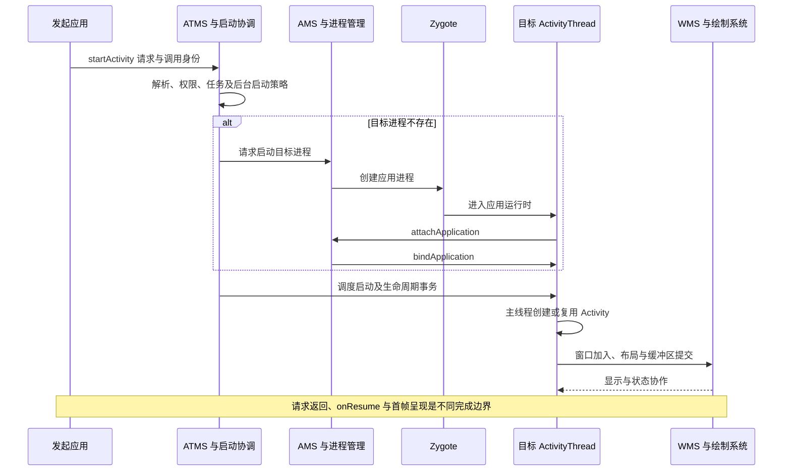

# Activity 启动原理

一次 `startActivity()` 不是直接创建 Activity 对象，而是提交启动请求：系统解析目标、校验权限、选择任务和进程，再调度应用主线程创建或复用界面。返回调用方不代表目标已 `onResume()`，更不代表首帧已经显示。

本文对应[原始提纲](https://alidocs.dingtalk.com/i/nodes/1OQX0akWmxaRZD7yfgRMaeOX8GlDd3mE)“四大组件 → Activity启动原理”，保留六个核心类型的顺序，修正 `ClientTrasaction` 为 `ClientTransaction`。实现基线为 AOSP **`android-16.0.0_r1`**，不将内部类当作应用 SDK，也不据此推断设备版本。

## ActivityThread {#s68}

`ActivityThread` 是应用进程的框架调度入口，不是 `Thread` 子类。它准备主线程消息循环，通过内部 `ApplicationThread` Binder 接口接收系统命令，再在主线程完成应用绑定、Activity/Service/Receiver/Provider 等组件相关工作。

启动 Activity 时，客户端事务最终进入 `handleLaunchActivity()` 与 `performLaunchActivity()` 等路径；后者取得 `LoadedApk`、准备组件 Context、创建 Activity、执行 attach 和生命周期调用。系统侧 `ActivityRecord` 与应用侧实例通过 Token 对应，不是跨进程共享同一个 Java 对象。[ActivityThread 源码](https://github.com/aosp-mirror/platform_frameworks_base/blob/android-16.0.0_r1/core/java/android/app/ActivityThread.java)

**进程启动与 Activity 创建是两个阶段。** 冷启动需要先创建进程、完成运行时与应用绑定；进程已存在时可以直接调度组件。也可能只是复用已有 Activity，此时不会再次构造实例。

## Instrumentation {#s71}

`Instrumentation` 同时参与应用向外发起启动和应用内部创建组件。典型入口 `execStartActivity()` 负责把请求交给系统；目标进程中的 `newActivity()`、`callActivityOnCreate()` 等方法参与实例化与生命周期调用。

它不是系统任务栈的最终决策者，也不能把一次客户端方法调用等同于系统已接受启动。现代实例化还涉及 `AppComponentFactory`；学习旧文章中的反射构造链时，应核对相应版本的工厂入口。[Instrumentation 源码](https://github.com/aosp-mirror/platform_frameworks_base/blob/android-16.0.0_r1/core/java/android/app/Instrumentation.java)

## ActivityStarter {#s74}

`ActivityStarter` 是 `system_server` 内组织一次启动决策的执行对象：结合调用者身份、Intent、解析结果、启动选项和当前任务状态，完成权限与策略检查、任务选择和后续调度。它经 `ActivityStartController` 等入口取得，不是普通应用自行创建的组件。

**解析出 Activity 不等于允许启动。** exported/权限、用户范围、后台启动限制、任务约束等仍可能使请求失败或改变行为。现代 Activity 管理核心在 ATMS 侧，不能把所有启动入口都画成 AMS 直接处理。[ActivityStarter 源码](https://github.com/aosp-mirror/platform_frameworks_base/blob/android-16.0.0_r1/services/core/java/com/android/server/wm/ActivityStarter.java)、[后台启动限制](https://developer.android.com/guide/components/activities/secure-bal)

## Task {#s77}

`Task` 表达系统侧的一组活动及其返回导航、组织和显示关系。它不是 Linux 进程，也不是一个 Java 调用栈；同一任务可包含不同应用的 Activity，同一应用的 Activity 也可能处于多个任务。

`launchMode`、Intent flags、task affinity 和启动来源共同影响新建、复用、移动与清栈。`singleTop` 仅在目标位于相应任务顶部且满足复用条件时复用；`singleTask` 等模式也必须结合任务位置与 flags 分析。实例复用通常通过 `onNewIntent()` 交付新请求，不应期待再次 `onCreate()`。[任务与返回栈](https://developer.android.com/guide/components/activities/tasks-and-back-stack)

配置变化重建、进程死亡后恢复和已有实例收到新 Intent 是不同场景。保存状态不能替代任务身份，静态变量也不能作为跨进程重启的可靠状态源。

## ActivityTaskSupervisor {#s80}

`ActivityTaskSupervisor` 参与活动与任务的跨对象协调。在 `startSpecificActivity()` 中，系统先检查目标进程的 `WindowProcessController` 是否已有可用应用线程：可用时进入 `realStartActivityLocked()`；不可用或远端失效时转入进程启动安排。

这里的“已有进程”是系统掌握的运行状态，不等于 Activity 已创建，也不保证 Binder 下一刻仍存活。源码明确包含远端异常后的回退路径。[ActivityTaskSupervisor 源码](https://github.com/aosp-mirror/platform_frameworks_base/blob/android-16.0.0_r1/services/core/java/com/android/server/wm/ActivityTaskSupervisor.java)

## ClientTransaction {#s83}

`ClientTransaction` 及其 item 将系统侧生命周期决策传给目标应用。`LaunchActivityItem` 承担启动相关工作，生命周期 item 驱动目标状态；`TransactionExecutor` 在客户端执行并按需要补齐中间状态。

Binder 接收与主线程执行之间有消息调度边界。事务已送达不等于 Activity 已执行完毕；事务也不提供数据库式原子提交与自动回滚。当前 item 模型及批量调度细节见 [ClientTransaction 专题](../framework/client-transaction.html)。

## 从请求到首帧的完整路径

下图用于总览阶段；包含 Launcher 点击入口、进程边界、主线程切换、Application / Provider 初始化、完整生命周期和绘制呈现的[完整时序图见 AMS / ATMS](./system-services.html#ams-atms-launch-sequence)。

图中省略 Binder 代理、内部锁、显示过渡和部分协作对象，展示的是阶段关系，不是每次启动都逐项发生的固定方法栈。任务复用、跨显示启动、进程启动失败和配置重建都会改变具体分支。

### 冷启动、温启动与热启动

- **冷启动**：目标进程尚不存在，额外经过进程创建与应用初始化。
- **温启动**：进程可能已在，但目标 Activity 仍需创建或恢复。
- **热启动**：已有界面实例可回到前台，可能主要发生状态切换与重新绘制。

这些术语用于性能分析时必须注明判定口径，不能只凭某次 `onCreate()` 是否出现判断全部启动成本。Provider 初始化、Application 初始化、资源与类加载也可能在首个 Activity 回调前消耗时间。

### 生命周期完成与窗口可见

`onCreate()`、`onStart()`、`onResume()` 描述 Activity 状态，首帧还要经过 View 树遍历、窗口/Surface 协作、缓冲区提交与显示合成。多窗口和多恢复场景也使“只有一个 Activity 处于 resumed”成为不可靠假设。[Activity 生命周期](https://developer.android.com/guide/components/activities/activity-lifecycle)

Token 与窗口归属见 [Activity Token](../framework/activity-token.html)，首帧后半段见 [SurfaceFlinger 与 VSYNC](../framework/surfaceflinger-vsync.html)。

## 排查时按失败阶段取证

1. **目标解析失败**：核对实际 Component、Intent filter、用户及包可见性，不先怀疑生命周期。
2. **系统拒绝启动**：检查异常和系统日志中的权限、exported、后台启动与任务策略信息。
3. **进程启动或初始化慢**：区分进程 attach、Provider/Application 初始化、类加载和磁盘访问。
4. **Activity 创建崩溃**：定位构造、attach、主题资源与生命周期中的首个异常原因。
5. **已 resumed 但没有内容**：继续查窗口、布局、绘制与 Surface 提交，不把生命周期回报当作可见证明。

设备上可先用 `adb shell getprop ro.build.version.release`、`adb shell getprop ro.build.version.sdk` 查询环境，再结合 `adb shell dumpsys activity activities` 与 `adb shell dumpsys window` 观察状态。本页未执行这些设备命令，不包含实测结论。
