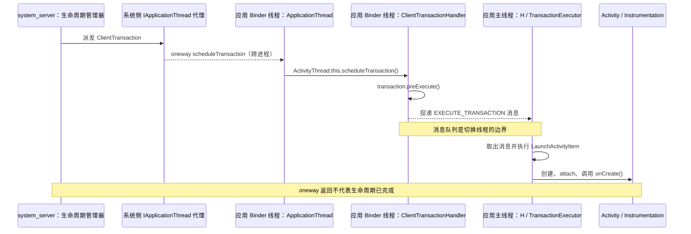
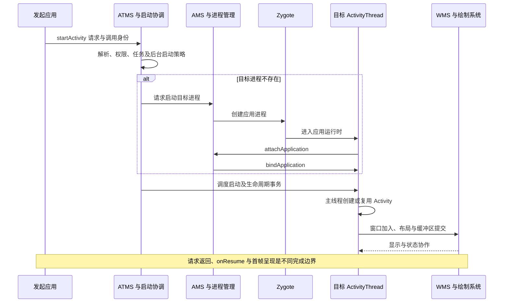

# Activity 启动原理

一次 `startActivity()` 不是直接创建 Activity 对象，而是提交启动请求：系统解析目标、校验权限、选择任务和进程，再调度应用主线程创建或复用界面。返回调用方不代表目标已 `onResume()`，更不代表首帧已经显示。


::: tip 源码阅读约定
以下 Java 代码节选自 AOSP `android-16.0.0_r1`，`// ...` 表示省略的实现，带“注”的中文注释解释关键调用。各段标明进程与所在方法，分支节选不表示每次启动都执行的固定调用栈。
:::

## ActivityThread {#s68}

`ActivityThread` 是应用进程的框架调度入口，不是 `Thread` 子类。它准备主线程消息循环，通过内部 `ApplicationThread` Binder 接口接收系统命令，再在主线程完成应用绑定、Activity/Service/Receiver/Provider 等组件相关工作。

启动 Activity 时，客户端事务最终进入 `handleLaunchActivity()` 与 `performLaunchActivity()` 等路径；后者取得 `LoadedApk`、准备组件 Context、创建 Activity、执行 attach 和生命周期调用。系统侧 `ActivityRecord` 与应用侧实例通过 Token 对应，不是跨进程共享同一个 Java 对象。[ActivityThread 源码](https://github.com/aosp-mirror/platform_frameworks_base/blob/android-16.0.0_r1/core/java/android/app/ActivityThread.java)

**进程启动与 Activity 创建是两个阶段。** 冷启动需要先创建进程、完成运行时与应用绑定；进程已存在时可以直接调度组件。也可能只是复用已有 Activity，此时不会再次构造实例。

### 应用进程入口与主线程调度

**定义与关键成员**位于 `core/java/android/app/ActivityThread.java`。普通应用进程中的这个对象既持有 Binder 接收端，也持有主线程 Handler 与事务执行器。

```java
public final class ActivityThread extends ClientTransactionHandler
        implements ActivityThreadInternal {
    // 注：系统通过这个 Binder 接口向应用提交事务。
    final ApplicationThread mAppThread = new ApplicationThread();
    // 注：H 绑定应用主线程的 Looper。
    final H mH = new H();
    private final TransactionExecutor mTransactionExecutor = new TransactionExecutor(this);
    // ...
}
```

核心方法：`main()` 准备主线程；`attach()` 将应用线程注册到 AMS；`handleLaunchActivity()` 处理 Launch 请求；`performLaunchActivity()` 完成实例创建和创建回调。`main()` 是**进程入口**，并非每启动一个 Activity 都重新执行。

```java
// ActivityThread.main(String[] args)，目标应用主线程
Looper.prepareMainLooper();
long startSeq = 0;
// ... 从 args 解析进程启动序号 startSeq
ActivityThread thread = new ActivityThread();
thread.attach(false, startSeq);
// ... 保存主线程 Handler、结束启动跟踪等
Looper.loop(); // 注：在当前主线程中循环分发消息，不是创建新线程。
```

`attach(false, startSeq)` 的普通应用分支中，关键调用如下；这里注册的是 `mAppThread`，不是把整个 ActivityThread 对象跨进程传给系统。

```java
// ActivityThread.attach() 的 !system 分支
RuntimeInit.setApplicationObject(mAppThread.asBinder());
final IActivityManager mgr = ActivityManager.getService();
try {
    mgr.attachApplication(mAppThread, startSeq); // 注：跨 Binder 到 AMS。
} catch (RemoteException ex) {
    throw ex.rethrowFromSystemServer();
}
```

源码定位：[类定义](https://android.googlesource.com/platform/frameworks/base/+/refs/tags/android-16.0.0_r1/core/java/android/app/ActivityThread.java#306)、[main](https://android.googlesource.com/platform/frameworks/base/+/refs/tags/android-16.0.0_r1/core/java/android/app/ActivityThread.java#9018)、[attach](https://android.googlesource.com/platform/frameworks/base/+/refs/tags/android-16.0.0_r1/core/java/android/app/ActivityThread.java#8730)。

### ApplicationThread 是什么，与 ActivityThread 有什么区别

`ApplicationThread` 是 `ActivityThread` 的非静态内部类，继承 AIDL 生成的 `IApplicationThread.Stub`，承担**应用进程向系统暴露的 Binder 命令接收端**。它既不是 `android.app.Application`，也不继承 `java.lang.Thread`，创建它不会启动一条新线程。

两者是**包含与委托关系**：`ActivityThread` 持有 `mAppThread`，负责进程内的组件管理与生命周期调度；`ApplicationThread` 实现跨进程接口，接到命令后调用外部 `ActivityThread` 的方法。可以把前者理解为应用端的框架协调者，后者理解为它对系统开放的通信入口，不能把这两个对象等同于两条线程。

```java
// ActivityThread.java，以下成员均位于 ActivityThread 类中。
private class ApplicationThread extends IApplicationThread.Stub {
    // ... 应用绑定、广播、Service 等命令的接收方法
    @Override
    public void scheduleTransaction(ClientTransaction transaction) throws RemoteException {
        // 注：这里的 this 是 ApplicationThread；显式调用外部 ActivityThread。
        ActivityThread.this.scheduleTransaction(transaction);
    }
    // ...
}

public ApplicationThread getApplicationThread()
{
    return mAppThread;
}
```

前面的 `attachApplication(mAppThread, startSeq)` 将这个 Binder 接口注册到 AMS。对于普通应用与 `system_server` 之间的远程通信，系统侧持有的是 `IApplicationThread` **代理**，应用侧才持有真正的 `ApplicationThread` Stub；系统不会取得应用中整个 `ActivityThread` 对象。`Instrumentation.execStartActivity()` 也通过 `getApplicationThread()` 提供调用方的应用接口，供系统识别请求来源。

源码定位：[内部类定义](https://android.googlesource.com/platform/frameworks/base/+/refs/tags/android-16.0.0_r1/core/java/android/app/ActivityThread.java#1143)、[scheduleTransaction](https://android.googlesource.com/platform/frameworks/base/+/refs/tags/android-16.0.0_r1/core/java/android/app/ActivityThread.java#2192)、[getApplicationThread](https://android.googlesource.com/platform/frameworks/base/+/refs/tags/android-16.0.0_r1/core/java/android/app/ActivityThread.java#3200)。

### 从 Binder 接收线程到应用主线程

`IApplicationThread.aidl` 声明的是 `oneway interface IApplicationThread`。跨进程调用通常由应用的 **Binder 线程池**接收，不会自动在主线程执行。以 Activity 启动事务为例，`ApplicationThread.scheduleTransaction()` 委托给外部对象继承自 `ClientTransactionHandler` 的方法，先执行 `preExecute()`，再投递 `H.EXECUTE_TRANSACTION`；主线程 Looper 取出消息后，才执行事务中的生命周期操作。



这里区分的是**调用所在线程**，不是把类固定绑定到某条线程：`ActivityThread.this.scheduleTransaction()` 在此仍运行于接收调用的 Binder 线程；真正的切换发生在消息投递与主线程分发之间。[后文的执行链](#binder-到主线程的执行链)给出入队、`H.handleMessage()` 与事务执行器的源码。

其他代表方法也体现了这种分工：`bindApplication()` 整理应用绑定数据后发送 `H.BIND_APPLICATION`，`scheduleReceiver()` 整理广播数据后发送 `H.RECEIVER`。但不能据此认为所有方法都只是转发消息：接收端可先更新状态、完成预处理，也有直接处理的操作。具体线程行为必须逐个方法核对，不能根据类名推断。

::: tip oneway 的准确含义
远程调用方不等待接收端方法执行完成，更不等待 `Activity.onCreate()` 或首帧完成；这不等于 Binder 传输没有开销，也不保证主线程不会阻塞或发生 ANR。如果是同进程的本地接口调用，AIDL 方法直接运行在调用者线程，`oneway` 不会自动创建异步任务。
:::

源码与线程规则：[IApplicationThread AIDL 声明](https://android.googlesource.com/platform/frameworks/base/+/refs/tags/android-16.0.0_r1/core/java/android/app/IApplicationThread.aidl#71)、[应用绑定入队](https://android.googlesource.com/platform/frameworks/base/+/refs/tags/android-16.0.0_r1/core/java/android/app/ActivityThread.java#1406)、[广播接收入队](https://android.googlesource.com/platform/frameworks/base/+/refs/tags/android-16.0.0_r1/core/java/android/app/ActivityThread.java#1149)、[官方 AIDL 线程说明](https://developer.android.com/develop/background-work/services/aidl)。

**为什么这样设计？** 从这条调用链可以理解其设计作用：

- **让系统能够回调应用。** 应用先向 AMS 注册 Binder 接口，系统随后通过统一的 `IApplicationThread` 协议下发组件命令；跨进程传递的是接口与数据，而不是应用内部的管理对象。
- **将通信接收与组件执行分开。** Binder 线程负责接收和必要的预处理，`ActivityThread`、`H` 与事务执行器承担进程内调度；Binder 接收端不必直接运行可能耗时的应用生命周期代码。
- **让生命周期与 UI 状态在主线程上有序推进。** 多个 Binder 线程可以接收调用，生命周期操作则通过主线程消息循环串行执行，减少并发修改组件状态的复杂度，并满足 UI 的线程约束。这个消息队列不替代系统侧的启动校验、生命周期状态机或完成回报机制。

### Activity 实例化与 onCreate

**调用处**是客户端 `LaunchActivityItem.execute()`，它创建 `ActivityClientRecord` 后调用 `client.handleLaunchActivity(...)`。实际接收者是 ActivityThread，随后进入它的私有方法 `performLaunchActivity()`。

```java
// ActivityThread.handleLaunchActivity(...)
// ... 更新配置、资源、图形环境等
final Activity a = performLaunchActivity(r, customIntent);
```

以下按 `performLaunchActivity()` 的原顺序摘出关键调用；普通应用的 ClassLoader 来自组件 Context，沙箱分支的加载器选择另有处理。

```java
// ActivityThread.performLaunchActivity(ActivityClientRecord r, Intent customIntent)
// ... 取得 LoadedApk、组件信息、activityBaseContext 和 ClassLoader cl
activity = mInstrumentation.newActivity(
        cl, component.getClassName(), r.intent); // 注：此处创建 Java Activity 实例。
// ... 创建/取得 Application app，准备窗口、配置和资源
activityBaseContext.setOuterContext(activity);
activity.attach(activityBaseContext, this, getInstrumentation(), r.token,
        r.ident, app, r.intent, r.activityInfo, title, r.parent,
        r.embeddedID, r.lastNonConfigurationInstances, config,
        r.referrer, r.voiceInteractor, window, r.activityConfigCallback,
        r.assistToken, r.shareableActivityToken, r.initialCallerInfoAccessToken);
// ... 处理主题、Intent、恢复信息等
r.activity = activity; // 注：在创建回调前，将实例挂到客户端记录。
if (r.isPersistable()) {
    mInstrumentation.callActivityOnCreate(activity, r.state, r.persistentState);
} else {
    mInstrumentation.callActivityOnCreate(activity, r.state);
}
// ... 检查是否调用了 super.onCreate()，更新客户端状态
```

这里的 `activity.attach()` 将 Context、Application、Token 和窗口等关联到实例；它与前面的 `ActivityThread.attach()` 是两个不同方法。`onStart()`、`onResume()` 由后续生命周期推进完成，不能加进这段代码就声称它们都由 `performLaunchActivity()` 直接执行。

源码定位：[Launch 调用处](https://android.googlesource.com/platform/frameworks/base/+/refs/tags/android-16.0.0_r1/core/java/android/app/servertransaction/LaunchActivityItem.java#214)、[handleLaunchActivity](https://android.googlesource.com/platform/frameworks/base/+/refs/tags/android-16.0.0_r1/core/java/android/app/ActivityThread.java#4437)、[performLaunchActivity](https://android.googlesource.com/platform/frameworks/base/+/refs/tags/android-16.0.0_r1/core/java/android/app/ActivityThread.java#4116)。

## Instrumentation {#s71}

`Instrumentation` 同时参与应用向外发起启动和应用内部创建组件。典型入口 `execStartActivity()` 负责把请求交给系统；目标进程中的 `newActivity()`、`callActivityOnCreate()` 等方法参与实例化与生命周期调用。

它不是系统任务栈的最终决策者，也不能把一次客户端方法调用等同于系统已接受启动。现代实例化还涉及 `AppComponentFactory`；学习旧文章中的反射构造链时，应核对相应版本的工厂入口。[Instrumentation 源码](https://github.com/aosp-mirror/platform_frameworks_base/blob/android-16.0.0_r1/core/java/android/app/Instrumentation.java)

```java
// core/java/android/app/Instrumentation.java
public class Instrumentation {
    // ... 请求发起、组件实例化及生命周期调度支持
}
```

核心方法：`execStartActivity()` 提交启动请求；`newActivity()` 通过组件工厂创建实例；`callActivityOnCreate()` 转入 Activity 的创建回调。跨应用进程启动时，两端分别使用各自进程中的 Instrumentation；同进程启动仍要经 ATMS 决策，可由该进程的同一 Instrumentation 参与请求和实例化。

### 请求入口：execStartActivity

**调用处**之一是发起方 `Activity.startActivityForResult()` 的 `mParent == null` 分支。普通 `startActivity()` 也会沿相应重载转入启动请求路径。

```java
// Activity.startActivityForResult(Intent intent, int requestCode, Bundle options)
Instrumentation.ActivityResult ar =
        mInstrumentation.execStartActivity(
                this, mMainThread.getApplicationThread(), mToken, this,
                intent, requestCode, options);
```

```java
// Instrumentation.execStartActivity(...)，发起方进程
// ... Intent 检查、ActivityMonitor 等处理
intent.migrateExtraStreamToClipData(who);
intent.prepareToLeaveProcess(who);
int result = ActivityTaskManager.getService().startActivity(whoThread,
        who.getOpPackageName(), who.getAttributionTag(), intent,
        intent.resolveTypeIfNeeded(who.getContentResolver()), token,
        target != null ? target.mEmbeddedID : null, requestCode, 0, null, options);
notifyStartActivityResult(result, options);
checkStartActivityResult(result, intent); // 注：检查系统返回的启动结果码。
```

`ActivityTaskManager.getService()` 返回 ATMS 的 Binder 接口；此处返回的结果码描述请求处理结果，不证明目标生命周期或绘制已完成。上层 `RemoteException` 处理等代码已省略。

源码定位：[Activity 调用处](https://android.googlesource.com/platform/frameworks/base/+/refs/tags/android-16.0.0_r1/core/java/android/app/Activity.java#5992)、[execStartActivity](https://android.googlesource.com/platform/frameworks/base/+/refs/tags/android-16.0.0_r1/core/java/android/app/Instrumentation.java#1951)。

### 目标实例：newActivity 与 callActivityOnCreate

**调用处**均为目标进程的 `ActivityThread.performLaunchActivity()`，与上一小节的“发起请求”属于不同阶段。

```java
// Instrumentation.java
public Activity newActivity(ClassLoader cl, String className, Intent intent)
        throws InstantiationException, IllegalAccessException, ClassNotFoundException {
    String pkg = intent != null && intent.getComponent() != null
            ? intent.getComponent().getPackageName() : null;
    return getFactory(pkg).instantiateActivity(cl, className, intent);
}

public void callActivityOnCreate(Activity activity, Bundle icicle) {
    prePerformCreate(activity);
    activity.performCreate(icicle); // 注：再由 Activity 内部调用业务 onCreate()。
    postPerformCreate(activity);
}
```

默认工厂 `AppComponentFactory.instantiateActivity()` 的核心返回语句是 `(Activity) cl.loadClass(className).newInstance()`；应用配置的组件工厂可以改变实例化行为。`Activity.performCreate()` 会根据是否有持久化状态调用相应的 `onCreate()` 重载，并执行周边框架工作。

源码定位：[newActivity](https://android.googlesource.com/platform/frameworks/base/+/refs/tags/android-16.0.0_r1/core/java/android/app/Instrumentation.java#1437)、[callActivityOnCreate](https://android.googlesource.com/platform/frameworks/base/+/refs/tags/android-16.0.0_r1/core/java/android/app/Instrumentation.java#1519)、[默认组件工厂](https://android.googlesource.com/platform/frameworks/base/+/refs/tags/android-16.0.0_r1/core/java/android/app/AppComponentFactory.java#92)、[Activity.performCreate](https://android.googlesource.com/platform/frameworks/base/+/refs/tags/android-16.0.0_r1/core/java/android/app/Activity.java#9132)。

## ActivityStarter {#s74}

`ActivityStarter` 是 `system_server` 内组织一次启动决策的执行对象：结合调用者身份、Intent、解析结果、启动选项和当前任务状态，完成权限与策略检查、任务选择和后续调度。它经 `ActivityStartController` 等入口取得，不是普通应用自行创建的组件。

**解析出 Activity 不等于允许启动。** exported/权限、用户范围、后台启动限制、任务约束等仍可能使请求失败或改变行为。现代 Activity 管理核心在 ATMS 侧，不能把所有启动入口都画成 AMS 直接处理。[ActivityStarter 源码](https://github.com/aosp-mirror/platform_frameworks_base/blob/android-16.0.0_r1/services/core/java/com/android/server/wm/ActivityStarter.java)、[后台启动限制](https://developer.android.com/guide/components/activities/secure-bal)

```java
// services/core/java/com/android/server/wm/ActivityStarter.java
class ActivityStarter {
    // ... 一次启动请求的参数、解析结果和任务选择状态
}
```

核心方法：`execute()` 执行已配置请求；`executeRequest()` 处理解析后的请求与策略；`startActivityUnchecked()` 协调窗口布局及过渡；`startActivityInner()` 计算启动状态、选择任务并进入后续调度。名字中的 `Unchecked` 不表示可以绕过此前的权限检查。

### 启动器来源与执行入口

**调用处**是 `ActivityTaskManagerService.startActivityAsUser()`。源码通过 `ActivityStartController` 获取并配置 ActivityStarter，而非直接把 Intent 发给某个 Activity 实例。

```java
// ActivityStartController.java
ActivityStarter obtainStarter(Intent intent, String reason) {
    return mFactory.obtain().setIntent(intent).setReason(reason);
}

// ActivityTaskManagerService.startActivityAsUser(...)，system_server
return getActivityStartController().obtainStarter(intent, "startActivityAsUser")
        .setCaller(caller)
        .setCallingPackage(callingPackage)
        .setCallingFeatureId(callingFeatureId)
        .setResolvedType(resolvedType)
        .setResultTo(resultTo)
        .setResultWho(resultWho)
        .setRequestCode(requestCode)
        .setStartFlags(startFlags)
        .setProfilerInfo(profilerInfo)
        .setActivityOptions(opts)
        .setUserId(userId)
        .execute();
```

进入正常启动分支后，方法级阅读顺序是 `execute()` → `executeRequest()` → `startActivityUnchecked()` → `startActivityInner()`。中间仍有检查、早返回、过渡处理与异常路径；Starter 在执行结束后会回收复用，不应继续持有并修改这次请求对象。

源码定位：[获取 Starter](https://android.googlesource.com/platform/frameworks/base/+/refs/tags/android-16.0.0_r1/services/core/java/com/android/server/wm/ActivityStartController.java#128)、[ATMS 调用处](https://android.googlesource.com/platform/frameworks/base/+/refs/tags/android-16.0.0_r1/services/core/java/com/android/server/wm/ActivityTaskManagerService.java#1299)、[execute](https://android.googlesource.com/platform/frameworks/base/+/refs/tags/android-16.0.0_r1/services/core/java/com/android/server/wm/ActivityStarter.java#800)、[executeRequest](https://android.googlesource.com/platform/frameworks/base/+/refs/tags/android-16.0.0_r1/services/core/java/com/android/server/wm/ActivityStarter.java#1042)。

### 任务选择后的关键调用

以下是 `startActivityInner()` 中的两处调用，源码中间的显示、焦点和分支处理已省略；第二处位于需要恢复且满足相关焦点条件的分支内。

```java
// ActivityStarter.startActivityInner(...)
final boolean isTaskSwitch = startedTask != prevTopTask;
mTargetRootTask.startActivityLocked(mStartActivity, topRootTask, newTask, isTaskSwitch,
        mOptions, sourceRecord);
// ... mDoResume、焦点、覆盖层、任务前移等条件判断
mRootWindowContainer.resumeFocusedTasksTopActivities(
        mTargetRootTask, mStartActivity, mOptions, mTransientLaunch);
```

前者处理 Task 内活动的组织及启动相关准备，后者推动可恢复任务的顶层 Activity。遇到已有实例复用、无需恢复或不允许抢占焦点的情况，后续路径不同，不保证新建客户端 Activity。

源码定位：[startActivityUnchecked](https://android.googlesource.com/platform/frameworks/base/+/refs/tags/android-16.0.0_r1/services/core/java/com/android/server/wm/ActivityStarter.java#1672)、[startActivityInner](https://android.googlesource.com/platform/frameworks/base/+/refs/tags/android-16.0.0_r1/services/core/java/com/android/server/wm/ActivityStarter.java#1875)、[Task 调用处](https://android.googlesource.com/platform/frameworks/base/+/refs/tags/android-16.0.0_r1/services/core/java/com/android/server/wm/ActivityStarter.java#2080)。

## Task {#s77}

`Task` 表达系统侧的一组活动及其返回导航、组织和显示关系。它不是 Linux 进程，也不是一个 Java 调用栈；同一任务可包含不同应用的 Activity，同一应用的 Activity 也可能处于多个任务。

`launchMode`、Intent flags、task affinity 和启动来源共同影响新建、复用、移动与清栈。`singleTop` 仅在目标位于相应任务顶部且满足复用条件时复用；`singleTask` 等模式也必须结合任务位置与 flags 分析。实例复用通常通过 `onNewIntent()` 交付新请求，不应期待再次 `onCreate()`。[任务与返回栈](https://developer.android.com/guide/components/activities/tasks-and-back-stack)

配置变化重建、进程死亡后恢复和已有实例收到新 Intent 是不同场景。保存状态不能替代任务身份，静态变量也不能作为跨进程重启的可靠状态源。

```java
// services/core/java/com/android/server/wm/Task.java，system_server
class Task extends TaskFragment {
    // ... 系统侧任务与窗口容器状态
}
```

核心方法：`startActivityLocked()` 处理启动相关的任务位置、可见性和过渡准备；`moveToFront()` 参与任务前移；`resumeTopActivityUncheckedLocked()` 是恢复顶层活动的外层入口，继续进入 `resumeTopActivityInnerLocked()` 与 TaskFragment 的恢复逻辑。`Locked` 是内部锁约定，不能理解成该方法会自动加锁。

### 启动准备：调整任务中的位置

**调用处**是前文 `ActivityStarter.startActivityInner()`；下面仅保留 `Task.startActivityLocked()` 的前部逻辑，`r` 是系统侧 ActivityRecord。

```java
void startActivityLocked(@NonNull ActivityRecord r, @Nullable Task topTask, boolean newTask,
        boolean isTaskSwitch, @Nullable ActivityOptions options,
        @Nullable ActivityRecord sourceRecord) {
    final boolean allowMoveToFront = options == null || !options.getAvoidMoveToFront();
    final Task activityTask = r.getTask();
    final boolean isThisOrHasChildTask = activityTask == this || hasChild(activityTask);
    if (!r.mLaunchTaskBehind && allowMoveToFront && (!isThisOrHasChildTask || newTask)) {
        positionChildAtTop(activityTask); // 注：操作系统侧任务容器的位置。
    }
    // ... 可见性检查、启动窗口及过渡准备
}
```

源码定位：[Task 类定义](https://android.googlesource.com/platform/frameworks/base/+/refs/tags/android-16.0.0_r1/services/core/java/com/android/server/wm/Task.java#208)、[startActivityLocked](https://android.googlesource.com/platform/frameworks/base/+/refs/tags/android-16.0.0_r1/services/core/java/com/android/server/wm/Task.java#5278)。

### 从任务恢复到具体 Activity

**调用入口**是 `RootWindowContainer.resumeFocusedTasksTopActivities()`；下面依次列出不同方法中的关键行，方法名写在注释中，省略的条件不能忽略。

```java
// RootWindowContainer.resumeFocusedTasksTopActivities(...) 的目标任务分支
result = targetRootTask.resumeTopActivityUncheckedLocked(target, targetOptions,
        deferPause);

// Task.resumeTopActivityUncheckedLocked(...) 的可见、可聚焦叶任务分支
someActivityResumed = resumeTopActivityInnerLocked(prev, options, deferPause);

// Task.resumeTopActivityInnerLocked(...)
final TaskFragment topFragment = topActivity.getTaskFragment();
// ... 处理其他满足恢复条件的叶 TaskFragment
resumed[0] |= topFragment.resumeTopActivity(prev, options, deferPause);

// TaskFragment.resumeTopActivity(...) 的需要启动/重启活动分支
mTaskSupervisor.startSpecificActivity(next, true, true);
```

这里必须经过 **TaskFragment 的恢复逻辑**，不能把 `Task.startActivityLocked()` 画成直接调用 `ActivityThread.handleLaunchActivity()`。已有可恢复客户端实例时，TaskFragment 可发送恢复事务；需要启动或重启实例时，才进入上面的 `startSpecificActivity()` 分支。

源码定位：[RootWindowContainer](https://android.googlesource.com/platform/frameworks/base/+/refs/tags/android-16.0.0_r1/services/core/java/com/android/server/wm/RootWindowContainer.java#2452)、[Task 外层恢复](https://android.googlesource.com/platform/frameworks/base/+/refs/tags/android-16.0.0_r1/services/core/java/com/android/server/wm/Task.java#5142)、[Task 内层恢复](https://android.googlesource.com/platform/frameworks/base/+/refs/tags/android-16.0.0_r1/services/core/java/com/android/server/wm/Task.java#5217)、[TaskFragment 调用处](https://android.googlesource.com/platform/frameworks/base/+/refs/tags/android-16.0.0_r1/services/core/java/com/android/server/wm/TaskFragment.java#1740)。

## ActivityTaskSupervisor {#s80}

`ActivityTaskSupervisor` 参与活动与任务的跨对象协调。在 `startSpecificActivity()` 中，系统先检查目标进程的 `WindowProcessController` 是否已有可用应用线程：可用时进入 `realStartActivityLocked()`；不可用或远端失效时转入进程启动安排。

这里的“已有进程”是系统掌握的运行状态，不等于 Activity 已创建，也不保证 Binder 下一刻仍存活。源码明确包含远端异常后的回退路径。[ActivityTaskSupervisor 源码](https://github.com/aosp-mirror/platform_frameworks_base/blob/android-16.0.0_r1/services/core/java/com/android/server/wm/ActivityTaskSupervisor.java)

```java
// services/core/java/com/android/server/wm/ActivityTaskSupervisor.java
public class ActivityTaskSupervisor implements RecentTasks.Callbacks {
    // ... 活动启动、恢复时机、空闲和任务协作
}
```

核心方法：`startSpecificActivity()` 判断是否有可用进程；`realStartActivityLocked()` 协调实际启动、配置和状态；本标签中的 **`tryRealStartActivityInner()`** 负责组装 Launch item 与目标生命周期 item，并尝试派发。不要将内部辅助方法归属写成其他版本的实现。

### 进程分支：startSpecificActivity

**调用处**之一是上一节的 `TaskFragment.resumeTopActivity()`。以下保留普通应用的关键分支，省略沙箱活动的专门中止逻辑和日志。

```java
void startSpecificActivity(ActivityRecord r, boolean andResume, boolean checkConfig) {
    final WindowProcessController wpc =
            mService.getProcessController(r.processName, r.info.applicationInfo.uid);
    boolean knownToBeDead = false;
    if (wpc != null && wpc.hasThread()) {
        try {
            realStartActivityLocked(r, wpc, andResume, checkConfig);
            return;
        } catch (RemoteException e) {
            // ... 记录远端失败；随后走重启进程路径
        }
        knownToBeDead = true;
        mService.mProcessNames.remove(wpc.mName, wpc.mUid);
        mService.mProcessMap.remove(wpc.getPid());
    }
    // ... 沙箱专门分支、可见性通知
    final boolean isTop = andResume && r.isTopRunningActivity();
    mService.startProcessAsync(r, knownToBeDead, isTop,
            isTop ? HostingRecord.HOSTING_TYPE_TOP_ACTIVITY
                    : HostingRecord.HOSTING_TYPE_ACTIVITY);
}
```

`startProcessAsync()` 是进程启动安排，不是直接 `new Activity()`。冷启动还需 AMS、Zygote 和进程 attach / bind 等协作；进程附着后的启动安排及初始化时序见后面的完整路径链接。

源码定位：[startSpecificActivity](https://android.googlesource.com/platform/frameworks/base/+/refs/tags/android-16.0.0_r1/services/core/java/com/android/server/wm/ActivityTaskSupervisor.java#1129)、[realStartActivityLocked](https://android.googlesource.com/platform/frameworks/base/+/refs/tags/android-16.0.0_r1/services/core/java/com/android/server/wm/ActivityTaskSupervisor.java#808)。

### 组装并派发 Launch 事务

`realStartActivityLocked()` 在完成前置准备后调用内部方法：

```java
// ActivityTaskSupervisor.realStartActivityLocked(...)
final RemoteException e = tryRealStartActivityInner(
        task, r, proc, activityClientController, andResume);
// ... 按远端失败、重试及目标生命周期更新系统侧状态
```

下列代码来自 `tryRealStartActivityInner()`。Launch 与 Resume 是两种独立 item；若此次无需恢复，目标状态也可以选择 Pause 或 Stop。

```java
// ActivityTaskSupervisor.tryRealStartActivityInner(...)
final LaunchActivityItem launchActivityItem = new LaunchActivityItem(r.token,
        r.intent, System.identityHashCode(r), r.info,
        procConfig, overrideConfig, deviceId,
        r.getFilteredReferrer(r.launchedFromPackage), task.voiceInteractor,
        proc.getReportedProcState(), r.getSavedState(), r.getPersistentSavedState(),
        results, newIntents, r.takeSceneTransitionInfo(), isTransitionForward,
        proc.createProfilerInfoIfNeeded(), r.assistToken, activityClientController,
        r.shareableActivityToken, r.getLaunchedFromBubble(), fragmentToken,
        r.initialCallerInfoAccessToken, activityWindowInfo);
final ActivityLifecycleItem lifecycleItem;
if (andResume) {
    lifecycleItem = new ResumeActivityItem(r.token, isTransitionForward,
            r.shouldSendCompatFakeFocus());
} else if (r.isVisibleRequested()) {
    lifecycleItem = new PauseActivityItem(r.token);
} else {
    lifecycleItem = new StopActivityItem(r.token);
}
// ... 特定兼容性策略下先派发此前积累的 pending transaction
// 注：下列调用位于 try 中，失败还有 catch / 状态回退处理。
isSuccessful = mService.getLifecycleManager().scheduleTransactionItems(
        proc.getThread(), true /* shouldDispatchImmediately */,
        launchActivityItem, lifecycleItem);
```

`proc.getThread()` 是目标应用的 `IApplicationThread` Binder 接口。此处明确要求立即派发，以便及时处理进程通信失败；生命周期管理器的其他调用可积累 pending item，不能概括为所有事务都一创建就立刻发送。

源码定位：[内部方法定义](https://android.googlesource.com/platform/frameworks/base/+/refs/tags/android-16.0.0_r1/services/core/java/com/android/server/wm/ActivityTaskSupervisor.java#970)、[item 构造与发送处](https://android.googlesource.com/platform/frameworks/base/+/refs/tags/android-16.0.0_r1/services/core/java/com/android/server/wm/ActivityTaskSupervisor.java#1017)。

## ClientTransaction {#s83}

`ClientTransaction` 及其 item 将系统侧生命周期决策传给目标应用。`LaunchActivityItem` 承担启动相关工作，生命周期 item 驱动目标状态；`TransactionExecutor` 在客户端执行并按需要补齐中间状态。

Binder 接收与主线程执行之间有消息调度边界。事务已送达不等于 Activity 已执行完毕；事务也不提供数据库式原子提交与自动回滚。当前 item 模型及批量调度细节见 [ClientTransaction 专题](../framework/client-transaction.html)。

```java
// core/java/android/app/servertransaction/ClientTransaction.java
public class ClientTransaction implements Parcelable {
    // ... 目标 IApplicationThread、按顺序排列的 transaction items 等
}
```

核心方法：`addTransactionItem()` 追加 item；`schedule()` 向客户端提交事务；`preExecute()` 在客户端正式入主线程队列前做准备。`Parcelable` 负责数据跨进程传递，执行器另由客户端持有，事务对象本身不是线程或 Binder 服务。

### 事务容器与发送

**调用处**是 `ClientLifecycleManager.scheduleTransactionItems()`：取得目标客户端对应的待发事务，循环调用 `addTransactionItem()`；根据立即派发参数和布局时机，最终进入 `ClientLifecycleManager.scheduleTransaction()`，后者调用下面的 `transaction.schedule()`。

```java
// ClientTransaction.java
public void addTransactionItem(@NonNull ClientTransactionItem item) {
    mTransactionItems.add(item); // 注：当前执行模型使用这个顺序列表。
    // ... 同步维护旧 callback / lifecycle 字段，兼容 UnsupportedAppUsage
}

@Nullable
public RemoteException schedule() {
    try {
        mClient.scheduleTransaction(this); // 注：跨 Binder 调用应用的 ApplicationThread。
        return null;
    } catch (RemoteException e) {
        return e; // 注：本标签将通信失败作为返回值交给上层处理。
    }
}
```

源码定位：[容器及追加方法](https://android.googlesource.com/platform/frameworks/base/+/refs/tags/android-16.0.0_r1/core/java/android/app/servertransaction/ClientTransaction.java#121)、[schedule](https://android.googlesource.com/platform/frameworks/base/+/refs/tags/android-16.0.0_r1/core/java/android/app/servertransaction/ClientTransaction.java#243)、[生命周期管理器组装处](https://android.googlesource.com/platform/frameworks/base/+/refs/tags/android-16.0.0_r1/services/core/java/com/android/server/wm/ClientLifecycleManager.java#155)、[立即派发判断](https://android.googlesource.com/platform/frameworks/base/+/refs/tags/android-16.0.0_r1/services/core/java/com/android/server/wm/ClientLifecycleManager.java#234)。

### Binder 到主线程的执行链

下面按接收顺序列出不同类中的片段。`ApplicationThread` 是 `ActivityThread` 的内部类，继承 `IApplicationThread.Stub`；它接收 Binder 调用，随后调用继承自 `ClientTransactionHandler` 的调度方法。

```java
// ActivityThread.ApplicationThread.scheduleTransaction(...)
public void scheduleTransaction(ClientTransaction transaction) throws RemoteException {
    ActivityThread.this.scheduleTransaction(transaction);
}

// ClientTransactionHandler.java
void scheduleTransaction(ClientTransaction transaction) {
    transaction.preExecute(this); // 注：此阶段还没有执行 Activity.onCreate()。
    sendMessage(ActivityThread.H.EXECUTE_TRANSACTION, transaction);
}

// ActivityThread.H.handleMessage(...)，从这里开始由主线程分发
case EXECUTE_TRANSACTION:
    final ClientTransaction transaction = (ClientTransaction) msg.obj;
    final ClientTransactionListenerController controller =
            ClientTransactionListenerController.getInstance();
    controller.onClientTransactionStarted();
    try {
        mTransactionExecutor.execute(transaction);
    } finally {
        controller.onClientTransactionFinished();
    }
    // ... 后续清理与 break
```

`TransactionExecutor.executeTransactionItems()` 遍历列表，将生命周期 item 与其他 item 分开处理；处理 Launch 这样的非生命周期 item 时，执行到以下调用：

```java
// TransactionExecutor.executeNonLifecycleItem(...)
// ... 按需要推进执行前的生命周期状态
item.execute(mTransactionHandler, mPendingActions);
item.postExecute(mTransactionHandler, mPendingActions);

// LaunchActivityItem.execute(...)，目标应用主线程
final ActivityClientRecord r = new ActivityClientRecord(mActivityToken, mIntent, mIdent,
        mInfo, mOverrideConfig, mReferrer, mVoiceInteractor, mState, mPersistentState,
        mPendingResults, mPendingNewIntents, mSceneTransitionInfo, mIsForward,
        mProfilerInfo, client, mAssistToken, mShareableActivityToken, mLaunchedFromBubble,
        mTaskFragmentToken, mInitialCallerInfoAccessToken, mActivityWindowInfo);
client.handleLaunchActivity(r, pendingActions, mDeviceId, null /* customIntent */);
```

至此回到本文第一节的 `ActivityThread.handleLaunchActivity()`。后续 Resume item 会按生命周期路径补齐 Start 等中间状态，再执行恢复阶段；Launch 完成不能作为 Resume 完成或首帧呈现的证据。

具体补齐发生在 `TransactionExecutor.executeLifecycleItem()`：先根据客户端记录的当前状态调用 `cycleToPath(..., targetState, true, ...)`，最后再执行目标 item 的 `execute()` 与 `postExecute()`。例如 Activity 已完成创建、目标是 Resume，路径会先进入 `handleStartActivity()`，再由 Resume item 完成恢复。`excludeLastState = true` 让最后一步交给带有该次参数的 item，避免通用路径先执行一次、item 又执行一次；因此不能只搜索 `LaunchActivityItem` 就认定 `onStart()` 缺失。[生命周期推进实现](https://github.com/aosp-mirror/platform_frameworks_base/blob/android-16.0.0_r1/core/java/android/app/servertransaction/TransactionExecutor.java#L146)

源码定位：[ApplicationThread](https://android.googlesource.com/platform/frameworks/base/+/refs/tags/android-16.0.0_r1/core/java/android/app/ActivityThread.java#2192)、[客户端入队](https://android.googlesource.com/platform/frameworks/base/+/refs/tags/android-16.0.0_r1/core/java/android/app/ClientTransactionHandler.java#55)、[H 消息分发](https://android.googlesource.com/platform/frameworks/base/+/refs/tags/android-16.0.0_r1/core/java/android/app/ActivityThread.java#2817)、[执行器](https://android.googlesource.com/platform/frameworks/base/+/refs/tags/android-16.0.0_r1/core/java/android/app/servertransaction/TransactionExecutor.java#95)、[LaunchActivityItem](https://android.googlesource.com/platform/frameworks/base/+/refs/tags/android-16.0.0_r1/core/java/android/app/servertransaction/LaunchActivityItem.java#214)。

## 从请求到首帧的完整路径

下图用于总览阶段；包含 Launcher 点击入口、进程边界、主线程切换、Application / Provider 初始化、完整生命周期和绘制呈现的[完整时序图见 AMS / ATMS](./system-services/ams-atms.html#ams-atms-launch-sequence)。



图中省略 Binder 代理、内部锁、显示过渡和部分协作对象，展示的是阶段关系，不是每次启动都逐项发生的固定方法栈。任务复用、跨显示启动、进程启动失败和配置重建都会改变具体分支。

### 冷启动、温启动与热启动

- **冷启动**：目标进程尚不存在，额外经过进程创建与应用初始化。
- **温启动**：进程可能已在，但目标 Activity 仍需创建或恢复。
- **热启动**：已有界面实例可回到前台，可能主要发生状态切换与重新绘制。

这些术语用于性能分析时必须注明判定口径，不能只凭某次 `onCreate()` 是否出现判断全部启动成本。Provider 初始化、Application 初始化、资源与类加载也可能在首个 Activity 回调前消耗时间。

### 生命周期完成与窗口可见

`onCreate()`、`onStart()`、`onResume()` 描述 Activity 状态，首帧还要经过 View 树遍历、窗口/Surface 协作、缓冲区提交与显示合成。多窗口和多恢复场景也使“只有一个 Activity 处于 resumed”成为不可靠假设。[Activity 生命周期](https://developer.android.com/guide/components/activities/activity-lifecycle)

Token 与窗口归属见 [Activity Token](../framework/activity-token.html)，首帧后半段见 [SurfaceFlinger 与 VSYNC](../framework/surfaceflinger-vsync.html)。

## 排查时按失败阶段取证

1. **目标解析失败**：核对实际 Component、Intent filter、用户及包可见性，不先怀疑生命周期。
2. **系统拒绝启动**：检查异常和系统日志中的权限、exported、后台启动与任务策略信息。
3. **进程启动或初始化慢**：区分进程 attach、Provider/Application 初始化、类加载和磁盘访问。
4. **Activity 创建崩溃**：定位构造、attach、主题资源与生命周期中的首个异常原因。
5. **已 resumed 但没有内容**：继续查窗口、布局、绘制与 Surface 提交，不把生命周期回报当作可见证明。

设备上可先用 `adb shell getprop ro.build.version.release`、`adb shell getprop ro.build.version.sdk` 查询环境，再结合 `adb shell dumpsys activity activities` 与 `adb shell dumpsys window` 观察状态。

原始笔记：[Android 基础知识提纲](https://alidocs.dingtalk.com/i/nodes/1OQX0akWmxaRZD7yfgRMaeOX8GlDd3mE)。
