# Android 打包与签名：从构建到更新安装

**打包决定 APK 里有什么，签名用于验证受保护内容及签名者身份。覆盖更新还要证明：新包有资格接替旧包。**

## 1. 源码怎样变成可安装的 APK {#build-flow}

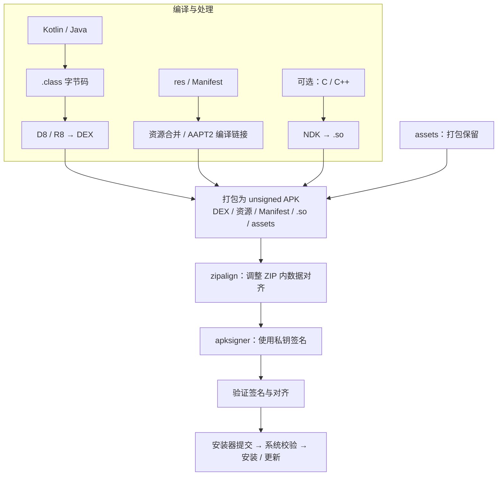

- **D8** 将字节码变成 DEX；启用优化时，**R8** 承担收缩、优化、混淆及 DEX 生成。代码任务与资源任务存在依赖，图中按产物分支简化。
- **AAPT2** 处理资源；Manifest 合并是构建过程中的另一环，不要把源码 XML 原样复制与最终二进制 Manifest 混淆。
- **zipalign 不签名**，主要让未压缩数据适合直接映射读取；它也不能替代原生库自身的 ELF 页面对齐。

Android 工程一般让 Gradle 完成整条链。手工流程要记住：**修改 / 打包 → 对齐 → 签名 → 验证；签名后修改受保护内容会使验签失败。** 可追加的扩展元数据见[渠道包原理](#channel-metadata)。

[D8](https://developer.android.com/tools/d8)、[AAPT2](https://developer.android.com/tools/aapt2)、[R8](https://developer.android.com/topic/performance/app-optimization/enable-app-optimization)、[zipalign](https://developer.android.com/tools/zipalign)

## 2. 私钥、证书、签名分别是什么 {#crypto-model}

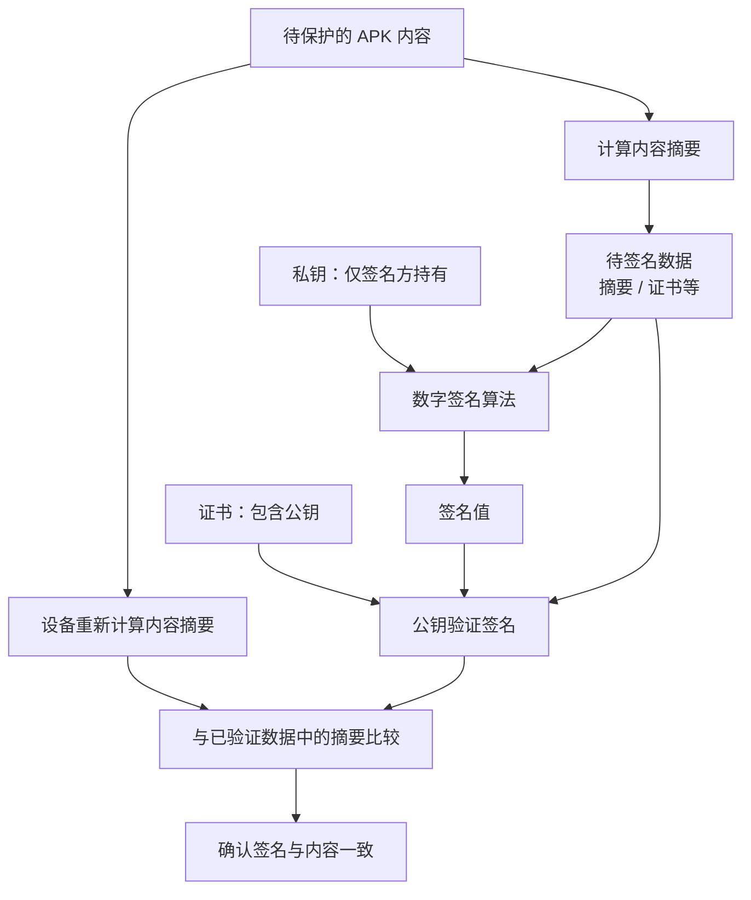

| 名称 | 保存什么 | 使用时关心什么 |
| --- | --- | --- |
| 私钥 | 签名能力 | 必须备份并限制访问；APK 不应包含它 |
| X.509 证书 | 公钥与证书信息 | 随签名发布，可用于识别签名身份 |
| KeyStore / alias | 密钥容器 / 容器中的条目名 | 改文件名或 alias 不等于更换密钥 |
| 证书 SHA-256 指纹 | 证书编码的摘要 | 不等于整个 APK 的哈希，也不等于签名算法 |

**签名不是“把 APK 加密”，也不是所有算法都能解释成“私钥加密哈希”。** 安装时的签名校验不会证明应用没有恶意行为；Android 应用证书也不依赖浏览器 HTTPS 那套公开 CA 身份背书。

[应用签名与证书](https://developer.android.com/studio/publish/app-signing#certificates-keystores)

## 3. 旧签名与新签名，区别在哪里 {#schemes}

这里的 **v1 / v2 / v3 是签名方案**；RSA、ECDSA、ML-DSA 是算法，debug / release 是构建与签名配置，不能混为一谈。

| 方案 | 平台开始支持 | 主要存放位置 | 解决的重点 |
| --- | --- | --- | --- |
| v1 | Android 早期即支持 | ZIP 内 `META-INF/` | JAR 方式验证条目，兼容老设备 |
| v2 | Android 7.0 / API 24 | APK Signing Block | 保护 APK 主体与 ZIP 结构，减少逐条解压验证开销 |
| v3 | Android 9 / API 28 | APK Signing Block | 在 v2 思路上加入密钥轮换证明、SDK 范围等 |
| v3.1 | Android 13 / API 33 | 独立的 v3.1 子块 | 按系统版本使用旧密钥或轮换密钥 |
| v3.2 | Android 17 / API 37 | 独立的 v3.2 子块 | 经典算法与后量子算法组成混合签名 |
| v4 | Android 11 / API 30 | APK 外的 `.apk.idsig` | 支持增量安装时按块验证，仍依赖 v2/v3 |

**这些方案可以共存。v4 的数字最大，并不代表能删掉 v2/v3；v3.2 的平台支持也不代表本机旧版构建工具已经能生成它。**

### v1：逐个条目建立校验关系

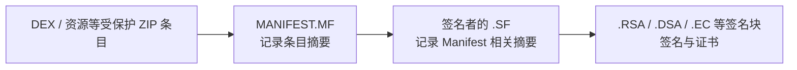

这些文件位于 `META-INF/`；扩展名取决于密钥与工具。v1 主要保护条目内容，**不能像 v2 一样覆盖 ZIP 元数据等结构**。

### v2 / v3：签名块不再只是一个 ZIP 文件条目

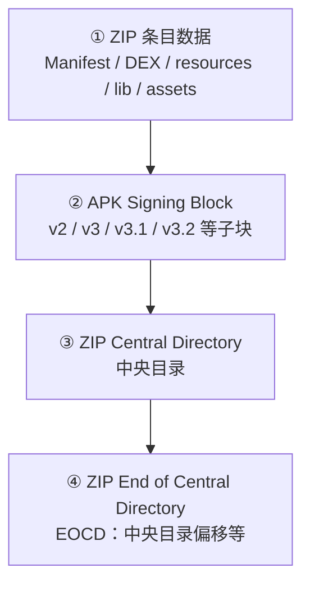

**Signing Block 位于中央目录之前，不是 `META-INF` 下的普通文件。** “v2 整包签名”是概括：其内容摘要覆盖①③④，排除签名块本身，并按规范处理 EOCD 中的目录偏移；子块里的 signed data 另由数字签名保护。

### v4：给增量安装配一棵校验树

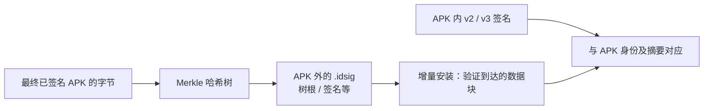

不要把 **增量安装** 与“下载一个差分补丁”混为一谈。`.idsig` 与最终 APK 的字节绑定；重新签名、写入渠道信息等改变 APK 字节后，需要重新生成对应数据。

[v1 与整体签名](https://source.android.com/docs/security/features/apksigning)、[v2 格式](https://source.android.com/docs/security/features/apksigning/v2)、[v3](https://source.android.com/docs/security/features/apksigning/v3)、[v3.1](https://source.android.com/docs/security/features/apksigning/v3-1)、[v4](https://source.android.com/docs/security/features/apksigning/v4)

## 4. 系统怎样确认 APK 没被改过 {#verification}

以 v2 为例，需要过两道关：**签名值正确，且实际 APK 摘要与签名保护的摘要一致。** 只验证证书或只比较文件哈希都不够。

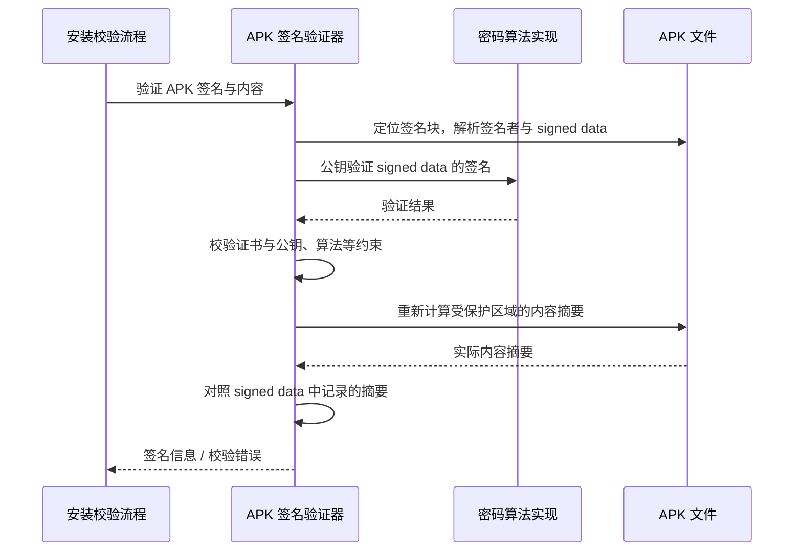

v2 会将受保护区域分成至多 **1 MiB（2²⁰ 字节）** 的块，计算块摘要，再汇总；它不是直接对整包只调用一次 SHA-256。签名算法和内容摘要算法也需要按签名记录选择。

<details>
<summary>展开 AOSP 核心代码：验证签名与验证内容是两步</summary>

`android-16.0.0_r1` 的 `core/java/android/util/apk/ApkSignatureSchemeV2Verifier.java`，`verifySigner()` L284～290 节选，省略参数配置与异常处理：

```java
Signature sig = Signature.getInstance(jcaSignatureAlgorithm);
sig.initVerify(publicKey);                     // L285：初始化验签公钥
// 部分算法还需要设置参数，此处省略。
sig.update(signedData);                        // L289：待验证的数据
sigVerified = sig.verify(bestSigAlgorithmSignatureBytes); // L290
```

同类的 `verify(...)` 在 L216 另外验证实际 APK 内容：

```java
ApkSigningBlockUtils.verifyIntegrity(contentDigests, apk, signatureInfo);
// 重新算 APK 内容摘要，并对照签名记录中的摘要；不是仅看证书存在。
```

[AOSP 源码](https://android.googlesource.com/platform/frameworks/base/+/refs/tags/android-16.0.0_r1/core/java/android/util/apk/ApkSignatureSchemeV2Verifier.java#284)

</details>

### 新方案失败后，会偷偷退回 v1 吗

**找不到相应签名块**与**找到但验证失败**是两回事。平台会结合支持的方案、最低方案要求和防剥离标记决定是否继续检查旧方案，不能理解为“v3 验不过，就换 v2/v1 试到通过”。

Android 16 的 `ApkSignatureVerifier.verifyV3AndBelowSignatures()` 在 L201 / L220 / L238 串起 v3、v2、v1；回退分支针对 `SignatureNotFoundException` 并检查最低方案要求。

v3.1 在 v3 验证器中处理；v3.2 属于更新平台的扩展，不能套用这份 Android 16 调用链。

[验证器源码](https://android.googlesource.com/platform/frameworks/base/+/refs/tags/android-16.0.0_r1/core/java/android/util/apk/ApkSignatureVerifier.java#196)

## 5. 先辨清：你要“替换”的是什么 {#replacement-choice}

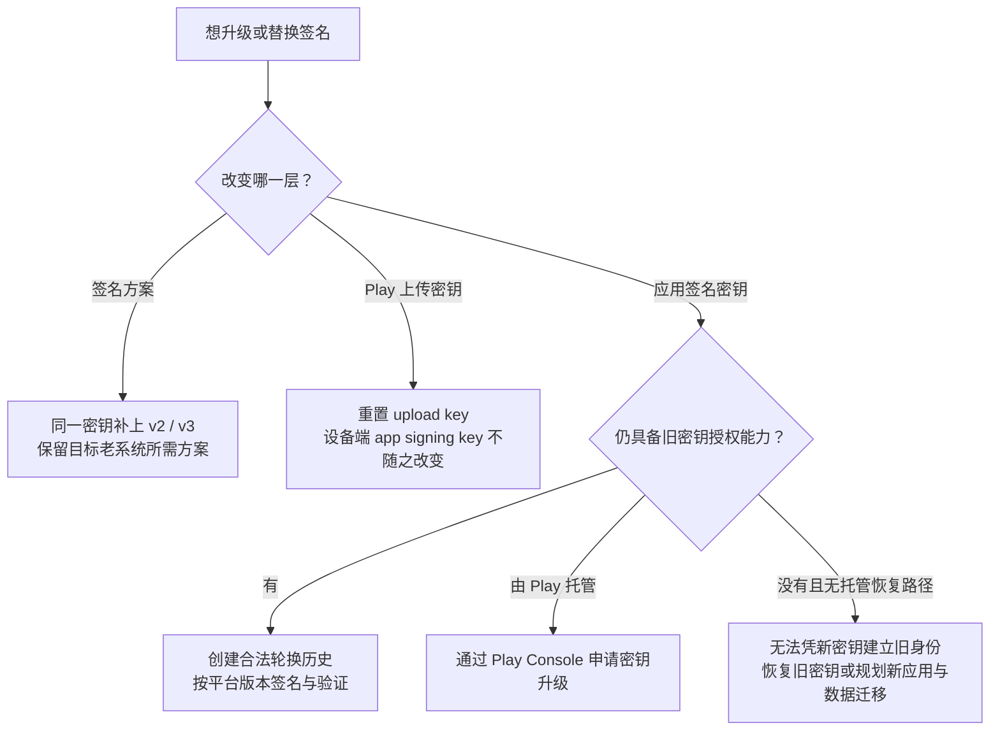

**覆盖更新不只看包名。** 同一 `applicationId` 的更新还要满足签名身份或平台认可的轮换关系，以及版本、SDK、split 一致性等安装要求。普通发布应提高 `versionCode`；签名正确也不保证所有安装条件都满足。

debug 与 release 通常使用不同密钥，不能直接互相覆盖。单纯把旧签名文件删掉，再换新证书签名，**不会获得接替已安装旧包的资格**。

## 6. 实操：对齐、签名、验证 {#sign-apk}

以下在 **Android 应用工程**执行。Android Studio 可用 **Generate Signed App Bundle / APK**；自动化构建则配置 Gradle 的 release 签名。

手工签名需要 JDK 的 `keytool` 和 SDK Build Tools 的 `zipalign`、`apksigner` 在 PATH 中。

### 第一步：生成密钥，确认它保存在哪里

```powershell
keytool -genkeypair -keystore release.jks -alias app -keyalg RSA -keysize 3072 -validity 10000
keytool -list -v -keystore release.jks -alias app
```

交互输入密码和证书信息。这里 RSA 3072 是示例选择，不是 APK 强制算法。保管私钥容器及密码；证书导出文件不能恢复私钥。正式密钥不要放进 Git，CI 通过受控凭据注入。

### 第二步：先对齐，再签名

从构建产物取得 `app-release-unsigned.apk`；不要把 AAB 改扩展名当作 APK。

```powershell
zipalign -P 16 -f -v 4 app-release-unsigned.apk app-aligned.apk
apksigner sign --ks release.jks --ks-key-alias app --out app-release.apk app-aligned.apk
```

`-P 16` 对未压缩 `.so` 做 16 KiB 页面对齐；最后的 `4` 是其他相关未压缩数据的字节对齐。`--out` 保留输入文件，便于对照。让工具依据 Manifest 的 `minSdkVersion` 等信息选择兼容方案，不要为了“只用最新签名”随意关掉旧系统需要的方案。

### 第三步：同时验证签名、证书和对齐

```powershell
apksigner verify --verbose --print-certs app-release.apk
zipalign -c -P 16 -v 4 app-release.apk
```

重点看：**命令是否成功、哪些方案有效、证书 SHA-256 是否符合预期**。某项 `Verified using ...: false` 可能只是没有该方案，不能脱离设备范围与总体结果认定失败。单看 `keytool -printcert -jarfile` 也不能代替 APK v2/v3 校验。

命令已用本机 **Build Tools 36.1.0**、临时实验密钥和最小 APK 验证。`-P 16` 需要支持该参数的工具；这不是设备安装实测。

[签名工具与参数](https://developer.android.com/tools/apksigner)、[对齐参数](https://developer.android.com/tools/zipalign)

## 7. 真正更换应用密钥：旧钥授权新钥 {#key-rotation}

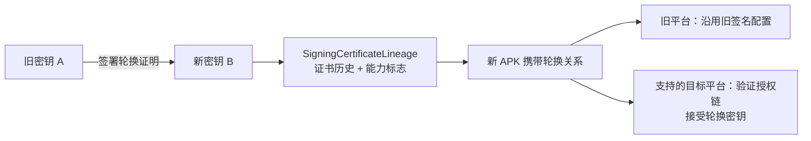

轮换证明由旧私钥授权建立，不是把两张证书简单拼接。历史证书还关联 installed-data、permission 等能力；**能更新应用，不表示所有证书比对 API、signature 权限及第三方 SDK 都会自动适配。**

### v3 与 v3.1：轮换从哪个系统开始生效

- v3 从 API 28 开始具备轮换能力，但较早系统存在兼容边界。普通迁移优先规划 API 33+ 的轮换路径。
- v3.1 可让同一 APK 在 API 33+ 使用新密钥，在较早系统继续使用旧配置。**`--rotation-min-sdk-version` 控制轮换生效范围，不是修改应用的 `minSdkVersion`。**
- 如果已经在 API 28～32 使用过轮换密钥，后续包要延续相应历史，不能不经评估又切回 API 33 默认路径。

### 创建轮换历史，再用新旧配置签 APK

下面假设旧密钥位于 `release-old.jks`，新密钥位于 `release-new.jks`，alias 都为 `app`；输入 APK 已对齐。密码交互输入，命令使用 PowerShell 单行形式：

```powershell
apksigner rotate --out signing.lineage --old-signer --ks release-old.jks --ks-key-alias app --new-signer --ks release-new.jks --ks-key-alias app
apksigner sign --ks release-old.jks --ks-key-alias app --next-signer --ks release-new.jks --ks-key-alias app --lineage signing.lineage --rotation-min-sdk-version 33 --out app-rotated.apk app-aligned.apk
```

这里 `--next-signer` 配合 lineage 提供不同平台使用的签名配置，**不等于把两个互不相关的签名者同时加上，就能兼容旧安装**。上例保留旧私钥，供早期平台对应的签名块使用。

分别检查两个平台范围：

```powershell
apksigner verify --verbose --print-certs --min-sdk-version 24 --max-sdk-version 32 app-rotated.apk
apksigner verify --verbose --print-certs --min-sdk-version 33 app-rotated.apk
```

此处 24 是实验 APK 的最低版本；实际检查应覆盖自己应用声明与承诺支持的范围。本机实验中，24～32 对应旧证书，33+ 对应新证书及 v3.1。验签工具通过后，还需用旧版真实安装包进行更新测试，覆盖保留数据、signature 权限、登录及 App Links 等关联功能。

<details>
<summary>展开 AOSP：为什么“历史里有旧证书”还涉及能力标志</summary>

Android 16 的 `SigningDetails.checkCapability()`，L625～638，核心分支节选：

```java
if (oldDetails.mSignatures.length > 1) {
    return signaturesMatchExactly(oldDetails); // 多签名者不是普通密钥轮换
} else {
    return hasCertificate(oldDetails.mSignatures[0], flags);
    // 检查历史证书，并确认授予所请求的能力，不是只比较包名。
}
```

省略 UNKNOWN 检查。这是系统内部类型，展示能力判断原理，不是让普通 App 调用隐藏接口。[源码](https://android.googlesource.com/platform/frameworks/base/+/refs/tags/android-16.0.0_r1/core/java/android/content/pm/SigningDetails.java#625)

</details>

[v3 轮换](https://source.android.com/docs/security/features/apksigning/v3)、[v3.1 兼容机制](https://source.android.com/docs/security/features/apksigning/v3-1)、[apksigner 轮换命令](https://developer.android.com/tools/apksigner#usage)

## 8. Play App Signing：上传密钥与安装签名分开 {#play-signing}

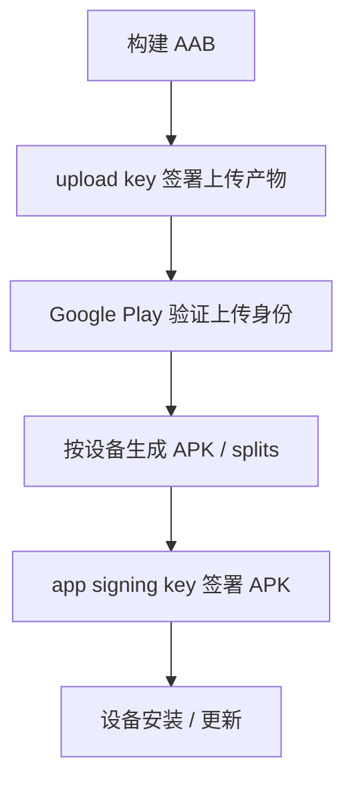

**AAB 是发布格式，设备安装的是生成的 APK。** `apksigner` 用于 APK，AAB 使用 Gradle / Android Studio 的相应签名流程；手工签 AAB 使用 JAR 签名工具，不能套用上面的 APK 命令。

- **丢 upload key**：在 Play Console 按流程重置上传密钥；不会因此更换设备端的 app signing key。
- **升级 app signing key**：使用 Play 提供的密钥升级流程，确认系统版本与其他分发渠道的覆盖关系；本地换一把上传密钥不等于完成升级。
- **配置 API / App Links**：使用分发渠道实际 APK 的应用签名证书指纹。把 upload 证书误填成设备端证书，常表现为本地正常、Play 下载后失败。

[Play 签名与密钥升级](https://developer.android.com/studio/publish/app-signing)、[AAB](https://developer.android.com/guide/app-bundle)

## 9. 新增的 v3.2：为什么不是再换一个哈希算法 {#hybrid-signing}

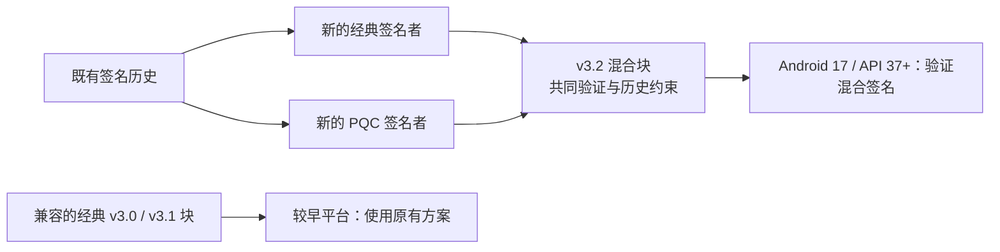

官方 v3.2 规范要求**两个签名者组成混合块**：经典算法与 PQC 算法共同工作，并满足 SDK 范围及签名历史要求；不是随便配置两个 RSA 密钥。过渡还涉及平台处理的隐式身份轮换。

保持对旧系统的支持需要相应的经典签名块。不能把普通 `--next-signer` 示例当作 v3.2 生成方式；应先确认签名工具及分发平台的支持。本篇实测工具链与前述源码节分别是 Build Tools 36.1.0、AOSP Android 16，**未声称已实测 v3.2**。

[官方 v3.2 规范](https://source.android.com/docs/security/features/apksigning/v3-2)

## 10. 渠道包：为什么签名后还能写渠道信息 {#channel-metadata}

**常见快速渠道方案利用签名覆盖边界与扩展机制，不是破解私钥或跳过验签。** 普通渠道包也可以在构建时通过不同配置写入渠道，再分别签名；这种方式没有“签名后修改”的问题。

### 仅 v1：ZIP comment 不参与 JAR 条目签名

旧方案可将渠道写进 ZIP comment，而不改变受 v1 保护的条目。但 **v2 保护 EOCD，不能继续照搬修改 ZIP comment 的方式**；同一个 APK 同时带 v1/v2 时，也不能只看 v1 仍然有效就判断整个包有效。

### v2：在 Signing Block 容器中放独立渠道条目

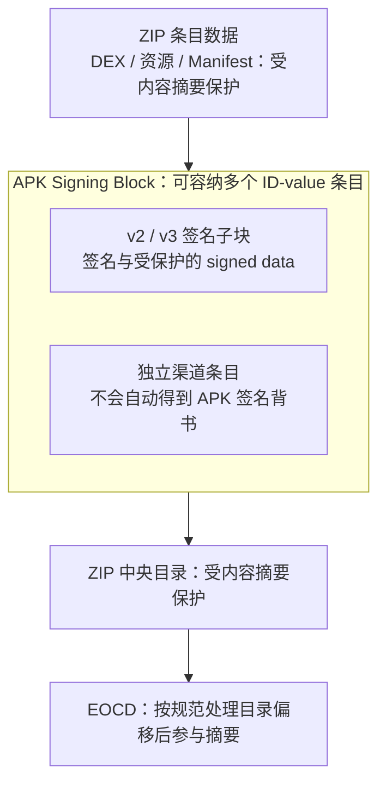

以 Walle 的 v2 渠道方案为例，渠道信息是容器中独立的自定义条目。原 v2 签名子块及其保护的数据保持有效；验证器按规范忽略未知 ID，而不是把渠道值当作签名者授权的内容。

这里有两个关键设计：

- **内容摘要排除整个 Signing Block 容器**，其中签名子块的 signed data 另有数字签名保护；自定义渠道条目没有因此被保护。
- 签名块变大可能移动中央目录。**EOCD 计算摘要时，对目录偏移有规范化处理**，因此不能把文件位置改变简单等同于内容摘要必然改变。

所以，“v2 整包签名”不等于“签名后每个字节都不能变”。它也不允许随意修改 DEX、资源、Manifest 或签名子块中的受保护内容。

### 渠道字段能相信到什么程度

**验签通过，只证明签名覆盖的内容有效，不能证明渠道值由原签名者填写。** 渠道可用于统计归因；如果它影响授权、计费或权益，需要另行认证来源及完整性。

渠道产物仍应检查 APK 验签和对齐。已有 v4 `.idsig` 或外部整文件哈希时，还需与最终 APK 对应；不能把 v2 的扩展方式直接推导为所有完整性检查都不受影响。重新运行签名工具也可能移除渠道扩展，产物生成顺序需要以工具行为为准。

[AOSP：签名保护范围与 EOCD 处理](https://source.android.com/docs/security/features/apksigning/v2#integrity-protected-contents)、[Walle 原理与注意事项](https://github.com/Meituan-Dianping/walle)

## 11. 出问题时，按哪一层排查 {#troubleshooting}

| 现象 | 先确认 | 常见处理方向 |
| --- | --- | --- |
| APK 签名验证失败 | 签名后是否改过受保护内容、工具支持和完整错误 | 回到最终产物，重新对齐、签名、验证 |
| 新包能验签，覆盖安装失败 | 新旧包名、证书 / lineage、版本与 splits | 合法验签与合法更新分开检查 |
| 本地可用，Play 包登录 / 链接失败 | 实际分发证书与服务端指纹配置 | 区分 debug、upload、app signing 证书 |
| 换 alias 后仍是相同签名 | 证书指纹与实际密钥条目 | alias 是容器内名字，不是签名身份 |
| 新密钥签名成功，但旧用户无法升级 | 是否有平台认可的旧钥授权与兼容配置 | 轮换 / Play 升级流程，不能靠删旧签名解决 |
