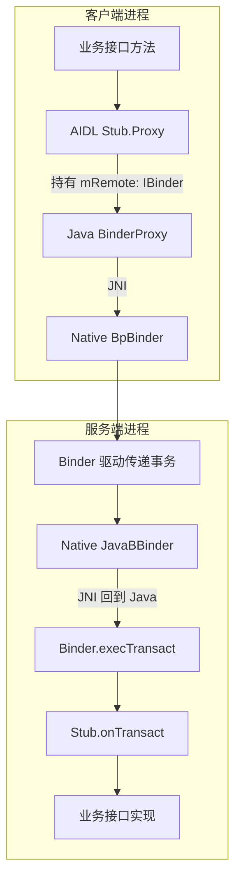

# Binder 通信机制

Binder 让一个进程持有另一个进程中对象的可调用引用。学习它先要分清业务接口、远端代理和本地实体，再沿一次事务连接 Java、JNI、Native 与驱动。

本文保留[原始基础提纲](https://alidocs.dingtalk.com/i/nodes/1OQX0akWmxaRZD7yfgRMaeOX8GlDd3mE)的 Java 层、Native 层及各类型顺序；内核事务、线程池、内存与服务发现见 [Framework / Binder 机制](../framework/binder-mechanism.html)。

::: info 阅读基线
实现关系参考 AOSP **`android-16.0.0_r1`** 的 Java Binder 与 `libbinder`，讨论经典 kernel Binder 路径。源码版本是阅读基线，不代表任何设备的实际环境。Binder RPC、NDK 与 Rust 后端有不同的运行时入口，不能机械套用全部 Java 调用链。
:::

## Java 层

### IBinder 接口

`IBinder` 表示可执行 Binder 事务的对象，提供 `transact()`、`queryLocalInterface()` 和死亡通知等通用能力。它不定义业务方法；事务码与 Parcel 数据才是传输层看到的请求。应用应优先使用生成的接口，避免手写编解码协议。[IBinder 官方参考](https://developer.android.com/reference/android/os/IBinder)

持有 `IBinder` 不等于服务一定存活，也不等于获得全部业务权限。`isBinderAlive()` 只能反映检查时的状态，下一次调用仍可能失败；远端死亡通知用于清理连接，业务端还需处理调用异常。

### Binder 类

Java `Binder` 是本地 `IBinder` 实现，也是 Java AIDL 服务端 `Stub` 的父类。生成的 `Stub.onTransact()` 读取事务码和参数、分派业务方法并编码回复。应用通常继承 `Stub` 实现业务接口，无需另写一套 `onTransact()`。[AIDL 官方指南](https://developer.android.com/develop/background-work/services/aidl)

`Binder` 对象不等于 Android `Service` 组件。前者是通信端点；后者由系统管理生命周期，可以在 `onBind()` 返回端点供客户端连接。一个服务进程可以持有多个 Binder 对象。

对于经驱动进入的远程请求，业务入口一般运行在服务进程 Binder 线程池中；本地接口直接调用则留在调用线程。服务实现必须同时考虑两种路径，不能假设方法总在主线程执行。

### BinderProxy 类

`BinderProxy` 是 Java 层远端 `IBinder` 的运行时实现，用于应用和系统服务的远端对象。典型 Java AIDL 客户端有两层代理：生成的 `Stub.Proxy` 负责业务协议，它的 `mRemote` 持有 `IBinder`，远程场景中通常就是 `BinderProxy`；后者经 JNI 连接 Native `BpBinder`。[BinderProxy 源码](https://github.com/aosp-mirror/platform_frameworks_base/blob/android-16.0.0_r1/core/java/android/os/BinderProxy.java)

因此，**`Stub.Proxy`、`mRemote` 与 `BinderProxy` 不是同一个概念**。`mRemote` 是字段，`Stub.Proxy` 与它是组合关系；不要把生成的业务代理理解为 `BinderProxy` 子类。

这张图表示跨进程 Java Binder 的常见路径。本地接口被 `asInterface()` 识别后可以直接返回实现对象，跳过代理编解码与驱动传输。

### IInterface 接口

`IInterface` 是 Java AIDL 业务接口的共同父接口，核心方法 `asBinder()` 返回底层 `IBinder`。业务接口回答“支持什么方法”，`IBinder` 回答“通过哪个通信对象发事务”。[IInterface 官方参考](https://developer.android.com/reference/android/os/IInterface)

例如，`IExample.Stub.asInterface(binder)` 把通信对象适配为业务接口：本地匹配时返回实现，远程时返回生成的代理；`service.asBinder()` 则取回其底层通信对象。`IExample` 是说明用名称，不是系统现成接口，也不是把任意 Binder 强制转换成任意协议的方法。

## Native 层

### IBinder.h 接口

Native `android::IBinder` 同样抽象 Binder 对象的事务与引用相关能力，但它是 C++ 类型，不能与 Java `IBinder` 当作同一对象。Java/Native 之间通过 JNI 包装与映射衔接。阅读入口为 [`libs/binder/include/binder/IBinder.h`](https://android.googlesource.com/platform/frameworks/native/+/refs/tags/android-16.0.0_r1/libs/binder/include/binder/IBinder.h)。

要区分这一层的 `libbinder` C++ 接口与面向稳定接口的 NDK 后端。AIDL 的 Java、CPP、NDK、Rust 后端使用不同生成结果和运行时，类型名相似并不表示可互换。[AIDL 后端说明](https://source.android.com/docs/core/architecture/aidl/aidl-backends)

### BpBinder

在经典 kernel Binder 路径中，`BpBinder` 表示远端 Binder 对象，持有当前进程中的远端 handle，通过 `IPCThreadState` 提交事务。handle 属于进程自己的引用空间，不能当作跨进程通用 ID 保存或比较。[BpBinder 源码](https://android.googlesource.com/platform/frameworks/native/+/refs/tags/android-16.0.0_r1/libs/binder/BpBinder.cpp)

生成的 C++ 业务代理与 `BpBinder` 也分工不同：前者了解接口方法和参数，后者提供通用远端事务能力。它们对应的抽象层次，与 Java 中业务 Proxy 和 BinderProxy 的分工相似。

### BBinder

`BBinder` 是 Native 本地 Binder 实体的基础实现。对于 Java 服务端，JNI 桥接类 **`JavaBBinder` 继承 `BBinder`** 并持有 Java Binder 的引用，再回调 Java 事务分派。[JNI 桥接源码](https://github.com/aosp-mirror/platform_frameworks_base/blob/android-16.0.0_r1/core/jni/android_util_Binder.cpp)

原提纲“Stub 对应 BBinder”可作角色类比，但不是直接继承或对象等同：Java `Stub → Binder`，Native `JavaBBinder → BBinder`，两侧由 JNI 联系。纯 Native 服务通常由对应业务的本地接口基类承担解包分派，未必经过 Java。

## 一次调用如何返回

1. 客户端从绑定回调或合法的服务获取入口得到 `IBinder`，用匹配的 `Stub.asInterface()` 构造业务接口。
2. 远程业务代理把方法参数写入 Parcel，以事务码调用底层 `transact()`。
3. Binder 运行时和驱动定位目标，服务端解包并执行实现；同步事务随后编码结果或可传递的异常。
4. 客户端代理读取回复，返回业务结果。`oneway` 远程事务不等待业务结果，需要独立回调或消息协议确认完成。

普通本地接口调用与远程调用在线程、参数共享和异常路径上存在差别。不要用本地测试通过推导跨进程线程安全；也不要把远程 `oneway` 的行为套到本地调用。相关约束见 [AIDL 线程与 oneway 语义](https://developer.android.com/develop/background-work/services/aidl)。

## 学习检查点

- 能否指出 `Stub.Proxy.mRemote` 的声明类型、远端常见实现，以及它与业务 Proxy 的关系？
- 能否分别画出 Java 与 Native 的继承关系，再用 JNI 连接，而不是画一条跨语言继承线？
- 如果本地 `asInterface()` 返回真实实现，执行线程是否仍然是 Binder 线程池？
- 如果事务失败，连接清理、重试与业务幂等分别由谁处理？

继续阅读 [Handler 原理](./handler.html)，理解服务收到事务后如何把工作切换到指定线程；再读 [Messenger 机制](./messenger.html)，把两种机制组合起来。
