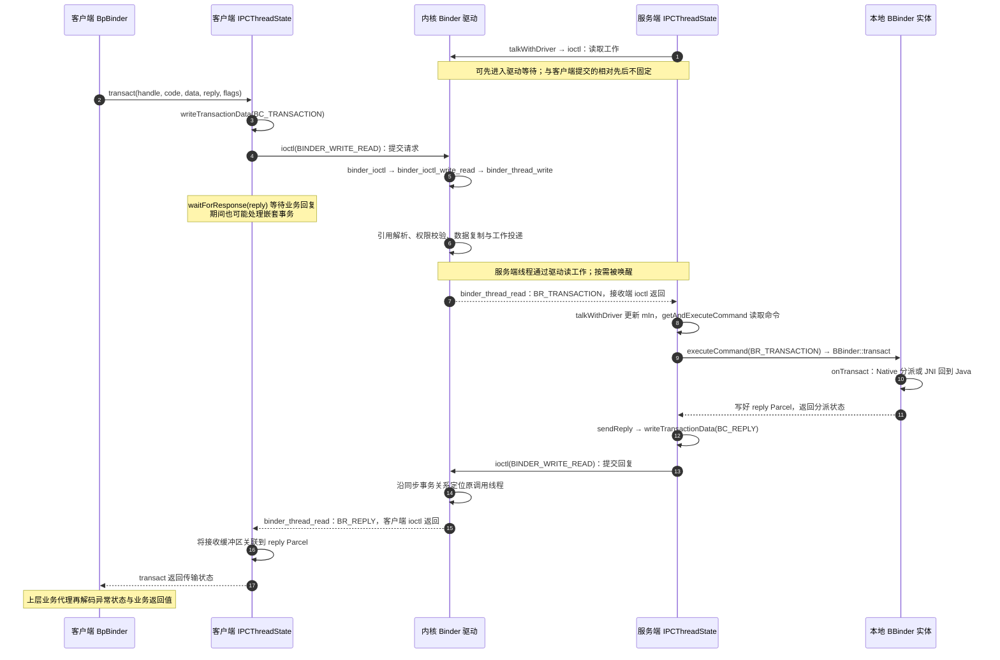

# Binder 通信机制

Binder 让一个进程持有另一个进程中对象的可调用引用。学习它先要分清业务接口、远端代理和本地实体，再沿一次事务连接 Java、JNI、Native 与驱动。

Java 代理经 JNI 连接 Native Binder 运行时，再由内核驱动路由到服务端。内核事务、线程池、内存与服务发现见 [Framework / Binder 机制](../framework/binder-mechanism.html)。

::: info 阅读基线
Java Binder 与 `libbinder` 源码取自 AOSP `android-16.0.0_r1`，驱动源码取自 Android Common Kernel `android16-6.12-2025-06_r1`。以下讨论经典 kernel Binder 路径；Binder RPC 使用不同的传输入口。
:::

## IPC 方式与场景选型

[Android IPC：通信方式、选型与关键代码](./ipc-methods.html)将 Binder 放到完整的进程通信体系中，对比 AIDL、Messenger、Intent / Broadcast、ContentProvider、文件描述符、SharedMemory 与 Socket，并给出独立进程配置、双端关键代码及资源管理要求。先明确“远程调用、事件、数据查询还是大内容传输”，再阅读下面的 Binder 实现。

## Java 层

### IBinder 接口

`IBinder` 表示可执行 Binder 事务的对象，提供 `transact()`、`queryLocalInterface()` 和死亡通知等通用能力。它不定义业务方法；事务码与 Parcel 数据才是传输层看到的请求。应用应优先使用生成的接口，避免手写编解码协议。[IBinder 官方参考](https://developer.android.com/reference/android/os/IBinder)

持有 `IBinder` 不等于服务一定存活，也不等于获得全部业务权限。`isBinderAlive()` 只能反映检查时的状态，下一次调用仍可能失败；远端死亡通知用于清理连接，业务端还需处理调用异常。

### Binder 类

Java `Binder` 是本地 `IBinder` 实现，也是 Java AIDL 服务端 `Stub` 的父类。生成的 `Stub.onTransact()` 读取事务码和参数、分派业务方法并编码回复。应用通常继承 `Stub` 实现业务接口，无需另写一套 `onTransact()`。[AIDL 官方指南](https://developer.android.com/develop/background-work/services/aidl)

`Binder` 对象不等于 Android `Service` 组件。前者是通信端点；后者由系统管理生命周期，可以在 `onBind()` 返回端点供客户端连接。一个服务进程可以持有多个 Binder 对象。

对于经驱动进入的远程请求，业务入口一般运行在服务进程 Binder 线程池中；本地接口直接调用则留在调用线程。服务实现必须同时考虑两种路径，不能假设方法总在主线程执行。

### BinderProxy 类

`BinderProxy` 是 Java 层远端 `IBinder` 的运行时实现，用于应用和系统服务的远端对象。典型 Java AIDL 客户端有两层代理：生成的 `Stub.Proxy` 负责业务协议，它的 `mRemote` 持有 `IBinder`，远程场景中通常就是 `BinderProxy`；后者经 JNI 连接 Native `BpBinder`。[BinderProxy 源码](https://github.com/aosp-mirror/platform_frameworks_base/blob/android-16.0.0_r1/core/java/android/os/BinderProxy.java)

因此，**`Stub.Proxy`、`mRemote` 与 `BinderProxy` 不是同一个概念**。`mRemote` 是字段，`Stub.Proxy` 与它是组合关系；不要把生成的业务代理理解为 `BinderProxy` 子类。


<a href="/assets/android/basics/binder/native-request-flow.svg" download="binder-native-request-flow.svg">下载 Binder 请求流程矢量图</a>。

这张图表示跨进程 Java Binder 的**请求方向**。第 6 → 7 步是客户端提交 ioctl；第 12 → 13 步是驱动把命令返回给服务端的 ioctl。第 11 → 12 步表示工作队列交接，**不是 `binder_transaction()` 直接调用接收线程的 `binder_thread_read()`**。编号表示这次请求的数据处理顺序，不表示全系统线程执行的绝对时间。

服务端线程通常已沿 `joinThreadPool()` → `getAndExecuteCommand()` → `talkWithDriver()` 进入驱动读取工作，可能先阻塞等待；第 13 步表示其读取调用返回，随后才读取 `mIn` 并执行命令。驱动不直接调用 Java/C++ 业务方法；同步回复见后文时序图。本地接口被 `asInterface()` 识别后可直接返回实现对象，跳过代理编解码与驱动传输。

### IInterface 接口

`IInterface` 是 Java AIDL 业务接口的共同父接口，核心方法 `asBinder()` 返回底层 `IBinder`。业务接口回答“支持什么方法”，`IBinder` 回答“通过哪个通信对象发事务”。[IInterface 官方参考](https://developer.android.com/reference/android/os/IInterface)

例如，`IExample.Stub.asInterface(binder)` 把通信对象适配为业务接口：本地匹配时返回实现，远程时返回生成的代理；`service.asBinder()` 则取回其底层通信对象。`IExample` 是说明用名称，不是系统现成接口，也不是把任意 Binder 强制转换成任意协议的方法。

## Native 层

### IBinder.h 接口

Native `android::IBinder` 同样抽象 Binder 对象的事务与引用相关能力，但它是 C++ 类型，不能与 Java `IBinder` 当作同一对象。Java/Native 之间通过 JNI 包装与映射衔接。阅读入口为 [`libs/binder/include/binder/IBinder.h`](https://android.googlesource.com/platform/frameworks/native/+/refs/tags/android-16.0.0_r1/libs/binder/include/binder/IBinder.h)。

要区分这一层的 `libbinder` C++ 接口与面向稳定接口的 NDK 后端。AIDL 的 Java、CPP、NDK、Rust 后端使用不同生成结果和运行时，类型名相似并不表示可互换。[AIDL 后端说明](https://source.android.com/docs/core/architecture/aidl/aidl-backends)

### BpBinder

在经典 kernel Binder 路径中，`BpBinder` 表示远端 Binder 对象，持有当前进程中的远端 handle，通过 `IPCThreadState` 提交事务。handle 属于进程自己的引用空间，不能当作跨进程通用 ID 保存或比较。[BpBinder 源码](https://android.googlesource.com/platform/frameworks/native/+/refs/tags/android-16.0.0_r1/libs/binder/BpBinder.cpp)

生成的 C++ 业务代理与 `BpBinder` 也分工不同：前者了解接口方法和参数，后者提供通用远端事务能力。它们对应的抽象层次，与 Java 中业务 Proxy 和 BinderProxy 的分工相似。

`BpBinder::transact()` 检查对象状态及接口稳定性，区分 Binder RPC 与 kernel Binder；后者交给**调用线程自己的** `IPCThreadState`。下面是 kernel 分支的核心调用，省略构建开关、日志和错误处理：

```cpp
// BpBinder::transact()：代理自身不执行远端业务方法。
status = IPCThreadState::self()->transact(
        binderHandle(), code, data, reply, flags);
// binderHandle()：当前进程的远端引用编号。
// code：业务协议的事务码；data/reply：请求与回复 Parcel。
```

Java 路径中，`BinderProxy.transactNative()` 对应 JNI 的 `android_os_BinderProxy_transact()`，它取得 Native IBinder，再调用 `target->transact()`；远端 kernel Binder 对象在此进入 BpBinder。源码：[BpBinder::transact](https://android.googlesource.com/platform/frameworks/native/+/refs/tags/android-16.0.0_r1/libs/binder/BpBinder.cpp#366)、[JNI 客户端入口](https://github.com/aosp-mirror/platform_frameworks_base/blob/android-16.0.0_r1/core/jni/android_util_Binder.cpp#L1512)。

### BBinder

`BBinder` 是 Native 本地 Binder 实体的基础实现。对于 Java 服务端，JNI 桥接类 **`JavaBBinder` 继承 `BBinder`** 并持有 Java Binder 的引用，再回调 Java 事务分派。[JNI 桥接源码](https://github.com/aosp-mirror/platform_frameworks_base/blob/android-16.0.0_r1/core/jni/android_util_Binder.cpp)

Java `Stub → Binder`，Native `JavaBBinder → BBinder`，两侧由 JNI 联系，而不是跨语言直接继承。纯 Native 服务通常由对应业务的本地接口基类承担解包分派，未必经过 Java。

服务端线程收到事务后，`IPCThreadState::executeCommand()` 恢复请求 Parcel、调用者身份等上下文，再进入本地 Binder 对象。下面节选普通目标对象分支；`tr.target.ptr` 用于引用有效性处理，`tr.cookie` 才在这里转换为本地 `BBinder*`，不能把客户端 handle 当作远端对象地址使用。

```cpp
// executeCommand() 的 BR_TRANSACTION 分支节选。
// 先尝试获得有效强引用，再调本地实体；省略上下文设置与失败分支。
if (reinterpret_cast<RefBase::weakref_type*>(
        tr.target.ptr)->attemptIncStrong(this)) {
    error = reinterpret_cast<BBinder*>(tr.cookie)->transact(
            tr.code, buffer, &reply, tr.flags);
    reinterpret_cast<BBinder*>(tr.cookie)->decStrong(this);
}

// BBinder::transact()：将读取位置归零；普通业务事务进入虚函数 onTransact。
data.setDataPosition(0);
// ... switch 中还处理 ping 等框架事务。
err = onTransact(code, data, reply, flags);
```

对于 Java 服务，本次虚调用进入 `JavaBBinder::onTransact()`，随后通过 JNI 调用 Java Binder 的 `execTransact()`。纯 Native 实体则进入其 C++ `onTransact()` 实现，不必绕回 Java。

```cpp
// JavaBBinder::onTransact() 节选：调用 Java Binder，传递 Native Parcel 地址。
jboolean res = env->CallBooleanMethod(mObject, gBinderOffsets.mExecTransact,
        code, reinterpret_cast<jlong>(&data), reinterpret_cast<jlong>(reply), flags);
```

源码：[IPCThreadState 接收分派](https://android.googlesource.com/platform/frameworks/native/+/refs/tags/android-16.0.0_r1/libs/binder/IPCThreadState.cpp#1484)、[BBinder::transact](https://android.googlesource.com/platform/frameworks/native/+/refs/tags/android-16.0.0_r1/libs/binder/Binder.cpp#374)、[JavaBBinder::onTransact](https://github.com/aosp-mirror/platform_frameworks_base/blob/android-16.0.0_r1/core/jni/android_util_Binder.cpp#L392)。代码为删节片段，中文注释为阅读说明，不是可独立编译的服务实现。

### ProcessState 与 IPCThreadState

`ProcessState` 管理进程的 Binder 运行时，包括驱动文件描述符、接收内存映射、代理缓存及线程池配置；`IPCThreadState` 保存参与通信线程的输入/输出命令缓冲和调用上下文。多个调用线程不是共享一个全局的“当前事务对象”。[ProcessState 初始化](https://android.googlesource.com/platform/frameworks/native/+/refs/tags/android-16.0.0_r1/libs/binder/ProcessState.cpp#606)、[IPCThreadState::self](https://android.googlesource.com/platform/frameworks/native/+/refs/tags/android-16.0.0_r1/libs/binder/IPCThreadState.cpp#340)

客户端提交事务分为三个阶段：

1. **封装命令**：`transact()` 调用 `writeTransactionData(BC_TRANSACTION, ...)`，将目标 handle、事务码、flags、Parcel 数据及对象偏移表的地址写入 `mOut`。此时不能说数据已经送达远端。
2. **进入驱动**：`waitForResponse()` 循环调用 `talkWithDriver()`，通过 `ioctl(BINDER_WRITE_READ)` 送出命令，并按需要读取驱动返回命令；一次 ioctl 可以同时有写和读。
3. **处理返回**：同步调用等待业务回复或错误；`oneway` 也有驱动命令交互，但不等待业务执行的结果。等待同步回复期间，还可能处理嵌套事务，不能理解为完全不执行其他 Binder 工作。

```cpp
// writeTransactionData() 的正常 Parcel 分支节选。
binder_transaction_data tr;
tr.target.ptr = 0;
tr.target.handle = handle;               // 请求：本进程的目标引用
tr.code = code;
tr.flags = binderFlags;
// ... 初始化 cookie、sender 等字段；真实调用身份由驱动提供。
tr.data_size = data.ipcDataSize();
tr.data.ptr.buffer = data.ipcData();      // 待驱动读取的发送端用户地址
tr.offsets_size = data.ipcObjectsCount() * sizeof(binder_size_t);
tr.data.ptr.offsets = data.ipcObjects();  // Binder/FD 等对象的位置表
mOut.writeInt32(cmd);                    // BC_TRANSACTION 或 BC_REPLY
mOut.write(&tr, sizeof(tr));
```

```cpp
// talkWithDriver() 节选：不是把 Parcel 数据直接写到另一个进程的地址。
bwr.write_size = outAvail;
bwr.write_buffer = (uintptr_t)mOut.data();
// ... 按 doReceive / needRead 设置 read_size 与 read_buffer。
if (ioctl(mProcess->mDriverFD, BINDER_WRITE_READ, &bwr) >= 0)
    err = NO_ERROR;
else
    err = -errno;
```

服务端线程池则沿 `joinThreadPool()` → `getAndExecuteCommand()` → `talkWithDriver()` 取工作，读取命令后进入 `executeCommand()`；调用线程等待同步回复时也可能进入命令分派。因此“不在 App 主线程”不等于“固定由某一条 Binder 线程处理”。源码：[transact](https://android.googlesource.com/platform/frameworks/native/+/refs/tags/android-16.0.0_r1/libs/binder/IPCThreadState.cpp#868)、[writeTransactionData](https://android.googlesource.com/platform/frameworks/native/+/refs/tags/android-16.0.0_r1/libs/binder/IPCThreadState.cpp#1298)、[talkWithDriver](https://android.googlesource.com/platform/frameworks/native/+/refs/tags/android-16.0.0_r1/libs/binder/IPCThreadState.cpp#1179)、[线程池循环](https://android.googlesource.com/platform/frameworks/native/+/refs/tags/android-16.0.0_r1/libs/binder/IPCThreadState.cpp#788)。

## 中间的 Binder 驱动具体做什么 {#binder-driver-flow}

对于普通非零 handle 的请求，驱动沿**发送进程的 handle → binder_ref → binder_node → 目标进程**定位接收者。handle 0 是当前 Binder context 的管理者入口，需要走特殊分支。路由依据是内核维护的引用关系，不是按业务接口名称查找，也不是用客户端提供的任意地址调用服务端函数。

请求主线为 `binder_ioctl()` → `binder_ioctl_write_read()` → `binder_thread_write()` → `binder_transaction()`；接收线程通过 `binder_thread_read()` 取回工作。它们分属发送与接收阶段，不是一条永不等待的同步函数调用栈。

```c
/* binder_thread_write()：用户态到驱动的请求和回复复用分派函数。 */
case BC_TRANSACTION:
case BC_REPLY: {
    struct binder_transaction_data tr;
    if (copy_from_user(&tr, ptr, sizeof(tr)))
        return -EFAULT;
    ptr += sizeof(tr);
    binder_transaction(proc, thread, &tr,
                       cmd == BC_REPLY, 0); /* 是否回复：沿不同路由处理 */
    break;
}
```

`binder_transaction()` 在校验目标、引用、调用权限及事务数据后，为接收进程分配事务缓冲区，复制数据并处理嵌入对象：Binder 引用需转换为接收端可使用的表示，FD 也需做受约束的跨进程转移，不能把 Parcel 一概看作普通字节数组。随后将工作投递给适合的线程或进程待办队列，按需唤醒等待线程；同步嵌套调用和 `oneway` 有各自的路由、排队规则。

目标进程已建立的 Binder 内存映射使用户态可读取接收缓冲区，**不代表发送端与接收端共享同一个 Java 对象或任意地址空间**。内存映射、数据复制、对象转换和命令返回是不同步骤；缓冲区引用释放后还会通过 `BC_FREE_BUFFER` 通知驱动回收，不能长期保存接收 Parcel 的裸数据地址。

`binder_thread_read()` 对普通新请求产生 `BR_TRANSACTION`，对回复产生 `BR_REPLY`；携带安全上下文时还可能使用 `BR_TRANSACTION_SEC_CTX`。服务端用户态收到前者后才进入上文的 `BBinder::transact()`，驱动本身没有执行 Stub 业务代码。

源码：[binder_ioctl_write_read](https://android.googlesource.com/kernel/common/+/refs/tags/android16-6.12-2025-06_r1/drivers/android/binder.c#5630)、[命令分派](https://android.googlesource.com/kernel/common/+/refs/tags/android16-6.12-2025-06_r1/drivers/android/binder.c#4488)、[事务路由与校验](https://android.googlesource.com/kernel/common/+/refs/tags/android16-6.12-2025-06_r1/drivers/android/binder.c#3189)、[接收端命令](https://android.googlesource.com/kernel/common/+/refs/tags/android16-6.12-2025-06_r1/drivers/android/binder.c#5203)。这些链接属于内核仓库，不能与 `frameworks/native` 中同名概念混读。

## 一次调用如何返回

### 同步事务的请求与回复

图以远程同步业务事务成功路径为例。客户端、驱动、服务端处于不同执行上下文；Native 本地方法箭头不表示额外跨进程调用。`BC_` 表示用户态提交给驱动的命令，`BR_` 表示驱动返回给用户态的命令。



服务端执行完同步事务后，`executeCommand()` 调用 `sendReply()`；后者写出 `BC_REPLY`。回复使用已有同步事务关系找到原调用线程，不需要服务端重新按客户端 handle 发起一次业务请求。客户端 `waitForResponse()` 收到 `BR_REPLY` 后，将数据关联到回复 Parcel，再由上层代理按业务协议解码。

```cpp
// IPCThreadState::sendReply() 节选：-1 是此回复封装中的参数，
// 不是“客户端 handle”；驱动按同步事务关系路由回复。
err = writeTransactionData(BC_REPLY, flags, -1, 0, reply, &statusBuffer);
if (err < NO_ERROR) return err;
return waitForResponse(nullptr, nullptr);
```

Native `transact()` 的 `status_t` 是事务/分派状态，不等于业务函数返回值；例如 Java AIDL 代理还会按协议读取异常信息和返回字段。`BR_DEAD_REPLY`、`BR_FAILED_REPLY` 等错误分支也会终止等待，不能把“等待 BR_REPLY”理解为永远不返回的唯一分支。[sendReply](https://android.googlesource.com/platform/frameworks/native/+/refs/tags/android-16.0.0_r1/libs/binder/IPCThreadState.cpp#1064)、[waitForResponse](https://android.googlesource.com/platform/frameworks/native/+/refs/tags/android-16.0.0_r1/libs/binder/IPCThreadState.cpp#1074)

### oneway 与驱动完成通知

`TF_ONE_WAY` 事务仍经过 BpBinder、驱动和服务端分派，但客户端不等待业务回复，服务端也不为这次调用发送普通的同步业务 reply。该标签的客户端代码仍会调用 `waitForResponse(nullptr, nullptr)`，处理驱动侧的完成或错误通知，不能把 `oneway` 描述为“没有 ioctl、没有排队、永不阻塞”。

**`BR_TRANSACTION_COMPLETE` 不是业务执行完成确认**：它属于驱动协议的事务提交/处理通知；同步调用收到它后仍需等待回复，`oneway` 没有业务 reply 可等待。若业务需要知道远端是否真正完成，必须另行设计受权限约束的回调或状态协议。对同一 Binder 节点的异步事务有串行化规则，但不保证总由同一条线程处理。[客户端分支与完成命令](https://android.googlesource.com/platform/frameworks/native/+/refs/tags/android-16.0.0_r1/libs/binder/IPCThreadState.cpp#895)、[官方线程与异步事务说明](https://source.android.com/docs/core/architecture/ipc/binder-threading)

普通本地接口调用与远程调用在线程、参数共享和异常路径上存在差别。不要用本地测试通过推导跨进程线程安全；也不要把远程 `oneway` 的行为套到本地调用。相关约束见 [AIDL 线程与 oneway 语义](https://developer.android.com/develop/background-work/services/aidl)。

同步嵌套事务还会带来**重入**：A 调 B，B 再回调 A，内核可能复用 A 中正在等待的那条调用线程。因此即使服务只有一条 Binder 线程，也不能假设当前方法返回之前本进程状态不会被另一段 Binder 回调修改。不要持有业务锁发起 Binder 调用；可先在锁内生成状态快照，释放锁后调用远端，返回后重新校验状态，再提交结果。[官方嵌套事务与死锁说明](https://source.android.com/docs/core/architecture/ipc/binder-threading#avoid-deadlocks)

## 学习检查点

- 能否指出 `Stub.Proxy.mRemote` 的声明类型、远端常见实现，以及它与业务 Proxy 的关系？
- 能否分别画出 Java 与 Native 的继承关系，再用 JNI 连接，而不是画一条跨语言继承线？
- 如果本地 `asInterface()` 返回真实实现，执行线程是否仍然是 Binder 线程池？
- 如果事务失败，连接清理、重试与业务幂等分别由谁处理？

继续阅读 [Handler 原理](./handler.html)，理解服务收到事务后如何把工作切换到指定线程；再读 [Messenger 机制](./messenger.html)，把两种机制组合起来。

原始笔记：[Android 基础知识提纲](https://alidocs.dingtalk.com/i/nodes/1OQX0akWmxaRZD7yfgRMaeOX8GlDd3mE)。
