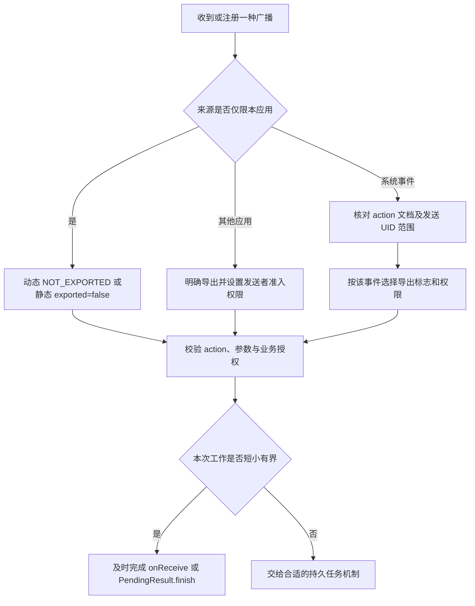
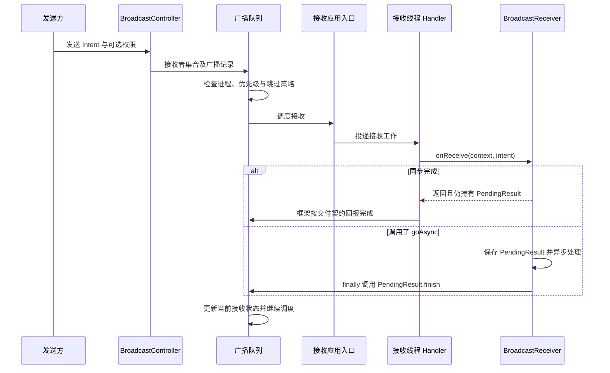
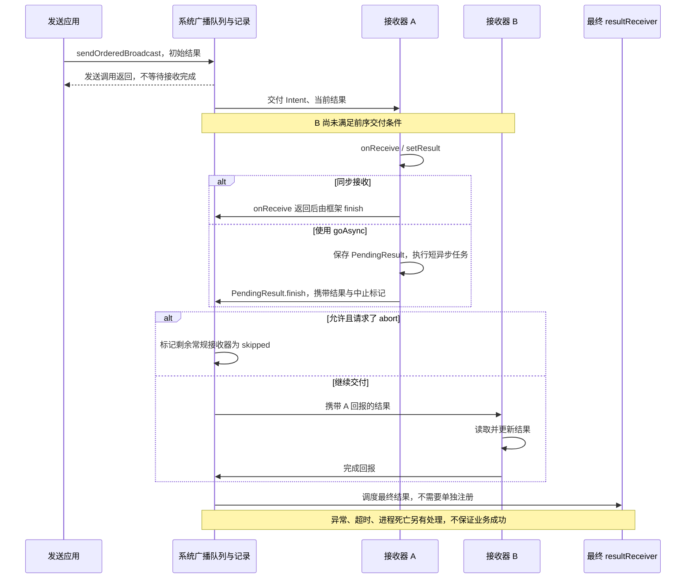

# Broadcast 发送与接收原理

广播是系统参与路由和调度的事件交付机制。发送方提交 Intent，系统解析与过滤接收者，再把事件交给应用进程；业务执行一般发生在接收器的调度线程，发送返回不代表所有接收者已处理完成。


## 广播分类：先区分不同维度 {#broadcast-types}

“有序、静态、系统、本地”不是互斥的四种广播，它们回答的是不同问题。例如，一个系统广播可以是粘性的，并由动态接收器订阅；一个应用自定义广播也可以按有序方式交付。

| 分类维度 | 常见类型 | 影响什么 |
| --- | --- | --- |
| 交付协作 | 普通、有序 | 是否逐个等待接收步骤结束，是否传递结果和允许中止 |
| 注册方式 | Context 动态、Manifest 静态 | 接收器对象与注册关系的生命周期，系统是否需要创建组件 |
| 路由范围 | 隐式、指定包、指定组件 | 哪些接收器有机会参与匹配，不代表完成了发送者认证 |
| 发送来源 | 系统、自定义 | action 的定义者及发送限制，不代表自动可信 |
| 状态保留 | 非粘性、粘性 | 后注册的接收器能否取得系统保留的 Intent |
| 通信实现 | 系统广播、LocalBroadcastManager | 是否经 AMS 路由，能否跨进程 |

### 普通、有序与粘性广播

- **普通广播**使用 `sendBroadcast()`。接收器之间没有业务结果传递链，不能用 `abortBroadcast()` 截断，也不能依赖完成顺序。“无序”不表示所有 `onReceive()` 一定并行，同一主线程上的回调仍串行执行。
- **有序广播**使用 `sendOrderedBroadcast()`。系统协调逐个交付、结果传递和完成确认；前一个步骤结束后，后一个才具备执行条件。发送方法本身仍是异步的，详细机制见[有序广播](#ordered-broadcast)。
- **粘性广播**在系统中保留 Intent，后续注册可能立即得到已有状态；“粘性”不等于可靠消息队列或历史事件列表。应用侧 `sendStickyBroadcast()` 从 API 21 起已弃用，不应用它传递敏感数据或实现状态同步协议。[Context API](https://developer.android.com/reference/android/content/Context)、[粘性广播的安全问题](https://developer.android.com/privacy-and-security/risks/sticky-broadcast)

系统的 `ACTION_BATTERY_CHANGED` 是理解粘性状态的典型例子：可以不创建接收对象，只读取最近状态；这不会建立持续订阅。

```java
// 位于持有 Context 的方法内；level 为百分比，-1 表示状态不可用。
Intent battery = context.registerReceiver(null,
        new IntentFilter(Intent.ACTION_BATTERY_CHANGED));
int raw = battery == null ? -1 : battery.getIntExtra(BatteryManager.EXTRA_LEVEL, -1);
int scale = battery == null ? -1 : battery.getIntExtra(BatteryManager.EXTRA_SCALE, -1);
int level = raw >= 0 && scale > 0 ? (int) (100L * raw / scale) : -1;
```

所需导入为 `android.content.Context/Intent/IntentFilter` 和 `android.os.BatteryManager`。这里读取的是系统提供的状态，不是在推荐应用发送自定义粘性广播。[ACTION_BATTERY_CHANGED](https://developer.android.com/reference/android/content/Intent#ACTION_BATTERY_CHANGED)

### 本地广播：进程内事件分发与弃用状态

`LocalBroadcastManager` 是 AndroidX 库中的进程内事件总线，不是 AMS 提供的另一种跨进程通道。它在进程内保存注册表、匹配 Intent 并调度回调，不启动其他进程；同一 APK 的 `:remote` 进程也收不到主进程的本地广播。它没有系统有序广播那套优先级、结果链与权限隔离语义。

<details>
<summary>旧项目阅读示例：LocalBroadcastManager</summary>

以下片段仅用于理解旧代码，依赖官方已弃用的 `androidx.localbroadcastmanager:localbroadcastmanager:1.1.0`，不建议给新项目增加此依赖。`receiver` 是已有的 `BroadcastReceiver`，`context` 是有效 Context。

```java
LocalBroadcastManager bus = LocalBroadcastManager.getInstance(context);
bus.registerReceiver(receiver, new IntentFilter("com.example.broadcastnotes.LOCAL_CHANGED"));
bus.sendBroadcast(new Intent("com.example.broadcastnotes.LOCAL_CHANGED"));
// 在订阅生命周期结束时调用，而不是紧跟发送后立即注销。
// bus.unregisterReceiver(receiver);
```

导入 `androidx.localbroadcastmanager.content.LocalBroadcastManager`。上面的异步 `sendBroadcast()` 通过主线程 Handler 分发；不要把这个结论套到同步发送方法上。
</details>

该库已完全弃用且不再发布新版本，官方建议使用 LiveData 或响应式流。新代码可按状态或事件的语义选择 LiveData、StateFlow、SharedFlow 等，并明确生命周期、是否重放和丢失策略；换成 Flow 不会自动获得跨进程能力或持久可靠性。[官方弃用说明](https://developer.android.com/jetpack/androidx/releases/localbroadcastmanager)

## 注册：动态与静态不是同一路径

### 动态注册

`Context.registerReceiver()` 的接收器是应用已创建的对象。客户端使用 `LoadedApk.ReceiverDispatcher` 把对象、Context 和调度 Handler 关联起来，将用于回调的 Binder 接口与过滤条件注册到系统；注销时解除注册与客户端映射。

动态接收器只在注册关系有效时接收事件。用 Activity Context 注册时，应与相应生命周期成对注销；改用 Application Context 只改变持有范围，不让注册跨越进程死亡。跨应用事件还需正确选择 exported 标志与权限。[LoadedApk 源码](https://github.com/aosp-mirror/platform_frameworks_base/blob/android-16.0.0_r1/core/java/android/app/LoadedApk.java)

**应用内部普通广播示例。** 下文完整示例使用 Java 与平台 API，运行下限为 **API 33**，以便直接展示导出标志；这不是广播本身的最低版本。旧系统兼容可使用官方指南中的 `ContextCompat.registerReceiver()`，不要直接在旧设备调用新增重载。

```java
package com.example.broadcastnotes;

import android.app.Activity;
import android.content.BroadcastReceiver;
import android.content.Context;
import android.content.Intent;
import android.content.IntentFilter;
import android.util.Log;

public class InternalBroadcastActivity extends Activity {
    private static final String ACTION = "com.example.broadcastnotes.action.INTERNAL_CHANGED";
    private boolean registered;
    private final BroadcastReceiver receiver = new BroadcastReceiver() {
        @Override public void onReceive(Context context, Intent intent) {
            if (!ACTION.equals(intent.getAction())) return;
            Log.i("BroadcastDemo", "收到应用内部更新");
        }
    };

    @Override protected void onStart() {
        super.onStart();
        registerReceiver(receiver, new IntentFilter(ACTION), Context.RECEIVER_NOT_EXPORTED);
        registered = true;
    }

    // 在页面处于 Started 状态时，从按钮等入口调用。
    public void notifyChanged() {
        sendBroadcast(new Intent(ACTION).setPackage(getPackageName()));
    }

    @Override protected void onStop() {
        if (registered) {
            unregisterReceiver(receiver);
            registered = false;
        }
        super.onStop();
    }
}
```

这仍是**系统广播**：`setPackage()` 限定目标包，`RECEIVER_NOT_EXPORTED` 限制外部应用向该动态接收器投递，二者保护的方向不同。页面停止后不再接收本例事件；重新进入页面不会补发之前遗漏的普通广播。

### Manifest 静态注册

静态接收器由 Manifest 声明，安装时进入包信息与组件解析结果。系统可以在交付某些允许的广播时启动目标进程，再通过 `ActivityThread.handleReceiver()` 创建接收器并调用 `onReceive()`。

它与动态注册的现成 Java 对象不同，不能认为所有广播接收都必须经过同一个 `ReceiverDispatcher` 创建路径。隐式广播、后台状态、接收器导出和权限限制还受系统版本及目标 SDK 影响。[广播官方指南](https://developer.android.com/develop/background-work/background-tasks/broadcasts)

例如，应用内部定向通知可以声明一个不导出的接收器。以下节点放在 `<application>` 中：

```xml
<receiver
    android:name=".NoteUpdateReceiver"
    android:exported="false" />
```

**NoteUpdateReceiver.java** 只处理约定 action 和合法 ID。广播内容应视为输入，不能把 extras 直接当作文件路径、组件名或操作授权。

```java
package com.example.broadcastnotes;

import android.content.BroadcastReceiver;
import android.content.Context;
import android.content.Intent;
import android.os.BadParcelableException;
import android.util.Log;

public class NoteUpdateReceiver extends BroadcastReceiver {
    public static final String ACTION = "com.example.broadcastnotes.action.NOTE_UPDATED";

    @Override public void onReceive(Context context, Intent intent) {
        if (!ACTION.equals(intent.getAction())) return;
        try {
            long noteId = intent.getLongExtra("note_id", -1L);
            if (noteId <= 0) return;
            // 示例只记录通知；实际操作仍需校验当前用户对该笔记的访问权。
            Log.i("BroadcastDemo", "note updated: " + noteId);
        } catch (BadParcelableException | ClassCastException e) {
            Log.w("BroadcastDemo", "非法广播数据", e);
        }
    }
}
```

发送方使用明确组件，不依赖 action 的全局匹配：

```java
context.sendBroadcast(new Intent(context, NoteUpdateReceiver.class)
        .setAction(NoteUpdateReceiver.ACTION).putExtra("note_id", 42L));
```

`exported="false"` 不是“应用被杀后永远收不到”，而是限制组件的外部可访问性；允许的定向投递仍可能触发组件所在进程启动。反过来，声明在 Manifest 中也不保证任何广播都能唤醒应用，强制停止、用户状态、后台与 action 专属限制仍然适用。

## 注册与接收的安全边界 {#broadcast-security}

### 导出、目标与权限各管什么

**先决定谁可以发，再决定发给谁。** action 和包名是路由数据，不是身份凭据；仅检查 action、给 action 加应用包名前缀，或读取 extras 中的 `senderPackage`，都不能替代权限校验。

- **接收端限制发送者**：静态接收器的 `android:permission`，或动态注册重载中的 `broadcastPermission`，要求**发送应用**持有该权限。
- **发送端限制接收者**：`sendBroadcast(intent, receiverPermission)` 及有序发送的同名参数，要求**接收应用**持有该权限。
- **限制路由范围**：指定组件或 `setPackage()` 减少接收范围，但不认证谁可以向该接收器发送。单纯设置 `exported="true"` 也不代表发送者可信。[receiver 权限属性](https://developer.android.com/guide/topics/manifest/receiver-element)、[Context 权限参数](https://developer.android.com/reference/android/content/Context)



接收系统事件时也要区分来源：部分蓝牙、电话事件由具有高权限的独立应用 UID 发送，`RECEIVER_NOT_EXPORTED` 可能接收不到。将“内部自定义事件”与“外部/系统事件”拆成不同接收器，逐一核对 action 的受保护属性与权限，不要为了兼容而把所有接收器都导出。[官方注册标志说明](https://developer.android.com/develop/background-work/background-tasks/broadcasts#context-registered-receivers)

### 同签名应用间通信：双向限制示例

假设接收应用 ID 为 `com.example.broadcastnotes`，合作发送应用使用同一签名证书。由接收应用**唯一声明**签名级权限；两个应用都通过 `<uses-permission>` 请求它，声明与请求不是同一件事。不同签名的普通应用不能靠写相同权限名取得该权限。[自定义权限指南](https://developer.android.com/guide/topics/permissions/defining)

接收应用 Manifest 的关键部分如下，用这里的接收器配置替换前面的内部版本，不要重复声明同一个组件：

```xml
<manifest xmlns:android="http://schemas.android.com/apk/res/android">
    <permission
        android:name="com.example.broadcastnotes.permission.EXCHANGE_NOTE"
        android:protectionLevel="signature" />
    <uses-permission android:name="com.example.broadcastnotes.permission.EXCHANGE_NOTE" />
    <application>
        <receiver
            android:name="com.example.broadcastnotes.NoteUpdateReceiver"
            android:exported="true"
            android:permission="com.example.broadcastnotes.permission.EXCHANGE_NOTE">
            <intent-filter>
                <action android:name="com.example.broadcastnotes.action.NOTE_UPDATED" />
            </intent-filter>
        </receiver>
    </application>
</manifest>
```

合作发送应用 Manifest 请求同一个权限：

```xml
<uses-permission android:name="com.example.broadcastnotes.permission.EXCHANGE_NOTE" />
```

发送代码中的权限参数保护接收方向；接收器声明中的同名权限保护发送方向。示例使用相同权限表达同一信任组，实际产品可以按读写能力拆成不同权限。

```java
// 在合作发送应用内执行；接收组件为前面的 NoteUpdateReceiver。
Intent update = new Intent("com.example.broadcastnotes.action.NOTE_UPDATED")
        .setComponent(new android.content.ComponentName(
                "com.example.broadcastnotes",
                "com.example.broadcastnotes.NoteUpdateReceiver"))
        .putExtra("note_id", 42L);
context.sendBroadcast(update, "com.example.broadcastnotes.permission.EXCHANGE_NOTE");
```

如果合作入口需要动态注册，平台 API 33 的对应写法是 `context.registerReceiver(receiver, filter, permission, null, Context.RECEIVER_EXPORTED)`：此处 `permission` 仍要求发送者持有；`null` Handler 表示使用默认主线程调度。签名权限认证的是应用信任组，笔记归属、登录状态和操作范围仍由业务校验。

### 与版本、生命周期有关的要求

- **Android 8.0 / target 26+**：大多数隐式广播不能通过 Manifest 订阅，定向广播及官方列出的例外需分别判断；动态注册也不会绕过 action 自身的限制。[隐式广播例外](https://developer.android.com/develop/background-work/background-tasks/broadcasts/broadcast-exceptions)
- **Android 12 / target 31+**：带 `<intent-filter>` 的接收器必须明确声明 `android:exported`。[组件导出要求](https://developer.android.com/about/versions/12/behavior-changes-12#exported)
- **Android 14 / target 34+**：动态注册非纯系统广播时必须明确选择 `RECEIVER_EXPORTED` 或 `RECEIVER_NOT_EXPORTED`，纯系统广播存在例外。导出选择仍应按真实发送来源判断。[运行时注册要求](https://developer.android.com/about/versions/14/behavior-changes-14#runtime-receivers-exported)
- **接收数据**：限制 extras 的类型、大小和取值，不把普通字符串转换成任意文件读写或组件启动指令。进入 `onReceive()` 后已不是原始发送者的同步 Binder 调用，不能用此时的 `Binder.getCallingUid()` 认证最初发送应用。
- **执行能力**：`onReceive()` 结束后，单靠自行创建的线程不能维持进程存活；广播回调也不自动获得后台启动 Activity、Service 或前台服务的通行权。注册/注销范围、后台执行规则和业务失败记录需分别设计。

## 发送：从 Intent 到接收队列

`sendBroadcast()` 或 `sendOrderedBroadcast()` 经客户端 Context 实现和 Binder 进入系统。`BroadcastController` 参与入口校验、接收者收集与发送组织，广播记录交给队列调度；匹配不只看 action，还涉及 Intent filter、权限、用户、exported 和系统跳过策略。

基线中的实际队列实现是 **`BroadcastQueueImpl`**，内部有按进程组织的 `BroadcastProcessQueue`。不要仅凭旧资料中的 `BroadcastQueue` 或 `BroadcastQueueModernImpl` 类名寻找当前完整实现。[BroadcastController](https://github.com/aosp-mirror/platform_frameworks_base/blob/android-16.0.0_r1/services/core/java/com/android/server/am/BroadcastController.java)、[BroadcastQueueImpl](https://github.com/aosp-mirror/platform_frameworks_base/blob/android-16.0.0_r1/services/core/java/com/android/server/am/BroadcastQueueImpl.java)

目标进程已运行时走已有应用线程的调度路径；静态接收者进程未运行时，可能先启动进程、等待 attach 后再投递。被策略跳过的接收者不会因为已经匹配 Intent 就必然执行。

## 接收：Binder 入口与 onReceive



静态与动态接收入口不同，图中合并为“接收应用入口”。默认回调通常在应用主线程；动态注册可指定调度 Handler，但这不会把一次广播变成持久任务。

在本基线中，可按下面两条入口继续读源码：

- **动态接收器**：队列调用 `IApplicationThread.scheduleRegisteredReceiver()`，应用的 `ApplicationThread` 转交 `IIntentReceiver`；`LoadedApk.ReceiverDispatcher` 将工作投递给注册时的 Handler，最终在 `Args` 的 Runnable 中调用已有对象的 `onReceive()`。
- **静态接收器**：队列调用 `IApplicationThread.scheduleReceiver()`，`ApplicationThread` 发送 `H.RECEIVER`，`ActivityThread.handleReceiver()` 创建组件实例并调用 `onReceive()`，而不是取得动态注册表中的现成对象。

源码定位：[队列区分两类接收器](https://android.googlesource.com/platform/frameworks/base/+/refs/tags/android-16.0.0_r1/services/core/java/com/android/server/am/BroadcastQueueImpl.java#1209)、[动态分发回调](https://android.googlesource.com/platform/frameworks/base/+/refs/tags/android-16.0.0_r1/core/java/android/app/LoadedApk.java#1830)、[静态组件接收](https://android.googlesource.com/platform/frameworks/base/+/refs/tags/android-16.0.0_r1/core/java/android/app/ActivityThread.java#4976)。

## PendingResult.finish 与完成回报 {#broadcast-finish}

### 原提纲链路怎样修正

Binder 接口的接收入口负责转交工作，真正业务回调是 `BroadcastReceiver.onReceive()`。`LoadedApk.ReceiverDispatcher.Args` 参与动态接收分发，并以 PendingResult 管理完成状态；`performReceive()` 与 `onReceive()` 不是同一个调用层次。

同步 `onReceive()` 返回后，如果结果仍由框架持有，框架结束本次接收。调用 `goAsync()` 会把 PendingResult 交给应用，应用须在处理完毕后调用它的 `finish()`；重复 finish 也是错误。

对于需要向系统确认的交付，`PendingResult.finish()` 通过 `sendFinished()` 等内部路径调用 AMS 的 `finishReceiver()`，再交给当前广播队列更新接收状态。基线中 `BroadcastQueueImpl.finishReceiverLocked()` 还处理有序广播结果和中止信息。**完成的是当前接收步骤，不等于整条广播、所有接收者或业务持久化都完成。** [BroadcastReceiver 源码](https://github.com/aosp-mirror/platform_frameworks_base/blob/android-16.0.0_r1/core/java/android/content/BroadcastReceiver.java)

并非所有交付都必须发生完全相同的回报调用；基线中还存在 `assumeDelivered` 等路径。分析 finish 时必须结合接收类型与该次交付状态，不能把一个旧截图推广成所有广播的固定链路。

### 原笔记截图


图中展示 ReceiverDispatcher 与完成回报的关系；对应实现见上面的源码链接。<a href="/assets/android/basics/source/broadcast-original.webp" download="broadcast-original.webp">下载原图</a>。

## 有序广播：结果链与调度原理 {#ordered-broadcast}

### 有序保证什么，不保证什么

有序广播以系统确定的接收列表协调逐项交付。接收器使用 `getResultCode/Data/Extras()` 读取上一阶段结果，使用 `setResultCode/Data/Extras()` 或 `setResult()` 写入下一阶段结果；它们与最初 Intent 的 extras 不是同一套数据，不能靠修改原 Intent 实现结果传递。

`abortBroadcast()` 请求跳过后续常规接收器，普通广播不支持这个操作；发送方可通过 `Intent.FLAG_RECEIVER_NO_ABORT` 禁止中止。作为发送参数提供的最终 `resultReceiver` 仍会收到结果，它不是通过 IntentFilter 匹配出来的业务接收器，不需要单独注册。[BroadcastReceiver API](https://developer.android.com/reference/android/content/BroadcastReceiver)、[禁止中止标志](https://developer.android.com/reference/android/content/Intent#FLAG_RECEIVER_NO_ABORT)

::: warning Android 16 的顺序边界
**运行在 Android 16 时，不论 target SDK，跨进程广播优先级不再保证全局排序。** 优先级只在同一应用进程内受尊重；同一 APK 的多个进程也不能依靠优先级协调。不要将“逐项交付”理解为“某个其他应用一定先执行”，也不要依赖相同优先级的先后关系。[Android 16 行为变化](https://developer.android.com/about/versions/16/behavior-changes-all#ordered-broadcast-priority-scope-no-longer-global)
:::

### 可操作示例：传递结果、最终回调与中止

下面的 **OrderedBroadcastActivity.java** 使用与前例相同的 API 33+ 平台注册方式。两个动态接收器位于**同一应用进程**，优先级分别为 20 和 10；注册完成且页面处于 Started 状态时，从按钮调用 `sendExample(false)`，即可观察结果沿链路累积。Activity 本身需按项目入口方式声明在 Manifest 中，本例省略 UI。

```java
package com.example.broadcastnotes;

import android.app.Activity;
import android.content.BroadcastReceiver;
import android.content.Context;
import android.content.Intent;
import android.content.IntentFilter;
import android.os.Bundle;
import android.util.Log;

public class OrderedBroadcastActivity extends Activity {
    private static final String ACTION = "com.example.broadcastnotes.action.ORDERED_DEMO";
    private boolean registered;

    private final BroadcastReceiver first = new BroadcastReceiver() {
        @Override public void onReceive(Context context, Intent intent) {
            if (!ACTION.equals(intent.getAction()) || !isOrderedBroadcast()) return;
            Bundle result = getResultExtras(true);
            result.putInt("steps", result.getInt("steps", 0) + 1);
            setResult(Activity.RESULT_OK, "first", result);
            Log.i("OrderedDemo", "first");
            if (intent.getBooleanExtra("stop_after_first", false)) abortBroadcast();
        }
    };

    private final BroadcastReceiver second = new BroadcastReceiver() {
        @Override public void onReceive(Context context, Intent intent) {
            if (!ACTION.equals(intent.getAction()) || !isOrderedBroadcast()) return;
            Bundle result = getResultExtras(true);
            result.putInt("steps", result.getInt("steps", 0) + 1);
            setResult(Activity.RESULT_OK, getResultData() + ">second", result);
            Log.i("OrderedDemo", "second");
        }
    };

    private final BroadcastReceiver completed = new BroadcastReceiver() {
        @Override public void onReceive(Context context, Intent intent) {
            Bundle result = getResultExtras(false);
            int steps = result == null ? 0 : result.getInt("steps", 0);
            Log.i("OrderedDemo", "final: code=" + getResultCode()
                    + ", data=" + getResultData() + ", steps=" + steps);
        }
    };

    @Override protected void onStart() {
        super.onStart();
        IntentFilter firstFilter = new IntentFilter(ACTION);
        firstFilter.setPriority(20);
        IntentFilter secondFilter = new IntentFilter(ACTION);
        secondFilter.setPriority(10);
        registerReceiver(first, firstFilter, Context.RECEIVER_NOT_EXPORTED);
        registerReceiver(second, secondFilter, Context.RECEIVER_NOT_EXPORTED);
        registered = true;
    }

    public void sendExample(boolean stopAfterFirst) {
        if (!registered) return;
        Intent intent = new Intent(ACTION).setPackage(getPackageName())
                .putExtra("stop_after_first", stopAfterFirst);
        // null 权限：仅在本例包限制和未导出的注册边界内演示。
        // null Handler：最终结果回调在默认主线程执行。
        sendOrderedBroadcast(intent, null, completed, null,
                Activity.RESULT_CANCELED, "initial", new Bundle());
    }

    @Override protected void onStop() {
        if (registered) {
            unregisterReceiver(first);
            unregisterReceiver(second);
            registered = false;
        }
        super.onStop();
    }
}
```

正常交付且未中途注销时，`sendExample(false)` 的预期日志为：

```text
first
second
final: code=-1, data=first>second, steps=2
```

调用 `sendExample(true)` 时，第二个接收器被跳过，最终结果为 `data=first, steps=1`。若给发送 Intent 添加 `Intent.FLAG_RECEIVER_NO_ABORT`，第一个接收器的中止请求不会截断链路。发送方法返回时，这些回调还不一定发生；最终回调也不是业务事务提交证明。此处日志是正常路径的预期值，不是设备执行记录。

### AOSP 为什么能等待前一个接收器

顺序来自**系统维护的交付状态与完成回报**，不是“各接收器自己睡眠排队”。在本基线中：

1. `ContextImpl.sendOrderedBroadcast()` 把初始结果、最终接收接口和有序标记交给 AMS；`BroadcastController` 解析目标并建立 `BroadcastRecord`。
2. `BroadcastRecord.calculateBlockedUntilBeyondCount()` 对有序列表的第 `i` 项设置阻塞门槛 `i`；`isBlocked()` 用 `beyondCount` 判断前序步骤是否已推进过去。
3. `BroadcastQueueImpl` 按进程组织调度。有现成进程时派发，必要时冷启动静态接收器进程；当前接收步骤结束后，通过 `finishReceiverLocked()` 更新结果与交付状态，再解除后续阻塞。
4. 正常完成、被跳过、超时和失败都属于需要推进处理的状态，不能把队列向前推进解释为业务成功。列表处理到末尾后，系统通过 `scheduleResultTo()` 调度最终结果回调。

下面是 `BroadcastRecord.java` 的关键节选，省略了普通广播的优先级分支。`beyondCount` 代表交付进度，不是“已成功执行 onReceive 的数量”；通用状态判断还把 `DELIVERY_DEFERRED` 视为已越过，不能把该字段一概解释成所有前序回调都已成功完成。[状态判断源码](https://android.googlesource.com/platform/frameworks/base/+/refs/tags/android-16.0.0_r1/services/core/java/com/android/server/am/BroadcastRecord.java#235)

```java
// calculateBlockedUntilBeyondCount(...) 的 ordered 分支
if (ordered) {
    for (int i = 0; i < N; i++) {
        blockedUntilBeyondCount[i] = i;
    }
} // ... 非有序广播分支

boolean isBlocked(int index) {
    return (beyondCount < blockedUntilBeyondCount[index]);
}
```

有序结果保存在 `BroadcastRecord` 中。接收器调用 `setResult()` 首先修改应用端的 PendingResult；系统在收到完成回报后才更新记录，下一次投递再携带这些结果。以下为 `BroadcastQueueImpl.finishReceiverLocked()` 的结果处理节选：

```java
if (r.ordered) {
    r.resultCode = resultCode;
    r.resultData = resultData;
    r.resultExtras = resultExtras;
    if (!r.isNoAbort()) {
        r.resultAbort = resultAbort;
    }
}
// ... 先完成当前项并推进进度，再按 resultAbort 跳过剩余项。
```

源码定位：[ContextImpl 发送](https://android.googlesource.com/platform/frameworks/base/+/refs/tags/android-16.0.0_r1/core/java/android/app/ContextImpl.java#1462)、[阻塞门槛](https://android.googlesource.com/platform/frameworks/base/+/refs/tags/android-16.0.0_r1/services/core/java/com/android/server/am/BroadcastRecord.java#786)、[isBlocked](https://android.googlesource.com/platform/frameworks/base/+/refs/tags/android-16.0.0_r1/services/core/java/com/android/server/am/BroadcastRecord.java#647)、[有序完成与中止](https://android.googlesource.com/platform/frameworks/base/+/refs/tags/android-16.0.0_r1/services/core/java/com/android/server/am/BroadcastQueueImpl.java#1370)、[最终结果与解除阻塞](https://android.googlesource.com/platform/frameworks/base/+/refs/tags/android-16.0.0_r1/services/core/java/com/android/server/am/BroadcastQueueImpl.java#1607)。这些是框架源码节选，不是可复制到普通 App 编译的 API。

### 有序广播时序：finish 才是推进边界

下图假定系统已经选定 A、B 的交付顺序。为突出结果链，合并了 Binder 接收端、Handler 和 AMS 回报入口；详细的注册与分发路径见前文。



调用 `goAsync()` 后，返回 `onReceive()` 本身不足以推进这次有序交付，需在允许时限内调用保存结果的 `PendingResult.finish()`。若异步阶段修改有序结果，应操作该 PendingResult 的 `setResultCode/Data/Extras()` 等方法，不能继续依赖已移交结果的接收器对象。超时可能触发 ANR，并由系统按失败策略继续处理。

普通广播不应被用来建立接收者之间的执行依赖；有序广播也不提供持久化、自动业务重试或跨应用全局事务。需要可靠流程、低延迟确认或明确跨进程顺序时，应选择带业务状态和确认机制的通信/任务方案。

## goAsync 的正确边界

下面是方法片段，假定 `executor` 已初始化、容量受控，`process(intent)` 是可在广播允许时限内结束的短工作。业务异常和拒绝提交都应记录为失败，不能只把 finish 当作处理成功。

```java
@Override
public void onReceive(Context context, Intent intent) {
    final PendingResult pending = goAsync();
    try {
        executor.execute(() -> {
            try {
                process(intent);
            } finally {
                pending.finish();
            }
        });
    } catch (java.util.concurrent.RejectedExecutionException e) {
        pending.finish();
        // 记录任务未接收；不能把广播回报完成当作业务成功。
    }
}
```

`goAsync()` 不取消广播时限，也不提供无限运行权。排队等待也消耗处理预算；长任务应把必要状态交给合适的任务调度器。处理异常仍须有明确业务失败记录，`finally` 只保证释放广播完成责任。

`goAsync()` 会取出本次 `mPendingResult`，同时将 Receiver 中的字段清空；异步阶段的结果读写和完成操作都应使用返回的 `PendingResult`。例如有序广播需要异步设置结果时，调用 `pending.setResultCode()`、`pending.setResultData()` 后再 `pending.finish()`，不要继续调用 Receiver 自身的结果方法。这个对象属于本次交付，不能缓存到下一次广播复用。[goAsync 与 PendingResult 源码](https://github.com/aosp-mirror/platform_frameworks_base/blob/android-16.0.0_r1/core/java/android/content/BroadcastReceiver.java)

广播超时不是统一的“10 秒”：系统会根据前台优先级标志、平台版本及 CPU 饥饿等条件采用不同窗口。`Intent.FLAG_RECEIVER_FOREGROUND` 指广播调度优先级，不等于应用界面在前台，也不会启动前台服务。冷启动、接收线程积压和异步执行器等待都可能导致广播超时，不应把超时窗口当作可用的业务耗时预算。[官方广播 ANR 排查](https://developer.android.com/topic/performance/anrs/diagnose-and-fix-anrs#broadcast-receiver-timeout)

## 定位问题的顺序

1. 确认发送的 action、显式目标、用户及权限与接收声明相符。
2. 区分 Manifest 接收器和动态接收器，检查进程启动或注册生命周期。
3. 查看系统是否跳过或延迟交付，不把“发送 API 无异常”当作收到证明。
4. 区分回调未进入、线程队列积压、业务耗时和 `goAsync()` 未 finish。
5. 结合具体版本分析队列和有序结果，不只按旧函数名对照堆栈。

更多关联：线程调度见 [Handler](./handler.html)，分发器归属见 [LoadedApk](./loaded-apk.html)，系统入口见 [核心服务](./system-services.html)。

原始笔记：[Android 基础知识提纲](https://alidocs.dingtalk.com/i/nodes/1OQX0akWmxaRZD7yfgRMaeOX8GlDd3mE)。
