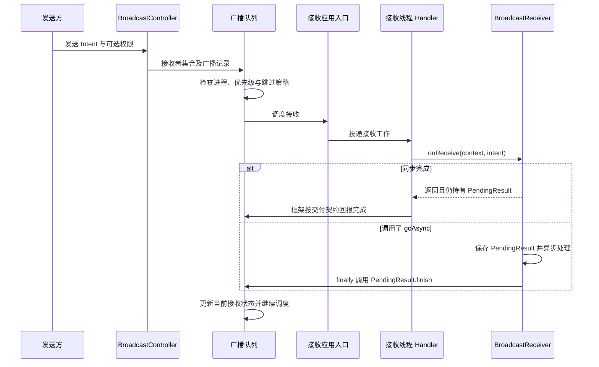

# Broadcast 发送与接收原理

广播是系统参与路由和调度的事件交付机制。发送方提交 Intent，系统解析与过滤接收者，再把事件交给应用进程；业务执行一般发生在接收器的调度线程，发送返回不代表所有接收者已处理完成。

本文对应[原提纲](https://alidocs.dingtalk.com/i/nodes/1OQX0akWmxaRZD7yfgRMaeOX8GlDd3mE)“Broacast发送接收原理”，规范名称并保留 `LoadedApk`、`PendingResult.finish()` 与服务端完成回报这一主线。源码固定 AOSP **`android-16.0.0_r1`**；旧参考链接作为原始资料保存在提纲记录中，不把旧版本方法链直接套到当前平台。

## 注册：动态与静态不是同一路径

### 动态注册

`Context.registerReceiver()` 的接收器是应用已创建的对象。客户端使用 `LoadedApk.ReceiverDispatcher` 把对象、Context 和调度 Handler 关联起来，将用于回调的 Binder 接口与过滤条件注册到系统；注销时解除注册与客户端映射。

动态接收器只在注册关系有效时接收事件。用 Activity Context 注册时，应与相应生命周期成对注销；改用 Application Context 只改变持有范围，不让注册跨越进程死亡。跨应用事件还需正确选择 exported 标志与权限。[LoadedApk 源码](https://github.com/aosp-mirror/platform_frameworks_base/blob/android-16.0.0_r1/core/java/android/app/LoadedApk.java)

### Manifest 静态注册

静态接收器由 Manifest 声明，安装时进入包信息与组件解析结果。系统可以在交付某些允许的广播时启动目标进程，再通过 `ActivityThread.handleReceiver()` 创建接收器并调用 `onReceive()`。

它与动态注册的现成 Java 对象不同，不能认为所有广播接收都必须经过同一个 `ReceiverDispatcher` 创建路径。隐式广播、后台状态、接收器导出和权限限制还受系统版本及目标 SDK 影响。[广播官方指南](https://developer.android.com/develop/background-work/background-tasks/broadcasts)

## 发送：从 Intent 到接收队列

`sendBroadcast()` 或 `sendOrderedBroadcast()` 经客户端 Context 实现和 Binder 进入系统。`BroadcastController` 参与入口校验、接收者收集与发送组织，广播记录交给队列调度；匹配不只看 action，还涉及 Intent filter、权限、用户、exported 和系统跳过策略。

基线中的实际队列实现是 **`BroadcastQueueImpl`**，内部有按进程组织的 `BroadcastProcessQueue`。不要仅凭旧资料中的 `BroadcastQueue` 或 `BroadcastQueueModernImpl` 类名寻找当前完整实现。[BroadcastController](https://github.com/aosp-mirror/platform_frameworks_base/blob/android-16.0.0_r1/services/core/java/com/android/server/am/BroadcastController.java)、[BroadcastQueueImpl](https://github.com/aosp-mirror/platform_frameworks_base/blob/android-16.0.0_r1/services/core/java/com/android/server/am/BroadcastQueueImpl.java)

目标进程已运行时走已有应用线程的调度路径；静态接收者进程未运行时，可能先启动进程、等待 attach 后再投递。被策略跳过的接收者不会因为已经匹配 Intent 就必然执行。

## 接收：Binder 入口与 onReceive



静态与动态接收入口不同，图中合并为“接收应用入口”。默认回调通常在应用主线程；动态注册可指定调度 Handler，但这不会把一次广播变成持久任务。

## PendingResult.finish 与完成回报 {#broadcast-finish}

### 原提纲链路怎样修正

原文把 `receiver.performReceive()` 与 `receiver.onReceive()` 混写。Binder 接口的接收入口负责转交工作，真正业务回调是 `BroadcastReceiver.onReceive()`。`LoadedApk.ReceiverDispatcher.Args` 参与动态接收分发，并以 PendingResult 管理完成状态。

同步 `onReceive()` 返回后，如果结果仍由框架持有，框架结束本次接收。调用 `goAsync()` 会把 PendingResult 交给应用，应用须在处理完毕后调用它的 `finish()`；重复 finish 也是错误。

对于需要向系统确认的交付，`PendingResult.finish()` 通过 `sendFinished()` 等内部路径调用 AMS 的 `finishReceiver()`，再交给当前广播队列更新接收状态。基线中 `BroadcastQueueImpl.finishReceiverLocked()` 还处理有序广播结果和中止信息。**完成的是当前接收步骤，不等于整条广播、所有接收者或业务持久化都完成。** [BroadcastReceiver 源码](https://github.com/aosp-mirror/platform_frameworks_base/blob/android-16.0.0_r1/core/java/android/content/BroadcastReceiver.java)

并非所有交付都必须发生完全相同的回报调用；基线中还存在 `assumeDelivered` 等路径。分析 finish 时必须结合接收类型与该次交付状态，不能把一个旧截图推广成所有广播的固定链路。

### 原笔记截图


该图保留为历史阅读材料，可点击放大；截图未标注源码版本，本文结论以固定标签核对为准。<a href="/assets/android/basics/source/broadcast-original.webp" download="broadcast-original.webp">下载原图</a>。

## 有序广播与版本边界

普通广播不应被用来建立接收者之间的执行依赖。有序广播具备结果传递与接收完成协调能力，但不表示可以依靠任意跨进程优先级实现稳定业务流水线。

**Android 16 不再保证跨进程按广播优先级排序**，优先级只在同一应用进程内受尊重；应用缓存状态也可能影响交付时机。因此“优先级越大就一定先于其他应用接收”不能作为通用结论。[广播版本变化](https://developer.android.com/develop/background-work/background-tasks/broadcasts#changes-system-broadcasts)

需要低延迟确认、可靠顺序或持久重试的协议，应使用明确的 IPC/任务机制和业务状态，而不是只靠有序广播的名称。

## goAsync 的正确边界

下面是示意片段，假定 `executor` 已初始化、容量受控，`process(intent)` 是可在广播允许时限内结束的短工作；尚未进行 Android 编译与设备验证。

```java
@Override
public void onReceive(Context context, Intent intent) {
    final PendingResult pending = goAsync();
    try {
        executor.execute(() -> {
            try {
                process(intent);
            } finally {
                pending.finish();
            }
        });
    } catch (java.util.concurrent.RejectedExecutionException e) {
        pending.finish();
        // 记录任务未接收；不能把广播回报完成当作业务成功。
    }
}
```

`goAsync()` 不取消广播时限，也不提供无限运行权。排队等待也消耗处理预算；长任务应把必要状态交给合适的任务调度器。处理异常仍须有明确业务失败记录，`finally` 只保证释放广播完成责任。

## 定位问题的顺序

1. 确认发送的 action、显式目标、用户及权限与接收声明相符。
2. 区分 Manifest 接收器和动态接收器，检查进程启动或注册生命周期。
3. 查看系统是否跳过或延迟交付，不把“发送 API 无异常”当作收到证明。
4. 区分回调未进入、线程队列积压、业务耗时和 `goAsync()` 未 finish。
5. 结合具体版本分析队列和有序结果，不只按旧函数名对照堆栈。

更多关联：线程调度见 [Handler](./handler.html)，分发器归属见 [LoadedApk](./loaded-apk.html)，系统入口见 [核心服务](./system-services.html)。
