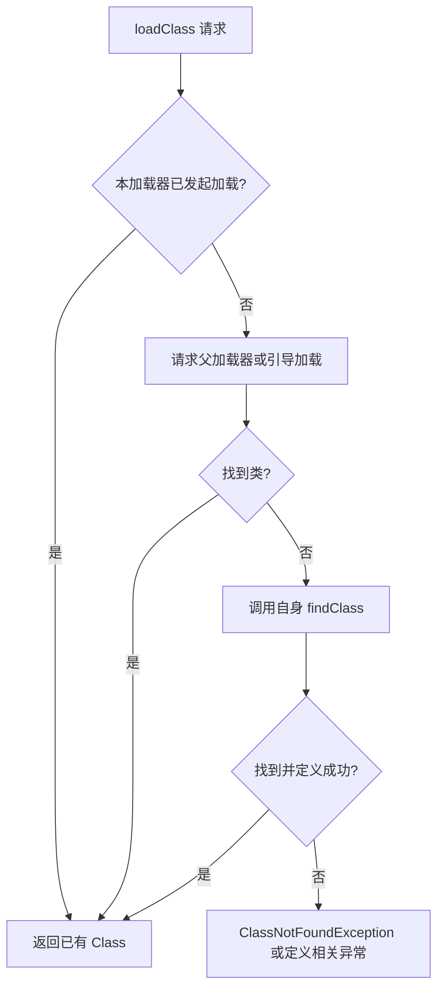

# 类加载机制

类加载解决“给定类名，由哪个加载器找到并定义这个类”。它与应用安装、组件注册、资源解析和类初始化有关联，但不是同一件事。本文补全[原提纲](https://alidocs.dingtalk.com/i/nodes/1OQX0akWmxaRZD7yfgRMaeOX8GlDd3mE)的 ClassLoader 章节，实现基线为 AOSP `android-16.0.0_r1`。

## 类身份：名字之外还有定义加载器

运行时区分类型，必须考虑类的二进制名称和**定义它的 ClassLoader**。两个加载器各自定义 `com.example.Note`，得到的类不一定可强制转换，即使类名和字节内容相同。把请求转交父加载器的发起加载器，也不一定是最终定义类的加载器。

这解释了插件或多加载器环境中的 `ClassCastException`、接口不可见和代理创建失败。共享接口应由双方可见的同一加载器定义；只对比 `Class.getName()` 无法排除类型身份冲突。[ClassLoader API](https://developer.android.com/reference/java/lang/ClassLoader)

## 默认委派：先查已加载，再向父级请求

基线 `ClassLoader.loadClass(name, resolve)` 先调用 `findLoadedClass()`，再尝试父加载器或引导加载，未找到时才调用自身 `findClass()`。只有适用该实现或契约的加载器才可以按这个顺序分析；子类可以改变查找策略。

`loadClass()` 不等于执行所有静态初始化。类的加载、链接和初始化需要分别理解；`Class.forName(name, false, loader)` 可以明确请求不初始化，后续主动使用仍可能触发初始化。[固定版本 ClassLoader](https://android.googlesource.com/platform/libcore/+/refs/tags/android-16.0.0_r1/ojluni/src/main/java/java/lang/ClassLoader.java)

## Android 的 DEX 加载器

### PathClassLoader 与 DexClassLoader

`PathClassLoader` 常用于应用和系统代码的路径加载；`DexClassLoader` 提供从指定路径加载 DEX 相关代码的公开构造入口。两者都涉及 `BaseDexClassLoader`，但构造参数、使用场景和历史版本约束不能混为一谈。Android 执行格式以 DEX 为核心，不是把任意桌面 JVM `.class` 文件直接放入路径就能运行。

`DexClassLoader` 的 `optimizedDirectory` 参数从 API 26 起已弃用且不再生效，不应照搬旧教程要求人为管理优化输出目录的做法。[PathClassLoader](https://developer.android.com/reference/dalvik/system/PathClassLoader)、[DexClassLoader](https://developer.android.com/reference/dalvik/system/DexClassLoader)

### BaseDexClassLoader 与 DexPathList

基线 `BaseDexClassLoader.findClass()` 会先考虑前置共享库加载器，再查询自身 `DexPathList`，必要时再考虑后置共享库加载器。DexPathList 在其元素中寻找目标 DEX 类；这只是默认父委派失败后，自身查找内部的进一步顺序，不能取代上层 `loadClass()` 的父委派。

因此“Android 永远只有父链”和“DEX 总是先于所有共享库”都过于绝对。定位来源要同时看父加载器、共享库加载器、split 和自身路径。[BaseDexClassLoader](https://android.googlesource.com/platform/libcore/+/refs/tags/android-16.0.0_r1/dalvik/src/main/java/dalvik/system/BaseDexClassLoader.java)、[DexPathList](https://android.googlesource.com/platform/libcore/+/refs/tags/android-16.0.0_r1/dalvik/src/main/java/dalvik/system/DexPathList.java)

### DelegateLastClassLoader 的边界

API 27 提供的 `DelegateLastClassLoader` 采用不同策略：先复用已经加载的类；需要查找新类时，优先引导类，再执行自身 `findClass()`，之后才委派父加载器。普通公开构造场景可概括为“引导类 → DEX 路径 → 父加载器”；平台内部若配置了前置或后置共享库加载器，继承的 `BaseDexClassLoader.findClass()` 仍会按前述共享库规则查找，不能将“自身查找”限定为仅查 DEX。名称中的 delegate last 不表示可覆盖所有 Java 核心类，也不代表自动解决接口隔离和资源冲突。[DelegateLastClassLoader API](https://developer.android.com/reference/dalvik/system/DelegateLastClassLoader)、[固定版本 loadClass 实现](https://android.googlesource.com/platform/libcore/+/refs/tags/android-16.0.0_r1/dalvik/src/main/java/dalvik/system/DelegateLastClassLoader.java)

## 动态代码加载不等于安装应用

创建加载器不会自动向 PMS 注册新的 Activity、Service、Receiver 或 Provider；组件声明和系统安装状态属于另一条链。它也不会把已有对象无缝变成新版本类，或为加载代码建立独立安全沙箱。共享进程和权限的代码需要按同一信任边界评估。

面向 Android 14 / API 34 及以上时，动态加载的 DEX、JAR 或 APK 文件需要满足平台只读要求。应按官方给出的写入和只读设置顺序处理，并在加载前验证来源与完整性；仅设置只读不能证明代码可信。动态下载执行代码还需核对分发渠道政策。[Android 14 动态代码加载变更](https://developer.android.com/about/versions/14/behavior-changes-14#safer-dynamic-code-loading)

## 常见异常如何定位

- `ClassNotFoundException`：先查请求加载器、路径、打包内容和依赖是否可见。
- `NoClassDefFoundError`：除了依赖不可见，还可能与此前初始化失败有关；应保留首个异常及 cause。
- `ClassCastException`：检查两端 Class 的定义加载器，不只看同名类。
- `UnsatisfiedLinkError`：转查原生库、ABI、依赖和链接器命名空间；DEX 能找到类不代表 `.so` 能加载。

排查时可以记录应用自身类的 `getClassLoader()` 和父级信息；这只是观察入口，不应反射改写 dexElements 来替代公开契约。本文未运行动态加载示例，也没有修改设备类加载行为。
