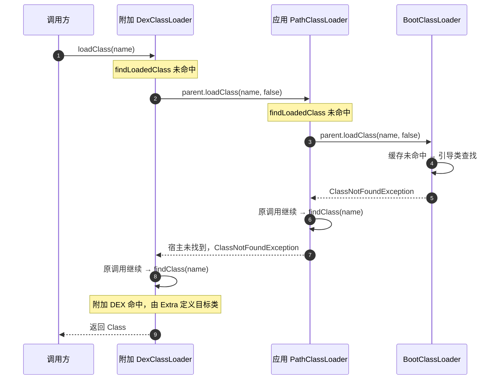
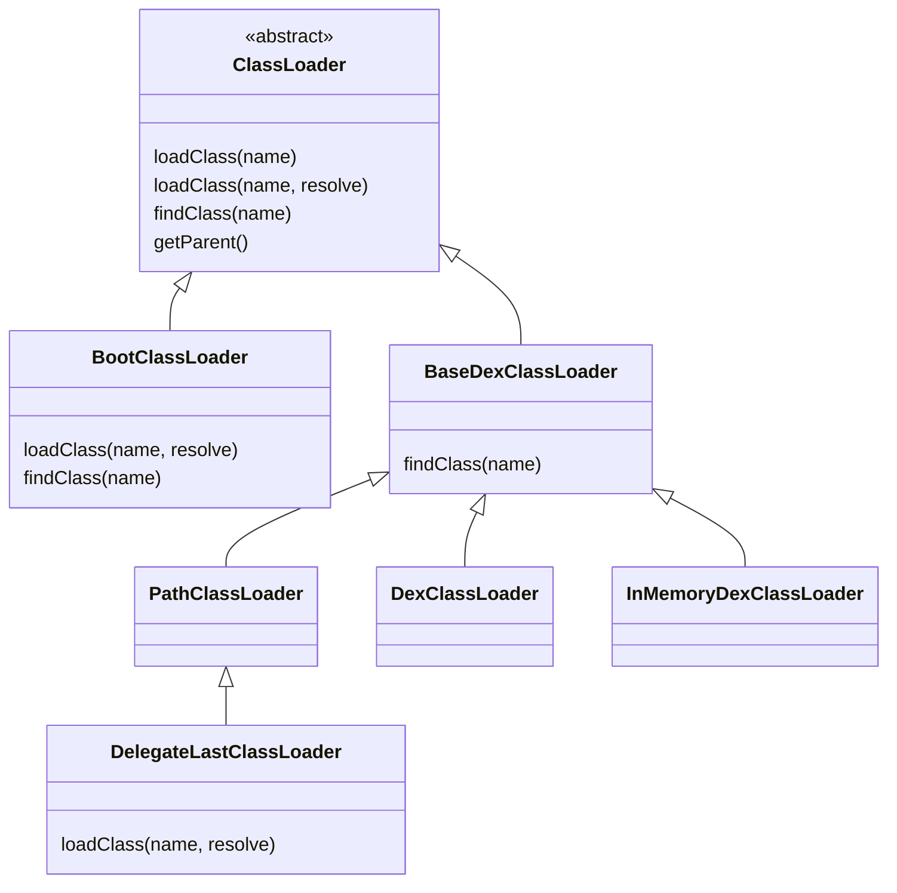
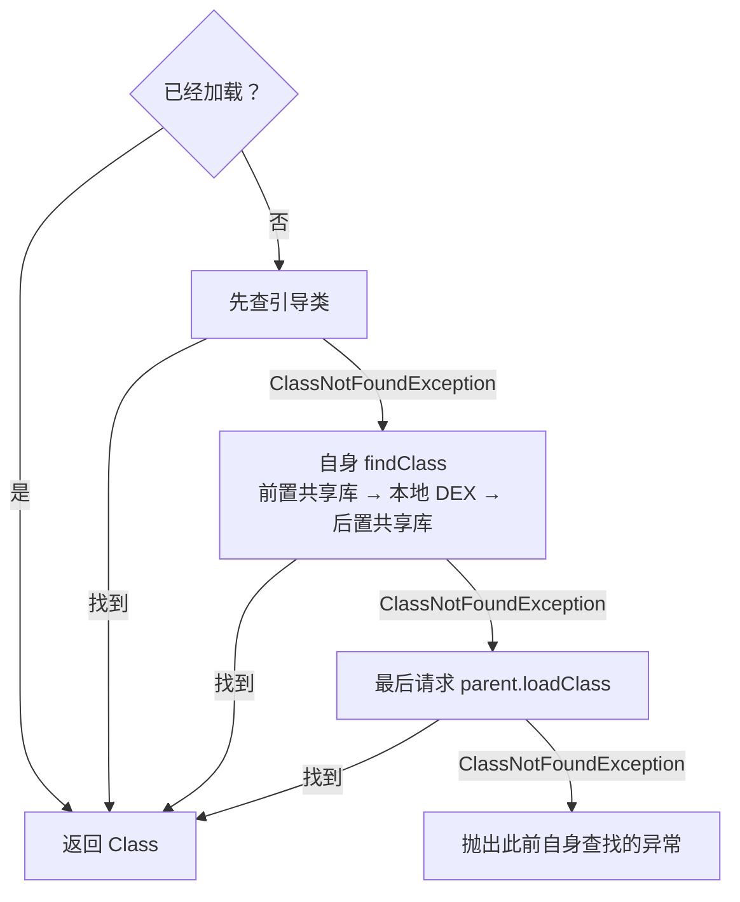
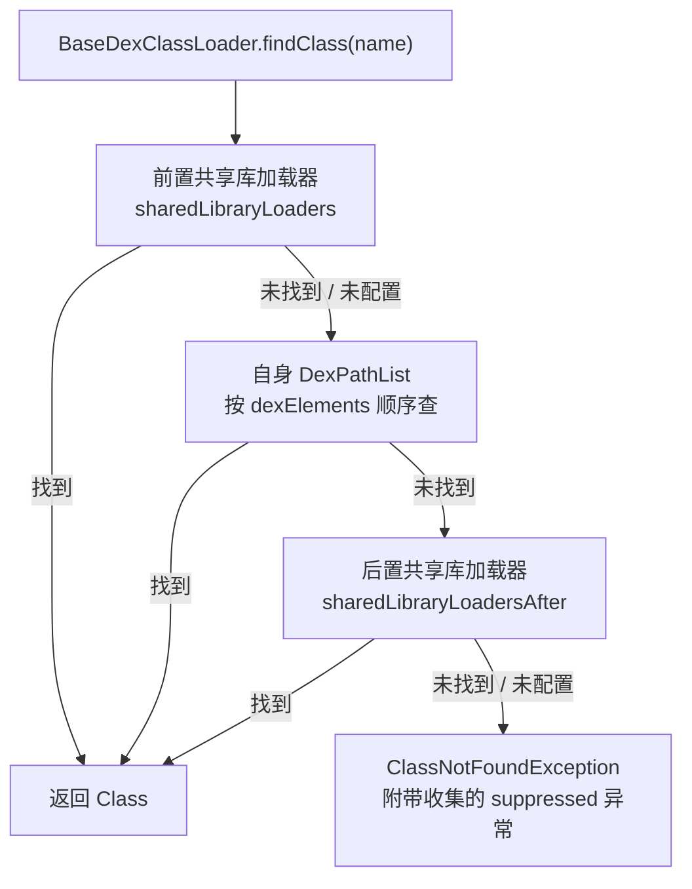
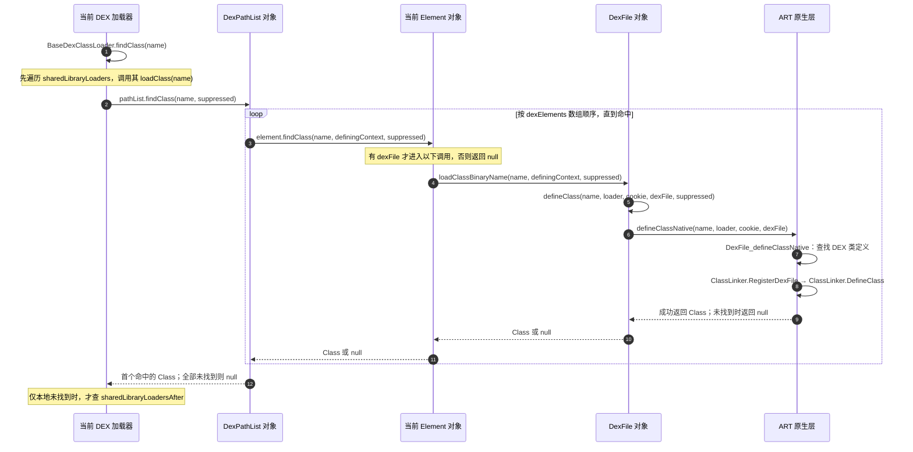
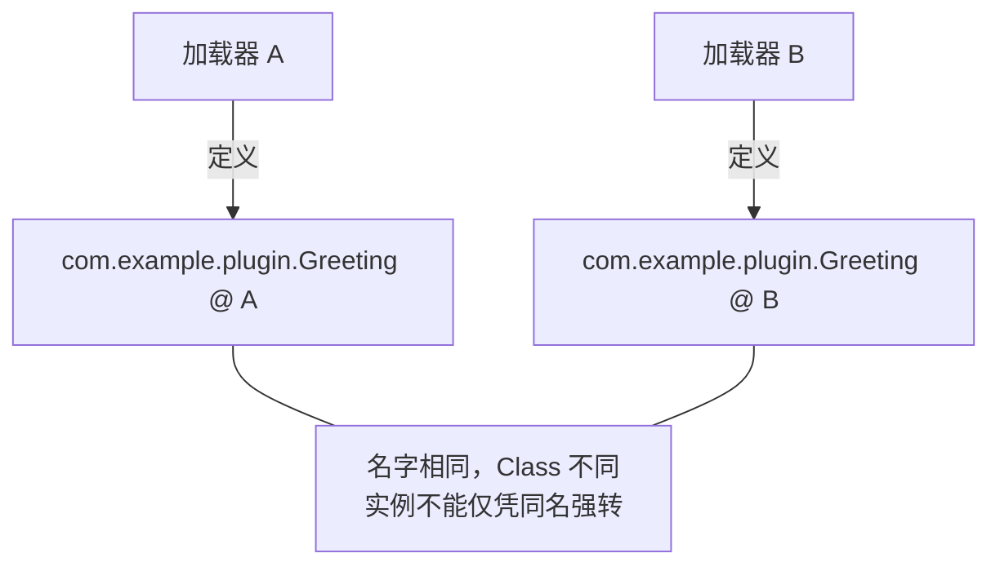
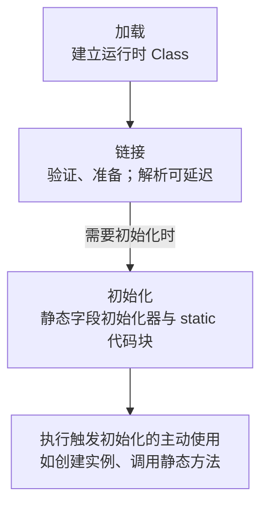
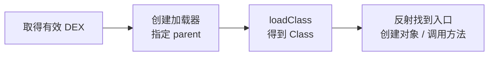

# 类加载机制：从双亲委派到 DEX 与 ART

**类加载器接收类名，找到对应代码，让运行时得到一个 `Class` 对象。** 先看代码从哪里来，再看谁先查、到哪里查，最后动手加载一个独立 DEX。

## 1. 从源码到运行：类加载发生在哪一步 {#first-look}

### 编译打包与运行时加载


编译打包产生代码文件，类加载发生在运行时。系统可能预加载部分基础类；应用运行时再按需要加载其他类，**不是启动时一次性加载整个 APK 的全部类**。Android 的普通 Java/Kotlin 代码最终以 DEX 为主，普通 `.class` 需要转换；仅修改文件扩展名不会得到有效 DEX。[d8 官方说明](https://developer.android.com/tools/d8)

### 类名进来，Class 对象出去

下面的 `context` 是 Activity 或 Application 的 Context：

```java
ClassLoader appLoader = context.getClassLoader();
Class<?> type = appLoader.loadClass("java.lang.String");
android.util.Log.d("ClassLoading", "请求入口：" + appLoader);
android.util.Log.d("ClassLoading", "类名：" + type.getName());
android.util.Log.d("ClassLoading", "定义加载器：" + type.getClassLoader());
```

这段代码返回 String 的类描述，没有创建 String 实例。**接收加载请求的对象，可能不是最终定义该类的加载器**，委派机制解释了其中的顺序。

### 可选场景：加密代码如何接入加载

自定义加密打包需要在运行时先恢复有效字节，再进入加载流程：


普通加载没有强制的加密、解密阶段。Android 的 `InMemoryDexClassLoader` 接收原始 DEX 字节，不能直接接收普通 `.class`。解密完成仍需要类查找和运行时处理。

## 2. 双亲委派：向上委托，向下查找 {#parent-delegation}

**先查已加载，再问 parent；parent 找不到，才查自己。** 每个加载器对象的 `parent` 引用至多指向一个父加载器，“双亲”不是同时有两个父级。

`parent` 是 `ClassLoader` 基类统一声明的私有实例字段。`PathClassLoader`、`DexClassLoader` 等子类对象也包含这份基类状态，不需要在每个子类中重复声明。

下面摘录 AOSP `android-16.0.0_r1` 的 `ClassLoader.java`：[字段声明，L233–236](https://android.googlesource.com/platform/libcore/+/refs/tags/android-16.0.0_r1/ojluni/src/main/java/java/lang/ClassLoader.java#233)、[私有构造方法，L422 起](https://android.googlesource.com/platform/libcore/+/refs/tags/android-16.0.0_r1/ojluni/src/main/java/java/lang/ClassLoader.java#422)、[接收 parent 的构造方法，L507–509](https://android.googlesource.com/platform/libcore/+/refs/tags/android-16.0.0_r1/ojluni/src/main/java/java/lang/ClassLoader.java#507)。省略无关成员、注释及后续初始化，补充中文注释：

```java
// ClassLoader 的实例字段：保存向上委托的目标对象。
private final ClassLoader parent;

private ClassLoader(Void unused, String name, ClassLoader parent) {
    this.name = name;
    this.parent = parent; // 将传入的父加载器保存到当前对象。
    // ... 省略其余初始化
}

protected ClassLoader(ClassLoader parent) {
    this(checkCreateClassLoader(), null, parent); // 调用上面的私有构造方法。
}
```

**构造时保存 parent，加载时沿 parent 委托。** 默认 `loadClass()` 通过 `parent.loadClass(name, false)` 请求这个字段引用的父加载器；父加载器再按自己的实现继续处理，从而形成逐级向上委托。链顶端的 `BootClassLoader` 通过 `super(null)` 将 parent 设为 `null`，表示没有父加载器；完整分支见[下一节的源码](#load-class)。


**从左下角出发，沿蓝线向上，再沿右侧橙线向下。任一绿色出口命中，就返回 Class，不再继续向下查找。**

图中假设每层 `findLoadedClass()` 都未命中，未配置共享库与隔离 split；附加加载器以应用加载器为 parent，应用加载器采用默认父级。

- **向上委托**：附加加载器请求应用加载器，应用加载器继续请求引导加载器。
- **向下查找**：引导类未找到，结果返回应用加载器的原调用点，应用加载器才执行自己的 `findClass()`；仍未找到，再返回附加加载器查附加 DEX。
- **找到即返回**：任一层成功，都把同一个 Class 结果逐层返回请求方；全部未找到，最初请求抛出 `ClassNotFoundException`。

::: tip “向下”表示调用返回后的回退顺序
父加载器不会遍历自己的子加载器，也不会主动向下调用子加载器。每层只是从 `parent.loadClass()` 返回后，继续执行自身尚未完成的查找逻辑。
:::

### 用三种类名走一遍

假设 HostEntry 只在宿主 APK，Greeting 只在附加 DEX，均从附加加载器请求：

| 请求的类 | 自身代码查找到哪层 | 定义加载器 |
| --- | --- | --- |
| `java.lang.String` | 引导类查找命中，停止 | 引导加载器 |
| `com.example.host.HostEntry` | 引导类未命中，宿主 DEX 命中 | 应用加载器 |
| `com.example.plugin.Greeting` | 引导类、宿主均未命中，附加 DEX 命中 | 附加加载器 |

父优先让可见的基础类和共享类型优先复用，减少重复定义同名类型的机会。它不保证整个进程只有一份同名类型，也不会为加载代码创建安全沙箱。

## 3. 对照源码：loadClass 与 findClass 各做什么 {#load-class}

### loadClass 决定顺序，findClass 执行自身查找

摘自 AOSP `android-16.0.0_r1` 的 `ClassLoader.java`，`loadClass(String, boolean)`，L617–647；保留分支，删去原注释并补充说明：

```java
protected Class<?> loadClass(String name, boolean resolve)
        throws ClassNotFoundException {
    Class<?> c = findLoadedClass(name);        // 1. 已加载则直接复用
    if (c == null) {
        try {
            if (parent != null) {
                c = parent.loadClass(name, false); // 2. 向另一个对象委托
            } else {
                c = findBootstrapClassOrNull(name);
            }
        } catch (ClassNotFoundException e) {
            // 父级未找到，回到本次调用，允许继续查自己。
        }
        if (c == null) {
            c = findClass(name);              // 3. 当前对象执行自身查找
        }
    }
    return c;                                 // 成功则返回同一结果
}
```

**“向下查找”就在 catch 后的 `findClass(name)`。** 不是重新发起一个从父到子的请求，而是当前 `loadClass()` 恢复执行。[ClassLoader 源码](https://android.googlesource.com/platform/libcore/+/refs/tags/android-16.0.0_r1/ojluni/src/main/java/java/lang/ClassLoader.java#617)

- `loadClass(name)` 进入 `loadClass(name, false)`；实际执行的方法由虚方法分派决定。
- `ClassLoader.findClass()` 默认只抛未找到异常；Android 的 DEX 查找由 `BaseDexClassLoader.findClass()` 实现。
- 默认实现只捕获父级的 `ClassNotFoundException`，其他链接错误可能直接中断加载。
- 该 Android 方法体没有桌面 JDK 常见的显式 `resolveClass()` 调用，不能照搬桌面实现绘图。

### 链顶端的 BootClassLoader 如何结束委托

它覆盖了 `loadClass()`，直接进行引导类查找。源码 L2753–2762：

```java
protected Class<?> loadClass(String className, boolean resolve)
        throws ClassNotFoundException {
    Class<?> clazz = findLoadedClass(className);
    if (clazz == null) {
        clazz = findClass(className);
    }
    return clazz;
}
// 同类 findClass()，L2697–2698：
// return Class.classForName(name, false, null);
```

`BootClassLoader` 是 Android 内部的 Java 包装，引导类查找由运行时完成。它的 parent 为 null，null 不是一个额外的加载器对象。

### 精确调用时序：目标只在附加 DEX



## 4. Android 的加载器：继承关系与 parent 引用 {#android-loaders}

### 类继承决定谁实现哪些方法

空心三角指向父类，表示 `extends`。`DexPathList`、`Element`、`DexFile` 是协作对象，不是 ClassLoader 子类。



| 加载器 | 常见代码来源 / 用途 | 核心行为 |
| --- | --- | --- |
| `BootClassLoader` | 引导类路径，内部实现 | 覆盖 loadClass，接入引导类查找 |
| `PathClassLoader` | 应用 APK / DEX 等路径 | 默认父优先入口与 DEX 查找 |
| `DexClassLoader` | 指定 DEX 或含 DEX 的 JAR / APK | 提供公开的路径加载构造入口 |
| `InMemoryDexClassLoader` | ByteBuffer 中的 DEX；API 26+ | 不必先写成代码文件 |
| `DelegateLastClassLoader` | 调整代码查找优先级；API 27+ | 引导类 → 自身查找 → parent |

`PathClassLoader` 与 `DexClassLoader` 是兄弟类，不是父子类。`DexClassLoader.optimizedDirectory` 从 API 26 起已弃用、不再生效。[PathClassLoader](https://developer.android.com/reference/dalvik/system/PathClassLoader)、[DexClassLoader](https://developer.android.com/reference/dalvik/system/DexClassLoader)、[内存加载器](https://developer.android.com/reference/dalvik/system/InMemoryDexClassLoader)

### parent 是对象引用，不是 extends

```java
// API 26+；dexBytes 是有效 DEX，context 是宿主 Context。
ClassLoader appLoader = context.getClassLoader();
ClassLoader extraLoader = new dalvik.system.InMemoryDexClassLoader(
        java.nio.ByteBuffer.wrap(dexBytes), appLoader);
boolean sameParent = extraLoader.getParent() == appLoader; // true
```

`parent.loadClass()` 调用另一个对象；`super.loadClass()` 在当前对象上执行父类实现。普通应用的默认 parent 通常是引导加载器，不必经过桌面 JDK 8 教程中的扩展加载器。

AOSP `ApplicationLoaders` 在未指定 parent 时，使用 `ClassLoader.getSystemClassLoader().getParent()`，系统加载器本身也不等于每个应用的加载器。自定义 parent、共享库与隔离 split 会改变实际查找关系。[ApplicationLoaders，L106–110](https://android.googlesource.com/platform/frameworks/base/+/refs/tags/android-16.0.0_r1/core/java/android/app/ApplicationLoaders.java#106)

### DelegateLast 为什么没有完全反转优先级



它仍先查引导类，不能用附加 DEX 覆盖 String。这个顺序来自被覆盖的 `loadClass()`；改变优先级也不自动解决接口隔离和资源冲突。[DelegateLastClassLoader，L181–211](https://android.googlesource.com/platform/libcore/+/refs/tags/android-16.0.0_r1/dalvik/src/main/java/dalvik/system/DelegateLastClassLoader.java#181)

## 5. 深入 DEX：findClass 如何走到 ART {#dex-to-art}

### 当前加载器内部还有一层顺序



这是默认父级查找失败后，本级 `findClass()` 的顺序。共享库数组来自平台配置，一般公开构造示例未配置它们。[BaseDexClassLoader.findClass，L232](https://android.googlesource.com/platform/libcore/+/refs/tags/android-16.0.0_r1/dalvik/src/main/java/dalvik/system/BaseDexClassLoader.java#232)

### DexPathList 逐个查什么

`BaseDexClassLoader` 持有 `DexPathList`，后者持有 `Element[]`；有 DEX 的元素再持有 `DexFile`。核心循环如下：

```java
// DexPathList.java，findClass()，L530–537；省略异常汇总部分。
public Class<?> findClass(String name, List<Throwable> suppressed) {
    for (Element element : dexElements) {
        Class<?> clazz = element.findClass(name, definingContext, suppressed);
        if (clazz != null) {
            return clazz; // 命中即结束，不继续查后面的元素
        }
    }
    // 原实现这里还会合并创建路径时收集的异常。
    return null;
}
```

`definingContext` 是当前加载器对象。一个加载器可以管理多个 DEX；`DexPathList` 和 `DexFile` 不会成为类的定义加载器。

### 从 Java 查找到 ART 原生层



ART 的关键位置在 `dalvik_system_DexFile.cc`：L493 查找 DEX 类定义，L501 注册 DEX，L507 进入 `ClassLinker::DefineClass`。建立运行时类之后，目标类的静态代码块仍需等到初始化时机才执行。[ART 源码](https://android.googlesource.com/platform/art/+/refs/tags/android-16.0.0_r1/runtime/native/dalvik_system_DexFile.cc#471)

`DexFile.defineClass()` 捕获 `ClassNotFoundException`、`NoClassDefFoundError` 后，会把异常加入 suppressed 并返回 null；其他错误仍可能直接传播。ART 对已知加载器还有内部快速路径，不能断言每个类引用都完整经过这些 Java 栈帧，也不是每次请求都重新解压 APK。

## 6. 同名类为什么不能强转：类身份 {#class-identity}

**类身份由二进制类名和定义加载器共同决定。** 假设两个加载器分别亲自定义 Greeting：



```java
// typeA、typeB 分别由 A、B 定义，而不是都委派给同一个父级。
boolean sameName = typeA.getName().equals(typeB.getName()); // true
boolean sameType = typeA == typeB;                         // false
```

插件通过接口交互时，把共享接口放在双方都能委派到的父加载器中；插件编译时引用它，避免再打包一份接口定义。[ClassLoader 官方说明](https://developer.android.com/reference/java/lang/ClassLoader)

## 7. 找到 Class 之后，什么时候执行 static {#initialization}



`loadClass()` 通常不触发目标类初始化。创建实例、调用类声明的静态方法、读写非编译期常量的静态字段等主动使用，才可能触发初始化；解析可以按需进行，不必在初始化前全部完成。[Java 初始化规则 §12.4](https://docs.oracle.com/javase/specs/jls/se17/html/jls-12.html#jls-12.4.1)

宿主中的 `app/src/main/java/com/example/InitProbe.java`：

```java
package com.example;

public final class InitProbe {
    static { System.out.println("InitProbe: static 执行"); }
    public static void hello() { System.out.println("InitProbe: hello"); }
}
```

在该类尚未初始化的前提下调用：

```java
Class<?> type = context.getClassLoader().loadClass("com.example.InitProbe");
System.out.println("已取得 Class");
type.getMethod("hello").invoke(null); // 首次调用静态方法，触发初始化
// 顺序：已取得 Class → InitProbe: static 执行 → InitProbe: hello
```

`Class.forName(name, false, loader)` 明确请求不初始化，传 true 请求初始化。初始化不是每次调用都重做；其他线程需要等待同一 Class 的初始化结果。

首次初始化失败可能抛 `ExceptionInInitializerError`，之后请求可能变成 `NoClassDefFoundError`。应追查最早异常，重复 `loadClass()` 不能重置失败状态。

## 8. 动态加载：先看核心，再做完整实验 {#dynamic-loading}

### 核心调用四步



```java
// API 26+；dexBytes 是原始 DEX，context 是宿主 Context。
ClassLoader loader = new dalvik.system.InMemoryDexClassLoader(
        java.nio.ByteBuffer.wrap(dexBytes), context.getClassLoader());
Class<?> entry = loader.loadClass("com.example.plugin.Greeting");
String value = (String) entry.getMethod("greet", String.class).invoke(null, "Android");
```

创建加载器不会自动调用入口。静态方法的接收对象传 null；实例方法要先通过 `getDeclaredConstructor().newInstance()` 创建对象，再将实例传入 `invoke()`。

### 官方示例在哪里

- [AOSP InMemoryDexClassLoaderTest，L172](https://android.googlesource.com/platform/libcore/+/refs/tags/android-16.0.0_r1/luni/src/test/java/libcore/dalvik/system/InMemoryDexClassLoaderTest.java#172)：将 DEX 放入 ByteBuffer，创建加载器，再加载类并反射调用；辅助文件依赖 AOSP 测试环境。
- [Android 14 文件加载片段](https://developer.android.com/about/versions/14/behavior-changes-14#safer-dynamic-code-loading)：演示打开文件、设置只读和创建加载器的顺序。
- [Google 动态功能模块工程](https://github.com/googlesamples/android-dynamic-code-loading)：演示反射、ServiceLoader 等模块访问方式，与手动加载独立 DEX 的前提不同。

下面实验使用随宿主 APK 打包的本地 DEX，要求 `minSdk >= 26`；内存和文件两种方式加载同一个 Greeting。

### 第一步：单独编译待加载类

在宿主 Java/Kotlin 源码目录之外创建 `plugin-src/com/example/plugin/Greeting.java`。该类仅依赖基础 Java 类型，便于观察 DEX 加载本身。

```java
package com.example.plugin;

public final class Greeting {
    private Greeting() {}

    public static String greet(String name) {
        return "Hello, " + name + " (from DEX)";
    }
}
```

使用 JDK 和 Android SDK Build Tools 的 `d8` 生成 DEX。以下为 Windows PowerShell 示例，从包含 `plugin-src/` 和宿主 `app/` 的目录执行；将前两个路径替换为本机已安装工具的真实路径。`javac` 需在 PATH 中，且支持示例的 Java 8 编译选项。

```powershell
$buildToolsDir = '<Android SDK>/build-tools/<已安装版本>'
$androidJar = '<Android SDK>/platforms/android-26/android.jar'

New-Item -ItemType Directory -Force -Path out/classes,out/dex,app/src/main/assets |
    Out-Null
javac -encoding UTF-8 -source 8 -target 8 -d out/classes `
    plugin-src/com/example/plugin/Greeting.java
if ($LASTEXITCODE -ne 0) { throw 'javac 编译失败' }
& "$buildToolsDir/d8.bat" --min-api 26 --lib $androidJar --output out/dex `
    out/classes/com/example/plugin/Greeting.class
if ($LASTEXITCODE -ne 0) { throw 'd8 转换失败' }
Copy-Item -LiteralPath out/dex/classes.dex -Destination app/src/main/assets/greeting.dex
```

产物是 `app/src/main/assets/greeting.dex`，不是把 `.class` 或普通 Java JAR 改个扩展名。`d8 --min-api 26` 指定输出 DEX 的最低 API；宿主的 `minSdk` 仍需在其 Android 构建配置中单独设置。[d8 官方用法](https://developer.android.com/tools/d8)

**宿主不能同时打包 `Greeting.class` 到自己的 DEX 中**，也不要对该类使用直接导入或 `new Greeting()`。否则默认父优先委派可能返回宿主已经包含的类，导致实验看似成功，实际上没有加载附加 DEX。

### 第二步：以内存或文件方式加载同一个 DEX

将以下类保存到宿主的 `app/src/main/java/com/example/loader/DynamicLoadingExample.java`。两个公开方法相互独立，共用复制与反射调用辅助方法。

<details>
<summary>展开完整示例：DynamicLoadingExample.java</summary>

```java
package com.example.loader;

import android.content.Context;
import dalvik.system.DexClassLoader;
import dalvik.system.InMemoryDexClassLoader;
import java.io.ByteArrayOutputStream;
import java.io.File;
import java.io.FileOutputStream;
import java.io.IOException;
import java.io.InputStream;
import java.io.OutputStream;
import java.nio.ByteBuffer;

public final class DynamicLoadingExample {
    private DynamicLoadingExample() {}

    // API 26+：ByteBuffer 中必须是原始 DEX 内容，不是 APK/JAR 容器。
    public static String runInMemory(Context context)
            throws IOException, ReflectiveOperationException {
        byte[] dexBytes;
        try (InputStream input = context.getAssets().open("greeting.dex");
             ByteArrayOutputStream output = new ByteArrayOutputStream()) {
            copy(input, output);
            dexBytes = output.toByteArray();
        }
        ClassLoader loader = new InMemoryDexClassLoader(
                ByteBuffer.wrap(dexBytes), context.getClassLoader());
        return invokeGreeting(loader);
    }

    // 本示例同样要求 API 26+；更老版本需要提供优化输出目录。
    public static String runFromFile(Context context)
            throws IOException, ReflectiveOperationException {
        File dexFile = File.createTempFile(
                "greeting-", ".dex", context.getCodeCacheDir());
        try (InputStream input = context.getAssets().open("greeting.dex");
             FileOutputStream output = new FileOutputStream(dexFile)) {
            // 顺序：打开输出文件 → 设置只读 → 用已打开的描述符写入。
            if (!dexFile.setReadOnly()) {
                throw new IOException("Cannot mark DEX read-only");
            }
            copy(input, output);
        }
        // 必须等文件写完、输出流关闭，再创建加载器。
        ClassLoader loader = new DexClassLoader(
                dexFile.getAbsolutePath(), null, null, context.getClassLoader());
        return invokeGreeting(loader);
    }

    private static String invokeGreeting(ClassLoader loader)
            throws ReflectiveOperationException {
        Class<?> type = loader.loadClass("com.example.plugin.Greeting");
        if (type.getClassLoader() != loader) {
            throw new IllegalStateException("Greeting was supplied by a parent loader");
        }
        // greet 是 public static，所以 invoke 的接收对象是 null。
        return (String) type.getMethod("greet", String.class).invoke(null, "Android");
    }

    private static void copy(InputStream input, OutputStream output) throws IOException {
        byte[] buffer = new byte[4096];
        int count;
        while ((count = input.read(buffer)) != -1) {
            output.write(buffer, 0, count);
        }
    }
}
```

</details>

内存示例的 `ByteBuffer.wrap()` 已将 `position` 设为 0、`limit` 设为字节数组长度；如果改成手动 `put()`，交给加载器前通常需要 `flip()`，确保剩余区间恰好覆盖 DEX。

文件示例使用私有 `codeCacheDir` 中的新文件，避免覆盖已加载的文件；重复演示会产生多个缓存文件，应由应用在不再需要这些加载器与代码文件时统一管理。

这两个示例的字节来源是随宿主发布的 asset。若改成其他来源，必须在创建加载器前验证可信签名或与可信预期值核对完整性，不能仅计算当前文件的哈希就声称已验证可信。[官方动态代码加载安全说明](https://developer.android.com/privacy-and-security/risks/dynamic-code-loading)

### 第三步：调用并核对结果

在宿主后台执行器或工作线程中调用，避免在主线程执行文件 I/O 和首次类加载。下面的 `context` 表示宿主的 `Context`；两个调用各创建一个独立加载器。

```java
String fromMemory = DynamicLoadingExample.runInMemory(context);
String fromFile = DynamicLoadingExample.runFromFile(context);
// 两者预期均为：Hello, Android (from DEX)
```

调用方需处理上述方法声明的 `IOException` 和 `ReflectiveOperationException`；若反射调用抛出 `InvocationTargetException`，应检查其 `cause` 中的目标方法异常。

`loadClass()` 先按委派规则返回 `Class`；`getMethod()` 找到公开方法；`invoke(null, "Android")` 执行静态方法，并在需要时触发类初始化。

若改成实例方法，需先通过 `getDeclaredConstructor().newInstance()` 创建实例，再将实例传给 `invoke()`。仅创建加载器不会自动调用插件的入口方法。

验证时除了输出字符串，还应保留代码中对**定义加载器**的检查。分别创建的内存加载器和文件加载器即使加载同名类，也不会因此共享类身份；如果要通过接口调用插件，应将共享接口放在宿主可见的父加载器中，插件单独编译时引用它，不再打包另一份接口定义。

## 9. 使用边界与异常排查 {#pitfalls}

### 文件加载：写入和只读顺序

Android 14 及以上、且 `targetSdkVersion >= 34` 的应用动态加载 DEX、JAR、APK 文件时，需要满足只读要求：**先打开输出文件 → 随即设为只读 → 经已打开的描述符写入 → 关闭输出流 → 创建加载器**。完整示例已按此处理；只读属性与代码来源可信是两回事。[Android 14 官方要求](https://developer.android.com/about/versions/14/behavior-changes-14#safer-dynamic-code-loading)

### 加载代码不自动安装组件或替换旧类

创建加载器不会自动向 PMS 注册 Activity、Service、Receiver、Provider，不会自动解决资源查找，也不会把已有对象变成新版类型。加载的代码仍运行在宿主进程和权限环境中。

### 从异常反查失败位置

| 异常 / 表现 | 优先判断 | 检查位置 |
| --- | --- | --- |
| `ClassNotFoundException` | 请求链没有找到可用类定义 | 请求加载器、parent、DEX 内容、路径与 suppressed |
| `NoClassDefFoundError` | 依赖不可见，或之前初始化失败 | 最早异常、cause、依赖来源与加载器 |
| 同名类型 `ClassCastException` | 独立定义加载器产生不同类型 | 两端 Class 及 getClassLoader() |
| `UnsatisfiedLinkError` | 原生库加载失败 | ABI、.so 依赖、链接器命名空间 |

不要只看类名，先记录请求入口与定义加载器。需要重现首次加载或初始化时，使用新的实验进程，避免已缓存的类让观察结果失真。

## 10. 源码与阅读索引 {#sources}

源码摘录与行号对应 AOSP `android-16.0.0_r1`：

- [ClassLoader / BootClassLoader](https://android.googlesource.com/platform/libcore/+/refs/tags/android-16.0.0_r1/ojluni/src/main/java/java/lang/ClassLoader.java)：L236 parent 字段，L422 构造赋值，L507 接收 parent 的构造入口，L572 单参数入口，L617 默认委派，L2692 引导加载器构造，L2697 引导类查找，L2753 引导加载入口。
- [BaseDexClassLoader](https://android.googlesource.com/platform/libcore/+/refs/tags/android-16.0.0_r1/dalvik/src/main/java/dalvik/system/BaseDexClassLoader.java#232)：共享库和自身路径顺序。
- [DexPathList](https://android.googlesource.com/platform/libcore/+/refs/tags/android-16.0.0_r1/dalvik/src/main/java/dalvik/system/DexPathList.java#530)、[DexFile](https://android.googlesource.com/platform/libcore/+/refs/tags/android-16.0.0_r1/dalvik/src/main/java/dalvik/system/DexFile.java#320)：元素遍历与 Java 到 native 的入口。
- [ART DexFile_defineClassNative](https://android.googlesource.com/platform/art/+/refs/tags/android-16.0.0_r1/runtime/native/dalvik_system_DexFile.cc#471)：查 DEX 类定义、注册 DEX、接入 ClassLinker。
- [ClassLoader 官方 API](https://developer.android.com/reference/java/lang/ClassLoader)、[Java 生命周期规范 §12](https://docs.oracle.com/javase/specs/jls/se17/html/jls-12.html)：类型与初始化契约。

结构参考：[JVM 类加载与双亲委派](https://cloud.tencent.com/developer/article/2293749)。Android 使用 DEX / ART，不能直接套用 JDK 8 的扩展加载器或 `rt.jar`。
