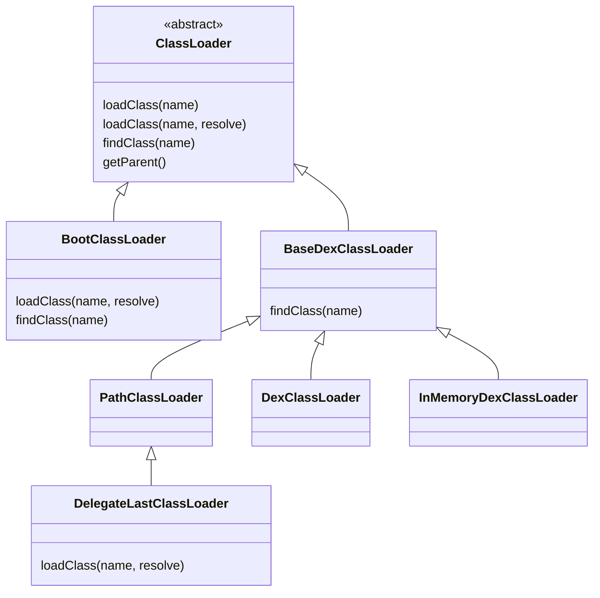
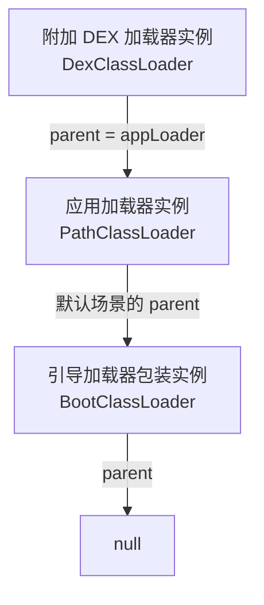
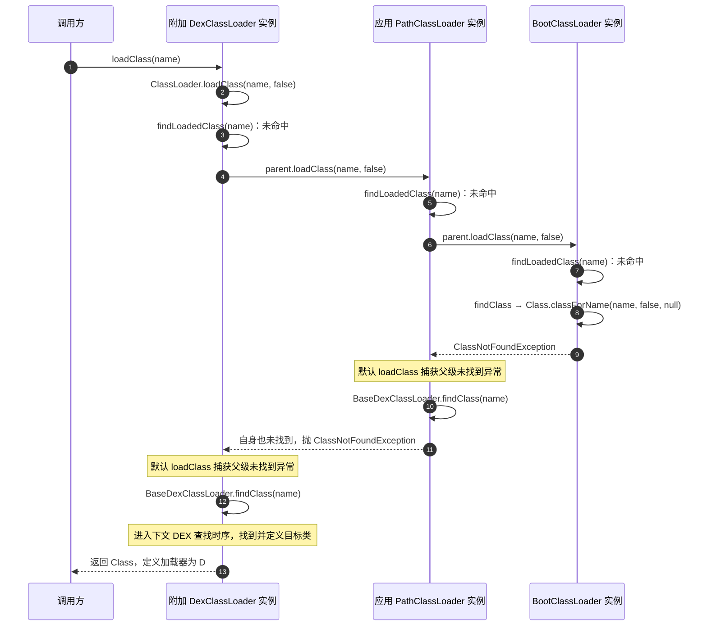
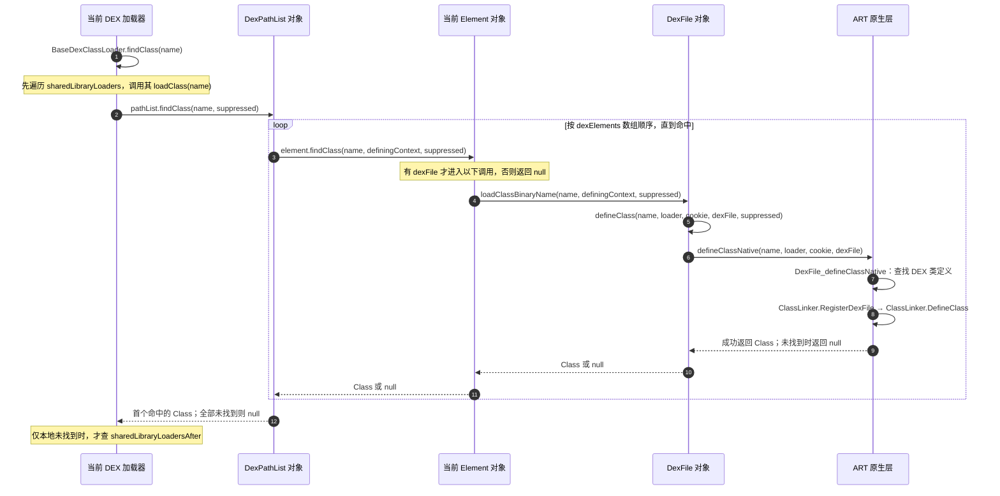
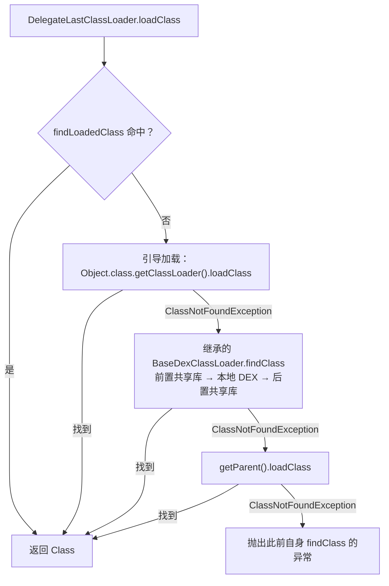

# 类加载机制

类加载解决“给定类名，由哪个加载器找到并定义这个类”。它与应用安装、组件注册、资源解析和类初始化有关联，但不是同一件事。本文补全[原提纲](https://alidocs.dingtalk.com/i/nodes/1OQX0akWmxaRZD7yfgRMaeOX8GlDd3mE)的 ClassLoader 章节，实现基线为 AOSP `android-16.0.0_r1`。

## ClassLoader 继承关系

下图的空心三角指向父类，表达 Java 的 `extends` 关系。`DexPathList`、`Element` 和 `DexFile` 是协作对象，不是 ClassLoader 子类。



- `ClassLoader` 提供默认父优先委派；基类的 `findClass()` 本身只抛出 `ClassNotFoundException`。
- `BootClassLoader` 是 Android 的内部引导加载器 Java 包装，直接继承 `ClassLoader`，有自己的 `loadClass()` 实现，不是供应用创建的公开 API。
- `BaseDexClassLoader` 重写 `findClass()`，将共享库和 DEX 路径接入默认委派流程。
- `PathClassLoader`、`DexClassLoader`、`InMemoryDexClassLoader` 在此基线均沿用父类的类查找实现，主要区别在构造入口和代码来源；内存加载器接受 `ByteBuffer` 中的 DEX。
- `DelegateLastClassLoader` 直接继承 `PathClassLoader`，重写 `loadClass()` 调整委派顺序；它与 `InMemoryDexClassLoader` 都是 `final` 类。

源码：[ClassLoader / BootClassLoader](https://android.googlesource.com/platform/libcore/+/refs/tags/android-16.0.0_r1/ojluni/src/main/java/java/lang/ClassLoader.java)、[PathClassLoader](https://android.googlesource.com/platform/libcore/+/refs/tags/android-16.0.0_r1/dalvik/src/main/java/dalvik/system/PathClassLoader.java)、[DexClassLoader](https://android.googlesource.com/platform/libcore/+/refs/tags/android-16.0.0_r1/dalvik/src/main/java/dalvik/system/DexClassLoader.java)、[InMemoryDexClassLoader](https://android.googlesource.com/platform/libcore/+/refs/tags/android-16.0.0_r1/dalvik/src/main/java/dalvik/system/InMemoryDexClassLoader.java)。

### 继承关系与 parent 委派关系

`extends` 决定对象继承哪些方法；`parent` 是构造加载器时传入的另一个加载器对象，决定向谁委派。**向 parent 请求不等于调用 `super.loadClass()`**：前者调用另一个对象，后者仍在当前对象上执行父类方法。

下面是普通应用加载器采用默认父级、且手动创建附加 DEX 加载器并将应用加载器传为 parent 的示例。箭头只表示对象间的 `parent` 引用。



`DexClassLoader` 不继承 `PathClassLoader`，图中只是两个实例建立了委派关系。基线 `ApplicationLoaders` 在未指定父级时，使用 `ClassLoader.getSystemClassLoader().getParent()` 作为默认父级；系统加载器本身是以 `BootClassLoader` 为 parent 的 `PathClassLoader`。因此普通应用的父级不必经过系统 `PathClassLoader`。自定义父级、隔离 split 和共享库会改变实际查找图，应以运行时对象与创建参数为准。[ApplicationLoaders 默认父级](https://android.googlesource.com/platform/frameworks/base/+/refs/tags/android-16.0.0_r1/core/java/android/app/ApplicationLoaders.java#94)

## 类身份：名字之外还有定义加载器

运行时区分类型，必须考虑类的二进制名称和**定义它的 ClassLoader**。两个加载器各自定义 `com.example.Note`，得到的类不一定可强制转换，即使类名和字节内容相同。把请求转交父加载器的发起加载器，也不一定是最终定义类的加载器。

这解释了插件或多加载器环境中的 `ClassCastException`、接口不可见和代理创建失败。共享接口应由双方可见的同一加载器定义；只对比 `Class.getName()` 无法排除类型身份冲突。[ClassLoader API](https://developer.android.com/reference/java/lang/ClassLoader)

## 默认委派：先查已加载，再向父级请求

基线 `ClassLoader.loadClass(name, resolve)` 先调用 `findLoadedClass()`，再尝试父加载器或引导加载，未找到时才调用自身 `findClass()`。只有适用该实现或契约的加载器才可以按这个顺序分析；子类可以改变查找策略。

### 调用时序：从请求到父级，再回到自身

以下沿用上面的实例关系，假设各级尚未发起加载目标类，目标仅存在于附加 DEX 中，而且没有共享库命中。图中的 `BaseDexClassLoader.findClass()` 在当前接收对象上执行，**不是创建了一个 BaseDexClassLoader 对象**。



若本级 `findLoadedClass()` 命中，立即返回；若父级成功，直接返回父级结果，不再执行当前加载器的 `findClass()`。父级未找到时，查找才向请求方逐层回退；最终自身也未找到，异常继续传给调用方。默认委派只捕获父级的 `ClassNotFoundException`，不能把所有链接错误都当成“换个路径继续找”。

`loadClass(name)` 在此基线调用 `loadClass(name, false)`。Java 虚方法分派决定执行哪一层实现：普通 DEX 加载器沿用 `ClassLoader.loadClass()`；`BootClassLoader` 和 `DelegateLastClassLoader` 则执行各自覆盖的方法。

`loadClass()` 不等于执行所有静态初始化。类的加载、链接和初始化需要分别理解；`Class.forName(name, false, loader)` 可以明确请求不初始化，后续主动使用仍可能触发初始化。基线 Android 的默认 `loadClass(name, resolve)` 方法体没有桌面 JDK 常见的显式 `resolveClass()` 调用，不应直接套用桌面实现绘图。[固定版本 ClassLoader](https://android.googlesource.com/platform/libcore/+/refs/tags/android-16.0.0_r1/ojluni/src/main/java/java/lang/ClassLoader.java#572)

## Android 的 DEX 加载器

### PathClassLoader 与 DexClassLoader

`PathClassLoader` 常用于应用和系统代码的路径加载；`DexClassLoader` 提供从指定路径加载 DEX 相关代码的公开构造入口。两者都涉及 `BaseDexClassLoader`，但构造参数、使用场景和历史版本约束不能混为一谈。Android 执行格式以 DEX 为核心，不是把任意桌面 JVM `.class` 文件直接放入路径就能运行。

`DexClassLoader` 的 `optimizedDirectory` 参数从 API 26 起已弃用且不再生效，不应照搬旧教程要求人为管理优化输出目录的做法。[PathClassLoader](https://developer.android.com/reference/dalvik/system/PathClassLoader)、[DexClassLoader](https://developer.android.com/reference/dalvik/system/DexClassLoader)

### BaseDexClassLoader 与 DexPathList

基线 `BaseDexClassLoader.findClass()` 会先考虑前置共享库加载器，再查询自身 `DexPathList`，必要时再考虑后置共享库加载器。DexPathList 在其元素中寻找目标 DEX 类；这只是默认父委派失败后，自身查找内部的进一步顺序，不能取代上层 `loadClass()` 的父委派。

因此“Android 永远只有父链”和“DEX 总是先于所有共享库”都过于绝对。定位来源要同时看父加载器、共享库加载器、split 和自身路径。[BaseDexClassLoader](https://android.googlesource.com/platform/libcore/+/refs/tags/android-16.0.0_r1/dalvik/src/main/java/dalvik/system/BaseDexClassLoader.java)、[DexPathList](https://android.googlesource.com/platform/libcore/+/refs/tags/android-16.0.0_r1/dalvik/src/main/java/dalvik/system/DexPathList.java)

### DEX 查找时序：从 findClass 到 ART

下面展开当前加载器的自身查找。为保持图的可读性，假设前置共享库未配置或均未找到，且本地某个 DEX 可以成功定义目标类；找到后即返回，不再查后续元素与后置共享库。



`BaseDexClassLoader` 持有 `DexPathList`，后者持有 `Element[]`，其中有 DEX 的元素再持有 `DexFile`。传入原生层的 `definingContext` 是当前加载器对象；`DexPathList` 和 `DexFile` 不会成为这个类的定义加载器。

查找结果有三种需要区分：成功返回 `Class`；未找到返回 `null`，使上层继续搜索；抛出异常。`DexFile.defineClass()` 会将其捕获的 `ClassNotFoundException`、`NoClassDefFoundError` 加入 `suppressed` 并返回 `null`；其他未被捕获的错误仍可直接传播。所有路径均未找到时，`BaseDexClassLoader.findClass()` 才构造最终 `ClassNotFoundException` 并附加收集的异常。

这张图描述 Java 显式加载入口的源码路径，ART 还可能对已知加载器使用内部快速路径，不能据此断言每次字节码解析类引用都完整经过这些 Java 栈帧。DEX 打开、验证和优化也不等于每次 `loadClass()` 都从 APK 重新解压一遍。

源码：[DexPathList.findClass / Element.findClass](https://android.googlesource.com/platform/libcore/+/refs/tags/android-16.0.0_r1/dalvik/src/main/java/dalvik/system/DexPathList.java#530)、[DexFile.loadClassBinaryName / defineClass](https://android.googlesource.com/platform/libcore/+/refs/tags/android-16.0.0_r1/dalvik/src/main/java/dalvik/system/DexFile.java#320)、[ART DexFile_defineClassNative](https://android.googlesource.com/platform/art/+/refs/tags/android-16.0.0_r1/runtime/native/dalvik_system_DexFile.cc#471)。

### DelegateLastClassLoader 的边界

API 27 提供的 `DelegateLastClassLoader` 采用不同策略：先复用已经加载的类；需要查找新类时，优先引导类，再执行自身 `findClass()`，之后才委派父加载器。普通公开构造场景可概括为“引导类 → DEX 路径 → 父加载器”；平台内部若配置了前置或后置共享库加载器，继承的 `BaseDexClassLoader.findClass()` 仍会按前述共享库规则查找，不能将“自身查找”限定为仅查 DEX。名称中的 delegate last 不表示可覆盖所有 Java 核心类，也不代表自动解决接口隔离和资源冲突。[DelegateLastClassLoader API](https://developer.android.com/reference/dalvik/system/DelegateLastClassLoader)、[固定版本 loadClass 实现](https://android.googlesource.com/platform/libcore/+/refs/tags/android-16.0.0_r1/dalvik/src/main/java/dalvik/system/DelegateLastClassLoader.java)



图中的向下继续只适用于标出的“未找到”异常；其他错误仍可中断加载。注意引导加载是在自身 DEX 之前执行，父级最后执行也不意味着能覆盖引导类。

## 动态代码加载不等于安装应用

创建加载器不会自动向 PMS 注册新的 Activity、Service、Receiver 或 Provider；组件声明和系统安装状态属于另一条链。它也不会把已有对象无缝变成新版本类，或为加载代码建立独立安全沙箱。共享进程和权限的代码需要按同一信任边界评估。

运行于 Android 14 及以上且 `targetSdkVersion >= 34` 的应用，动态加载的 DEX、JAR 或 APK 文件需要满足平台只读要求。官方要求先打开输出文件，随即设为只读，再通过已打开的文件描述符写入内容。加载前仍需验证来源与完整性；仅设置只读不能证明代码可信。动态下载执行代码还需核对分发渠道政策。[Android 14 动态代码加载变更](https://developer.android.com/about/versions/14/behavior-changes-14#safer-dynamic-code-loading)

## 官方示例与本地动态加载实践

### 官方资料分别演示什么

- **AOSP 的直接加载测试**：[InMemoryDexClassLoaderTest.java](https://android.googlesource.com/platform/libcore/+/refs/tags/android-16.0.0_r1/luni/src/test/java/libcore/dalvik/system/InMemoryDexClassLoaderTest.java#172) 中，`createLoaderDirect()` 将 DEX 放进 `ByteBuffer` 并创建加载器；`createLoaderDirectAndCallMethod()` 接着调用 `loadClass()`、`getMethod()` 和 `invoke()`。这是可核对的官方动态加载使用代码，其辅助文件和测试运行器依赖 AOSP 测试环境。
- **Android Developers 的文件加载片段**：[Android 14 DCL 说明](https://developer.android.com/about/versions/14/behavior-changes-14#safer-dynamic-code-loading) 给出文件打开、只读设置和创建 `PathClassLoader` 的顺序。该片段主要说明文件权限处理，需要自行补齐写入和方法调用。
- **Google 的动态功能模块工程**：[android-dynamic-code-loading](https://github.com/googlesamples/android-dynamic-code-loading) 演示通过反射、`ServiceLoader`、Dagger 访问动态功能模块中的实现。仓库于 2024 年 2 月 20 日归档，可用于理解模块访问模式；功能模块由应用分发机制管理，与手动创建加载器读取独立 DEX 的实验具有不同前提。

下面给出基于公开 API 整理的教学代码，使用**自己编译并随宿主 APK 打包的本地 DEX**。宿主示例要求 `minSdk >= 26`，不使用网络、外部存储或隐藏 API。内存方式使用 API 26 提供的单 `ByteBuffer` 构造函数；文件方式使用 `DexClassLoader`，在这一版本范围内 `optimizedDirectory` 可传 `null`。[内存加载器 API](https://developer.android.com/reference/dalvik/system/InMemoryDexClassLoader)、[文件加载器 API](https://developer.android.com/reference/dalvik/system/DexClassLoader)

### 第一步：单独编译待加载类

在宿主 Java/Kotlin 源码目录之外创建 `plugin-src/com/example/plugin/Greeting.java`。该类仅依赖基础 Java 类型，便于观察 DEX 加载本身。

```java
package com.example.plugin;

public final class Greeting {
    private Greeting() {}

    public static String greet(String name) {
        return "Hello, " + name + " (from DEX)";
    }
}
```

使用 JDK 和 Android SDK Build Tools 的 `d8` 生成 DEX。以下为 Windows PowerShell 示例，从包含 `plugin-src/` 和宿主 `app/` 的目录执行；将前两个路径替换为本机已安装工具的真实路径。`javac` 需在 PATH 中，且支持示例的 Java 8 编译选项。

```powershell
$buildToolsDir = '<Android SDK>/build-tools/<已安装版本>'
$androidJar = '<Android SDK>/platforms/android-26/android.jar'

New-Item -ItemType Directory -Force -Path out/classes,out/dex,app/src/main/assets |
    Out-Null
javac -encoding UTF-8 -source 8 -target 8 -d out/classes `
    plugin-src/com/example/plugin/Greeting.java
if ($LASTEXITCODE -ne 0) { throw 'javac 编译失败' }
& "$buildToolsDir/d8.bat" --min-api 26 --lib $androidJar --output out/dex `
    out/classes/com/example/plugin/Greeting.class
if ($LASTEXITCODE -ne 0) { throw 'd8 转换失败' }
Copy-Item -LiteralPath out/dex/classes.dex -Destination app/src/main/assets/greeting.dex
```

产物是 `app/src/main/assets/greeting.dex`，不是把 `.class` 或普通 Java JAR 改个扩展名。`d8 --min-api 26` 指定输出 DEX 的最低 API；宿主的 `minSdk` 仍需在其 Android 构建配置中单独设置。[d8 官方用法](https://developer.android.com/tools/d8)

**宿主不能同时打包 `Greeting.class` 到自己的 DEX 中**，也不要对该类使用直接导入或 `new Greeting()`。否则默认父优先委派可能返回宿主已经包含的类，导致实验看似成功，实际上没有加载附加 DEX。

### 第二步：以内存或文件方式加载同一个 DEX

将以下类保存到宿主的 `app/src/main/java/com/example/loader/DynamicLoadingExample.java`。两个公开方法相互独立，共用复制与反射调用辅助方法。

```java
package com.example.loader;

import android.content.Context;
import dalvik.system.DexClassLoader;
import dalvik.system.InMemoryDexClassLoader;
import java.io.ByteArrayOutputStream;
import java.io.File;
import java.io.FileOutputStream;
import java.io.IOException;
import java.io.InputStream;
import java.io.OutputStream;
import java.nio.ByteBuffer;

public final class DynamicLoadingExample {
    private DynamicLoadingExample() {}

    // API 26+：ByteBuffer 中必须是原始 DEX 内容，不是 APK/JAR 容器。
    public static String runInMemory(Context context)
            throws IOException, ReflectiveOperationException {
        byte[] dexBytes;
        try (InputStream input = context.getAssets().open("greeting.dex");
             ByteArrayOutputStream output = new ByteArrayOutputStream()) {
            copy(input, output);
            dexBytes = output.toByteArray();
        }
        ClassLoader loader = new InMemoryDexClassLoader(
                ByteBuffer.wrap(dexBytes), context.getClassLoader());
        return invokeGreeting(loader);
    }

    // 本示例同样要求 API 26+；更老版本需要提供优化输出目录。
    public static String runFromFile(Context context)
            throws IOException, ReflectiveOperationException {
        File dexFile = File.createTempFile(
                "greeting-", ".dex", context.getCodeCacheDir());
        try (InputStream input = context.getAssets().open("greeting.dex");
             FileOutputStream output = new FileOutputStream(dexFile)) {
            // 顺序：打开输出文件 → 设置只读 → 用已打开的描述符写入。
            if (!dexFile.setReadOnly()) {
                throw new IOException("Cannot mark DEX read-only");
            }
            copy(input, output);
        }
        // 必须等文件写完、输出流关闭，再创建加载器。
        ClassLoader loader = new DexClassLoader(
                dexFile.getAbsolutePath(), null, null, context.getClassLoader());
        return invokeGreeting(loader);
    }

    private static String invokeGreeting(ClassLoader loader)
            throws ReflectiveOperationException {
        Class<?> type = loader.loadClass("com.example.plugin.Greeting");
        if (type.getClassLoader() != loader) {
            throw new IllegalStateException("Greeting was supplied by a parent loader");
        }
        // greet 是 public static，所以 invoke 的接收对象是 null。
        return (String) type.getMethod("greet", String.class).invoke(null, "Android");
    }

    private static void copy(InputStream input, OutputStream output) throws IOException {
        byte[] buffer = new byte[4096];
        int count;
        while ((count = input.read(buffer)) != -1) {
            output.write(buffer, 0, count);
        }
    }
}
```

内存示例的 `ByteBuffer.wrap()` 已将 `position` 设为 0、`limit` 设为字节数组长度；如果改成手动 `put()`，交给加载器前通常需要 `flip()`，确保剩余区间恰好覆盖 DEX。文件示例使用私有 `codeCacheDir` 中的新文件，避免覆盖已加载的文件；重复演示会产生多个缓存文件，应由应用在不再需要这些加载器与代码文件时统一管理。

这两个示例的字节来源是随宿主发布的 asset。若改成其他来源，必须在创建加载器前验证可信签名或与可信预期值核对完整性，不能仅计算当前文件的哈希就声称已验证可信。[官方动态代码加载安全说明](https://developer.android.com/privacy-and-security/risks/dynamic-code-loading)

### 第三步：调用并核对结果

在宿主后台执行器或工作线程中调用，避免在主线程执行文件 I/O 和首次类加载。下面的 `context` 表示宿主的 `Context`；两个调用各创建一个独立加载器。

```java
String fromMemory = DynamicLoadingExample.runInMemory(context);
String fromFile = DynamicLoadingExample.runFromFile(context);
// 两者预期均为：Hello, Android (from DEX)
```

调用方需处理上述方法声明的 `IOException` 和 `ReflectiveOperationException`；若反射调用抛出 `InvocationTargetException`，应检查其 `cause` 中的目标方法异常。

`loadClass()` 先按委派规则返回 `Class`；`getMethod()` 找到公开方法；`invoke(null, "Android")` 执行静态方法，并在需要时触发类初始化。若改成实例方法，需先通过 `getDeclaredConstructor().newInstance()` 创建实例，再将实例传给 `invoke()`。仅创建加载器不会自动调用插件的入口方法。

验证时除了输出字符串，还应保留代码中对**定义加载器**的检查。分别创建的内存加载器和文件加载器即使加载同名类，也不会因此共享类身份；如果要通过接口调用插件，应将共享接口放在宿主可见的父加载器中，插件单独编译时引用它，不再打包另一份接口定义。

## 常见异常如何定位

- `ClassNotFoundException`：先查请求加载器、路径、打包内容和依赖是否可见。
- `NoClassDefFoundError`：除了依赖不可见，还可能与此前初始化失败有关；应保留首个异常及 cause。
- `ClassCastException`：检查两端 Class 的定义加载器，不只看同名类。
- `UnsatisfiedLinkError`：转查原生库、ABI、依赖和链接器命名空间；DEX 能找到类不代表 `.so` 能加载。

排查时可以记录应用自身类的 `getClassLoader()` 和父级信息；这只是观察入口，不应反射改写 dexElements 来替代公开契约。示例的设备运行结果需按实际宿主、系统版本和构建配置验证，不能将预期输出视为真机验证记录。
