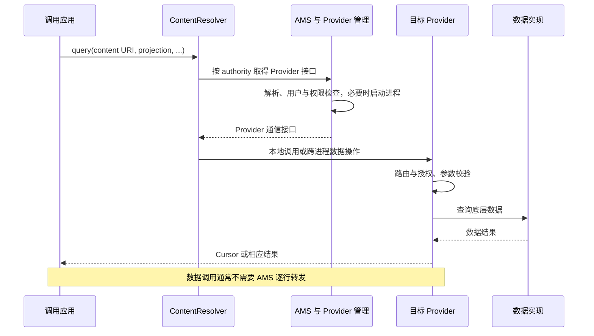
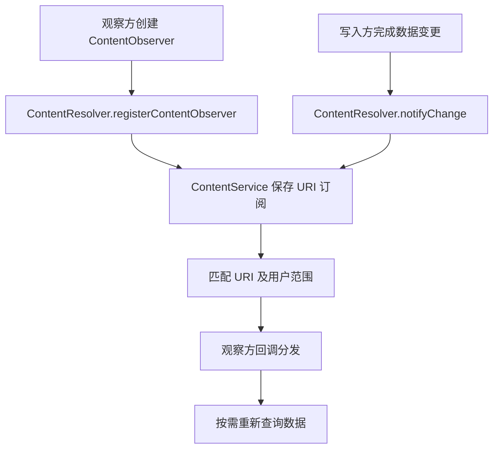

# Provider 原理

ContentProvider 是用 URI 暴露数据操作与访问控制的应用组件；ContentResolver 是调用入口；ContentObserver 观察变化；ContentService 协调观察注册与通知。它们名字接近，但分别承担不同职责。


## Provider 声明与 Observer 注册 {#provider-registration}

### Provider 通过 Manifest 声明

应用 Provider 通常在 Manifest 中以 `<provider>` 声明类名、authority、进程、权限及导出条件，系统包管理据此发现组件。authority 是 URI 路由的一部分，不能只根据 URI 路径找到任意 Java 对象。

普通应用没有一个等价于 `registerReceiver()` 的公开 API，能把任意新 Provider 动态注册成系统组件。框架内部发布已装载 Provider 的过程，也不应被说成普通应用的“动态注册 Provider”。[Provider 基础](https://developer.android.com/guide/topics/providers/content-provider-basics)

### ContentObserver 在运行时注册

`ContentResolver.registerContentObserver() → ContentService.registerContentObserver()` 是**观察者注册链**。它让系统记住对特定 URI 的订阅，不负责把 Provider 安装到系统，也不会创建数据表。

是否观察子 URI、接收哪个用户空间的变化、观察对象持有多长生命周期，都应明确。调用者注册成功后，还需在相应生命周期注销观察者，避免不必要的持有与回调。[ContentObserver API](https://developer.android.com/reference/android/database/ContentObserver)

## Provider 如何被创建和发布

访问远端 authority 时，ContentResolver 需要取得对应的 Provider 接口。AMS 中的 `ContentProviderHelper` 参与查找、权限/用户检查、进程协调与引用管理；目标进程尚未就绪时，系统可能先启动进程并等待 Provider 发布。

应用侧 `ActivityThread.installProvider()` 使用相应包信息和 ClassLoader 创建 Provider，完成 attach 并执行初始化，再把可供外部调用的接口发布给系统。普通应用绑定初始化路径中，初始 Provider 的安装可能早于 `Application.onCreate()`，因此不能在 Provider 初始化时假设后者已经完成。[ContentProviderHelper](https://github.com/aosp-mirror/platform_frameworks_base/blob/android-16.0.0_r1/services/core/java/com/android/server/am/ContentProviderHelper.java)、[ActivityThread](https://github.com/aosp-mirror/platform_frameworks_base/blob/android-16.0.0_r1/core/java/android/app/ActivityThread.java)

这不表示所有 Provider 都在任意启动场景无条件提前实例化；实际取决于进程、绑定数据、初始化路径及组件配置。

## 从 URI 查询到数据返回



Provider 不必使用 SQLite；也可以封装文件、内存或其他数据来源。URI 统一的是访问协议和授权入口，不是底层存储格式。

### Cursor 与文件接口

`query()` 返回的 Cursor 是受管理资源，使用完必须关闭；远端结果可能涉及窗口化数据传输，不等于把全部表一次复制成 Java List。文件接口则可返回文件描述符，调用方应按各自资源契约关闭。

查询时明确 projection、筛选和结果范围，避免不必要的全列读取或一次读取过多数据。取消、远端死亡、权限变化与无匹配数据是不同结果，不能统一吞掉后当成空列表。[ContentProvider API](https://developer.android.com/reference/android/content/ContentProvider)

`ContentResolver.query()` 的默认远程查询路径也管理引用生命周期：先取得 unstable Provider，若查询时遭遇 `DeadObjectException`，会报告死亡并尝试重新取得 stable Provider。成功返回的 Cursor 由包装对象持有 stable 引用，关闭 Cursor 才释放它；调用结束不等于引用已经释放。该重试是查询实现中的特定分支，不能据此自动重试所有有副作用的写入。[query 与 CursorWrapperInner](https://github.com/aosp-mirror/platform_frameworks_base/blob/android-16.0.0_r1/core/java/android/content/ContentResolver.java)

### 线程边界

远程数据方法可能在 Provider 进程 Binder 线程上并发执行，需要保护共享状态；同进程访问也不能假设总在主线程。`onCreate()` 与数据方法的调用阶段不同，启动阶段应避免大量阻塞初始化。

通过 ContentResolver 调用并不会自动变成异步操作。UI 线程上查询慢 Provider 仍可能卡顿，应在合适后台执行环境处理，并把结果交回界面层。

## ContentService 与变化通知 {#content-observer}



Provider 写入数据后通常需要按协议调用 `notifyChange()`；ContentService 不会自动监控所有底层文件或数据库变化。Observer 收到的是“数据可能变化”的提示，不能当作包含完整数据、恰好一次或永久可靠的事件日志。

`ContentObserver(Handler)` 可将回调安排到该 Handler；未提供 Handler 时，回调线程遵循其 API 分发规则，不应盲目直接改 UI。变化后应合并重复刷新，必要时重新查询，而不是在通知回调里执行长任务。[ContentService 源码](https://github.com/aosp-mirror/platform_frameworks_base/blob/android-16.0.0_r1/services/core/java/com/android/server/content/ContentService.java)

### 一组对应的注册与注销

下面是拥有者生命周期方法中的 Kotlin 片段，`context` 是拥有者管理的 Context，URI 指向自行实现的示例 Provider；双参数 `onChange()` 回调从 API 16 提供。

```kotlin
private val notesUri = android.net.Uri.parse("content://example.notes/items")
private val observer = object : android.database.ContentObserver(
    android.os.Handler(android.os.Looper.getMainLooper())
) {
    override fun onChange(selfChange: Boolean, uri: android.net.Uri?) {
        // 合并刷新请求，并交给后台查询；此处不直接做阻塞 I/O。
    }
}

fun startObserving() {
    context.contentResolver.registerContentObserver(notesUri, true, observer)
}

fun stopObserving() {
    context.contentResolver.unregisterContentObserver(observer)
}
```

拥有者应防止重复注册，并明确停止后是否仍接受在途回调。`example.notes` 是说明用 authority，不是设备必定存在的系统 Provider。

## 权限、URI 与引用生命周期

- exported、读写权限与 URI 临时授权共同决定跨应用访问；拿到 URI 不等于有权限读取。
- Provider 内仍需对 URI 路由、projection、筛选参数和文件路径进行约束；Binder 可达不等于业务授权通过。
- `ContentProviderClient`、Cursor 和文件描述符是不同资源，需按各自生命周期释放；不要因为缓存了引用就假设远端永久可用。
- 观察通知与数据事务没有自动绑定成跨进程原子操作，调用方要容忍合并、重复或重新查询后的状态差异。

组件安全细节见 [ContentProvider 安全](/security/android/component-security.html#s57)，包与进程初始化见 [LoadedApk](./loaded-apk.html)，ContentService 职责见 [系统核心服务](./system-services/content-service.html#s200)。

原始笔记：[Android 基础知识提纲](https://alidocs.dingtalk.com/i/nodes/1OQX0akWmxaRZD7yfgRMaeOX8GlDd3mE)。
