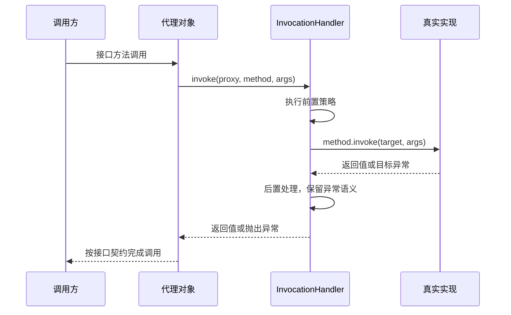

# 动态代理原理

Java 接口动态代理可以在运行时创建一个实现指定接口的对象，将经由这个对象发生的方法调用转交给 `InvocationHandler`。它适合在明确的接口边界实现计时、鉴权、日志或适配；不会自动拦截进程中所有对象的方法。


## Proxy 与 InvocationHandler 如何协作

`Proxy.newProxyInstance(loader, interfaces, handler)` 取得实现接口的代理实例。调用接口方法时，运行时把代理对象、Method 和实参数组交给 `handler.invoke()`；没有参数时 args 可以为空。处理器可以实现行为，也可以将调用委派给一个真实目标。



代理类只实现指定接口，不能凭此覆盖任意具体类的 final 方法，也不会经过目标对象内部对自身方法的直接调用。接口默认方法是否委派给目标、是否执行额外策略，需要处理器明确决定，不能假定运行时替业务作出选择。

代理调用仍在发起调用的线程同步进入 `invoke()`，除非处理器显式安排异步工作；多个线程可以同时进入同一处理器。计数、缓存和鉴权状态因此仍需正确同步，代理本身不会把调用串行化。代理类继承 `Proxy` 并实现给定接口，真正的目标对象只是处理器选择持有的委托对象。[Proxy 与处理器契约](https://docs.oracle.com/en/java/javase/17/docs/api/java.base/java/lang/reflect/Proxy.html)

## 最小可运行示例：代理调用真实对象

保存为 `ProxyDemo.java`。示例只使用 Java 标准 API，可以先在桌面 JDK 中运行；在 Android 中，将 `main()` 内的创建和调用代码放进业务方法，`main()` 本身不是 Android 组件入口。

```java
import java.lang.reflect.InvocationTargetException;
import java.lang.reflect.Proxy;

public final class ProxyDemo {
    public interface Greeter {
        String hello(String name);
    }

    public static final class RealGreeter implements Greeter {
        @Override public String hello(String name) {
            System.out.println("target.hello");
            return "Hello, " + name;
        }
    }

    public static void main(String[] args) {
        Greeter target = new RealGreeter();
        Greeter proxy = (Greeter) Proxy.newProxyInstance(
                Greeter.class.getClassLoader(),
                new Class<?>[] { Greeter.class },
                (proxyObject, method, methodArgs) -> {
                    System.out.println("handler.before " + method.getName());
                    try {
                        Object result = method.invoke(target, methodArgs);
                        System.out.println("handler.after " + method.getName());
                        return result;
                    } catch (InvocationTargetException e) {
                        throw e.getCause();
                    }
                });
        System.out.println(proxy.hello("Android"));
    }
}
```

在文件所在目录执行：

```sh
javac -encoding UTF-8 ProxyDemo.java
java ProxyDemo
```

输出顺序：

```text
handler.before hello
target.hello
handler.after hello
Hello, Android
```

核心调用链是 `proxy.hello("Android")` → `InvocationHandler.invoke()` → `method.invoke(target, methodArgs)` → `target.hello("Android")`，结果再沿原路返回。Lambda 就是 `InvocationHandler` 的实现：本次 `method` 对应 `Greeter.hello(String)`，`methodArgs` 包含字符串 `"Android"`，`proxyObject` 则是生成的代理对象。

转发时应将真实对象 `target` 传给 `method.invoke()`；若传入 `proxyObject`，会再次进入处理器，形成递归。本例的 `handler.after` 只在成功返回时打印，若需无论成功失败都执行清理，应使用 `finally`。[InvocationHandler API](https://developer.android.com/reference/java/lang/reflect/InvocationHandler)

## 一个保留身份和异常契约的例子

`Notes` 与 `LocalNotes` 可以放在同一外部类中作为静态嵌套类型，`createNotesProxy()` 则放在该外部类中。

```java
public interface Notes {
    String title(String id);
}

public static final class LocalNotes implements Notes {
    @Override public String title(String id) {
        if (id == null) throw new IllegalArgumentException("id required");
        return "Note " + id;
    }
}

public static Notes createNotesProxy(Notes target) {
    java.util.Objects.requireNonNull(target);
    return (Notes) java.lang.reflect.Proxy.newProxyInstance(
        Notes.class.getClassLoader(),
        new Class<?>[] { Notes.class },
        (proxy, method, args) -> {
            if (method.getDeclaringClass() == Object.class) {
                switch (method.getName()) {
                    case "equals": return proxy == args[0];
                    case "hashCode": return System.identityHashCode(proxy);
                    case "toString": return "NotesProxy";
                    default: throw new AssertionError(method);
                }
            }
            try {
                return method.invoke(target, args);
            } catch (java.lang.reflect.InvocationTargetException e) {
                throw e.getCause();
            }
        });
}
```

`equals`、`hashCode`、`toString` 同样会进入处理器。这里有意采用**代理自身的身份语义**，避免直接转发 `target.equals(proxy)` 破坏对称性；不同业务可以选择另一套完整且一致的契约。不要在 `toString` 中再次拼接 proxy，造成递归调用。

## 返回值与异常必须满足接口

反射调用把目标异常包在 `InvocationTargetException` 中；示例解包后保留原始 cause。处理器抛出的受检异常如果不在接口方法的 throws 契约内，代理调用可能出现 `UndeclaredThrowableException`。返回类型不匹配或对基本类型返回 null，也可能产生转换或拆箱异常。

日志与计时处理应使用 try/finally 保留失败路径，且不吞掉目标异常。方法返回异步结果时，`invoke()` 返回只覆盖提交阶段，不能直接当作异步任务的完整执行耗时。[InvocationHandler API](https://developer.android.com/reference/java/lang/reflect/InvocationHandler)

## ClassLoader 与接口可见性

所选加载器必须能够看到所声明的接口，并满足 Proxy API 对接口重复、访问性等约束。两个同名接口若由不同加载器定义，仍可能无法转换。诊断时记录实际 Class 对象和定义加载器，不能只比较接口字符串名称。[类加载机制](./class-loading.html)

## 与 BinderProxy、AIDL Proxy 的区别

`java.lang.reflect.Proxy` 是接口调用分发机制；AIDL 生成的 Proxy 是编译生成的通信包装；Android 的 BinderProxy 是远程 Binder 对象在 Java 层的表示。三者名称相近但不构成同一个继承关系，也不意味着一次动态代理调用必定跨进程。

动态代理包裹本地实现时只是本地调用；包裹已有远程接口时，是否跨进程取决于它最终委派的实现。进程间的身份、序列化、线程池与死亡通知仍由 Binder 通信契约决定，见 [Binder 基础](./binder-basics.html) 和 [Messenger](./messenger.html)。

原始笔记：[Android 基础知识提纲](https://alidocs.dingtalk.com/i/nodes/1OQX0akWmxaRZD7yfgRMaeOX8GlDd3mE)。
