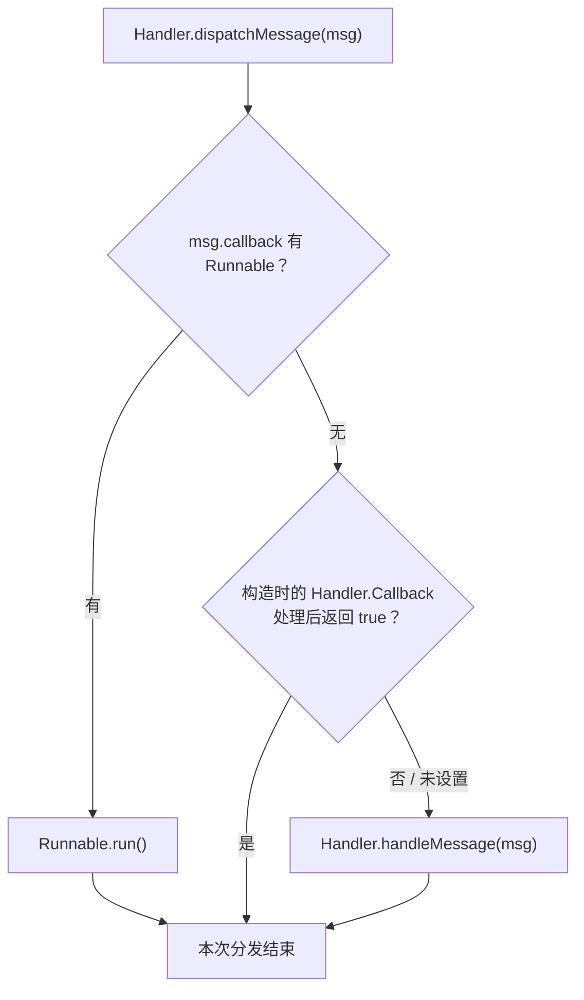
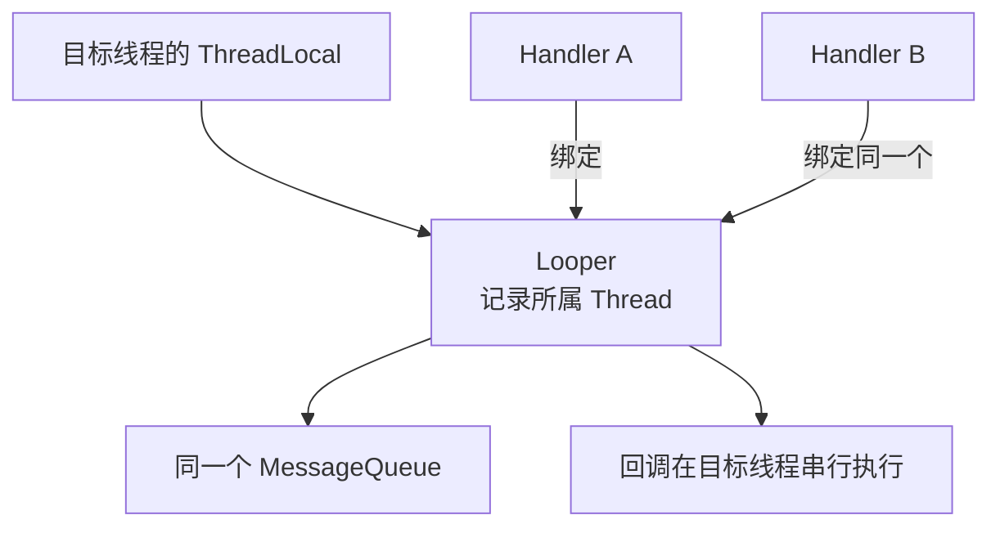
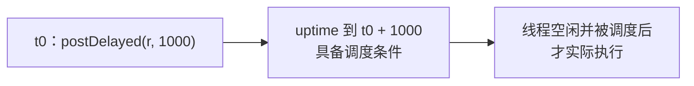
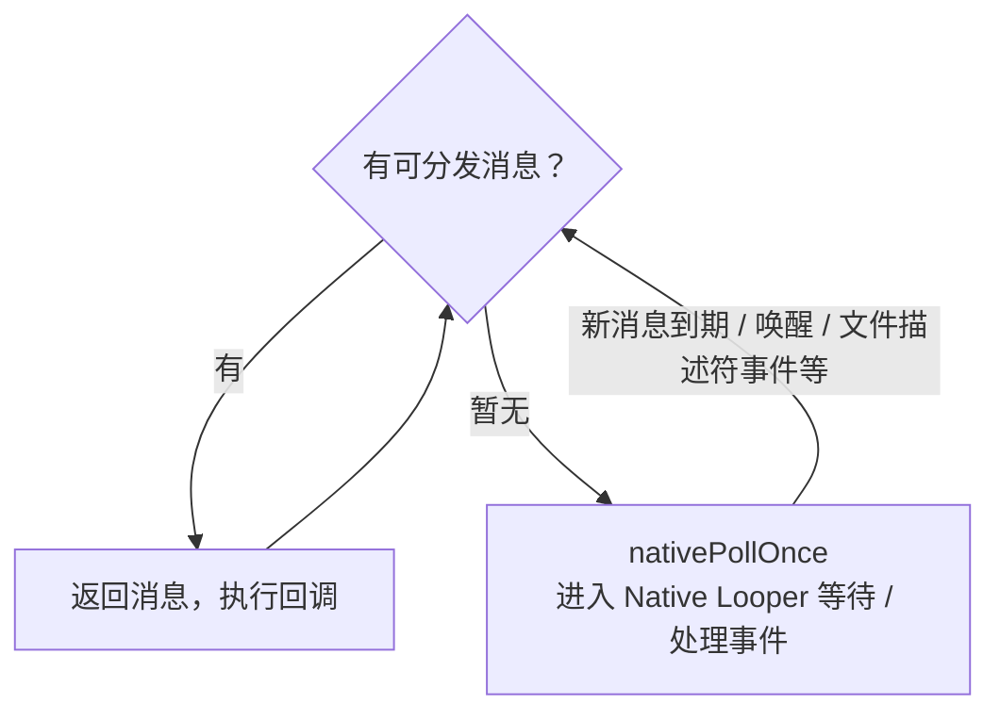
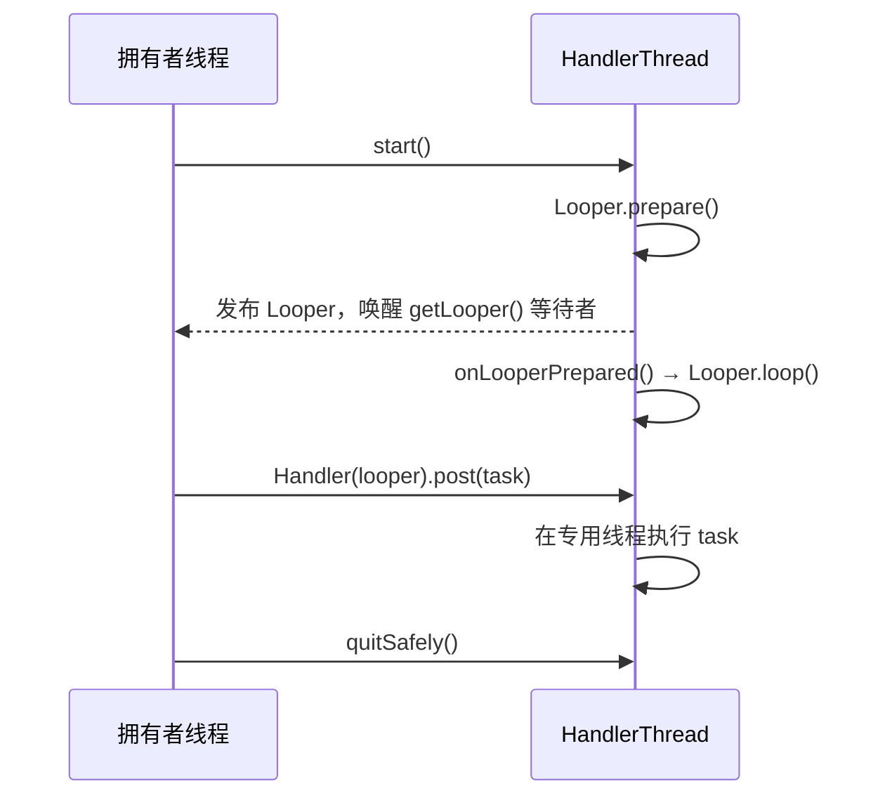
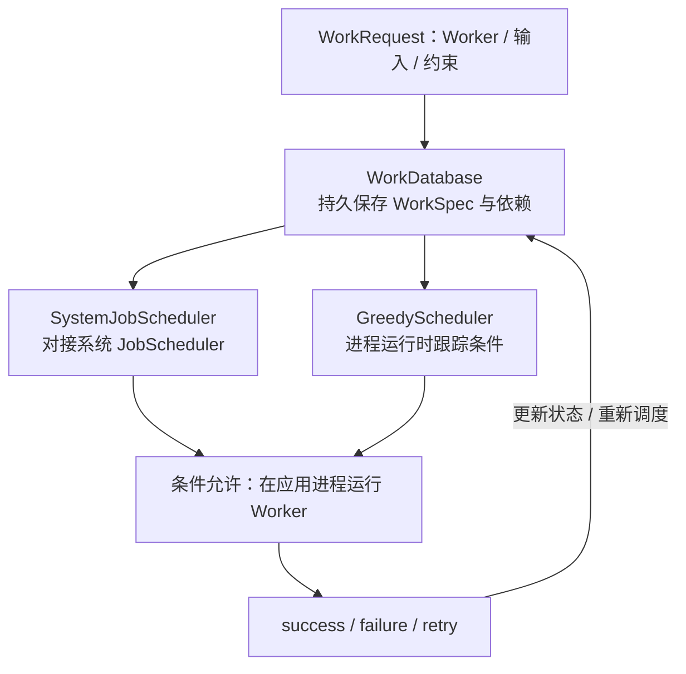
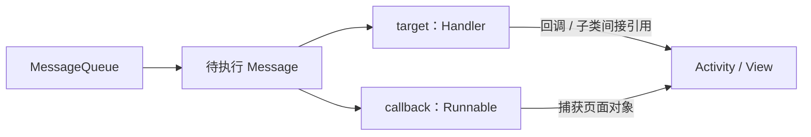

# Handler 原理：一条消息怎样到达指定线程

**发送线程把工作交进队列，目标线程的 Looper 取出消息，再交回消息指定的 Handler 执行。** Handler 不创建线程，执行位置由它绑定的 Looper 决定。

## 1. 先看图：消息的一次旅行 {#message-flow}


图中只有**一个 Handler H1**，绑定主 Looper；左侧发送方只是持有它的引用。**入队在发送线程执行，取消息与分发在目标线程执行。**

- **Message 是包裹**：携带数据、时间和目标 Handler，也可携带 Runnable。
- **MessageQueue 是传送带上的等待区**：保存消息，按时间与屏障规则提供可处理的消息。
- **Looper 是传送带的循环控制器**：调用 `MessageQueue.next()` 取消息，再调用 `msg.target.dispatchMessage(msg)` 分发。
- **Handler 是投递入口与处理台**：发送时入队，分发时决定执行哪种回调。

**实线表示消息流向，虚线表示循环控制。** 控制面板只是 Looper 的类比；取消息、分发与回调都在同一目标线程串行执行。正常返回后，Looper 回收 Message，再进入下一轮。

**记住一条主线：`Handler → MessageQueue → Looper → Message.target（原 Handler）`。** Message 是在线路中传递的载体。

## 2. 最小示例：后台发送，主线程接收 {#example}

下面只输出日志，不访问页面对象。普通 App 主 Looper 已由系统准备，不需自行调用 prepare。

```java
import android.os.Handler;
import android.os.Looper;
import android.os.Message;
import android.util.Log;

public final class HandlerFlowExample {
    private static final int DONE = 1;

    public static void runDemo() {
        Handler ui = new Handler(Looper.getMainLooper(), msg -> {
            if (msg.what != DONE) return false;
            Log.d("HandlerFlow", msg.obj + " @ " + Thread.currentThread().getName());
            return true; // Handler.Callback 已消费这条 Message
        });

        new Thread(() -> {
            Message msg = ui.obtainMessage(DONE, "后台计算结果");
            ui.sendMessage(msg); // 送入主线程队列；之后不再修改或重发 msg
            ui.post(() -> Log.d("HandlerFlow", "Runnable @ "
                    + Thread.currentThread().getName()));
        }, "notes-worker").start();
    }
}
```

`sendMessage()` 用字段传递数据；`post()` 将 Runnable 放进 Message 的 `callback`。两者进入同一个队列，回调都在主 Looper 线程执行。这个一次性线程仅用于观察流程，实际并发任务可由线程池或协程管理。

### Message 中最重要的字段

| 字段 | 用途 | 谁填写 |
| --- | --- | --- |
| `what / arg1 / arg2 / obj` | 业务类型、参数、对象 | 发送方；obj 是引用，不会自动深拷贝 |
| `target` | 到期后交给哪个 Handler | Handler 入队时设置为自己 |
| `callback` | 要执行的 Runnable | post() 包装时设置 |
| `when` | 最早可调度时间 | 入队调度逻辑，基于 uptimeMillis |

Message 可通过 `obtain()` 复用。发送后交由队列管理，不应继续修改、手动回收或重复发送同一实例。[Message API](https://developer.android.com/reference/android/os/Message)

## 3. 源码只抓三处：入队、取出、分发 {#source-flow}

### 发送：写入 target，再放进队列

```java
// Handler.java，enqueueMessage()，L782–790 核心节选。
// 省略 WorkSource 与异步标记处理。
msg.target = this;                            // 记录回到哪个 Handler
return queue.enqueueMessage(msg, uptimeMillis);
```

**target 是消息的回送地址。** 同一队列中可以有多个 Handler 的消息，Looper 不会靠 what 猜测接收者。[Handler.enqueueMessage](https://android.googlesource.com/platform/frameworks/base/+/refs/tags/android-16.0.0_r1/core/java/android/os/Handler.java#782)

### 取出：Looper 在自己的线程调用目标 Handler

```java
// Looper.java，loopOnce() 正常路径节选：L196、248、302。
// 省略日志、监控、异常处理等分支。
Message msg = me.mQueue.next(); // 没有可处理消息时，可能阻塞等待
if (msg == null) return false;  // 队列退出，消息循环结束
msg.target.dispatchMessage(msg);
msg.recycleUnchecked();        // 正常分发完成后回收复用
return true;
```

发送方只负责入队，`dispatchMessage()` 由 Looper 所在线程调用，这就是执行位置发生变化的原因。同线程发送通常也会排队，不等于立即调用。[Looper.loopOnce](https://android.googlesource.com/platform/frameworks/base/+/refs/tags/android-16.0.0_r1/core/java/android/os/Looper.java#194)

### 分发：不是三种回调都执行



对应 `Handler.java`，L101–113：

```java
public void dispatchMessage(Message msg) {
    if (msg.callback != null) {
        handleCallback(msg); // 内部调用 msg.callback.run()
    } else {
        if (mCallback != null) {
            if (mCallback.handleMessage(msg)) return;
        }
        handleMessage(msg);
    }
}
```

优先级是 **Message 的 Runnable → Handler.Callback → handleMessage**。所以 Handler.Callback 不能拦截所有 post()；示例中的 post 会直接执行 Runnable。[Handler.dispatchMessage](https://android.googlesource.com/platform/frameworks/base/+/refs/tags/android-16.0.0_r1/core/java/android/os/Handler.java#101)

## 4. 线程绑定：一个 Looper，一条执行线 {#thread-binding}



- `Looper.prepare()` 在当前线程创建 Looper/Queue，存入 ThreadLocal；同线程不能重复 prepare。
- `Looper.loop()` 在当前线程运行消息循环；主 Looper 已由系统准备。
- `myLooper()` 查当前调用线程；`getMainLooper()` 取得主 Looper。
- 构造时显式传入 Looper；把引用传给另一个线程，不会改变 Looper 的所属线程。

`Handler()`、`Handler(Callback)` 的隐式选择 Looper 构造方式已弃用。多个 Handler 绑定同一 Looper，仍共享同一条执行线；一个回调卡住，后面的工作都要等待。[Looper API](https://developer.android.com/reference/android/os/Looper)、[Handler 构造说明](https://developer.android.com/reference/android/os/Handler)

## 5. 延迟、屏障与等待 {#timing-and-wait}

### 延迟到期，只是可以执行



时间基准是 `SystemClock.uptimeMillis()`，深度休眠不计入这段时间；前一个回调阻塞、系统调度和休眠，都可能让实际执行更晚。它不能提供跨进程死亡或重启的可靠定时。[Handler 时间契约](https://developer.android.com/reference/android/os/Handler)

### 队列不是无条件 FIFO

通常按调度时间选择消息，但队首插入、同步屏障等会改变可分发顺序。**异步消息能越过同步屏障，仍在同一个 Looper 线程执行**；这里的异步不代表另开线程，也不能跳过正在运行的长回调。

### 没消息时会空转吗



Java 队列经 JNI 的 `NativeMessageQueue::pollOnce()` 进入 Native Looper；需要时通过 `nativeWake()` 唤醒。它不是一直占用 CPU 忙轮询。单独一帧 `nativePollOnce` 也不能证明死锁。[JNI pollOnce / wake，L123、137](https://android.googlesource.com/platform/frameworks/base/+/refs/tags/android-16.0.0_r1/core/jni/android_os_MessageQueue.cpp#123)

<details>
<summary>源码深一层：Android 16 的队列实现差异</summary>

AOSP `android-16.0.0_r1` 包含 Legacy、Concurrent、Combined 队列实现。Combined 的 `next()`（L1021）、`enqueueMessage()`（L1392）按 `mUseConcurrent` 选择分支。不能把某一版的单链表、锁与唤醒细节当成所有版本的固定实现；上面的消息去向与线程模型仍成立。

[CombinedMessageQueue 源码](https://android.googlesource.com/platform/frameworks/base/+/refs/tags/android-16.0.0_r1/core/java/android/os/CombinedMessageQueue/MessageQueue.java#1021)

</details>

## 6. HandlerThread、线程池、WorkManager 怎么选 {#handlerthread-是否弃用-应该换成什么}

**HandlerThread 本身没有被标记为弃用。** 官方建议只有必须使用 Handler API、且需要专用 Looper 线程时才使用它；一般异步工作优先 Executor 或协程。[HandlerThread 官方建议](https://developer.android.com/reference/android/os/HandlerThread)

| 工具 | 执行方式 | 进程退出后 | 适合的需求 |
| --- | --- | --- | --- |
| HandlerThread | 一个专用 Looper 线程，串行回调 | 内存消息丢失 | 必须绑定 Handler/Looper 的 API |
| Executor / 协程 | 线程池或调度器，按配置组织并发 | 内存任务不自动恢复 | 页面加载、计算、普通 I/O |
| WorkManager | 持久记录任务，条件满足时执行 Worker | 可以恢复调度，业务需幂等 | 可延后的同步、上传、维护 |

WorkManager 不是把 HandlerThread 换个名字；它解决任务持久调度。需要直接管理平台 Job 时，另见 [JobScheduler](./job-scheduler.html)。

## 7. HandlerThread：启动、使用、退出 {#handler-thread}



先 start，再 getLooper；后者可能等待 Looper 创建。**拿到 Looper 不代表 onLooperPrepared 中的业务初始化已经完成**，需要就绪信号时另设协议。

<details>
<summary>展开核心源码：HandlerThread.run()</summary>

```java
@Override
public void run() {
    mTid = Process.myTid();
    Looper.prepare();                 // 在新线程上创建 Looper / MessageQueue
    synchronized (this) {
        mLooper = Looper.myLooper();
        notifyAll();                  // 唤醒等待 getLooper() 的调用者
    }
    Process.setThreadPriority(mPriority);
    onLooperPrepared();               // 在工作线程初始化线程相关资源
    Looper.loop();                    // 持续取消息并分发，直到队列退出
    mTid = -1;
}
```

[HandlerThread.java，run()，L76](https://android.googlesource.com/platform/frameworks/base/+/refs/tags/android-16.0.0_r1/core/java/android/os/HandlerThread.java#76)

</details>

<details>
<summary>展开完整 Java 示例：由主线程拥有者管理专用工作线程</summary>

API 18+；拥有者在主线程依次创建、提交和关闭，工作回调不得直接操作 View。

```java
import android.os.Handler;
import android.os.HandlerThread;
import android.os.Looper;

final class SerialNoteWorker {
    private final HandlerThread thread = new HandlerThread("note-worker");
    private final Handler worker;
    private boolean closed;

    SerialNoteWorker() {
        requireMainThread();
        thread.start();
        worker = new Handler(thread.getLooper());
    }

    boolean submit(Runnable task) {
        requireMainThread();
        return !closed && worker.post(task);
    }

    void close() {
        requireMainThread();
        if (closed) return;
        closed = true;
        worker.removeCallbacksAndMessages(null);
        thread.quitSafely();
    }

    private static void requireMainThread() {
        if (Looper.myLooper() != Looper.getMainLooper()) {
            throw new IllegalStateException("Owner methods must run on main");
        }
    }
}
```

```java
private SerialNoteWorker noteWorker;

void onOwnerCreated() {
    noteWorker = new SerialNoteWorker();
    boolean accepted = noteWorker.submit(() ->
        android.util.Log.d("Notes", Thread.currentThread().getName()));
    if (!accepted) android.util.Log.w("Notes", "Queue is closed");
}

void onOwnerDestroyed() {
    noteWorker.close();
}
```

</details>

`removeCallbacksAndMessages()` 取消尚未执行的本 Handler 工作，不能停止正在运行的 Runnable；长任务需要协作取消。`quitSafely()` 执行队列中已到期的剩余工作，舍弃未来才到期的延迟消息。示例先移除待处理消息，再请求退出，不承诺排空，也不等待线程已经终止。

## 8. WorkManager：持久任务的另一条链 {#workmanager-的工作原理}



两个调度器协作争取执行机会，不是固定先后运行。普通 Worker 在配置的后台 Executor 执行；CoroutineWorker 运行挂起工作，阻塞 I/O 应切到适合的调度器。**不要启动脱离管理的工作后，马上返回 success。**

- `enqueue` 完成只代表入队操作，不代表 Worker 成功。
- `retry` 结合退避再次调度；约束、Doze、配额等影响实际开始时间。
- 持久化不保证副作用恰好一次，也不保证强行停止后继续执行；业务需要幂等与恢复设计。

[Worker 线程模型](https://developer.android.com/develop/background-work/background-tasks/persistent/threading/worker)、[任务状态](https://developer.android.com/develop/background-work/background-tasks/persistent/how-to/states)

### 示例：清理过期预览缓存

完整示例保留依赖、取消响应、退避、唯一任务去重和页面状态观察，只清理可重新生成的私有预览缓存。

<details>
<summary>展开完整 Kotlin 示例：PreviewCleanupWorker 与任务管理</summary>

**依赖与 Worker**

示例只清理应用私有的 `cacheDir/note-previews/` 下过期的普通文件，不需要存储权限。目录只保存可重新生成的预览，不能放原始笔记；生产者应使用独立的临时文件和原子重命名发布预览，避免清理器与正在写入的同名文件竞争。重复清理已删除文件不会产生重复副作用，适合演示可恢复任务。

下面使用 WorkManager **2.12.0**，最低 Android 版本为 **API 24**。把依赖加到 Android 应用模块的 `build.gradle.kts`，仓库配置需包含 `google()`。[发布与依赖说明](https://developer.android.com/jetpack/androidx/releases/work#2.12.0)

```kotlin
dependencies {
    implementation("androidx.work:work-runtime-ktx:2.12.0")
}
```

`PreviewCleanupWorker.kt` 使用标准 `(Context, WorkerParameters)` 构造方法，配合默认初始化和 WorkerFactory 即可调度。

```kotlin
import android.content.Context
import androidx.work.CoroutineWorker
import androidx.work.WorkerParameters
import java.io.File
import java.io.IOException
import java.util.concurrent.TimeUnit
import kotlinx.coroutines.Dispatchers
import kotlinx.coroutines.currentCoroutineContext
import kotlinx.coroutines.ensureActive
import kotlinx.coroutines.withContext

class PreviewCleanupWorker(
    appContext: Context,
    params: WorkerParameters
) : CoroutineWorker(appContext, params) {
    override suspend fun doWork(): Result = withContext(Dispatchers.IO) {
        try {
            val directory = File(applicationContext.cacheDir, "note-previews")
            if (!directory.exists()) return@withContext Result.success()
            val files = directory.listFiles()
                ?: throw IOException("Cannot list preview directory")
            val cutoff = System.currentTimeMillis() - TimeUnit.DAYS.toMillis(7)

            for (file in files) {
                currentCoroutineContext().ensureActive() // 协作响应停止或取消
                if (file.isFile && file.lastModified() < cutoff) {
                    if (!file.delete() && file.exists()) {
                        throw IOException("Cannot remove expired preview")
                    }
                }
            }
            Result.success() // 当前尝试的清理全部完成之后才报告成功
        } catch (e: IOException) {
            // runAttemptCount 从 0 开始：本例最多尝试三次
            if (runAttemptCount < 2) Result.retry() else Result.failure()
        }
        // 不捕获 CancellationException，让 WorkManager 正常传播取消
    }
}
```

取消是协作式的，不能撤回已经删除的文件；`ensureActive()` 让循环在下一次检查时及时停止。目录中的数据本来就可能被系统回收，所以“目录已不存在”应视为成功，而不是无休止重试。真实缓存业务还应考虑文件数量、清理配额及访问中的资源。

**创建请求、去重与取消**

下面的 `PreviewCleanup` 可以从页面或应用层调用，内部只把 applicationContext 交给 WorkManager。充电约束适合这个允许延后的维护任务，不适合照搬到必须立即响应的交互操作。

```kotlin
import android.content.Context
import androidx.work.BackoffPolicy
import androidx.work.Constraints
import androidx.work.ExistingWorkPolicy
import androidx.work.OneTimeWorkRequestBuilder
import androidx.work.WorkManager
import java.util.concurrent.TimeUnit

object PreviewCleanup {
    const val UNIQUE_NAME = "notes-preview-cleanup"

    fun enqueue(context: Context) {
        val request = OneTimeWorkRequestBuilder<PreviewCleanupWorker>()
            .setConstraints(
                Constraints.Builder().setRequiresCharging(true).build()
            )
            .setBackoffCriteria(BackoffPolicy.EXPONENTIAL, 30, TimeUnit.SECONDS)
            .build()
        WorkManager.getInstance(context.applicationContext).enqueueUniqueWork(
            UNIQUE_NAME, ExistingWorkPolicy.KEEP, request
        )
    }

    fun cancel(context: Context) {
        WorkManager.getInstance(context.applicationContext)
            .cancelUniqueWork(UNIQUE_NAME)
    }
}

// 页面需要安排清理时调用：PreviewCleanup.enqueue(requireContext())
// 用户明确取消维护任务时调用：PreviewCleanup.cancel(requireContext())
```

`KEEP` 表示存在同名未完成任务时保留原任务、忽略新请求，不是“永远只执行一次”；原任务结束后可以再次提交。退避时间是重试的调度下限，实际运行仍取决于约束及系统。页面退出通常不应自动取消这种持久任务，否则会失去选择 WorkManager 的意义。[唯一任务与冲突策略](https://developer.android.com/develop/background-work/background-tasks/persistent/how-to/manage-work)、[约束与退避](https://developer.android.com/develop/background-work/background-tasks/persistent/getting-started/define-work)

**页面观察任务状态**

在使用 AndroidX Fragment 的页面中，于 `onViewCreated()` 注册观察，使用 `viewLifecycleOwner` 避免销毁 View 后继续更新页面。按唯一名称查询能在页面重建后重新找到任务；结果可能包含历史记录，示例展示各任务 ID，不把列表顺序当成时间顺序。

```kotlin
val manager = WorkManager.getInstance(requireContext().applicationContext)
manager.getWorkInfosForUniqueWorkLiveData(PreviewCleanup.UNIQUE_NAME)
    .observe(viewLifecycleOwner) { infos ->
        infos.forEach { info ->
            android.util.Log.d("Cleanup", "${info.id}: ${info.state}")
        }
    }
```

业务可以根据 `WorkInfo.State` 显示等待、运行或完成状态；`enqueueUniqueWork()` 返回的入队操作完成，不能替代任务的 `SUCCEEDED` 状态。需要传文件或大批数据时，将其保存在可恢复的位置并传递标识，避免把内容塞入 WorkManager 的输入 Data。[状态观察 API](https://developer.android.com/reference/androidx/work/WorkManager#getWorkInfosForUniqueWorkLiveData(java.lang.String))


</details>

## 9. 最容易踩的五个坑 {#pitfalls}

- **成功入队 ≠ 已执行**：send/post 返回 true 不是业务完成确认；队列退出或进程死亡仍可能丢任务。
- **耗时回调阻塞后续消息**：主线程会卡顿，专用 Looper 也一样串行等待。
- **消息持有页面**：Message/Runnable 可间接保留 Activity、Fragment 或 View；按拥有者生命周期取消失效工作，静态 Handler 也不自动解决所有引用。
- **高频进度堆积**：合并、去重或限流；取消操作也有成本，不宜高频反复扫描队列。
- **异常与取消有边界**：未处理异常可能结束 Looper 线程或导致进程崩溃；移除消息无法撤回正在执行的业务副作用。



Handler 调度的是本进程内的工作。跨进程传消息见 [Messenger 机制](./messenger.html)：由 Binder 接收远端 Message，再交给本地 Handler。

## 10. 源码索引 {#sources}

AOSP 摘录对应 `android-16.0.0_r1`：

- [Handler.java](https://android.googlesource.com/platform/frameworks/base/+/refs/tags/android-16.0.0_r1/core/java/android/os/Handler.java)：L101 分发优先级，L705 延迟时间，L782 写 target 入队，L980 包装 Runnable。
- [Looper.java](https://android.googlesource.com/platform/frameworks/base/+/refs/tags/android-16.0.0_r1/core/java/android/os/Looper.java)：L118 prepare，L194 loopOnce，L314 loop。
- [Message.java](https://android.googlesource.com/platform/frameworks/base/+/refs/tags/android-16.0.0_r1/core/java/android/os/Message.java)、[MessageQueue API](https://developer.android.com/reference/android/os/MessageQueue)：消息与队列契约。
