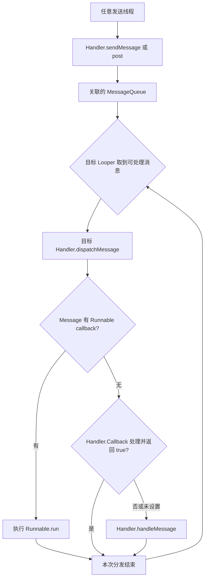

# Handler 原理

Handler 把消息或 Runnable 交给某个 Looper 的队列，由该 Looper 所在线程执行。**它负责调度，不会因为创建 Handler 自动创建线程。** 同一个 Looper 可以关联多个 Handler，它们共享队列和执行线程。


## 四个核心对象

- **Message**：一次待处理工作的载体，包含 `what`、参数、目标 Handler 或 Runnable 回调。消息送入队列后，发送方应放弃对其内容的修改，也不要重复发送同一实例。
- **MessageQueue**：保存并选择待分发消息，同时参与等待与唤醒。应用通常通过 Handler 入队，不直接操作内部结构。
- **Looper**：管理当前线程的消息循环，取出可处理消息并调用目标 Handler。
- **Handler**：关联确定的 Looper，负责发送、取消和分发自己的消息。

对象职责与线程准备方式见 [Looper 官方参考](https://developer.android.com/reference/android/os/Looper)、[MessageQueue 官方参考](https://developer.android.com/reference/android/os/MessageQueue) 与 [Message 官方参考](https://developer.android.com/reference/android/os/Message)。Message 被复用时不能继续持有并修改；跨线程传递的业务对象也不因放进消息就自动变成不可变对象。

## 线程与 Looper 如何关联

普通线程默认没有消息循环。手工创建时，需要在线程内执行 `Looper.prepare()`，建立与该线程的关联，再调用 `Looper.loop()` 消费消息；同一线程不能重复准备 Looper。Android 应用主 Looper 由运行环境创建，不应自行再准备或退出。

这种关联由 `ThreadLocal<Looper>` 保存：`Looper.myLooper()` 读取**当前调用线程**的值，而 `Looper.getMainLooper()` 返回应用主线程的全局引用。Looper 自身还保存创建它的 Thread 与 MessageQueue；把这个 Looper 引用传给另一个线程构造 Handler，并不会转移消息循环的所有权。[Looper.prepare / myLooper 实现](https://github.com/aosp-mirror/platform_frameworks_base/blob/android-16.0.0_r1/core/java/android/os/Looper.java)

构造 Handler 时显式传入 `Looper.getMainLooper()` 或专用线程的 Looper，可以清楚表达执行位置。依赖当前线程隐式选择 Looper 的构造方式已弃用，可能因没有准备循环、绑定错误线程或循环退出造成问题。[Handler 构造说明](https://developer.android.com/reference/android/os/Handler)

`HandlerThread` 则把线程与 Looper 初始化封装起来；它仍是一个串行工作线程。通用并行任务通常更适合 Executor 或 Kotlin 协程，是否选择 HandlerThread 应由既有消息 API 和线程亲和需求决定。[HandlerThread 官方参考](https://developer.android.com/reference/android/os/HandlerThread)

## 从发送到回调



图中入队可以发生在其他线程，**分发与业务回调在目标 Looper 线程**。这就是消息调度能用于线程切换的原因；若发送方与目标本来就是同一线程，仍然是排队执行。

### sendMessage 与 post

`sendMessage()` 使用 Message 的字段传递工作；`post()` 把 Runnable 包装为带回调的 Message。二者都进入 Handler 关联的消息队列，`post()` 不会额外启动线程。

发送返回 `true` 表示成功入队，不保证一定执行，更不代表任务已完成。如果队列退出、进程结束，已入队工作仍可能丢失。需要业务确认时，必须另设完成通知或持久化状态。[Handler 发送与调度契约](https://developer.android.com/reference/android/os/Handler)

### dispatchMessage 的优先级

分发首先处理 Message 自带的 Runnable；没有它时才调用构造时传入的 `Handler.Callback`。Callback 返回 `true` 表示已经消费，否则继续到可覆写的 `handleMessage()`。因此，给 Handler 设置 Callback 不等于可以拦截所有 `post()` 的 Runnable。[Handler 分发实现](https://github.com/aosp-mirror/platform_frameworks_base/blob/android-16.0.0_r1/core/java/android/os/Handler.java)

## 延迟、顺序与等待

### 延迟不是准点执行

`postDelayed()` 的时间基准是 `SystemClock.uptimeMillis()`。消息到期只意味着具备分发条件；前一任务阻塞、线程调度和设备深度休眠都可能使实际执行更晚。它不适合承诺跨进程死亡、重启或休眠的可靠定时。[Handler 时间说明](https://developer.android.com/reference/android/os/Handler)

同一个 Looper 逐个执行回调，但不应把所有消息看成无条件 FIFO。延迟时间、队首插入以及同步屏障都会影响可分发顺序；多个生产线程竞争时，业务需要序号或状态机表达顺序。异步 Message 可越过同步屏障，“异步”在此不表示换到另一个线程。

### 没有消息时如何等待

队列暂无可处理工作时，消息循环可以进入 Native 等待，后续由新消息或相关事件唤醒；`Looper.loop()` 的持续循环不等于持续忙轮询。具体等待细节与队列实现有关。

JNI 的 `nativePollOnce()` 进入 `NativeMessageQueue::pollOnce()`，后者交给 Native Looper；`nativeWake()` 则走对应的唤醒入口。消息队列还可监听文件描述符事件，所以线程停在 `nativePollOnce` 只表明该时刻处于等待/事件处理入口，不能单凭这一帧认定发生死锁。应继续看它等待之前的业务、其他线程的依赖和采样时序。[MessageQueue JNI 的 pollOnce / wake](https://github.com/aosp-mirror/platform_frameworks_base/blob/android-16.0.0_r1/core/jni/android_os_MessageQueue.cpp)

::: info 源码版本差异
`android-16.0.0_r1` 的 `core/java/android/os/` 下包含 `LegacyMessageQueue`、`ConcurrentMessageQueue` 与 `CombinedMessageQueue` 实现目录，消息存储、并发入队与唤醒细节需按实际构建选择和运行时分支阅读。
:::

实现入口见 [Looper.java](https://github.com/aosp-mirror/platform_frameworks_base/blob/android-16.0.0_r1/core/java/android/os/Looper.java) 与 [CombinedMessageQueue/MessageQueue.java](https://github.com/aosp-mirror/platform_frameworks_base/blob/android-16.0.0_r1/core/java/android/os/CombinedMessageQueue/MessageQueue.java)。

## HandlerThread 是否弃用，应该换成什么

**`HandlerThread` 没有被标记为弃用。** 官方建议仅在必须使用 Handler API、且需要一个专用 Looper 线程时使用它，其余情况优先选择 Executor、ExecutorService 或 Kotlin 协程。弃用的是 `Handler()`、`Handler(Callback)` 这类隐式选择 Looper 的构造方法。[HandlerThread 官方建议](https://developer.android.com/reference/android/os/HandlerThread)、[Handler 构造方法](https://developer.android.com/reference/android/os/Handler)

| 关注点 | HandlerThread | ExecutorService / 协程 | WorkManager |
| --- | --- | --- | --- |
| 解决的问题 | 给 Handler 提供专用消息循环 | 管理进程内异步工作、并发与取消 | 持久保存任务并在条件满足时调度 |
| 执行模型 | 一个线程上的 Looper，回调逐个执行 | 线程池或协程调度器；顺序由具体配置决定 | 系统调度与进程内执行器协作，运行 Worker |
| 进程退出之后 | 内存消息丢失 | 内存任务不会自动恢复 | 可根据持久记录恢复调度，业务仍需幂等 |
| 常见用途 | 旧 SDK 的 Handler 回调、必须绑定 Looper 的对象 | 页面数据加载、计算、普通文件 I/O | 可延后的同步、上传、维护任务 |

**WorkManager 不是 HandlerThread 的直接替代品。** 只需把页面中的耗时操作移出主线程，通常用 Executor 或受生命周期约束的协程；需要在应用进程退出、设备重启后仍保留执行意图，才考虑 WorkManager。已有 API 如果新增 Executor 重载，应优先采用它；若对象明确要求固定的 Looper 线程，不能随意改成可能切换线程的协程调度器。[后台任务选型](https://developer.android.com/develop/background-work/background-tasks/persistent)、[AOSP API 设计指南](https://source.android.com/docs/setup/contribute/api-guidelines#use-executor-instead-of-handler)

## HandlerThread 的工作原理与调用示例

### 从 start 到消息循环

HandlerThread **继承 Thread，并在 `run()` 中准备 Looper**。调用顺序为：拥有者调用 `start()`；新线程执行 `Looper.prepare()`；保存 Looper 并通知等待者；设置线程优先级；执行 `onLooperPrepared()`；最后进入 `Looper.loop()`。以下是 AOSP `android-16.0.0_r1` 的方法节选，注释为本文补充。

```java
@Override
public void run() {
    mTid = Process.myTid();
    Looper.prepare();                 // 在新线程上创建 Looper / MessageQueue
    synchronized (this) {
        mLooper = Looper.myLooper();
        notifyAll();                  // 唤醒等待 getLooper() 的调用者
    }
    Process.setThreadPriority(mPriority);
    onLooperPrepared();               // 在工作线程初始化线程相关资源
    Looper.loop();                    // 持续取消息并分发，直到队列退出
    mTid = -1;
}
```

`getLooper()` 不会创建线程：线程尚未启动或已经死亡时返回 `null`；线程存活但 Looper 尚未建立时，调用者会等待。因此先 `start()`，再构造 `Handler(thread.getLooper())`。**Looper 已发布不代表 `onLooperPrepared()` 中的业务初始化已经完成**；需要完成信号时应另设协议，不能只依赖 `getLooper()` 返回。[HandlerThread.java 源码](https://android.googlesource.com/platform/frameworks/base/+/refs/tags/android-16.0.0_r1/core/java/android/os/HandlerThread.java)

所有绑定这个 Looper 的 Handler 共享一个串行执行位置。一个回调阻塞就会拖住后续消息；它没有线程池的自动扩容，也没有持久化、失败重试或进程保活能力。不要为每个短任务各建一个 HandlerThread，应由明确的拥有者管理线程生命周期。

### 一个具有明确生命周期的示例

下面的 Java 片段使用一个专用串行线程，`quitSafely()` 需要 API 18+。方法由拥有者在主线程顺序调用，示例省略包名。

```java
import android.os.Handler;
import android.os.HandlerThread;
import android.os.Looper;

final class SerialNoteWorker {
    private final HandlerThread thread = new HandlerThread("note-worker");
    private final Handler worker;
    private boolean closed;

    SerialNoteWorker() {
        requireMainThread();
        thread.start();
        worker = new Handler(thread.getLooper());
    }

    boolean submit(Runnable task) {
        requireMainThread();
        return !closed && worker.post(task);
    }

    void close() {
        requireMainThread();
        if (closed) return;
        closed = true;
        worker.removeCallbacksAndMessages(null);
        thread.quitSafely();
    }

    private static void requireMainThread() {
        if (Looper.myLooper() != Looper.getMainLooper()) {
            throw new IllegalStateException("Owner methods must run on main");
        }
    }
}
```

这里的 `close()` 是“取消待执行任务并请求线程退出”，没有承诺排空队列，也没有等待线程已经终止。`removeCallbacksAndMessages()` 不能停止正在执行的 Runnable；长任务需协作取消。构造也应由主线程拥有者执行，工作回调不得直接操作 View。确认线程终止如需 `join()`，应放在可阻塞的管理线程。

`quitSafely()` 会处理仍留在队列中、已经到期的消息，舍弃未来才到期的延迟消息；它不会把未来消息全部等完。示例先移除了本 Handler 的待处理任务，两种操作的目的不同。[Looper 退出契约](https://developer.android.com/reference/android/os/Looper#quitSafely())

调用方可以在页面创建时持有 `SerialNoteWorker`，提交工作；在页面销毁时关闭它。下面两个方法分别从主线程的创建、销毁回调调用；日志中的线程名可用于观察实际执行位置。

```java
private SerialNoteWorker noteWorker;

void onOwnerCreated() {
    noteWorker = new SerialNoteWorker();
    boolean accepted = noteWorker.submit(() ->
        android.util.Log.d("Notes", Thread.currentThread().getName()));
    if (!accepted) android.util.Log.w("Notes", "Queue is closed");
}

void onOwnerDestroyed() {
    noteWorker.close();
}
```

不要把 `post()` 的返回值当成任务成功结果；关闭拥有者时，上例中尚未执行的日志任务可能被取消。确实需要脱离页面继续完成的业务，应重新确定拥有者和持久化需求，而不是简单去掉 `close()`。

## WorkManager 的工作原理

### 持久任务如何被执行

WorkManager 是 Jetpack 的任务调度库，**Worker 仍在应用进程中执行**，并非把业务代码放到系统服务中运行。以一次性任务为例：

1. 应用创建 `WorkRequest`，指定 Worker 类型、输入、约束及重试策略，再调用 `enqueue()` 或 `enqueueUniqueWork()`。
2. WorkManager 将 `WorkSpec`、依赖关系等保存到基于 Room / SQLite 的 `WorkDatabase`。入队接口返回不代表业务已经运行或成功。
3. 调度器协调执行机会：系统侧使用 `SystemJobScheduler` 对接 JobScheduler；进程运行时也可通过 `GreedyScheduler` 跟踪条件并触发符合条件的工作。两者并非固定的先后步骤。
4. 执行层检查任务状态等条件，通过 `WorkerFactory` 创建 Worker，再由 `WorkerWrapper` 启动工作。不要自行 `new Worker` 后调用 `doWork()` 来替代正常调度。
5. 任务返回 `Result.success()`、`failure()` 或 `retry()`，状态写回数据库；重试结合退避策略再次等待调度。依赖任务还需等待前置任务成功。

WorkManager 2.12.0 实现：[`WorkDatabase.kt`](https://android.googlesource.com/platform/frameworks/support/+/cbf5ea2a1e5a7e5999144c2cb7f170802046e1c9/work/work-runtime/src/main/java/androidx/work/impl/WorkDatabase.kt)、[`Schedulers.java`](https://android.googlesource.com/platform/frameworks/support/+/cbf5ea2a1e5a7e5999144c2cb7f170802046e1c9/work/work-runtime/src/main/java/androidx/work/impl/Schedulers.java)、[`WorkerWrapper.kt`](https://android.googlesource.com/platform/frameworks/support/+/cbf5ea2a1e5a7e5999144c2cb7f170802046e1c9/work/work-runtime/src/main/java/androidx/work/impl/WorkerWrapper.kt)。

### 执行线程、状态与可靠性的边界

普通 `Worker.doWork()` 在 WorkManager 配置的后台 Executor 上同步执行，返回时应已完成工作。`CoroutineWorker.doWork()` 是挂起函数，在默认配置下使用 `Dispatchers.Default`；阻塞文件 I/O 可显式放入 `withContext(Dispatchers.IO)`。不要启动一个脱离管理的线程或 `GlobalScope` 协程后立即返回成功。[Worker 线程模型](https://developer.android.com/develop/background-work/background-tasks/persistent/threading/worker)、[CoroutineWorker API](https://developer.android.com/reference/androidx/work/CoroutineWorker)

一次性任务通常是 `ENQUEUED → RUNNING → SUCCEEDED / FAILED`，返回 `retry()` 会重新进入 `ENQUEUED`；取消进入 `CANCELLED`。持久调度不等于每次尝试都执行完，更不保证业务副作用只发生一次：进程可能在写入远端成功、记录本地成功之前死亡，所以上传、支付等操作必须由业务设计幂等键及恢复机制。[任务状态](https://developer.android.com/develop/background-work/background-tasks/persistent/how-to/states)

WorkManager 不保证准确的开始时间，也不是常驻线程或保活方案。约束、Doze、系统配额和用户强行停止应用等会影响调度；强行停止后不能承诺继续运行。普通 Worker 有执行时限，长时间工作需另行评估官方长任务方案及前台服务限制；周期任务也不等于精确闹钟。[持久任务概览](https://developer.android.com/develop/background-work/background-tasks/persistent)

## WorkManager 调用示例：清理过期预览缓存

### 依赖与 Worker

示例只清理应用私有的 `cacheDir/note-previews/` 下过期的普通文件，不需要存储权限。目录只保存可重新生成的预览，不能放原始笔记；生产者应使用独立的临时文件和原子重命名发布预览，避免清理器与正在写入的同名文件竞争。重复清理已删除文件不会产生重复副作用，适合演示可恢复任务。

下面使用 WorkManager **2.12.0**，最低 Android 版本为 **API 24**。把依赖加到 Android 应用模块的 `build.gradle.kts`，仓库配置需包含 `google()`。[发布与依赖说明](https://developer.android.com/jetpack/androidx/releases/work#2.12.0)

```kotlin
dependencies {
    implementation("androidx.work:work-runtime-ktx:2.12.0")
}
```

`PreviewCleanupWorker.kt` 使用标准 `(Context, WorkerParameters)` 构造方法，配合默认初始化和 WorkerFactory 即可调度。

```kotlin
import android.content.Context
import androidx.work.CoroutineWorker
import androidx.work.WorkerParameters
import java.io.File
import java.io.IOException
import java.util.concurrent.TimeUnit
import kotlinx.coroutines.Dispatchers
import kotlinx.coroutines.currentCoroutineContext
import kotlinx.coroutines.ensureActive
import kotlinx.coroutines.withContext

class PreviewCleanupWorker(
    appContext: Context,
    params: WorkerParameters
) : CoroutineWorker(appContext, params) {
    override suspend fun doWork(): Result = withContext(Dispatchers.IO) {
        try {
            val directory = File(applicationContext.cacheDir, "note-previews")
            if (!directory.exists()) return@withContext Result.success()
            val files = directory.listFiles()
                ?: throw IOException("Cannot list preview directory")
            val cutoff = System.currentTimeMillis() - TimeUnit.DAYS.toMillis(7)

            for (file in files) {
                currentCoroutineContext().ensureActive() // 协作响应停止或取消
                if (file.isFile && file.lastModified() < cutoff) {
                    if (!file.delete() && file.exists()) {
                        throw IOException("Cannot remove expired preview")
                    }
                }
            }
            Result.success() // 当前尝试的清理全部完成之后才报告成功
        } catch (e: IOException) {
            // runAttemptCount 从 0 开始：本例最多尝试三次
            if (runAttemptCount < 2) Result.retry() else Result.failure()
        }
        // 不捕获 CancellationException，让 WorkManager 正常传播取消
    }
}
```

取消是协作式的，不能撤回已经删除的文件；`ensureActive()` 让循环在下一次检查时及时停止。目录中的数据本来就可能被系统回收，所以“目录已不存在”应视为成功，而不是无休止重试。真实缓存业务还应考虑文件数量、清理配额及访问中的资源。

### 创建请求、去重与取消

下面的 `PreviewCleanup` 可以从页面或应用层调用，内部只把 applicationContext 交给 WorkManager。充电约束适合这个允许延后的维护任务，不适合照搬到必须立即响应的交互操作。

```kotlin
import android.content.Context
import androidx.work.BackoffPolicy
import androidx.work.Constraints
import androidx.work.ExistingWorkPolicy
import androidx.work.OneTimeWorkRequestBuilder
import androidx.work.WorkManager
import java.util.concurrent.TimeUnit

object PreviewCleanup {
    const val UNIQUE_NAME = "notes-preview-cleanup"

    fun enqueue(context: Context) {
        val request = OneTimeWorkRequestBuilder<PreviewCleanupWorker>()
            .setConstraints(
                Constraints.Builder().setRequiresCharging(true).build()
            )
            .setBackoffCriteria(BackoffPolicy.EXPONENTIAL, 30, TimeUnit.SECONDS)
            .build()
        WorkManager.getInstance(context.applicationContext).enqueueUniqueWork(
            UNIQUE_NAME, ExistingWorkPolicy.KEEP, request
        )
    }

    fun cancel(context: Context) {
        WorkManager.getInstance(context.applicationContext)
            .cancelUniqueWork(UNIQUE_NAME)
    }
}

// 页面需要安排清理时调用：PreviewCleanup.enqueue(requireContext())
// 用户明确取消维护任务时调用：PreviewCleanup.cancel(requireContext())
```

`KEEP` 表示存在同名未完成任务时保留原任务、忽略新请求，不是“永远只执行一次”；原任务结束后可以再次提交。退避时间是重试的调度下限，实际运行仍取决于约束及系统。页面退出通常不应自动取消这种持久任务，否则会失去选择 WorkManager 的意义。[唯一任务与冲突策略](https://developer.android.com/develop/background-work/background-tasks/persistent/how-to/manage-work)、[约束与退避](https://developer.android.com/develop/background-work/background-tasks/persistent/getting-started/define-work)

### 页面观察任务状态

在使用 AndroidX Fragment 的页面中，于 `onViewCreated()` 注册观察，使用 `viewLifecycleOwner` 避免销毁 View 后继续更新页面。按唯一名称查询能在页面重建后重新找到任务；结果可能包含历史记录，示例展示各任务 ID，不把列表顺序当成时间顺序。

```kotlin
val manager = WorkManager.getInstance(requireContext().applicationContext)
manager.getWorkInfosForUniqueWorkLiveData(PreviewCleanup.UNIQUE_NAME)
    .observe(viewLifecycleOwner) { infos ->
        infos.forEach { info ->
            android.util.Log.d("Cleanup", "${info.id}: ${info.state}")
        }
    }
```

业务可以根据 `WorkInfo.State` 显示等待、运行或完成状态；`enqueueUniqueWork()` 返回的入队操作完成，不能替代任务的 `SUCCEEDED` 状态。需要传文件或大批数据时，将其保存在可恢复的位置并传递标识，避免把内容塞入 WorkManager 的输入 Data。[状态观察 API](https://developer.android.com/reference/androidx/work/WorkManager#getWorkInfosForUniqueWorkLiveData(java.lang.String))

## 生命周期与性能检查

- **主线程阻塞**：不要在回调中执行网络、大量磁盘 I/O 或长计算。队列仍在运行并不能阻止卡顿与 ANR。
- **引用保留**：待执行 Message/Runnable 可能间接持有 Activity、Fragment 或 View；在相应生命周期取消工作，并避免执行已失效的 UI 更新。改成静态 Handler 也不能自动解除所有业务引用。
- **积压控制**：频繁进度更新应合并、去重或限流。消息循环没有替业务自动设置一个合理容量上限。
- **取消成本**：遍历队列删除消息有成本，不宜在高频路径反复扫描；必要时结合任务代次或取消标记，同时释放不再需要的引用。
- **异常边界**：未处理的业务异常可能使 Looper 线程退出或导致进程崩溃，不能假设下一条消息仍会继续执行。

## 从 Handler 到跨进程消息

Handler 的消息队列属于本进程，不能仅靠把 Handler 对象交给另一个进程实现 IPC。[Messenger 机制](./messenger.html)用 Binder 接收远端 Message，再交给本地 Handler，把跨进程传输和指定线程执行连接起来。

原始笔记：[Android 基础知识提纲](https://alidocs.dingtalk.com/i/nodes/1OQX0akWmxaRZD7yfgRMaeOX8GlDd3mE)。
