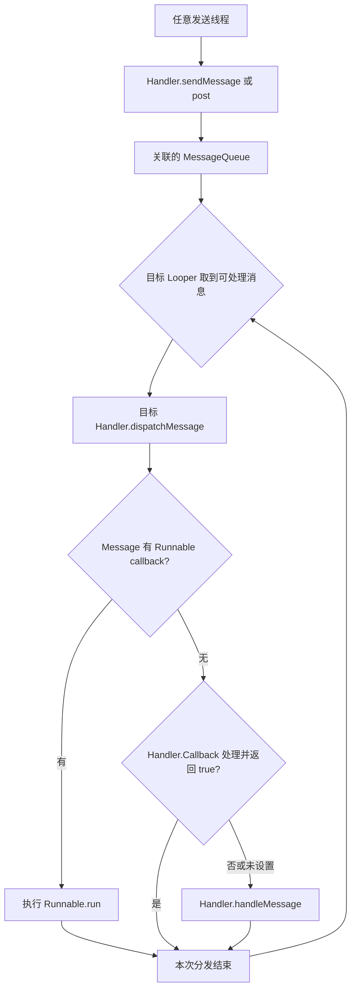

# Handler 原理

Handler 把消息或 Runnable 交给某个 Looper 的队列，由该 Looper 所在线程执行。**它负责调度，不会因为创建 Handler 自动创建线程。** 同一个 Looper 可以关联多个 Handler，它们共享队列和执行线程。

[原始基础提纲](https://alidocs.dingtalk.com/i/nodes/1OQX0akWmxaRZD7yfgRMaeOX8GlDd3mE)此处仅列出标题，本文补充完整机制与工程边界。Java 分发链参考 AOSP **`android-16.0.0_r1`**，示例使用公开 SDK API；源码阅读不代表设备实测。

## 四个核心对象

- **Message**：一次待处理工作的载体，包含 `what`、参数、目标 Handler 或 Runnable 回调。消息送入队列后，发送方应放弃对其内容的修改，也不要重复发送同一实例。
- **MessageQueue**：保存并选择待分发消息，同时参与等待与唤醒。应用通常通过 Handler 入队，不直接操作内部结构。
- **Looper**：管理当前线程的消息循环，取出可处理消息并调用目标 Handler。
- **Handler**：关联确定的 Looper，负责发送、取消和分发自己的消息。

对象职责与线程准备方式见 [Looper 官方参考](https://developer.android.com/reference/android/os/Looper)、[MessageQueue 官方参考](https://developer.android.com/reference/android/os/MessageQueue) 与 [Message 官方参考](https://developer.android.com/reference/android/os/Message)。Message 被复用时不能继续持有并修改；跨线程传递的业务对象也不因放进消息就自动变成不可变对象。

## 线程与 Looper 如何关联

普通线程默认没有消息循环。手工创建时，需要在线程内执行 `Looper.prepare()`，建立与该线程的关联，再调用 `Looper.loop()` 消费消息；同一线程不能重复准备 Looper。Android 应用主 Looper 由运行环境创建，不应自行再准备或退出。

构造 Handler 时显式传入 `Looper.getMainLooper()` 或专用线程的 Looper，可以清楚表达执行位置。依赖当前线程隐式选择 Looper 的构造方式已弃用，可能因没有准备循环、绑定错误线程或循环退出造成问题。[Handler 构造说明](https://developer.android.com/reference/android/os/Handler)

`HandlerThread` 则把线程与 Looper 初始化封装起来；它仍是一个串行工作线程。通用并行任务通常更适合 Executor 或 Kotlin 协程，是否选择 HandlerThread 应由既有消息 API 和线程亲和需求决定。[HandlerThread 官方参考](https://developer.android.com/reference/android/os/HandlerThread)

## 从发送到回调



图中入队可以发生在其他线程，**分发与业务回调在目标 Looper 线程**。这就是消息调度能用于线程切换的原因；若发送方与目标本来就是同一线程，仍然是排队执行。

### sendMessage 与 post

`sendMessage()` 使用 Message 的字段传递工作；`post()` 把 Runnable 包装为带回调的 Message。二者都进入 Handler 关联的消息队列，`post()` 不会额外启动线程。

发送返回 `true` 表示成功入队，不保证一定执行，更不代表任务已完成。如果队列退出、进程结束，已入队工作仍可能丢失。需要业务确认时，必须另设完成通知或持久化状态。[Handler 发送与调度契约](https://developer.android.com/reference/android/os/Handler)

### dispatchMessage 的优先级

分发首先处理 Message 自带的 Runnable；没有它时才调用构造时传入的 `Handler.Callback`。Callback 返回 `true` 表示已经消费，否则继续到可覆写的 `handleMessage()`。因此，给 Handler 设置 Callback 不等于可以拦截所有 `post()` 的 Runnable。[Handler 分发实现](https://github.com/aosp-mirror/platform_frameworks_base/blob/android-16.0.0_r1/core/java/android/os/Handler.java)

## 延迟、顺序与等待

### 延迟不是准点执行

`postDelayed()` 的时间基准是 `SystemClock.uptimeMillis()`。消息到期只意味着具备分发条件；前一任务阻塞、线程调度和设备深度休眠都可能使实际执行更晚。它不适合承诺跨进程死亡、重启或休眠的可靠定时。[Handler 时间说明](https://developer.android.com/reference/android/os/Handler)

同一个 Looper 逐个执行回调，但不应把所有消息看成无条件 FIFO。延迟时间、队首插入以及同步屏障都会影响可分发顺序；多个生产线程竞争时，业务需要序号或状态机表达顺序。异步 Message 可越过同步屏障，“异步”在此不表示换到另一个线程。

### 没有消息时如何等待

队列暂无可处理工作时，消息循环可以进入 Native 等待，后续由新消息或相关事件唤醒；`Looper.loop()` 的持续循环不等于持续忙轮询。具体等待细节与队列实现有关。

::: info 源码版本差异
不要把“MessageQueue 永远只有一条链表”作为跨版本结论。`android-16.0.0_r1` 的 `core/java/android/os/` 下已有 `LegacyMessageQueue`、`ConcurrentMessageQueue` 与 `CombinedMessageQueue` 实现目录。阅读时需同时核对构建选择及运行时分支；本文解释公共调度契约，不推断某设备选择了哪一种。
:::

实现入口见 [Looper.java](https://github.com/aosp-mirror/platform_frameworks_base/blob/android-16.0.0_r1/core/java/android/os/Looper.java) 与 [CombinedMessageQueue/MessageQueue.java](https://github.com/aosp-mirror/platform_frameworks_base/blob/android-16.0.0_r1/core/java/android/os/CombinedMessageQueue/MessageQueue.java)。

## 一个具有明确生命周期的示例

下面的 Java 教学片段使用一个专用串行线程，适用 API 18+。方法由拥有者在主线程顺序调用；示例省略包名，尚未在 Android 工程编译或设备运行。

```java
import android.os.Handler;
import android.os.HandlerThread;
import android.os.Looper;

final class SerialNoteWorker {
    private final HandlerThread thread = new HandlerThread("note-worker");
    private final Handler worker;
    private boolean closed;

    SerialNoteWorker() {
        thread.start();
        worker = new Handler(thread.getLooper());
    }

    boolean submit(Runnable task) {
        requireMainThread();
        return !closed && worker.post(task);
    }

    void close() {
        requireMainThread();
        if (closed) return;
        closed = true;
        worker.removeCallbacksAndMessages(null);
        thread.quitSafely();
    }

    private static void requireMainThread() {
        if (Looper.myLooper() != Looper.getMainLooper()) {
            throw new IllegalStateException("Owner methods must run on main");
        }
    }
}
```

这里的 `close()` 是“取消待执行任务并请求线程退出”，没有承诺排空队列，也没有等待线程已经终止。`removeCallbacksAndMessages()` 不能停止正在执行的 Runnable；长任务需协作取消。构造也应由主线程拥有者执行，工作回调不得直接操作 View。确认线程终止如需 `join()`，应放在可阻塞的管理线程。

`quitSafely()` 会处理仍留在队列中、已经到期的消息，舍弃未来才到期的延迟消息；它不会把未来消息全部等完。示例先移除了本 Handler 的待处理任务，两种操作的目的不同。[Looper 退出契约](https://developer.android.com/reference/android/os/Looper#quitSafely())

## 生命周期与性能检查

- **主线程阻塞**：不要在回调中执行网络、大量磁盘 I/O 或长计算。队列仍在运行并不能阻止卡顿与 ANR。
- **引用保留**：待执行 Message/Runnable 可能间接持有 Activity、Fragment 或 View；在相应生命周期取消工作，并避免执行已失效的 UI 更新。改成静态 Handler 也不能自动解除所有业务引用。
- **积压控制**：频繁进度更新应合并、去重或限流。消息循环没有替业务自动设置一个合理容量上限。
- **取消成本**：遍历队列删除消息有成本，不宜在高频路径反复扫描；必要时结合任务代次或取消标记，同时释放不再需要的引用。
- **异常边界**：未处理的业务异常可能使 Looper 线程退出或导致进程崩溃，不能假设下一条消息仍会继续执行。

## 从 Handler 到跨进程消息

Handler 的消息队列属于本进程，不能仅靠把 Handler 对象交给另一个进程实现 IPC。[Messenger 机制](./messenger.html)用 Binder 接收远端 Message，再交给本地 Handler，把跨进程传输和指定线程执行连接起来。
