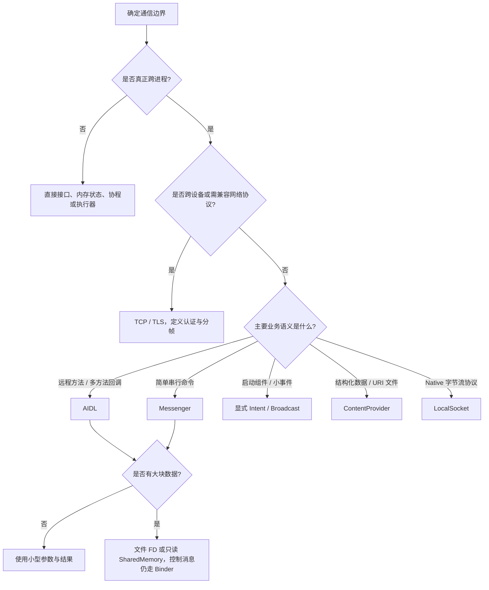

# Android IPC：通信方式、选型与关键代码

IPC 是进程间通信。不同进程拥有独立地址空间，即使属于同一应用，static 字段、单例和 Application 对象也不是共享实例。先判断业务需要的是**调用方法、发送事件、查询数据，还是传输大块内容**，再选择接口，不要只比较某个 API 是否“底层”。

AIDL、Messenger、ContentProvider、Intent 组件通信在 Android 框架中依托 Binder 提供不同抽象；Socket、共享内存和共享文件则有不同的数据通路。[进程与 IPC 官方说明](https://developer.android.com/guide/components/processes-and-threads)

## 先看方式与选型

### 常用方式有什么区别

所有方式都能交换业务数据，区别在于**数据如何表达、主体走哪条通路，以及能否直接回复**。先看数据，再看通信方向。

#### 能传什么，适合传多大

表中“KB 级 / MB 级”表示适合的工程规模，**不是 API 保证的单次上限**；大小以编码后的数据为准，不以 Java 对象在堆中的大小为准。

| 方式 | 能传什么数据 | 适合的数据量与限制 |
| --- | --- | --- |
| **Binder / AIDL** | 基本类型、字符串、数组、Parcelable；也可传 Binder 接口、FD 等句柄 | **小参数、小结果，通常 KB 级**；内联数据受 Binder 缓冲区约束，大内容改传 FD / 共享内存 |
| **Messenger** | Message 中的命令码、整数参数、Bundle 小对象 | **KB 级消息**；底层仍走 Binder，不能靠换成 Message 突破大小限制 |
| **Intent（启动组件）** | action、URI、extras 中的 ID、字符串、基本类型、Parcelable | **几个 KB 的启动参数**；图片、PDF 等只传 URI，再读取主体 |
| **Broadcast** | Intent 中的事件名、状态、记录 ID、版本号等 | **小事件，按几个 KB 设计**；同样走 Binder，不把大列表或文件字节塞入 extras |
| **ContentProvider** | 行列记录、ContentValues、Cursor；文件通过 URI 打开 FD | **大量记录分页 / 分窗口读取**；CursorWindow 有容量限制，大 BLOB 改用文件入口 |
| **共享文件 / ParcelFileDescriptor** | 图片、PDF、ZIP、音视频等任意文件字节 | **多 MB，乃至 GB 级文件分块读取**；主体不塞进 Binder，受存储、文件系统及提供方能力限制 |
| **SharedMemory** | 双方约定格式的二进制区域，如图像像素、模型或数据快照 | **MB 级内存数据**；受可分配内存、地址空间和业务配额限制，不受 Binder 内联数据量限制 |
| **LocalSocket / TCP Socket** | 字节流；文本、JSON、Protobuf、文件均需按协议编码 | **小消息到大文件、持续流均可**；没有 Binder 的约 1 MB 缓冲区约束，须自行分帧、限流和分块 |

::: warning 约 1 MB 不是每条消息可用的额度
官方说明 Binder 事务缓冲区约 **1 MB，由进程中正在进行的事务共享**，请求和回复都可能过大。不能据此认定“单次发送 900 KB 一定成功”；AIDL、Messenger 和 Intent 的内联数据都要保持小。FD / URI 传的是访问入口，文件或共享内存主体另行读取，也不代表资源使用无上限。
:::

依据：[Binder 大事务限制](https://developer.android.com/reference/android/os/TransactionTooLargeException)、[Intent 数据量建议](https://developer.android.com/guide/components/activities/parcelables-and-bundles)、[CursorWindow](https://developer.android.com/reference/android/database/CursorWindow)、[SharedMemory](https://developer.android.com/reference/android/os/SharedMemory)。

#### 能否接收后，再把数据发回去

这里区分两件事：**请求后返回结果**，以及**接收方稍后主动回信 / 推送**。两者都能让数据往返，但实现方式不同。

| 方式 | 是否支持数据往返 | 接收方怎样返回数据 |
| --- | --- | --- |
| **Binder / AIDL** | **支持同步返回，也支持异步回调** | 普通方法直接 return；主动推送需客户端传入回调 AIDL 接口。oneway 调用没有同步返回结果 |
| **Messenger** | **支持异步双向消息** | 请求设置 `Message.replyTo`，接收方用它 `send(reply)`；`send()` 本身不返回业务结果 |
| **Intent（启动组件）** | **启动本身不返回业务结果** | Activity 可另用 Activity Result 协议返回；Service 若需持续交互，使用绑定接口等另建回信通道 |
| **Broadcast** | **普通广播是单向通知** | 有序广播可经结果字段及最终接收器回传结果；持续双向会话应另选 AIDL / Messenger 等 |
| **ContentProvider** | **支持请求与结果往返** | `query()` 返回 Cursor，写入返回 URI / 行数，`call()` 可返回 Bundle；变更通知另用 ContentObserver，不等于自动推送完整记录 |
| **共享文件 / ParcelFileDescriptor** | **可设计双向交换，本身没有请求 / 回复语义** | 约定输入 / 输出文件或通道，并另设完成通知；只读 FD 不能写回，普通 pipe 是单向的 |
| **SharedMemory** | **有写权限时可设计双向读写** | 双方约定输入 / 输出区域及同步、通知协议；只读快照不能原地回写，可另传结果区域 |
| **LocalSocket / TCP Socket** | **支持全双工** | 同一已连接流式 Socket 两端均能读写，可回复和主动发送；需协议关联请求与结果，避免读写互相阻塞 |

机制依据：[AIDL](https://developer.android.com/develop/background-work/services/aidl)、[Message.replyTo](https://developer.android.com/reference/android/os/Message#replyTo)、[有序广播结果](https://developer.android.com/reference/android/content/Context#sendOrderedBroadcast(android.content.Intent,%20java.lang.String,%20android.content.BroadcastReceiver,%20android.os.Handler,%20int,%20java.lang.String,%20android.os.Bundle))、[ContentProvider](https://developer.android.com/reference/android/content/ContentProvider)。

“普通 Binder 子类 + 强转本地类型”只适合同进程接口；跨进程拿到的通常是 BinderProxy，不能强转为服务端的 Java 类。Parcelable、Serializable、Bundle 是数据编码或容器，不是传输通道；Handler、Executor、协程也不会单独变成 IPC。

### 怎么选择



例如笔记应用：页面读取数据优先统一到 Provider / 数据层；跨进程解析服务用 AIDL；少量串行控制命令可用 Messenger；分享 PDF 用受控 content URI；大图片或模型快照用 FD / SharedMemory；已有 Native 流协议才考虑 LocalSocket。跨设备优先成熟网络协议和库，不要把 Android AIDL 当作网络 RPC。

## 示例约定与运行边界

以下完整类使用包名 **`com.example.ipc`**，Java 8，**minSdk 27、compileSdk 35**；SharedMemory 自 API 27 提供，其他 API 若用于较低版本需分别检查。示例为**同一 APK 的不同私有进程**，不是跨应用授权示例；组件不导出，共用应用 UID，但对象和堆内存独立。

在 Android 模块启用 AIDL 编译，并保持接口文件路径和 package 一致；生成类不要手写。下面是模块级 `build.gradle.kts` 中相关配置，已有项目应合并到自己的 android 块：[AIDL 构建开关](https://developer.android.com/reference/tools/gradle-api/9.1/com/android/build/api/dsl/BuildFeatures#aidl)

```kotlin
android {
    buildFeatures { aidl = true }
}
```

Manifest 注册本页组件；测试 Activity 由应用现有页面显式打开。冒号进程名是应用私有进程名，不代表创建新应用身份。

```xml
<application>
    <activity android:name="com.example.ipc.IpcDemoActivity"
        android:exported="false" />
    <service android:name="com.example.ipc.RemoteNoteService"
        android:process=":ipc" android:exported="false" />
    <provider android:name="com.example.ipc.DemoNoteProvider"
        android:authorities="com.example.ipc.notes"
        android:process=":data" android:exported="false"
        android:grantUriPermissions="true" />
    <receiver android:name="com.example.ipc.NoteEventReceiver"
        android:process=":events" android:exported="false" />
</application>
```

## Binder / AIDL：需要明确的服务接口

### 定义接口与实现服务

创建 `src/main/aidl/com/example/ipc/INoteApi.aidl`。前两个方法演示普通 RPC 和核对进程，第三个方法为后文的共享内存示例提供控制入口。

```java
package com.example.ipc;
import android.os.SharedMemory;

interface INoteApi {
    int add(int left, int right);
    int servicePid();
    long checksum(in SharedMemory payload);
}
```

`IpcProtocol.java` 定义示例协议的上限。这是业务限制，不是 Binder 缓冲区大小；共享内存格式固定为“大端 4 字节长度 + 内容”。

```java
package com.example.ipc;

public final class IpcProtocol {
    public static final int MAX_PAYLOAD_BYTES = 1024 * 1024;
    private IpcProtocol() {}
}
```

`RemoteNoteService.java` 返回 AIDL Stub。方法实现不依赖可变共享状态，因此可应对 Binder 线程池并发；校验和只是有界的教学计算，真实长任务应交给受控执行器，再用回调或持久任务状态回报。

```java
package com.example.ipc;

import android.app.Service;
import android.content.Intent;
import android.os.Binder;
import android.os.IBinder;
import android.os.Process;
import android.os.SharedMemory;
import android.system.ErrnoException;
import java.nio.ByteBuffer;
import java.nio.ByteOrder;
import java.util.zip.CRC32;

public final class RemoteNoteService extends Service {
    private static void requireOwnUid() {
        if (Binder.getCallingUid() != Process.myUid()) {
            throw new SecurityException("This demo accepts only its own UID");
        }
    }

    private final INoteApi.Stub endpoint = new INoteApi.Stub() {
        @Override public int add(int left, int right) {
            requireOwnUid();
            long result = (long) left + right;
            if (result < Integer.MIN_VALUE || result > Integer.MAX_VALUE) {
                throw new IllegalArgumentException("Sum is outside the int range");
            }
            return (int) result;
        }

        @Override public int servicePid() {
            requireOwnUid();
            return Process.myPid();
        }

        @Override public long checksum(SharedMemory payload) {
            if (payload == null) throw new IllegalArgumentException("Missing payload");
            // 远程调用收到的是接收进程自己的描述符副本
            try (SharedMemory received = payload) {
                requireOwnUid();
                int size = received.getSize();
                if (size < 4 || size > IpcProtocol.MAX_PAYLOAD_BYTES + 4) {
                    throw new IllegalArgumentException("Invalid shared region size");
                }
                ByteBuffer mapping = received.mapReadOnly().order(ByteOrder.BIG_ENDIAN);
                try {
                    int length = mapping.getInt();
                    if (length < 0 || length != mapping.remaining()) {
                        throw new IllegalArgumentException("Invalid payload length");
                    }
                    byte[] bytes = new byte[length];
                    mapping.get(bytes);
                    CRC32 crc = new CRC32();
                    crc.update(bytes);
                    return crc.getValue();
                } finally {
                    SharedMemory.unmap(mapping);
                }
            } catch (ErrnoException e) {
                throw new IllegalStateException("Cannot map shared payload", e);
            }
        }
    };

    @Override public IBinder onBind(Intent intent) { return endpoint; }
}
```

接口由 AIDL 生成 Stub / Proxy，业务代码调用 `INoteApi.Stub.asInterface()`，无需操作隐藏的 ServiceManager。跨应用开放时，不能直接删掉 UID 校验和 exported 限制：应设计签名权限、授权对象、调用频率和协议边界。[AIDL 指南](https://developer.android.com/develop/background-work/services/aidl)

### 客户端绑定、调用与解绑

`IpcDemoActivity.java` 在可见页面绑定，连接回调只获取接口，实际同步 RPC 放到工作线程。Logcat 中客户端 PID 与 servicePid 可用于检查是否确实跨进程，不能只凭类名或包名判断。

```java
package com.example.ipc;

import android.app.Activity;
import android.content.ComponentName;
import android.content.Context;
import android.content.Intent;
import android.content.ServiceConnection;
import android.os.Bundle;
import android.os.IBinder;
import android.os.Process;
import android.os.RemoteException;
import android.system.ErrnoException;
import android.util.Log;
import android.widget.TextView;
import java.nio.charset.StandardCharsets;
import java.util.concurrent.ExecutorService;
import java.util.concurrent.Executors;

public final class IpcDemoActivity extends Activity {
    private final ExecutorService io = Executors.newSingleThreadExecutor();
    private boolean bound; // 主线程管理绑定生命周期
    private final ServiceConnection connection = new ServiceConnection() {
        @Override public void onServiceConnected(ComponentName name, IBinder binder) {
            if (!bound) return;
            INoteApi remote = INoteApi.Stub.asInterface(binder);
            io.execute(() -> {
                try {
                    Log.d("IpcDemo", "client=" + Process.myPid()
                            + ", server=" + remote.servicePid());
                    Log.d("IpcDemo", "sum=" + remote.add(20, 22));
                    long crc = SharedPayload.checksum(remote,
                            "一份只读笔记快照".getBytes(StandardCharsets.UTF_8));
                    Log.d("IpcDemo", "crc=" + crc);
                } catch (RemoteException | ErrnoException | RuntimeException e) {
                    Log.e("IpcDemo", "Remote call failed", e);
                }
            });
        }
        @Override public void onServiceDisconnected(ComponentName name) {
            Log.w("IpcDemo", "Service disconnected; do not reuse an old interface");
        }
        @Override public void onBindingDied(ComponentName name) { releaseBinding(); }
        @Override public void onNullBinding(ComponentName name) { releaseBinding(); }
    };

    @Override protected void onCreate(Bundle state) {
        super.onCreate(state);
        TextView text = new TextView(this);
        text.setText("查看 Logcat / IpcDemo 的进程与调用结果");
        setContentView(text);
        bound = bindService(new Intent(this, RemoteNoteService.class),
                connection, Context.BIND_AUTO_CREATE);
        if (!bound) Log.e("IpcDemo", "Binding request rejected");
    }

    private void releaseBinding() {
        if (bound) {
            bound = false;
            unbindService(connection);
        }
    }

    @Override protected void onDestroy() {
        releaseBinding();
        io.shutdownNow();
        super.onDestroy();
    }
}
```

绑定返回 true 仅表示已接受连接请求；接口只能在 onServiceConnected 后使用。onServiceDisconnected 不等于所有业务都未执行；系统可能保留绑定并重新连接。

onBindingDied / onNullBinding 应释放对应绑定，由拥有者决定是否重新发起。线程中断也不能自动取消已经发出的同步 Binder 事务。[绑定生命周期](https://developer.android.com/develop/background-work/services/bound-services)

## Messenger：简单串行消息协议

服务端用 `Messenger(Handler)` 发布 `getBinder()`，客户端在连接回调中用 `Messenger(binder)` 包装。以下是关键调用片段，完整服务、身份校验和回复处理见 [Messenger 机制](./messenger.html)。

```java
// 服务端：onCreate 中初始化，onBind 返回 endpoint.getBinder()
Handler incoming = new Handler(Looper.getMainLooper(), message -> {
    if (message.sendingUid != android.os.Process.myUid()) return true;
    if (message.what == 1) android.util.Log.d("IpcDemo", "Receive request");
    return true;
});
Messenger endpoint = new Messenger(incoming);

// 客户端：onServiceConnected 收到 binder 后构造 remote
Messenger remote = new Messenger(binder);
Message request = Message.obtain(null, 1);
Bundle data = new Bundle();
data.putInt("request_id", 7);
request.setData(data);
request.replyTo = replies; // 客户端自己的 Messenger，由回复 Handler 构造
remote.send(request);     // 调用方捕获 RemoteException，业务另设超时
```

此处 Handler 选择主 Looper，只适合快速处理。耗时工作要选专用执行位置；把业务转发到线程池后，也不能再宣称业务完成顺序天然串行。replyTo 只提供回复通道，不自动匹配请求、重试或保证处理成功。

Handler 回调中用 Message.sendingUid 识别入口记录的 UID，不能用此时的 Binder.getCallingUid 恢复原调用者。

## Intent / Broadcast：组件入口与小事件

Intent 适合携带少量参数启动 Activity / Service；Broadcast 适合表示“某状态变化，请读取最新数据”，不适合传大文件、充当可靠队列或替代有返回结果的 RPC。显式 Intent 仍受组件权限、导出及后台启动规则约束。

`NoteEventReceiver.java` 由前面的 Manifest 放在 `:events` 进程。客户端发送后，接收回调在接收进程主线程；日志只演示取值，不做阻塞业务。

```java
package com.example.ipc;

import android.content.BroadcastReceiver;
import android.content.Context;
import android.content.Intent;
import android.os.Process;
import android.util.Log;

public final class NoteEventReceiver extends BroadcastReceiver {
    public static final String ACTION = "com.example.ipc.NOTES_CHANGED";
    @Override public void onReceive(Context context, Intent intent) {
        if (!ACTION.equals(intent.getAction())) return;
        int revision = intent.getIntExtra("revision", -1);
        if (revision < 0) return;
        Log.d("IpcDemo", "event pid=" + Process.myPid() + ", revision=" + revision);
    }
}
```

```java
// 同一应用的任意合法调用位置；context 为当前 Context
Intent event = new Intent(context, NoteEventReceiver.class)
        .setAction(NoteEventReceiver.ACTION)
        .putExtra("revision", 1);
context.sendBroadcast(event);
```

需要持久完成的工作应另用任务调度及数据状态；广播到达不代表后续工作成功。不要用无目标的敏感广播、sticky broadcast 或已弃用的 LocalBroadcastManager 来实现跨进程通信；LocalBroadcastManager 本身只在同进程工作。[广播种类、注册安全与示例](./broadcast.html)

## ContentProvider 与文件描述符：共享数据与文件

### Provider 的查询和文件入口

`DemoNoteProvider.java` 只支持固定笔记 URI，返回一条教学元数据，不假装实现完整数据库；同时用 openFile 返回该笔记的只读描述符。入口在 `:data` 进程，底层文件位于同一应用的私有目录。

```java
package com.example.ipc;

import android.content.ContentProvider;
import android.content.ContentValues;
import android.database.Cursor;
import android.database.MatrixCursor;
import android.net.Uri;
import android.os.ParcelFileDescriptor;
import java.io.File;
import java.io.FileNotFoundException;

public final class DemoNoteProvider extends ContentProvider {
    public static final Uri NOTE_URI = Uri.parse("content://com.example.ipc.notes/notes/1");
    private static void requireUri(Uri uri) {
        if (!NOTE_URI.equals(uri)) throw new IllegalArgumentException("Unknown note URI");
    }
    @Override public boolean onCreate() { return true; }

    @Override public Cursor query(Uri uri, String[] projection, String selection,
            String[] selectionArgs, String sortOrder) {
        requireUri(uri);
        if (selection != null || selectionArgs != null || sortOrder != null) {
            throw new IllegalArgumentException("Filtering is not supported in this demo");
        }
        String[] columns = projection == null ? new String[]{"_id", "title"} : projection;
        Object[] values = new Object[columns.length];
        for (int i = 0; i < columns.length; i++) {
            if ("_id".equals(columns[i])) values[i] = 1L;
            else if ("title".equals(columns[i])) values[i] = "IPC 示例笔记";
            else throw new IllegalArgumentException("Unknown column");
        }
        MatrixCursor cursor = new MatrixCursor(columns);
        cursor.addRow(values);
        return cursor;
    }

    @Override public String getType(Uri uri) { requireUri(uri); return "text/plain"; }

    @Override public ParcelFileDescriptor openFile(Uri uri, String mode)
            throws FileNotFoundException {
        requireUri(uri);
        if (!"r".equals(mode)) throw new FileNotFoundException("Read only");
        return ParcelFileDescriptor.open(new File(getContext().getFilesDir(), "ipc-note.txt"),
                ParcelFileDescriptor.MODE_READ_ONLY);
    }

    @Override public Uri insert(Uri uri, ContentValues values) {
        throw new UnsupportedOperationException("Read only");
    }
    @Override public int update(Uri uri, ContentValues values, String where, String[] args) {
        throw new UnsupportedOperationException("Read only");
    }
    @Override public int delete(Uri uri, String where, String[] args) {
        throw new UnsupportedOperationException("Read only");
    }
}
```

### 客户端查询、读取与临时授权

`ProviderDemo.java` 的 run 必须在工作线程调用。先生成小型测试文件，再经 ContentResolver 跨进程查询和读取；AutoCloseInputStream 负责关闭返回的 ParcelFileDescriptor，Cursor 也必须关闭。

```java
package com.example.ipc;

import android.content.Context;
import android.database.Cursor;
import android.os.ParcelFileDescriptor;
import android.util.Log;
import java.io.File;
import java.io.FileOutputStream;
import java.io.IOException;
import java.io.InputStream;
import java.nio.charset.StandardCharsets;

public final class ProviderDemo {
    public static void run(Context context) throws IOException {
        try (FileOutputStream out = new FileOutputStream(
                new File(context.getFilesDir(), "ipc-note.txt"))) {
            out.write("一份可读取的笔记".getBytes(StandardCharsets.UTF_8));
        }
        try (Cursor cursor = context.getContentResolver().query(
                DemoNoteProvider.NOTE_URI, new String[]{"_id", "title"}, null, null, null)) {
            if (cursor != null && cursor.moveToFirst()) {
                Log.d("IpcDemo", cursor.getString(cursor.getColumnIndexOrThrow("title")));
            }
        }
        ParcelFileDescriptor fd = context.getContentResolver()
                .openFileDescriptor(DemoNoteProvider.NOTE_URI, "r");
        if (fd == null) throw new IOException("Provider returned no descriptor");
        try (InputStream input = new ParcelFileDescriptor.AutoCloseInputStream(fd)) {
            byte[] prefix = new byte[64];
            Log.d("IpcDemo", "Read prefix bytes=" + input.read(prefix));
        }
    }
}
```

文件主体经描述符读取，不是先把文件整个放进 Binder Parcel。Provider 的进程中创建的是描述符，接收方持有自己的描述符引用；关闭一端不等于立即关闭所有持有者。实际流式读取仍需要关闭、取消、大小和并发控制。

若由用户主动分享给其他应用，可对**这个具体 URI**提供临时读授权，下面片段放在可见 Activity 中。Manifest 的 grantUriPermissions 允许授权，但不会自动把所有数据公开。

```java
Intent share = new Intent(Intent.ACTION_SEND)
        .setType("text/plain")
        .putExtra(Intent.EXTRA_STREAM, DemoNoteProvider.NOTE_URI)
        .setClipData(ClipData.newRawUri("note", DemoNoteProvider.NOTE_URI))
        .addFlags(Intent.FLAG_GRANT_READ_URI_PERMISSION);
startActivity(Intent.createChooser(share, "分享笔记"));
```

通用文件分享优先采用配置范围收敛的 FileProvider，不发送 file:// 或任意文件路径。文件共享本身也不保证读写一致：示例仅演示一次写完后读取，生产环境需快照、原子发布或统一事务。

SharedPreferences 的 MODE_MULTI_PROCESS 已弃用且不可靠，不能当作跨进程数据库；需要观察变更时使用 Provider 通知并重新查询。[Provider 基础](https://developer.android.com/guide/topics/providers/content-provider-basics)、[文件安全分享](https://developer.android.com/training/secure-file-sharing)、[MODE_MULTI_PROCESS](https://developer.android.com/reference/android/content/Context#MODE_MULTI_PROCESS)

## SharedMemory：大块快照与 Binder 控制面配合

### 写入、只读封存、传递与释放

`SharedMemory.map()` 底层建立 mmap，返回指向共享区域的 ByteBuffer 窗口。两端各自在自己的地址空间建立映射，共享的是后备存储，不是 Java 对象或虚拟地址。`unmap()` 撤销本次映射后，原 ByteBuffer 及其别名都不能再访问；关闭 SharedMemory 与撤销映射应分别管理。[映射与释放契约](https://developer.android.com/reference/android/os/SharedMemory#map(int,%20int,%20int))

`SharedPayload.java` 与前面的 INoteApi / Service 配合：发送端创建共享区域、写入格式化内容、解除可写映射，降为只读，再通过 AIDL 传共享内存句柄；远端读取并返回校验和。**传递控制信息和描述符仍需要 Binder 等通道**，共享内存自己不会通知另一个进程。

```java
package com.example.ipc;

import android.os.RemoteException;
import android.os.SharedMemory;
import android.system.ErrnoException;
import android.system.OsConstants;
import java.nio.ByteBuffer;
import java.nio.ByteOrder;

public final class SharedPayload {
    public static long checksum(INoteApi remote, byte[] bytes)
            throws ErrnoException, RemoteException {
        if (bytes == null || bytes.length > IpcProtocol.MAX_PAYLOAD_BYTES) {
            throw new IllegalArgumentException("Payload too large or missing");
        }
        try (SharedMemory memory = SharedMemory.create("note-snapshot", 4 + bytes.length)) {
            ByteBuffer mapping = memory.mapReadWrite().order(ByteOrder.BIG_ENDIAN);
            try {
                mapping.putInt(bytes.length);
                mapping.put(bytes);
            } finally {
                SharedMemory.unmap(mapping); // 不保留发送端的可写映射
            }
            if (!memory.setProtect(OsConstants.PROT_READ)) {
                throw new IllegalStateException("Cannot seal shared memory read-only");
            }
            return remote.checksum(memory); // 同步完成后发送端关闭自己的描述符
        }
    }
}
```

接收端前文已展示 mapReadOnly、长度校验、unmap 和 close。示例强制远程服务，双方各管理自己的描述符副本；若也允许同进程绑定，AIDL 可能直接传同一个 Java 对象，必须重新定义复制或所有权转移规则，不能机械套用“收到的必然是独立对象”。

### 共享内存不自动解决什么

`setProtect()` 只会减少权限，并且不会撤销已经建立的旧映射，所以必须处理仍存活的可写映射；“接收端 mapReadOnly”也不等于发送端不再修改数据。本例通过先完成写入、解除写映射、再发布只读区域来约束单次快照。[SharedMemory 官方契约](https://developer.android.com/reference/android/os/SharedMemory)

反复写入同一区域则需要另设跨进程同步、版本、生产消费及通知协议。Java synchronized 只协调同一进程中共享该锁对象的线程，不能直接保护另一进程。共享映射减少了经 Binder 复制主体数据的需要，不代表端到端完全没有数据拷贝，也不提供数据完整性或来源认证。

## Socket：字节流与 Native 协作

### LocalSocket 最小双端协议

LocalSocket 是设备本地 Unix domain socket；LocalServerSocket 的字符串构造方式使用 abstract namespace。

这里限制为同 UID 双端，并定义“大端长度 + 内容”的有界帧，防止把一次 read 误当成一条完整消息。Socket 名称本身不代表身份，两端都校验内核提供的 peer credentials。[LocalSocket](https://developer.android.com/reference/android/net/LocalSocket)、[LocalServerSocket](https://developer.android.com/reference/android/net/LocalServerSocket)

`LocalChannel.java` 的构造、serveOnce 和 request 都由工作线程调用。先在服务端进程构造监听对象，再通知客户端可以连接；示例一次只接受一个连接，长期服务还需有界连接池和退出管理。

```java
package com.example.ipc;

import android.net.LocalServerSocket;
import android.net.LocalSocket;
import android.net.LocalSocketAddress;
import android.os.Process;
import java.io.Closeable;
import java.io.DataInputStream;
import java.io.DataOutputStream;
import java.io.IOException;

public final class LocalChannel implements Closeable {
    private static final String NAME = "com.example.ipc.notes.v1";
    private static final int MAX_FRAME_BYTES = 64 * 1024;
    private static final int READ_TIMEOUT_MS = 3000;
    private final LocalServerSocket listener;

    public LocalChannel() throws IOException { listener = new LocalServerSocket(NAME); }

    public void serveOnce() throws IOException {
        try (LocalSocket peer = listener.accept()) {
            requireOwnUid(peer);
            peer.setSoTimeout(READ_TIMEOUT_MS);
            byte[] request = readFrame(new DataInputStream(peer.getInputStream()));
            writeFrame(new DataOutputStream(peer.getOutputStream()), request); // 原样回显
        }
    }

    public static byte[] request(byte[] payload) throws IOException {
        if (payload == null || payload.length > MAX_FRAME_BYTES) {
            throw new IOException("Invalid frame size");
        }
        try (LocalSocket socket = new LocalSocket()) {
            socket.connect(new LocalSocketAddress(NAME, LocalSocketAddress.Namespace.ABSTRACT));
            requireOwnUid(socket);
            socket.setSoTimeout(READ_TIMEOUT_MS);
            writeFrame(new DataOutputStream(socket.getOutputStream()), payload);
            return readFrame(new DataInputStream(socket.getInputStream()));
        }
    }

    private static void requireOwnUid(LocalSocket socket) throws IOException {
        if (socket.getPeerCredentials().getUid() != Process.myUid()) {
            throw new IOException("Unexpected peer UID");
        }
    }

    private static byte[] readFrame(DataInputStream input) throws IOException {
        int length = input.readInt();
        if (length < 0 || length > MAX_FRAME_BYTES) throw new IOException("Invalid frame size");
        byte[] payload = new byte[length];
        input.readFully(payload); // 读取指定长度，处理中途到达的数据片段
        return payload;
    }

    private static void writeFrame(DataOutputStream output, byte[] payload) throws IOException {
        output.writeInt(payload.length);
        output.write(payload);
        output.flush();
    }

    @Override public void close() throws IOException { listener.close(); }
}
```

服务端在后台使用 `try (LocalChannel server = new LocalChannel()) { server.serveOnce(); }`，客户端在另一进程的后台调用 `LocalChannel.request("ping".getBytes(StandardCharsets.UTF_8))`。

不能用“启动线程后 sleep 一下”代替监听就绪协议；服务拥有者应保留监听器引用以便取消 accept，取消已接受的连接则要关闭相应 LocalSocket。

这里的 SO_TIMEOUT 是读超时，不等于连接、写入和整次业务请求都有同一个总时限。生产协议还需总截止时间、写端拥塞处理、版本、限流和失败重连；固定名称也可能被抢先占用，不能仅靠名称选择可信端点。跨应用 UID 不同，不能照搬这个同 UID 策略。

### TCP 与管道如何理解

跨设备或需要网络协议时可用 TCP；同设备的 loopback TCP 也能跨进程，但端口和“来自本机”都不是身份保证。以下只是连接骨架，需 INTERNET 权限，在工作线程调用；生产联网通常选择带认证的 TLS 和成熟应用协议，而非自行拼明文口令。

```java
try (java.net.Socket socket = new java.net.Socket()) {
    socket.connect(new java.net.InetSocketAddress("127.0.0.1", port), 3000);
    socket.setSoTimeout(3000);
    // 服务端必须已监听；双方继续使用明确的有界分帧协议
    // 不把一次 read / write 当作业务消息的边界
}
```

匿名管道适合单向字节流，例如 Native 子进程 I/O；Android 可用 ParcelFileDescriptor.createPipe 创建读写两端，再借 Binder 或其他机制分发 FD。

它不是让普通 Java 对象跨进程共享的手段，写端不关闭时读端可能一直等 EOF。信号、POSIX 共享内存等 Linux 能力更多见于 Native / 系统场景，不应直接替代普通应用的稳定 SDK 接口。[管道 API](https://developer.android.com/reference/android/os/ParcelFileDescriptor#createPipe())

## 统一的工程检查点

### 安全、线程与大数据

- **身份在入口确认**：Binder 调用者 UID 要在 Binder 入口取；交给执行器后不能再从 getCallingUid 恢复原调用者。请求里自报的包名、PID 或字符串令牌不能替代授权。
- **不阻塞主线程**：同步 Binder、ContentResolver、Socket 及文件 I/O 都可能等待；Binder / Provider 实现也要支持适当并发和取消，避免反向回调与持锁造成死锁。
- **保持控制消息小**：官方说明 Binder 事务缓冲区约 1 MB，由进程中进行的事务共享，不是“每次都能安全发送接近 1 MB”。请求和回复都要限制大小，大内容用 FD、分页或共享内存。
- **输入与资源有界**：校验长度、字段、URI、权限和版本；关闭 Cursor、流、FD、socket、共享映射与 SharedMemory。并发连接、排队任务和回调也要限额。

[Binder 大事务说明](https://developer.android.com/reference/android/os/TransactionTooLargeException)、[AIDL 线程与调用约束](https://developer.android.com/develop/background-work/services/aidl)

### 失败、顺序与验证

RemoteException、连接断开、超时或广播未收到，通常不能证明业务从未执行。写操作需请求 ID、幂等键、持久状态及有界重试；oneway 也不表示成功确认。Binder / Messenger / Socket 都不是自动持久化的可靠任务队列。

验证时确认客户端和服务端实际 PID 不同；覆盖服务端重启、解绑后旧回调、重复请求、无效长度、权限拒绝与大数据压力。同进程测试不能证明远程线程安全，Java 类型检查也不能代替真实跨进程运行。

进一步阅读：[Binder Java / Native 调用链](./binder-basics.html)、[Service 绑定与销毁](./service-lifecycle.html)、[Messenger 完整通信](./messenger.html)、[Provider 与内容观察](./content-provider.html)、[Framework Binder 机制](../framework/binder-mechanism.html)。
