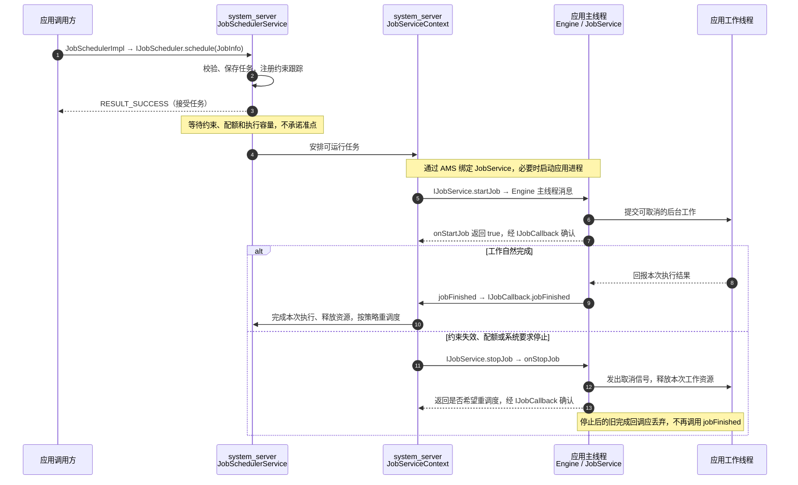

# JobScheduler：系统任务调度

JobScheduler 是 Android **API 21** 引入的系统任务调度 API。应用提交“做什么、满足哪些条件再做”，由系统协调执行机会。**系统负责调度，业务仍在应用进程执行；JobService 的生命周期回调默认在应用主线程。**

[JobScheduler API](https://developer.android.com/reference/android/app/job/JobScheduler)、[JobService API](https://developer.android.com/reference/android/app/job/JobService)

## 一、工作原理

### 核心对象与职责

- **JobInfo**：任务配置，包含 jobId、JobService 组件、时间、网络、充电等条件；它不是正在运行的线程。
- **JobScheduler / JobSchedulerImpl**：应用侧 API 与实际代理，经 `IJobScheduler` Binder 接口向系统提交、查询或取消任务。
- **JobSchedulerService**：位于 system_server，验证调用身份、服务和权限，保存任务，协调约束、配额及调度。
- **JobStatus、JobStore**：前者描述系统侧任务及约束状态，后者维护任务集合并将需要跨重启保存的任务写入磁盘。
- **StateController、JobConcurrencyManager、JobServiceContext**：分别跟踪状态变化、协调执行并发，以及管理一次任务与 JobService 的绑定、开始、停止和完成回报。
- **JobServiceEngine、JobService、JobParameters**：应用侧接收 Binder 命令并转交主线程，回调应用实现；JobParameters 标识这次执行并携带输入和系统信息。

充电、网络、空闲、时间和配额分别有相应控制器，例如 `BatteryController`、`ConnectivityController`、`IdleController`、`TimeController`、`QuotaController`。**条件满足只是具备候选资格**；系统还会考虑并发容量、应用待机状态、配额与设备健康情况。

源码入口：[`JobSchedulerImpl.java`](https://android.googlesource.com/platform/frameworks/base/+/refs/tags/android-16.0.0_r1/apex/jobscheduler/framework/java/android/app/JobSchedulerImpl.java)、[`JobSchedulerService.java`](https://android.googlesource.com/platform/frameworks/base/+/refs/tags/android-16.0.0_r1/apex/jobscheduler/service/java/com/android/server/job/JobSchedulerService.java)、[`JobStore.java`](https://android.googlesource.com/platform/frameworks/base/+/refs/tags/android-16.0.0_r1/apex/jobscheduler/service/java/com/android/server/job/JobStore.java)、[约束控制器目录](https://android.googlesource.com/platform/frameworks/base/+/refs/tags/android-16.0.0_r1/apex/jobscheduler/service/java/com/android/server/job/controllers/)。

### 从提交到执行、停止的时序



图中 `JobServiceContext` 对应用的调用经过 Binder；应用 `JobServiceEngine` 再经绑定主 Looper 的 Handler 分发。工作线程是应用自己创建或选择的执行器，不是 JobScheduler 自动替业务创建。系统运行任务期间管理对应 wakelock，但这不能消除任务的执行时限和停止要求。

实现见 [`JobServiceContext.java`](https://android.googlesource.com/platform/frameworks/base/+/refs/tags/android-16.0.0_r1/apex/jobscheduler/service/java/com/android/server/job/JobServiceContext.java) 与 [`JobServiceEngine.java`](https://android.googlesource.com/platform/frameworks/base/+/refs/tags/android-16.0.0_r1/apex/jobscheduler/framework/java/android/app/job/JobServiceEngine.java)。后者的分发核心如下，省略清理、异常处理和其他分支，注释为本文补充：

```java
case MSG_EXECUTE_JOB: {
    final JobParameters params = (JobParameters) msg.obj;
    boolean workOngoing = JobServiceEngine.this.onStartJob(params);
    // 返回值通过回调回报给系统，表示业务是否仍在继续
    ackStartMessage(params, workOngoing);
    break;
}
case MSG_STOP_JOB: {
    final JobParameters params = (JobParameters) msg.obj;
    boolean ret = JobServiceEngine.this.onStopJob(params);
    // ret 表达重新调度意愿，不表示后台线程已被自动终止
    ackStopMessage(params, ret);
    break;
}
```

### 三个生命周期契约

`onStartJob(params)` 返回 **false**，表示这次工作已经结束，不应再为它调用 `jobFinished()`；返回 **true**，表示工作异步继续，正常结束后应调用 `jobFinished(params, wantsReschedule)`。

`jobFinished(params, false)` 表示结束本次执行，不要求按失败退避重调度。它**不是业务成功状态码**，不会替应用保存“上传成功”等结果；周期任务仍会按周期策略安排后续执行。传 **true** 则请求按退避策略重新安排任务。

`onStopJob(params)` 表示系统要求提前停止。应用负责取消工作、关闭资源，返回值表示是否希望重调度；**收到这个停止回调后，不再为该次执行调用 jobFinished()**。返回 true 也不能覆盖用户取消等系统限制。[生命周期契约](https://developer.android.com/reference/android/app/job/JobService)

## 二、使用场景与选型

### 适合做什么

适合允许等待条件、能被中断和恢复的后台工作，例如充电时重建本地索引、网络合适时同步已持久化的变更、定期维护可重建缓存。任务输入和处理进度应独立保存，不能依赖 Activity、内存队列或某个对象一直存活。

直接使用 JobScheduler 的典型理由，是需要平台 API 的具体能力或正在学习、维护系统调度链。**普通应用的持久后台任务通常优先评估 WorkManager**，由它管理任务状态、依赖链、唯一任务和跨版本适配；不是所有应用都需要手工维护 JobService。[持久任务选型](https://developer.android.com/develop/background-work/background-tasks/persistent)

### 与 Handler、WorkManager、闹钟的关系

| 关注点 | Handler / Executor / 协程 | JobScheduler | WorkManager | AlarmManager |
| --- | --- | --- | --- | --- |
| 主要目标 | 进程内执行与线程切换 | 平台约束与系统任务调度 | 应用层持久任务编排 | 基于时间的唤醒或通知触发 |
| 进程退出后 | 内存工作不会自动恢复 | 系统保留调度记录，跨重启需额外配置 | 数据库保存工作和状态，可恢复调度 | 需按闹钟类型、权限和重启策略处理 |
| 时间语义 | 消息或执行器调度，不保证准点 | 允许系统推迟、批处理 | 受系统调度及约束影响 | 精确闹钟有独立资格及权限限制 |
| 业务管理 | 生命周期、取消自行管理 | 业务重试上限、结果、依赖自行管理 | 提供状态、退避、依赖、唯一任务等 API | 触发后耗时工作仍需另行管理 |

页面内立即加载数据用协程或执行器；用户设定的准点提醒应研究 AlarmManager 的对应能力；持续且用户可感知的工作需评估[前台服务](./service-lifecycle.html#foreground-services)。不要用周期 Job 模拟秒级心跳、常驻服务或精确闹钟。[闹钟说明](https://developer.android.com/develop/background-work/services/alarms)

Android 14 / API 34 引入的 **用户发起数据传输任务 UIDT** 是 JobScheduler 的专门模式：用于用户明确发起、可能持续较久的数据传输，要求合法的调度时机、相应权限和通知。它不是普通 Job 随便添加一个标志后的无限运行模式。[UIDT 官方说明](https://developer.android.com/develop/background-work/background-tasks/uidt)

## 三、怎么使用：重建本地笔记索引

### 示例约定与 Manifest

下面三个部分使用同一包名 `com.example.notes`，面向 **minSdk 21+**，使用 Java 8 语言功能和公开平台 API，不依赖 WorkManager。应用将私有 `filesDir/notes/` 下的 Markdown 文件名写入 `notes-index.json`；目录由应用维护，示例不读取用户任意路径，也不需要网络或共享存储权限。

示例选择充电且提交至少五分钟后才具备执行资格，并允许跨设备重启保留调度。`BIND_JOB_SERVICE` 放在 **service 的 android:permission 属性**，限制绑定者；不是让普通应用通过 uses-permission 取得该签名权限。`RECEIVE_BOOT_COMPLETED` 则是 `setPersisted(true)` 的声明要求，不必为这项机制另写一个重复提交任务的开机 Receiver。

```xml
<manifest xmlns:android="http://schemas.android.com/apk/res/android">
    <uses-permission android:name="android.permission.RECEIVE_BOOT_COMPLETED" />
    <application>
        <service
            android:name="com.example.notes.NoteIndexJobService"
            android:exported="true"
            android:permission="android.permission.BIND_JOB_SERVICE" />
    </application>
</manifest>
```

服务允许系统跨进程绑定，同时由签名权限保护；不要移除权限保护来排查调度失败。真实项目应将上述内容合并到现有 Manifest。[JobService 权限](https://developer.android.com/reference/android/app/job/JobService#PERMISSION_BIND)、[跨重启配置](https://developer.android.com/reference/android/app/job/JobInfo.Builder#setPersisted(boolean))

### 提交、检查结果与取消

`NoteIndexJobs.java` 集中定义稳定 ID；相同应用、相同 namespace 内再次 `schedule()` 同一个 ID 是**替换任务**，运行中的旧任务会被停止，不是追加或 WorkManager 的 KEEP。

```java
package com.example.notes;

import android.app.job.JobInfo;
import android.app.job.JobScheduler;
import android.content.ComponentName;
import android.content.Context;
import java.util.concurrent.TimeUnit;

public final class NoteIndexJobs {
    public static final int JOB_ID = 1001;
    private NoteIndexJobs() {}

    public static boolean schedule(Context context) {
        Context app = context.getApplicationContext();
        JobInfo job = new JobInfo.Builder(JOB_ID,
                new ComponentName(app, NoteIndexJobService.class))
                .setRequiresCharging(true)
                .setMinimumLatency(TimeUnit.MINUTES.toMillis(5))
                .setPersisted(true)
                .setBackoffCriteria(TimeUnit.MINUTES.toMillis(1),
                        JobInfo.BACKOFF_POLICY_EXPONENTIAL)
                .build();
        JobScheduler scheduler = (JobScheduler)
                app.getSystemService(Context.JOB_SCHEDULER_SERVICE);
        return scheduler.schedule(job) == JobScheduler.RESULT_SUCCESS;
    }

    public static void cancel(Context context) {
        JobScheduler scheduler = (JobScheduler)
                context.getSystemService(Context.JOB_SCHEDULER_SERVICE);
        scheduler.cancel(JOB_ID);
    }
}
```

页面中调用 `boolean accepted = NoteIndexJobs.schedule(this)`，根据返回值处理提交结果；用户明确取消时调用 `NoteIndexJobs.cancel(this)`。`RESULT_FAILURE` 不应触发紧密循环重试；权限、组件或参数错误抛出的异常属于配置问题，应修正原因。成功提交也不等于索引生成成功。[schedule 契约](https://developer.android.com/reference/android/app/job/JobScheduler#schedule(android.app.job.JobInfo))

### JobService：异步执行与停止竞态

`NoteIndexJobService.java` 将文件工作移到单线程执行器。Map 只由主线程访问；每次执行使用独立 Run 对象，旧执行完成时必须确认仍是当前对象，防止同一个 jobId 被重新调度后，旧回调结束了新任务。

```java
package com.example.notes;

import android.app.job.JobParameters;
import android.app.job.JobService;
import android.os.Handler;
import android.os.Looper;
import android.util.AtomicFile;
import android.util.JsonWriter;
import android.util.Log;
import java.io.File;
import java.io.FileOutputStream;
import java.io.IOException;
import java.io.InterruptedIOException;
import java.io.OutputStreamWriter;
import java.nio.charset.StandardCharsets;
import java.util.HashMap;
import java.util.Map;
import java.util.concurrent.ExecutorService;
import java.util.concurrent.Executors;
import java.util.concurrent.Future;

public final class NoteIndexJobService extends JobService {
    private final Handler main = new Handler(Looper.getMainLooper());
    private final ExecutorService io = Executors.newSingleThreadExecutor();
    private final Map<Integer, Run> running = new HashMap<>();

    private static final class Run {
        final JobParameters params;
        volatile boolean cancelled;
        Future<?> future;
        Run(JobParameters params) { this.params = params; }
    }

    @Override public boolean onStartJob(JobParameters params) {
        if (params.getJobId() != NoteIndexJobs.JOB_ID) return false;
        Run run = new Run(params);
        running.put(params.getJobId(), run);
        run.future = io.submit(() -> {
            try {
                rebuildIndex(run);
            } catch (InterruptedIOException e) {
                Thread.currentThread().interrupt();
            } catch (IOException | RuntimeException e) {
                Log.e("NoteIndex", "Index rebuild failed", e);
                // 本例记录失败并结束，不将所有错误无限重试
            }
            main.post(() -> {
                if (run.cancelled || running.get(params.getJobId()) != run) return;
                running.remove(params.getJobId());
                jobFinished(run.params, false);
            });
        });
        return true; // 仅表示后台工作尚未结束
    }

    @Override public boolean onStopJob(JobParameters params) {
        cancel(running.remove(params.getJobId()));
        return true; // 本例可重建，希望系统在允许时重调度
    }

    private static void cancel(Run run) {
        if (run == null) return;
        run.cancelled = true;
        if (run.future != null) run.future.cancel(true);
    }

    private static void checkCancelled(Run run) throws InterruptedIOException {
        if (run.cancelled || Thread.currentThread().isInterrupted()) {
            throw new InterruptedIOException("Job stopped");
        }
    }

    private void rebuildIndex(Run run) throws IOException {
        File directory = new File(getFilesDir(), "notes");
        File[] files = directory.exists() ? directory.listFiles() : new File[0];
        if (files == null) throw new IOException("Cannot list notes directory");
        AtomicFile index = new AtomicFile(new File(getFilesDir(), "notes-index.json"));
        FileOutputStream stream = null;
        try {
            checkCancelled(run);
            stream = index.startWrite();
            JsonWriter writer = new JsonWriter(
                    new OutputStreamWriter(stream, StandardCharsets.UTF_8));
            writer.beginArray();
            for (File file : files) {
                checkCancelled(run);
                if (file.isFile() && file.getName().endsWith(".md")) {
                    writer.value(file.getName());
                }
            }
            writer.endArray();
            writer.flush();
            checkCancelled(run);
            index.finishWrite(stream); // 完成后发布整个索引
        } catch (IOException | RuntimeException e) {
            if (stream != null) index.failWrite(stream);
            throw e;
        }
    }

    @Override public void onDestroy() {
        for (Run run : running.values()) cancel(run);
        running.clear();
        io.shutdownNow(); // 不在主线程 join 或等待任务终止
        super.onDestroy();
    }
}
```

`Future.cancel(true)` 只是请求中断，不能强杀线程；例中的取消标志和循环检查共同响应停止。单线程执行器也让前后两次索引写入串行，避免 AtomicFile 自身不提供的写者互斥。生产项目还需与其他写入方统一锁或数据事务，并明确索引读取策略。[AtomicFile 契约](https://developer.android.com/reference/android/util/AtomicFile)

本例索引可以重新生成，I/O 失败只记录日志，`jobFinished(false)` 不表示业务成功。若改成同步或上传，应持久化业务结果、进度、幂等标识和有限重试次数；只有可恢复错误才请求重试。直接使用 JobScheduler 时，没有 WorkManager 那样现成的业务状态和尝试次数模型。

## 四、编码时特别注意什么

### 主线程、取消与资源

- **回调快速返回**：不要在 onStartJob / onStopJob 做网络、磁盘扫描、等待锁或 Future.get。应用主线程被其他代码堵住，也可能导致任务回调 ANR。
- **任务按执行实例管理**：同一个 JobService 可承接不同 jobId，不要只保存一个全局 Future。旧执行与新执行还需区分代次；只比较 jobId 不够。
- **完成与停止只能收口一次**：将状态收口串行化，停止时移除 Run，完成时校验身份。onStopJob 已到达时丢弃旧完成通知。
- **释放实际资源**：中断不能保证取消所有网络或文件操作；使用对应库的取消、超时及关闭机制。不要在 finally 中无条件 jobFinished，也不要依赖 onDestroy 一定执行。

### 时间、约束与重试

`setMinimumLatency()` 是最早具备执行资格的延迟，不是到点执行；`setPeriodic()` 的周期和 flex 受平台下限约束，AOSP 本文版本最小周期为 15 分钟。周期任务不能同时设置 minimum latency 或 override deadline。不要把短周期或反复 schedule 当成绕过系统批处理的办法。

**`setOverrideDeadline()` 不是准时保证**。到期可能放宽功能性约束，但仍受 Doze、设备健康等因素影响；如果因此在没有期望网络或电源条件时开始，业务仍须正确处理。idle 任务也不能随意与自定义退避组合，具体组合需核对 Builder 校验。[JobInfo.Builder 约束](https://developer.android.com/reference/android/app/job/JobInfo.Builder)

请求重试仍受原约束和系统策略影响；永久鉴权失败、无效输入和配置错误不应无限重试。任务被执行多次时必须安全，不能假设“本地没有收到完成回报，所以远端肯定没有成功”。

### 持久化、标识与网络

系统保存调度记录不等于保存执行栈或业务内存。`setPersisted(true)` 配合开机权限用于跨重启恢复调度；应用被卸载、清除数据或用户强行停止等情况不能承诺照常执行。持久输入用适合的小型 `PersistableBundle`，大文件和敏感凭据留在受保护的数据层，任务只传标识。

统一管理 ID，避免 SDK、业务模块彼此覆盖；API 34+ 可以使用 namespace 隔离，但它不提供额外 UID 配额。不要从 getPendingJob / getAllPendingJobs 的存在与否推断业务成功，业务状态应自行持久记录。

网络约束只表示调度条件，不代表目标服务器一定可访问。Android 14 / targetSdk 34+ 配置网络约束需声明 `ACCESS_NETWORK_STATE`，实际联网还需要 `INTERNET`；API 28+ 可从 `JobParameters.getNetwork()` 获取分配网络，并在适用的网络 API 上显式使用它，而不是假定默认网络必然符合约束。[Android 14 网络权限要求](https://developer.android.com/about/versions/14/behavior-changes-14#jobscheduler)、[JobParameters 网络信息](https://developer.android.com/reference/android/app/job/JobParameters#getNetwork())

### 版本与配额

- **API 21 起**：JobScheduler 基础能力；本文示例只使用这一基线及更早 API。
- **API 24 起**：周期 flex 等能力；**API 31 起**：expedited job；**API 34 起**：namespace、UIDT、停止和等待原因相关能力需逐项检查具体 API 版本。
- **Android 14，targetSdk 34+**：回调不及时返回可能触发明确的 ANR；网络约束权限要求也要同步适配。[行为变化](https://developer.android.com/about/versions/14/behavior-changes-14#jobscheduler)
- **Android 16，所有运行其上的应用**：普通与 expedited job 的执行配额进一步考虑应用待机桶、可见状态及与前台服务并行执行等因素。开启一个前台服务不能让 Job 自动获得无限运行时间。[Android 16 配额变化](https://developer.android.com/about/versions/16/behavior-changes-all#job-scheduler)

expedited 仍有配额，提交可能失败，也有限制可组合的约束，不能直接给上面的“充电 + 延迟”示例添加 setExpedited(true)。UIDT 需要用户发起、合法调度时机、`RUN_USER_INITIATED_JOBS` 权限及通知；用户要求停止时应尊重其意图。[Expedited API](https://developer.android.com/reference/android/app/job/JobInfo.Builder#setExpedited(boolean))、[UIDT 要求](https://developer.android.com/develop/background-work/background-tasks/uidt)

### 如何验证与排查

先核对设备版本、用户、应用 targetSdk、Manifest 和任务 ID，再看任务是否提交、为何等待以及停止原因。调试命令随系统版本变化，先查询设备自己的帮助：

```sh
adb shell getprop ro.build.version.sdk
adb shell am get-current-user
adb shell cmd jobscheduler help
adb shell dumpsys jobscheduler
```

在隔离的调试设备，确认当前用户和 ID 后，可参考 AOSP 本文版本的语法。下例包名与前面一致，1001 对应 `NoteIndexJobs.JOB_ID`，实际项目应替换为自己的值；多用户设备按帮助附加 `-u USER_ID`。

```sh
adb shell cmd jobscheduler get-job-state com.example.notes 1001
adb shell cmd jobscheduler run -f com.example.notes 1001
adb shell cmd jobscheduler stop com.example.notes 1001
```

`run -f` 用于验证执行链，会绕过部分约束，**不能用它证明真实充电、网络、配额和时间行为正确**。还应通过真实条件变化验证：停止后线程是否退出、旧完成通知是否被忽略、相同 ID 替换是否安全、重启后是否恢复、失败能否有界处理。API 31+ 可检查停止原因，API 34+ 可查询等待原因，但必须做版本判断。[调试命令源码](https://android.googlesource.com/platform/frameworks/base/+/refs/tags/android-16.0.0_r1/apex/jobscheduler/service/java/com/android/server/job/JobSchedulerShellCommand.java)
