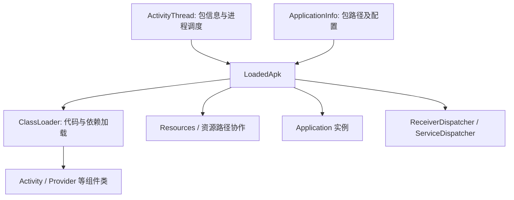
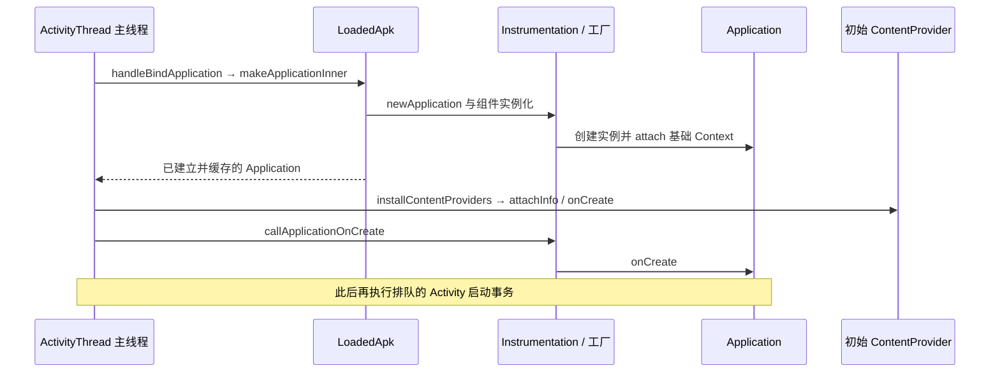

# LoadedApk 原理

`LoadedApk` 是应用进程中框架管理已加载包信息的重要对象，连接 `ApplicationInfo`、代码和资源路径、ClassLoader、Resources、Application 以及部分组件分发对象。它不是磁盘上的 APK 文件，也不是“已经把整个 APK 读入内存”的证明。

## ActivityThread 如何取得实例 {#s250}

`ActivityThread.getPackageInfo()` 系列入口根据包信息、兼容性和是否需要代码等条件取得或建立 LoadedApk，并结合包缓存复用对象。代码包与仅资源访问的缓存用途不同，相关缓存包含弱引用，不能据此声称“一个包在设备上永久只有一个 LoadedApk”。

LoadedApk、Application 和 ClassLoader 都有进程与加载上下文。多进程应用可以各有自己的 Application；同一包的资源访问也不等于创建该包的 Application。缓存、配置更新、分包和特殊加载场景需要结合具体入口核对。[ActivityThread 源码](https://github.com/aosp-mirror/platform_frameworks_base/blob/android-16.0.0_r1/core/java/android/app/ActivityThread.java)

图示是职责关联，不代表所有对象在 LoadedApk 构造时立即建立，也不表示资源由 ClassLoader 独立管理。

## Application 创建与 onCreate 的区别 {#s253}

### makeApplicationInner 与 Instrumentation {#s256}

`makeApplicationInner()` 检查已有实例，准备类加载器及包上下文，通过 Instrumentation 创建 Application，关联 Context 并缓存结果。现代组件工厂 `AppComponentFactory` 也参与实例化路径。

缓存存在两个层次：当前 LoadedApk 的 `mApplication` 与进程内按包名索引的 `sApplications`。内部入口先复用这些实例，再执行创建；因此包信息缓存中的弱引用不意味着 Application 会随一次局部变量离开作用域立即消失。ActivityThread 也维护已创建 Application 的集合，这些都是进程内状态。[缓存与实例化顺序](https://github.com/aosp-mirror/platform_frameworks_base/blob/android-16.0.0_r1/core/java/android/app/LoadedApk.java#L1415)

`Application.attach()` 会连接基础 Context 并进入 `attachBaseContext()`。**Application 对象创建完成不等于 `Application.onCreate()` 已执行。** `makeApplicationInner()` 是否直接调用后者还取决于传入的 Instrumentation；不能脱离调用点画一条固定生命周期链。[LoadedApk 源码](https://github.com/aosp-mirror/platform_frameworks_base/blob/android-16.0.0_r1/core/java/android/app/LoadedApk.java)、[Instrumentation 源码](https://github.com/aosp-mirror/platform_frameworks_base/blob/android-16.0.0_r1/core/java/android/app/Instrumentation.java)

### 普通冷启动中的初始化顺序

在 `ActivityThread.handleBindApplication()` 的普通绑定路径中，框架调用 `makeApplicationInner(..., null)`，随后安装本次需要初始化的 Provider，最后通过 `Instrumentation.callApplicationOnCreate()` 调用 Application 回调。因此这些 Provider 的 `onCreate()` 可能早于 Application 的 `onCreate()`，却晚于 Application 对象的创建与基础 Context 关联。

这里限定为普通应用绑定及初始 Provider 集合，不覆盖备份模式、延迟取得其他 Provider 等所有分支。Application 的 `onTerminate()` 也不能当作生产设备上可靠的进程退出回调。完整跨进程链见 [AMS / ATMS 启动时序](./system-services/ams-atms.html#ams-atms-launch-sequence)。

## APK、资源与原生库路径 {#s262}

### appDir：基础包及分包路径 {#s265}

`appDir` 可结合 `ApplicationInfo.sourceDir` 及 LoadedApk 的包路径字段理解；访问资源还要考虑 publicSourceDir、资源目录、splitSourceDirs、覆盖资源和配置。应用可能包含多个 split APK，不能仅靠一个 base APK 路径描述全部代码和资源。

路径元数据不是文件内容。Resources / AssetManager 与配置、资源 ID、分包和覆盖资源共同决定最终资源；ClassLoader 的 Java 资源查找不能替代 Android 的资源解析。[ApplicationInfo API](https://developer.android.com/reference/android/content/pm/ApplicationInfo)

### libDir：原生库与 ABI {#s268}

`libDir` 对应原生库搜索所需目录信息，例如 `ApplicationInfo.nativeLibraryDir`。实际加载还受 ABI、打包与解压方式、链接器命名空间及依赖关系影响。它不是全部 `.so` 必然已解压到某一个目录、也不是 Java DEX 搜索路径的别名。

## ClassLoader 与共享依赖 {#s271}

`createOrUpdateClassLoaderLocked()` 等逻辑根据包代码、split、共享库和原生库相关信息创建或更新类加载协作。加载器不是任意互换的：同名类若由不同定义加载器加载，可以是两个不兼容的类型。共享库还可能通过独立加载器参与搜索，并非简单把所有代码拼成一条 dexElements 数组。

细节见[类加载机制](./class-loading.html)。包更新后系统的缓存与进程处理也不能简化成“修改 APK 路径就原地替换所有已加载类”。普通应用不应反射改写 LoadedApk 内部字段作为稳定的 SDK 扩展点。

## 组件分发职责与排查

LoadedApk 中的 `ReceiverDispatcher` 和 `ServiceDispatcher` 协助动态广播回调、服务连接回调与线程调度，不等于 LoadedApk 统一运行全部四大组件。Activity 的创建和生命周期主要沿 ActivityThread、Instrumentation 与事务执行器协作。

遇到初始化或类加载问题，先区分：包元数据是否正确、代码路径与依赖是否可见、类由哪个加载器定义、Application 是否已创建、Provider 是否仍在初始化、Activity 事务是否已经执行。

原始笔记：[Android 基础知识提纲](https://alidocs.dingtalk.com/i/nodes/1OQX0akWmxaRZD7yfgRMaeOX8GlDd3mE)。
