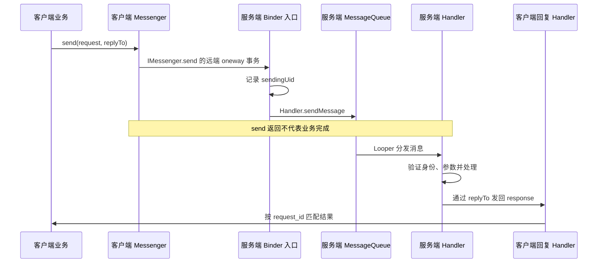

# Messenger 机制

Messenger 把一个 Handler 包装为可跨进程传递的消息端点：客户端通过 Binder 发送 Message，服务端再把它交给目标 Handler。它适合消息种类较少、希望在同一 Looper 串行处理的 IPC；复杂强类型协议或并发接口可考虑直接使用 AIDL。


## 轻量级跨进程通信

Messenger 的底层接口是隐藏的 `IMessenger` AIDL，`send(Message)` 定义为 `oneway`。远端调用无需等待 Handler 完成业务；本地直调没有远程 oneway 语义，但仍通过 Handler 入队，把业务延后到目标 Looper。[IMessenger.aidl](https://github.com/aosp-mirror/platform_frameworks_base/blob/android-16.0.0_r1/core/java/android/os/IMessenger.aidl)



图中回复同样经过 Binder 与客户端队列，箭头合并展示了该路径。耗时工作若转交线程池，完成顺序可能变化，需用请求标识匹配；同一 Looper 串行回调也不等于整个应用无需同步。

## 两个关键构造方法

### Messenger(Handler target)

服务端先创建 Handler，再创建 Messenger。框架内部取得该 Handler 对应的 `IMessenger` 实现，因而多个指向同一 Handler 的 Messenger 可共享同一通信端点。[Messenger API](https://developer.android.com/reference/android/os/Messenger)

两个构造入口分别对应创建接收端和适配已有通信端点：

```text
Messenger(Handler) → Handler.getIMessenger() → MessengerImpl
Messenger(IBinder) → IMessenger.Stub.asInterface(IBinder)
Messenger.getBinder() → 底层 IMessenger.asBinder()
Messenger.send(Message) → 底层 IMessenger.send(Message)
```

`Handler.getIMessenger()` 缓存内部实现，`MessengerImpl` 继承 `IMessenger.Stub`；其 Binder 入口先记录 `Binder.getCallingUid()` 到 `Message.sendingUid`，再调用目标 Handler 的 `sendMessage()`。[Handler 内部实现](https://github.com/aosp-mirror/platform_frameworks_base/blob/android-16.0.0_r1/core/java/android/os/Handler.java)

`getIMessenger()`、`MessengerImpl` 和 `IMessenger` 是源码阅读入口，**不是普通应用可直接依赖的公开 SDK API**。应用只使用 `new Messenger(handler)` 等公开入口。[Messenger.java](https://github.com/aosp-mirror/platform_frameworks_base/blob/android-16.0.0_r1/core/java/android/os/Messenger.java)

### Messenger(IBinder target)

客户端从 `onServiceConnected()` 收到 `IBinder`，通过 `new Messenger(binder)` 构造发送端。内部 `asInterface()` 可能取得本地接口，也可能创建远程代理；不能把两条路径都说成必然创建 BinderProxy。

**`Service.onBind()` 的返回类型是 `IBinder`，应返回 `messenger.getBinder()`**；客户端拿到的也首先是 IBinder，再把它适配为 Messenger。[官方 Messenger 绑定流程](https://developer.android.com/develop/background-work/services/bound-services#Messenger)

## 通信四步

### 1. 服务端创建 Handler 与 Messenger

选择明确的 Looper；如果绑定主 Looper，收到的业务消息就在主线程处理。Service 并不自带工作线程。需要长任务时可使用受控后台执行器，保留串行协议状态并限制并发。

### 2. onBind 返回底层 IBinder

下面是**同应用、同 UID、远程进程**的教学服务骨架，最低 API 21，限定小字符串请求，默认 Manifest 不对外导出。跨应用时应替换为第 4 步中的“指定发送应用”校验策略，不能直接沿用同 UID 判断。它展示传输和回复边界，不是持久任务执行器。

```java
import android.app.Service;
import android.content.Intent;
import android.os.Bundle;
import android.os.Handler;
import android.os.IBinder;
import android.os.Looper;
import android.os.Message;
import android.os.Messenger;
import android.os.Process;
import android.os.RemoteException;
import android.util.Log;

public final class NoteMessageService extends Service {
    public static final int REQUEST = 1;
    public static final int RESPONSE = 2;
    private static final int MAX_TEXT_CHARS = 256;
    private Handler incoming;
    private Messenger endpoint;

    @Override public void onCreate() {
        super.onCreate();
        incoming = new Handler(Looper.getMainLooper(), this::onMessage);
        endpoint = new Messenger(incoming);
    }

    @Override public IBinder onBind(Intent intent) {
        return endpoint.getBinder();
    }

    private boolean onMessage(Message request) {
        // 先验证调用身份，再解码业务 Bundle 或向 replyTo 回复。
        if (request.what != REQUEST || request.sendingUid != Process.myUid()) {
            return true;
        }
        try {
            Bundle data = request.getData();
            int id = data.getInt("request_id", -1);
            String text = data.getString("text");
            if (id < 0 || text == null || text.length() > MAX_TEXT_CHARS
                    || request.replyTo == null) return true;

            Message response = Message.obtain(null, RESPONSE);
            Bundle result = new Bundle();
            result.putInt("request_id", id);
            result.putInt("length", text.length());
            response.setData(result);
            request.replyTo.send(response);
        } catch (RemoteException e) {
            Log.w("NoteMessage", "Reply endpoint unavailable", e);
        } catch (RuntimeException e) {
            Log.w("NoteMessage", "Invalid message data", e);
        }
        return true;
    }

    @Override public void onDestroy() {
        incoming.removeCallbacksAndMessages(null);
        super.onDestroy();
    }
}
```

示例为包内 `NoteMessageService` 配置显式绑定；Manifest 中放在 `<application>` 内：

```xml
<service
    android:name=".NoteMessageService"
    android:exported="false"
    android:process=":notes" />
```

`:notes` 用于演示同一应用的独立进程，仍使用相同 UID。取消绑定和销毁期间也可能有在途消息，`onDestroy()` 的队列清理不是跨进程撤销已发事务的保证，客户端必须能处理没有回复的请求。

### 3. 客户端绑定并构造 Messenger

使用显式 Intent 绑定目标 Service；`bindService()` 是异步连接，请在 `onServiceConnected(ComponentName, IBinder)` 中执行 `remote = new Messenger(binder)`，成功后才允许发送。绑定返回 `true` 也不是业务接口已经可用。

客户端的连接状态应由一个线程管理，例如主线程，至少区分“未绑定、连接中、已连接、已关闭”。单独记录绑定尝试与清理责任，按生命周期调用 `unbindService()`；SDK 契约要求正常返回 `false` 或抛出 `SecurityException` 时也释放连接，不能只在返回 `true` 时安排清理。正常解绑不依赖 `onServiceDisconnected()` 回调来清理本地状态。系统报告断连时清空远端引用，重新连接策略应有次数和退避限制。[Context.bindService 返回与释放契约](https://developer.android.com/reference/android/content/Context#bindService(android.content.Intent,%20android.content.ServiceConnection,%20int))

这与连接登记前的参数错误不同：固定版本 `ContextImpl.bindServiceCommon()` 在 `conn == null` 或同时提供 Handler/Executor 时先抛 `IllegalArgumentException`，此时尚未取得 ServiceDispatcher。不能仅按异常类型统一决定解绑，因为隐式 Intent 等其他参数校验又可能发生在登记之后；应结合具体失败位置维护清理状态。[固定版本绑定入口](https://github.com/aosp-mirror/platform_frameworks_base/blob/android-16.0.0_r1/core/java/android/app/ContextImpl.java#L2201)

### 4. send 发送请求

以下片段置于已连接客户端的方法中，`remote` 来自连接回调，`replies` 是关联客户端回复 Handler 的 Messenger；示例请求编号 `7` 在实际协议中应按连接会话分配并避免冲突：

```java
Message request = Message.obtain(null, NoteMessageService.REQUEST);
Bundle data = new Bundle();
data.putInt("request_id", 7);
data.putString("text", "Binder 与 Handler");
request.setData(data);
request.replyTo = replies;
// 不需要设置 request.sendingUid，也不在 Bundle 中自报 UID。
// Messenger 接收入口会用真实 Binder 调用 UID 覆盖该字段。
try {
    remote.send(request);
} catch (RemoteException e) {
    // 令本次请求失败，并使当前连接失效；由拥有者统一处理重连。
}
```

客户端回复 Handler 只接受预期响应类型，校验请求编号，匹配待完成请求并删除超时任务；这里的长度计算只是无副作用的教学业务。实际写操作重试需要幂等标识，不能把“超时未收到回复”等同于“服务端没有执行”。

#### sendingUid 在哪里设值

赋值发生在**接收进程的框架入口**，而不是由客户端声明。AOSP `android-16.0.0_r1` 的 `Handler.MessengerImpl` 在入队前执行以下代码；应用无需复制这个隐藏类：

```java
// AOSP Handler.java 中 MessengerImpl.send() 的核心语句。
// 此处仍在 Binder 事务上下文中，取得的是直接调用方的真实 UID。
msg.sendingUid = Binder.getCallingUid();
Handler.this.sendMessage(msg); // UID 随消息入队，供稍后的 Handler 回调读取。
```

因此，即使发送方写了 `request.sendingUid = Process.myUid()`，真正跨进程经 Messenger 发送后也会被框架覆盖；写成别的 UID 同样不能冒充。直接 `Handler.sendMessage()` 不提供这项调用方认证语义。[AOSP 赋值位置](https://github.com/aosp-mirror/platform_frameworks_base/blob/android-16.0.0_r1/core/java/android/os/Handler.java#L974)

#### 接收方验证是否为指定的合法应用

业务目标是**仅允许指定应用发消息**，需要同时验证：① Messenger 保存的真实发送 UID；② 该 UID 对应预先允许的包名；③ 该包的签名符合接收方预置的证书策略。`pm.checkSignatures(Process.myUid(), senderUid)` 只比较接收应用与发送 UID 的签名关系，既不限定发送包名，也不适用于双方采用不同签名的合作场景。

下面的跨应用版本采用 **API 28+ 的 `hasSigningCertificate()`**。把 `MessageSenderPolicy.java` 与服务端放在同一包中，并将前面的 `onMessage()` 入口判断替换为：

```java
// 每条消息都验证，再继续原有的 Bundle 解码和回复逻辑。
if (request.what != REQUEST || !MessageSenderPolicy.isTrusted(this, request)) {
    return true; // 拒绝请求，不向调用方提供的 replyTo 返回业务数据。
}
```

`com.example.trustedclient` 是示例允许包名，证书指纹留空，**必须由接收方开发者配置真实值后才能放行**。配置不能从消息 Bundle 或首次连接时自动采信。

```java
import android.content.Context;
import android.content.pm.PackageInfo;
import android.content.pm.PackageManager;
import android.os.Build;
import android.os.Message;
import android.util.Log;

public final class MessageSenderPolicy {
    private static final String TRUSTED_PACKAGE = "com.example.trustedclient";
    // 填入通过可信发布渠道核实的应用签名证书 SHA-256，64 位十六进制。
    // 这是证书摘要，不是 APK 文件摘要；留空时拒绝所有跨应用请求。
    private static final String TRUSTED_CERT_SHA256 = "";

    private MessageSenderPolicy() {}

    public static boolean isTrusted(Context context, Message request) {
        // 读取框架在 Messenger Binder 入口保存的 UID。
        // 不读取 Bundle 中的 uid / packageName，它们只是发送方自报的数据。
        final int senderUid = request.sendingUid;
        if (senderUid < 0 || Build.VERSION.SDK_INT < Build.VERSION_CODES.P) {
            return false; // 本跨应用示例要求 API 28+，不降级为包名检查。
        }
        byte[] certificate = parseSha256(TRUSTED_CERT_SHA256);
        if (certificate == null) return false; // 未配置或配置错误时拒绝。
        try {
            PackageManager pm = context.getPackageManager();
            // 包名来自接收方固定配置，不是发送方自报的字符串。
            PackageInfo allowed = pm.getPackageInfo(TRUSTED_PACKAGE, 0);
            if (allowed.applicationInfo == null
                    || allowed.applicationInfo.uid != senderUid) {
                return false; // 实际发消息的 UID 必须属于指定应用。
            }
            // Binder 认证的是 UID，不能区分同一共享 UID 内的多个应用。
            // 本例保守拒绝声明 sharedUserId 的目标，避免声称能唯一识别包。
            if (allowed.sharedUserId != null) {
                return false;
            }
            // 按可信指纹验证指定包，允许该证书属于平台认可的签名轮换历史。
            // 不与服务端自身签名比较，也不只是比较两个包是否彼此同签名。
            return pm.hasSigningCertificate(TRUSTED_PACKAGE, certificate,
                    PackageManager.CERT_INPUT_SHA256);
        } catch (PackageManager.NameNotFoundException e) {
            return false; // 未安装、不可见或无法查询均拒绝。
        } catch (RuntimeException e) {
            // 查询失败时拒绝，不能因异常降级成放行，也不让主线程回调崩溃。
            Log.w("NoteMessage", "Sender verification failed", e);
            return false;
        }
    }

    private static byte[] parseSha256(String fingerprint) {
        String hex = fingerprint.replace(":", "").trim();
        if (hex.length() != 64) return null;
        byte[] result = new byte[32];
        for (int i = 0; i < result.length; i++) {
            int high = Character.digit(hex.charAt(i * 2), 16);
            int low = Character.digit(hex.charAt(i * 2 + 1), 16);
            if (high < 0 || low < 0) return null;
            result[i] = (byte) ((high << 4) | low);
        }
        return result;
    }
}
```

这里的证书策略明确为“指定包当前或被平台认可的历史签名包含预置信任证书”，**不等于只允许某张当前证书**；如果业务要求撤销旧证书或固定当前签名，需另外制定轮换和撤销策略，不能直接照搬这个判断。不同包即使同签名，也不能通过前面的指定包 UID 判断。UID 也不是用户登录身份，业务数据权限仍需单独检查。

依据：[ApplicationInfo.uid](https://developer.android.com/reference/android/content/pm/ApplicationInfo#uid)、[PackageInfo.sharedUserId](https://developer.android.com/reference/android/content/pm/PackageInfo#sharedUserId)、[hasSigningCertificate 官方契约](https://developer.android.com/reference/android/content/pm/PackageManager#hasSigningCertificate(java.lang.String,%20byte[],%20int))。AOSP `android-16.0.0_r1` 的 [ComputerEngine.hasSigningCertificate()](https://github.com/aosp-mirror/platform_frameworks_base/blob/android-16.0.0_r1/services/core/java/com/android/server/pm/ComputerEngine.java) 根据指定包获取 SigningDetails，`CERT_INPUT_SHA256` 分支调用 `hasSha256Certificate()`；不是比较接收方自身 UID。

配置指纹前，对**来自可信发布渠道**的目标 APK 使用以下命令，取签名证书的 SHA-256 摘要并与发布方资料核对；不能对任意收到的 APK 提取后直接信任。[apksigner 官方用法](https://developer.android.com/tools/apksigner)

```sh
apksigner verify --print-certs trusted-client.apk
```

这套策略只接受指定包与可信证书同时匹配的消息；其他包即使同签名也拒绝，共享 UID、查询失败及指纹未配置时同样拒绝。Bundle 中自报的包名 / UID 不参与身份判定。

#### 跨应用开放时的 Manifest 配置

只有确需给指定外部应用使用时，才替换默认的私有服务配置，并启用上面的消息级身份校验。服务端 Manifest 增加目标包可见性声明，供 UID 和证书查询使用：

```xml
<!-- 服务端 AndroidManifest.xml：放在 <manifest> 下。 -->
<queries>
    <package android:name="com.example.trustedclient" />
</queries>

<!-- 服务端：放在 <application> 下。 -->
<service
    android:name=".NoteMessageService"
    android:exported="true"
    android:process=":notes" />
```

`<queries>` 只控制查询可见性，不授予业务访问权。此版本允许外部建立连接，但每条消息必须通过指定包和证书校验；连接建立本身不能触发敏感业务，仍需限制连接及消息负载。若合作双方同签名，可以额外叠加 signature 级绑定权限，但不能用它代替指定包检查；双方签名不同时，不能直接要求调用方持有由接收方签名限定的权限。[包可见性配置](https://developer.android.com/training/package-visibility/declaring)、[signature 权限](https://developer.android.com/guide/topics/manifest/permission-element)

客户端必须显式指定接收服务的包名和完整组件类名；若客户端也要确认接收服务可信，应反向核验服务应用的预期包名和证书。`replyTo` 是调用方提供的回复能力，并不证明端点属于发送 UID；本例仅回复字符串长度，敏感结果需另行约束回复端点和业务授权。

## 数据协议与调用身份

### Message 字段如何约定

用 `what` 区分消息类型，`arg1/arg2` 携带简单整数，Bundle 传递有明确定义的字段，`replyTo` 提供回复端点。协议应约定版本、必填字段、大小上限、错误码、超时及是否允许重复请求。

还要区分 Binder 接收与 Handler 接收：`MessengerImpl.send()` 调用 `Handler.sendMessage()`，但不会把后者表示“是否成功入队”的 boolean 回传给发送者。若目标 Looper 已退出，即使 Binder 对象仍存活，调用方也不能靠 `send()` 无异常判断消息已经进入业务队列。需要确认时应由服务端在完成授权与参数检查后显式回复，并由客户端设置超时。[MessengerImpl 入队实现](https://github.com/aosp-mirror/platform_frameworks_base/blob/android-16.0.0_r1/core/java/android/os/Handler.java#L974)

跨进程不要把普通 Java 对象塞进 `obj`。官方对 Messenger 场景下 `Message.obj` 的类型有限制；自定义数据一般放入 Bundle，并在需要自定义 Parcelable 时正确配置 ClassLoader 和兼容性。大图片、文件内容用受控 URI 或文件描述符传递，避免用大 Bundle 代替文件协议。[Message 数据与 replyTo 契约](https://developer.android.com/reference/android/os/Message)

### sendingUid 与权限边界

`Message.sendingUid` 自 API 21 提供，在 Messenger 接收路径用于表达发送 UID。对真正的远程调用，框架在 Binder 入口记录身份后才入队；等到 Handler 回调时再调用 `Binder.getCallingUid()`，已经不能据此恢复原事务调用者。[sendingUid 官方说明](https://developer.android.com/reference/android/os/Message#sendingUid)

它并不是用户登录身份、包名或权限校验的替代品。同 UID 可能对应多进程或特定共享 UID 场景；本地直调还受当前 Binder 调用上下文影响。上面的跨应用示例关联真实 UID、固定目标包及预置证书，并保守拒绝共享 UID；仍不能区分同一应用内的不同进程或充当用户级业务授权。跨应用配置及代码见前面的发送示例，业务数据范围和请求频率限制仍需另行设计。

## 顺序、失败与适用边界

- **执行顺序**：目标 Looper 串行分发；多个发送者的竞争不等于业务全局有序，跨线程耗时处理也可能使回复乱序。
- **成功含义**：`send()` 没有报错不等于入队后必定执行或结果已经落盘。服务死亡、进程被终止、队列退出都需要业务超时与恢复策略。
- **资源边界**：单个消息要小，入口要限流，重复刷新可合并；Messenger 自身不提供应用级背压与持久队列。
- **生命周期**：Service 绑定不是可靠后台任务保证；请求超出组件生命周期时，应重新选择持久化与任务调度方案。
- **接口选择**：同进程可用普通 Binder 或直接调用；简单跨进程串行命令可用 Messenger；需要强类型、多方法和并发协议时再设计 AIDL。

复习 [Binder 通信机制](./binder-basics.html) 中的代理与实体关系，以及 [Handler 原理](./handler.html) 中的分发线程，就可以解释 Messenger 的完整路径，而不是只记住四个 API 调用。

原始笔记：[Android 基础知识提纲](https://alidocs.dingtalk.com/i/nodes/1OQX0akWmxaRZD7yfgRMaeOX8GlDd3mE)。
