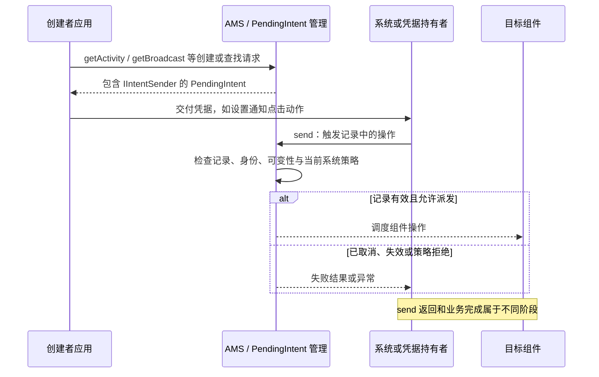

# PendingIntent 原理

`PendingIntent` 是可以交给其他组件或系统持有的操作凭据，常见于通知点击、闹钟和安装结果回调。接收者以后触发操作时，系统使用创建者授予的身份和权限执行相应请求；它不只是一个延迟保存的 Intent，也不保证目标操作一定成功。

本文对应[原提纲](https://alidocs.dingtalk.com/i/nodes/1OQX0akWmxaRZD7yfgRMaeOX8GlDd3mE)的“PendingIntent 原理 / 关键点 IntentSender”。内部链路以 AOSP `android-16.0.0_r1` 为基线；公开行为以 [PendingIntent API](https://developer.android.com/reference/android/app/PendingIntent) 为准。

## IntentSender：凭据背后的 Binder {#s227}

公开 `PendingIntent` 包装 `IIntentSender` 引用，`getIntentSender()` 可以取得公开的 `IntentSender` 包装对象。创建或取得凭据时，框架经 AMS 与 PendingIntent 管理逻辑查找或建立系统记录；之后的 `send()` 请求由系统解析这份记录，派发 Activity、广播或服务操作。

`IntentSender` 不是 Activity 或 Receiver 的实例，不代表调用者获得创建者的全部权限。能力范围还受记录的操作类型、目标、Intent 内容、可变性以及系统启动策略约束。不能直接把系统内部 `IIntentSender` 当作普通应用应调用的 SDK。[PendingIntent 源码](https://github.com/aosp-mirror/platform_frameworks_base/blob/android-16.0.0_r1/core/java/android/app/PendingIntent.java)、[IntentSender API](https://developer.android.com/reference/android/content/IntentSender)

创建者进程结束后，系统中的凭据可能继续有效；凭据生命周期与创建它的 Java 对象或进程不同。它也不是可跨设备重启永久保存的凭据。取消、一次性使用、包生命周期和系统重启都需要重新考虑。

## 哪些参数决定复用同一份记录

匹配涉及操作类型、创建者、requestCode，以及 Intent 的匹配身份字段等。Intent 的这部分匹配采用 `filterEquals()` 语义，包括 action、data、type、component、categories 等，**extras 不参与这种 Intent 身份匹配**。只改 extras 而继续使用相同 requestCode，常会取回已有凭据。

记录自身的 flags 也参与匹配，例如 `FLAG_ONE_SHOT`、`FLAG_IMMUTABLE`。查询或更新既有凭据时，必须保留原有的这些身份标志；查找一次性凭据应组合 `FLAG_ONE_SHOT | FLAG_NO_CREATE`，若原记录还带 `FLAG_IMMUTABLE`，查询时也须保留它。`FLAG_NO_CREATE`、`FLAG_UPDATE_CURRENT`、`FLAG_CANCEL_CURRENT` 是此次获取操作的控制标志，不能把它们与记录身份标志混为一谈。[PendingIntent 匹配契约](https://developer.android.com/reference/android/app/PendingIntent)、[固定版本 Key.equals](https://github.com/aosp-mirror/platform_frameworks_base/blob/android-16.0.0_r1/services/core/java/com/android/server/am/PendingIntentRecord.java)

- `FLAG_UPDATE_CURRENT`：存在匹配记录时，更新创建者保存的附加数据。即使同时使用 `FLAG_IMMUTABLE`，创建者仍可更新；不可变约束的是后续发送方修改操作。
- `FLAG_CANCEL_CURRENT`：取消匹配的旧凭据并创建新的，旧持有者不能继续依赖旧记录。
- `FLAG_NO_CREATE`：只查询已有记录，不创建；结果可能为空。
- `FLAG_ONE_SHOT`：发送后按一次性语义失效；不要用于需要反复点击或重复回调的业务。

通知指向不同笔记时，应使用稳定且区分业务对象的 requestCode 或 data URI，不能只改 `putExtra("noteId", ...)`。也不要为每次构建通知随机制造身份，导致无法更新、撤销已有凭据。[Intent.filterEquals](https://developer.android.com/reference/android/content/Intent#filterEquals(android.content.Intent))

## 可变性与最小能力

API 23 起可使用 `FLAG_IMMUTABLE`；面向 Android 12 / API 31 及以上的应用须按规则明确指定可变性。普通通知导航优先使用显式目标和不可变凭据，避免把目标或关键参数的控制权无意授予持有者。确需系统填入远程输入等内容时，再依据该场景的公开契约使用可变凭据。

可变凭据应限制目标组件、校验回调内容，并控制交付范围。`FLAG_IMMUTABLE` 不会自动检查 exported、URI 权限、敏感 extras，也不会绕过后台 Activity 启动或前台服务限制。[Android 12 PendingIntent 规则](https://developer.android.com/about/versions/12/behavior-changes-12#pending-intent-mutability)

### PackageInstaller 回调的例外

不要机械地将所有 PendingIntent 改成不可变：`PackageInstaller.Session.commit(IntentSender)` 的回调需要系统填入结果。公开文档规定，当应用 target SDK 为 35 或更高时，使用来自不可变 PendingIntent 的状态接收器会抛出 `IllegalArgumentException`。应按安装 API 的契约配置明确指向本应用接收组件的可变凭据，并处理用户确认及最终状态，详见[安装会话流程](./system-services.html#installer-flow)。

## 取消、失败与业务完成

持有者调用 `send()` 可能遇到 `CanceledException`；创建方应在业务失效时撤销凭据，并设计重复触发与过期处理。发送结果、系统接受启动、目标组件执行和业务成功是不同边界，关键业务需要自己的请求编号、状态校验和回执。

排查时先确认凭据类型、创建者、requestCode、Intent 身份和 flags，再检查目标组件及当前启动限制。不要通过打印完整 Intent extras 泄漏凭据、账号或个人数据。本文未调用真实通知、闹钟或安装操作。
