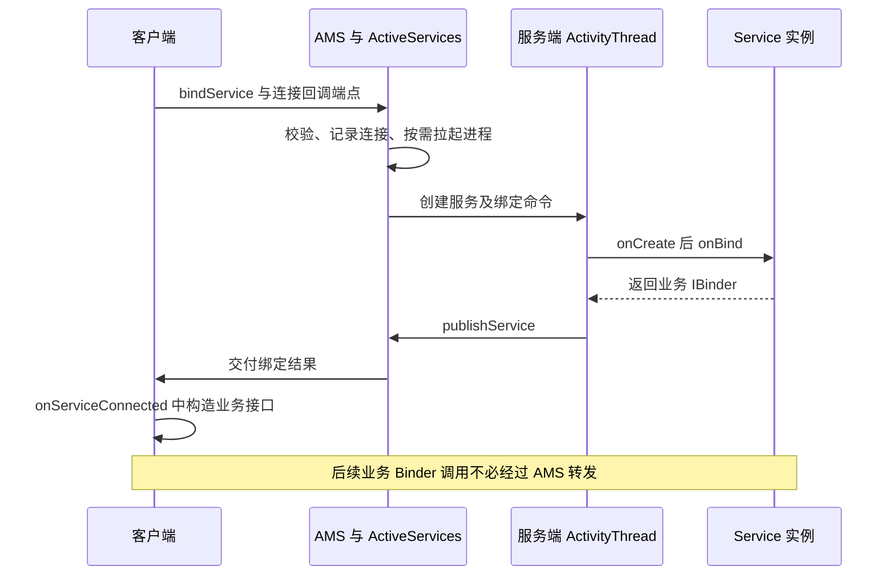
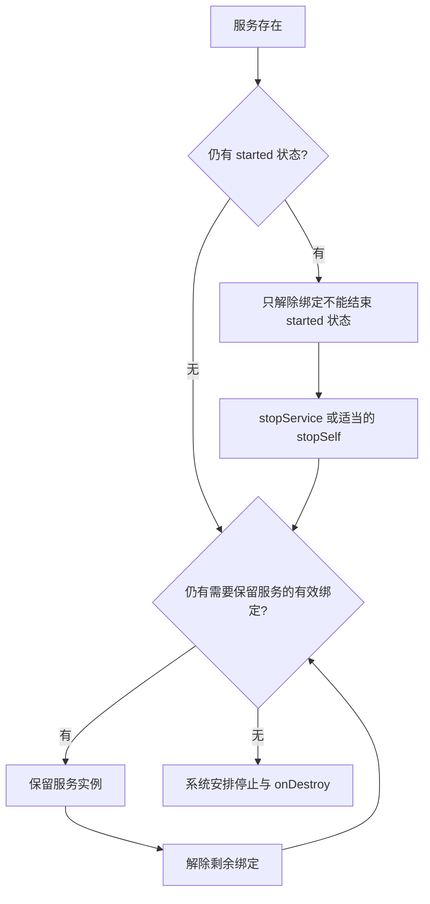

# Service 启动、绑定与销毁原理

Service 是由系统管理的无界面组件。它可以处于 started 状态、接受客户端绑定，或同时具备两者；**生命周期回调默认在所在进程主线程执行，Service 本身不会创建工作线程。**

本文对应[原始提纲](https://alidocs.dingtalk.com/i/nodes/1OQX0akWmxaRZD7yfgRMaeOX8GlDd3mE)的同名条目，源码基线为 AOSP **`android-16.0.0_r1`**。以下分析普通应用 Service；isolated service、SDK sandbox 等特殊路径需另行核对。

## 系统侧与应用侧分别保存什么

- **AMS / ActiveServices**：管理服务记录、启动请求、连接关系、执行状态与进程关联。`ServiceRecord` 不等于应用中的 Service 实例。
- **ActivityThread**：接收创建、参数交付、绑定、解绑、停止等系统命令，在主线程调度应用组件。
- **应用 Service 实例**：执行 `onCreate()`、`onStartCommand()`、`onBind()`、`onUnbind()` 和 `onDestroy()` 等回调。
- **业务 Binder**：在绑定路径中交给客户端的通信端点，可能是本地 Binder、Messenger 或生成的 AIDL Stub。

实现入口见 [ActiveServices.java](https://github.com/aosp-mirror/platform_frameworks_base/blob/android-16.0.0_r1/services/core/java/com/android/server/am/ActiveServices.java) 与 [ActivityThread.java](https://github.com/aosp-mirror/platform_frameworks_base/blob/android-16.0.0_r1/core/java/android/app/ActivityThread.java)。

## 启动：startService 到 onStartCommand

1. Context 提交启动 Intent，系统解析目标，检查权限、导出配置和后台执行等条件。
2. `ActiveServices` 建立或复用服务记录；进程不存在时先启动目标进程。
3. 应用收到创建命令，`ActivityThread.handleCreateService()` 使用包的 ClassLoader 与组件工厂创建实例，完成 attach 后调用 `onCreate()`。
4. 启动参数经后续调度进入 `handleServiceArgs()`，再交给 `onStartCommand(intent, flags, startId)`。

多次启动同一服务通常不会创建多个 Service 实例，但会交付多次启动请求。`onCreate()` 负责实例初始化，不能拿它代替逐次处理启动参数。started 状态也不是“所有任务已经完成”的业务计数器。[Service 官方概览](https://developer.android.com/develop/background-work/services)

`START_NOT_STICKY`、`START_STICKY` 与 `START_REDELIVER_INTENT` 影响系统在特定进程终止后的重建和参数交付策略，不提供任意时间重启、任务恰好执行一次或数据持久化保证。进程可能在没有 `onDestroy()` 的情况下结束。

## 绑定：bindService 到 onServiceConnected

### BIND_AUTO_CREATE 的含义

带 `BIND_AUTO_CREATE` 的有效连接会影响服务创建与存活决策；它不是把 Service 变成 started 状态，也不是让进程永久不被杀。`bindService()` 返回 `true` 只表示绑定请求被接受，业务端点仍需等待连接回调。

连接清理不能仅由这个布尔值决定：SDK 契约要求正常返回 `false` 或抛出 `SecurityException` 时也调用 `unbindService()` 释放连接。绑定尝试、实际拿到 Binder 与已经清理是三个状态。[Context.bindService 契约](https://developer.android.com/reference/android/content/Context#bindService(android.content.Intent,%20android.content.ServiceConnection,%20int))

还需区分登记前的参数错误：固定版本在 `conn == null` 或同时提供 Handler/Executor 时先抛 `IllegalArgumentException`，尚未登记连接，不应盲目解绑。但隐式 Intent 等校验可在登记之后抛出同类异常，不能把所有 `IllegalArgumentException` 都当作“未登记”。[ContextImpl.bindServiceCommon](https://github.com/aosp-mirror/platform_frameworks_base/blob/android-16.0.0_r1/core/java/android/app/ContextImpl.java#L2201)

### onBind 返回值与缓存

`onBind()` 返回用于通信的 `IBinder`，不是 Service 对象。系统可以对匹配的绑定 Intent 复用已发布的 Binder，因此不能假设每新增一个客户端都调用一次 `onBind()`。多个客户端连接到同一端点时，业务状态要区分客户端会话。

`onBind()` 返回 null、服务端进程死亡与正常解绑是不同事件，客户端应区分空绑定、断连与主动关闭。`onServiceDisconnected()` 不应被当作每次 `unbindService()` 后必然发生的清理通知。[绑定服务指南](https://developer.android.com/develop/background-work/services/bound-services)

### 生命周期线程与业务调用线程

Service 生命周期回调通常在服务进程主线程；远端 AIDL 方法可在 Binder 线程池并发进入；Messenger 则把消息转到所选 Handler 的 Looper。本地直接调用还会保留调用线程。线程安全必须针对实际业务入口设计。

## 解绑、停止与销毁

图为常规存活条件的简化模型，不表示内存回收、崩溃或策略终止一定先走这些回调。

### started 与 bound 两类条件

服务同时被启动和绑定时，`stopService()` 清除启动方面的需求，但有效绑定仍可能保留实例；解除最后一个连接后，started 状态若仍在，也不会仅因解绑就必然销毁。

`onUnbind()` 返回值影响后续重绑定是否走 `onRebind()`。它既不是客户端已完成全部任务的证明，也不改变 `onBind()` 负责发布通信接口的分工。

### startId 与停止竞态

异步任务完成时盲目 `stopSelf()`，可能结束刚接收新请求的服务。可以结合相应 `startId` 和 `stopSelfResult(startId)` 处理“仍为最后一次启动请求”这一条件，但它不会替你追踪多个并行任务。业务仍需任务计数、幂等和取消策略。[Service API](https://developer.android.com/reference/android/app/Service)

### onDestroy 不保证执行

主动停止的常规路径会调用销毁回调；进程被系统直接终止、崩溃或设备断电时未必有机会执行。重要状态应在合适时机保存，不能把数据库提交、锁文件删除或业务回执全部押在 `onDestroy()`。

## 前台服务与后台限制

前台服务是有用户可感知用途及通知要求的执行形态，不是独立线程，也不是无限运行或免于终止的豁免。后台启动资格、服务类型、权限和进入前台的时限需按系统版本、target SDK 与用途核对。[前台服务文档](https://developer.android.com/develop/background-work/services/fgs)

使用 `startForegroundService()` 后仍需按约定及时进入前台；需要持久、可延期且可重试的工作时，应评估任务调度方案。不要为了避免任务建模而把所有工作塞进长期 Service。

## 排查与阅读路线

先分清错误发生在**解析/授权、进程启动、实例创建、启动参数、绑定发布、业务调用、停止清理**中的哪一段。绑定成功但方法不可用，优先查 Binder 协议与远端存活；只有 `onCreate()` 没有连接回调，则继续查 `onBind()` 和发布结果。

源码可按 `ActiveServices → ActivityThread.handleCreateService / handleBindService / handleServiceArgs → Service` 阅读。设备调试可查询实际系统版本后结合 `adb shell dumpsys activity services`；本页未执行设备验证。

相关笔记：[Messenger](./messenger.html)、[系统服务与应用绑定](../framework/service-manager-aidl.html)、[LoadedApk](./loaded-apk.html)。
