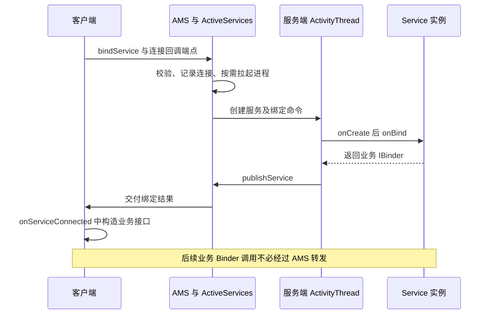
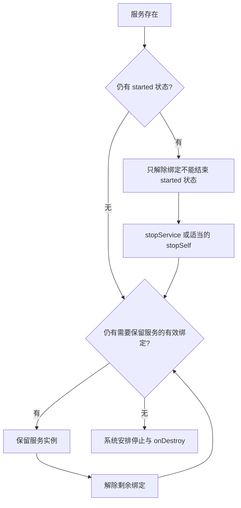
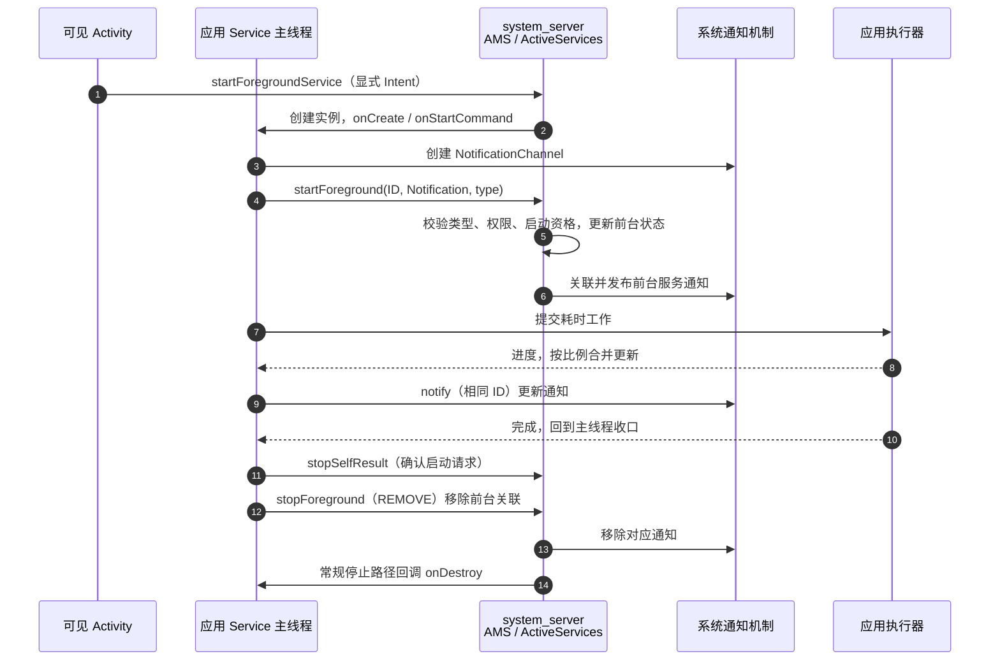

# Service 启动、绑定与销毁原理

Service 是由系统管理的无界面组件。它可以处于 started 状态、接受客户端绑定，或同时具备两者；**生命周期回调默认在所在进程主线程执行，Service 本身不会创建工作线程。**

## 系统侧与应用侧分别保存什么

- **AMS / ActiveServices**：管理服务记录、启动请求、连接关系、执行状态与进程关联。`ServiceRecord` 不等于应用中的 Service 实例。
- **ActivityThread**：接收创建、参数交付、绑定、解绑、停止等系统命令，在主线程调度应用组件。
- **应用 Service 实例**：执行 `onCreate()`、`onStartCommand()`、`onBind()`、`onUnbind()` 和 `onDestroy()` 等回调。
- **业务 Binder**：在绑定路径中交给客户端的通信端点，可能是本地 Binder、Messenger 或生成的 AIDL Stub。

实现入口见 [ActiveServices.java](https://github.com/aosp-mirror/platform_frameworks_base/blob/android-16.0.0_r1/services/core/java/com/android/server/am/ActiveServices.java) 与 [ActivityThread.java](https://github.com/aosp-mirror/platform_frameworks_base/blob/android-16.0.0_r1/core/java/android/app/ActivityThread.java)。

## 启动：startService 到 onStartCommand

1. Context 提交启动 Intent，系统解析目标，检查权限、导出配置和后台执行等条件。
2. `ActiveServices` 建立或复用服务记录；进程不存在时先启动目标进程。
3. 应用收到创建命令，`ActivityThread.handleCreateService()` 使用包的 ClassLoader 与组件工厂创建实例，完成 attach 后调用 `onCreate()`。
4. 启动参数经后续调度进入 `handleServiceArgs()`，再交给 `onStartCommand(intent, flags, startId)`。

创建命令先到应用进程的 `ApplicationThread.scheduleCreateService()`，再投递 `H.CREATE_SERVICE`，由主线程进入 `handleCreateService()`。后者先取得 `LoadedApk` 与 Application，使用组件工厂实例化 Service，创建 Context 并 `attach()`，才调用 `onCreate()`；最后把实例按 token 放入 `mServices`。后续启动、绑定、停止命令据此找到同一个对象。**Binder 负责传命令，主线程消息队列负责生命周期串行化**。[ActivityThread 实现](https://github.com/aosp-mirror/platform_frameworks_base/blob/android-16.0.0_r1/core/java/android/app/ActivityThread.java)

多次启动同一服务通常不会创建多个 Service 实例，但会交付多次启动请求。`onCreate()` 负责实例初始化，不能拿它代替逐次处理启动参数。started 状态也不是“所有任务已经完成”的业务计数器。[Service 官方概览](https://developer.android.com/develop/background-work/services)

`START_NOT_STICKY`、`START_STICKY` 与 `START_REDELIVER_INTENT` 影响系统在特定进程终止后的重建和参数交付策略，不提供任意时间重启、任务恰好执行一次或数据持久化保证。进程可能在没有 `onDestroy()` 的情况下结束。

## 绑定：bindService 到 onServiceConnected



### BIND_AUTO_CREATE 的含义

带 `BIND_AUTO_CREATE` 的有效连接会影响服务创建与存活决策；它不是把 Service 变成 started 状态，也不是让进程永久不被杀。`bindService()` 返回 `true` 只表示绑定请求被接受，业务端点仍需等待连接回调。

连接清理不能仅由这个布尔值决定：SDK 契约要求正常返回 `false` 或抛出 `SecurityException` 时也调用 `unbindService()` 释放连接。绑定尝试、实际拿到 Binder 与已经清理是三个状态。[Context.bindService 契约](https://developer.android.com/reference/android/content/Context#bindService(android.content.Intent,%20android.content.ServiceConnection,%20int))

还需区分登记前的参数错误：固定版本在 `conn == null` 或同时提供 Handler/Executor 时先抛 `IllegalArgumentException`，尚未登记连接，不应盲目解绑。但隐式 Intent 等校验可在登记之后抛出同类异常，不能把所有 `IllegalArgumentException` 都当作“未登记”。[ContextImpl.bindServiceCommon](https://github.com/aosp-mirror/platform_frameworks_base/blob/android-16.0.0_r1/core/java/android/app/ContextImpl.java#L2201)

### onBind 返回值与缓存

`onBind()` 返回用于通信的 `IBinder`，不是 Service 对象。系统可以对匹配的绑定 Intent 复用已发布的 Binder，因此不能假设每新增一个客户端都调用一次 `onBind()`。多个客户端连接到同一端点时，业务状态要区分客户端会话。

`onBind()` 返回 null、服务端进程死亡与正常解绑是不同事件，客户端应区分空绑定、断连与主动关闭。`onServiceDisconnected()` 不应被当作每次 `unbindService()` 后必然发生的清理通知。[绑定服务指南](https://developer.android.com/develop/background-work/services/bound-services)

### 生命周期线程与业务调用线程

Service 生命周期回调通常在服务进程主线程；远端 AIDL 方法可在 Binder 线程池并发进入；Messenger 则把消息转到所选 Handler 的 Looper。本地直接调用还会保留调用线程。线程安全必须针对实际业务入口设计。

## 解绑、停止与销毁



图为常规存活条件的简化模型，不表示内存回收、崩溃或策略终止一定先走这些回调。

### started 与 bound 两类条件

服务同时被启动和绑定时，`stopService()` 清除启动方面的需求，但有效绑定仍可能保留实例；解除最后一个连接后，started 状态若仍在，也不会仅因解绑就必然销毁。

`onUnbind()` 返回值影响后续重绑定是否走 `onRebind()`。它既不是客户端已完成全部任务的证明，也不改变 `onBind()` 负责发布通信接口的分工。

### startId 与停止竞态

异步任务完成时盲目 `stopSelf()`，可能结束刚接收新请求的服务。可以结合相应 `startId` 和 `stopSelfResult(startId)` 处理“仍为最后一次启动请求”这一条件，但它不会替你追踪多个并行任务。业务仍需任务计数、幂等和取消策略。[Service API](https://developer.android.com/reference/android/app/Service)

### onDestroy 不保证执行

主动停止的常规路径会调用销毁回调；进程被系统直接终止、崩溃或设备断电时未必有机会执行。重要状态应在合适时机保存，不能把数据库提交、锁文件删除或业务回执全部押在 `onDestroy()`。

## IntentService：串行工作线程与自动停止 {#intent-service}

### 原理与弃用状态

`IntentService` 继承 Service，在 `onCreate()` 创建一个 HandlerThread 和对应 Handler；每次启动把 Intent 与 startId 封装为消息，由工作线程**逐个**调用 `onHandleIntent()`。回调返回后执行 `stopSelf(startId)`，在后面还有更新的启动请求时不会直接结束服务。生命周期回调仍在主线程，只有 onHandleIntent 等工作消息运行在该专用线程。

下面是 AOSP `android-16.0.0_r1` 的核心逻辑节选，省略声明和其他方法，注释为本文补充：

```java
// onCreate：一个实例使用一个串行消息循环
HandlerThread thread = new HandlerThread("IntentService[" + mName + "]");
thread.start();
mServiceLooper = thread.getLooper();
mServiceHandler = new ServiceHandler(mServiceLooper);

// onStart：主线程将每次请求入队
Message msg = mServiceHandler.obtainMessage();
msg.arg1 = startId;
msg.obj = intent;
mServiceHandler.sendMessage(msg);

// ServiceHandler.handleMessage：工作线程执行
onHandleIntent((Intent) msg.obj);
stopSelf(msg.arg1); // 按本次 startId 请求停止，不是无条件 stopSelf()
```

它从 **API 30 正式弃用**，并且受 Android 8 起的后台执行限制影响。与[未正式弃用的 HandlerThread](./handler.html#handlerthread-是否弃用-应该换成什么)应分开理解。默认返回 `START_NOT_STICKY`；配置 `setIntentRedelivery(true)` 后使用 `START_REDELIVER_INTENT`，仍不提供恰好执行一次或完整业务持久化保证。[IntentService 官方参考](https://developer.android.com/reference/android/app/IntentService)、[固定版本源码](https://android.googlesource.com/platform/frameworks/base/+/refs/tags/android-16.0.0_r1/core/java/android/app/IntentService.java)

`onHandleIntent()` 内不能再启动一个脱离管理的异步任务就返回，否则 IntentService 可能认为请求处理完毕并停止；返回前应完成该次工作。`onDestroy()` 退出内部 Looper 也不会强行打断正在执行的业务代码。

### 历史代码的最小示例与迁移

下面仅用于理解已有项目，不建议新建业务采用它。示例包名为 `com.example.notes`，把小段文本写入应用私有文件，无需存储权限。

```java
package com.example.notes;

import android.app.IntentService;
import android.content.Intent;
import java.io.FileOutputStream;
import java.io.IOException;
import java.nio.charset.StandardCharsets;

public final class LegacyNoteService extends IntentService {
    public LegacyNoteService() { super("legacy-note"); }

    @Override protected void onHandleIntent(Intent intent) {
        if (intent == null) return;
        String text = intent.getStringExtra("text");
        if (text == null) return;
        try (FileOutputStream out = openFileOutput("legacy-note.txt", MODE_PRIVATE)) {
            out.write(text.getBytes(StandardCharsets.UTF_8));
        } catch (IOException e) {
            android.util.Log.e("LegacyNote", "Cannot write note", e);
        }
    }
}
```

在 Manifest 注册 `<service android:name="com.example.notes.LegacyNoteService" android:exported="false" />` 后，可在可见 Activity 中用显式 Intent 调用：`startService(new Intent(this, LegacyNoteService.class).putExtra("text", "一条笔记"))`。这不授权应用从任意后台场景启动服务，也不是前台服务启动方式。

迁移时按需求选型：页面内工作用 Executor 或生命周期协程；需要持久调度的工作用 [WorkManager](./handler.html#workmanager-的工作原理)；需要直接管理平台 Job 的场景见 [JobScheduler](./job-scheduler.html)；确有持续、用户可感知用途时才使用下面的前台服务。不要把迁移理解为把 IntentService 的类名机械替换为另一个类。

## 前台服务与后台限制 {#foreground-services}

<span id="前台服务与后台限制"></span>

前台服务是有用户可感知用途及通知要求的执行形态，不是独立线程，也不是无限运行或免于终止的豁免。后台启动资格、服务类型、权限和进入前台的时限需按系统版本、target SDK 与用途核对。[前台服务文档](https://developer.android.com/develop/background-work/services/fgs)

使用 `startForegroundService()` 后仍需按约定及时进入前台；需要持久、可延期且可重试的工作时，应评估任务调度方案。不要为了避免任务建模而把所有工作塞进长期 Service。

### 怎么与 Notification 关联

前台服务的关联入口是 **Service.startForeground(非零通知 ID, Notification[, 服务类型])**。它经 AMS / ActiveServices 更新服务的前台状态并关联通知，再由系统通知机制展示；仅调用 `NotificationManager.notify()` 发布通知，不会把 Service 变成前台服务。通知渠道 ID 是通知分类，通知 ID 是这条通知的标识，两者用途不同。

常见调用顺序是：可见页面的用户操作发起 `startForegroundService()`；Service 尽快创建渠道、构造有效通知并调用 `startForeground()`；然后才把耗时工作交给执行器。更新进度使用**相同通知 ID** 调用 `notify()`，这样更新的是已关联的通知。[启动前台服务](https://developer.android.com/develop/background-work/services/fgs/launch)、[Service.java 的系统调用](https://android.googlesource.com/platform/frameworks/base/+/refs/tags/android-16.0.0_r1/core/java/android/app/Service.java)



图中调用经过系统框架的异步消息和 Binder 路径，是职责时序而非所有内部方法的逐条展开。`stopForeground()` 与 `stopSelf()` 是两个动作：前者退出前台状态，后者结束 started 状态；仍有绑定时，服务实例是否销毁还要按前文判断。

### 版本、权限与通知可见性

- **Android 8 / API 26 起**：后台服务限制及 startForegroundService 路径；targetSdk 26+ 的通知必须有有效渠道。进入前台要尽快完成，不能先等网络或文件扫描，也不要依赖某个固定超时秒数来安排业务。
- **Android 9，targetSdk 28+**：声明 `FOREGROUND_SERVICE` 普通权限。
- **Android 12，targetSdk 31+**：限制后台发起前台服务，只有规定的例外；从后台发起被拒绝可能抛 `ForegroundServiceStartNotAllowedException`。
- **Android 13 / API 33 起**：普通通知受 `POST_NOTIFICATIONS` 运行时权限控制，但启动前台服务不以获得该通知权限为前提，仍必须传有效通知。用户拒绝后，非豁免前台服务通知通常不出现在通知抽屉，但任务管理器仍显示相关提示。
- **Android 14，targetSdk 34+**：声明正确的 foregroundServiceType 及对应权限；相机、麦克风、位置等还需满足运行时权限与 while-in-use 条件。普通后台启动例外不代表自动拥有这些访问资格。
- **Android 15，targetSdk 35+**：dataSync / mediaProcessing 后台运行受分别计算的时间预算约束；达到时限需在 onTimeout 中迅速停止。dataSync 不能从 BOOT_COMPLETED Receiver 启动。

这里列的是常见边界，实际以设备 OS、应用 targetSdk 和服务用途共同判定；不是只把 targetSdk 调高或声明一个类型就能获得启动资格。[后台启动限制](https://developer.android.com/develop/background-work/services/fgs/restrictions-bg-start)、[通知权限](https://developer.android.com/develop/ui/compose/notifications/notification-permission)、[服务类型](https://developer.android.com/develop/background-work/services/fgs/service-types)、[运行时限](https://developer.android.com/develop/background-work/services/fgs/timeout)

## 前台服务 Demo：用户主动导出笔记 {#foreground-demo}

### 场景、文件与配置

示例把应用私有 `filesDir/notes/` 下的 Markdown 文件打包为 ZIP，展示完整前台生命周期。它属于 dataSync 支持的导出 / 本地文件处理用途；真实数据很少时用普通异步任务即可，不必为了执行一次小操作启动前台服务。[dataSync 用途](https://developer.android.com/develop/background-work/services/fgs/service-types#data-sync)

Demo 约定 **minSdk 26、compileSdk / targetSdk 35**，Java 8 语言功能，包名与 Android 模块 namespace 均为 `com.example.notes`，只使用平台 API。它包含一个 Activity、一个 Service、一个 ZIP 工具类和通知小图标；现有工程可将按钮逻辑并入自己的页面。

Manifest 合并以下权限与组件。service 不导出；Activity 在此作为可见测试入口，由应用内部显式打开。

```xml
<manifest xmlns:android="http://schemas.android.com/apk/res/android">
    <uses-permission android:name="android.permission.FOREGROUND_SERVICE" />
    <uses-permission android:name="android.permission.FOREGROUND_SERVICE_DATA_SYNC" />
    <uses-permission android:name="android.permission.POST_NOTIFICATIONS" />
    <application>
        <activity android:name="com.example.notes.ExportDemoActivity"
            android:exported="false" />
        <service android:name="com.example.notes.NoteExportService"
            android:exported="false" android:foregroundServiceType="dataSync" />
    </application>
</manifest>
```

创建 `res/drawable/ic_stat_notes.xml` 作为单色通知小图标，不要直接省略 setSmallIcon 或随意传一个不存在的资源：

```xml
<vector xmlns:android="http://schemas.android.com/apk/res/android"
    android:width="24dp" android:height="24dp"
    android:viewportWidth="24" android:viewportHeight="24">
    <path android:fillColor="#FFFFFFFF"
        android:pathData="M5,3h14v18H5zM7,6v2h10V6zM7,10v2h10v-2zM7,14v2h7v-2z"
        android:fillType="evenOdd" />
</vector>
```

### Activity：授权通知、开始与停止

`ExportDemoActivity.java` 提供三个按钮。先授权通知便于在通知抽屉观察效果，再点击开始；拒绝通知权限不等于可以省略前台通知。授权过程异步完成，示例不会在发起权限请求后假定授权已成功。

```java
package com.example.notes;

import android.Manifest;
import android.app.Activity;
import android.content.Intent;
import android.content.pm.PackageManager;
import android.os.Build;
import android.os.Bundle;
import android.widget.Button;
import android.widget.LinearLayout;
import android.widget.Toast;

public final class ExportDemoActivity extends Activity {
    @Override protected void onCreate(Bundle state) {
        super.onCreate(state);
        LinearLayout layout = new LinearLayout(this);
        layout.setOrientation(LinearLayout.VERTICAL);
        Button permission = new Button(this);
        permission.setText("授权通知");
        permission.setOnClickListener(v -> {
            if (Build.VERSION.SDK_INT >= 33 && checkSelfPermission(
                    Manifest.permission.POST_NOTIFICATIONS) != PackageManager.PERMISSION_GRANTED) {
                requestPermissions(new String[]{Manifest.permission.POST_NOTIFICATIONS}, 1);
            }
        });
        Button start = new Button(this);
        start.setText("开始导出");
        start.setOnClickListener(v -> {
            try {
                startForegroundService(new Intent(this, NoteExportService.class));
            } catch (IllegalStateException | SecurityException e) {
                Toast.makeText(this, "无法启动，请检查启动资格与权限", Toast.LENGTH_LONG).show();
            }
        });
        Button stop = new Button(this);
        stop.setText("停止导出");
        stop.setOnClickListener(v -> stopService(new Intent(this, NoteExportService.class)));
        layout.addView(permission);
        layout.addView(start);
        layout.addView(stop);
        setContentView(layout);
    }
}
```

这个启动入口依赖“页面可见且用户明确操作”，不能原样搬到任意后台广播。普通权限已声明并不代表满足后台资格；若在相机或定位场景使用同一结构，必须另外完成相应权限和服务类型适配。

### Service：绑定通知、更新进度与停止

`NoteExportService.java` 创建低重要性渠道，初次用 startForeground 绑定通知，后续 notify 复用同一 ID。内容 PendingIntent 打开 Activity；“停止” PendingIntent 明确指向本服务且不可变。每个通知使用的 ID 与渠道字符串都集中定义，不能与其他前台服务共用同一通知 ID。

```java
package com.example.notes;

import android.app.Notification;
import android.app.NotificationChannel;
import android.app.NotificationManager;
import android.app.PendingIntent;
import android.app.Service;
import android.content.Intent;
import android.content.pm.ServiceInfo;
import android.graphics.drawable.Icon;
import android.os.Build;
import android.os.Handler;
import android.os.IBinder;
import android.os.Looper;
import android.util.Log;
import java.io.File;
import java.io.IOException;
import java.io.InterruptedIOException;
import java.util.concurrent.ExecutorService;
import java.util.concurrent.Executors;
import java.util.concurrent.Future;

public final class NoteExportService extends Service {
    private static final String CHANNEL_ID = "note-export";
    private static final String ACTION_STOP = "com.example.notes.STOP_EXPORT";
    private static final int NOTIFICATION_ID = 2001; // 必须非零
    private final Handler main = new Handler(Looper.getMainLooper());
    private final ExecutorService io = Executors.newSingleThreadExecutor();
    private NotificationManager notifications;
    private Future<?> task;
    private boolean exporting; // 下面三个状态字段只在主线程读写
    private int generation;
    private int latestStartId;

    @Override public void onCreate() {
        super.onCreate();
        notifications = getSystemService(NotificationManager.class);
        notifications.createNotificationChannel(new NotificationChannel(
                CHANNEL_ID, "笔记导出", NotificationManager.IMPORTANCE_LOW));
    }

    private Notification notification(int percent) {
        int flags = PendingIntent.FLAG_UPDATE_CURRENT | PendingIntent.FLAG_IMMUTABLE;
        PendingIntent open = PendingIntent.getActivity(this, 0,
                new Intent(this, ExportDemoActivity.class), flags);
        PendingIntent stop = PendingIntent.getService(this, 1,
                new Intent(this, NoteExportService.class).setAction(ACTION_STOP), flags);
        Notification.Builder builder = new Notification.Builder(this, CHANNEL_ID)
                .setSmallIcon(R.drawable.ic_stat_notes)
                .setContentTitle("正在导出笔记")
                .setContentText(percent < 0 ? "准备文件" : "进度 " + percent + "%")
                .setContentIntent(open)
                .setCategory(Notification.CATEGORY_SERVICE)
                .setOnlyAlertOnce(true)
                .setOngoing(true)
                .setProgress(100, Math.max(0, percent), percent < 0)
                .addAction(new Notification.Action.Builder(
                        Icon.createWithResource(this, R.drawable.ic_stat_notes), "停止", stop).build());
        if (Build.VERSION.SDK_INT >= 31) {
            builder.setForegroundServiceBehavior(Notification.FOREGROUND_SERVICE_IMMEDIATE);
        }
        return builder.build();
    }

    @Override public int onStartCommand(Intent intent, int flags, int startId) {
        latestStartId = startId;
        if (intent != null && ACTION_STOP.equals(intent.getAction())) {
            stopNow();
            return START_NOT_STICKY;
        }
        try {
            Notification initial = notification(-1);
            if (Build.VERSION.SDK_INT >= 29) {
                startForeground(NOTIFICATION_ID, initial,
                        ServiceInfo.FOREGROUND_SERVICE_TYPE_DATA_SYNC);
            } else {
                startForeground(NOTIFICATION_ID, initial);
            }
        } catch (RuntimeException e) {
            Log.e("NoteExport", "Cannot enter foreground", e);
            stopNow();
            return START_NOT_STICKY;
        }
        if (exporting) return START_NOT_STICKY; // 合并重复点击，不新增并行导出
        exporting = true;
        final int token = ++generation;
        task = io.submit(() -> {
            try {
                File output = NoteZip.export(getFilesDir(), percent -> main.post(() -> {
                    if (exporting && token == generation) {
                        notifications.notify(NOTIFICATION_ID, notification(percent));
                    }
                }));
                Log.i("NoteExport", "Saved " + output.getName());
            } catch (InterruptedIOException e) {
                Thread.currentThread().interrupt();
            } catch (IOException | RuntimeException e) {
                Log.e("NoteExport", "Export failed", e);
            }
            main.post(() -> {
                if (token != generation || !exporting) return; // 忽略已取消的旧执行
                exporting = false;
                task = null;
                if (stopSelfResult(latestStartId)) {
                    stopForeground(STOP_FOREGROUND_REMOVE);
                }
                // false 表示系统还有更新的启动请求，保留前台状态等待其交付
            });
        });
        return START_NOT_STICKY;
    }

    private void stopNow() {
        generation++;
        exporting = false;
        if (task != null) task.cancel(true);
        stopForeground(STOP_FOREGROUND_REMOVE);
        stopSelf();
    }

    @Override public void onTimeout(int startId, int fgsType) {
        // API 35+ 的 dataSync 时限回调：迅速停止，不在主线程等待 I/O
        stopNow();
    }

    @Override public IBinder onBind(Intent intent) { return null; }

    @Override public void onDestroy() {
        generation++;
        exporting = false;
        if (task != null) task.cancel(true);
        io.shutdownNow();
        stopForeground(STOP_FOREGROUND_REMOVE);
        super.onDestroy();
    }
}
```

`latestStartId` 记录合并后的最新启动请求；完成时用 stopSelfResult 防止清除系统尚未交付的新请求。generation 则阻止取消后的旧进度或完成回调更新通知。示例不自动重启失败工作，业务成功与失败目前只写日志；真实应用应将导出结果及错误保存到数据层，供 Activity 重建后查询。

通知权限被拒绝时，正常的非豁免通知可能不显示在抽屉，不能据此认定 startForeground 未调用；不要用删除渠道或取消通知来“隐藏”前台工作。渠道重要性创建后主要由用户控制，反复 createNotificationChannel 不会强行覆盖用户偏好。[通知渠道](https://developer.android.com/develop/ui/compose/notifications/channels)、[通知权限行为](https://developer.android.com/develop/ui/compose/notifications/notification-permission)

### 导出实现：可取消、完整写入后发布

`NoteZip.java` 只打包应用维护的笔记目录中的普通 `.md` 文件，不递归、不接收外部路径。先完整关闭临时 ZIP，再在同一私有目录执行原子移动，发布为唯一文件名；不支持原子移动时报告失败，不静默退化成可能暴露半成品的复制。进度按已处理文件数计算，最多按整数百分比变化发布，不等于准确字节进度。

```java
package com.example.notes;

import java.io.File;
import java.io.FileInputStream;
import java.io.IOException;
import java.io.InterruptedIOException;
import java.nio.file.Files;
import java.nio.file.Path;
import java.nio.file.StandardCopyOption;
import java.util.ArrayList;
import java.util.List;
import java.util.UUID;
import java.util.zip.ZipEntry;
import java.util.zip.ZipOutputStream;

final class NoteZip {
    interface Progress { void update(int percent); }

    static File export(File filesDir, Progress progress) throws IOException {
        File directory = new File(filesDir, "notes");
        File[] entries = directory.exists() ? directory.listFiles() : new File[0];
        if (entries == null) throw new IOException("Cannot list notes directory");
        List<File> notes = new ArrayList<>();
        for (File file : entries) {
            if (file.isFile() && file.getName().endsWith(".md")) notes.add(file);
        }
        Path temporary = Files.createTempFile(filesDir.toPath(), "export-", ".tmp");
        File output = new File(filesDir, "notes-" + UUID.randomUUID() + ".zip");
        try {
            try (ZipOutputStream zip = new ZipOutputStream(Files.newOutputStream(temporary))) {
                byte[] buffer = new byte[8192];
                int done = 0, lastPercent = -1;
                for (File note : notes) {
                    checkCancelled();
                    zip.putNextEntry(new ZipEntry(note.getName()));
                    try (FileInputStream input = new FileInputStream(note)) {
                        int count;
                        while ((count = input.read(buffer)) != -1) {
                            checkCancelled();
                            zip.write(buffer, 0, count);
                        }
                    }
                    zip.closeEntry();
                    int percent = (int) (++done * 100L / notes.size());
                    if (percent != lastPercent) {
                        progress.update(percent);
                        lastPercent = percent;
                    }
                }
            }
            checkCancelled();
            Files.move(temporary, output.toPath(), StandardCopyOption.ATOMIC_MOVE);
            return output;
        } finally {
            try { Files.deleteIfExists(temporary); }
            catch (IOException e) { android.util.Log.w("NoteExport", "Temporary file remains", e); }
        }
    }

    private static void checkCancelled() throws InterruptedIOException {
        if (Thread.currentThread().isInterrupted()) {
            throw new InterruptedIOException("Export cancelled");
        }
    }
}
```

私有目录输出无需共享存储权限；交给其他应用或保存到用户选择位置时，应使用 FileProvider / Storage Access Framework，不发送 file:// URI。输入文件若仍会被其他业务修改，需要数据快照或统一读写协议；原子发布只避免出现未完成的 ZIP，不代表内容快照一致，也不保证断电持久性。[Files.move 契约](https://developer.android.com/reference/java/nio/file/Files#move(java.nio.file.Path,java.nio.file.Path,java.nio.file.CopyOption...))

取消和超时只能协作结束工作，不能撤回已经发布的文件。进程被直接终止时 finally / onDestroy 也不保证执行，应在后续维护中清理遗留临时文件。实际网络、媒体或设备业务还需调用对应 API 的取消方法，不能只依靠线程中断。

### 验证 Demo 与常见错误

在测试工程生成几份私有笔记后，从可见页面点击导出，检查通知点击可回到页面、进度复用同一通知、页面退出后服务仍能受控工作，以及页面或通知中的停止操作能取消导出。重复点击不应启动并行导出；取消后的旧回调不得重新创建通知。示例文件少时可能很快结束，不应为了延长通知显示而在主线程 sleep。

还应覆盖通知权限拒绝、渠道关闭、后台启动被拒、进程被杀、I/O 失败及 API 35 时限处理。进入前台失败要检查启动资格、type / 权限、通知渠道、smallIcon 和非零通知 ID；不要只捕获异常后无限重启服务。

`stopForeground(STOP_FOREGROUND_REMOVE)` 退出前台并移除关联通知，**不会单独停止服务**；`STOP_FOREGROUND_DETACH` 则解除关联并保留通知，用于确实需要留下结果通知的场景。任务完成还需适当 stopSelf / stopService；通知上的 ongoing 也不保证用户或系统无法终止应用。[Service 停止 API](https://developer.android.com/reference/android/app/Service#stopForeground(int))

## 排查与阅读路线

先分清错误发生在**解析/授权、进程启动、实例创建、启动参数、绑定发布、业务调用、停止清理**中的哪一段。绑定成功但方法不可用，优先查 Binder 协议与远端存活；只有 `onCreate()` 没有连接回调，则继续查 `onBind()` 和发布结果。

源码可按 `ActiveServices → ActivityThread.handleCreateService / handleBindService / handleServiceArgs → Service` 阅读。设备调试使用 `adb shell dumpsys activity services` 查看服务记录、连接与执行状态。

相关笔记：[Messenger](./messenger.html)、[系统服务与应用绑定](../framework/service-manager-aidl.html)、[LoadedApk](./loaded-apk.html)。
