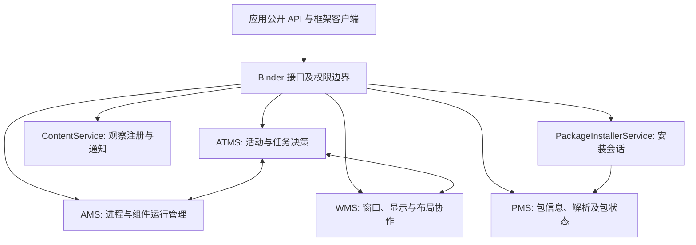

# 系统核心服务

应用组件的运行依赖多种系统服务共同协调。管理进程、选择任务、解析包、加入窗口、订阅数据变化与安装 APK 是不同职责，不能因为它们都运行在 `system_server` 就视为同一个服务。

`PMS` 在这里指 **PackageManagerService**。各服务按职责拆为独立笔记，PMS 的包查询与组件解析集中在包管理专题中。

图中箭头表示职责关联，省略同进程内部接口与细分执行器。应用 API 的调用不必都经过同一个入口；系统内部协作也不必每次再走远程 Binder。

## AMS / ATMS {#s160}

[阅读 AMS / ATMS](./system-services/ams-atms.html)：进程与任务管理的职责拆分，以及 Launcher 点击到首帧的完整启动时序。

- [Launcher 点击到首帧的完整时序](./system-services/ams-atms.html#ams-atms-launch-sequence)

- [复用、时序和完成边界](./system-services/ams-atms.html#launch-branches)

- [沿源码复核启动链](./system-services/ams-atms.html#launch-source-map)

## PMS：PackageManagerService {#s166}

[阅读 PMS：PackageManagerService](./system-services/pms.html)：包与组件查询、共享库、卸载、清数据及安装器客户端的职责边界。

- [queryIntentActivities](./system-services/pms.html#s169)

- [getSharedLibraries](./system-services/pms.html#s182)

- [deletePackageAsUser](./system-services/pms.html#s185)

- [clearApplicationUserData](./system-services/pms.html#s188)

- [getPackageInstaller](./system-services/pms.html#s191)

## WMS：WindowManagerService {#s197}

[阅读 WMS：WindowManagerService](./system-services/wms.html)：窗口加入、Token 校验、布局、焦点与显示合成的协作边界。

## ContentService {#s200}

[阅读 ContentService](./system-services/content-service.html)：ContentObserver 注册、URI 变化通知与 ContentProvider 数据访问的区别。

## PackageInstallerService {#s203}

[阅读 PackageInstallerService](./system-services/package-installer-service.html)：安装会话、PackageInstaller 客户端、提交、用户确认与最终结果。

- [PackageInstallerSession](./system-services/package-installer-service.html#s209)

- [PackageInstaller 与 Session](./system-services/package-installer-service.html#s212)

- [SessionParams](./system-services/package-installer-service.html#s215)

- [从创建到结果的完整流程](./system-services/package-installer-service.html#installer-flow)

## 从症状选择服务与证据

- 组件启动、进程存活与服务绑定问题，先区分 AMS 管理状态和应用回调。
- Activity 复用、返回栈或后台启动问题，先定位 ATMS 任务与启动决策。
- 组件查询、包可见性、安装与用户包状态问题，跟踪 PMS/安装会话结果。
- 窗口加入、焦点、Token 与显示区域问题，跟踪 WMS，而不是只看 Activity 是否 resumed。
- 数据变化通知未收到时，核对 ContentService 订阅和 URI；数据查询失败则同时检查 Provider。

设备排查前先实际查询系统版本、用户与目标应用信息，再使用相应 `dumpsys` 和日志；本页为源码与文档核对，未执行安装、卸载、清数据或设备命令。
