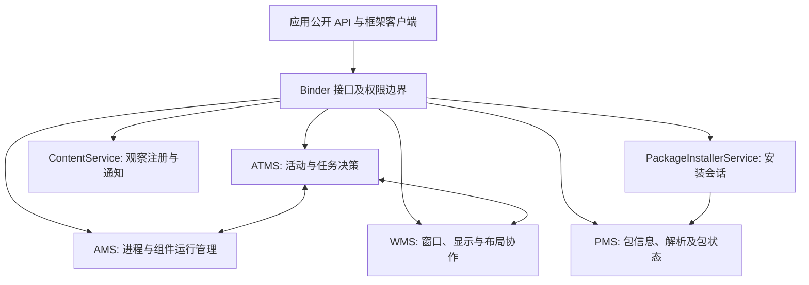
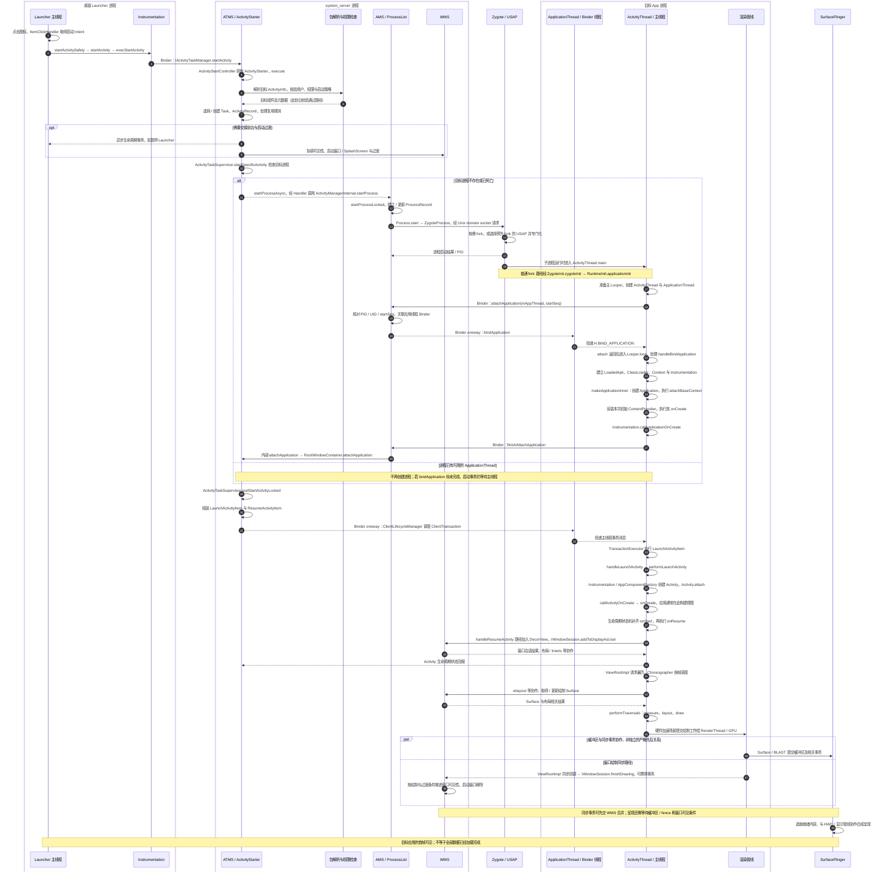
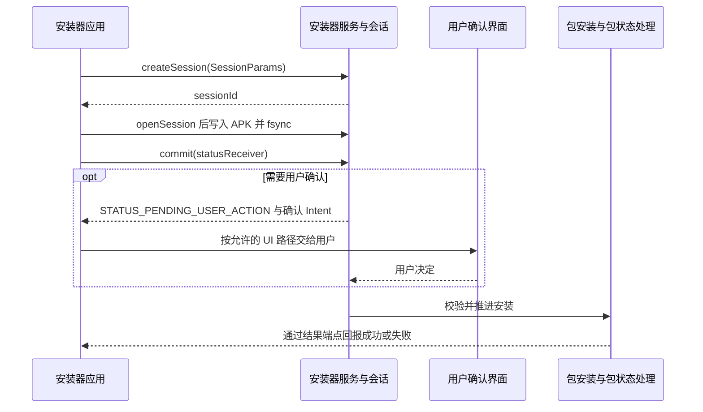

# 系统核心服务

应用组件的运行依赖多种系统服务共同协调。管理进程、选择任务、解析包、加入窗口、订阅数据变化与安装 APK 是不同职责，不能因为它们都运行在 `system_server` 就视为同一个服务。

本文按[原提纲](https://alidocs.dingtalk.com/i/nodes/1OQX0akWmxaRZD7yfgRMaeOX8GlDd3mE)顺序保留五组服务和 PMS 下五个方法。平台实现固定 AOSP **`android-16.0.0_r1`**；`PMS` 在本文专指 **PackageManagerService**。内部 Binder 方法不等于普通应用可调用的公开 SDK。

图中箭头表示职责关联，省略同进程内部接口与细分执行器。应用 API 的调用不必都经过同一个入口；系统内部协作也不必每次再走远程 Binder。

## AMS / ATMS {#s160}

### ActivityManagerService

AMS 负责应用进程及多类组件的运行管理，与进程启动、绑定应用、服务、广播和 Provider 等机制协作。`ActiveServices`、`BroadcastController`、`ContentProviderHelper` 分担具体逻辑，不能把所有状态机都理解为 AMS 中的一个方法。

应用中的 `ActivityManager` 是框架客户端入口，AMS 是系统侧实现；应用进程的 `ActivityThread` 是受调度的一方。客户端管理对象、服务端管理记录和实际组件实例属于不同层次。[AMS 源码](https://github.com/aosp-mirror/platform_frameworks_base/blob/android-16.0.0_r1/services/core/java/com/android/server/am/ActivityManagerService.java)

### ActivityTaskManagerService

ATMS 侧重点是 Activity、Task、启动、前后台状态及与窗口相关的任务组织。现代启动路径经 ATMS、ActivityStarter、任务协调对象等作决策；必要时再与 AMS 的进程管理协作。

AMS/ATMS 是职责拆分，不能解读成两者完全独立。一个“启动 Activity”的用户动作可能同时牵动包解析、进程启动、生命周期调度和窗口加入。[ATMS 源码](https://github.com/aosp-mirror/platform_frameworks_base/blob/android-16.0.0_r1/services/core/java/com/android/server/wm/ActivityTaskManagerService.java)

`SystemServer` 负责组织系统服务启动与初始化依赖，既有生命周期管理方式，也有服务专用初始化入口；不要假设所有服务均由同一个构造函数创建并立即可用。[SystemServer 源码](https://github.com/aosp-mirror/platform_frameworks_base/blob/android-16.0.0_r1/services/java/com/android/server/SystemServer.java)

### 从 Launcher 点击图标到应用首帧 {#ams-atms-launch-sequence}

以同一用户下普通桌面图标、目标进程不存在、启动一个需要 resumed 的 Activity 为主线，图中保留进程复用分支。图中 **Launcher、system_server、Zygote、目标 App、SurfaceFlinger 是不同进程**；AMS、ATMS、PMS 和 WMS 在此属于同一 system_server，其内部调用不等于跨进程 Binder。虚线表示回复或异步回报；标有 Binder、Socket 的箭头才指出对应传输边界。它是分阶段源码导读，不是某次启动的线程时间线。

`IActivityTaskManager.startActivity()` 还有一条回到 `Instrumentation.execStartActivity()`、再回到 Launcher 的同步返回链；它可以与后续进程初始化和绘制重叠，故不在异步主线末尾画“返回”。启动请求的结果检查在这一返回链上完成，不能等待首帧才当作 startActivity 返回。

这张图采用 **`expediteActivityLaunchOnColdStart()` 关闭、`mEnableWaitForFinishAttachApplication` 开启**的 attach 路径。前者开启时，AMS 在 `attachApplicationLocked()` 中、发出 `bindApplication()` 后提前通知 ATMS；前者关闭时则由 `finishAttachApplicationInner()` 通知。后者关闭时，AMS 在 attach 内直接调用这个 Inner 方法，稍后的客户端 `finishAttachApplication()` 被忽略，而非等待 `Application.onCreate()` 回报。**提前发送启动事务不表示 Activity 回调可以越过主线程中的应用初始化**；Binder 接收与主线程执行要分开阅读。这些是该标签的源码分支，不代表已查询某台设备的开关值。[AMS attach 与 finishAttach 分支](https://github.com/aosp-mirror/platform_frameworks_base/blob/android-16.0.0_r1/services/core/java/com/android/server/am/ActivityManagerService.java#L4826)

**启动身份与任务参数**：此普通图标路径的 `startActivitySafely()` 会加入 `FLAG_ACTIVITY_NEW_TASK`，不保证每次都新建 Task。`Instrumentation.execStartActivity()` 传递 Launcher 的 `IApplicationThread`、包名 / attribution tag、来源 Activity token 等信息；服务端保存真实 Binder PID/UID，并结合 caller 对应进程核验来源，目标应用的 UID 由解析结果决定，不能把 Intent 内自报字段当作身份。深层快捷方式与跨用户图标会经 `LauncherApps` 的其他入口，未画成同一条调用链。[Launcher3 入口](https://android.googlesource.com/platform/packages/apps/Launcher3/+/refs/tags/android-16.0.0_r1/src/com/android/launcher3/views/ActivityContext.java#418)、[Instrumentation](https://github.com/aosp-mirror/platform_frameworks_base/blob/android-16.0.0_r1/core/java/android/app/Instrumentation.java#L1992)、[ActivityStarter.Request.resolveActivity](https://github.com/aosp-mirror/platform_frameworks_base/blob/android-16.0.0_r1/services/core/java/com/android/server/wm/ActivityStarter.java#L560)

主线程在 `ActivityThread.main()` 中已经存在，先准备 Looper，再 attach，随后进入消息循环；不能画成“Application.onCreate 后才创建主线程”。Zygote 回复 PID 与子进程 attach 可以并发推进，图中排列不表示两端严格串行。USAP 是否启用取决于实际系统配置，本页没有查询设备。[ActivityThread.main](https://github.com/aosp-mirror/platform_frameworks_base/blob/android-16.0.0_r1/core/java/android/app/ActivityThread.java#L9018)、[Zygote 进程机制](https://source.android.com/docs/core/runtime/zygote)

### 复用、时序和完成边界 {#launch-branches}

- **进程存在，Activity 不存在**：直接走 `realStartActivityLocked()`，创建 Activity；同一进程已初始化的 Application 不会因这次启动重新执行 `onCreate()`。
- **进程正在启动**：已有进程记录但没有可用 thread 时，ATMS 可等待 attach；已有 thread 也不证明 `handleBindApplication()` 已完成，启动事务仍按应用主线程队列执行。`realStartActivityLocked()` 还可能因暂停交接未完成而暂缓，并不保证调用它就立即发出启动事务。[进程检查与暂停门槛](https://github.com/aosp-mirror/platform_frameworks_base/blob/android-16.0.0_r1/services/core/java/com/android/server/wm/ActivityTaskSupervisor.java#L808)、[正在启动的进程去重](https://github.com/aosp-mirror/platform_frameworks_base/blob/android-16.0.0_r1/services/core/java/com/android/server/wm/ActivityTaskManagerService.java#L5322)
- **已有 Activity / Task 可复用**：可能移动任务到前台、派发 `NewIntentItem` / `onNewIntent()` 并恢复生命周期，省略新的 `LaunchActivityItem`。具体由 launchMode、Intent flags、任务和实例状态决定。
- **Launcher 暂停**：任务切换会与生命周期、转场和窗口可见性协作；不能推导出“Launcher 的每一个暂停/停止回调都在目标进程创建之前完成”。首屏启动窗口也不是目标 Activity 已经画出的内容。
- **事务派发**：此标签使用 `scheduleTransactionItems()`，可能受兼容性策略影响合并或独立派发；不是所有系统版本都固定为旧教程中的 `scheduleLaunchActivity()`。
- **三个结束点**：`startActivity()` 返回说明启动请求已处理到可返回的阶段；`onResume()` 返回说明生命周期回调完成；目标帧被合成呈现才是用户看到内容。TTID 衡量初始显示，TTFD 还需考虑应用报告完全绘制的时机，不能用任一单个 Java 回调替代二者。

图中的绘制后半程按普通 View、硬件加速路径展开；SurfaceView、软件绘制、多窗口和厂商实现有额外分支。WMS 管理窗口和绘制同步，**SurfaceFlinger 负责显示合成**；`finishDrawing()` 回报不是物理屏幕已经呈现的证明。[启动耗时与 TTID / TTFD](https://developer.android.com/topic/performance/issues/launch-time)、[SurfaceFlinger 与 VSYNC](../framework/surfaceflinger-vsync.html)

`ViewRootImpl` 的同步完成回调可从渲染相关线程调用 `reportDrawFinished()`；对跨进程 WMS 不要求先切回应用主线程。`finishDrawing()` 可把待合并的 SurfaceControl 事务送到服务端，不能读成“缓冲区已经独立提交，主线程随后只发一个通知”。启动窗口移除与过渡也可能涉及 WM Shell，图中合并为窗口协作阶段。[ViewRootImpl 同步回调](https://github.com/aosp-mirror/platform_frameworks_base/blob/android-16.0.0_r1/core/java/android/view/ViewRootImpl.java#L4569)、[WindowState.finishDrawing](https://github.com/aosp-mirror/platform_frameworks_base/blob/android-16.0.0_r1/services/core/java/com/android/server/wm/WindowState.java#L5645)、[ActivityRecord.onFirstWindowDrawn](https://github.com/aosp-mirror/platform_frameworks_base/blob/android-16.0.0_r1/services/core/java/com/android/server/wm/ActivityRecord.java#L6472)

TTID 的框架 `Displayed` / windows-drawn 计时属于初始显示指标，不能直接当成显示面板扫描完成时间；需要物理呈现证据时，还要关联 SurfaceFlinger、present fence 和显示管线时间。TTFD 依赖应用在达到可用状态后正确报告 `reportFullyDrawn()`，系统不会自动判断所有业务数据是否加载完毕。[ActivityRecord.onWindowsDrawn](https://github.com/aosp-mirror/platform_frameworks_base/blob/android-16.0.0_r1/services/core/java/com/android/server/wm/ActivityRecord.java#L6545)、[TTID / TTFD 定义与报告](https://developer.android.com/topic/performance/issues/launch-time#time-initial)

### 沿源码复核这条链 {#launch-source-map}

1. **桌面发起**：[ItemClickHandler](https://android.googlesource.com/platform/packages/apps/Launcher3/+/refs/tags/android-16.0.0_r1/src/com/android/launcher3/touch/ItemClickHandler.java) 的 `onClickAppShortcut()` / `startAppShortcutOrInfoActivity()` → [ActivityContext.startActivitySafely](https://android.googlesource.com/platform/packages/apps/Launcher3/+/refs/tags/android-16.0.0_r1/src/com/android/launcher3/views/ActivityContext.java) → 框架 [Instrumentation.execStartActivity](https://github.com/aosp-mirror/platform_frameworks_base/blob/android-16.0.0_r1/core/java/android/app/Instrumentation.java)。桌面通常已有显式组件，不能把每次点击都画成一次隐式 `queryIntentActivities()`。
2. **任务决策**：[ActivityStarter.execute](https://github.com/aosp-mirror/platform_frameworks_base/blob/android-16.0.0_r1/services/core/java/com/android/server/wm/ActivityStarter.java) 与 [ActivityTaskSupervisor](https://github.com/aosp-mirror/platform_frameworks_base/blob/android-16.0.0_r1/services/core/java/com/android/server/wm/ActivityTaskSupervisor.java) 的 `startSpecificActivity()` / `realStartActivityLocked()`。ATMS 决定“哪个 Activity 在哪个 Task 中运行”，AMS 协调“承载它的进程是否可用”。
3. **创建进程**：[ProcessList](https://github.com/aosp-mirror/platform_frameworks_base/blob/android-16.0.0_r1/services/core/java/com/android/server/am/ProcessList.java) → `Process.start()` → [ZygoteProcess](https://github.com/aosp-mirror/platform_frameworks_base/blob/android-16.0.0_r1/core/java/android/os/ZygoteProcess.java)。这是 Socket 进程启动协议，不是应用用 Binder 调用 Zygote。
4. **应用与 Activity**：[ActivityThread](https://github.com/aosp-mirror/platform_frameworks_base/blob/android-16.0.0_r1/core/java/android/app/ActivityThread.java) 的 `main()`、`attach()`、`handleBindApplication()`、`performLaunchActivity()`；另见 [LoadedApk](./loaded-apk.html) 和 [ClientTransaction](../framework/client-transaction.html)。
5. **窗口与首帧**：[ViewRootImpl](https://github.com/aosp-mirror/platform_frameworks_base/blob/android-16.0.0_r1/core/java/android/view/ViewRootImpl.java)、[WMS](https://github.com/aosp-mirror/platform_frameworks_base/blob/android-16.0.0_r1/services/core/java/com/android/server/wm/WindowManagerService.java) 与 SurfaceFlinger。要观察线程唤醒、帧提交和实际呈现，不能只读 Activity 日志。

## PMS：PackageManagerService {#s166}

PMS 维护包与组件元数据、安装状态及相关查询/管理协作。**它知道包里声明了什么，不负责执行应用 Activity 的生命周期。** 公共 `PackageManager`、应用侧实现、`IPackageManager` 接口和系统内部解析对象之间还存在适配与权限层次。

基线中不能把 PMS 简化为“直接继承一个包含全部方法的 Stub”：源码有 `IPackageManagerImpl` 等接口实现和职责委托，部分查询还结合快照/解析辅助类。阅读应沿具体公开方法进入相应服务端路径。[PMS 源码](https://github.com/aosp-mirror/platform_frameworks_base/blob/android-16.0.0_r1/services/core/java/com/android/server/pm/PackageManagerService.java)

### queryIntentActivities：查询匹配 Activity {#s169}

客户端提交 Intent 与 flags，系统在指定用户及可见性范围内取得匹配候选。Intent 的 action、category、data 等参与过滤；返回候选列表不等于启动某一项，也不跳过启动时的权限与策略检查。

查询结果还受包可见性、enabled 状态、Direct Boot 和匹配 flags 等影响。“查询不到”不一定意味着没有安装；“查得到”也不是可绕过 exported 限制的凭证。[PackageManager API](https://developer.android.com/reference/android/content/pm/PackageManager)

原图保留查询、过滤与排序的阅读线索；类名和层次需按当前源码核对，可点击放大。<a href="/assets/android/basics/source/package-query-original.webp" download="package-query-original.webp">下载原图</a>。

### getSharedLibraries：查询共享库 {#s182}

`PackageManager.getSharedLibraries()` 查询设备上的共享库信息，**不等于只返回当前 APK 的全部依赖**，也不是扫描应用目录下所有 `.so`。分析某个应用实际可用的共享代码，还要结合包声明、解析后的 ApplicationInfo 和运行时 ClassLoader 结构。

这里的共享 Java 代码库与 native 库搜索路径是不同维度。加载关系见 [ClassLoader](./class-loading.html)。

### deletePackageAsUser：按用户卸载 {#s185}

这是原提纲中的系统内部方法名。普通应用不应通过反射调用隐藏接口来假定有卸载权限，应使用受支持的安装器/卸载流程，并遵循用户确认、设备管理角色与权限约束。

卸载某用户下的包、删除全局代码和删除用户数据不是同一个操作；多用户、系统预装包、更新包会改变具体处理。请求发出也不表示卸载已完成，必须看结果回调。[PackageInstaller 公共 API](https://developer.android.com/reference/android/content/pm/PackageInstaller)

### clearApplicationUserData：清理应用数据 {#s188}

原文把它列在 PMS 下，但公共 SDK 中 `ActivityManager.clearApplicationUserData()` 用于清理**调用应用自身**的数据；系统内部 AMS 入口还与包管理、存储及进程状态协作。它不能被概括为普通应用可借 PMS 清除任意其他应用数据。

清数据不是清缓存，通常会影响账户、设置、数据库和当前进程，必须作为明确的破坏性用户操作设计。本页只解释职责，不执行清理。[ActivityManager API](https://developer.android.com/reference/android/app/ActivityManager#clearApplicationUserData())

### getPackageInstaller：取得安装器客户端 {#s191}

`PackageManager.getPackageInstaller()` 返回应用侧 `PackageInstaller` 对象，提供创建安装会话、查询会话与受权限约束的卸载等入口。返回的是客户端封装，不是把 `PackageInstallerService` 实体对象传进应用。

通过 Binder 得到会话访问能力后，仍要校验会话所属、安装来源、用户与安装授权；获取对象本身不是静默安装授权。

## WMS：WindowManagerService {#s197}

WMS 管理窗口与显示相关状态，参与窗口加入、布局、可见性、层次、焦点及与输入/显示系统的协调。Activity 是活动状态与界面生命周期单元，Window 是显示和交互容器，Surface/Buffer 是图形提交的一部分，不能混成同一个对象。

应用典型地经 `WindowManager`、`ViewRootImpl` 与 `IWindowSession` 提交窗口操作，服务端 Session 再进入 WMS。`addWindow()` 要结合调用方、窗口类型、Token、显示等条件校验，并非“token 非空即可加入”。[WMS 源码](https://github.com/aosp-mirror/platform_frameworks_base/blob/android-16.0.0_r1/services/core/java/com/android/server/wm/WindowManagerService.java)

窗口管理与最终图像合成是协作关系，WMS 不是替应用执行全部 View 绘制的线程，也不等于 SurfaceFlinger。BadTokenException 应回到窗口类型、Token 归属、生命周期和上下文分析。[Token 专题](../framework/activity-token.html)、[显示管线](../framework/surfaceflinger-vsync.html)

## ContentService {#s200}

ContentService 维护 ContentObserver 等相关系统协作，依据 URI、用户和订阅条件分发变化通知。它不保存每个应用的业务数据库，也不把所有 ContentResolver 查询转成自己的数据库查询。

原提纲的注册链应理解为：`ContentResolver.registerContentObserver()` 注册观察端点；写入后的 `notifyChange()` 触发匹配通知；真正的数据仍经目标 ContentProvider 访问。[ContentService 源码](https://github.com/aosp-mirror/platform_frameworks_base/blob/android-16.0.0_r1/services/core/java/com/android/server/content/ContentService.java)

变化通知不自带持久事件日志或跨进程事务保证，观察方要容忍重新查询与合并刷新。完整机制见 [Provider 原理](./content-provider.html)。

## PackageInstallerService {#s203}

系统安装器服务管理安装会话及其访问关系；会话准备的数据最终交给包安装处理与 PMS 相关状态协作。用户确认、签名/版本/包结构校验、安装结果和更新状态属于不同阶段，不是一次 `commit()` 同步完成全部工作。

### PackageInstallerSession：服务端会话 {#s209}

`PackageInstallerSession` 是 `system_server` 内的会话实现，管理暂存内容、提交状态及后续安装处理。它不是普通应用 `openSession()` 的 Java 返回类型。[PackageInstallerService 源码](https://github.com/aosp-mirror/platform_frameworks_base/blob/android-16.0.0_r1/services/core/java/com/android/server/pm/PackageInstallerService.java)

### PackageInstaller 与 Session：公开客户端 {#s212}

应用用 `PackageInstaller` 创建和打开会话。**公开 `openSession(sessionId)` 返回 `PackageInstaller.Session`**，客户端 Session 再经接口操作服务端会话，原提纲直接写成 `PackageInstallerSession` 需要修正。

### SessionParams：创建参数 {#s215}

`PackageInstaller.SessionParams` 描述安装模式和会话参数，不能替代 APK 内容，也不是授权令牌。参数必须与实际安装需求和应用资格一致，不能通过填某个字段绕过系统确认。

### 从创建到结果的完整流程 {#installer-flow}

原提纲缺少的关键步骤是：打开 Session 后用写入流提供 APK 内容，适当 `fsync()` 并关闭流，准备结果 IntentSender，再 `commit()`。关闭客户端 Session 与放弃安装会话不是一回事，清理未完成会话需要采用对应的 abandon 流程。

`commit()` 返回不表示安装成功；应处理待用户操作、成功和各类失败状态。结果接收端也要绑定到自己创建的会话，避免把任意收到的广播当作安装成功证明。[Session 提交与结果契约](https://developer.android.com/reference/android/content/pm/PackageInstaller.Session#commit(android.content.IntentSender))

::: warning 结果 PendingIntent 的可变性例外
不能把“所有 PendingIntent 一律 immutable”作为规则。安装提交的结果端点需要系统填写结果；`Session.commit()` 文档明确指出，调用方 target SDK 为 API 35+ 时使用 immutable PendingIntent 会抛 `IllegalArgumentException`。应按 API 契约选择明确指向自己接收组件的可变结果端点，并校验会话与输入，详见 [PendingIntent](./pending-intent.html)。
:::

## 从症状选择服务与证据

- 组件启动、进程存活与服务绑定问题，先区分 AMS 管理状态和应用回调。
- Activity 复用、返回栈或后台启动问题，先定位 ATMS 任务与启动决策。
- 组件查询、包可见性、安装与用户包状态问题，跟踪 PMS/安装会话结果。
- 窗口加入、焦点、Token 与显示区域问题，跟踪 WMS，而不是只看 Activity 是否 resumed。
- 数据变化通知未收到时，核对 ContentService 订阅和 URI；数据查询失败则同时检查 Provider。

设备排查前先实际查询系统版本、用户与目标应用信息，再使用相应 `dumpsys` 和日志；本页为源码与文档核对，未执行安装、卸载、清数据或设备命令。
