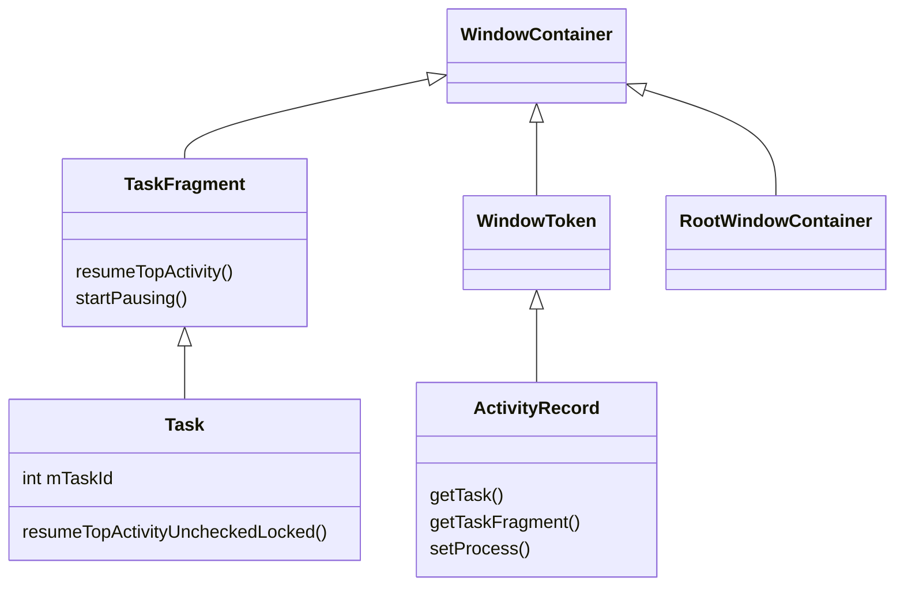
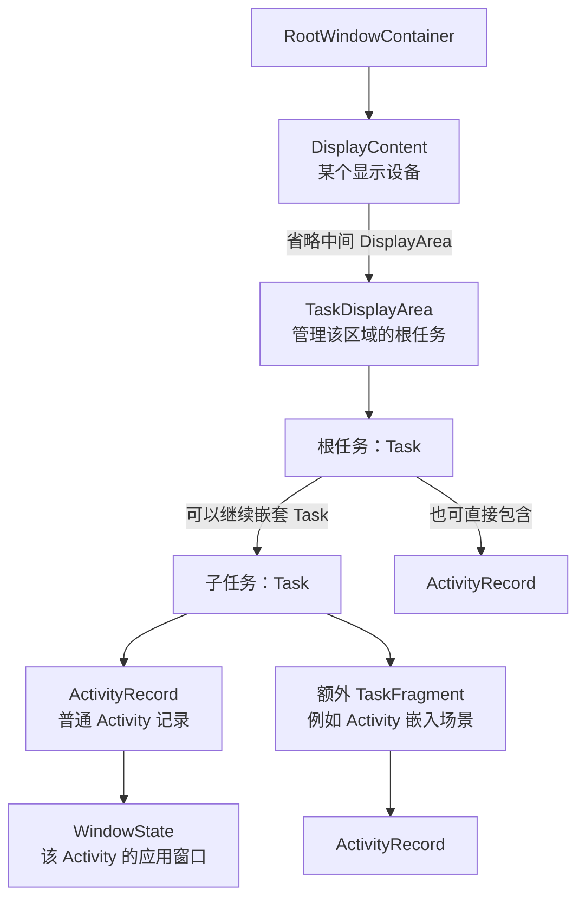
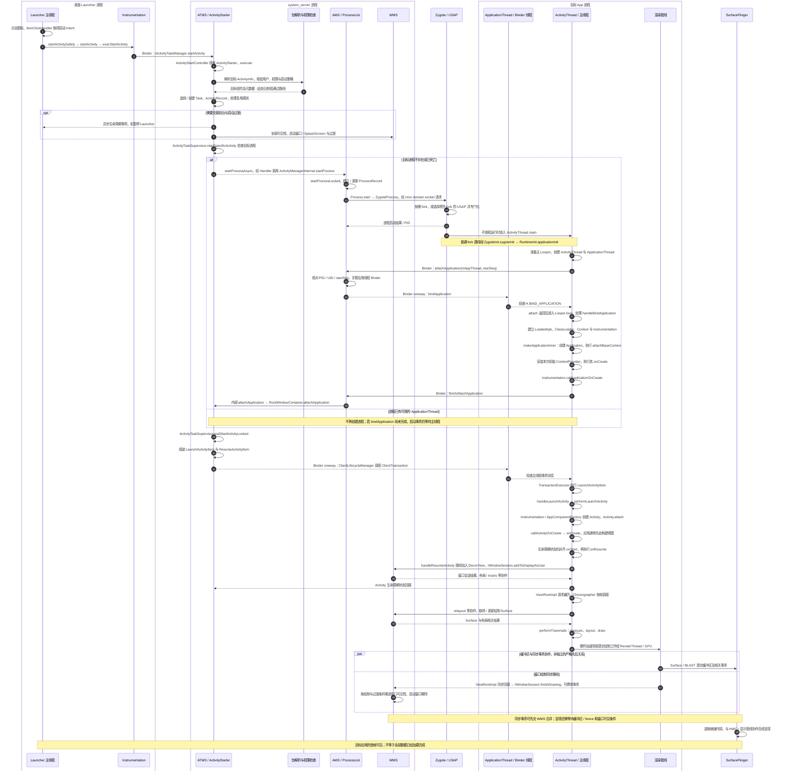

# AMS / ATMS {#s160}

## ActivityManagerService

AMS 负责应用进程及多类组件的运行管理，与进程启动、绑定应用、服务、广播和 Provider 等机制协作。`ActiveServices`、`BroadcastController`、`ContentProviderHelper` 分担具体逻辑，不能把所有状态机都理解为 AMS 中的一个方法。

应用中的 `ActivityManager` 是框架客户端入口，AMS 是系统侧实现；应用进程的 `ActivityThread` 是受调度的一方。客户端管理对象、服务端管理记录和实际组件实例属于不同层次。[AMS 源码](https://github.com/aosp-mirror/platform_frameworks_base/blob/android-16.0.0_r1/services/core/java/com/android/server/am/ActivityManagerService.java)

## ActivityTaskManagerService

ATMS 侧重点是 Activity、Task、启动、前后台状态及与窗口相关的任务组织。现代启动路径经 ATMS、ActivityStarter、任务协调对象等作决策；必要时再与 AMS 的进程管理协作。

AMS/ATMS 是职责拆分，不能解读成两者完全独立。一个“启动 Activity”的用户动作可能同时牵动包解析、进程启动、生命周期调度和窗口加入。[ATMS 源码](https://github.com/aosp-mirror/platform_frameworks_base/blob/android-16.0.0_r1/services/core/java/com/android/server/wm/ActivityTaskManagerService.java)

`SystemServer` 负责组织系统服务启动与初始化依赖，既有生命周期管理方式，也有服务专用初始化入口；不要假设所有服务均由同一个构造函数创建并立即可用。[SystemServer 源码](https://github.com/aosp-mirror/platform_frameworks_base/blob/android-16.0.0_r1/services/java/com/android/server/SystemServer.java)

## 核心类与版本边界 {#core-classes}

阅读主线是：**ATMS 接收请求 → Starter 决策 → Record 进入 Task → Supervisor 找进程 → 生命周期事务进入应用**。这些名字分别表示服务、执行器、状态记录与容器，不能互相替代。

`Task` 是任务实体，`ActivityRecord` 是活动记录，`ActivityTaskManagerService` 是管理服务，三者不能混成一个 `ActivityTask` 类。旧教程中的 `TaskRecord` 确实存在，例如 Android 9 的 `com.android.server.am.TaskRecord` 保存 `taskId`、`mActivities` 和所属 `ActivityStack`。本篇 Android 16 基线采用 `com.android.server.wm.Task`，它同时参与窗口容器树；旧版的 `ActivityStack` 也不能机械替换为某个固定层级的新对象。跨版本应对照职责和调用点，而非只替换类名。[Android 9 TaskRecord](https://github.com/aosp-mirror/platform_frameworks_base/blob/android-9.0.0_r1/services/core/java/com/android/server/am/TaskRecord.java#L131)

| 核心类 | 保存或管理什么 | 沿启动链重点看哪里 |
| --- | --- | --- |
| `ActivityTaskManagerService` | 启动入口、全局任务状态和协调对象 | `startActivityAsUser()`、`startProcessAsync()` |
| `ActivityStartController` | Starter 的获取、回收与启动协调 | `obtainStarter()`、`onExecutionComplete()` |
| `ActivityStarter` | 一次启动请求及其决策上下文 | `execute()`、`executeRequest()`、`startActivityInner()` |
| `ActivityRecord` | 一个 Activity 的服务端身份、状态、Intent、组件信息和所属进程 | `getTask()`、`getTaskFragment()`、`setProcess()`、`setState()` |
| `Task` | 任务身份、任务层级及其 Activity/子容器 | `mTaskId`、`startActivityLocked()`、`resumeTopActivityUncheckedLocked()` |
| `TaskFragment` | 任务内部的 Activity 组织与生命周期协调 | `mResumedActivity`、`mPausingActivity`、`resumeTopActivity()` |
| `TaskDisplayArea` | 某显示区域的根任务组织与选择 | `getOrCreateRootTask()`、`createRootTask()` |
| `RootWindowContainer` | 各显示设备及任务树的全局入口 | `resumeFocusedTasksTopActivities()`、`attachApplication()` |
| `ActivityTaskSupervisor` | Activity 启动、暂停交接与进程可用性协调 | `startSpecificActivity()`、`realStartActivityLocked()` |
| `WindowProcessController` | ATMS/窗口侧的进程视图、Activity 集合和应用通信端点 | `hasThread()`、`getThread()`、`addActivityIfNeeded()` |
| `ProcessRecord` | AMS 侧的应用进程记录，与进程管理状态对象协作 | `makeActive()`、`getWindowProcessController()` |
| `ClientLifecycleManager` | 向应用组织并调度生命周期事务 | `scheduleTransactionItems()`、`scheduleTransaction()` |

下面的 Java 代码均节选自固定标签；中文注释为阅读说明，`// ...` 表示省略原有代码，不是可独立编译的完整实现。类定义链接与关键方法链接放在各节末尾。

## Task、TaskFragment 与 ActivityRecord 如何组织 {#task-record-model}

### 继承关系不等于包含关系

图中只展示本篇相关的继承边，省略泛型参数和其他基类。`Task` **继承** `TaskFragment`；`ActivityRecord` **继承** `WindowToken`，并不是继承 `Task`。`ActivityRecord` 能参与窗口容器层级，但仍是 system_server 中的管理记录，不是应用内的 `Activity` 实例。



定义见 [Task](https://github.com/aosp-mirror/platform_frameworks_base/blob/android-16.0.0_r1/services/core/java/com/android/server/wm/Task.java#L208)、[TaskFragment](https://github.com/aosp-mirror/platform_frameworks_base/blob/android-16.0.0_r1/services/core/java/com/android/server/wm/TaskFragment.java#L122)、[ActivityRecord](https://github.com/aosp-mirror/platform_frameworks_base/blob/android-16.0.0_r1/services/core/java/com/android/server/wm/ActivityRecord.java#L386)、[WindowToken](https://github.com/aosp-mirror/platform_frameworks_base/blob/android-16.0.0_r1/services/core/java/com/android/server/wm/WindowToken.java#L63)。

### 运行时的任务容器树

下图表示**父子包含关系**，不是方法调用。为便于阅读，省略显示区域中间层；普通任务可以直接包含 ActivityRecord，嵌入场景才可能插入额外的 TaskFragment。根任务本身也是 `Task`，某个 `Task` 可以同时是根任务和叶子任务，不能假定每次启动都有两层 Task。



`TaskDisplayArea` 选择或创建根任务；`Task` 组织任务内容；`TaskFragment` 协调它所管理的 Activity 状态。不要把所有任务理解为一个全局后进先出的 Java `Stack`，多显示、多窗口、嵌套任务和嵌入容器都会改变层次。

```java
// TaskDisplayArea.createRootTask()：容器父节点是当前显示区域。
return new Task.Builder(mAtmService)
        .setWindowingMode(windowingMode)
        .setActivityType(activityType)
        .setParent(this)
        .setOnTop(onTop)
        .setActivityOptions(opts)
        .build();
```

源码：[TaskDisplayArea 类定义](https://github.com/aosp-mirror/platform_frameworks_base/blob/android-16.0.0_r1/services/core/java/com/android/server/wm/TaskDisplayArea.java#L76)、[createRootTask](https://github.com/aosp-mirror/platform_frameworks_base/blob/android-16.0.0_r1/services/core/java/com/android/server/wm/TaskDisplayArea.java#L969)。

### ActivityRecord：系统保存的是记录与 Token

`ActivityRecord` 保存 Intent、ActivityInfo、用户、状态、任务归属等信息。它可以先于应用进程和应用内 Activity 对象存在；进程死亡后，任务中也可能保留需要恢复的记录。新建一次启动请求的记录，不代表最终一定新建一个客户端 Activity，复用决策仍可能转向已有记录。

```java
// ActivityRecord 构造函数：把 Binder Token 交给 WindowToken 基类保存。
super(_service.mWindowManager, new Token(), TYPE_APPLICATION, true,
        null /* displayContent */, false /* ownerCanManageAppTokens */);
mAtmService = _service;
((Token) token).mActivityRef = new WeakReference<>(this);
info = aInfo;
mUserId = UserHandle.getUserId(info.applicationInfo.uid);
packageName = info.applicationInfo.packageName;
intent = _intent;
```

这里的 `token` 用于跨进程关联同一个 Activity 身份，不是把整个 `ActivityRecord` 传进 App。App 侧事务执行后会建立 `ActivityThread.ActivityClientRecord`，再创建实际的 Activity；服务端记录、客户端记录和组件实例是三个不同对象。[ActivityRecord 构造与 Token](https://github.com/aosp-mirror/platform_frameworks_base/blob/android-16.0.0_r1/services/core/java/com/android/server/wm/ActivityRecord.java#L1746)、[LaunchActivityItem 创建客户端记录](https://github.com/aosp-mirror/platform_frameworks_base/blob/android-16.0.0_r1/core/java/android/app/servertransaction/LaunchActivityItem.java#L214)

## 从启动请求到 Task 决策 {#starter-source-chain}

### ATMS 与 ActivityStartController：接收并组织请求

ATMS 的定义是 `ActivityTaskManagerService extends IActivityTaskManager.Stub`。应用的 `startActivity()` 经框架客户端进入这个 Binder 服务；ATMS 取得调用者 PID/UID、检查来源包与目标用户，然后配置 Starter。以下省略了前面的身份、用户与特殊场景检查。

```java
// ActivityTaskManagerService.startActivityAsUser()：把参数汇入一次启动请求。
return getActivityStartController().obtainStarter(intent, "startActivityAsUser")
        .setCaller(caller)                 // 调用方的应用通信端点，不是目标 Activity
        .setCallingPackage(callingPackage)
        .setCallingFeatureId(callingFeatureId)
        .setResolvedType(resolvedType)
        .setResultTo(resultTo)             // 用于来源/结果关联的 Activity Token
        .setResultWho(resultWho)
        .setRequestCode(requestCode)
        .setStartFlags(startFlags)
        .setProfilerInfo(profilerInfo)
        .setActivityOptions(opts)
        .setUserId(userId)
        .execute();
```

`ActivityStartController` 从工厂取得 Starter，并在执行结束后保存最近一次执行信息、回收执行器。因此 Starter 是可复用的请求执行器，不是与某个 Activity 一一对应的常驻对象，也不应在 `execute()` 后继续修改使用。

```java
ActivityStarter obtainStarter(Intent intent, String reason) {
    return mFactory.obtain().setIntent(intent).setReason(reason);
}
// onExecutionComplete() 节选：保存执行信息后回收本次执行器。
mLastStarter.set(starter);
mFactory.recycle(starter);
```

源码：[ATMS 定义](https://github.com/aosp-mirror/platform_frameworks_base/blob/android-16.0.0_r1/services/core/java/com/android/server/wm/ActivityTaskManagerService.java#L317)、[startActivityAsUser](https://github.com/aosp-mirror/platform_frameworks_base/blob/android-16.0.0_r1/services/core/java/com/android/server/wm/ActivityTaskManagerService.java#L1268)、[ActivityStartController](https://github.com/aosp-mirror/platform_frameworks_base/blob/android-16.0.0_r1/services/core/java/com/android/server/wm/ActivityStartController.java#L128)。

### ActivityStarter：执行校验、建立记录、决定复用

按方法跟踪为 `execute()` → `executeRequest()` → `startActivityUnchecked()` → `startActivityInner()`。这些方法之间还包含目标解析、权限检查、后台启动限制、URI 授权、启动拦截和失败清理；不能仅因为方法名里有 `Unchecked` 就认为权限不再检查。任务相关关键状态的修改受全局锁保护，执行请求前已保存真实调用身份。

`executeRequest()` 中先构造服务端的启动记录，目标 ActivityInfo 来自前面的组件解析，调用来源也单独保存：

```java
final ActivityRecord r = new ActivityRecord.Builder(mService)
        .setCaller(callerApp)
        .setLaunchedFromPid(callingPid)
        .setLaunchedFromUid(callingUid)      // 启动来源，不等于目标应用 UID
        .setLaunchedFromPackage(callingPackage)
        .setLaunchedFromFeature(callingFeatureId)
        .setIntent(intent)
        .setResolvedType(resolvedType)
        .setActivityInfo(aInfo)             // 已解析的目标组件信息
        .setConfiguration(mService.getGlobalConfiguration())
        // ... 结果关联、Options、来源记录等字段
        .build();
```

进入 `startActivityInner()` 后，先整理启动 flags，再找可复用任务或目标任务。下面各段位于同一方法的不同位置，中间省略了检查与分支。

```java
computeLaunchingTaskFlags();
mIntent.setFlags(mLaunchFlags);
// ...
final Task reusedTask = resolveReusableTask(includeLaunchedFromBubble);
// 找不到可复用任务，还可能根据来源、inTask 等计算目标任务。
final Task targetTask = reusedTask != null ? reusedTask : computeTargetTask();
final boolean newTask = targetTask == null;
// ... 处理已有任务、栈顶复用与启动策略；某些分支会提前返回。
if (newTask) {
    final Task taskToAffiliate = (mLaunchTaskBehind && mSourceRecord != null)
            ? mSourceRecord.getTask() : null;
    setNewTask(taskToAffiliate);
} else if (mAddingToTask) {
    addOrReparentStartingActivity(targetTask, "adding to task");
}
```

`setNewTask()` 内还会调用根任务的 `reuseOrCreateTask()`，再把启动记录加入或重新挂接到选定任务。因此 `FLAG_ACTIVITY_NEW_TASK`、`newTask` 局部变量和“分配一个全新 Task 对象”不能直接画等号。`launchMode`、affinity、flags、已有任务状态与显示区域等共同影响决策；已有实例还可能通过 `deliverNewIntent()` 收到新 Intent，而不重新 `onCreate()`。

源码：[execute](https://github.com/aosp-mirror/platform_frameworks_base/blob/android-16.0.0_r1/services/core/java/com/android/server/wm/ActivityStarter.java#L800)、[记录构建](https://github.com/aosp-mirror/platform_frameworks_base/blob/android-16.0.0_r1/services/core/java/com/android/server/wm/ActivityStarter.java#L1471)、[startActivityInner](https://github.com/aosp-mirror/platform_frameworks_base/blob/android-16.0.0_r1/services/core/java/com/android/server/wm/ActivityStarter.java#L1875)、[setNewTask](https://github.com/aosp-mirror/platform_frameworks_base/blob/android-16.0.0_r1/services/core/java/com/android/server/wm/ActivityStarter.java#L3157)。

## 从任务树到可执行的应用进程 {#task-to-process}

### RootWindowContainer、Task、TaskFragment：先决定谁应当活跃

在需要恢复前台且满足相应条件的路径中，Starter 调用 `resumeFocusedTasksTopActivities()`。RootWindowContainer 从显示与根任务维度协调，Task 再定位叶子任务和 TaskFragment。这里的 resume 是**系统侧的协调过程**，不能直接等同于 App 已执行 `onResume()`。

```java
// RootWindowContainer：协调目标根任务；后面还会遍历其他显示/任务。
result = targetRootTask.resumeTopActivityUncheckedLocked(target, targetOptions,
        deferPause);

// Task.resumeTopActivityUncheckedLocked()：叶子与非叶子任务走不同分支。
if (isLeafTask()) {
    if (isFocusableAndVisible()) {
        someActivityResumed = resumeTopActivityInnerLocked(prev, options, deferPause);
    }
} else {
    // ... 遍历符合条件的子 Task，继续 resumeTopActivityUncheckedLocked()
}

// Task.resumeTopActivityInnerLocked()：定位目标 Activity 所在的 TaskFragment。
final TaskFragment topFragment = topActivity.getTaskFragment();
// ... 其他可恢复的叶子 TaskFragment 也可能参与处理。
resumed[0] |= topFragment.resumeTopActivity(prev, options, deferPause);
```

TaskFragment 检查当前可见性、暂停交接、现有 Activity 与进程状态。已经有可用客户端记录时可能发送恢复事务；需要首次启动或重建时进入 `mTaskSupervisor.startSpecificActivity(next, true, true)`。它维护的 `mResumedActivity` 与 `mPausingActivity` 说明生命周期协调落在具体容器，不是用一个全局变量代表全设备的 Activity 状态。

源码：[RootWindowContainer 定义](https://github.com/aosp-mirror/platform_frameworks_base/blob/android-16.0.0_r1/services/core/java/com/android/server/wm/RootWindowContainer.java#L170)、[resumeFocusedTasksTopActivities](https://github.com/aosp-mirror/platform_frameworks_base/blob/android-16.0.0_r1/services/core/java/com/android/server/wm/RootWindowContainer.java#L2452)、[Task 递归与叶子路径](https://github.com/aosp-mirror/platform_frameworks_base/blob/android-16.0.0_r1/services/core/java/com/android/server/wm/Task.java#L5142)、[TaskFragment.resumeTopActivity](https://github.com/aosp-mirror/platform_frameworks_base/blob/android-16.0.0_r1/services/core/java/com/android/server/wm/TaskFragment.java#L1423)。

### ActivityTaskSupervisor：检查承载进程

Supervisor 不代表一个额外进程，也不负责在 system_server 中实例化目标 Activity。它通过进程名和目标 UID 查找 WindowProcessController；有通信端点时尝试真正启动，否则请求启动进程。

```java
// ActivityTaskSupervisor.startSpecificActivity() 节选。
final WindowProcessController wpc =
        mService.getProcessController(r.processName, r.info.applicationInfo.uid);
boolean knownToBeDead = false;
if (wpc != null && wpc.hasThread()) {
    try {
        realStartActivityLocked(r, wpc, andResume, checkConfig);
        return;
    } catch (RemoteException e) {
        // ... 记录通信失败，并移除失效的进程映射。
    }
    knownToBeDead = true;
    // ...
}
// ... 特殊进程场景校验与可见性通知。
final boolean isTop = andResume && r.isTopRunningActivity();
mService.startProcessAsync(r, knownToBeDead, isTop,
        isTop ? HostingRecord.HOSTING_TYPE_TOP_ACTIVITY
                : HostingRecord.HOSTING_TYPE_ACTIVITY);
```

这里的 `hasThread()` 只是 `mThread != null`，指应用通信端点可用，不是在询问 Java 主线程是否存在，更不证明 `Application.onCreate()` 已执行完。`realStartActivityLocked()` 还会检查暂停门槛，可能返回 `false` 等待后续推进，不能把一次调用当成客户端启动成功。[Supervisor 定义](https://github.com/aosp-mirror/platform_frameworks_base/blob/android-16.0.0_r1/services/core/java/com/android/server/wm/ActivityTaskSupervisor.java#L182)、[startSpecificActivity](https://github.com/aosp-mirror/platform_frameworks_base/blob/android-16.0.0_r1/services/core/java/com/android/server/wm/ActivityTaskSupervisor.java#L1129)、[暂停门槛](https://github.com/aosp-mirror/platform_frameworks_base/blob/android-16.0.0_r1/services/core/java/com/android/server/wm/ActivityTaskSupervisor.java#L808)

### ProcessRecord 与 WindowProcessController：同一进程的两侧视图

AMS 的 `ProcessRecord` 持有一个 `WindowProcessController`，后者供 ATMS/窗口侧跟踪该进程及其 Activity。二者都在 system_server，不是两个应用进程；Task 也不等于进程，一个进程可承载多个任务中的 Activity，一个任务也可包含不同应用进程的 Activity。

```java
// ProcessRecord.makeActive() 节选：同步应用端点到窗口/任务侧视图。
mThread = thread;
// ... 同进程场景的通信包装等处理。
mWindowProcessController.setThread(mThread);

// ActivityRecord.setProcess() 节选：启动时关联承载进程，建立反向记录。
app = proc;
final ActivityRecord root = task != null ? task.getRootActivity() : null;
if (root == this) {
    task.setRootProcess(proc);
}
proc.addActivityIfNeeded(this);
```

`ActivityRecord.app` 指向 WindowProcessController；其 Activity 集合又能定位属于该进程的服务端记录。进程通信端点以 `IApplicationThread` 接口使用，框架中可带有委托包装；App 实际接收端是 `ActivityThread.ApplicationThread`，不是 WindowProcessController 本身。

缺少进程时，`ATMS.startProcessAsync()` 先记录待启动的 Activity，再通过 Handler 消息调用 `ActivityManagerInternal.startProcess`。源码明确说明这样可避免持有 ATMS 锁直接进入 AMS 导致潜在死锁。进程 attach 后，`RootWindowContainer.attachApplication()` 根据 UID、进程名及记录状态找到待启动项，再尝试 `realStartActivityLocked()`；不是把最初整条 startActivity 调用从头执行一遍。

ATMS 与 AMS 都在 `system_server`，同进程并不能消除不同状态锁之间的顺序风险。冷启动还要跨过运行时初始化和 `attachApplication()`：PID 已分配与 `IApplicationThread` 已可用是两个条件，不能看到进程出现就认定启动事务已经可以执行。

源码：[ProcessRecord 定义](https://github.com/aosp-mirror/platform_frameworks_base/blob/android-16.0.0_r1/services/core/java/com/android/server/am/ProcessRecord.java#L82)、[makeActive](https://github.com/aosp-mirror/platform_frameworks_base/blob/android-16.0.0_r1/services/core/java/com/android/server/am/ProcessRecord.java#L742)、[WindowProcessController 定义](https://github.com/aosp-mirror/platform_frameworks_base/blob/android-16.0.0_r1/services/core/java/com/android/server/wm/WindowProcessController.java#L112)、[ActivityRecord.setProcess](https://github.com/aosp-mirror/platform_frameworks_base/blob/android-16.0.0_r1/services/core/java/com/android/server/wm/ActivityRecord.java#L2150)、[异步进程请求](https://github.com/aosp-mirror/platform_frameworks_base/blob/android-16.0.0_r1/services/core/java/com/android/server/wm/ActivityTaskManagerService.java#L5322)、[attach 回接](https://github.com/aosp-mirror/platform_frameworks_base/blob/android-16.0.0_r1/services/core/java/com/android/server/wm/RootWindowContainer.java#L1768)。

## 启动事务怎样进入 ActivityThread {#launch-transaction-source}

`realStartActivityLocked()` 在进程可用且满足条件后关联记录与进程，组装 `LaunchActivityItem`，并选择目标生命周期项。需要恢复时是 `ResumeActivityItem`；其他条件下也可能是 Pause 或 Stop，不能把所有 Activity 启动都固定画成立即 Resume。

```java
// realStartActivityLocked() 中先执行 r.setProcess(proc)，再准备启动参数。
final LaunchActivityItem launchActivityItem = new LaunchActivityItem(r.token,
        r.intent, System.identityHashCode(r), r.info,
        // ... 配置、保存状态、待处理结果、关联 Token 等参数
        r.initialCallerInfoAccessToken, activityWindowInfo);

// andResume 分支：指定客户端最终需要到达的生命周期状态。
lifecycleItem = new ResumeActivityItem(r.token, isTransitionForward,
        r.shouldSendCompatFakeFocus());
// ... 独立发送 LaunchActivityItem 等兼容分支。
isSuccessful = mService.getLifecycleManager().scheduleTransactionItems(
        proc.getThread(),
        true /* shouldDispatchImmediately */,
        launchActivityItem, lifecycleItem);
```

`ClientLifecycleManager` 组织事务，`ClientTransaction.schedule()` 通过 `IApplicationThread` 投递。App 的 ApplicationThread 接收后转交 ActivityThread；`ClientTransactionHandler.scheduleTransaction()` 把事务送入主线程消息队列，随后由 TransactionExecutor 执行。`LaunchActivityItem.execute()` 建立客户端记录并进入 `handleLaunchActivity()`，再沿 `performLaunchActivity()` 创建 Activity、通过 Instrumentation 调用生命周期。具体类创建和回调代码见 [Activity 启动原理](../activity-startup.html)。

```java
// system_server：ClientTransaction.schedule() 中的远程接口调用。
mClient.scheduleTransaction(this);

// App：ActivityThread.ApplicationThread 中的 Binder 接收方法。
public void scheduleTransaction(ClientTransaction transaction) throws RemoteException {
    ActivityThread.this.scheduleTransaction(transaction);
}

// ClientTransactionHandler：预处理后排入应用主线程，并非在 Binder 回调直接 onCreate。
void scheduleTransaction(ClientTransaction transaction) {
    transaction.preExecute(this);
    sendMessage(ActivityThread.H.EXECUTE_TRANSACTION, transaction);
}
```

源码：[realStartActivityLocked 的事务组装](https://github.com/aosp-mirror/platform_frameworks_base/blob/android-16.0.0_r1/services/core/java/com/android/server/wm/ActivityTaskSupervisor.java#L1017)、[ClientLifecycleManager](https://github.com/aosp-mirror/platform_frameworks_base/blob/android-16.0.0_r1/services/core/java/com/android/server/wm/ClientLifecycleManager.java#L74)、[ClientTransaction.schedule](https://github.com/aosp-mirror/platform_frameworks_base/blob/android-16.0.0_r1/core/java/android/app/servertransaction/ClientTransaction.java#L243)、[ApplicationThread 接收](https://github.com/aosp-mirror/platform_frameworks_base/blob/android-16.0.0_r1/core/java/android/app/ActivityThread.java#L2193)、[主线程排队](https://github.com/aosp-mirror/platform_frameworks_base/blob/android-16.0.0_r1/core/java/android/app/ClientTransactionHandler.java#L55)。

## 用三个场景检查是否理解 {#core-class-examples}

- **Launcher 首次打开进程不存在的应用**：Starter 解析目标并选择任务，建立/挂接记录；Supervisor 找不到可用应用端点，经 AMS 启动进程；attach 后推进原有待启动记录并下发事务。
- **同一任务的 A 打开普通 B**：在未使用改变任务归属的 flags/options 等条件下，B 的记录通常加入 A 所在任务；若承载进程可用，可沿事务路径启动。B 是新 Activity，不代表新 Task，也不代表新进程。
- **栈顶 singleTop Activity 再次被启动且满足复用条件**：Starter 可把新 Intent 交给已有记录；应用收到 `onNewIntent()`，不必新建 Activity。已有进程但客户端 Activity 需要重建，又是不同路径。

结合下面的完整时序阅读时，把 `ActivityStarter` 看成请求决策者，把 `ActivityRecord` 看成被调度的服务端身份，把 `Task` 看成容器，把 `ProcessRecord`/`WindowProcessController` 看成承载进程的状态视图。

## 从 Launcher 点击图标到应用首帧 {#ams-atms-launch-sequence}

以同一用户下普通桌面图标、目标进程不存在、启动一个需要 resumed 的 Activity 为主线，图中保留进程复用分支。图中 **Launcher、system_server、Zygote、目标 App、SurfaceFlinger 是不同进程**；AMS、ATMS、PMS 和 WMS 在此属于同一 system_server，其内部调用不等于跨进程 Binder。虚线表示回复或异步回报；标有 Binder、Socket 的箭头才指出对应传输边界。它是分阶段源码导读，不是某次启动的线程时间线。



`IActivityTaskManager.startActivity()` 还有一条回到 `Instrumentation.execStartActivity()`、再回到 Launcher 的同步返回链；它可以与后续进程初始化和绘制重叠，故不在异步主线末尾画“返回”。启动请求的结果检查在这一返回链上完成，不能等待首帧才当作 startActivity 返回。

这张图采用 **`expediteActivityLaunchOnColdStart()` 关闭、`mEnableWaitForFinishAttachApplication` 开启**的 attach 路径。前者开启时，AMS 在 `attachApplicationLocked()` 中、发出 `bindApplication()` 后提前通知 ATMS；前者关闭时则由 `finishAttachApplicationInner()` 通知。后者关闭时，AMS 在 attach 内直接调用这个 Inner 方法，稍后的客户端 `finishAttachApplication()` 被忽略，而非等待 `Application.onCreate()` 回报。**提前发送启动事务不表示 Activity 回调可以越过主线程中的应用初始化**；Binder 接收与主线程执行要分开阅读。[AMS attach 与 finishAttach 分支](https://github.com/aosp-mirror/platform_frameworks_base/blob/android-16.0.0_r1/services/core/java/com/android/server/am/ActivityManagerService.java#L4826)

**启动身份与任务参数**：此普通图标路径的 `startActivitySafely()` 会加入 `FLAG_ACTIVITY_NEW_TASK`，不保证每次都新建 Task。`Instrumentation.execStartActivity()` 传递 Launcher 的 `IApplicationThread`、包名 / attribution tag、来源 Activity token 等信息；服务端保存真实 Binder PID/UID，并结合 caller 对应进程核验来源，目标应用的 UID 由解析结果决定，不能把 Intent 内自报字段当作身份。深层快捷方式与跨用户图标会经 `LauncherApps` 的其他入口，未画成同一条调用链。[Launcher3 入口](https://android.googlesource.com/platform/packages/apps/Launcher3/+/refs/tags/android-16.0.0_r1/src/com/android/launcher3/views/ActivityContext.java#418)、[Instrumentation](https://github.com/aosp-mirror/platform_frameworks_base/blob/android-16.0.0_r1/core/java/android/app/Instrumentation.java#L1992)、[ActivityStarter.Request.resolveActivity](https://github.com/aosp-mirror/platform_frameworks_base/blob/android-16.0.0_r1/services/core/java/com/android/server/wm/ActivityStarter.java#L560)

主线程在 `ActivityThread.main()` 中已经存在，先准备 Looper，再 attach，随后进入消息循环；不能画成“Application.onCreate 后才创建主线程”。Zygote 回复 PID 与子进程 attach 可以并发推进，图中排列不表示两端严格串行。USAP 是否启用取决于系统配置。[ActivityThread.main](https://github.com/aosp-mirror/platform_frameworks_base/blob/android-16.0.0_r1/core/java/android/app/ActivityThread.java#L9018)、[Zygote 进程机制](https://source.android.com/docs/core/runtime/zygote)

## 复用、时序和完成边界 {#launch-branches}

- **进程存在，Activity 不存在**：直接走 `realStartActivityLocked()`，创建 Activity；同一进程已初始化的 Application 不会因这次启动重新执行 `onCreate()`。
- **进程正在启动**：已有进程记录但没有可用 thread 时，ATMS 可等待 attach；已有 thread 也不证明 `handleBindApplication()` 已完成，启动事务仍按应用主线程队列执行。`realStartActivityLocked()` 还可能因暂停交接未完成而暂缓，并不保证调用它就立即发出启动事务。[进程检查与暂停门槛](https://github.com/aosp-mirror/platform_frameworks_base/blob/android-16.0.0_r1/services/core/java/com/android/server/wm/ActivityTaskSupervisor.java#L808)、[正在启动的进程去重](https://github.com/aosp-mirror/platform_frameworks_base/blob/android-16.0.0_r1/services/core/java/com/android/server/wm/ActivityTaskManagerService.java#L5322)
- **已有 Activity / Task 可复用**：可能移动任务到前台、派发 `NewIntentItem` / `onNewIntent()` 并恢复生命周期，省略新的 `LaunchActivityItem`。具体由 launchMode、Intent flags、任务和实例状态决定。
- **Launcher 暂停**：任务切换会与生命周期、转场和窗口可见性协作；不能推导出“Launcher 的每一个暂停/停止回调都在目标进程创建之前完成”。首屏启动窗口也不是目标 Activity 已经画出的内容。
- **事务派发**：此标签使用 `scheduleTransactionItems()`，可能受兼容性策略影响合并或独立派发；不是所有系统版本都固定为旧教程中的 `scheduleLaunchActivity()`。
- **三个结束点**：`startActivity()` 返回说明启动请求已处理到可返回的阶段；`onResume()` 返回说明生命周期回调完成；目标帧被合成呈现才是用户看到内容。TTID 衡量初始显示，TTFD 还需考虑应用报告完全绘制的时机，不能用任一单个 Java 回调替代二者。

图中的绘制后半程按普通 View、硬件加速路径展开；SurfaceView、软件绘制、多窗口和厂商实现有额外分支。WMS 管理窗口和绘制同步，**SurfaceFlinger 负责显示合成**；`finishDrawing()` 回报不是物理屏幕已经呈现的证明。[启动耗时与 TTID / TTFD](https://developer.android.com/topic/performance/issues/launch-time)、[SurfaceFlinger 与 VSYNC](../../framework/surfaceflinger-vsync.html)

`ViewRootImpl` 的同步完成回调可从渲染相关线程调用 `reportDrawFinished()`；对跨进程 WMS 不要求先切回应用主线程。`finishDrawing()` 可把待合并的 SurfaceControl 事务送到服务端，不能读成“缓冲区已经独立提交，主线程随后只发一个通知”。启动窗口移除与过渡也可能涉及 WM Shell，图中合并为窗口协作阶段。[ViewRootImpl 同步回调](https://github.com/aosp-mirror/platform_frameworks_base/blob/android-16.0.0_r1/core/java/android/view/ViewRootImpl.java#L4569)、[WindowState.finishDrawing](https://github.com/aosp-mirror/platform_frameworks_base/blob/android-16.0.0_r1/services/core/java/com/android/server/wm/WindowState.java#L5645)、[ActivityRecord.onFirstWindowDrawn](https://github.com/aosp-mirror/platform_frameworks_base/blob/android-16.0.0_r1/services/core/java/com/android/server/wm/ActivityRecord.java#L6472)

TTID 的框架 `Displayed` / windows-drawn 计时属于初始显示指标，不能直接当成显示面板扫描完成时间；需要物理呈现证据时，还要关联 SurfaceFlinger、present fence 和显示管线时间。TTFD 依赖应用在达到可用状态后正确报告 `reportFullyDrawn()`，系统不会自动判断所有业务数据是否加载完毕。[ActivityRecord.onWindowsDrawn](https://github.com/aosp-mirror/platform_frameworks_base/blob/android-16.0.0_r1/services/core/java/com/android/server/wm/ActivityRecord.java#L6545)、[TTID / TTFD 定义与报告](https://developer.android.com/topic/performance/issues/launch-time#time-initial)

## 沿源码复核这条链 {#launch-source-map}

1. **桌面发起**：[ItemClickHandler](https://android.googlesource.com/platform/packages/apps/Launcher3/+/refs/tags/android-16.0.0_r1/src/com/android/launcher3/touch/ItemClickHandler.java) 的 `onClickAppShortcut()` / `startAppShortcutOrInfoActivity()` → [ActivityContext.startActivitySafely](https://android.googlesource.com/platform/packages/apps/Launcher3/+/refs/tags/android-16.0.0_r1/src/com/android/launcher3/views/ActivityContext.java) → 框架 [Instrumentation.execStartActivity](https://github.com/aosp-mirror/platform_frameworks_base/blob/android-16.0.0_r1/core/java/android/app/Instrumentation.java)。桌面通常已有显式组件，不能把每次点击都画成一次隐式 `queryIntentActivities()`。
2. **任务决策**：[ActivityStarter.execute](https://github.com/aosp-mirror/platform_frameworks_base/blob/android-16.0.0_r1/services/core/java/com/android/server/wm/ActivityStarter.java) 与 [ActivityTaskSupervisor](https://github.com/aosp-mirror/platform_frameworks_base/blob/android-16.0.0_r1/services/core/java/com/android/server/wm/ActivityTaskSupervisor.java) 的 `startSpecificActivity()` / `realStartActivityLocked()`。ATMS 决定“哪个 Activity 在哪个 Task 中运行”，AMS 协调“承载它的进程是否可用”。
3. **创建进程**：[ProcessList](https://github.com/aosp-mirror/platform_frameworks_base/blob/android-16.0.0_r1/services/core/java/com/android/server/am/ProcessList.java) → `Process.start()` → [ZygoteProcess](https://github.com/aosp-mirror/platform_frameworks_base/blob/android-16.0.0_r1/core/java/android/os/ZygoteProcess.java)。这是 Socket 进程启动协议，不是应用用 Binder 调用 Zygote。
4. **应用与 Activity**：[ActivityThread](https://github.com/aosp-mirror/platform_frameworks_base/blob/android-16.0.0_r1/core/java/android/app/ActivityThread.java) 的 `main()`、`attach()`、`handleBindApplication()`、`performLaunchActivity()`；另见 [LoadedApk](../loaded-apk.html) 和 [ClientTransaction](../../framework/client-transaction.html)。
5. **窗口与首帧**：[ViewRootImpl](https://github.com/aosp-mirror/platform_frameworks_base/blob/android-16.0.0_r1/core/java/android/view/ViewRootImpl.java)、[WMS](https://github.com/aosp-mirror/platform_frameworks_base/blob/android-16.0.0_r1/services/core/java/com/android/server/wm/WindowManagerService.java) 与 SurfaceFlinger。要观察线程唤醒、帧提交和实际呈现，不能只读 Activity 日志。
