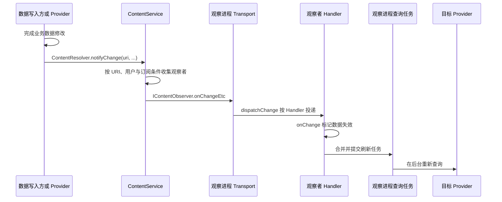

# ContentService {#s200}

ContentService 维护 ContentObserver 等相关系统协作，依据 URI、用户和订阅条件分发变化通知。它不保存每个应用的业务数据库，也不把所有 ContentResolver 查询转成自己的数据库查询。

注册与通知分为两条路径：`ContentResolver.registerContentObserver()` 注册观察端点；写入后的 `notifyChange()` 触发匹配通知；真正的数据仍经目标 ContentProvider 访问。[ContentService 源码](https://github.com/aosp-mirror/platform_frameworks_base/blob/android-16.0.0_r1/services/core/java/com/android/server/content/ContentService.java)

变化通知不自带持久事件日志或跨进程事务保证，观察方要容忍重新查询与合并刷新。完整机制见 [Provider 原理](../content-provider.html)。

## 注册的不是查询，而是观察端点 {#observer-registration}

`ContentResolver.registerContentObserver(uri, notifyForDescendants, observer)` 把观察者的 Binder 端点交给 `ContentService`。服务端结合调用者、用户及 URI 访问条件检查请求，再在锁内加入观察树；登记成功不会立即查询 Provider，也不代表以后能够读取任意相关数据。

`ObserverNode` 按 URI 的 authority、path 分段组织节点，同时保存订阅条件和用户信息。例如观察 `content://notes/items`，是否接收其下 `items/42` 的通知，要结合 `notifyForDescendants`、本次通知的路径与 flags 判断，不能用字符串前缀比较替代系统匹配规则。[注册与观察树](https://android.googlesource.com/platform/frameworks/base/+/refs/tags/android-16.0.0_r1/services/core/java/com/android/server/content/ContentService.java#365)、[URI 分段](https://android.googlesource.com/platform/frameworks/base/+/refs/tags/android-16.0.0_r1/services/core/java/com/android/server/content/ContentService.java#1770)

## notifyChange 如何回到观察者 {#observer-notification}

`notifyChange()` 在观察树中收集匹配项，再由 `ObserverCollector.dispatch()` 调用观察端点的 `onChangeEtc()`。通知与读取走不同 Binder 接口：前者由 ContentService 协调，后者仍访问拥有数据的 Provider。图中分开查询步骤，是因为收到 URI 并不等于拿到新数据，也不等于获得读权限。[通知收集与分发](https://android.googlesource.com/platform/frameworks/base/+/refs/tags/android-16.0.0_r1/services/core/java/com/android/server/content/ContentService.java#428)

分发还有调度策略：该实现对重要前台进程等满足条件的观察者立即发出回调，其他后台观察者可能延后通知，以免同时触发大量刷新。因此 `notifyChange()` 返回不能作为“所有观察者已经更新完毕”的屏障。[ObserverCollector 分发策略](https://android.googlesource.com/platform/frameworks/base/+/refs/tags/android-16.0.0_r1/services/core/java/com/android/server/content/ContentService.java#581)

## 回调在哪条线程，怎样刷新数据 {#observer-thread}

客户端 `ContentObserver.Transport` 接收 `onChangeEtc()` 后调用 `dispatchChange()`。提供 Handler 时会投递到该 Handler；未提供 Handler、也没有其他执行器时直接调用 `onChange()`，不能假定总在主线程。普通应用可显式传入目标 Handler，再在回调中合并刷新请求，把耗时查询放到后台执行。[ContentObserver 分发](https://android.googlesource.com/platform/frameworks/base/+/refs/tags/android-16.0.0_r1/core/java/android/database/ContentObserver.java#321)

常见使用顺序是：创建观察者、注册、读取当前快照；收到变化后重新读取并替换界面状态。注册和查询不是一个原子事务，期间仍可能再次变化，界面应能接受重复通知与重复读取。生命周期结束后调用 `unregisterContentObserver()`，避免对象和订阅持续存活。[ContentResolver API](https://developer.android.com/reference/android/content/ContentResolver#registerContentObserver(android.net.Uri,boolean,android.database.ContentObserver))

## 通知与同步调度的边界 {#observer-sync}

`NOTIFY_SYNC_TO_NETWORK` 会让 ContentService 的相应路径请求本地同步调度；它不表示通知里包含可直接上传的数据，更不保证网络同步立即完成。业务要求可靠传输、审计或顺序消费时，需要自己的持久状态、重试和幂等策略，不能把观察者通知当作消息队列。[同步调度入口](https://android.googlesource.com/platform/frameworks/base/+/refs/tags/android-16.0.0_r1/services/core/java/com/android/server/content/ContentService.java#496)
