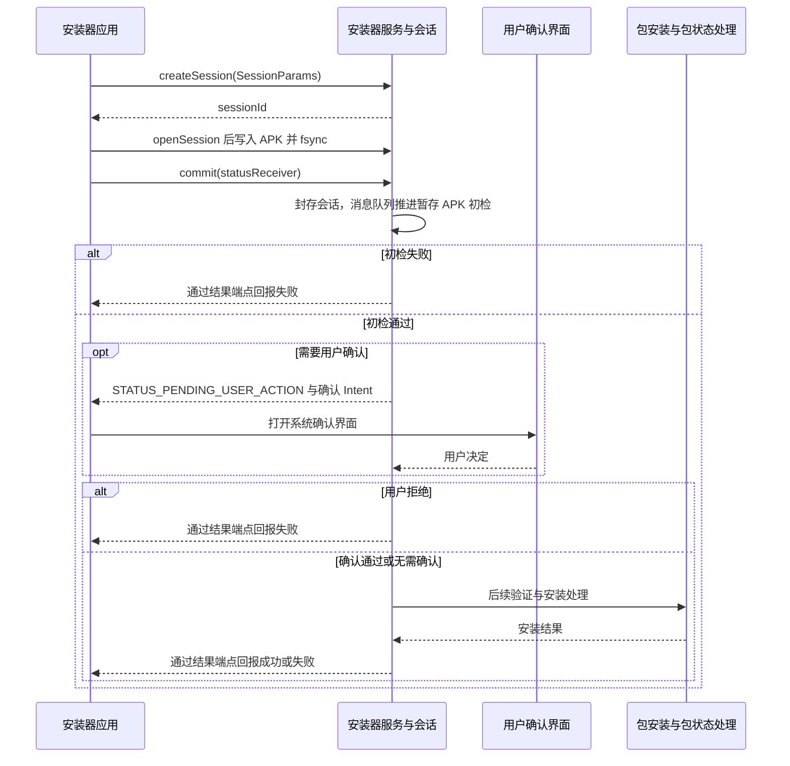

# PackageInstallerService {#s203}

系统安装器服务管理安装会话及其访问关系；会话准备的数据最终交给包安装处理与 PMS 相关状态协作。用户确认、签名/版本/包结构校验、安装结果和更新状态属于不同阶段，不是一次 `commit()` 同步完成全部工作。

## PackageInstallerSession：服务端会话 {#s209}

`PackageInstallerSession` 是 `system_server` 内的会话实现，管理暂存内容、提交状态及后续安装处理。它不是普通应用 `openSession()` 的 Java 返回类型。[PackageInstallerService 源码](https://github.com/aosp-mirror/platform_frameworks_base/blob/android-16.0.0_r1/services/core/java/com/android/server/pm/PackageInstallerService.java)

服务端 `commit()` 将会话封存后，通过 Handler 的 `MSG_ON_SESSION_SEALED`、`MSG_STREAM_VALIDATE_AND_COMMIT`、`MSG_INSTALL` 等阶段推进，安装阶段再进入 `InstallingSession.installStage()`。

封存后不能继续把会话当作可任意写入的临时目录；校验失败、等待用户操作和最终安装失败也不能合并为同一种结果。[提交与消息阶段](https://android.googlesource.com/platform/frameworks/base/+/refs/tags/android-16.0.0_r1/services/core/java/com/android/server/pm/PackageInstallerSession.java#2189)

## PackageInstaller 与 Session：公开客户端 {#s212}

应用用 `PackageInstaller` 创建和打开会话。**公开 `openSession(sessionId)` 返回 `PackageInstaller.Session`**，客户端 Session 再经接口操作服务端会话。

创建会话时，服务端检查调用 UID、跨用户权限及用户安装限制；`openSession()` 还检查会话访问资格。`sessionId` 只是定位编号，知道编号不等于有权操作他人的会话。持久化的服务端会话与临时客户端包装对象也不是同一生命周期。[创建与访问检查](https://android.googlesource.com/platform/frameworks/base/+/refs/tags/android-16.0.0_r1/services/core/java/com/android/server/pm/PackageInstallerService.java#655)

## SessionParams：创建参数 {#s215}

`PackageInstaller.SessionParams` 描述安装模式和会话参数，不能替代 APK 内容，也不是授权令牌。参数必须与实际安装需求和应用资格一致，不能通过填某个字段绕过系统确认。

## 从创建到结果的完整流程 {#installer-flow}



普通非 staged 会话中，`streamValidateAndCommit()` 的 `validateApkInstallLocked()` 先检查暂存 APK，再推进安装阶段的用户操作判断。**用户确认不等于 APK 校验全部完成，更不等于安装成功**；拒绝或校验失败均会终止对应路径。[初检与后续安装阶段](https://github.com/aosp-mirror/platform_frameworks_base/blob/android-16.0.0_r1/services/core/java/com/android/server/pm/PackageInstallerSession.java#L2502)

提交前需要完成：打开 Session 后用写入流提供 APK 内容，适当 `fsync()` 并关闭流，准备结果 IntentSender，再 `commit()`。关闭客户端 Session 与放弃安装会话不是一回事，清理未完成会话需要采用对应的 abandon 流程。

单个 APK 的写入部分如下：`installer` 是已取得的 `PackageInstaller`，`sessionId` 来自本次创建的会话，`apkInput` 是调用方管理的输入流，`statusReceiver` 是符合下述契约的结果端点。

```kotlin
installer.openSession(sessionId).use { session ->
    session.openWrite("base.apk", 0, -1).use { output ->
        apkInput.copyTo(output)
        session.fsync(output)
    }
    session.commit(statusReceiver)
}
```

`openWrite()` 写的是会话暂存内容，不是直接覆盖目标应用的安装目录。拆分 APK 需要把相互匹配的完整集合写入同一会话，不能把某个 split 当作通用独立安装包；写入异常时不要继续提交半成品。是否放弃会话取决于是否准备继续使用它，`close()` 只释放当前客户端操作资源。[Session 写入、同步与放弃](https://developer.android.com/reference/android/content/pm/PackageInstaller.Session)

`commit()` 返回不表示安装成功；应处理待用户操作、成功和各类失败状态。结果接收端也要绑定到自己创建的会话，避免把任意收到的广播当作安装成功证明。[Session 提交与结果契约](https://developer.android.com/reference/android/content/pm/PackageInstaller.Session#commit(android.content.IntentSender))

::: warning 结果 PendingIntent 的可变性例外
不能把“所有 PendingIntent 一律 immutable”作为规则。安装提交的结果端点需要系统填写结果；`Session.commit()` 文档明确指出，调用方 target SDK 为 API 35+ 时使用 immutable PendingIntent 会抛 `IllegalArgumentException`。

应按 API 契约选择明确指向自己接收组件的可变结果端点，并校验会话与输入，详见 [PendingIntent](../pending-intent.html)。
:::
