# PMS：PackageManagerService {#s166}

PMS 维护包与组件元数据、安装状态及相关查询/管理协作。**它知道包里声明了什么，不负责执行应用 Activity 的生命周期。** 公共 `PackageManager`、应用侧实现、`IPackageManager` 接口和系统内部解析对象之间还存在适配与权限层次。

`IPackageManagerImpl` 继承 `IPackageManagerBase`，把查询、安装、删除等能力委托给不同辅助对象；查询还会使用 `Computer` 快照。公开方法与 PMS 中的同名实现不一定一一对应，需要继续追踪职责委托。[PMS 源码](https://github.com/aosp-mirror/platform_frameworks_base/blob/android-16.0.0_r1/services/core/java/com/android/server/pm/PackageManagerService.java)

## 职责与协作边界 {#pms-responsibilities}

下图是职责概览，箭头表示请求或协作关系，不表示类继承。

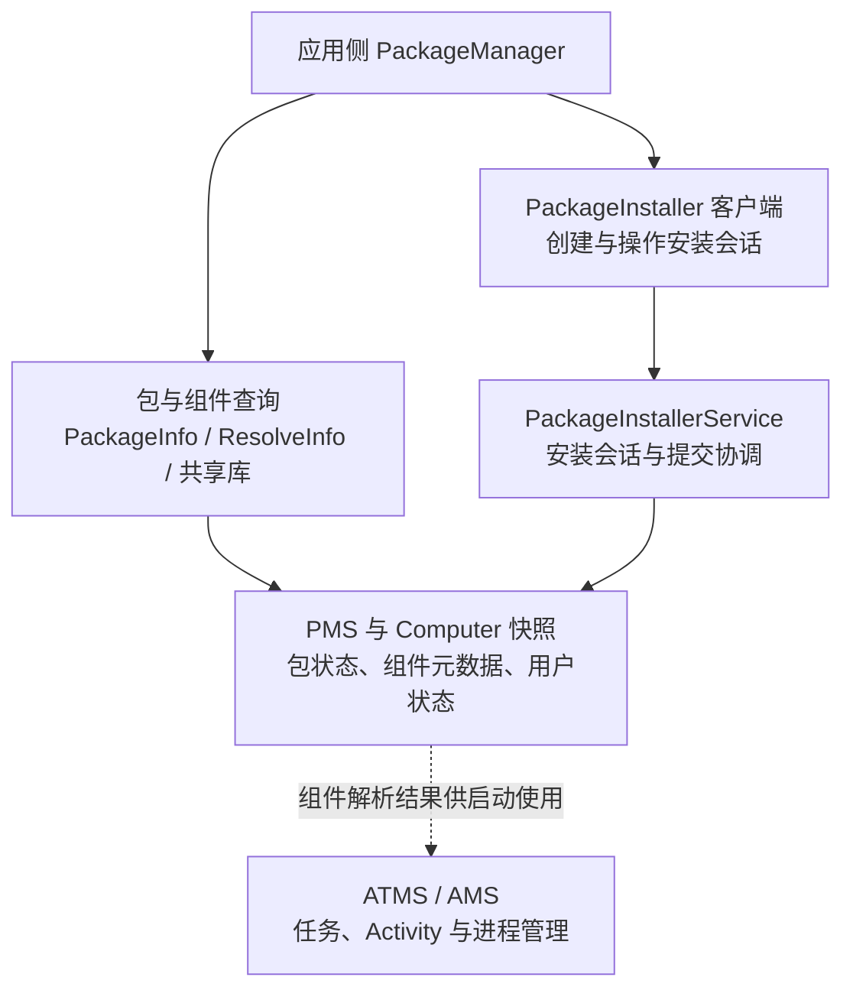

安装会话的完整流程见 [PackageInstallerService](./package-installer-service.html)，应用启动见 [AMS / ATMS](./ams-atms.html)。

## 先看全景：安装之后，系统多了什么

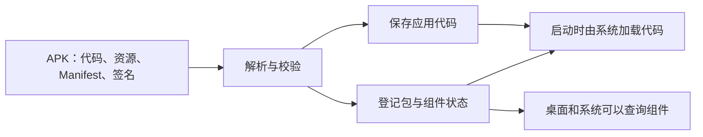

PMS 管理“有哪些包、组件和用户状态”；运行进程与 Activity 生命周期由 AMS / ATMS 等协作完成。安装完成不代表应用已启动。

## 核心类：谁负责哪一步

以下对应 AOSP `android-16.0.0_r1`，厂商版本和其他 Android 版本可能拆分不同。

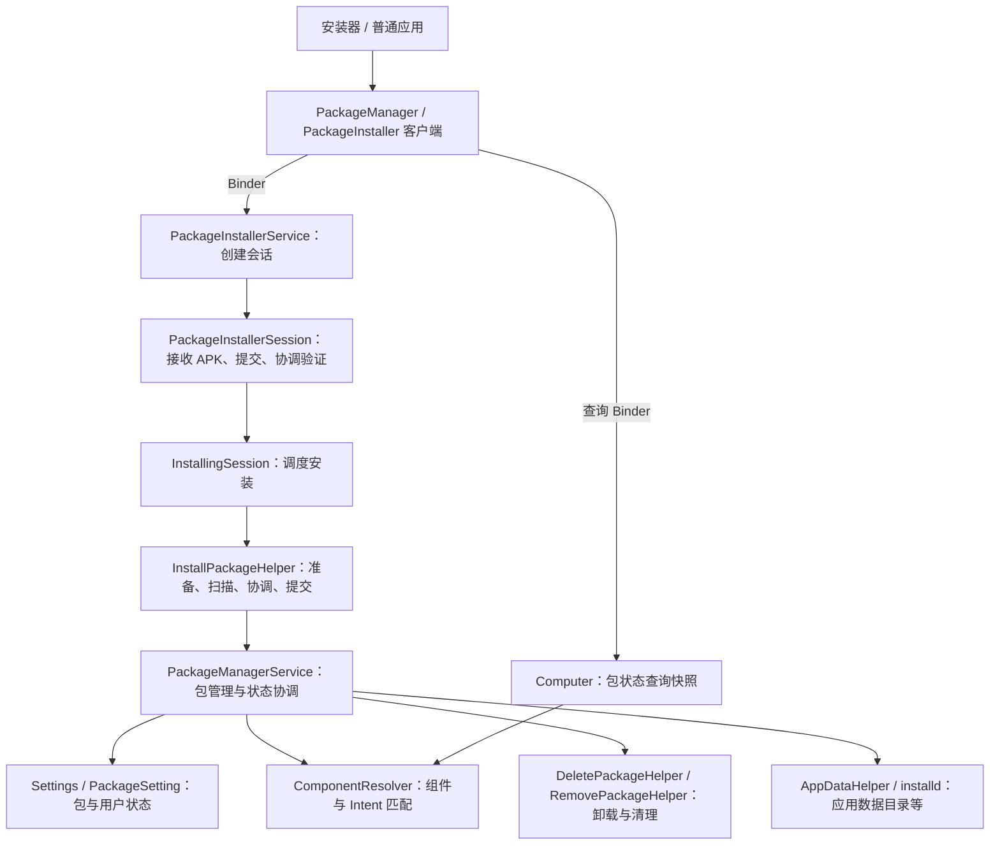

箭头表示职责协作，省略接口和条件分支。`PackageInstaller` 是应用侧 API；`PackageInstallerService` 和 `PackageInstallerSession` 位于 `system_server`，不是同一个对象。[PMS](https://github.com/aosp-mirror/platform_frameworks_base/blob/android-16.0.0_r1/services/core/java/com/android/server/pm/PackageManagerService.java)、[InstallingSession](https://github.com/aosp-mirror/platform_frameworks_base/blob/android-16.0.0_r1/services/core/java/com/android/server/pm/InstallingSession.java)、[InstallPackageHelper](https://github.com/aosp-mirror/platform_frameworks_base/blob/android-16.0.0_r1/services/core/java/com/android/server/pm/InstallPackageHelper.java)。

## 开机时：PMS 怎样知道手机装了哪些应用

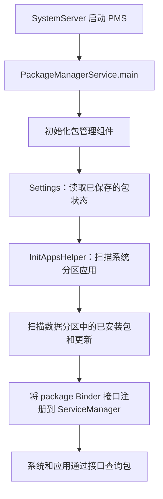

图为启动主线，省略缓存、并行解析和条件分支；开机扫描是重建和核对包状态，**不等同用户每次开机都重新安装应用**。

- `Settings` 保存包管理状态；该版本的全局设置文件包括 `/data/system/packages.xml`，各用户状态另有记录，不能把一个文件当作全部包信息。
- `InitAppsHelper.initSystemApps()` 处理系统目录，`initNonSystemApps()` 处理数据目录及系统应用更新。
- 服务注册时，Android 16 的 `package` Binder 入口是 `IPackageManagerImpl`；不应把旧版本直接注册 PMS 对象的代码当成所有版本的实现。

对照源码：[SystemServer 启动入口](https://github.com/aosp-mirror/platform_frameworks_base/blob/android-16.0.0_r1/services/java/com/android/server/SystemServer.java#L1225)、[启动扫描](https://github.com/aosp-mirror/platform_frameworks_base/blob/android-16.0.0_r1/services/core/java/com/android/server/pm/PackageManagerService.java#L2113)、[服务注册](https://github.com/aosp-mirror/platform_frameworks_base/blob/android-16.0.0_r1/services/core/java/com/android/server/pm/PackageManagerService.java#L1666)、[Settings 文件](https://github.com/aosp-mirror/platform_frameworks_base/blob/android-16.0.0_r1/services/core/java/com/android/server/pm/Settings.java#L660)。[早期 PMS 启动分析](https://www.cnblogs.com/chenbin7/archive/2013/06/05/2865202.html)适合了解历史背景，类结构与接口需按源码版本核对。

**Android Q 与 Android 16 对照**：Android Q 在 PMS 中读取 Settings、扫描目录并直接注册 PMS 对象；Android 16 将扫描职责拆到 `InitAppsHelper`，注册 `IPackageManagerImpl`。见 [Android Q 源码](https://github.com/aosp-mirror/platform_frameworks_base/blob/android-10.0.0_r1/services/core/java/com/android/server/pm/PackageManagerService.java#L2127)及上方 Android 16 源码。[Android 11 的启动分析](https://juejin.cn/post/7101655949575716901)也展示了旧版本的扫描和注册方式。

### 扫描一个目录时做了什么

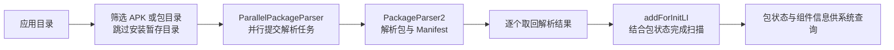

解析可以并行，结果处理并非因此全部并行；解析或扫描失败还有单独处理分支。[Android 16 扫描源码](https://github.com/aosp-mirror/platform_frameworks_base/blob/android-16.0.0_r1/services/core/java/com/android/server/pm/InstallPackageHelper.java#L3568)

## 安装：一个 APK 怎样变成可运行的应用

### 从提交到安装完成

以下是普通 APK、非 staged 安装的主路径。验证、用户确认和具体执行顺序存在版本及策略分支。

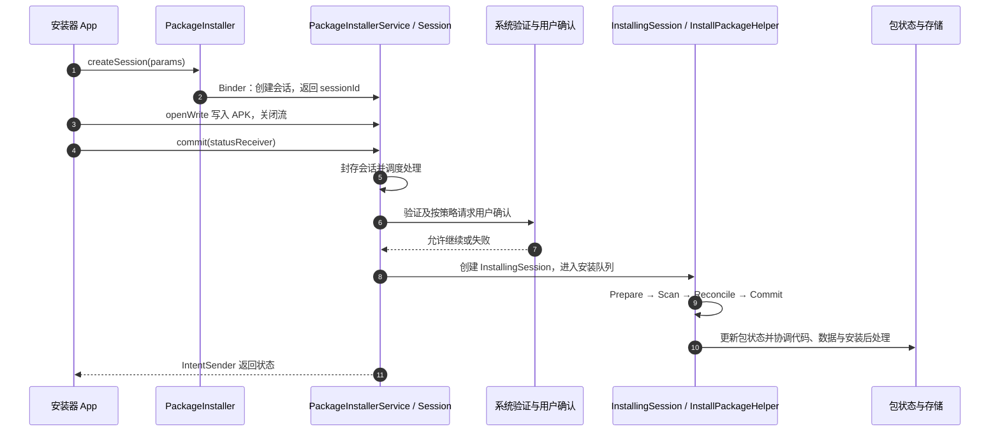

`commit()` 是**提交请求**，不是同步安装成功；`STATUS_PENDING_USER_ACTION` 需要处理确认界面，最终以成功或失败状态为准。[Session.commit](https://developer.android.com/reference/android/content/pm/PackageInstaller.Session#commit(android.content.IntentSender))

### 四个关键阶段

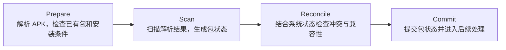

源码入口：[InstallPackageHelper.installPackagesTraced](https://github.com/aosp-mirror/platform_frameworks_base/blob/android-16.0.0_r1/services/core/java/com/android/server/pm/InstallPackageHelper.java#L959)。路径重命名、dexopt 和后处理存在条件分支；图中的 Commit 指包状态提交，**不同于应用调用的 Session.commit**。

源码中的核心调用顺序，以下为省略参数与分支的结构示意：

```java
prepareInstallPackages(requests);   // 解析并准备
scanInstallPackages(...);          // 扫描包
reconcileInstallPackages(...);     // 检查与现有状态的兼容性
renameAndUpdatePaths(requests);     // 更新代码路径
commitInstallPackages(...);        // 提交包状态
```

实际代码会在失败时提前返回，dexopt 的时机也受特性开关影响；以上不是可直接执行的源码片段。

### 安装后的文件在哪里

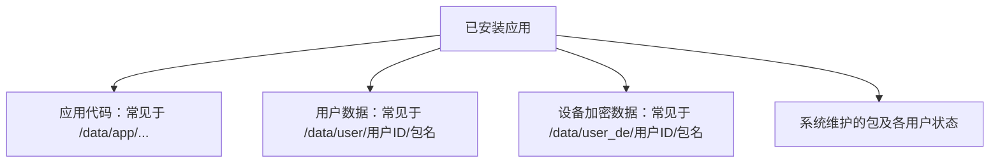

这是常见布局，不保证所有包都在这些路径：预装系统应用位于系统相关分区；目录名、存储位置和访问权限依设备及用户而异。代码路径与应用私有数据目录是两类不同对象。

### 最小安装会话示例

下面是核心调用，`statusReceiver` 由调用方创建并负责接收结果；写入须在工作线程执行。

```java
void installApk(Context context, File apk, IntentSender statusReceiver)
        throws IOException {
    PackageInstaller installer = context.getPackageManager().getPackageInstaller();
    PackageInstaller.SessionParams params = new PackageInstaller.SessionParams(
            PackageInstaller.SessionParams.MODE_FULL_INSTALL);
    int id = installer.createSession(params);
    try (PackageInstaller.Session session = installer.openSession(id)) {
        try (InputStream in = new FileInputStream(apk);
             OutputStream out = session.openWrite("base.apk", 0, apk.length())) {
            byte[] buffer = new byte[64 * 1024];
            int count;
            while ((count = in.read(buffer)) != -1) out.write(buffer, 0, count);
            session.fsync(out);
        } // commit 前必须关闭写入流
        session.commit(statusReceiver); // 异步：不代表安装成功
    } catch (IOException | RuntimeException e) {
        installer.abandonSession(id);
        throw e;
    }
}
```

- 普通安装器需按版本声明 `REQUEST_INSTALL_PACKAGES` 并满足安装来源授权等要求；不能因此自动静默安装。
- 结果处理：读取 `EXTRA_STATUS`；待用户操作时处理 `Intent.EXTRA_INTENT`，成功或失败时记录最终结果。后台需通过通知引导用户操作。
- 目标 API 35 及以上，`commit` 的回调不能来自不可变 `PendingIntent`；使用**显式组件**的可变 PendingIntent，避免将其暴露给其他应用。[官方 Session 文档](https://developer.android.com/reference/android/content/pm/PackageInstaller.Session#commit(android.content.IntentSender))

## 多个 APK 和多应用安装：不是一回事

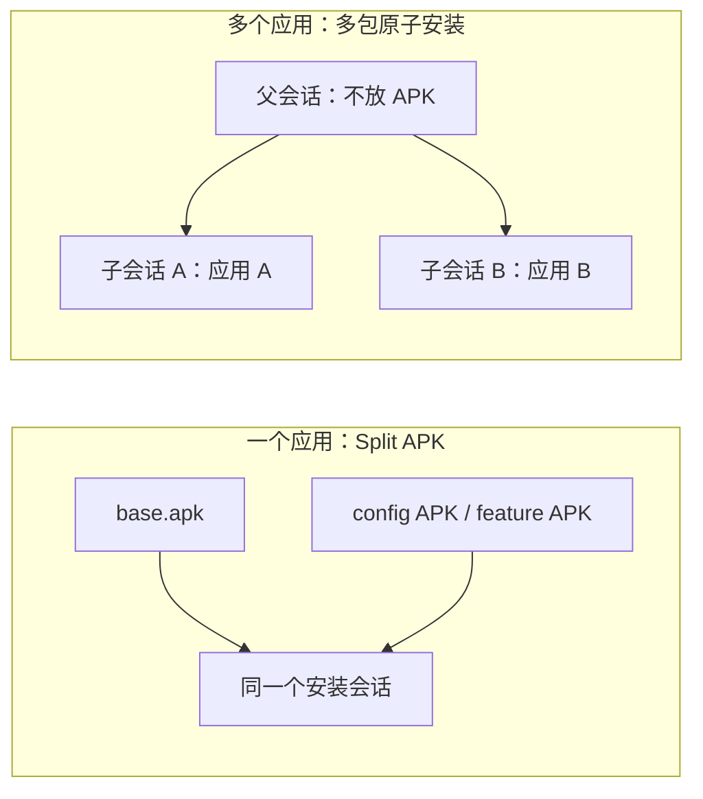

| 场景 | 组织方式 | 结果 |
| --- | --- | --- |
| 单 APK | 一个会话写入一个完整 APK | 安装一个应用 |
| Split APK | 一个会话写入 base 和所需 split | 同一应用的拆分文件须匹配包名、版本和签名 |
| 多应用原子安装 | API 29 起：父会话关联多个子会话，提交父会话 | 子会话一起成功或一起失败 |

```bash
adb install app.apk
adb install-multiple base.apk config.arm64_v8a.apk config.xxhdpi.apk
```

文件名仅为示例，必须选择实际设备所需的 split；`install-multiple` 是一个应用的多个 APK，不等于多个应用的原子安装。[ADB 安装](https://developer.android.com/tools/adb)、[多包会话](https://developer.android.com/reference/android/content/pm/PackageInstaller.SessionParams#setMultiPackage())、[Split 要求](https://developer.android.com/reference/android/content/pm/PackageInstaller.Session)。

多应用会话的关键调用：父会话调用 `SessionParams.setMultiPackage()`，分别创建并写入子会话，父会话用 `addChildSessionId()` 关联子会话，最后只提交父会话。失败处理仍以回调为准。

## 静默安装：谁能不弹确认框

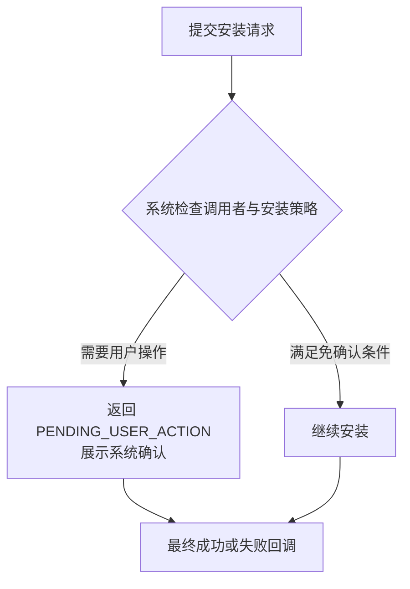

- 普通应用申请 `REQUEST_INSTALL_PACKAGES` **不等于**取得静默安装权限。
- 设备所有者等受管理设备场景可按系统策略执行免确认安装；`adb` 是 shell 调用场景，不等同普通应用权限。
- API 31 起，符合官方条件的安装器可对已有应用更新请求 `USER_ACTION_NOT_REQUIRED`，包括安装者身份、目标应用 target SDK 和声明 `UPDATE_PACKAGES_WITHOUT_USER_ACTION` 等条件；系统仍可能要求用户确认。[官方条件](https://developer.android.com/reference/android/content/pm/PackageInstaller.SessionParams#setRequireUserAction(int))
- 系统签名或特权应用也必须满足对应授权与策略，不能仅凭“预装”推断一定可以静默安装。

## 更新：为什么同一个包可以覆盖

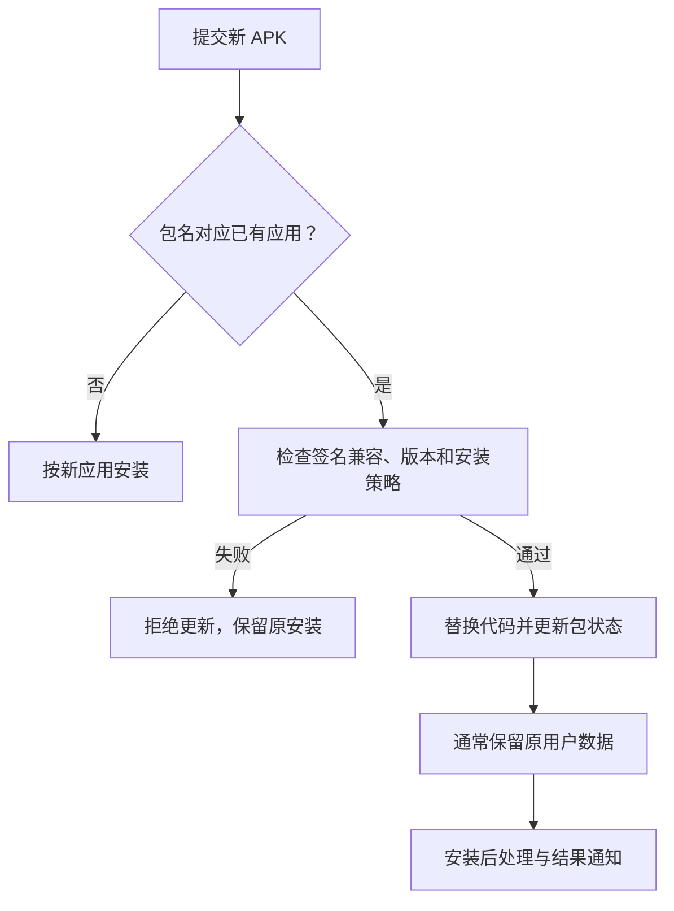

- **身份**：包名相同，签名须兼容；受支持的签名轮换需符合系统的签名历史与能力规则。
- **版本**：通常不能直接安装较低 `versionCode`；降级受设备、调用者和策略约束。
- **数据**：覆盖安装通常保留数据，但应用仍需自己处理数据库与数据格式迁移。
- **系统应用更新**：更新可能位于数据分区，卸载更新可恢复出厂系统版本，不能当作删除系统分区中的原 APK。

调试示例：`adb install -r app-new.apk`，`-r` 表示重新安装已有应用并保留数据；仍需通过签名、版本等检查。[ADB 参数](https://developer.android.com/tools/adb)、[应用签名与更新](../apk-signing.html)。

## queryIntentActivities：查询匹配 Activity {#s169}

客户端提交 Intent 与 flags，系统在指定用户及可见性范围内取得匹配候选。Intent 的 action、category、data 等参与过滤；返回候选列表不等于启动某一项，也不跳过启动时的权限与策略检查。

查询结果还受包可见性、enabled 状态、Direct Boot 和匹配 flags 等影响。“查询不到”不一定意味着没有安装；“查得到”也不是可绕过 exported 限制的凭证。[PackageManager API](https://developer.android.com/reference/android/content/pm/PackageManager)

### 查询调用链 {#pms-query-sequence}

以下展示**普通应用查询隐式 Intent、当前用户且不限定 package**的主路径。编号表示调用顺序；虚线表示返回。图中的 Binder 入口由 PMS 内部的 `IPackageManagerImpl` 提供，`queryIntentActivities()` 的实现继承自 `IPackageManagerBase`。

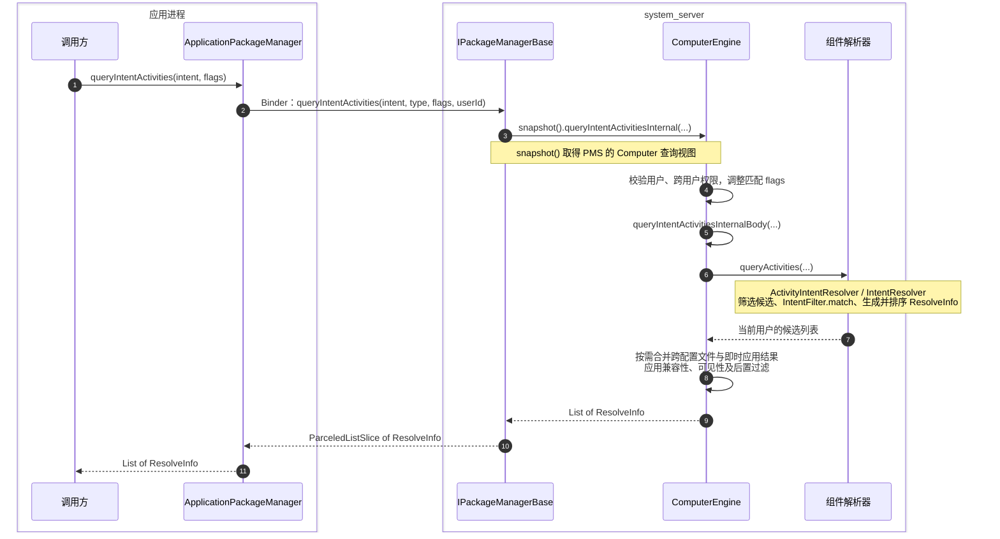

图省略了以下条件分支，避免把可选路径画成每次必经步骤：

- **显式 component**：通过 `getActivityInfo()` 取得目标信息，不走隐式候选的完整扫描链；仍有可见性、即时应用和适用的兼容性检查。
- **限定 package**：只在该包的 Activity 范围内解析，不等于已指定 component。
- **跨配置文件与 Web URI**：结合转发策略、域名验证等决策；返回列表可能合并、过滤并再次排序。
- **结果过滤**：分布在解析前、候选生成和解析后，不能理解为最后统一做一次检查；部分分支会直接返回已处理结果。

源码入口：[ApplicationPackageManager](https://github.com/aosp-mirror/platform_frameworks_base/blob/android-16.0.0_r1/core/java/android/app/ApplicationPackageManager.java#L1539)、[IPackageManagerBase](https://github.com/aosp-mirror/platform_frameworks_base/blob/android-16.0.0_r1/services/core/java/com/android/server/pm/IPackageManagerBase.java#L1033)、[ComputerEngine](https://github.com/aosp-mirror/platform_frameworks_base/blob/android-16.0.0_r1/services/core/java/com/android/server/pm/ComputerEngine.java#L505)、[ComponentResolverBase](https://github.com/aosp-mirror/platform_frameworks_base/blob/android-16.0.0_r1/services/core/java/com/android/server/pm/resolution/ComponentResolverBase.java#L128)。目标版本为 Android 11 及以上时，包可见性还会影响此 API 的查询结果，见 [官方包可见性说明](https://developer.android.com/training/package-visibility)。

### snapshot() 与 Computer：查询时读的是什么

**Computer 是 PMS 内部的查询接口，ComputerEngine 是实现；Snapshot 为它提供包状态等数据。** 查询通常使用缓存的快照，数据变化后按需重建。

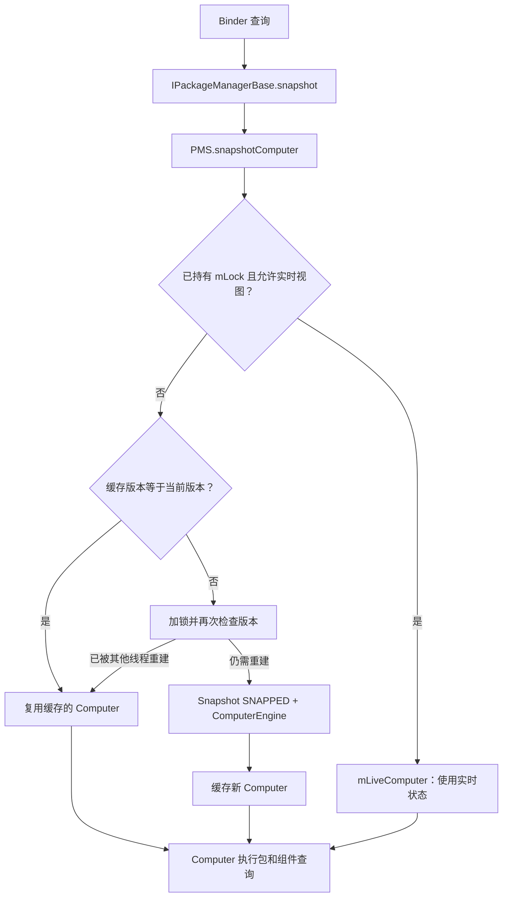

以下源码均为 **AOSP android-16.0.0_r1** 的实际片段，省略了与说明无关的代码。

#### 1. snapshot()：转交给 PMS

```java
// IPackageManagerBase.java
protected Computer snapshot() {
    return mService.snapshotComputer();
}
```

`snapshot()` 本身不复制数据；`mService` 是 PMS。[源码](https://github.com/aosp-mirror/platform_frameworks_base/blob/android-16.0.0_r1/services/core/java/com/android/server/pm/IPackageManagerBase.java#L134)

#### 2. snapshotComputer()：返回实时视图或缓存

```java
// PackageManagerService.java
public Computer snapshotComputer() {
    return snapshotComputer(true /*allowLiveComputer*/);
}
```

带参数的方法先检查当前线程是否持有 PMS 的包状态锁：

```java
var isHoldingPackageLock = Thread.holdsLock(mLock);
if (allowLiveComputer) {
    if (isHoldingPackageLock) {
        return mLiveComputer;
    }
}
```

持锁线程可能刚修改状态，尚未使旧快照失效，因此允许实时视图时返回 `mLiveComputer`。未走该分支时，检查缓存版本：

```java
var oldSnapshot = sSnapshot.get();
var pendingVersion = sSnapshotPendingVersion.get();

if (oldSnapshot != null && oldSnapshot.getVersion() == pendingVersion) {
    return oldSnapshot.use();
}
```

`sSnapshot` 保存缓存，`sSnapshotPendingVersion` 记录当前需要的版本。命中后 `use()` 记录使用次数并返回该 `Computer`；未命中则在锁保护下再次检查，必要时重建。[源码](https://github.com/aosp-mirror/platform_frameworks_base/blob/android-16.0.0_r1/services/core/java/com/android/server/pm/PackageManagerService.java#L1095)

#### 3. rebuildSnapshot()：构造查询对象

```java
// PackageManagerService.rebuildSnapshot() 中
var args = new Snapshot(Snapshot.SNAPPED);
var newSnapshot = new ComputerEngine(args, newVersion);
```

`Snapshot(SNAPPED)` 取得需要的 PMS 状态，`ComputerEngine` 接收这些数据并实现查询。重建成功后由 `snapshotComputer()` 写入缓存。[源码](https://github.com/aosp-mirror/platform_frameworks_base/blob/android-16.0.0_r1/services/core/java/com/android/server/pm/PackageManagerService.java#L1138)

`Snapshot` 构造函数中的实际字段示例：

```java
settings = mSettings.snapshot();
packages = mPackagesSnapshot.snapshot();
appsFilter = mAppsFilter.snapshot();
componentResolver = mComponentResolver.snapshot();
```

它们分别提供包设置、包信息、包可见性过滤和组件解析状态。内部对象可以复用自己的快照缓存，**不等于每次查询都复制全部数据**。[Snapshot 源码](https://github.com/aosp-mirror/platform_frameworks_base/blob/android-16.0.0_r1/services/core/java/com/android/server/pm/PackageManagerService.java#L1006)

#### 4. ComputerEngine：使用快照查询

```java
// ComputerEngine 构造函数中的实际赋值
mSettings = new Settings(args.settings);
mPackages = args.packages;
mAppsFilter = args.appsFilter;
mComponentResolver = args.componentResolver;
```

例如 `queryIntentActivitiesInternal()` 会结合目标用户、调用者、可见性与组件解析结果执行查询。[ComputerEngine 源码](https://github.com/aosp-mirror/platform_frameworks_base/blob/android-16.0.0_r1/services/core/java/com/android/server/pm/ComputerEngine.java#L410)

#### 5. 包状态改变后，旧快照如何失效

```java
// PackageManagerService.onChange() 中
sSnapshotPendingVersion.incrementAndGet();
```

版本变化后，旧快照不再命中；后续查询按需重建。已经持有旧快照的查询仍可继续使用它；实时视图和外部服务引用不属于这一快照保证。[失效源码](https://github.com/aosp-mirror/platform_frameworks_base/blob/android-16.0.0_r1/services/core/java/com/android/server/pm/PackageManagerService.java#L1165)

### IntentFilter 如何匹配 {#pms-intent-filter}

这是**单个候选过滤器**的核心匹配顺序，与上面的完整查询流程分开阅读。失败只淘汰当前候选，不代表整次查询立刻结束。

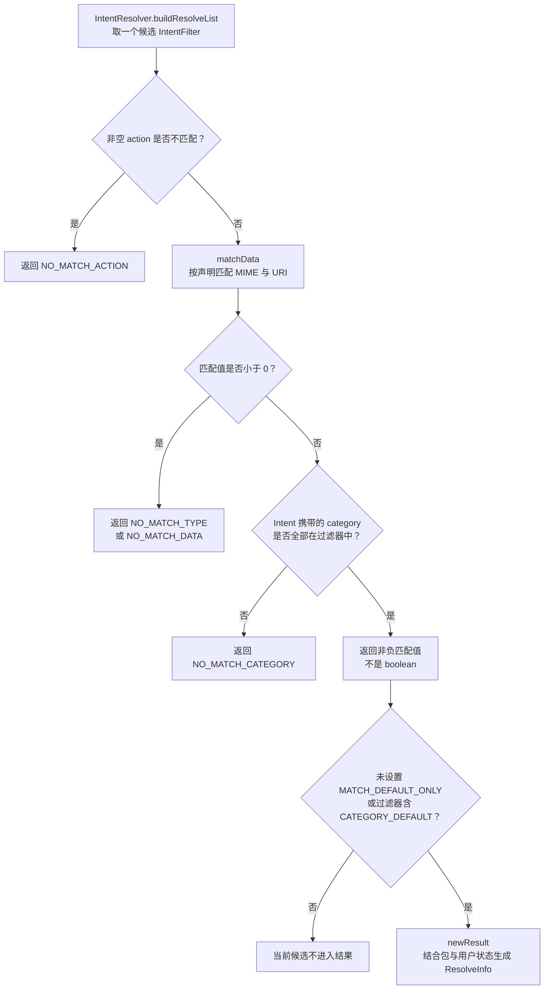

`matchData()` 内部按声明处理 scheme、scheme-specific part、authority、path 与 MIME 等条件，存在分支，并非每次依次匹配全部字段。

`MATCH_DEFAULT_ONLY` 的检查位于 `IntentResolver`，不是 `IntentFilter.match()` 自身自动添加的条件；没有这个 flag 时不能把缺少 `CATEGORY_DEFAULT` 一概判为查询失败。

源码见 [IntentFilter.match](https://github.com/aosp-mirror/platform_frameworks_base/blob/android-16.0.0_r1/core/java/android/content/IntentFilter.java#L2423)、[IntentResolver.buildResolveList](https://github.com/aosp-mirror/platform_frameworks_base/blob/android-16.0.0_r1/services/core/java/com/android/server/IntentResolver.java#L785)。

<details>
<summary>原笔记图附件</summary>

旧图未标注源码版本，仅作为历史附件保留；学习与调用链核对请以上面的分层图和固定版本源码为准。<a href="/assets/android/basics/source/package-query-original.webp" download="package-query-original.webp">下载原图</a>。

</details>

## getSharedLibraries：查询共享库 {#s182}

`PackageManager.getSharedLibraries()` 查询设备上的共享库信息，**不等于只返回当前 APK 的全部依赖**，也不是扫描应用目录下所有 `.so`。分析某个应用实际可用的共享代码，还要结合包声明、解析后的 ApplicationInfo 和运行时 ClassLoader 结构。

这里的共享 Java 代码库与 native 库搜索路径是不同维度。加载关系见 [ClassLoader](../class-loading.html)。

## deletePackageAsUser：按用户卸载 {#s185}

### 卸载从请求到清理

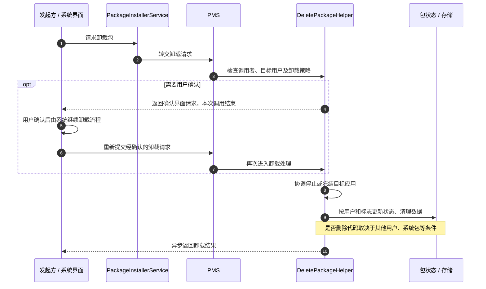

`deletePackageAsUser` 是系统内部入口；应用侧应使用受支持的卸载流程。权限、用户限制和包状态决定能否卸载，反射不授予权限。[DeletePackageHelper 源码](https://github.com/aosp-mirror/platform_frameworks_base/blob/android-16.0.0_r1/services/core/java/com/android/server/pm/DeletePackageHelper.java)

```bash
adb shell pm uninstall com.example.app
```

该命令会改变连接设备的应用状态，执行前确认设备和包名；`adb shell` 与普通应用身份不同。[pm uninstall](https://developer.android.com/tools/adb#pm)

| 情况 | 典型处理 |
| --- | --- |
| 当前用户卸载，其他用户仍安装 | 更新当前用户状态，不能简单认为全局代码已删除 |
| 普通应用彻底卸载 | 按卸载标志和策略清理代码及用户数据 |
| 已更新的系统应用卸载更新 | 可能恢复出厂系统版本，而非删除只读分区中的原包 |
| 保留数据的卸载 | 特定标志和调用权限下可保留数据；不应假设默认保留 |

卸载请求发出不代表完成，必须检查结果回调。[PackageInstaller 公共 API](https://developer.android.com/reference/android/content/pm/PackageInstaller)

## clearApplicationUserData：清理应用数据 {#s188}

公共 SDK 中 `ActivityManager.clearApplicationUserData()` 用于清理**调用应用自身**的数据；系统内部 AMS 入口还与包管理、存储及进程状态协作。它不能被概括为普通应用可借 PMS 清除任意其他应用数据。

清数据不是清缓存，通常会影响账户、设置、数据库和当前进程，必须作为明确的破坏性用户操作设计。[ActivityManager API](https://developer.android.com/reference/android/app/ActivityManager#clearApplicationUserData())

服务端 `IPackageManagerImpl.clearApplicationUserData()` 先检查清数据权限、跨用户权限、调用者可见的已安装包和受保护包，再把耗时操作投递到 `mHandler`。

后台操作通过 `freezePackage()` 协调进程，在安装锁下执行 `clearApplicationUserDataLIF()`；调用返回与数据清理完成之间存在异步边界，应以结果回调判断完成，而非立即重新打开旧数据库。[权限检查与异步清理](https://android.googlesource.com/platform/frameworks/base/+/refs/tags/android-16.0.0_r1/services/core/java/com/android/server/pm/PackageManagerService.java#4792)

## getPackageInstaller：取得安装器客户端 {#s191}

`PackageManager.getPackageInstaller()` 返回应用侧 `PackageInstaller` 对象，提供创建安装会话、查询会话与受权限约束的卸载等入口。返回的是客户端封装，不是把 `PackageInstallerService` 实体对象传进应用。

通过 Binder 得到会话访问能力后，仍要校验会话所属、安装来源、用户与安装授权；获取对象本身不是静默安装授权。
