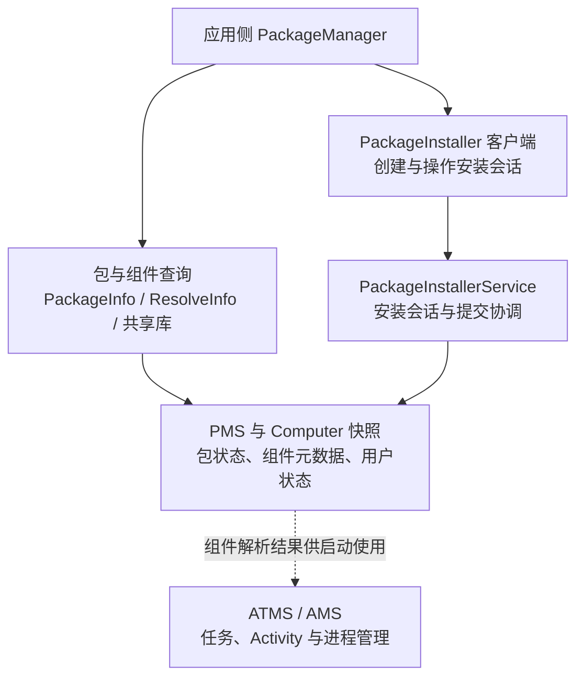
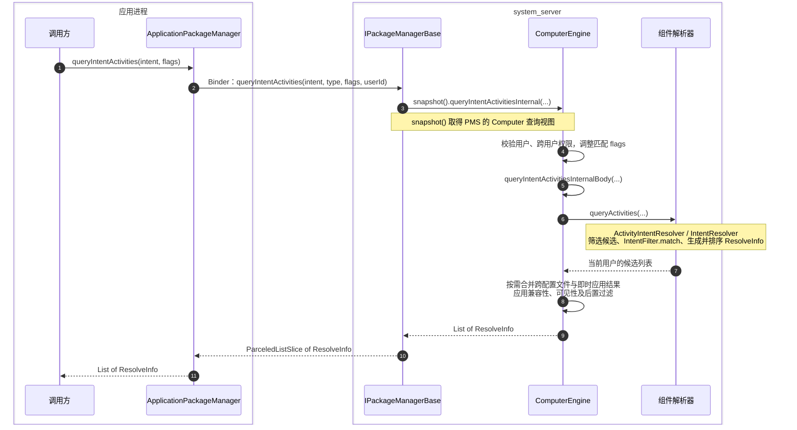
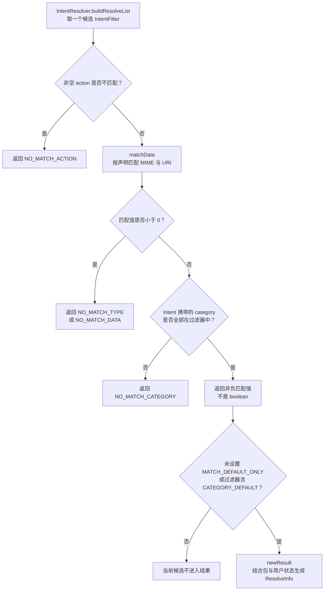

# PMS：PackageManagerService {#s166}

PMS 维护包与组件元数据、安装状态及相关查询/管理协作。**它知道包里声明了什么，不负责执行应用 Activity 的生命周期。** 公共 `PackageManager`、应用侧实现、`IPackageManager` 接口和系统内部解析对象之间还存在适配与权限层次。

`IPackageManagerImpl` 继承 `IPackageManagerBase`，把查询、安装、删除等能力委托给不同辅助对象；查询还会使用 `Computer` 快照。公开方法与 PMS 中的同名实现不一定一一对应，需要继续追踪职责委托。[PMS 源码](https://github.com/aosp-mirror/platform_frameworks_base/blob/android-16.0.0_r1/services/core/java/com/android/server/pm/PackageManagerService.java)

## 职责与协作边界 {#pms-responsibilities}

下图是职责概览，箭头表示请求或协作关系，不表示类继承。

安装会话的完整流程见 [PackageInstallerService](./package-installer-service.html)，应用启动见 [AMS / ATMS](./ams-atms.html)。

## queryIntentActivities：查询匹配 Activity {#s169}

客户端提交 Intent 与 flags，系统在指定用户及可见性范围内取得匹配候选。Intent 的 action、category、data 等参与过滤；返回候选列表不等于启动某一项，也不跳过启动时的权限与策略检查。

查询结果还受包可见性、enabled 状态、Direct Boot 和匹配 flags 等影响。“查询不到”不一定意味着没有安装；“查得到”也不是可绕过 exported 限制的凭证。[PackageManager API](https://developer.android.com/reference/android/content/pm/PackageManager)

### 查询调用链 {#pms-query-sequence}

以下展示**普通应用查询隐式 Intent、当前用户且不限定 package**的主路径。编号表示调用顺序；虚线表示返回。图中的 Binder 入口由 PMS 内部的 `IPackageManagerImpl` 提供，`queryIntentActivities()` 的实现继承自 `IPackageManagerBase`。

图省略了以下条件分支，避免把可选路径画成每次必经步骤：

- **显式 component**：通过 `getActivityInfo()` 取得目标信息，不走隐式候选的完整扫描链；仍有可见性、即时应用和适用的兼容性检查。
- **限定 package**：只在该包的 Activity 范围内解析，不等于已指定 component。
- **跨配置文件与 Web URI**：结合转发策略、域名验证等决策；返回列表可能合并、过滤并再次排序。
- **结果过滤**：分布在解析前、候选生成和解析后，不能理解为最后统一做一次检查；部分分支会直接返回已处理结果。

源码入口：[ApplicationPackageManager](https://github.com/aosp-mirror/platform_frameworks_base/blob/android-16.0.0_r1/core/java/android/app/ApplicationPackageManager.java#L1539)、[IPackageManagerBase](https://github.com/aosp-mirror/platform_frameworks_base/blob/android-16.0.0_r1/services/core/java/com/android/server/pm/IPackageManagerBase.java#L1033)、[ComputerEngine](https://github.com/aosp-mirror/platform_frameworks_base/blob/android-16.0.0_r1/services/core/java/com/android/server/pm/ComputerEngine.java#L505)、[ComponentResolverBase](https://github.com/aosp-mirror/platform_frameworks_base/blob/android-16.0.0_r1/services/core/java/com/android/server/pm/resolution/ComponentResolverBase.java#L128)。目标版本为 Android 11 及以上时，包可见性还会影响此 API 的查询结果，见 [官方包可见性说明](https://developer.android.com/training/package-visibility)。

### IntentFilter 如何匹配 {#pms-intent-filter}

这是**单个候选过滤器**的核心匹配顺序，与上面的完整查询流程分开阅读。失败只淘汰当前候选，不代表整次查询立刻结束。

`matchData()` 内部按声明处理 scheme、scheme-specific part、authority、path 与 MIME 等条件，存在分支，并非每次依次匹配全部字段。`MATCH_DEFAULT_ONLY` 的检查位于 `IntentResolver`，不是 `IntentFilter.match()` 自身自动添加的条件；没有这个 flag 时不能把缺少 `CATEGORY_DEFAULT` 一概判为查询失败。源码见 [IntentFilter.match](https://github.com/aosp-mirror/platform_frameworks_base/blob/android-16.0.0_r1/core/java/android/content/IntentFilter.java#L2423)、[IntentResolver.buildResolveList](https://github.com/aosp-mirror/platform_frameworks_base/blob/android-16.0.0_r1/services/core/java/com/android/server/IntentResolver.java#L785)。

原笔记图附件

旧图未标注源码版本，仅作为历史附件保留；学习与调用链核对请以上面的分层图和固定版本源码为准。<a href="/assets/android/basics/source/package-query-original.webp" download="package-query-original.webp">下载原图</a>。

## getSharedLibraries：查询共享库 {#s182}

`PackageManager.getSharedLibraries()` 查询设备上的共享库信息，**不等于只返回当前 APK 的全部依赖**，也不是扫描应用目录下所有 `.so`。分析某个应用实际可用的共享代码，还要结合包声明、解析后的 ApplicationInfo 和运行时 ClassLoader 结构。

这里的共享 Java 代码库与 native 库搜索路径是不同维度。加载关系见 [ClassLoader](../class-loading.html)。

## deletePackageAsUser：按用户卸载 {#s185}

`deletePackageAsUser` 是系统内部入口。应用侧使用受支持的卸载流程，系统仍按调用者权限、用户和包状态决定是否允许操作；反射取得方法并不会取得卸载资格。

卸载某用户下的包、删除全局代码和删除用户数据不是同一个操作；多用户、系统预装包、更新包会改变具体处理。请求发出也不表示卸载已完成，必须看结果回调。[PackageInstaller 公共 API](https://developer.android.com/reference/android/content/pm/PackageInstaller)

## clearApplicationUserData：清理应用数据 {#s188}

公共 SDK 中 `ActivityManager.clearApplicationUserData()` 用于清理**调用应用自身**的数据；系统内部 AMS 入口还与包管理、存储及进程状态协作。它不能被概括为普通应用可借 PMS 清除任意其他应用数据。

清数据不是清缓存，通常会影响账户、设置、数据库和当前进程，必须作为明确的破坏性用户操作设计。[ActivityManager API](https://developer.android.com/reference/android/app/ActivityManager#clearApplicationUserData())

服务端 `IPackageManagerImpl.clearApplicationUserData()` 先检查清数据权限、跨用户权限、调用者可见的已安装包和受保护包，再把耗时操作投递到 `mHandler`。后台操作通过 `freezePackage()` 协调进程，在安装锁下执行 `clearApplicationUserDataLIF()`；调用返回与数据清理完成之间存在异步边界，应以结果回调判断完成，而非立即重新打开旧数据库。[权限检查与异步清理](https://android.googlesource.com/platform/frameworks/base/+/refs/tags/android-16.0.0_r1/services/core/java/com/android/server/pm/PackageManagerService.java#4792)

## getPackageInstaller：取得安装器客户端 {#s191}

`PackageManager.getPackageInstaller()` 返回应用侧 `PackageInstaller` 对象，提供创建安装会话、查询会话与受权限约束的卸载等入口。返回的是客户端封装，不是把 `PackageInstallerService` 实体对象传进应用。

通过 Binder 得到会话访问能力后，仍要校验会话所属、安装来源、用户与安装授权；获取对象本身不是静默安装授权。
