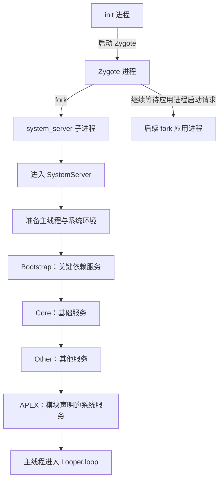
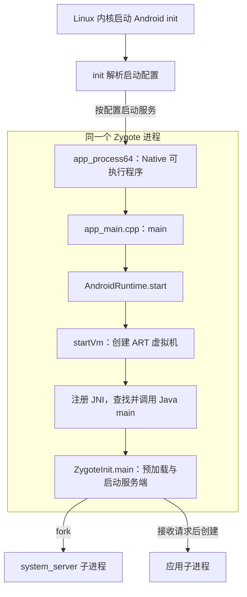
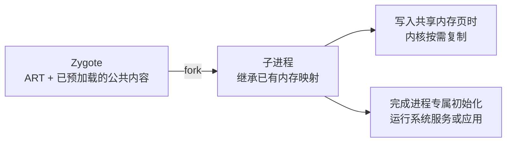
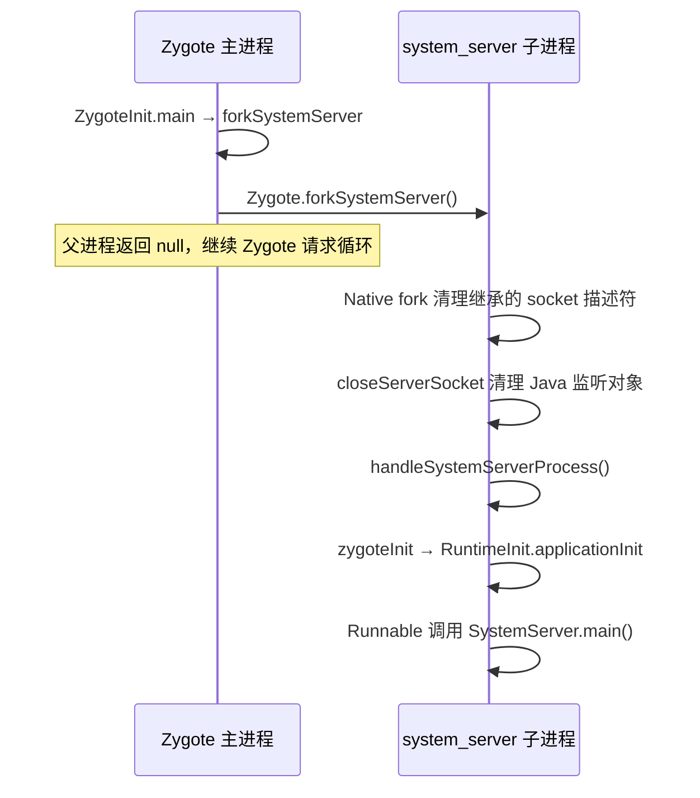
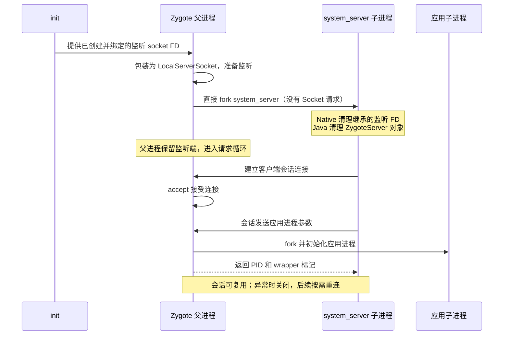
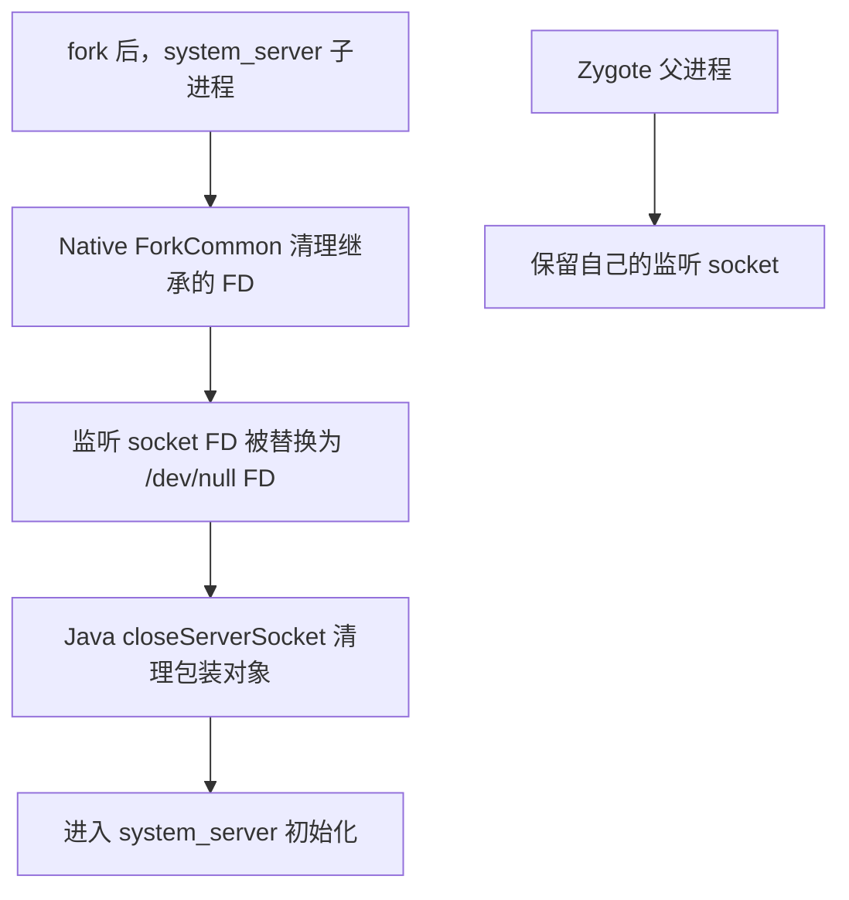
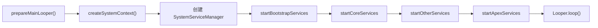
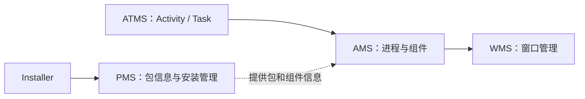
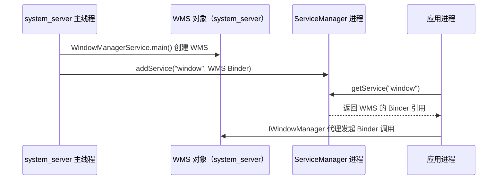
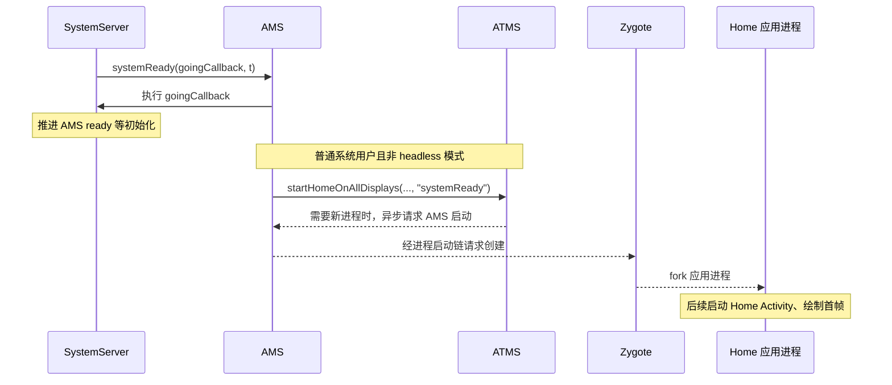

# SystemServer 启动流程：系统服务从哪里来

**SystemServer 是启动系统服务的 Java 入口；`system_server` 是承载这些服务的进程。** AMS、ATMS、PMS、WMS 等在其中协作，各自仍是独立服务。

先分清四个名字：

- **`init`**：Android 初始化进程，按启动配置拉起 Zygote 等进程。
- **`Zygote`**：已准备运行时的进程，fork 出 `system_server`，后续也可创建应用进程。
- **`system_server`**：独立进程，承载 AMS、PMS、WMS 等多个服务对象。
- **`SystemServer`**：Java 类，在 `system_server` 中组织服务启动。

`ServiceManager` 是 Binder 服务的**登记与查找中心**，不是 `SystemServiceManager`；服务对象通常仍在其宿主进程中。应用通过 Binder 引用调用服务，不是把服务搬到自己进程里。

## 1. 先看全景



这张图突出主调用顺序；初始化中也有异步任务。启动组与 Boot Phase 是**两个不同维度**：服务可能在不同启动组创建，阶段通知则在运行过程中逐步发出，并非统一等到所有组结束。

### 从 Linux init 到 Java：Zygote 从哪里来

**Zygote 是一个已初始化 ART 的 Android 进程。** 它预加载一部分公共类和资源，再创建 `system_server` 和应用进程。`ZygoteInit` 是这个进程执行的 Java 入口类，不是另一个进程。



**读图关键**：`init` 启动 Native 程序，ART 在该进程中创建，JNI 再调用 Java 方法；这一步没有新建 Java 进程。后面的 `fork` 才创建子进程。

#### ① init 配置：启动哪个程序

以 AOSP 64 位配置为例，设备可能使用其他 Zygote 配置。以下节选自 [init.zygote64.rc](https://android.googlesource.com/platform/system/core/+/refs/heads/main/rootdir/init.zygote64.rc)，省略其他属性：

```text
service zygote /system/bin/app_process64 -Xzygote /system/bin --zygote --start-system-server --socket-name=zygote
    class main
    socket zygote stream 660 root system
```

- `service zygote`：为 init 定义名为 `zygote` 的服务；后面是可执行文件与参数。
- `--zygote`：选择 Zygote 启动路径；`--start-system-server`：让该 Zygote 创建 `system_server`。
- `socket zygote`：由 init 配置并提供本地 socket，Zygote 用它接收进程创建请求。

`.rc` 是 **Android init 的配置语言**，不是 Java 代码，也不是由 Linux 内核直接执行。服务定义本身只是声明，init 按启动流程启动相应服务。

#### ② Native 入口：选择 Java 入口类

[app_main.cpp 的 main()](https://android.googlesource.com/platform/frameworks/base/+/refs/tags/android-16.0.0_r1/cmds/app_process/app_main.cpp#311) 解析参数后，在 Zygote 分支调用：

```cpp
// AOSP android-16.0.0_r1，app_main.cpp，摘录
if (zygote) {
    runtime.start("com.android.internal.os.ZygoteInit", args, zygote);
}
```

#### ③ 创建 ART，并通过 JNI 进入 Java

[AndroidRuntime::start()](https://android.googlesource.com/platform/frameworks/base/+/refs/tags/android-16.0.0_r1/core/jni/AndroidRuntime.cpp#1183) 先创建虚拟机，再注册 Native 方法，最后调用 Java 入口。以下按源码执行顺序摘录，省略错误分支和参数数组构造：

```cpp
// AOSP android-16.0.0_r1，AndroidRuntime::start()，摘录
startVm(&mJavaVM, &env, zygote, primary_zygote); // 内部调用 JNI_CreateJavaVM
startReg(env);                                  // 注册 Android JNI 方法

char* slashClassName = toSlashClassName(className != NULL ? className : "");
jclass startClass = env->FindClass(slashClassName);
jmethodID startMeth = env->GetStaticMethodID(startClass, "main",
        "([Ljava/lang/String;)V");
env->CallStaticVoidMethod(startClass, startMeth, strArray); // 调用 ZygoteInit.main
```

`JNIEnv` 是当前线程使用 JNI 的接口；`FindClass` 找类，`GetStaticMethodID` 找静态 `main(String[])`，`CallStaticVoidMethod` 发起调用。[startVm 实现](https://android.googlesource.com/platform/frameworks/base/+/refs/tags/android-16.0.0_r1/core/jni/AndroidRuntime.cpp) · [JNI 规范](https://docs.oracle.com/en/java/javase/21/docs/specs/jni/functions.html)

#### ④ Zygote 为什么能加快启动



预加载与写时复制减少重复初始化和内存复制，但子进程仍有独立地址空间，修改不会自动同步给其他进程。预加载可按配置延迟，应用创建也可能使用预先 fork 的 USAP 池。[Zygote 官方说明](https://source.android.com/docs/core/runtime/zygote) · [预加载与请求循环源码](https://android.googlesource.com/platform/frameworks/base/+/refs/tags/android-16.0.0_r1/core/java/com/android/internal/os/ZygoteInit.java#810)

## 2. Zygote 如何创建 system_server



源码中的启动参数指定进程名 `system_server`、UID/GID `1000` 和入口类 `com.android.server.SystemServer`。特殊的 wrapper 路径另有处理；下面的源码展示普通路径的关键分支。[ZygoteInit.java](https://android.googlesource.com/platform/frameworks/base/+/refs/tags/android-16.0.0_r1/core/java/com/android/internal/os/ZygoteInit.java#666)

```java
// ZygoteInit.forkSystemServer()：省略参数构造及异常处理
pid = Zygote.forkSystemServer(
        parsedArgs.mUid, parsedArgs.mGid,
        parsedArgs.mGids, parsedArgs.mRuntimeFlags, null,
        parsedArgs.mPermittedCapabilities, parsedArgs.mEffectiveCapabilities);

if (pid == 0) { // 子进程
    // 若设备有第二个 Zygote，先等待它就绪；此处省略该条件分支
    zygoteServer.closeServerSocket();
    return handleSystemServerProcess(parsedArgs);
}
return null; // 父进程
```

### Zygote 的 Socket：建立、使用与清理

**先区分两条路径：**开机创建 `system_server` 是 Zygote 直接 fork；系统启动后创建应用进程，才有 `system_server → Zygote` 的 Socket 请求。Socket 是本机 Unix domain socket，不是网络端口。源码展示了使用 Socket 的实现，不能仅凭这一点断言选择它而非 Binder 的历史原因。



图为普通 Zygote 路径；启用并符合条件时，应用也可能走下方 USAP 路径。

#### ① init 创建，Zygote 包装并监听

`init.zygote*.rc` 的 `socket zygote stream 660 root system` 声明本地 Socket。init 把文件描述符编号放入 `ANDROID_SOCKET_zygote` 环境变量；Zygote 读取该编号，包装为 `LocalServerSocket`。[init 配置](https://android.googlesource.com/platform/system/core/+/refs/heads/main/rootdir/init.zygote64.rc) · [Zygote.java](https://android.googlesource.com/platform/frameworks/base/+/refs/tags/android-16.0.0_r1/core/java/com/android/internal/os/Zygote.java#1043)

```java
// AOSP android-16.0.0_r1，Zygote.createManagedSocketFromInitSocket()，摘录
final String fullSocketName = ANDROID_SOCKET_PREFIX + socketName;
String env = System.getenv(fullSocketName);
fileDesc = Integer.parseInt(env);
FileDescriptor fd = new FileDescriptor();
fd.setInt$(fileDesc);
return new LocalServerSocket(fd);
```

构造 `LocalServerSocket(fd)` 时执行 `listen`；客户端到来后，Zygote 的 `runSelectLoop()` 检测监听端，再经 `acceptCommandPeer()` 接受连接。**监听 Socket 和 accept 返回的会话 Socket 是两个不同对象。** [LocalServerSocket](https://android.googlesource.com/platform/frameworks/base/+/refs/tags/android-16.0.0_r1/core/java/android/net/LocalServerSocket.java) · [ZygoteServer](https://android.googlesource.com/platform/frameworks/base/+/refs/tags/android-16.0.0_r1/core/java/com/android/internal/os/ZygoteServer.java)

```java
// AOSP android-16.0.0_r1，ZygoteServer.acceptCommandPeer()，摘录
return createNewConnection(mZygoteSocket.accept(), abiList);
```

#### ② system_server 创建客户端会话，发送请求

关闭继承的**服务端对象**不影响以后新建**客户端会话**。[ZygoteProcess.ZygoteState.connect()](https://android.googlesource.com/platform/frameworks/base/+/refs/tags/android-16.0.0_r1/core/java/android/os/ZygoteProcess.java#169) 连接指定 Zygote，并取得输入、输出流：

```java
// AOSP android-16.0.0_r1，ZygoteState.connect()，摘录
final LocalSocket zygoteSessionSocket = new LocalSocket();
zygoteSessionSocket.connect(zygoteSocketAddress);
zygoteInputStream = new DataInputStream(zygoteSessionSocket.getInputStream());
zygoteOutputWriter = new BufferedWriter(
        new OutputStreamWriter(zygoteSessionSocket.getOutputStream()),
        Zygote.SOCKET_BUFFER_SIZE);
```

普通路径发送参数后，读取完整返回值。发生 `IOException` 时关闭该会话；这是关闭**客户端会话**，不是关闭 Zygote 的监听端。[ZygoteProcess 请求源码](https://android.googlesource.com/platform/frameworks/base/+/refs/tags/android-16.0.0_r1/core/java/android/os/ZygoteProcess.java#429)

```java
// AOSP android-16.0.0_r1，attemptZygoteSendArgsAndGetResult()，摘录
zygoteWriter.write(msgStr);
zygoteWriter.flush();
result.pid = zygoteInputStream.readInt();
result.usingWrapper = zygoteInputStream.readBoolean();
// IOException 分支：zygoteState.close();
```

`openZygoteSocketIfNeeded()` 按 ABI 选择主或次 Zygote；可用的会话会复用，已关闭则重新连接。请求及响应受 `mLock` 保护，不能将这理解为每次请求都会新建连接。[复用与重连](https://android.googlesource.com/platform/frameworks/base/+/refs/tags/android-16.0.0_r1/core/java/android/os/ZygoteProcess.java#974)

#### ③ 子进程到底关闭了什么

`fork` 会继承文件描述符，但 **Android 16 的实际清理比“调用 Java close 就关闭底层 FD”更细**：



Native 子进程路径调用 `gOpenFdTable->ReopenOrDetach()`；对于纳入表的 Socket，`DetachSocket()` 用 `dup3` 将该描述符替换为指向 `/dev/null` 的描述符。**不是关闭整个 Socket 服务，也不是将父进程的 FD 替换。** [fork 清理](https://android.googlesource.com/platform/frameworks/base/+/refs/tags/android-16.0.0_r1/core/jni/com_android_internal_os_Zygote.cpp) · [FD 处理](https://android.googlesource.com/platform/frameworks/base/+/refs/tags/android-16.0.0_r1/core/jni/fd_utils.cpp)

```cpp
// AOSP android-16.0.0_r1，FileDescriptorInfo::DetachSocket()，摘录
const int dev_null_fd = open("/dev/null", O_RDWR | O_CLOEXEC);
dup3(dev_null_fd, fd, O_CLOEXEC); // 子进程原 socket FD 的编号改为指向 /dev/null
close(dev_null_fd);
```

随后 `ZygoteInit` 调用 `closeServerSocket()`，清理 `mZygoteSocket` Java 包装；是否额外 `Os.close(fd)` 由 `mCloseSocketFd` 决定。Android 16 主 Zygote 构造路径没有将该字段设为 `true`，因此**不能说此处必然调用 `Os.close` 关闭原监听 FD**。`LocalSocketImpl.close()` 对外部传入的 FD 也不会自行 `Os.close`。[ZygoteServer.closeServerSocket](https://android.googlesource.com/platform/frameworks/base/+/refs/tags/android-16.0.0_r1/core/java/com/android/internal/os/ZygoteServer.java) · [LocalSocketImpl.close](https://android.googlesource.com/platform/frameworks/base/+/refs/tags/android-16.0.0_r1/core/java/android/net/LocalSocketImpl.java)

```java
// AOSP android-16.0.0_r1，ZygoteServer.closeServerSocket()，摘录
if (mZygoteSocket != null) {
    FileDescriptor fd = mZygoteSocket.getFileDescriptor();
    mZygoteSocket.close();
    if (fd != null && mCloseSocketFd) {
        Os.close(fd);
    }
}
// 省略异常处理
mZygoteSocket = null;
```

清理的目的：子进程不应保留或误用 Zygote 的监听入口。遗漏清理可能延长内核对象引用并增加误用风险；具体故障取决于其他 FD 和进程状态。

#### ④ Socket 连接与 USAP 进程池不是一回事

| 项目 | 存放的内容 | 使用与回收 |
| --- | --- | --- |
| Zygote 会话 | 客户端与 Zygote 的 Socket 连接 | 复用已有会话；异常关闭，后续按需重连 |
| USAP 池 | 已 fork、尚未专门化的应用进程 | 命中后成为应用进程并退出池，Zygote 按策略补充 |

Android 16 AOSP `ZygoteConfig` 的代码默认值：USAP **关闭**、最大 3、最小 1、补充阈值 1、延迟 3000 ms。设备配置可覆盖；这些是**进程数及补充策略，不是 Socket 连接数**。[ZygoteConfig.java](https://android.googlesource.com/platform/frameworks/base/+/refs/tags/android-16.0.0_r1/core/java/com/android/internal/os/ZygoteConfig.java) · [USAP 官方说明](https://source.android.com/docs/core/runtime/zygote)

符合 USAP 条件时，客户端创建临时 USAP 会话并通过 `try` 结束时关闭；若 USAP 通信发生 `IOException`，代码会尝试普通 Zygote 路径。[USAP 选择、关闭与回退](https://android.googlesource.com/platform/frameworks/base/+/refs/tags/android-16.0.0_r1/core/java/android/os/ZygoteProcess.java#415)

子进程经 `zygoteInit()` 初始化运行时和 Binder 相关环境，再通过 `RuntimeInit.applicationInit()` 得到入口 Runnable。执行入口后进入 `SystemServer.main()`。[zygoteInit](https://android.googlesource.com/platform/frameworks/base/+/refs/tags/android-16.0.0_r1/core/java/com/android/internal/os/ZygoteInit.java#900)

### 类名怎样变成 main 方法调用？

启动参数里的类名不是直接执行的代码。普通路径中，`applicationInit()` 从参数取得类名并调用 `findStaticMain()`；后者通过反射找到 `main(String[])`，返回持有该方法的 `Runnable`。[RuntimeInit.java](https://android.googlesource.com/platform/frameworks/base/+/refs/tags/android-16.0.0_r1/core/java/com/android/internal/os/RuntimeInit.java#289)

```java
// RuntimeInit.findStaticMain()，摘录
cl = Class.forName(className, true, classLoader);
m = cl.getMethod("main", new Class[] { String[].class });
// 校验 public static；省略异常处理
return new MethodAndArgsCaller(m, argv);
```

`ZygoteInit.main()` 在子进程执行返回的 `r.run()`；`MethodAndArgsCaller.run()` 通过 `mMethod.invoke(...)` 调用找到的 `SystemServer.main()`。因此这一步仍发生在 **system_server 子进程**，不是 Zygote 父进程。[Runnable 执行处](https://android.googlesource.com/platform/frameworks/base/+/refs/tags/android-16.0.0_r1/core/java/com/android/internal/os/ZygoteInit.java#833) · [反射调用处](https://android.googlesource.com/platform/frameworks/base/+/refs/tags/android-16.0.0_r1/core/java/com/android/internal/os/RuntimeInit.java#530)

## 3. SystemServer.run：先准备，再启动

```java
// SystemServer.main()，AOSP android-16.0.0_r1
public static void main(String[] args) {
    new SystemServer().run();
}
```

`run()` 中的关键顺序如下。初始化中间还有系统配置、Native 库加载等步骤，源码链接可查看完整内容。[SystemServer.java](https://android.googlesource.com/platform/frameworks/base/+/refs/tags/android-16.0.0_r1/services/java/com/android/server/SystemServer.java#837)



- **Looper**：SystemServer 主线程先准备消息循环，启动工作完成后进入 `loop()`；对应 [Handler 传送带模型](../handler.html#thread-binding)。
- **System Context**：`ActivityThread.systemMain()` 后取得系统 Context，供系统服务使用；它不是普通应用的 Activity Context。
- **SystemServiceManager**：管理采用 `SystemService` 生命周期的服务，负责启动和阶段回调；不是 Binder 的服务注册表。
- **主线程与 Binder 线程池不同**：`Looper.loop()` 消费主线程消息；跨进程 Binder 请求可由 Binder 线程处理，具体服务还可能切换到其他线程。

## 4. 四组服务与关键依赖

| 启动组 | 负责什么 | Android 16 源码中的例子 |
| --- | --- | --- |
| Bootstrap | 初始化依赖关系紧密的关键服务 | Installer、ATMS、AMS、PowerManagerService、PMS |
| Core | 启动其他基础服务 | BatteryService、UsageStatsService |
| Other | 启动其余服务并推进系统就绪 | WMS、设备相关服务、AMS `systemReady()` |
| APEX | 启动由 APEX 声明的系统服务 | 从 APEX 信息读取服务名和 JAR 路径 |

这些是**示例，不是完整清单**。设备配置、特性开关及 Android 版本会影响实际服务与顺序。[SystemServer 各启动组](https://android.googlesource.com/platform/frameworks/base/+/refs/tags/android-16.0.0_r1/services/java/com/android/server/SystemServer.java#921)



图示关键关联，不表示全部调用链。Android 16 的启动代码先通过 `ActivityTaskManagerService.Lifecycle` 获得 ATMS，再启动 AMS；PMS 使用 `PackageManagerService.main()`，WMS 使用 `WindowManagerService.main()`。[ATMS / AMS](https://android.googlesource.com/platform/frameworks/base/+/refs/tags/android-16.0.0_r1/services/java/com/android/server/SystemServer.java#1147)、[PMS](https://android.googlesource.com/platform/frameworks/base/+/refs/tags/android-16.0.0_r1/services/java/com/android/server/SystemServer.java#1225)、[WMS](https://android.googlesource.com/platform/frameworks/base/+/refs/tags/android-16.0.0_r1/services/java/com/android/server/SystemServer.java#1568)

## 5. 服务启动、注册和就绪有什么不同？

以 WMS 为例：先创建服务对象，再登记名为 `window` 的 Binder 接口；客户端查找后，后续请求直接发往 WMS，而不是每次都由 ServiceManager 转发。



实际请求能否成功还要看服务的权限检查和业务状态。WMS 的发布位置在 [SystemServer.java](https://android.googlesource.com/platform/frameworks/base/+/refs/tags/android-16.0.0_r1/services/java/com/android/server/SystemServer.java#1568)；应用侧查找位于 [WindowManagerGlobal.getWindowManagerService()](https://android.googlesource.com/platform/frameworks/base/+/refs/tags/android-16.0.0_r1/core/java/android/view/WindowManagerGlobal.java#198)。

```java
// SystemServer.startOtherServices()，摘录：创建并发布 WMS
wm = WindowManagerService.main(context, inputManager, !mFirstBoot,
        new PhoneWindowManager(), mActivityManagerService.mActivityTaskManager);
ServiceManager.addService(Context.WINDOW_SERVICE, wm, /* allowIsolated= */ false,
        DUMP_FLAG_PRIORITY_CRITICAL | DUMP_FLAG_PRIORITY_HIGH | DUMP_FLAG_PROTO);

// WindowManagerGlobal.getWindowManagerService()，摘录：客户端查找
sWindowManagerService = IWindowManager.Stub.asInterface(
        ServiceManager.getService("window"));
```

### 两个 Manager：各管什么？

| 对象 | 管理内容 | 使用方式 |
| --- | --- | --- |
| `SystemServiceManager` | `SystemService` 实例与生命周期 | 在 system_server 内调用 `onStart()`、`onBootPhase()` |
| `ServiceManager` | 名称到 Binder 服务引用的登记 | 服务发布 Binder，客户端按名称查询 |
| `LocalServices` | system_server 内部的本地接口 | 进程内注册和获取，不用于跨进程查找 |

**创建对象不代表业务完全就绪；加入 SystemServiceManager 的列表也不等于向 ServiceManager 注册 Binder。** 是否发布、何时可用取决于具体服务。

`SystemServiceManager.startService()` 对 `SystemService` 类型创建实例，并在下面的方法中保存实例、调用 `onStart()`：

```java
// SystemServiceManager.startService(SystemService)，关键片段
mServiceClassnames.add(className);
mServices.add(service); // 生命周期管理列表
long time = SystemClock.elapsedRealtime();
try {
    service.onStart(); // 具体服务决定如何初始化、发布接口
} catch (RuntimeException ex) {
    throw new RuntimeException("Failed to start service " + service.getClass().getName()
            + ": onStart threw an exception", ex);
}
```

`SystemService.publishBinderService()` 可将 Binder 接口交给 ServiceManager；`LocalServices` 则用于 system_server 进程内的本地接口。有些服务通过自己的 `main()` 创建与注册，不必强行套用 `onStart()`。[SystemServiceManager](https://android.googlesource.com/platform/frameworks/base/+/refs/tags/android-16.0.0_r1/services/core/java/com/android/server/SystemServiceManager.java#211)、[SystemService](https://android.googlesource.com/platform/frameworks/base/+/refs/tags/android-16.0.0_r1/services/core/java/com/android/server/SystemService.java)

## 6. Boot Phase：分阶段宣布条件已满足


`startBootPhase()` 要求阶段递增，并向**当时已经启动**的受管理服务调用 `onBootPhase()`；较晚启动的服务不会自动补收到先前阶段。`PHASE_BOOT_COMPLETED` 是系统服务生命周期阶段，与具体用户的 `BOOT_COMPLETED` 广播不是同一个事件。[SystemServiceManager.startBootPhase](https://android.googlesource.com/platform/frameworks/base/+/refs/tags/android-16.0.0_r1/services/core/java/com/android/server/SystemServiceManager.java#280)、[阶段常量](https://android.googlesource.com/platform/frameworks/base/+/refs/tags/android-16.0.0_r1/services/core/java/com/android/server/SystemService.java#71)

### systemReady 之后怎样到桌面？



图中省略了进程启动的中间调用；Home 可能复用已有进程，车载 headless 用户模式等路径也不同。Home 的具体选择由系统配置和当前状态决定，不一定是日常桌面应用。[AMS.systemReady](https://android.googlesource.com/platform/frameworks/base/+/refs/tags/android-16.0.0_r1/services/core/java/com/android/server/am/ActivityManagerService.java#8331) · [AMS 发起 Home](https://android.googlesource.com/platform/frameworks/base/+/refs/tags/android-16.0.0_r1/services/core/java/com/android/server/am/ActivityManagerService.java#8472) · [ATMS 异步请求进程](https://android.googlesource.com/platform/frameworks/base/+/refs/tags/android-16.0.0_r1/services/core/java/com/android/server/wm/ActivityTaskManagerService.java#4940)

后续 AMS 的 `finishBooting()` 推进 `PHASE_BOOT_COMPLETED`，并触发用户启动完成的处理；这与每个用户接收 `BOOT_COMPLETED` 广播不是同一个事件，也不表示所有应用已经加载完成。[AMS.finishBooting](https://android.googlesource.com/platform/frameworks/base/+/refs/tags/android-16.0.0_r1/services/core/java/com/android/server/am/ActivityManagerService.java#4850)

## 7. 调试：从进程、服务到启动日志

```bash
adb shell pidof system_server                 # 查看进程 PID
adb shell service list                       # 查看已注册的 Binder 服务
adb shell dumpsys activity                   # 查看 AMS 状态
adb shell dumpsys package                    # 查看 PMS 状态
adb logcat -b system -d -s SystemServer SystemServiceManager
```

- `service list` 能看到已注册接口，**不能单独证明服务业务已就绪**。
- 启动慢：查看 SystemServer 各阶段日志与 trace；部分工作在初始化线程池，不能只看主线程。
- 设备日志、可见性和命令输出取决于系统版本与设备权限。

## 延伸阅读

- [AMS / ATMS：进程与任务管理](./ams-atms.html) · [PMS：包管理](./pms.html) · [WMS：窗口管理](./wms.html)
- 相关链接（正文未核验）：[掘金文章一](https://juejin.cn/post/6844903981148274702) · [掘金文章二](https://juejin.cn/post/7214373797691342903) · [掘金文章三](https://juejin.cn/post/7069565469774053390)。
