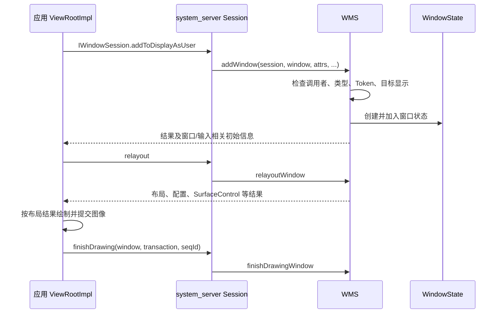

# WMS：WindowManagerService {#s197}

WMS 管理窗口与显示相关状态，参与窗口加入、布局、可见性、层次、焦点及与输入/显示系统的协调。Activity 是活动状态与界面生命周期单元，Window 是显示和交互容器，Surface/Buffer 是图形提交的一部分，不能混成同一个对象。

应用典型地经 `WindowManager`、`ViewRootImpl` 与 `IWindowSession` 提交窗口操作，服务端 Session 再进入 WMS。`addWindow()` 要结合调用方、窗口类型、Token、显示等条件校验，并非“token 非空即可加入”。[WMS 源码](https://github.com/aosp-mirror/platform_frameworks_base/blob/android-16.0.0_r1/services/core/java/com/android/server/wm/WindowManagerService.java)

窗口管理与最终图像合成是协作关系，WMS 不是替应用执行全部 View 绘制的线程，也不等于 SurfaceFlinger。BadTokenException 应回到窗口类型、Token 归属、生命周期和上下文分析。[Token 专题](../../framework/activity-token.html)、[显示管线](../../framework/surfaceflinger-vsync.html)

## 先分清两端保存的对象 {#window-objects}

- **应用进程**：`Window` 管理窗口属性与内容，`ViewRootImpl` 连接 View 树、绘制调度和窗口会话；它的 `IWindow` 端点供系统回调。
- **system_server**：`Session` 承接窗口会话请求；`WindowState` 保存单个窗口的服务端状态；`WindowToken` 组织具有共同身份或用途的窗口。
- **图形系统**：SurfaceControl、Surface 与图像 Buffer 承担不同职责；布局状态、绘制结果和最终显示时间并非一份数据。

因此，一次 Activity 可以包含主窗口、对话框等多个窗口；服务端也不会通过 Binder 接收一棵完整的 Java View 树。

## 添加窗口：从 ViewRootImpl 到 WindowState {#window-add-flow}

`ViewRootImpl` 在客户端发起调用；跨进程请求由 `Session` 的 Binder 入口接收，再进入 WMS。WMS 在自己的锁与状态约束下处理窗口树，而不是把请求直接转成应用主线程上的 View 操作。

窗口属性中的 Token 是校验输入之一，窗口类型、父窗口和目标显示也会改变校验分支。[客户端添加入口](https://android.googlesource.com/platform/frameworks/base/+/refs/tags/android-16.0.0_r1/core/java/android/view/ViewRootImpl.java#1633)、[Session 转发](https://android.googlesource.com/platform/frameworks/base/+/refs/tags/android-16.0.0_r1/services/core/java/com/android/server/wm/Session.java#248)、[WMS 添加窗口](https://android.googlesource.com/platform/frameworks/base/+/refs/tags/android-16.0.0_r1/services/core/java/com/android/server/wm/WindowManagerService.java#1534)

## relayout、绘制完成与真正显示 {#window-relayout-draw}

`relayoutWindow()` 根据当前窗口与显示状态计算结果，通过 `WindowRelayoutResult` 返回窗口帧、配置、SurfaceControl、Insets 等数据。

应用据此继续测量、布局和绘制；内容绘制与 Buffer 提交还需要应用渲染和图形管线参与，WMS 不在 Binder 线程上替应用运行 `View.onDraw()`。[relayoutWindow](https://android.googlesource.com/platform/frameworks/base/+/refs/tags/android-16.0.0_r1/services/core/java/com/android/server/wm/WindowManagerService.java#2348)

`finishDrawing()` 携带窗口端点、绘制事务与序列信息回到 WMS，用于推进窗口绘制状态和关联事务。它不是“面板已经扫描到这帧”的回执；SurfaceFlinger 的合成、HWC 提交及 fence 完成仍有各自边界。[绘制完成转发](https://android.googlesource.com/platform/frameworks/base/+/refs/tags/android-16.0.0_r1/services/core/java/com/android/server/wm/Session.java#315)、[WMS 处理](https://android.googlesource.com/platform/frameworks/base/+/refs/tags/android-16.0.0_r1/services/core/java/com/android/server/wm/WindowManagerService.java#2879)

## 使用与定位时先看哪个阶段 {#window-debug}

添加普通 Activity 窗口应使用与其生命周期一致的上下文和 Token，关闭页面时释放自己持有的附加窗口。Overlay、WindowContext 和子窗口有不同的类型与身份要求，不能用一组参数套用所有窗口。

`BadTokenException` 优先查添加阶段的 Token、类型和所属 Activity 状态；窗口存在但尺寸不对，查 relayout、配置和 Insets；窗口可见却内容迟迟不更新，继续查应用绘制、Buffer 和合成链路。焦点、可见与可触摸是不同状态，不能由“屏幕上看得见”推断输入一定投递给它。
