# View 触摸机制：从 U 型分发到滑动冲突

点击按钮时，为什么先经过 Activity，却最终由 Button 响应？滑动列表时，按钮为什么会收到 `CANCEL`？先理解**一次手势由谁接收、谁持有、什么时候取消**，再看系统输入链路。

## 1. 从屏幕分区认识窗口与 View 层级 {#first-look}


**左图看屏幕，右图看对象层级，点击可放大。** 图按官方窗口定义与 AOSP 源码重绘，重点区分屏幕区域、对象持有关系和 View 父子关系。

- **Activity → PhoneWindow**：Activity 持有窗口；PhoneWindow 是 Window 的具体实现，**不是 View，也不是一个布局容器**。
- **PhoneWindow → DecorView**：窗口管理根 View。DecorView 继承 FrameLayout，其内部才是 View 与 ViewGroup 的父子结构。
- **DecorView → Content → 业务布局**：经典平台主题中的 `@android:id/content` 是业务内容容器，`setContentView()` 把业务根布局加入其中；内容容器不等于业务根布局本身。

### StatusBar、ActionBar 和 Content 不要混在一起

- **StatusBar** 是显示时间、电量、通知图标的系统状态栏；**NavigationBar** 是系统导航区域，通常由 SystemUI 的独立窗口管理。
- **ActionBar / App bar** 是应用标题与操作区，不能当作 StatusBar。平台主题可提供 ActionBar；App 自建 Toolbar 又可能位于业务内容布局中。
- 旧版或特定配置下，DecorView 可有 `statusBarBackground` / `navigationBarBackground` 色块，**色块不是系统栏的图标与交互窗口**。现代 edge-to-edge 还允许 App 内容延伸到系统栏下方，需要结合 WindowInsets 理解遮挡和布局。

图中是便于理解的经典分区，不能认定所有设备都固定分成等高、互不重叠的四块。主题、AppCompat、窗口模式和系统版本都可能改变装饰布局。系统栏外观可对照 [Android 官方系统栏图解](https://developer.android.com/design/ui/mobile/guides/foundations/system-bars)。

### setContentView 究竟放进了哪里

```java
// 普通 framework Activity 内，示意业务布局与系统内容容器的区别。
android.widget.LinearLayout businessRoot = new android.widget.LinearLayout(this);
setContentView(businessRoot);

android.view.Window window = getWindow(); // 通常是 PhoneWindow 的 Window 引用。
android.view.View decor = window.getDecorView();
android.view.ViewGroup content = decor.findViewById(android.R.id.content);
// 在这个普通平台路径中：businessRoot 是 content 的子 View，而不是 DecorView 本身。
```

AOSP `android-16.0.0_r1` 的三个关键证据：

1. [PhoneWindow.installDecor，L2918](https://android.googlesource.com/platform/frameworks/base/+/refs/tags/android-16.0.0_r1/core/java/com/android/internal/policy/PhoneWindow.java#2918)创建 DecorView 并生成装饰布局；[generateLayout，L2870](https://android.googlesource.com/platform/frameworks/base/+/refs/tags/android-16.0.0_r1/core/java/com/android/internal/policy/PhoneWindow.java#2870)通过 `ID_ANDROID_CONTENT` 找内容容器。
2. [screen_simple.xml，L35](https://android.googlesource.com/platform/frameworks/base/+/refs/tags/android-16.0.0_r1/core/res/res/layout/screen_simple.xml#35)声明 Content 的 FrameLayout；[screen_action_bar.xml，L21](https://android.googlesource.com/platform/frameworks/base/+/refs/tags/android-16.0.0_r1/core/res/res/layout/screen_action_bar.xml#21)展示带 ActionBar 的另一种装饰结构。
3. [SystemUI 的 StatusBarWindowControllerImpl，L166、L263](https://android.googlesource.com/platform/frameworks/base/+/refs/tags/android-16.0.0_r1/packages/SystemUI/src/com/android/systemui/statusbar/window/StatusBarWindowControllerImpl.java#166)以 `TYPE_STATUS_BAR` 配置独立状态栏窗口，并经 WindowManager 添加。

**触摸先选窗口，再在选定窗口内寻找 View。** 点击 App 内容与下拉状态栏，不能简单当成同一棵 App View 树中的两个子控件；窗口焦点、可见和可触摸也不是同一件事。

下面讨论普通 Activity 窗口中的手指触摸。Dialog、PopupWindow 可以拥有不同的窗口回调；鼠标悬停还涉及 `dispatchGenericMotionEvent()`，不能全部套用同一条链。

## 2. 经典 U 型图：向下分发，未消费时逐层兜底 {#u-diagram}

**先看蓝色向下、底部向右、橙色向上的 U，再看拦截分支和红色虚线。点击图片可放大。**


图中只展开一个普通单指 `ACTION_DOWN`：Activity → 一个父 ViewGroup → 一个命中的子 View；监听器不消费，没有其他候选子 View。PhoneWindow、DecorView 等中间层暂时折叠。

- **向下分发**：调用 `super.dispatchTouchEvent()` 进入默认逻辑；父容器先问是否拦截，不拦截才交给子 View。
- **拦截分支**：`onInterceptTouchEvent()` 返回 true，这次 DOWN 交给父容器自身处理，不再交给子 View。拦截不等于已经消费。
- **向上兜底**：子 View 未处理，父容器尝试自身 `onTouchEvent()`；父容器仍未处理，窗口内容也无人处理，才到 Activity 的 `onTouchEvent()`。
- **返回 true**：本次已处理，结果沿调用栈返回；上层不再走自身的兜底处理。`super` 是调用父类实现，**不等于 false**，例如可点击的 Button 通常会消费 DOWN。

图形布局参考[《图解 Android 事件分发机制》](https://www.jianshu.com/p/e99b5e8bd67b)（[公开转载](https://cloud.tencent.com/developer/article/1035833)），按 AOSP 的调用关系重绘。右侧箭头表示同一个 DOWN 的未处理分支，不是 `ACTION_UP`。

### 子 View 返回 false，谁先接手？

**先返回父 `dispatchTouchEvent()` 的调用点，再由父方法决定是否执行自身的 `onTouchEvent()`。** 主图的斜线将这段过程折叠；完整顺序如下：

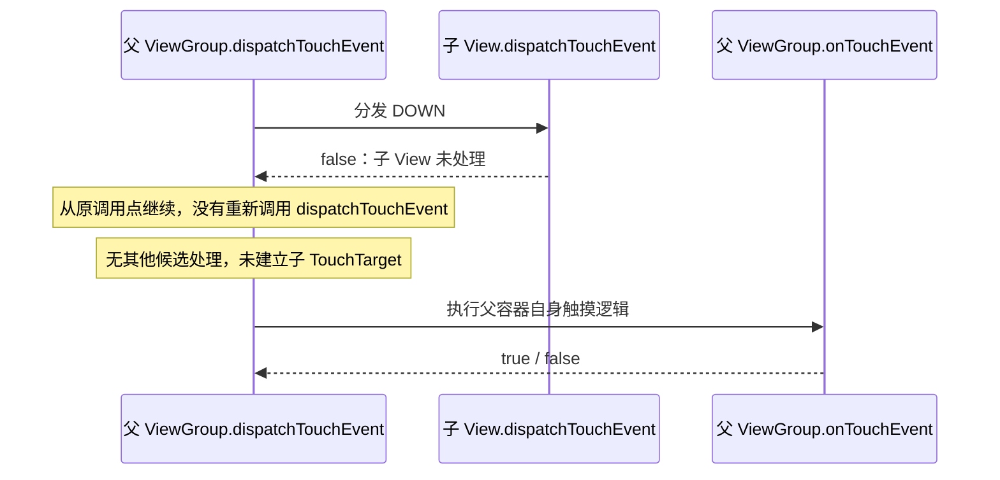

对应 `ViewGroup.java` 的 `dispatchTouchEvent()`：L2771 子级分发成功才进入目标记录分支；L2812–2815 没有子目标时，以 `child = null` 转入自身处理。

父容器自身返回 false，同样先返回其调用方。**主图直连 Activity 的前提是省略的窗口中间层也都未处理**；有多层业务容器时，应补上各层的兜底节点。

### 直接 return false，跳过的是哪一层

**`dispatchTouchEvent()` 入口直接返回 false，会跳过这个方法尚未执行的默认逻辑。** 例如父 ViewGroup 直接返回，不会再自动执行这个父对象自己的 `onTouchEvent()`，而是由上层调用方继续处理。

Activity 的正常兜底之所以存在，是因为默认方法明确写了调用：

```java
// Activity.java，dispatchTouchEvent()，L4604–4607。
if (getWindow().superDispatchTouchEvent(ev)) {
    return true;
}
return onTouchEvent(ev); // 窗口内容未处理，才走这行兜底。
```

如果你覆盖 `Activity.dispatchTouchEvent()` 后直接 `return false`，没有调用 `super`，**上面的逻辑就不会执行**；结果回到 DecorView 的窗口回调调用方，再回到 ViewRootImpl 输入处理链，不会自动转入 Activity.onTouchEvent，也不会自动把同一触摸穿透到下面的窗口。

图中“尝试其他候选”针对 DOWN。已经建立 TouchTarget 后，某个 MOVE 返回 false，不表示重新命中其他子级，详见 [DOWN 与 MOVE 返回值的区别](#touch-target)。

### 为什么 DecorView 看起来出现了两次

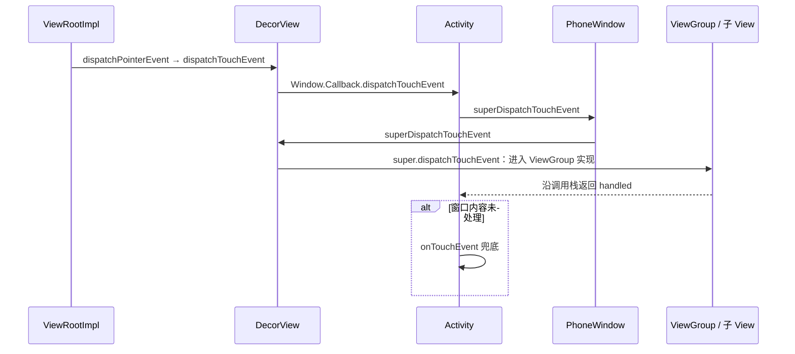

第一次经过 DecorView 是转交窗口回调，第二次是通过 `super` 进入其父类的分发实现，**不是再次调用 DecorView 的同名覆盖方法造成递归**。源码入口：[DecorView.java L430、L474](https://android.googlesource.com/platform/frameworks/base/+/refs/tags/android-16.0.0_r1/core/java/com/android/internal/policy/DecorView.java#430)、[PhoneWindow.java L2020](https://android.googlesource.com/platform/frameworks/base/+/refs/tags/android-16.0.0_r1/core/java/com/android/internal/policy/PhoneWindow.java#2020)。

## 3. MotionEvent：一次手势不是一次回调 {#motion-events}

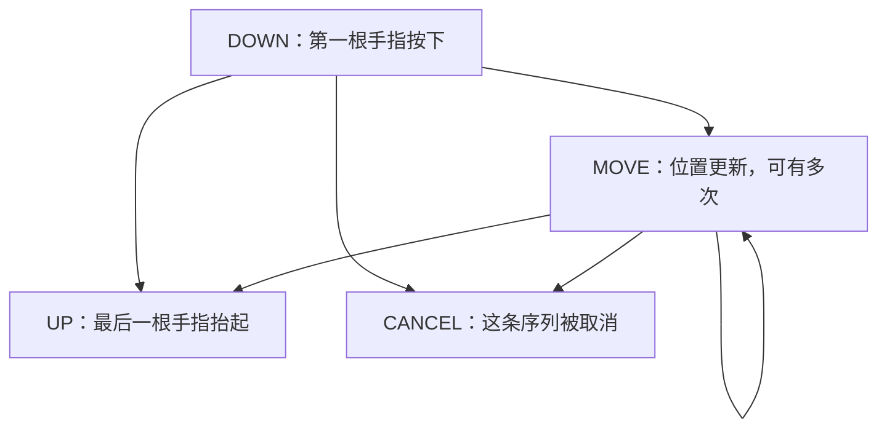

- **正常单指序列**：`DOWN → MOVE… → UP`，也可能没有 MOVE。
- **取消序列**：已经获得事件的接收方可能以 `CANCEL` 结束，例如被父容器接管。此时不能继续等待 UP 才清理。
- 多指加入、离开会产生 `POINTER_DOWN / POINTER_UP`，最后一指离开才是整个序列的 UP。

用 `event.getActionMasked()` 判断动作；`getAction()` 在指针按下、抬起事件中还编码了指针索引，直接与 `ACTION_POINTER_UP` 比较容易出错。

**一个 MOVE 不一定只包含一个采样点**：事件可以批量携带历史坐标。绘图、笔迹场景还应读取 `getHistorySize()`、`getHistoricalX()` / `getHistoricalY()`；普通拖动通常先关注当前坐标。参见 [MotionEvent 的批处理说明](https://developer.android.com/reference/android/view/MotionEvent#batching)。

## 4. 三个核心方法，各自决定什么 {#three-methods}

| 方法 | 在哪里 | 要解决的问题 | 返回 true | 返回 false |
| --- | --- | --- | --- | --- |
| `dispatchTouchEvent()` | Activity、View、ViewGroup | 本层如何分发，事件最终是否被处理 | 本次分发被处理 | 向调用方报告未处理 |
| `onInterceptTouchEvent()` | ViewGroup | 是否由父容器接管子级触摸 | 拦截，必要时取消已有子目标 | 允许继续分发给子级 |
| `onTouchEvent()` | Activity、View，ViewGroup 也继承它 | 当前对象是否处理事件 | 本次处理成功 | 本次未处理 |

**三个 true 的含义不相同，尤其“拦截”不等于“消费”。** 父容器拦截后，仍需要自己的触摸逻辑承接后续事件。

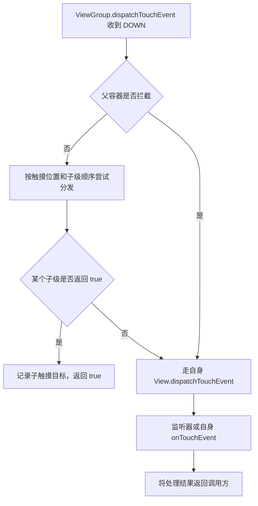

这里画的是普通 DOWN 的主干。辅助功能、安全过滤、触摸委托和多指拆分会增加分支，**实际 `ViewGroup.dispatchTouchEvent()` 不能用三行伪代码完整替代**。

## 5. DOWN 如何决定后续事件交给谁 {#touch-target}

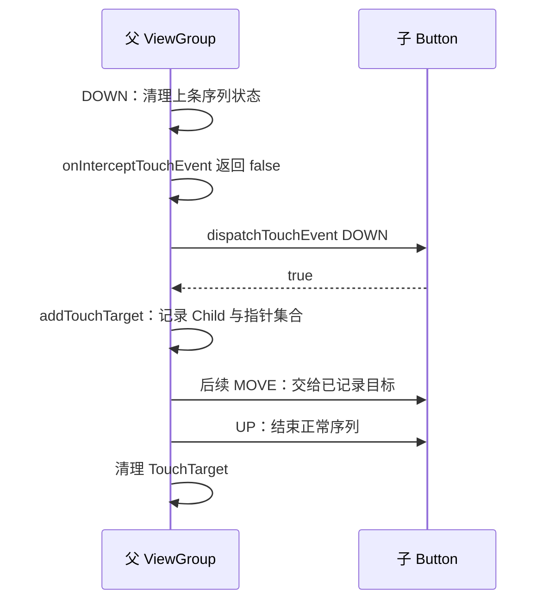

**普通单指场景下，DOWN 建立“后续交给谁”的关系。MOVE 不是每次重新命中检测后换一个 View。** 手指移出按钮，也可能继续交给该按钮，是否保持点击资格由按钮自己判断。

### ViewGroup 记住的不是一个布尔值

下面按职责节选 AOSP `android-16.0.0_r1`，不是可替换原方法的完整实现：

```java
// ViewGroup.java，dispatchTouchEvent()，L2664–2669。
if (actionMasked == MotionEvent.ACTION_DOWN) {
    cancelAndClearTouchTargets(ev); // 清掉遗留目标。
    resetTouchState();             // 也重置禁止拦截等序列状态。
}

// 同方法 L2771、L2787：子级真正返回 true 才记录为目标。
if (dispatchTransformedTouchEvent(ev, false, child, idBitsToAssign)) {
    // ...记录按下时间、坐标等...
    newTouchTarget = addTouchTarget(child, idBitsToAssign);
    // ...
}
```

`mFirstTouchTarget` 是 TouchTarget 链表入口；节点保存子 View 与 `pointerIdBits`。启用多指拆分时，**不同指针可以对应不同子级**，不能把它理解成永远只有一个“被点击控件”。源码：[ViewGroup.java L2647](https://android.googlesource.com/platform/frameworks/base/+/refs/tags/android-16.0.0_r1/core/java/android/view/ViewGroup.java#2647)。

### 返回 false 的两个不同场景

- **子级 DOWN 返回 false**：通常不会登记为该子目标，后续不能指望自己突然收到 MOVE；父级会尝试其他候选或自身处理。
- **已成为目标后，某个 MOVE 返回 false**：只表示这次未处理，不会因此自动删除 TouchTarget，也不会自动把整条序列交给兄弟 View。

后者走的是已有 TouchTarget 的分发分支：子级 MOVE 返回 false，并不会再回头执行本父容器的 `onTouchEvent()`。结果仍向外返回；如果整个窗口都报告未处理，Activity 的默认分发实现仍可能执行自己的兜底。不要把 U 型图针对 DOWN 的“逐层尝试候选与自身处理”套到所有 MOVE 上。

父级选择候选还涉及可接收性、坐标、Z 值与绘制顺序。不要简单记成“XML 最后一个控件一定先拿到事件”。

## 6. OnTouch、onTouchEvent 与 onClick 的关系 {#click}

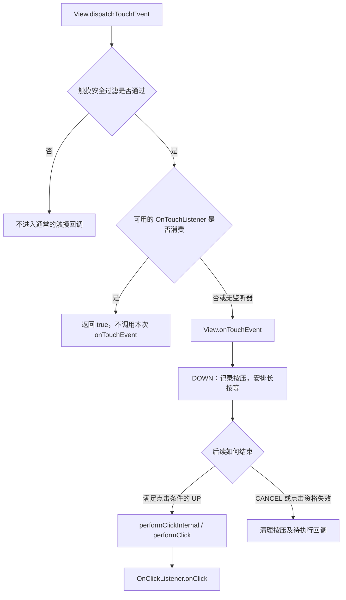

图中 `onTouchEvent()` 的点击流程概括默认 View 行为，并非每个子类都实现完全相同的手势逻辑。

### 监听器消费了事件，为什么按钮不再点击

```java
button.setOnTouchListener((view, event) -> {
    android.util.Log.d("TouchStudy",
            android.view.MotionEvent.actionToString(event.getAction()));
    return false; // 只观察；让 Button.onTouchEvent 继续维护点击逻辑。
});
button.setOnClickListener(view -> submitForm()); // submitForm 是示意业务方法。
```

把这里改成无条件 `return true`，默认 `onTouchEvent()` 就不再处理这些事件，默认点击可能失效；除非你另行正确识别点击并调用 `performClick()`。

AOSP 16 已将回调逻辑放在辅助方法中，不要照搬旧版本的函数布局：

```java
// View.java：dispatchTouchEvent()，L16597–16599。
if (onFilterTouchEventForSecurity(event)) {
    result = performOnTouchCallback(event);
}

// performOnTouchCallback()，L16628–16645，省略 tracing 等分支。
if (li != null && li.mOnTouchListener != null
        && (mViewFlags & ENABLED_MASK) == ENABLED) {
    handled = li.mOnTouchListener.onTouch(this, event);
}
if (handled) {
    return true;
}
return onTouchEvent(event);
```

对应 [View.java L16575](https://android.googlesource.com/platform/frameworks/base/+/refs/tags/android-16.0.0_r1/core/java/android/view/View.java#16575)。默认 `onTouchEvent()` 的按压与取消见 [L18093](https://android.googlesource.com/platform/frameworks/base/+/refs/tags/android-16.0.0_r1/core/java/android/view/View.java#18093)。

### 自定义 View 的点击要走 performClick

```java
// 放在自定义 View 内；只展示已持有序列后的收尾逻辑。
// tapCandidate 应在 DOWN 初始化，并在越过 touchSlop、多指加入等情形取消。
switch (event.getActionMasked()) {
    case MotionEvent.ACTION_UP:
        setPressed(false);
        if (tapCandidate) performClick(); // 保留点击监听器和无障碍点击语义。
        tapCandidate = false;
        return true;
    case MotionEvent.ACTION_CANCEL:
        setPressed(false);
        tapCandidate = false; // 取消不能提交业务动作。
        return true;
}
```

**UP 不等于必然点击。** 拦截、移出允许区域、长按等都会影响默认点击状态。标准控件优先保留 `super` 的实现，避免自己再维护一套不完整的按压状态机。

## 7. 父容器中途拦截：子 View 为什么收到 CANCEL {#interception}

以“蓝色按钮放在可水平拖动的父容器内”为例：先允许按钮接收 DOWN；移动超过阈值并判定为横向手势后，父容器接管。

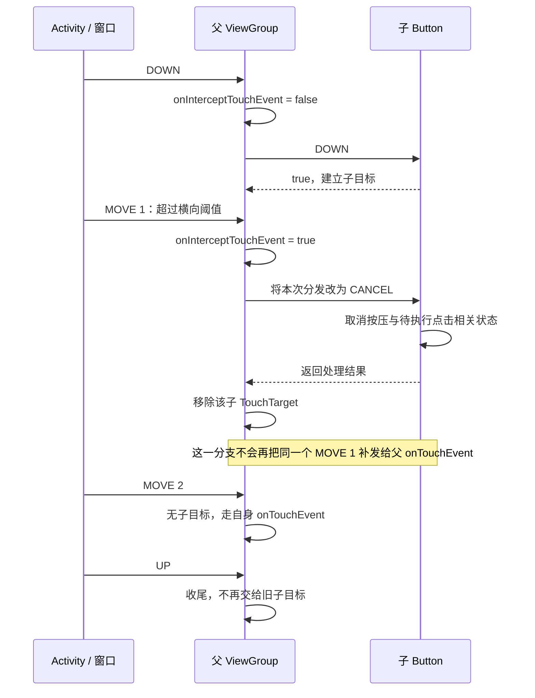

**关键细节：触发拦截的 MOVE 用来取消原子目标，后续事件才转入父级自身处理。** 在这条普通单子目标路径中，不能假设父 `onTouchEvent()` 一定收到 DOWN，或者立即收到触发拦截的同一个 MOVE。

### 源码如何做取消和移除

```java
// ViewGroup.java，dispatchTouchEvent()，L2812–2815。
if (mFirstTouchTarget == null) {
    handled = dispatchTransformedTouchEvent(ev, canceled, null,
            TouchTarget.ALL_POINTER_IDS); // child 为 null：交给自身 View 实现。
} else {
    // 遍历已存在的 TouchTarget，L2826–2840：
    // cancelChild = resetCancelNextUpFlag(...) || intercepted;
    // dispatchTransformedTouchEvent(ev, cancelChild, target.child, ...);
    // cancelChild 为 true 时，从链表移除并回收这个节点。
}

// dispatchTransformedTouchEvent()，L3113–3115。
if (cancel) {
    event.setAction(MotionEvent.ACTION_CANCEL);
}
// 在 finally 中恢复原 action，避免污染调用方后续观察，见 L3175–3176。
```

源码：[分发与清理 L2812](https://android.googlesource.com/platform/frameworks/base/+/refs/tags/android-16.0.0_r1/core/java/android/view/ViewGroup.java#2812)、[取消转换 L3108](https://android.googlesource.com/platform/frameworks/base/+/refs/tags/android-16.0.0_r1/core/java/android/view/ViewGroup.java#3108)。

### 父容器的核心写法

```java
// HorizontalDragLayout 内部；字段与完整实现见下方 Demo。
@Override public boolean onInterceptTouchEvent(MotionEvent e) {
    switch (e.getActionMasked()) {
        case MotionEvent.ACTION_DOWN:
            activePointerId = e.getPointerId(0);
            downX = lastX = e.getX(0);
            downY = e.getY(0);
            dragging = false;
            return false; // 此处必须先记状态，父 onTouchEvent 可能收不到 DOWN。
        case MotionEvent.ACTION_MOVE:
            int index = e.findPointerIndex(activePointerId);
            if (index < 0) return false;
            float dx = e.getX(index) - downX;
            float dy = e.getY(index) - downY;
            if (Math.abs(dx) > touchSlop && Math.abs(dx) > Math.abs(dy)) {
                dragging = true;
                lastX = e.getX(index); // 从接管点开始计算后续位移，避免跳动。
                return true;
            }
            return false;
        default:
            return dragging;
    }
}
```

`touchSlop` 来自 `ViewConfiguration.get(context).getScaledTouchSlop()`，单位是像素；不要硬编码“移动 10 px 就滚动”。完整版本还必须处理多指切换、UP、CANCEL 和状态清理，不能只复制上面两个分支。

## 8. 滑动冲突：什么时候允许父级接管 {#scroll-conflict}

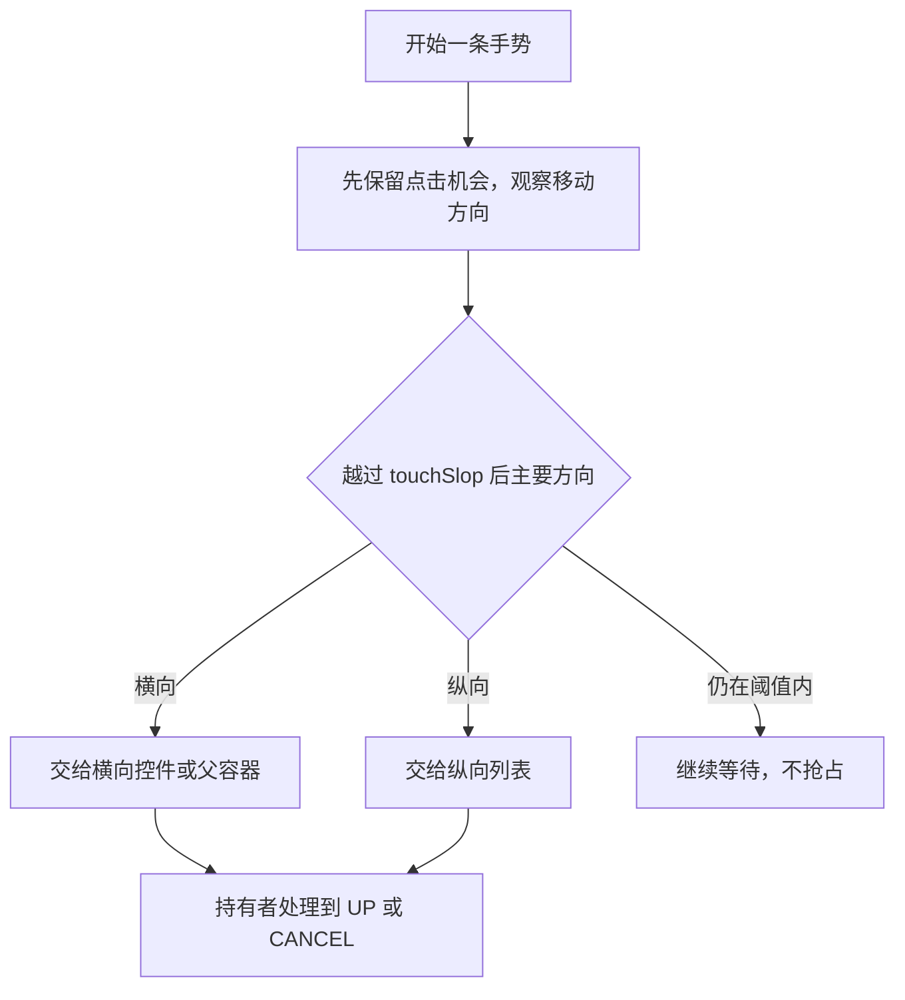

- **父级决策**：在父容器 `onInterceptTouchEvent()` 中，根据方向、距离和业务边界决定何时接管。
- **子级协调**：子 View 确定需要自行处理时，通过 `getParent().requestDisallowInterceptTouchEvent(true)` 请求祖先暂不拦截。
- **同方向嵌套**：若父子需要共享滚动距离，例如列表滚动同时折叠顶部区域，优先看下一节的嵌套滚动机制。

### requestDisallowInterceptTouchEvent 能做什么

```java
// 子控件处理触摸时的核心调用，不是完整状态机。
getParent().requestDisallowInterceptTouchEvent(true);  // 本序列暂不让祖先拦截。
// 子控件到达滚动边界，或手势结束时，按策略恢复：
getParent().requestDisallowInterceptTouchEvent(false);
```

请求会沿父链传播，并影响标准 ViewGroup 是否调用拦截判断。它**不会把已取消的序列重新交回子 View**，也不能阻止系统级手势接管。新 DOWN 会重置相关状态；AOSP 16 对进行中的返回手势还存在专门分支，见 [ViewGroup.java L2675](https://android.googlesource.com/platform/frameworks/base/+/refs/tags/android-16.0.0_r1/core/java/android/view/ViewGroup.java#2675)与 [L3258](https://android.googlesource.com/platform/frameworks/base/+/refs/tags/android-16.0.0_r1/core/java/android/view/ViewGroup.java#3258)。

**不要在每次 DOWN 都无条件禁止拦截且永不释放。** 例如横向区域嵌在纵向列表里，这会让用户从该区域开始的纵向滑动也难以交给列表；要结合方向识别与边界策略。

## 9. Nested Scrolling：父子协作消费距离 {#nested-scrolling}

**触摸拦截决定事件给谁；嵌套滚动协调一段滚动距离由谁消费。** 子控件可以继续持有 MotionEvent，同时把滚动机会交给父级。

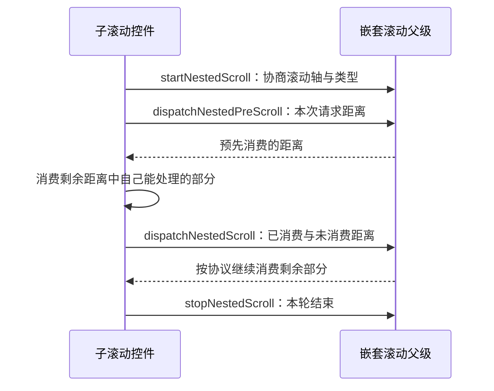

- 配套实现要同时有支持嵌套滚动的父级与子级，不能只在布局里套一层就期待协作。
- `TYPE_TOUCH` 与 `TYPE_NON_TOUCH` 区分触摸和惯性等滚动阶段；手指离开后仍可能继续惯性滚动。
- 处理父级消费量、窗口坐标偏移和 fling 协商，不能简单把 dy 同时传给父子各滚一遍。

接口契约见 [NestedScrollingChild3](https://developer.android.com/reference/androidx/core/view/NestedScrollingChild3)与 [NestedScrollingParent3](https://developer.android.com/reference/androidx/core/view/NestedScrollingParent3)。框架与 AndroidX 有不同代际接口，调用签名需与项目实际使用的接口对应。

## 10. 坐标和多指：为什么拖动会突然跳一下 {#coordinates-and-pointers}

### 坐标必须在同一个参照系里计算

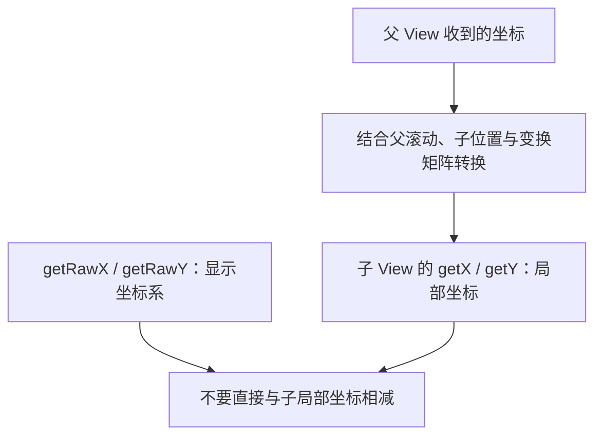

父级会在派发时转换坐标，必要时复制或拆分事件，并在结束后恢复或回收临时对象。源码见 [ViewGroup.java L3142–3168](https://android.googlesource.com/platform/frameworks/base/+/refs/tags/android-16.0.0_r1/core/java/android/view/ViewGroup.java#3142)。

多窗口、视图平移、缩放、父级滚动都会影响参照关系。拖动中若不断移动**取坐标的同一个 View**，其局部原点也会变化，位移计算容易抖动；示例在父容器坐标系中跟踪，并移动子 View。

### pointerId 是身份，pointerIndex 是本次位置

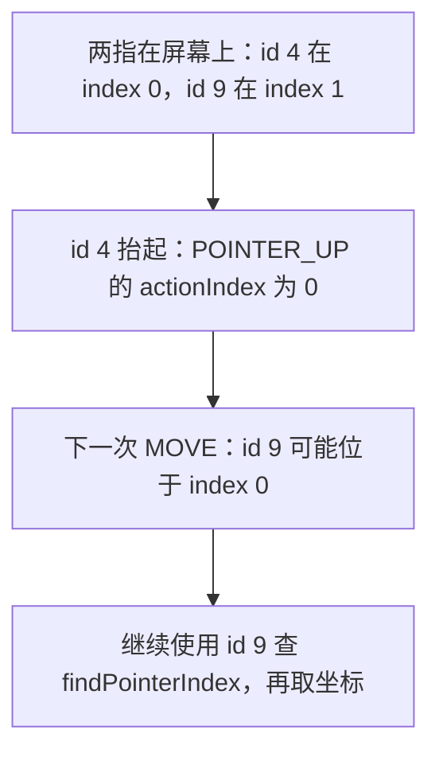

图中 ID 只是示例。**ID 在该指针活动期间稳定，index 可以变化**；不要保存 index 跨事件使用，也不要把 ID 直接传给 `getX(index)`。

```java
// DOWN：选定跟踪手指。
activePointerId = event.getPointerId(0);

// MOVE：每次重新查索引，不能假设一直是 0。
int index = event.findPointerIndex(activePointerId);
if (index >= 0) {
    float x = event.getX(index);
    float deltaX = x - lastX;
    lastX = x;
    // 在同一坐标系中应用 deltaX。
}

// ACTION_POINTER_UP：仅在离开的正是当前跟踪手指时切换。
int lifted = event.getActionIndex();
if (event.getPointerId(lifted) == activePointerId) {
    int next = lifted == 0 ? 1 : 0;
    if (next < event.getPointerCount()) {
        activePointerId = event.getPointerId(next);
        lastX = event.getX(next); // 切换基准，避免与旧手指坐标相减导致跳动。
    }
}
```

POINTER_UP 这一份事件仍包含离开手指的信息，后续事件才不再包含它；整个序列结束后要清空 ID。缩放优先交给 `ScaleGestureDetector`，滑动、双击、长按可交给 `GestureDetector`，但检测器不能替你解决父级是否拦截以及 DOWN 是否被接收的问题。参见 [官方多指处理](https://developer.android.com/develop/ui/views/touch-and-input/gestures/multi)与 [拖动和缩放](https://developer.android.com/develop/ui/views/touch-and-input/gestures/scale)。

## 11. 可以直接观察的交互 Demo {#demo}

<a href="/attachments/android/view-touch/TouchDispatchActivity.java" download>下载 TouchDispatchActivity.java</a> · <a href="/attachments/android/view-touch/README.txt" download>下载接入说明</a>

示例使用普通 Activity、FrameLayout 和 Button，无 AndroidX 依赖。注册后从自己 App 内启动即可；**不是一个独立 APK**。

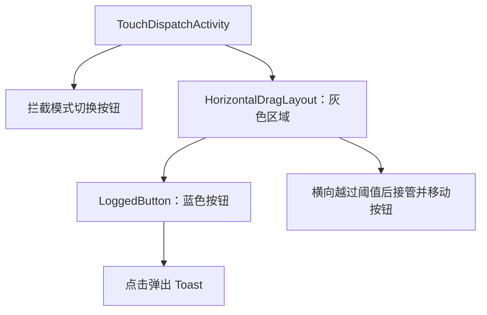

按这几个动作对照日志：

1. **轻点蓝色按钮**：子级接到 DOWN、UP，默认按钮产生 onClick，父 `onTouchEvent()` 无需再处理同一次点击。
2. **开启拦截后横向拖动**：父级判定横向滚动，子级收到 CANCEL；后续 MOVE 由父级拖动按钮。
3. **关闭拦截再操作**：子级继续处理序列，是否点击由 Button 自身的默认状态规则决定。
4. **拖动中加第二指，再抬起当前跟踪手指**：切换 ID 并重置坐标基准，避免突然跳动。

```bash
adb logcat -s TouchStudy:D
```

日志在 `super` **返回之后**记录，所以同一事件常表现为 Child → Parent → Activity 的输出顺序。这正是 U 型图右侧的栈返回，**不能据此误判实际分发从子级开始**。

Demo 只实现水平拖动，没有纵向滚动、fling 或嵌套滚动。子按钮保留系统点击逻辑；父级既在完结事件后清理，也在新 DOWN 初始化，避免依赖“结束事件一定完整送达”的假设。

## 12. 深入系统：触摸从硬件怎样进入 App {#system-input}

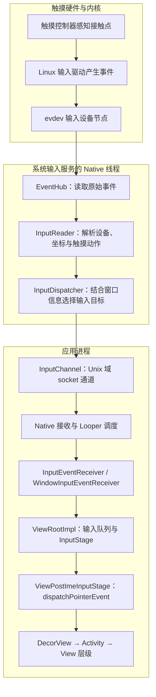

- **InputReader** 把设备事件解释为 Android 输入动作，**InputDispatcher** 决定输入如何交给目标窗口；它们不是 Activity 中的 Java 类。
- Binder 参与服务通信和通道建立等控制过程；**不能把每次触摸传输画成 InputDispatcher 对 Activity 的一次 Binder 调用**。
- 常见窗口的 View 回调在绑定窗口的 UI Looper 上执行。MOVE 可能批处理，输入阶段也可能提前消费事件，不保证所有输入都无条件抵达 Activity。

输入通道创建的关键实现：

```cpp
// frameworks/native/libs/input/InputTransport.cpp
// InputChannel::openInputChannelPair()，L357 起，关键调用在 L361。
if (socketpair(AF_UNIX, SOCK_SEQPACKET, 0, sockets)) {
    // ...错误处理...
}
```

App 侧的关键衔接：

```java
// ViewRootImpl.java，WindowInputEventReceiver.onInputEvent()，L10654。
public void onInputEvent(InputEvent event) {
    processRawInputEvent(event); // 后续还有队列与各 InputStage。
}

// ViewPostImeInputStage.processPointerEvent()，L8228。
// handled 表示前面的手写等机制可能已经处理，不是总会继续向 View 树派发。
handled = handled || mView.dispatchPointerEvent(event);

// View.java，dispatchPointerEvent()，L16936 起。
if (event.isTouchEvent()) {
    return dispatchTouchEvent(event);
} else {
    return dispatchGenericMotionEvent(event);
}
```

源码：[InputTransport.cpp L357](https://android.googlesource.com/platform/frameworks/native/+/refs/tags/android-16.0.0_r1/libs/input/InputTransport.cpp#357)、[ViewRootImpl.java L10648](https://android.googlesource.com/platform/frameworks/base/+/refs/tags/android-16.0.0_r1/core/java/android/view/ViewRootImpl.java#10648)、[ViewRootImpl.java L8208](https://android.googlesource.com/platform/frameworks/base/+/refs/tags/android-16.0.0_r1/core/java/android/view/ViewRootImpl.java#8208)、[View.java L16936](https://android.googlesource.com/platform/frameworks/base/+/refs/tags/android-16.0.0_r1/core/java/android/view/View.java#16936)。系统分层说明见 [AOSP Input](https://source.android.com/docs/core/interaction/input)。

### 处理回报与画面呈现是两件事

事件处理后需要通过接收机制回报处理完成。阻塞 UI 线程会拖延事件消费与回报，可能触发输入分发超时；**`onTouchEvent()` 返回 true 只说明处理结果，不表示 UI 已更新到屏幕**。

若处理引起界面变化，还需要经历布局、绘制、渲染和显示，继续看 [SurfaceFlinger 与 VSYNC](../framework/surfaceflinger-vsync.html)。输入延迟排查不能只看某个 View 方法耗时，也不能把所有 ANR 都归因于返回 false。

## 13. 常见误区与排查顺序 {#pitfalls}

| 现象 | 先检查 | 应掌握的边界 |
| --- | --- | --- |
| 只收到 DOWN，没有 MOVE / UP | DOWN 的返回值、父级拦截及 CANCEL | 未成为目标与已被取消是两种情况 |
| 按钮不再触发 onClick | OnTouchListener 是否一直返回 true | 监听器可能绕开默认 onTouchEvent |
| 父级收不到 DOWN，拖动起点异常 | 是否在 onInterceptTouchEvent 中初始化 | 子级消费 DOWN 时父 onTouchEvent 不必执行 |
| 一拦截就跳动 | 接管时的 lastX、多指 ID 与参照系 | 不要依赖父级收到同一个触发拦截的 MOVE |
| 子 View MOVE 返回 false 后没交给兄弟 | TouchTarget 是否仍然存在 | 返回 false 不会自动重新选择整条序列的目标 |
| disabled 按钮仍挡住触摸 | clickable 等状态、实际分发结果 | disabled 不等于默认一定返回 false |
| 手指抬起后仍保持按压或拖动 | CANCEL、新 DOWN、移除时的清理 | 不能只在 UP 清理 |

先记录**窗口 / View 名、方法、动作、pointerId、坐标参照系和返回值**，再对照 U 型图找分支。避免只打印动作名，也避免在 MOVE 中做网络、磁盘读写或大量同步日志。

如需延后使用事件，自己 `MotionEvent.obtain(event)` 复制并在使用后 `recycle()`；不要长期持有框架传入的原对象，也不要回收不属于自己的事件。

## 14. 源码阅读入口 {#sources}

以下固定到 **AOSP `android-16.0.0_r1`**；行号对应该标签的原始文件，不代表其他版本的相同行号。

- **窗口回调与兜底**：[Activity.dispatchTouchEvent，L4600](https://android.googlesource.com/platform/frameworks/base/+/refs/tags/android-16.0.0_r1/core/java/android/app/Activity.java#4600)。
- **目标选择、拦截与取消**：[ViewGroup.dispatchTouchEvent，L2647](https://android.googlesource.com/platform/frameworks/base/+/refs/tags/android-16.0.0_r1/core/java/android/view/ViewGroup.java#2647)。
- **监听器优先级、默认点击状态机**：[View.dispatchTouchEvent，L16575](https://android.googlesource.com/platform/frameworks/base/+/refs/tags/android-16.0.0_r1/core/java/android/view/View.java#16575)和 [onTouchEvent，L18093](https://android.googlesource.com/platform/frameworks/base/+/refs/tags/android-16.0.0_r1/core/java/android/view/View.java#18093)。
- **读设备与分发窗口**：[EventHub::getEvents，L1879](https://android.googlesource.com/platform/frameworks/native/+/refs/tags/android-16.0.0_r1/services/inputflinger/reader/EventHub.cpp#1879)、[InputReader::loopOnce，L163](https://android.googlesource.com/platform/frameworks/native/+/refs/tags/android-16.0.0_r1/services/inputflinger/reader/InputReader.cpp#163)、[InputDispatcher::dispatchOnce，L1002](https://android.googlesource.com/platform/frameworks/native/+/refs/tags/android-16.0.0_r1/services/inputflinger/dispatcher/InputDispatcher.cpp#1002)。
- **SDK 使用契约**：[父容器触摸管理](https://developer.android.com/develop/ui/views/touch-and-input/gestures/viewgroup)、[MotionEvent](https://developer.android.com/reference/android/view/MotionEvent)、[多指处理](https://developer.android.com/develop/ui/views/touch-and-input/gestures/multi)。
