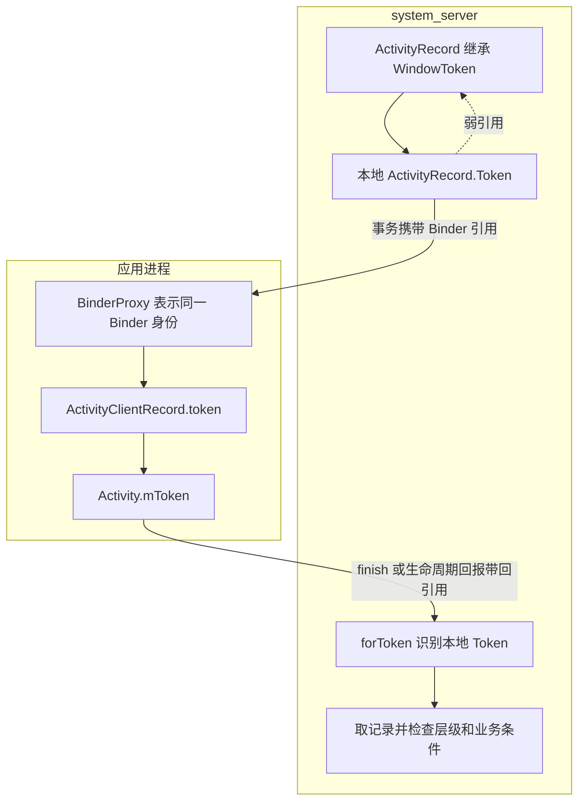
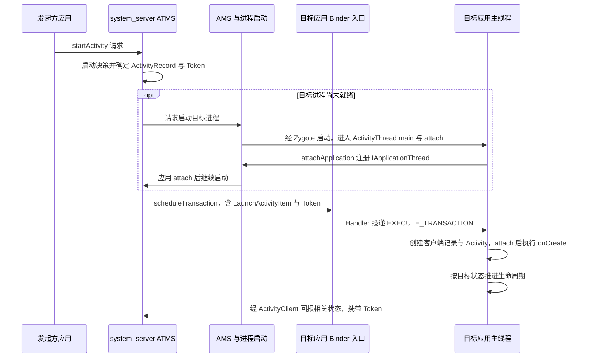
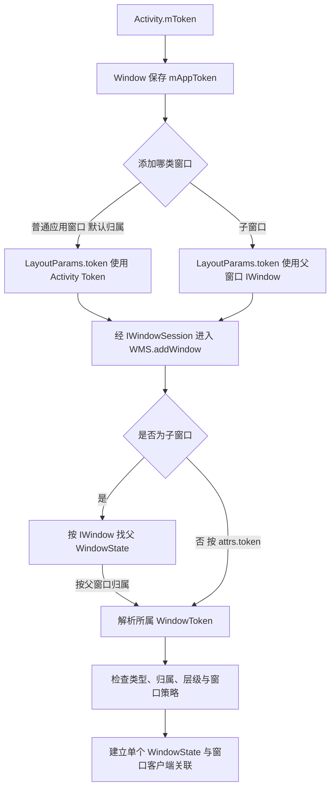

# Android Token 原理：从 Activity 启动到窗口归属

Activity Token 把服务端的活动记录、客户端的生命周期调度与窗口归属关联起来。读懂它的关键，是始终追问：**谁创建这个 Binder、它标识什么、接收方怎样解析、这次操作还检查哪些条件？**

## 1. 先分清记录、实例与身份

`ActivityRecord` 是 `system_server` 中的服务端状态记录，管理任务关系、配置、可见性和生命周期等信息。`ActivityClientRecord` 是应用进程中的客户端记录，其中才引用开发者编写的 Java `Activity` 实例。三者互相协作，但不是跨进程共享的同一个 Java 对象。

| 对象 | 所在位置与职责 | 与 Token 的关系 |
| --- | --- | --- |
| `ActivityRecord` | system_server，活动与窗口体系的状态记录 | 创建并持有 Activity Token，继承 `WindowToken` |
| `ActivityClientRecord` | 应用进程，生命周期执行与运行信息 | 使用传来的 Token，进入 `ActivityThread.mActivities` 映射 |
| `Activity` | 应用进程，业务回调与界面逻辑 | `attach()` 将 Token 保存到 `mToken` |
| `WindowToken` | system_server，一组窗口的容器 | 普通 Java 容器，其 `token` 字段才是 Binder 引用 |
| `WindowState` | system_server，单个窗口的状态 | 关联窗口客户端 `IWindow` 和所属 `WindowToken` |
| `Task` / `TaskFragment` | system_server，任务与活动的组织容器 | 组织 ActivityRecord，不是用 Activity Token 代替 Task ID |

一个进程可以运行多个 Activity；一个任务也可以包含来自不同应用进程的 Activity。**任务、进程和 Activity 实例没有一对一关系。** `ActivityThread` 还是一个调度类，名称不意味着它是 `Thread` 子类。

## 2. Activity Token 怎样创建，又怎样返回原对象

在此基线中，`ActivityRecord` 继承 `WindowToken`，构造时将 `new Token()` 传给父类；内部 `private static class Token extends Binder` 保存 `WeakReference<ActivityRecord>`。因此，`ActivityRecord.token` 的本地 Binder 对象位于 `system_server`。[源码：ActivityRecord](https://android.googlesource.com/platform/frameworks/base/+/refs/tags/android-16.0.0_r1/services/core/java/com/android/server/wm/ActivityRecord.java#1746)

这份引用经 Binder 传给应用后，应用通常得到 `BinderProxy`。再把引用传回拥有者进程时，Binder 对象转换能找回原本的本地 Java Binder；`ActivityRecord.forToken()` 因而能将它识别为内部 `Token` 并取出弱引用。`forTokenLocked()` 还检查记录仍处于 root task 层级。[源码：Java Binder 对象转换](https://android.googlesource.com/platform/frameworks/base/+/refs/tags/android-16.0.0_r1/core/jni/android_util_Binder.cpp#949)



这里传递的是 **Binder 对象身份**，不是 Activity 内存地址、字符串密钥或永久整数编号。`toString()`、日志中的十六进制摘要和进程内 Binder handle 都不能当作可重建身份的序列号。应用也不能把远端代理强转成服务端私有类。

普通应用自己 `new Binder()` 只会得到一个新的 Binder 身份；复制原 Token 的日志文本也不会产生同一身份。Token 内的弱引用避免仅由 Token 强行保活记录，但记录何时失效还取决于任务层级和业务状态，不能只凭 Binder 引用非空判断 Activity 有效。

## 3. 不同名字里的 Token，不一定是同一份引用

`WindowToken` 是类名，`LayoutParams.token` 是带上下文含义的字段，`View.getWindowToken()` 是公共方法。它们不能仅凭单词相同就互换。

| 名称 | 标识对象与创建位置 | 典型用途与边界 |
| --- | --- | --- |
| Activity Token | system_server 的 `ActivityRecord.Token` | 活动事务、状态回报、普通应用窗口归属 |
| `IApplicationThread.asBinder()` | 应用进程的 `ApplicationThread` 端点 | 系统向某个应用进程调度，不标识单个 Activity |
| `IWindow.asBinder()` | 应用 `ViewRootImpl.W` 的窗口客户端 | 标识具体窗口；附着后的 `View.getWindowToken()` 返回它 |
| `LayoutParams.token` | 由窗口类型和父窗口关系决定 | 普通应用窗口可用 Activity Token；子窗口使用父窗口的 `IWindow` 身份 |
| WindowContext Token | 与窗口上下文绑定的身份 | 参与上下文、显示和窗口类型关联，不是 Activity Token 的别名 |
| Input application token | `ActivityRecord` 提供给输入系统的应用身份 | 此版本可直接使用同一 Activity Token，不能一概说它们都不同 |
| Input channel token | 输入通道的 Binder 身份 | 对应具体输入通道；`InputTransferToken` 另提供输入转移相关包装 |
| assist / shareable activity token | 辅助与受限共享场景的专用身份 | `attach()` 中分别传入，不应替代 `mToken` 使用 |

尤其注意：此版本 `View.getWindowToken()` 从 `AttachInfo.mWindowToken` 返回窗口客户端 Binder；`View.getApplicationWindowToken()` 也不是读取 `Activity.mToken`，对 panel 可返回其包含窗口的身份。未附着的 View 还可能返回 `null`。[源码：View](https://android.googlesource.com/platform/frameworks/base/+/refs/tags/android-16.0.0_r1/core/java/android/view/View.java#22970)

输入身份可核对 [ActivityRecord.getInputApplicationHandle](https://android.googlesource.com/platform/frameworks/base/+/refs/tags/android-16.0.0_r1/services/core/java/com/android/server/wm/ActivityRecord.java#2123) 与 [WindowState.openInputChannel](https://android.googlesource.com/platform/frameworks/base/+/refs/tags/android-16.0.0_r1/services/core/java/com/android/server/wm/WindowState.java#2501)。下面沿 Activity Token 主线继续，图形呈现的后续过程可结合 [SurfaceFlinger 与 VSYNC](./surfaceflinger-vsync.html) 阅读。

## 4. 启动入口：先做决策，再向目标进程调度

从一个已有 Activity 发起的典型路径是：

```text
Activity.startActivity / startActivityForResult
  → Instrumentation.execStartActivity
  → IActivityTaskManager.startActivity                 [Binder]
  → ActivityTaskManagerService.startActivityAsUser
  → ActivityStartController.obtainStarter(...).execute()
  → ActivityStarter.executeRequest
```

`Instrumentation` 参与应用侧的启动代理；ATMS 入口检查调用包与 UID 等条件，并转入启动器。`ActivityStarter` 解析 Intent、目标组件、权限、启动模式与 Task 选择，通过 Builder 构造候选 `ActivityRecord`。其后的复用决策可能向已有实例投递新 Intent，不能把每次 `startActivity()` 都理解成创建一个最终保留的新记录和 Java 实例。[源码：Instrumentation](https://android.googlesource.com/platform/frameworks/base/+/refs/tags/android-16.0.0_r1/core/java/android/app/Instrumentation.java#1992)、[ATMS](https://android.googlesource.com/platform/frameworks/base/+/refs/tags/android-16.0.0_r1/services/core/java/com/android/server/wm/ActivityTaskManagerService.java#1303)、[ActivityStarter](https://android.googlesource.com/platform/frameworks/base/+/refs/tags/android-16.0.0_r1/services/core/java/com/android/server/wm/ActivityStarter.java#1471)

### 已有进程与冷启动在哪里分流

`ActivityTaskSupervisor.startSpecificActivity()` 查询目标 `WindowProcessController`，已有进程且具有应用线程接口时尝试 `realStartActivityLocked()`。若进程不存在或远端线程失效，则需要启动或重新启动进程；“进程存在”也不等于目标 Activity 实例已经存在。

冷启动涉及 ATMS 请求、AMS/ProcessList、Zygote 派生进程，以及 `ActivityThread.main()` / `attach()`。应用向 AMS 注册 `IApplicationThread` 后，系统才能回调目标进程。在此标签中，`RootWindowContainer.attachApplication()` 遍历 `mStartingProcessActivities`，核对 UID、进程名和可见性等条件，再继续真实启动。AMS 在 attach 或 finish-attach 阶段推进启动取决于相关 flag，不能固定为唯一同步时序。[源码：启动分流](https://android.googlesource.com/platform/frameworks/base/+/refs/tags/android-16.0.0_r1/services/core/java/com/android/server/wm/ActivityTaskSupervisor.java#1129)、[进程 attach 后继续启动](https://android.googlesource.com/platform/frameworks/base/+/refs/tags/android-16.0.0_r1/services/core/java/com/android/server/wm/RootWindowContainer.java#1768)

## 5. ClientTransaction 传的是数据和引用

`realStartActivityLocked()` 准备 Intent、ActivityInfo、配置和恢复状态等数据，创建 `LaunchActivityItem(r.token, …)`，再根据目标状态配合 Resume、Pause 或 Stop item。此版本各 Activity item 携带自己的 Token，`ClientLifecycleManager` 以 `new ClientTransaction(client)` 和 `addTransactionItem()` 组织调度。[源码：事务生成](https://android.googlesource.com/platform/frameworks/base/+/refs/tags/android-16.0.0_r1/services/core/java/com/android/server/wm/ActivityTaskSupervisor.java#1021)、[事务调度](https://android.googlesource.com/platform/frameworks/base/+/refs/tags/android-16.0.0_r1/services/core/java/com/android/server/wm/ClientLifecycleManager.java#155)

`ClientTransaction` 与 item 是可序列化的数据载体，不是跨进程共享的原 Java 对象，也不是 Activity 的 Binder 服务本身。Binder 调用传输序列化的数据，并保持其中 Binder 引用的身份；应用侧反序列化得到自己的事务对象。**系统没有把整个 ActivityRecord 复制到应用。**

`ApplicationThread.scheduleTransaction()` 接收调度后，通过 `ClientTransactionHandler` 投递 `H.EXECUTE_TRANSACTION`，由应用主线程中的 `TransactionExecutor` 执行。接收 Binder 调用与执行 Activity 生命周期之间存在 Handler 调度边界，不应把 `onCreate()` 画在 Binder 线程上。



图中聚合了进程启动阶段，调用箭头不表示所有步骤都是同步 Binder；发起方和目标方也可能是同一个应用进程。

## 6. 从客户端记录到 Activity.attach

`LaunchActivityItem.execute()` 使用自己的 `mActivityToken` 创建新的 `ActivityClientRecord`，随后进入 `ActivityThread.handleLaunchActivity()` / `performLaunchActivity()`。后者准备 `LoadedApk`、资源和 ClassLoader，通过 `Instrumentation.newActivity()` 创建 Java Activity，再准备或取得 Application。[源码：LaunchActivityItem](https://android.googlesource.com/platform/frameworks/base/+/refs/tags/android-16.0.0_r1/core/java/android/app/servertransaction/LaunchActivityItem.java#214)、[ActivityThread](https://android.googlesource.com/platform/frameworks/base/+/refs/tags/android-16.0.0_r1/core/java/android/app/ActivityThread.java#4173)

框架将 `r.token → r` 放进 `mActivities`，调用 `activity.attach(..., r.token, ...)`，并在执行 `onCreate()` 前让 `r.activity` 指向该实例。`attach()` 把 Token 保存为 `mToken`，设置 Context、Instrumentation、Application 和窗口关联，最后通过 Instrumentation 进入 Activity 的创建回调。

可以用下面这份**关系示意，非可编译代码**定位源码：

```text
ActivityRecord.token                         [system_server 本地 Binder]
  → LaunchActivityItem.mActivityToken         [应用侧通常为远端代理]
  → ActivityClientRecord.token
  → ActivityThread.mActivities[token]
  → Activity.attach(..., token, ...)
  → Activity.mToken
```

后续生命周期 item 依据 Token 找到客户端记录，再操作其 Activity 实例。Token 解决的是目标身份关联，资源、类加载与 Context 初始化仍需要各自的数据和约束。

### 同一个 Token 在两端查的是不同记录 {#token-lookup-tables}

客户端 `ActivityThread` 以 `r.token` 为键把 `ActivityClientRecord` 放入 `mActivities`；服务端则由 `ActivityRecord.forTokenLocked()` 解析本地 Token 指向的服务端记录。客户端查不到记录，不等于这个 Binder 引用从未存在：启动尚未执行、客户端已销毁与服务端记录已移除是不同阶段。排查时先确认出错的是哪一端的表，再对照事务和销毁时序。[客户端入表位置](https://android.googlesource.com/platform/frameworks/base/+/refs/tags/android-16.0.0_r1/core/java/android/app/ActivityThread.java#4204)

## 7. 从 Activity Token 到窗口校验

### 普通应用窗口与子窗口必须分别跟踪

`Activity.attach()` 将 `mToken` 交给 `Window.setWindowManager()`；`Window` 保存 `mAppToken`，再通过 `WindowManagerImpl.createLocalWindowManager(parentWindow)` 建立与父 Window 的关联。这里不能套用旧资料中的 `Window.LocalWindowManager` 类名。

常见窗口添加路径为 `WindowManagerImpl.addView → WindowManagerGlobal.addView → ViewRootImpl.setView → IWindowSession.addToDisplayAsUser → Session.addToDisplayAsUser → WMS.addWindow`。`Window.adjustLayoutParamsForSubWindow()` 会根据类型和父窗口设置参数：普通应用窗口在 Token 未设置时可取 `mAppToken`；子窗口则使用父 DecorView 的 `getWindowToken()`，即父窗口的 `IWindow` 身份。[源码：Window](https://android.googlesource.com/platform/frameworks/base/+/refs/tags/android-16.0.0_r1/core/java/android/view/Window.java#888)、[WindowManagerImpl](https://android.googlesource.com/platform/frameworks/base/+/refs/tags/android-16.0.0_r1/core/java/android/view/WindowManagerImpl.java#131)、[ViewRootImpl](https://android.googlesource.com/platform/frameworks/base/+/refs/tags/android-16.0.0_r1/core/java/android/view/ViewRootImpl.java)



因此，一个 Activity 可关联多个窗口；用于添加的归属 Token 与用于标识单个窗口的 `IWindow` 可以同时出现在同一条调用链中。`setContentView()` 构建本地 View 树，也不等于窗口已经被 WMS 接纳或画面已经呈现。

### WMS 不是只做一次“非空检查”

WMS 先处理窗口类型、调用 Session、显示和父窗口等约束，再解析 `WindowToken`。普通 Activity 应用窗口需要关联到 `ActivityRecord`；不是活动记录或记录已脱离父层级时会被拒绝。子窗口需要找到有效父窗口，系统窗口和窗口上下文另有类型及权限规则。[源码：WindowManagerService.addWindow](https://android.googlesource.com/platform/frameworks/base/+/refs/tags/android-16.0.0_r1/services/core/java/com/android/server/wm/WindowManagerService.java#1565)

应用侧 `ViewRootImpl` 会将部分添加失败结果转换为 `WindowManager.BadTokenException` 等异常。该异常还可能覆盖重复添加、窗口类型权限拒绝或无效用户；显示错误则可能表现为 `InvalidDisplayException`。具体错误应结合窗口类型、父窗口、显示和调用时间分析，不能看到 “token invalid” 就统一归因为权限不足。[源码：添加结果与异常映射](https://android.googlesource.com/platform/frameworks/base/+/refs/tags/android-16.0.0_r1/core/java/android/view/ViewRootImpl.java#1686)

## 8. 生命周期、finish 与重建的边界

`Activity.finish()` 经 `ActivityClient.finishActivity(mToken, …)` 和 `IActivityClientController` 到达 `ActivityClientController.finishActivity()`，由服务端按 Token 找记录，再推进结束流程。请求返回不意味着 Java Activity 已同步执行完 `onDestroy()`，进程被直接终止前也不保证收到该回调。[源码：finish](https://android.googlesource.com/platform/frameworks/base/+/refs/tags/android-16.0.0_r1/core/java/android/app/Activity.java#7428)、[服务端 finish](https://android.googlesource.com/platform/frameworks/base/+/refs/tags/android-16.0.0_r1/services/core/java/com/android/server/wm/ActivityClientController.java#441)

Resume/Pause item 可在 `postExecute()` 经 `ActivityClient` 带 Token 回报；Stop 状态还涉及 `StopInfo` 等后续调度。因此，系统和客户端各有状态推进过程，不能写成“每个回调都立即同步通知 AMS”。

| 场景 | Activity 与客户端记录 | 服务端记录和 Token |
| --- | --- | --- |
| 启动模式复用已有实例 | 可能投递新 Intent，不创建新 Activity | 继续使用被复用记录的身份 |
| 配置变化导致 relaunch | 可销毁旧实例，再使用原客户端记录创建新实例 | 可保留同一 ActivityRecord 和 Token |
| 应用进程死亡后恢复 | 原 Java 对象消失，新进程重建客户端对象 | 记录可能保留并复用 Token，也可能被移除 |
| Activity 结束并移除 | 客户端对象与窗口随后清理 | 持有旧引用不代表它仍能解析为有效目标 |
| system_server 重启或设备重启 | 运行对象重新建立 | Binder 身份不能作为持久身份从磁盘恢复 |

配置重建路径可在 `ActivityThread.handleRelaunchActivityInner()` 中看到：销毁旧实例、清理实例引用，再使用原 `r` 启动。进程死亡后的 `ActivityRecord.handleAppDied()` 则根据 finishing、保存状态和崩溃等条件决定移除或保留记录。[源码：relaunch](https://android.googlesource.com/platform/frameworks/base/+/refs/tags/android-16.0.0_r1/core/java/android/app/ActivityThread.java#6570)、[进程死亡处理](https://android.googlesource.com/platform/frameworks/base/+/refs/tags/android-16.0.0_r1/services/core/java/com/android/server/wm/ActivityRecord.java#4235)

Token 的本地端在 `system_server`，所以应用死亡不等于该 Binder 的拥有者死亡。窗口和输入通道是否重建也要分别跟踪，不能仅由 Activity Token 是否相同推导。

## 9. Token 是能力线索，不是通用授权

持有 Token 可以让系统定位某个目标，但操作是否允许仍由具体接口决定。ActivityRecord 解析、层级有效性与调用 UID、组件权限、窗口类型和当前状态是不同维度；并非每个接口都执行同一套检查，也不能宣称“有 Token 就有所有权限”。

例如 ATMS 的启动入口会核对调用包与 UID；WMS 添加窗口还要核对窗口类型、父窗口和策略。Binder 传来的调用身份与业务参数里的 Token 作用不同，不能用 Token 的字符串代替调用身份，也不能把一个有效 Token 当成任意系统窗口的授权。[源码：启动入口校验](https://android.googlesource.com/platform/frameworks/base/+/refs/tags/android-16.0.0_r1/services/core/java/com/android/server/wm/ActivityTaskManagerService.java#1303)

服务端记录与客户端实例承担不同职责：客户端替换实例并不会自动改变系统登记的宿主组件、UID、任务和权限；继续使用宿主的合法身份也不是为另一个应用创建了系统级身份。不同 Android 版本还有类加载、组件、资源、后台启动和生命周期约束，不能仅凭 Token 机制断言某框架必然可用。

## 10. 遇到 BadTokenException，怎样缩小问题

先记录完整异常、窗口类型、发起界面的生命周期、是否发生重建，以及添加与移除的时间顺序。排查顺序通常比反射读取内部字段更重要：

1. **确认使用场景**：Activity 窗口、Dialog、PopupWindow、子窗口或其他类型分别走什么归属路径，是否用了不匹配的 Context。
2. **核对父窗口**：子窗口是否在父 View 附着前添加，父窗口是否已经移除；不要拿 Activity Token 与 IWindow 身份互换。
3. **核对异步时序**：网络回调或延迟任务执行时，Activity 是否已结束或重建，回调是否仍持有旧界面引用。
4. **核对服务端记录**：在同一时间点关联 ActivityRecord、Task、WindowState 与显示信息；有效 Binder 引用不保证业务目标仍存在。
5. **核对类型和策略**：将添加失败返回值对应回当前系统版本源码，区别无效归属、退出状态与权限拒绝。

先查询实际版本，再关联 Activity 与窗口记录；`dumpsys` 字段和可见信息随系统版本、构建与权限变化。

```sh
adb shell getprop ro.build.version.release
adb shell getprop ro.build.version.sdk
adb shell getprop ro.build.fingerprint
adb shell getprop ro.product.model
adb shell dumpsys activity activities
adb shell dumpsys window tokens
adb shell dumpsys window windows
adb logcat -d -v threadtime
```

可先用 `adb shell dumpsys activity -h` 和 `adb shell dumpsys window -h` 查看当前设备支持的选项。命令入口可对照 [AMS dump](https://android.googlesource.com/platform/frameworks/base/+/refs/tags/android-16.0.0_r1/services/core/java/com/android/server/am/ActivityManagerService.java#10695) 与 [WMS dump](https://android.googlesource.com/platform/frameworks/base/+/refs/tags/android-16.0.0_r1/services/core/java/com/android/server/wm/WindowManagerService.java#7106)。日志中的 `ActivityRecord{...}`、`Window{...}` 与 Binder 摘要各自描述不同对象，应结合进程、组件、Task、显示和时间关联；不要仅凭一段相似的十六进制文本认定是同一个 Token。

## 11. 按问题阅读源码

建议依次验证身份、传递、解析与清理，不必一次通读整个 Framework：

1. **谁创建身份，怎样反查记录**：[ActivityRecord.java](https://android.googlesource.com/platform/frameworks/base/+/refs/tags/android-16.0.0_r1/services/core/java/com/android/server/wm/ActivityRecord.java)。搜索 `class Token`、`forToken`、构造器和 `handleAppDied`。
2. **启动决策和进程就绪边界**：[ActivityStarter.java](https://android.googlesource.com/platform/frameworks/base/+/refs/tags/android-16.0.0_r1/services/core/java/com/android/server/wm/ActivityStarter.java)、[ActivityTaskSupervisor.java](https://android.googlesource.com/platform/frameworks/base/+/refs/tags/android-16.0.0_r1/services/core/java/com/android/server/wm/ActivityTaskSupervisor.java)、[RootWindowContainer.java](https://android.googlesource.com/platform/frameworks/base/+/refs/tags/android-16.0.0_r1/services/core/java/com/android/server/wm/RootWindowContainer.java)。区分创建候选记录、复用决策和真实启动。
3. **事务在哪里执行**：[ClientTransactionHandler.java](https://android.googlesource.com/platform/frameworks/base/+/refs/tags/android-16.0.0_r1/core/java/android/app/ClientTransactionHandler.java)、[TransactionExecutor.java](https://android.googlesource.com/platform/frameworks/base/+/refs/tags/android-16.0.0_r1/core/java/android/app/servertransaction/TransactionExecutor.java)、[ActivityThread.java](https://android.googlesource.com/platform/frameworks/base/+/refs/tags/android-16.0.0_r1/core/java/android/app/ActivityThread.java)。标出 Binder 入口、Handler 消息、客户端记录及实例创建。
4. **窗口参数的 Token 从哪里来**：[Window.java](https://android.googlesource.com/platform/frameworks/base/+/refs/tags/android-16.0.0_r1/core/java/android/view/Window.java)、[WindowManagerGlobal.java](https://android.googlesource.com/platform/frameworks/base/+/refs/tags/android-16.0.0_r1/core/java/android/view/WindowManagerGlobal.java)、[WindowManagerService.java](https://android.googlesource.com/platform/frameworks/base/+/refs/tags/android-16.0.0_r1/services/core/java/com/android/server/wm/WindowManagerService.java)。分别跟踪普通窗口和子窗口。
5. **回报怎样回到服务端记录**：[ActivityClient.java](https://android.googlesource.com/platform/frameworks/base/+/refs/tags/android-16.0.0_r1/core/java/android/app/ActivityClient.java)、[ActivityClientController.java](https://android.googlesource.com/platform/frameworks/base/+/refs/tags/android-16.0.0_r1/services/core/java/com/android/server/wm/ActivityClientController.java)。为每个接口单独记录状态、调用身份和权限检查。

原始笔记：[原始笔记《Android Token 原理与 Activity 启动全链路解析》](https://alidocs.dingtalk.com/i/nodes/pYLaezmVNeydNlE7uP3ARkYxWrMqPxX6)。
