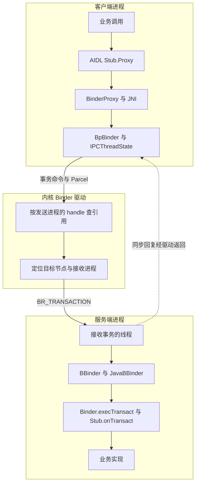
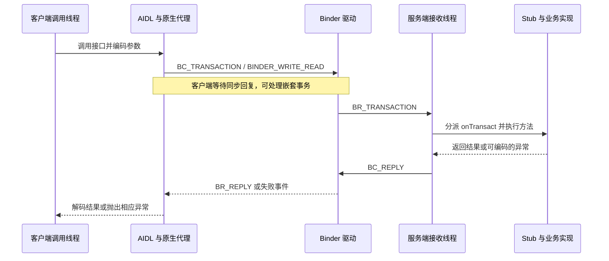
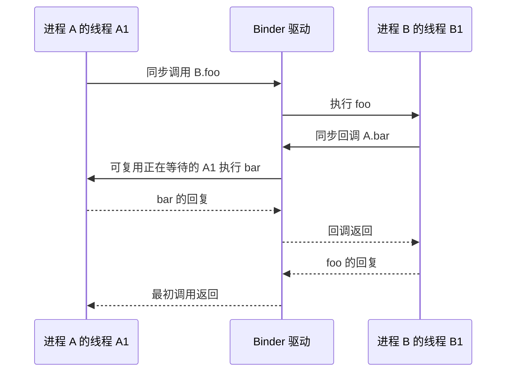

# Binder 机制：从 AIDL 到内核事务

Binder 将接口调用转换为跨进程事务，同时管理远端对象引用、线程调度与调用者身份。理解它，需要把接口生成代码、用户态运行库与内核驱动连接起来，沿着一次请求与回复逐层阅读。

平台实现对应 `android-16.0.0_r1`，内核参考独立标签 `android16-6.12-2025-06_r1`；两者不自动构成某台设备的组合。以下讨论 kernel Binder，socket Binder RPC 的传输路径另计。

## 1. 先分清接口、代理与实体

**AIDL 定义跨进程接口的协议，Binder 执行事务，Parcel 承载数据。** AIDL 编译器生成的代码负责参数编码、事务码分派与返回值解码；驱动不理解业务方法的 Java 名称，而是根据目标引用、事务码和数据执行传递。

Java 调用栈里有三种不同的“代理”，不能混为一谈：

- **生成的 `Stub.Proxy`**：对应具体 AIDL 接口，知道业务方法如何读写 Parcel。
- **`android.os.BinderProxy`**：Java 层的远端 `IBinder`，把通用 `transact` 操作交给 JNI。
- **原生 `BpBinder`**：在 kernel Binder 路径中持有远端 handle，并通过 `IPCThreadState` 与驱动交互。

服务端则由 Java `Binder`、JNI 的 `JavaBBinder` 与生成的 `Stub.onTransact()` 衔接到业务实现。纯 C++ 服务通常使用对应的 `Bp/Bn` 接口类型，不能套用整条 Java/JNI 调用栈。



源码入口：[AIDL Java 生成器](https://android.googlesource.com/platform/system/tools/aidl/+/refs/tags/android-16.0.0_r1/generate_java_binder.cpp)、[`BinderProxy.java`](https://android.googlesource.com/platform/frameworks/base/+/refs/tags/android-16.0.0_r1/core/java/android/os/BinderProxy.java)、[`BpBinder.cpp`](https://android.googlesource.com/platform/frameworks/native/+/refs/tags/android-16.0.0_r1/libs/binder/BpBinder.cpp)。

## 2. 同一份 AIDL，本地与远端执行不同

生成的 `Stub.asInterface()` 会先调用 `queryLocalInterface()`。如果匹配到本进程的接口实现，就直接返回该实现；否则才构造生成的代理。常见本地路径既不经过驱动，也不需要把参数编码成跨进程 Parcel。

### 用同一个加法接口观察两条路径

接口只有一个同步方法，返回值用于观察回复路径。以下三个文件使用同一个包名 `com.example.binderstudy`。

```java
// app/src/main/aidl/com/example/binderstudy/IAdder.aidl
package com.example.binderstudy;

interface IAdder {
    int add(int a, int b);
}
```

```java
// AdderImpl.java：业务实现，既能被本地直接调用，也能接收远端事务。
package com.example.binderstudy;

import android.os.Process;
import android.util.Log;

public final class AdderImpl extends IAdder.Stub {
    @Override
    public int add(int a, int b) {
        Log.d("BinderStudy", "add: pid=" + Process.myPid()
                + ", tid=" + Process.myTid()
                + ", thread=" + Thread.currentThread().getName());
        return a + b;
    }
}
```

```java
// AdderService.java：应用 Service 负责向绑定方交出 Binder。
package com.example.binderstudy;

import android.app.Service;
import android.content.Intent;
import android.os.IBinder;

public final class AdderService extends Service {
    private final AdderImpl binder = new AdderImpl();

    @Override
    public IBinder onBind(Intent intent) {
        return binder; // 交出的是 Stub 实例，不是一个客户端 Proxy。
    }
}
```

先直接在调用进程中创建实现对象，观察本地分支：

```java
// 调用方方法内；所在方法声明 throws android.os.RemoteException。
AdderImpl implementation = new AdderImpl();
IAdder local = IAdder.Stub.asInterface(implementation.asBinder());

boolean sameObject = local == implementation; // true，仍是刚创建的对象。
int result = local.add(3, 4);                  // 7，在当前调用线程执行。
// 不调用 Proxy.add()，也不调用 Stub.onTransact()。
```

再通过 `bindService()` 获取 Binder。在 Activity 中用显式 Intent 绑定 `AdderService`，并在成功绑定后配对调用 `unbindService()`；下面是 `ServiceConnection` 的核心回调，两个进程配置共用这段客户端代码：

```java
@Override
public void onServiceConnected(android.content.ComponentName name,
        android.os.IBinder service) {
    IAdder api = IAdder.Stub.asInterface(service);
    android.util.Log.d("BinderStudy", "binder=" + service.getClass().getName()
            + ", interface=" + api.getClass().getName());

    // 同步 IPC 放到工作线程，避免在主线程等待服务端。
    new Thread(() -> {
        android.util.Log.d("BinderStudy", "caller: pid=" + android.os.Process.myPid()
                + ", tid=" + android.os.Process.myTid());
        try {
            int result = api.add(3, 4);
            android.util.Log.d("BinderStudy", "result=" + result);
        } catch (android.os.RemoteException e) {
            android.util.Log.e("BinderStudy", "add failed", e);
        }
    }, "adder-client").start();
}
```

在 `<application>` 中切换 Service 的进程配置：

```xml
<!-- 同进程：没有 android:process；绑定回调获得本地 Stub。 -->
<service android:name="com.example.binderstudy.AdderService"
    android:exported="false" />

<!-- 跨进程：用这一项替换上面一项，不要同时声明两次。 -->
<service android:name="com.example.binderstudy.AdderService"
    android:exported="false" android:process=":adder" />
```

同进程时，接口对象是 `AdderImpl`，`add()` 日志的 PID、TID 与工作线程调用方相同。独立进程时，客户端通常拿到 `BinderProxy`，接口对象是生成的 `IAdder.Stub.Proxy`；`add()` 在服务端 Binder 线程执行，PID 与客户端不同。**进程配置改变了实际执行路径，客户端的 `api.add(3, 4)` 写法没有改变。**

### asInterface 为什么能返回原对象

生成的 Stub 构造时调用 `attachInterface(this, DESCRIPTOR)`，把实现对象和接口描述保存在本地 Binder 中。`Binder.queryLocalInterface()` 在描述匹配时返回这个对象。下面保留生成代码的核心分支，省略注解和外围类：

```java
// IAdder.Stub 内部，DESCRIPTOR 是接口全名。
public Stub() {
    attachInterface(this, "com.example.binderstudy.IAdder");
}

public static IAdder asInterface(android.os.IBinder obj) {
    if (obj == null) return null;
    android.os.IInterface local =
            obj.queryLocalInterface("com.example.binderstudy.IAdder");
    if (local instanceof IAdder) {
        return (IAdder) local; // 本地 Binder：返回原来的 AdderImpl。
    }
    return new Proxy(obj);     // BinderProxy 的查询返回 null，走远端代理。
}
```

这里检查的是接口描述和 Java 类型，不能只凭“同一个进程”就断言一定直调。不同 ClassLoader 导致类型不匹配、包装对象不提供本地接口等情况，也可能走 Proxy 分支。

### 远端多出来的编码、分派与回复

`api.add()` 进入生成的 `Proxy.add()` 后，才开始编码参数。下面是同步事务的核心结构；事务码由生成器分配，业务代码不要手写一套与生成类并存。

```java
// IAdder.Stub.Proxy.add() 核心节选；mRemote 是客户端持有的 IBinder。
android.os.Parcel data = android.os.Parcel.obtain();
android.os.Parcel reply = android.os.Parcel.obtain();
try {
    data.writeInterfaceToken("com.example.binderstudy.IAdder");
    data.writeInt(a);
    data.writeInt(b);
    // 0 表示普通同步事务；BinderProxy 随后进入 JNI / Native / 驱动。
    mRemote.transact(Stub.TRANSACTION_add, data, reply, 0);
    reply.readException(); // 先读取远端异常头，再读取业务返回值。
    return reply.readInt();
} finally {
    reply.recycle();
    data.recycle();
}
```

服务端接收事务后，生成的 `Stub.onTransact()` 根据事务码分派。下面节选 `add` 对应的分支，省略接口查询等其他分支：

```java
data.enforceInterface("com.example.binderstudy.IAdder");
switch (code) {
    case TRANSACTION_add: {
        int a = data.readInt();
        int b = data.readInt();
        data.enforceNoDataAvail(); // 不接受约定参数之外的剩余数据。
        int result = this.add(a, b); // 直到这里才进入 AdderImpl.add()。
        reply.writeNoException();
        reply.writeInt(result);
        return true;
    }
}
```

把两条路径记成一组调用顺序：

```text
本地：asInterface(Stub) → 原 AdderImpl → add() → 普通 Java 返回
远端：asInterface(BinderProxy) → Proxy.add() → Parcel → transact()
      → 驱动 → 服务端 Stub.onTransact() → AdderImpl.add()
      → 回复 Parcel → Proxy.readException()/readInt() → 调用方得到 7
```

核对入口：[AIDL 生成器的 `MakeAsInterface()`](https://android.googlesource.com/platform/system/tools/aidl/+/refs/tags/android-16.0.0_r1/generate_java_binder.cpp#324)、[`Binder.attachInterface()`](https://android.googlesource.com/platform/frameworks/base/+/refs/tags/android-16.0.0_r1/core/java/android/os/Binder.java#753)、[`queryLocalInterface()`](https://android.googlesource.com/platform/frameworks/base/+/refs/tags/android-16.0.0_r1/core/java/android/os/Binder.java#788)。

即使显式调用本地 `Binder.transact()`，该基线的实现也是直接进入 `onTransact()`，并非自动经过一次驱动往返。

| 比较维度 | 同进程直接接口调用 | 远端同步调用 | 远端 `oneway` 调用 |
| --- | --- | --- | --- |
| 典型执行入口 | 本地实现方法 | 代理编码，服务端分派 | 代理编码，服务端分派 |
| 是否进入驱动 | 通常不进入 | 进入 | 进入 |
| 业务在哪条线程执行 | 当前调用线程 | 服务端接收事务的线程 | 服务端接收事务的线程 |
| 调用方何时继续 | 本地方法返回后 | 收到同步结果或失败后 | 提交阶段完成或失败后，不等业务执行结束 |
| 返回值与业务异常 | 普通语言调用语义 | 经回复 Parcel 或传输错误返回 | 没有普通业务回复，提交仍可能失败 |

因此，AIDL 中的 `oneway` 不会把本地直接调用自动变成后台任务；将服务从同进程改成独立进程，也可能改变时序、异常与线程语义。应用服务的生命周期回调与 Binder 接口方法同样应分别分析，不能因为 `onBind()` 通常在主线程，就认为远端接口方法也在主线程。

依据：[`Binder.java` 的 `queryLocalInterface()` 与 `transact()`](https://android.googlesource.com/platform/frameworks/base/+/refs/tags/android-16.0.0_r1/core/java/android/os/Binder.java)、[Android 进程与线程说明](https://developer.android.com/guide/components/processes-and-threads)。

## 3. ServiceManager 如何让双方找到彼此

### 服务发现与业务调用是两个阶段

在这一基线中，原生 ServiceManager 建立 context object，并通过 `becomeContextManager()` 向驱动注册为当前 Binder context 的管理者。`ProcessState::getContextObject()` 获取 handle 0 对应的入口。**handle 0 是当前 context manager 的特殊入口，不是每个系统服务统一使用的 handle。**

一次典型注册与查找可分为四步：

1. 服务进程创建实现对象，将名称和 Binder 对象交给 ServiceManager。准入检查通过后，ServiceManager 保存名称到服务引用的映射。
2. Binder 对象跨进程传给 ServiceManager 时，驱动进行对象引用转换；它保存的是可操作的服务引用，不是能直接解引用的其他进程 Java 对象地址。
3. 客户端按名称查找服务，ServiceManager 执行查找及可见性检查，将服务引用返回；驱动将其转换成客户端可使用的引用。
4. 客户端持有目标引用后，业务事务直接发往服务进程。**ServiceManager 不负责中转每一次业务请求。**

Android 16 的 Java ServiceManager 仍有兼容包装层，不应把旧教程中的手工事务码实现直接套到这个版本。普通应用也不应把隐藏的 ServiceManager 接口当作公开 SDK；平台服务通常通过相应的 Framework manager 使用，应用间服务则按绑定服务的接口契约接入。

### 注册与查找：名称先换成 Binder，再调用业务接口

沿用第 2 节的 `IAdder`、`AdderImpl`，下面是**平台源码环境**中的核心调用，省略服务启动框架。注册方需要满足 UID、SELinux `add` 权限等条件；普通 APK 不能直接照搬注册代码。`study.adder` 是示例服务名，实际新增系统服务还需要配置对应的 `service_contexts` 类型及策略。

```java
// 服务进程启动时：创建实体，并向目录发布名称与 Binder 的映射。
android.os.ServiceManager.addService(
        "study.adder", new AdderImpl(), false /* allowIsolated */);

// 另一个进程的客户端工作线程：按名称取引用，再转成具体 AIDL 接口。
android.os.IBinder binder = android.os.ServiceManager.getService("study.adder");
if (binder == null) {
    throw new IllegalStateException("study.adder is unavailable");
}
IAdder adder = IAdder.Stub.asInterface(binder);
int result = adder.add(3, 4); // 所在方法处理 RemoteException；这一笔发往服务进程。
```

`addService()` 发布的是 Binder 引用，**不会替你创建服务进程、启动 Android Service 或执行 `onCreate()`**。`getService()` 是目录查找；`adder.add()` 是后续业务调用。二者使用的目标 Binder 不同：前者找 ServiceManager，后者找 `AdderImpl` 所在进程。

### Java 包装层如何找到目录入口

`ServiceManager.java` 先获取 context manager 的 Binder，再包装成目录接口；注册、查找都复用这个目录代理。下面保留 `getIServiceManager()` 的核心代码：

```java
if (sServiceManager != null) {
    return sServiceManager;
}
sServiceManager = ServiceManagerNative.asInterface(
        Binder.allowBlocking(BinderInternal.getContextObject()));
return sServiceManager;
```

`BinderInternal.getContextObject()` 对应当前 Binder context 的特殊入口 handle 0。`sServiceManager` 保存“目录自身”的接口，不是某个业务服务的缓存。注册的 Java 转发路径则是：

```java
// ServiceManager.java，addService() 的四参数重载核心。
getIServiceManager().addService(name, service, allowIsolated, dumpPriority);

// ServiceManagerNative.java 中的兼容代理继续转给 native backend。
mServiceManager.addService(name, service, allowIsolated, dumpPriority);
```

查找路径还要区分 Java 预装缓存和兼容转发，以下为同一源码版本的核心节选：

```java
// ServiceManager.getService(name)：实际方法还捕获 RemoteException 并返回 null。
IBinder service = sCache.get(name);
if (service != null) {
    return service;
} else {
    return Binder.allowBlocking(rawGetService(name));
}

// rawGetService(name)：省略耗时统计。
final IBinder binder =
        getIServiceManager().getService2(name).getServiceWithMetadata().service;

// ServiceManagerNative.java 中的 getService2(name)：注意实际调用 checkService2。
return checkService2(name);
```

Java `sCache` 主要由启动阶段预装，普通查找未命中后不会自动执行 `sCache.put()`。它与 Native ServiceManager 的完整注册表不同；native backend 还可能有自己的缓存。这里的 Java `getService()` 经兼容代理走 `checkService2()`，不能仅凭名字把它理解成“没找到就启动服务并一直等待”。需要等待的系统代码应按相应的 `waitForService()` 契约处理。

核对入口：[`ServiceManager.getIServiceManager()`](https://android.googlesource.com/platform/frameworks/base/+/refs/tags/android-16.0.0_r1/core/java/android/os/ServiceManager.java#149)、[`getService()`](https://android.googlesource.com/platform/frameworks/base/+/refs/tags/android-16.0.0_r1/core/java/android/os/ServiceManager.java#169)、[`addService()`](https://android.googlesource.com/platform/frameworks/base/+/refs/tags/android-16.0.0_r1/core/java/android/os/ServiceManager.java#250)、[`rawGetService()`](https://android.googlesource.com/platform/frameworks/base/+/refs/tags/android-16.0.0_r1/core/java/android/os/ServiceManager.java#426)、[兼容代理的 `getService2()`](https://android.googlesource.com/platform/frameworks/base/+/refs/tags/android-16.0.0_r1/core/java/android/os/ServiceManagerNative.java#68)。

### Native ServiceManager 如何维护注册表

目录维护在 `servicemanager` 用户态进程中，核心容器是 `std::map<std::string, Service>`；内核负责 Binder 节点、引用和事务传递，不负责维护这张按服务名查找的业务目录。`ServiceManager.h` 中的主要成员如下，省略成员函数：

```cpp
struct Service {
    sp<IBinder> binder;          // 服务引用，持有强引用。
    bool allowIsolated;         // 是否允许 isolated 进程查找。
    int32_t dumpPriority;
    bool hasClients = false;
    bool guaranteeClient = false;
    Access::CallingContext ctx; // 记录注册者的身份上下文。
};
using ServiceMap = std::map<std::string, Service>;
ServiceMap mNameToService;
```

`ServiceManager::addService()` 不是无条件 `put()`。它先拒绝普通应用 UID，检查注册者是否能 `add` 该名称，校验非空 Binder、名称，以及适用的 VINTF 声明；随后对远端 Binder 注册死亡通知，再保存记录。下面按执行顺序摘出关键语句，省略各检查的错误分支及通知回调：

```cpp
auto ctx = mAccess->getCallingContext();
// multiuser_get_app_id(ctx.uid) >= AID_APP 时直接拒绝。
// canAddService(ctx, name, &accessorName) 执行注册准入检查。
// 非空、合法名称、适用的声明要求等检查通过后：

if (binder->remoteBinder() != nullptr &&
    binder->linkToDeath(sp<ServiceManager>::fromExisting(this)) != OK) {
    return Status::fromExceptionCode(Status::EX_ILLEGAL_STATE,
                                    "Couldn't linkToDeath.");
}
mNameToService[name] = Service{
    .binder = binder,
    .allowIsolated = allowIsolated,
    .dumpPriority = dumpPriority,
    .hasClients = prevClients,
    .guaranteeClient = false,
    .ctx = ctx,
};
```

这个赋值也说明：已有名称不是天然不可覆盖；源码有重注册的处理，`prevClients` 来自对旧记录的检查。不能把服务名当作不可变对象 ID。

查找最终进入 `tryGetBinder()`。以下节选突出“查表后仍检查访问条件”，省略 lazy-service 启动和客户端计数通知：

```cpp
auto ctx = mAccess->getCallingContext();
sp<IBinder> out;
Service* service = nullptr;
if (auto it = mNameToService.find(name); it != mNameToService.end()) {
    service = &(it->second);
    if (!service->allowIsolated && is_multiuser_uid_isolated(ctx.uid)) {
        return os::ServiceWithMetadata();
    }
    out = service->binder;
}
if (!mAccess->canFind(ctx, name)) {
    return os::ServiceWithMetadata(); // 名称存在，也不代表调用方允许查找。
}
// 实际函数将 out 与 lazy-service 元数据一起装入 ServiceWithMetadata 返回。
```

服务进程退出后，驱动的死亡通知到达 ServiceManager，`binderDied()` 移除指向死亡对象的目录项。后续重新注册同名服务会得到新的服务对象；客户端已经持有的旧 Proxy 不会自动换成新对象，仍需处理死亡并重新获取。

```cpp
// ServiceManager::binderDied() 的服务表清理节选。
for (auto it = mNameToService.begin(); it != mNameToService.end();) {
    if (who == it->second.binder) {
        it = mNameToService.erase(it);
    } else {
        ++it;
    }
}
```

核对入口：[`Service` 与注册表定义](https://android.googlesource.com/platform/frameworks/native/+/refs/tags/android-16.0.0_r1/cmds/servicemanager/ServiceManager.h#84)、[`addService()`](https://android.googlesource.com/platform/frameworks/native/+/refs/tags/android-16.0.0_r1/cmds/servicemanager/ServiceManager.cpp#512)、[`tryGetBinder()`](https://android.googlesource.com/platform/frameworks/native/+/refs/tags/android-16.0.0_r1/cmds/servicemanager/ServiceManager.cpp#449)、[`binderDied()`](https://android.googlesource.com/platform/frameworks/native/+/refs/tags/android-16.0.0_r1/cmds/servicemanager/ServiceManager.cpp#853)。

源码入口：[`servicemanager/main.cpp`](https://android.googlesource.com/platform/frameworks/native/+/refs/tags/android-16.0.0_r1/cmds/servicemanager/main.cpp)、[`ServiceManager.cpp`](https://android.googlesource.com/platform/frameworks/native/+/refs/tags/android-16.0.0_r1/cmds/servicemanager/ServiceManager.cpp)、[`ServiceManagerNative.java`](https://android.googlesource.com/platform/frameworks/base/+/refs/tags/android-16.0.0_r1/core/java/android/os/ServiceManagerNative.java)。

### handle 为什么不是全局对象 ID

| 对象 | 所在层次 | 表达什么 | 阅读时注意 |
| --- | --- | --- | --- |
| `binder_proc` | 内核 | 一个 Binder 进程上下文 | 包含该进程的引用、线程等状态 |
| `binder_node` | 内核 | 由某进程拥有的 Binder 实体节点 | 关联拥有者及本地对象标识 |
| `binder_ref` | 内核 | 某进程对节点的引用 | 描述符属于引用进程的命名空间 |
| handle | 用户态协议与内核引用表 | 当前进程用于寻址远端节点的引用描述符 | 不同进程的同一数值不保证指向同一节点 |
| `binder_thread` | 内核 | 参与事务的线程状态 | 包含待办与同步事务栈等信息 |
| `binder_transaction` | 内核 | 一次正在传递或处理的事务 | 不等同于永久对象或业务成功记录 |

客户端把某个 Binder 引用继续传给第三个进程时，第三个进程得到自己的引用描述符；如果对象回到其所属进程，驱动可以将它还原为本地对象形式。不能把某进程的 handle 直接当成另一进程可复用的地址。

依据：固定内核的 [`binder_internal.h`](https://android.googlesource.com/kernel/common/+/refs/tags/android16-6.12-2025-06_r1/drivers/android/binder_internal.h) 与 [`binder.c` 的对象翻译和目标查找](https://android.googlesource.com/kernel/common/+/refs/tags/android16-6.12-2025-06_r1/drivers/android/binder.c)。

## 4. 一次 Java 远端同步调用如何完成

### 从应用到驱动的请求路径

下面按请求经过的入口排列；它跨越两端的进程和线程，不能当作单条线程栈。

```text
客户端：
生成的 Stub.Proxy.业务方法
  → BinderProxy.transact / transactNative
  → JNI android_os_BinderProxy_transact
  → BpBinder::transact
  → IPCThreadState::transact
  → writeTransactionData(BC_TRANSACTION, ...)
  → talkWithDriver → ioctl(BINDER_WRITE_READ)

内核：
binder_ioctl → binder_ioctl_write_read
  → binder_thread_write → binder_transaction
  → 定位引用/节点，分配目标缓冲区，转换对象，投递事务
  → binder_thread_read 返回 BR_TRANSACTION

服务端：
IPCThreadState::executeCommand
  → BBinder::transact
  → JavaBBinder::onTransact
  → Binder.execTransact / execTransactInternal
  → 生成的 Stub.onTransact
  → 业务实现方法
```

客户端代理把接口标识与参数写入 Parcel，并将事务码作为 `transact()` 的独立参数传递。`writeTransactionData()` 组织 `binder_transaction_data` 等协议数据，其中包括目标 handle、code、flags、数据区及对象偏移表信息；`BINDER_WRITE_READ` 负责交换一批命令和返回事件，并不意味着一次业务调用只发生一次 ioctl。

驱动根据发送进程的引用表找到目标节点，将工作交给目标线程或进程队列。服务端用户态读取 `BR_TRANSACTION` 后建立 Parcel 视图，再由本地 Binder 对象逐层分派。生成的 `Stub.onTransact()` 负责检查协议、解码参数和调用实现，驱动本身不执行 Java 业务方法。

源码入口：[`android_util_Binder.cpp`](https://android.googlesource.com/platform/frameworks/base/+/refs/tags/android-16.0.0_r1/core/jni/android_util_Binder.cpp)、[`IPCThreadState.cpp`](https://android.googlesource.com/platform/frameworks/native/+/refs/tags/android-16.0.0_r1/libs/binder/IPCThreadState.cpp)、[`Binder.cpp`](https://android.googlesource.com/platform/frameworks/native/+/refs/tags/android-16.0.0_r1/libs/binder/Binder.cpp)。

### 回复并不是函数返回时自动跨过进程边界



服务端将同步结果写入回复 Parcel，经 `sendReply()` 发送 `BC_REPLY`。驱动把回复交回对应等待线程，客户端处理 `BR_REPLY`，生成的 Java 代理读取异常状态及返回值。

要区分三层结果：驱动是否接受事务、Binder 传输是否完成、业务是否成功。`BR_TRANSACTION_COMPLETE` 是驱动侧完成通知，不能替代同步回复，更不能当作业务成功确认。协议和执行细节见 [`IPCThreadState::waitForResponse()`、`executeCommand()` 与 `sendReply()`](https://android.googlesource.com/platform/frameworks/native/+/refs/tags/android-16.0.0_r1/libs/binder/IPCThreadState.cpp)。

## 5. Parcel、对象转换与内存拷贝

### Parcel 中不只有一串普通字节

普通字段按约定编码；Binder 对象、文件描述符等还需要相应的对象元数据与偏移信息。`Parcel::flattenBinder()` 根据本地实体或远端代理写入不同对象形式，驱动随后将它们转换成接收进程可使用的表示；`unflattenBinder()` 再构造本地对象引用或代理。

因此，把一个原始指针数值写进 Parcel，并不会使接收进程拥有可解引用的同一对象。跨进程传递 FD 也涉及内核中的引用和接收方描述符安装，不能简单理解为复制一个整数。

源码入口：[`Parcel.cpp` 的 `flattenBinder()`、`unflattenBinder()`](https://android.googlesource.com/platform/frameworks/native/+/refs/tags/android-16.0.0_r1/libs/binder/Parcel.cpp) 及驱动的 `binder_translate_binder()`、`binder_translate_handle()`。

### 怎样准确理解“一次拷贝”

该基线的 libbinder 通过 `mmap` 建立接收缓冲区映射。驱动把发送方的 payload 写入接收方缓冲区；接收方用户态 Parcel 可以引用这一映射，避免再把同一 payload 从独立内核中转区完整复制到接收方用户缓冲区。

这个描述只针对**一个方向的 payload 传输机制**。参数序列化、协议元数据、对象转换、读取字符串或数组时的分配，以及反方向回复都有自己的成本，整个 RPC 不能称为“零拷贝”，也不能不加条件地说“总共只复制一次”。

读取结束后的缓冲区释放也属于协议的一部分，不能把映射地址当作无限期有效的业务存储。核对入口：[`ProcessState.cpp` 的映射建立](https://android.googlesource.com/platform/frameworks/native/+/refs/tags/android-16.0.0_r1/libs/binder/ProcessState.cpp)、[`binder_alloc.c` 的分配与复制](https://android.googlesource.com/kernel/common/+/refs/tags/android16-6.12-2025-06_r1/drivers/android/binder_alloc.c)、[`Parcel::ipcSetDataReference()`](https://android.googlesource.com/platform/frameworks/native/+/refs/tags/android-16.0.0_r1/libs/binder/Parcel.cpp)。

### 接收缓冲区怎样归还给驱动 {#receive-buffer-lifetime}

接收 Parcel 可以引用驱动映射的数据，但该地址不是业务永久存储。释放接收数据时，`IPCThreadState::freeBuffer()` 将 `BC_FREE_BUFFER` 和缓冲区地址写入输出命令队列，并调用 `flushIfNeeded()`；驱动据此回收接收空间。及时结束接收数据的持有，既是对象生命周期问题，也是并发事务的容量问题。[释放协议](https://android.googlesource.com/platform/frameworks/native/+/refs/tags/android-16.0.0_r1/libs/binder/IPCThreadState.cpp#1696)

保留反序列化得到的业务值，与保留 Parcel 内部数据指针是两回事。原生代码需要跨越 Parcel 生命周期使用数据时，应取得有明确所有权的副本或对象引用。

## 6. 线程池、同步重入与 oneway

### 线程池容量不是一个通用常数

原生 `ProcessState` 管理进程中的 Binder 运行时状态，`IPCThreadState` 保存参与调用的线程状态。服务端方法应按可能被不同调用线程并发进入来设计，不能依赖“系统会固定派给同一条线程”。

`maxThreads` 也不能机械解释为进程总 Binder 线程上限。该版本 NDK 头文件明确区分：内核按需启动的线程、`startThreadPool()` 主动启动的线程，以及调用 `joinThreadPool()` 加入的线程。它给出的配置 3、再启动 1 条并由主线程加入 1 条的例子，可形成 5 条线程；这不是所有 Java 或原生服务的统一配置。

遇到拥塞，先区分业务耗时、锁等待、嵌套调用和队列积压，再考虑线程池设置。增加线程不能修复持锁跨进程调用的死锁。依据：[`binder_process.h` 的线程池契约](https://android.googlesource.com/platform/frameworks/native/+/refs/tags/android-16.0.0_r1/libs/binder/ndk/include_platform/android/binder_process.h)。

### 等待回复的线程可能再次进入业务代码



同步事务链支持嵌套回调，原线程可能在外层调用尚未结束时被重新进入。即使进程只有一条 Binder 线程，也不能据此排除重入。

如果 A 在持有非递归锁时调用 B，B 又同步回调 A 并尝试获取同一把锁，就可能死锁。Java 的可重入锁在这种同线程场景下未必自锁，但回调仍可能看到尚未恢复的不完整状态。工程上应避免持锁发起 Binder 调用，缩小临界区，并在跨进程调用前建立明确、可回入的状态。依据：[官方 Binder 线程模型](https://source.android.com/docs/core/architecture/ipc/binder-threading)。

### oneway 的串行边界在 Binder 节点上

远端 `oneway` 不等待服务端业务执行结束，仍要完成编码与提交，且提交可能失败。它没有普通业务回复，服务端后来抛出的异常也不能按同步调用方式返回给调用方。

同一 Binder 节点上的异步事务会依次交付处理，但先后执行的线程可以不同。这个保证不能推广成“整个服务进程串行”，也不能约束同一节点的同步事务；如果 handler 把任务转交给业务线程池，后续业务任务是否并行与是否有序，要由业务层保证。

异步队列受缓冲区等资源约束，并非无限队列。需要业务完成确认时，应设计回调、结果查询或请求状态协议，而不是把方法改成 `oneway` 后假定任务必达。

核对入口：[`IPCThreadState::transact()` 的异步分支](https://android.googlesource.com/platform/frameworks/native/+/refs/tags/android-16.0.0_r1/libs/binder/IPCThreadState.cpp)、固定内核 [`binder.c` 的 `async_todo`](https://android.googlesource.com/kernel/common/+/refs/tags/android16-6.12-2025-06_r1/drivers/android/binder.c) 与 [`binder_alloc.c` 的异步空间管理](https://android.googlesource.com/kernel/common/+/refs/tags/android16-6.12-2025-06_r1/drivers/android/binder_alloc.c)。

## 7. 调用身份与权限检查

服务端处理入站事务时，`Binder.getCallingUid()` 读取当前线程的调用者身份；普通远端事务的身份由内核提供，不能让客户端自行提交一个 UID 字段来替代它。参数中的包名、业务账号等仍需按自己的协议核实。

身份属于接收事务的线程上下文。需要异步处理时，应在入口完成鉴权，并按需要显式保存已经核实的身份信息；把工作切到另一条线程后再调用 `getCallingUid()`，不能恢复最初那笔事务的来访者。

`getCallingPid()` 不适合作为安全身份：该基线的远端 `oneway` 调用返回 0，同步调用也可能因发送方死亡的竞态返回 0；PID 还可能被复用。鉴权应基于经验证的 UID、权限与具体资源规则，而不是 PID 或接口描述符。依据：[`Binder` 调用身份 API](https://developer.android.com/reference/android/os/Binder)。

### clearCallingIdentity 改变什么

它重置当前线程的 Binder 入站调用身份，用于明确需要以本服务身份执行的操作，**不会改变进程的 Linux UID，也不是通用的权限提升接口**。先检查原始调用者，再按需要清除，并在同一线程的 `finally` 中恢复。

```java
// 结构示意：授权规则和具体操作由服务实现。
final int callerUid = Binder.getCallingUid();
// 在这里校验 callerUid 是否有权执行目标操作，失败则拒绝。

final long identity = Binder.clearCallingIdentity();
try {
    // 仅执行确实需要本服务身份的操作。
} finally {
    Binder.restoreCallingIdentity(identity);
}
```

还要区分下一跳远程调用与本进程内的检查：A 调用 B，B 再发起到 C 的普通 Binder 事务时，C 看到的发送方是 B；这并不以 B 先调用 `clearCallingIdentity()` 为前提。B 线程上仍保留的入站身份，会影响 B 的本地调用和身份查询，正是需要谨慎处理的上下文。

接口 token/descriptor 用于核对协议，不等同于授权；ServiceManager 的服务发现准入、SELinux 的 Binder 策略与具体业务方法的权限检查也各有职责，拿到引用不能代替业务鉴权。核对入口：[`Binder.java`](https://android.googlesource.com/platform/frameworks/base/+/refs/tags/android-16.0.0_r1/core/java/android/os/Binder.java)、[`IPCThreadState::clearCallingIdentity()` 与 `clearCaller()`](https://android.googlesource.com/platform/frameworks/native/+/refs/tags/android-16.0.0_r1/libs/binder/IPCThreadState.cpp)。

## 8. 引用计数、死亡通知与业务可靠性

Binder 运行库和驱动共同维护对象与远端引用的生命周期。持有代理意味着持有对端对象的引用关系，**不保证承载服务的进程永远存活**；系统仍可能结束进程，进程也可能崩溃。

### 引用计数：Native 代理如何通知驱动

Java 引用和 Native 强弱引用不是一套计数，不能把“Java 变量赋值一次”理解成“立刻发一次驱动命令”。看内核 Binder 路径的两个关键回调即可理解强引用的建立与释放；以下省略 Binder RPC 分支、日志及编译条件：

```cpp
// libs/binder/BpBinder.cpp，类 android::BpBinder。
// onFirstRef()：L768，首次建立 Native 强引用时。
IPCThreadState* ipc = IPCThreadState::self();
if (ipc) ipc->incStrongHandle(binderHandle(), this);

// onLastStrongRef()：L783，最后一个 Native 强引用释放时。
IPCThreadState* ipc = IPCThreadState::self();
if (ipc) ipc->decStrongHandle(binderHandle());
```

`IPCThreadState` 把强引用变化编码到发往驱动的命令缓冲；下面保留命令与 handle，省略刷新及临时引用保护：

```cpp
// libs/binder/IPCThreadState.cpp，类 android::IPCThreadState。
// incStrongHandle()：L945；强引用增加。
mOut.writeInt32(BC_ACQUIRE);
mOut.writeInt32(handle);

// decStrongHandle()：L957；强引用减少。
mOut.writeInt32(BC_RELEASE);
mOut.writeInt32(handle);
```

驱动据此维护本进程 `binder_ref` 与目标 `binder_node` 的关系，服务端运行库再配合维护实体对象的生命周期。它能维持对象引用，不能阻止整个进程被杀死；把客户端代理放在静态变量中也不能让服务进程“保活”。

源码：[`BpBinder::onFirstRef()`](https://android.googlesource.com/platform/frameworks/native/+/refs/tags/android-16.0.0_r1/libs/binder/BpBinder.cpp#768)、[`onLastStrongRef()`](https://android.googlesource.com/platform/frameworks/native/+/refs/tags/android-16.0.0_r1/libs/binder/BpBinder.cpp#783)、[`IPCThreadState::incStrongHandle()`](https://android.googlesource.com/platform/frameworks/native/+/refs/tags/android-16.0.0_r1/libs/binder/IPCThreadState.cpp#945)。

### 死亡通知：从登记到回调

`linkToDeath()` 用于监听远端 Binder 的死亡。本地对象没有同样的远端进程死亡语义；登记通知时目标也可能已经死亡。`isBinderAlive()` 等检查存在检查后状态变化的竞态，不能把“检查为存活”当作下一次调用必定成功的保证。

Native `BpBinder::linkToDeath()` 首次建立通知列表时向驱动登记，已发送死亡通知的代理则返回 `DEAD_OBJECT`。请求中的 handle 用于定位目标，cookie 用于把死亡事件关联回本地代理：

```cpp
// BpBinder.cpp，BpBinder::linkToDeath()，L421；内核 Binder 分支节选。
IPCThreadState* self = IPCThreadState::self();
self->requestDeathNotification(binderHandle(), this);
self->flushCommands();

// IPCThreadState.cpp，requestDeathNotification()，L999。
mOut.writeInt32(BC_REQUEST_DEATH_NOTIFICATION);
mOut.writeInt32((int32_t)handle);
mOut.writePointer((uintptr_t)proxy);

// IPCThreadState.cpp，executeCommand() 的 BR_DEAD_BINDER 分支，L1565。
case BR_DEAD_BINDER: {
    BpBinder* proxy = (BpBinder*)mIn.readPointer();
    proxy->sendObituary(); // 标记死亡、取出接收者并逐个通知，Java 桥再回调 DeathRecipient。
    mOut.writeInt32(BC_DEAD_BINDER_DONE);
    mOut.writePointer((uintptr_t)proxy);
} break;
```

源码：[`BpBinder::linkToDeath()`](https://android.googlesource.com/platform/frameworks/native/+/refs/tags/android-16.0.0_r1/libs/binder/BpBinder.cpp#421)、[`requestDeathNotification()`](https://android.googlesource.com/platform/frameworks/native/+/refs/tags/android-16.0.0_r1/libs/binder/IPCThreadState.cpp#999)、[`BR_DEAD_BINDER` 分派](https://android.googlesource.com/platform/frameworks/native/+/refs/tags/android-16.0.0_r1/libs/binder/IPCThreadState.cpp#1565)、[`sendObituary()`](https://android.googlesource.com/platform/frameworks/native/+/refs/tags/android-16.0.0_r1/libs/binder/BpBinder.cpp#524)。

下面用第 2 节的 `IAdder` 包装一个远端连接。保留同一个 `DeathRecipient` 供清理使用，用原子状态协调业务线程与死亡回调；没有通过 `isBinderAlive()` 做不可靠的调用前保证。

```java
// AdderSession.java：用于远端 Binder；调用者持有会话，并在不用时 close()。
package com.example.binderstudy;

import android.os.DeadObjectException;
import android.os.IBinder;
import android.os.RemoteException;
import android.util.Log;
import java.util.concurrent.atomic.AtomicBoolean;

public final class AdderSession implements AutoCloseable {
    private final IBinder binder;
    private final IAdder api;
    private final AtomicBoolean closed = new AtomicBoolean();
    private final AtomicBoolean dead = new AtomicBoolean();
    private final IBinder.DeathRecipient death = () -> {
        dead.set(true); // Binder 回调线程：只标记失效，不在这里执行阻塞式重连。
        Log.w("BinderStudy", "remote binder died");
        // 如需恢复，将连接重建请求投递到自己管理的工作线程。
    };

    public AdderSession(IBinder binder) throws RemoteException {
        this.binder = java.util.Objects.requireNonNull(binder);
        this.api = IAdder.Stub.asInterface(binder);
        // 对端可能在登记前已经死亡，此处也必须让调用者处理 RemoteException。
        binder.linkToDeath(death, 0);
    }

    public int add(int a, int b) throws RemoteException {
        if (closed.get()) throw new IllegalStateException("session closed");
        if (dead.get()) throw new DeadObjectException();
        try {
            return api.add(a, b); // 即使前面的状态正常，这里仍可能失败。
        } catch (DeadObjectException e) {
            dead.set(true); // 调用失败也能先于死亡回调到达。
            throw e;
        }
    }

    @Override
    public void close() {
        if (closed.compareAndSet(false, true)) {
            binder.unlinkToDeath(death, 0); // 主动退出时取消登记；死亡后可能返回 false。
        }
    }
}
```

`close()` 结束本会话的使用，不会撤销已经发出的事务；调用者还需释放自己的会话引用。对于绑定服务，取消死亡登记也不等于 `unbindService()`，绑定关系仍需独立清理。`binderDied()` 中无需再次取消已经死亡的 Binder 登记；回调可能来自 Binder 线程，不能直接更新 UI。[死亡回调与清理契约](https://developer.android.com/reference/android/os/IBinder.DeathRecipient)

### 传输失败为什么不能直接重放业务

死亡通知既不会自动重新连接，也不能证明此前某个业务请求没有执行。重连后需要重新取得有效代理并按需登记死亡通知；是否重试、如何去重及如何查询提交结果，则属于业务协议。

```text
客户端发出 create(requestId)
→ 服务端已提交记录
→ 服务端在回复到达客户端之前崩溃
→ 客户端得到异常，却不能据此判断“没有创建成功”
```

有副作用接口应携带稳定的 `requestId`，服务端将去重记录与业务变更原子持久化；重连后按该 ID 查询结果，确需重试时复用原 ID。只在进程内保存去重 Map，会在崩溃后丢失去重依据。`DeadObjectException` 也可能源于底层 Binder 错误，应将连接视为不可用并恢复，不能把异常本身当作目标进程死亡的取证结论。[异常语义](https://developer.android.com/reference/android/os/DeadObjectException)

引用与死亡协议入口：[`IBinder` 生命周期契约](https://developer.android.com/reference/android/os/IBinder)、[原生 `IBinder.h`](https://android.googlesource.com/platform/frameworks/native/+/refs/tags/android-16.0.0_r1/libs/binder/include/binder/IBinder.h)。

## 9. 缓冲区、延迟与常见故障

### “1 MiB”不是单笔请求的安全上限

官方 API 说明 Binder 事务缓冲区容量有限，并由进程进行中的事务共享。该基线 libbinder 的接收区大小还包含 `1 MiB - 2 × page size` 这样的实现细节，不能把一个近似数值直接当成单笔 payload 的可用预算。

下面的平台片段固定为 `android-16.0.0_r1`；驱动片段固定为 `android16-6.12-2025-06_r1`。行号按 Gitiles 原始文件计算，内核文件是 C 函数，没有 Java/C++ 类。

**① libbinder 实际申请多大的接收映射。** 文件 `frameworks/native/libs/binder/ProcessState.cpp`，宏位于文件作用域 L47；使用位置为 `android::ProcessState::ProcessState(const char* driver)`（方法起点 L592，`mmap()` 调用 L610）：

```cpp
// ProcessState.cpp:L47，文件作用域宏，不属于某个方法。
#define BINDER_VM_SIZE ((1 * 1024 * 1024) - sysconf(_SC_PAGE_SIZE) * 2)

// ProcessState.cpp:L610–611，ProcessState 构造函数内。
// 从 Binder 驱动映射接收事务的地址空间；长度不是完整的 1 MiB。
mVMStart = mmap(nullptr, BINDER_VM_SIZE, PROT_READ, MAP_PRIVATE | MAP_NORESERVE,
                opened.get(), 0);
```

若页大小为 4 KiB，申请的是 `1,040,384 B = 1016 KiB`；若为 16 KiB，则是 `1,015,808 B = 992 KiB`。这是代入源码公式的计算，不能据此推断当前设备的页大小。[宏 L47](https://android.googlesource.com/platform/frameworks/native/+/refs/tags/android-16.0.0_r1/libs/binder/ProcessState.cpp#47)、[构造函数调用 L610](https://android.googlesource.com/platform/frameworks/native/+/refs/tags/android-16.0.0_r1/libs/binder/ProcessState.cpp#610)

**② 驱动另有映射长度上限，但不会自动扩大 libbinder 的申请。** 文件 `drivers/android/binder_alloc.c`，函数 `binder_alloc_mmap_handler()` 从 L826 开始，长度裁剪在 L845–846：

```c
// binder_alloc.c:L845–846，binder_alloc_mmap_handler()。
// 可管理长度取 VMA 实际长度和 4 MiB 中较小者。
alloc->buffer_size = min_t(unsigned long, vma->vm_end - vma->vm_start,
                           SZ_4M);
```

`4 MiB` 是这一内核分配器的裁剪上限，**不代表普通 Java 应用就有 4 MiB 事务缓冲区**；libbinder 走上面的约 1 MiB 申请时，驱动仍按较小的实际映射长度管理。[函数与裁剪位置 L845](https://android.googlesource.com/kernel/common/+/refs/tags/android16-6.12-2025-06_r1/drivers/android/binder_alloc.c#845)

**③ `oneway` 还受异步事务预算约束。** 同一文件、同一 `binder_alloc_mmap_handler()`，L876 初始化异步可用空间；后续 `binder_alloc_new_buf_locked()`（起点 L437）在 L461 检查余额，L529 扣除本次分配：

```c
// binder_alloc.c:L876，binder_alloc_mmap_handler()：初始异步预算为总长度的一半。
alloc->free_async_space = alloc->buffer_size / 2;

// binder_alloc.c:L461–466，binder_alloc_new_buf_locked()：余额不足就拒绝。
if (is_async && alloc->free_async_space < size) {
    // 此处省略原有调试日志。
    buffer = ERR_PTR(-ENOSPC);
    goto out;
}

// binder_alloc.c:L528–529，同一分配函数：成功分配后扣减。
if (is_async) {
    alloc->free_async_space -= size;
    // 此处省略日志和 oneway spam 检测。
}
```

这是接收方分配器中全部未释放异步事务共享的预算，不是“每个 `oneway` 都能发半个缓冲区”，也不是另开了一块同样大小的独立缓冲。同步与异步还共用实际空间，碎片和并发占用同样会影响成功率；该内核函数还包含厂商 hook 的额外拒绝路径。[预算初始化 L876](https://android.googlesource.com/kernel/common/+/refs/tags/android16-6.12-2025-06_r1/drivers/android/binder_alloc.c#876)、[余额检查 L461](https://android.googlesource.com/kernel/common/+/refs/tags/android16-6.12-2025-06_r1/drivers/android/binder_alloc.c#461)、[扣减 L529](https://android.googlesource.com/kernel/common/+/refs/tags/android16-6.12-2025-06_r1/drivers/android/binder_alloc.c#529)

**④ 实际分配不只计算业务字段长度。** `binder_alloc.c` 的 `sanitized_size()` 从 L544 开始，将数据、Binder 对象偏移表及附加缓冲分别按指针大小对齐，并检查整数溢出。以下节选 L550–557：

```c
// binder_alloc.c:L550–557，sanitized_size()。
// data_size 之外还要计入 offsets_size 和 extra_buffers_size。
tmp = ALIGN(data_size, sizeof(void *)) +
      ALIGN(offsets_size, sizeof(void *));
if (tmp < data_size || tmp < offsets_size)
    return 0;
total = tmp + ALIGN(extra_buffers_size, sizeof(void *));
if (total < tmp || total < extra_buffers_size)
    return 0;
```

因此 `Parcel.dataSize()` 可以帮助估算编码后数据，不能单独证明目标进程当前一定能分配成功。[计算位置 L544](https://android.googlesource.com/kernel/common/+/refs/tags/android16-6.12-2025-06_r1/drivers/android/binder_alloc.c#544)

**⑤ 64 KiB 是 Framework 给出的建议规模，不是驱动的另一条硬上限。** 文件 `frameworks/base/core/java/android/os/IBinder.java`，接口 `android.os.IBinder` 的常量在 L198，静态方法 `getSuggestedMaxIpcSizeBytes()` 在 L205–206：

```java
// IBinder.java:L198，接口字段；MAX_IPC_SIZE 在源码中标为 @hide。
public static final int MAX_IPC_SIZE = 64 * 1024;

// IBinder.java:L205–206，调用方可使用的建议规模查询接口，API 30 起提供。
static int getSuggestedMaxIpcSizeBytes() {
    return MAX_IPC_SIZE;
}
```

应用调用 `IBinder.getSuggestedMaxIpcSizeBytes()` 获取建议值，而不是直接依赖隐藏常量。小于建议值仍可能因目标空间不足而失败；大于建议值也不意味着驱动必定按 64 KiB 拒绝。[常量 L198 与方法 L205](https://android.googlesource.com/platform/frameworks/base/+/refs/tags/android-16.0.0_r1/core/java/android/os/IBinder.java#198)

并发事务、对象元数据和占用尚未释放的缓冲区都会影响分配。请求发不出去和回复发不回来，都可能表现为 `TransactionTooLargeException`；客户端不能仅凭该异常判定服务端没有执行。

接口应控制请求和回复规模，对集合分页、对字段做体积约束；大数据优先考虑带明确生命周期的文件描述符或共享内存通道，并单独管理所有权与权限。依据：[`TransactionTooLargeException` 契约](https://developer.android.com/reference/android/os/TransactionTooLargeException) 与 [`ProcessState.cpp`](https://android.googlesource.com/platform/frameworks/native/+/refs/tags/android-16.0.0_r1/libs/binder/ProcessState.cpp)。

### 按等待阶段定位问题

| 现象 | 优先检查 | 需要的证据 |
| --- | --- | --- |
| 查不到服务 | 注册时序、名称、当前 Binder context、可见性或权限 | 注册日志、ServiceManager 状态与策略日志 |
| 调用线程长期等待 | 服务端耗时、锁、嵌套依赖与可用接收线程 | 双方线程栈、同一时段的调度和 Binder trace |
| 小请求也失败 | 对端死亡、共享缓冲占用、异常回复与运行时状态 | 异常类型、服务生命周期、并发及回复大小 |
| oneway 延迟持续增加 | 接收端处理速度、同节点排队、异步空间 | 发送/接收时间、队列趋势与业务处理耗时 |
| UI 卡顿或 ANR | 主线程上的同步调用及下游阻塞 | 主线程栈、系统 trace 与关联服务线程状态 |

一次调用的延迟包含编码、驱动处理、排队与调度、业务执行和回复等阶段。只看到客户端停在 `transact`，不足以判断驱动慢或线程池不足；扩容、改异步和增加重试之前，应先找到等待发生的位置。

## 10. 现代 AIDL 与历史 Binder 分域

Android 8 的相关文档介绍了 `/dev/binder`、`/dev/hwbinder` 与 `/dev/vndbinder` 等历史分域，每个 context 有自己的服务管理入口。它们不是可以任意互通、共享 handle 的同一个命名空间。

但不能把“Framework 永远用 binder，所有 vendor 服务永远用 hwbinder/vndbinder”当作现代规则。Stable AIDL 自 Android 10 提供接口稳定性支持，Android 11 引入 AIDL HAL；现代跨 system/vendor 的 Stable AIDL 使用 `/dev/binder`，并对后端与运行库有具体要求。`vndservicemanager` 自 Android 11 被弃用，不表示所有存量设备立刻移除。

跨 system/vendor 的 HAL 接口还涉及 `@VintfStability`、构建中的 `stability: "vintf"`、接口版本冻结与 VINTF 清单等约束。写了 `.aidl` 文件并不自动获得跨版本兼容；不能把本地 Java AIDL、平台内部 C++ ABI 和稳定 HAL 接口当成同一层保证。

依据：[Binder 分域的历史与迁移说明](https://source.android.com/docs/core/architecture/hidl/binder-ipc)、[AIDL HAL](https://source.android.com/docs/core/architecture/aidl/aidl-hals)、[Stable AIDL](https://source.android.com/docs/core/architecture/aidl/stable-aidl)、[AIDL 后端与 API 边界](https://source.android.com/docs/core/architecture/aidl/aidl-backends)。

## 11. 怎样用源码和设备验证理解

### 先记录实际环境

先查询实际版本、构建和内核，再选择对应源码；服务列表用于确认目录可见性：

```sh
adb shell getprop ro.build.version.release
adb shell getprop ro.build.version.sdk
adb shell getprop ro.build.fingerprint
adb shell uname -r
adb shell service list
adb shell dumpsys -l
```

`service list` 列出服务名称及可获取的接口描述；`dumpsys -l` 只列出服务，不执行各服务的完整 dump。它们反映当前上下文中可见的服务，不是所有内核 Binder 节点或 handle 的清单。命令语义可核对固定版本的 [`service.cpp`](https://android.googlesource.com/platform/frameworks/native/+/refs/tags/android-16.0.0_r1/cmds/service/service.cpp) 与 [`dumpsys.cpp`](https://android.googlesource.com/platform/frameworks/native/+/refs/tags/android-16.0.0_r1/cmds/dumpsys/dumpsys.cpp)。

即使设备显示 Android 16，也不能由版本字符串单独推出它与本文源码标签完全一致。进一步分析应使用与设备构建匹配的源码、符号和厂商修改信息。

### 再构造能区分机制的观察

1. 在受控测试服务中，比较同进程与独立进程调用，记录入口线程、UID 与执行顺序，验证本地优化是否发生。
2. 分别观察同步方法与 `oneway` 的发送返回、服务端开始和业务完成时刻，避免把提交时间当作完成时间。
3. 给请求与回复加入可关联的业务编号，结合双方线程栈与系统 trace，定位编码、排队、执行和回复的等待阶段。
4. 在隔离环境验证服务死亡、连接恢复和大消息失败，核对副作用是否已经发生，检查重试幂等与资源释放。

设备与构建可能限制 trace、调试文件或进程信息的可见性，应按实际权限选择观察方法。记录结论时同时写明设备输出、源码版本、执行步骤与无法覆盖的条件。

## 12. 源码阅读路线

建议先追踪一个实际接口的方法，再按下面的顺序扩展；不要仅背诵一串类名。

- **接口与生成代码**：AIDL 声明、生成的 `asInterface()`、代理方法和 `Stub.onTransact()`，确认本地分支、事务码、参数方向及异常读取。
- **Framework 与 JNI**：`BinderProxy.transactNative`、`android_os_BinderProxy_transact`、`JavaBBinder::onTransact`、`Binder.execTransactInternal`，连接 Java 与原生对象。
- **原生运行库**：`BpBinder::transact`、`IPCThreadState::transact` / `waitForResponse` / `executeCommand`、`ProcessState` 与 `Parcel`，确认协议命令和线程上下文。
- **独立内核参考**：`binder_transaction`、对象引用转换、线程待办和事务栈、`binder_alloc`，确认目标解析、缓冲区与投递边界。
- **服务发现与约束**：ServiceManager 的注册查找、调用身份检查，以及实际服务的业务权限和重试语义。

对照源码时，反复回答五个问题：当前在哪个进程与线程？持有本地实体还是代理？正在等待提交、执行还是回复？调用身份属于谁？出现失败后，已经完成的业务动作能否确定？

原始笔记：[原始 Binder 笔记](https://alidocs.dingtalk.com/i/nodes/14dA3GK8gjRyZe27foyNY7MoJ9ekBD76)。
