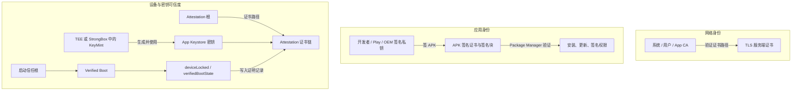
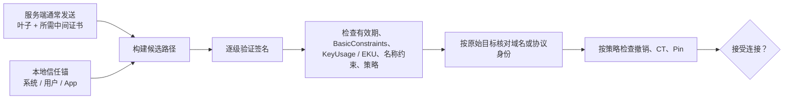
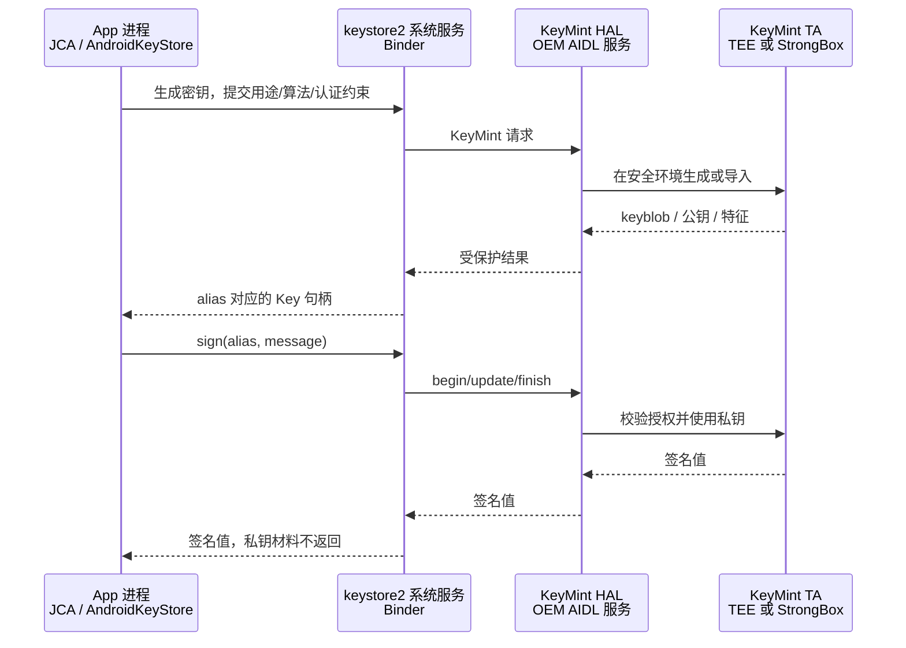
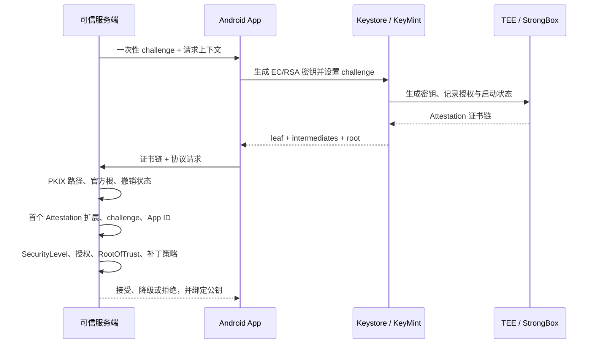
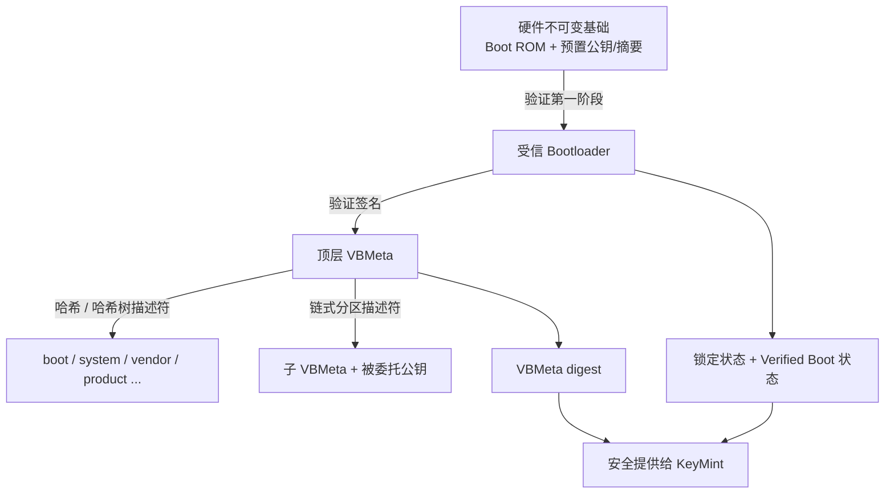
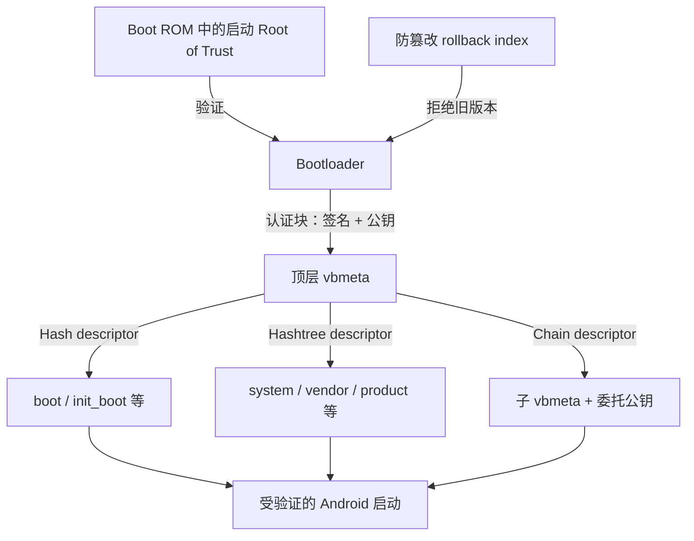
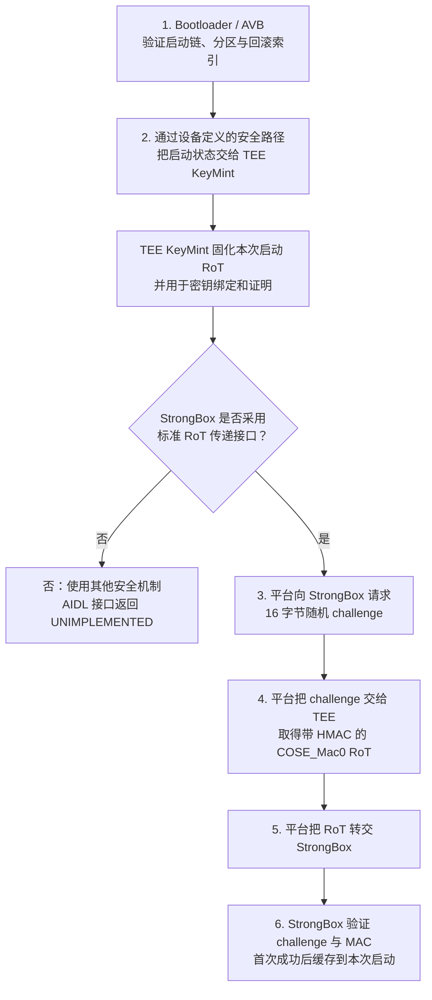
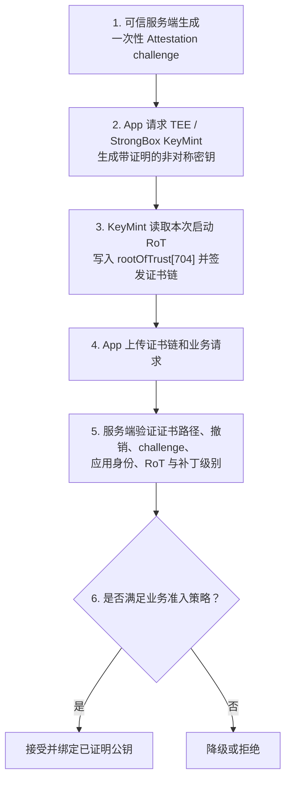

# Android 证书与信任体系：系统 CA、数字签名、TEE 与 Key Attestation

Android 里常说的“系统证书”不是一种对象。它可能指 HTTPS 使用的系统根 CA、APK 的签名证书、ROM 的 platform 证书、Android Keystore 生成的公钥证书、Key Attestation 证书链，甚至被误用于描述 Verified Boot 的启动信任根。

这些机制都使用公钥密码学，但回答的问题不同：

- TLS 系统 CA 回答“这个网络端点的证书能否追溯到本机信任的 CA”。
- APK 签名回答“这个安装包是否由有资格的应用签名密钥签署，内容是否被改过”。
- Android Keystore 回答“应用的密钥怎样保存和受控使用”。
- Key Attestation 回答“远端怎样验证某个密钥的安全级别、授权属性与生成时设备状态”。
- Verified Boot 回答“设备启动的代码和数据能否追溯到设备认可的启动信任根”。

本文按 2026-11-12 可访问的 Android 官方文档整理。根证书集合、撤销状态、平台默认策略会更新，生产系统必须从官方发布点维护数据，不能把本文中的日期或单个证书指纹永久硬编码为唯一真相。

## 1. 先建立全景：Android 有哪些“证书”

| 对象 | 主要信任方 | 证明什么 | 信任根从哪里来 | 典型用途 |
| --- | --- | --- | --- | --- |
| TLS 服务端证书链 | App / 系统 TLS 栈 | 域名对应的公钥通过指定 CA 路径获得信任 | 系统 CA、用户 CA 或 App 自定义锚 | HTTPS、WebSocket、mTLS 服务端认证 |
| 客户端证书与私钥 | TLS 服务端 | 客户端控制相应私钥；身份含义由业务 PKI 定义 | 企业或业务 CA | mTLS、企业 Wi-Fi、VPN |
| APK 签名证书 | Package Manager、其他 App | APK 内容完整性、更新签名连续性、应用签名身份 | 已安装版本或调用方认可的签名证书，不查公共 CA | 安装、覆盖更新、signature 权限 |
| platform 签名证书 | Android Framework / OEM 系统 | 包是否使用 ROM 构建方的 platform key 签名 | 当前系统构建的 platform key | 部分 signature 权限和系统组件协作 |
| Keystore 公钥证书 | 本地 App 或业务服务端 | 把一个公钥包装为 X.509；是否可信取决于是否有有效 Attestation 链 | 自签名、占位签名或 Attestation 根 | 找回公钥、签名协议、密钥证明 |
| Key Attestation 证书链 | 独立可信服务端 | 密钥属性、安全级别、挑战值与生成时设备状态 | Google 或设备厂商认可的 Attestation 根 | 设备注册、硬件密钥绑定、反滥用信号 |
| Verified Boot 密钥链 | Boot ROM / Bootloader | 下一启动阶段和受保护分区的完整性、来源与版本 | 硬件保护或设备配置的启动信任根 | 启动验证、回滚保护 |



*图 1：自绘总览。箭头表示验证或声明关系，不表示这些信任根可以互相替代。依据：[Android App signing](https://source.android.com/docs/security/features/apksigning)、[Hardware-backed Keystore](https://source.android.com/docs/security/features/keystore)、[Key Attestation](https://source.android.com/docs/security/features/keystore/attestation)、[Verified Boot](https://source.android.com/docs/security/features/verifiedboot)。*

最重要的边界是：**同样使用 X.509 格式，不代表采用同一套信任策略。** HTTPS 根 CA 不负责证明 APK 作者；APK 的自签名证书不能成为网站 CA；Attestation 根也不应加入普通 HTTPS 信任库。

## 2. 公钥密码学、数字签名与证书

### 2.1 摘要、签名、加密分别解决什么

设原始消息为 `M`，哈希函数为 `H`，签名私钥为 `sk`，公钥为 `pk`：

1. 签名方计算摘要 `h = H(M)`。
2. 签名算法使用私钥生成 `sig = Sign(sk, h)`。
3. 验证方重新计算 `H(M)`，再用公钥执行 `Verify(pk, H(M), sig)`。

工程实现应直接调用 `Signature` 等成熟密码 API，不要自行拼装“私钥加密哈希”。RSA-PSS、ECDSA、EdDSA 等签名算法的编码、随机数和参数规则不同。

数字签名可以提供：

- 完整性：签名覆盖的数据被改动后应无法通过验证。
- 私钥持有证明：有效签名说明某个能使用对应私钥的实体参与了签名。
- 可归属身份：前提是验证方已经通过证书、预置公钥或其他可信渠道把公钥绑定到预期身份。

数字签名本身不提供：

- 保密性：任何拿到明文的人仍可读取内容。
- 新鲜性：旧的有效签名可以被重放，需要 nonce、挑战值、计数器或可信时间。
- 业务授权：证明“谁签了”不等于证明“他有权执行此操作”。
- 设备绝对安全：签名密钥可能被滥用，运行环境也可能已被攻破。

### 2.2 X.509 证书装什么

X.509 证书的核心是“被签名的数据 + 签发者签名”。典型字段包括：

| 字段 | 作用 | 常见误解 |
| --- | --- | --- |
| Subject / SAN | 描述主体或可验证名称 | TLS 主机名主要核对 SAN，不是只看 CN |
| SubjectPublicKeyInfo | 公钥与公钥算法参数 | 证书不包含对应私钥 |
| Issuer | 声称的签发者名称 | 名称相同不等于签名已经验证 |
| Serial Number | 签发者范围内的证书序列号 | 不是全局身份，也不是公钥指纹 |
| Validity | `notBefore` 与 `notAfter` | 时间有效不等于路径可信 |
| Basic Constraints | 是否为 CA、允许的路径长度 | 叶子证书不能仅因能验签就充当 CA |
| Key Usage / Extended Key Usage | 公钥被允许的用途 | 用于签 APK 的证书不自动适合 TLS |
| Authority / Subject Key Identifier | 辅助寻找签发者与区分密钥 | 不是独立的信任来源 |
| Signature Algorithm / Signature Value | 签发者对证书内容的签名 | 根证书自签成功不是根被信任的原因 |

证书是公开材料。需要保密的是私钥、口令、会话密钥等。PEM、DER、PKCS#12/JKS 是编码或容器形式，不能只看文件后缀判断其中是否含私钥。

### 2.3 证书、CA 与信任锚

- **叶子证书**：最终被验证的主体，例如网站、客户端或被证明的 Keystore 公钥。
- **中间 CA**：受上级 CA 授权，可继续签发下级证书。
- **根 CA 证书**：常以自签名证书分发，但其可信性来自操作系统、应用或管理员的带外配置。
- **信任锚**：路径验证的本地输入。它可以用证书表示，但“信任锚”是信任策略角色，不等于“任何自签名证书”。

根证书的自签名只证明“这个签名与这把公钥匹配”，不能回答“为什么应该信它”。真正的答案是：验证方通过系统更新、应用配置、设备管理或其他受控渠道预先选择了它。[RFC 5280 §6](https://www.rfc-editor.org/rfc/rfc5280.html#section-6)

## 3. 证书链怎样验证



*图 2：自绘的 TLS/PKIX 验证分层。路径构建、路径验证、目标身份验证和额外策略是不同步骤。依据：[RFC 5280 §6](https://www.rfc-editor.org/rfc/rfc5280.html#section-6)、[RFC 9525](https://www.rfc-editor.org/rfc/rfc9525.html)。*

一个可接受的网络证书至少需要满足以下条件：

1. 能从目标证书构建到本地选定的信任锚。
2. 每一级证书签名有效，签发者/主体关系和 CA 约束合法。
3. 证书在验证时刻有效，关键扩展能被理解并满足用途。
4. 目标域名或 IP 与证书声明的身份匹配。
5. 满足本地撤销、Certificate Transparency、算法限制与 Pin 等额外策略。

服务器通常发送叶子证书和中间证书，不应依赖客户端自动下载缺失中间证书。服务器即使把根证书一并发送，也不会使该根自动成为客户端信任锚。

**路径构建不等于路径验证。** 同一叶子证书可能通过交叉签名形成多条候选路径；实现先寻找路径，再按本地策略验证。不同 App 也可以为同一服务器选择不同信任锚集合。

更完整的 TLS 握手、证书签发和本地证书实验见[HTTPS、TLS 与证书](../../network/tls.html)。

## 4. Android 系统 CA 与网络信任库

### 4.1 系统 CA、用户 CA、App CA

Android 网络信任来源可分为三层：

- **系统 CA**：平台预装并由系统更新机制维护的公共信任锚。
- **用户或管理员添加的 CA**：为当前用户、工作资料或设备管理场景添加，信任范围受系统版本、target SDK 和 App 配置约束。
- **App 自定义 CA**：随 App 资源或配置提供，只影响该 App 指定的连接范围。

Android 官方 `Network Security Configuration` 的默认值是：

| App target SDK | 默认 TLS 信任锚 | 默认明文策略 |
| --- | --- | --- |
| API 23 及以下 | 系统 CA + 用户添加 CA | 允许明文 |
| API 24～27 | 仅系统 CA | 允许明文 |
| API 28 及以上 | 仅系统 CA | 禁止明文 |

这是默认值，不是不可改变的系统常量。App 的 `Network Security Configuration`、自定义 TLS 栈、WebView/浏览器实现、VPN、企业管理策略或证书固定都可能改变实际行为。[Network Security Configuration 默认配置](https://developer.android.com/privacy-and-security/security-config#configuration-file-format)

因此，“手机已经安装抓包 CA”不是“所有 App 都能被抓包”的充分条件。面向 API 24 及以上的 App 默认不信任用户 CA，App 还可能配置 Pin 或使用独立网络栈。

### 4.2 Android 14 之后系统根怎样更新

Android 的平台 TLS 实现主要由 Conscrypt 提供，底层结合 BoringSSL。Android 14 引入可更新的根信任库：

- Android 14 以前，系统 CA 主要随系统分区和完整系统版本更新。
- Android 14 起，根信任证书可存放在 Conscrypt Mainline APEX，同时保留系统分区来源。
- App 仍可通过 `NetworkSecurityConfig` 选择系统、用户或自带证书。

这意味着“系统根列表”不是只由出厂 ROM 永久决定，也不能仅凭一个固定目录判断最终生效集合。[AOSP Conscrypt](https://source.android.com/docs/core/ota/modular-system/conscrypt)

AOSP 当前实现可从 `/apex/com.android.conscrypt/cacerts` 选择可更新证书目录，并回退到 `$ANDROID_ROOT/etc/security/cacerts`。这些路径来自平台内部实现，不是第三方 App 可依赖的 SDK 契约；OEM、Android 版本、权限和 Mainline 状态都可能影响实际结果。[AOSP `TrustedCertificateStore`](https://android.googlesource.com/platform/external/conscrypt/+/refs/heads/master/platform/src/main/java/org/conscrypt/TrustedCertificateStore.java)

### 4.3 App 怎样声明自己的信任策略

Manifest 指向网络安全配置：

```xml
<application
    android:networkSecurityConfig="@xml/network_security_config"
    ... />
```

只为指定域名增加企业 CA，同时保留系统 CA：

```xml
<?xml version="1.0" encoding="utf-8"?>
<network-security-config>
    <domain-config>
        <domain includeSubdomains="true">api.example.com</domain>
        <trust-anchors>
            <certificates src="@raw/company_ca" />
            <certificates src="system" />
        </trust-anchors>
    </domain-config>

    <debug-overrides>
        <trust-anchors>
            <certificates src="@raw/debug_ca" />
        </trust-anchors>
    </debug-overrides>
</network-security-config>
```

注意：

- `@raw/company_ca` 应只含 PEM 或 DER 证书数据。
- `debug-overrides` 仅在 `android:debuggable="true"` 时生效。
- 调试锚默认可以绕过 Pin，不能把调试 CA 配进发布策略。
- 使用自定义信任锚的连接默认不执行 Certificate Transparency 验证。
- Pin 基于证书公钥的 `SubjectPublicKeyInfo` 哈希，应准备备用 Pin 和轮换方案；失效时间能降低断网风险，也会在到期后取消 Pin 保护。

Android 16（API 36）开始提供 Network Security Configuration 的 Certificate Transparency 能力，默认关闭；Android 17（API 37）起官方文档规定默认开启，并允许按全局或域名退出。是否启用 CT、是否允许自定义锚和是否 Pin 是三个独立策略。[Android Certificate Transparency 配置](https://developer.android.com/privacy-and-security/security-config#CertificateTransparency)

### 4.4 服务端认证与客户端证书不要混淆

系统根 CA 主要用于验证对端证书。mTLS 的客户端证书则包含客户端公钥，并需要客户端控制相应私钥：

- `KeyChain` 适合用户通过系统 UI 授权多个 App 使用系统级客户端凭据。
- `AndroidKeyStore` 适合某个 App 独占使用自己的密钥。
- 把客户端证书放入信任库不会自动提供客户端私钥。
- 把企业根 CA 放进 App 资源只改变该 App 的信任锚，不会变成系统范围凭据。

[Android Keystore 与 KeyChain 的选择](https://developer.android.com/privacy-and-security/keystore#WhichShouldIUse)

## 5. 四种容易混淆的 KeyStore

| 名称 | 所在阶段 | 主要内容 | 私钥是否可导出 | 是否决定 TLS 信任 |
| --- | --- | --- | --- | --- |
| JKS / PKCS#12 文件 | 构建机、服务器 | 私钥、证书或证书链的文件容器 | 取决于文件与权限 | 只有显式加载为信任库时才决定 |
| `AndroidKeyStore` | Android 运行时 | App 的密钥句柄、受控密钥与公钥证书 | 设计目标为不可导出 | 不直接等于系统 CA 库 |
| `AndroidCAStore` | Android 运行时实现 | 系统/用户信任锚的 JCA 视图 | 通常没有对应私钥 | 可作为平台 TLS 默认信任来源 |
| `KeyChain` | Android 系统凭据层 | 用户或管理员安装的客户端密钥和证书 | 由系统与凭据实现控制 | 主要用于客户端身份，不等于服务端 CA 策略 |

APK 签名文档中的 `release.jks` 是构建机密钥文件；运行时的 `KeyStore.getInstance("AndroidKeyStore")` 是 Android 系统提供者。二者名称相似，但生命周期、权限边界和用途完全不同。

## 6. Android Keystore、KeyMint、TEE 与 StrongBox

### 6.1 调用链



*图 3：自绘的硬件支持 Keystore 主路径。具体进程、传输格式和安全环境由版本与 OEM 实现决定。依据：[AOSP Hardware-backed Keystore](https://source.android.com/docs/security/features/keystore)。*

第三方 App 使用 `KeyPairGenerator`、`KeyGenerator`、`Cipher`、`Signature` 等 JCA API。`keystore2` 负责系统侧访问控制和存储受保护的 keyblob，OEM 的 KeyMint HAL 把敏感操作转交给安全环境中的 KeyMint Trusted Application。KeyMint HAL 是平台内部接口，不是 App SDK。

### 6.2 TEE 是什么

Trusted Execution Environment 是与 Android 普通执行环境隔离的安全执行区域。Trusty 是 Android 可采用的一种 TEE OS，但设备也可以使用其他符合要求的实现。

以 Trusty 为例，它与 Android 运行在同一主处理器上，通过硬件和软件隔离保护自己的内存、寄存器、熔丝和 Trusted Application。普通 Android 内核或 App 不能直接读取其中保存的原始密钥，只能请求受控操作。[AOSP Trusty TEE](https://source.android.com/docs/security/features/trusty)

TEE 不等于：

- 一张证书或一个 CA。
- Android 系统分区中的“可信目录”。
- 设备永远不会被攻击。
- App 进程被控制后密钥就绝对不会被滥用。

它主要提高密钥提取和绕过硬件强制授权的成本。若攻击者控制 App 进程，仍可能在 App 当前权限和密钥授权范围内发起签名或解密请求。需要用用户认证、用途限制、协议挑战和服务端授权共同降低滥用风险。

### 6.3 Software、TEE、StrongBox 的差异

| Security Level | 密钥与授权主要由谁保护 | 典型边界 |
| --- | --- | --- |
| `SOFTWARE` | Android 软件安全模型 | 依赖系统、内核、SELinux 与 Verified Boot 状态 |
| `TRUSTED_ENVIRONMENT` | TEE 中的 KeyMint TA | 抵抗普通 Android 环境被攻破后的密钥提取；仍信任 TEE |
| `STRONGBOX` | 类 HSM 的独立安全硬件/安全元素 | 要求独立 CPU、安全存储、真随机数、抗篡改和侧信道能力，能力与性能通常更受限 |

StrongBox 不是“比 TEE 快”。它追求更强物理攻击边界，支持的算法、密钥大小和并发能力可能更少。请求 `setIsStrongBoxBacked(true)` 前应检查 `FEATURE_STRONGBOX_KEYSTORE`，并处理 `StrongBoxUnavailableException`，是否允许回退由威胁模型决定。[Android Keystore](https://developer.android.com/privacy-and-security/keystore#HardwareSecurityModule)

API 31 起可通过 `KeyInfo.getSecurityLevel()` 区分 `SOFTWARE`、`TRUSTED_ENVIRONMENT` 和 `STRONGBOX`；旧的 `isInsideSecureHardware()` 只能给出布尔结果，并已在 API 31 弃用。[`KeyInfo.getSecurityLevel()`](https://developer.android.com/reference/android/security/keystore/KeyInfo#getSecurityLevel())

### 6.4 密钥授权与限制

生成或导入密钥时可以声明：

- 用途：加密、解密、签名、验证、密钥协商等。
- 算法参数：摘要、分组模式、Padding、曲线或密钥大小。
- 用户认证：每次使用或一定时间内要求设备凭据/强生物识别。
- 解锁状态、有效期、使用次数等条件。
- 是否要求 StrongBox、是否请求 Attestation。

不是每项授权都由安全硬件执行。Attestation 中的 `hardwareEnforced` 表示由 TEE/StrongBox 级别执行的特征，`softwareEnforced` 表示由 Android/Keystore 软件侧执行的特征。安全硬件通常缺少可信实时时钟，因此时间有效期经常由软件侧执行。[KeyMint hardware versus software enforcement](https://source.android.com/docs/security/features/keystore/features#hardware_versus_software_enforcement)

### 6.5 Keystore 能保护什么，不能保护什么

Keystore 能降低：

- 私钥或对称密钥以明文进入 App 进程的机会。
- 从文件系统直接复制密钥材料到另一设备使用的风险。
- 使用不允许的算法、用途或认证状态调用密钥的风险。

Keystore 不能自动解决：

- 被控制的 App 进程在允许范围内调用密钥。
- 签名前业务数据被替换。
- 服务端不校验挑战、账户、设备注册状态或重放。
- 备份恢复后密文存在但密钥不可用。
- 密钥永久可恢复。卸载、锁屏凭据变化、认证配置变化或安全升级都可能导致密钥不可用。

## 7. Key Attestation：让远端验证硬件密钥

### 7.1 Attestation 证明什么

Key Attestation 为非对称 Keystore 密钥生成一条 X.509 证书链。链中的 Android 扩展描述：

- 被证明公钥及算法、用途和授权。
- `attestationSecurityLevel` 与 `keyMintSecurityLevel`。
- 服务端提供的 `attestationChallenge`。
- `softwareEnforced` 与 `hardwareEnforced` 授权列表。
- 可选的 `RootOfTrust`、OS/厂商/Boot patch level、应用身份等信息。

Attestation 扩展 OID 是 `1.3.6.1.4.1.11129.2.1.17`。它是一个 X.509 `OCTET_STRING`，内部再封装 DER 编码的 ASN.1 `KeyDescription`。[AOSP Attestation extension](https://source.android.com/docs/security/features/keystore/attestation#attestation-extension)

Attestation 不证明：

- 当前屏幕上的用户就是某个自然人。
- App 的所有代码与服务端业务都可信。
- 设备从此以后一直保持生成密钥时的状态。
- 拿到 Attestation 的调用方有业务权限。
- TEE 或 StrongBox 不可能有漏洞。

### 7.2 证书链与验证时序



*图 4：自绘的远端验证流程。验证必须在独立可信服务端完成，不能让出具证明的同一设备决定自己是否可信。依据：[Verify hardware-backed key pairs](https://developer.android.com/privacy-and-security/security-key-attestation)。*

证书链通常包含：

1. 带被证明公钥的证书。
2. 一个或多个 Attestation 中间证书。
3. 验证端预置信任的 Attestation 根。

不能硬编码“链一定有三张”或“Attestation 扩展一定只在数组第 0 项”。官方验证指南要求寻找从叶子向根方向遇到的第一个 Attestation 扩展；后续由不可信方附加的同 OID 扩展不能覆盖它。

### 7.3 App 侧最小生成示例

以下示例要求 API 24+，使用服务端提供的非空挑战生成 EC 签名密钥并读取证书链：

```kotlin
import android.security.keystore.KeyGenParameterSpec
import android.security.keystore.KeyProperties
import java.security.KeyPairGenerator
import java.security.KeyStore
import java.security.cert.X509Certificate
import java.security.spec.ECGenParameterSpec

fun generateAttestedEcKey(
    alias: String,
    serverChallenge: ByteArray,
): Array<X509Certificate> {
    // 平台允许 0～128 字节；生产协议应使用服务端生成、不可预测且可防重放的非空挑战。
    require(serverChallenge.isNotEmpty() && serverChallenge.size <= 128)

    val generator = KeyPairGenerator.getInstance(
        KeyProperties.KEY_ALGORITHM_EC,
        "AndroidKeyStore",
    )
    val spec = KeyGenParameterSpec.Builder(
        alias,
        KeyProperties.PURPOSE_SIGN,
    )
        .setAlgorithmParameterSpec(ECGenParameterSpec("secp256r1"))
        .setDigests(KeyProperties.DIGEST_SHA256)
        .setAttestationChallenge(serverChallenge.copyOf())
        .build()

    generator.initialize(spec)
    generator.generateKeyPair()

    val keyStore = KeyStore.getInstance("AndroidKeyStore").apply {
        load(null)
    }
    return keyStore.getCertificateChain(alias)
        ?.map { it as X509Certificate }
        ?.toTypedArray()
        ?: error("No attestation certificate chain for alias=$alias")
}
```

`setAttestationChallenge()` 在 API 24 加入，挑战最大 128 字节。若传 `null`，具备签名用途的非对称密钥会得到自签名证书；若密钥不能签名，证书只包含占位签名。两者都不是可由远端信任的硬件 Attestation 链。[`setAttestationChallenge()`](https://developer.android.com/reference/android/security/keystore/KeyGenParameterSpec.Builder#setAttestationChallenge(byte%5B%5D))

如果业务必须使用 StrongBox，可在 API 28+ 的独立配置分支增加 `setIsStrongBoxBacked(true)`。不要在示例外无条件回退到 TEE，否则会把“必须 StrongBox”的安全需求静默降级。

### 7.4 服务端必须逐项验证

生产验证至少包括：

1. **解析边界**：限制链长、单证书大小、ASN.1 深度和总请求大小，拒绝重复或畸形数据。
2. **证书路径**：验证每级签名和约束，最终只能落到当前允许的 Attestation 根集合。
3. **撤销状态**：检查链中证书序列号是否出现在官方状态列表，并按其缓存头及时更新。
4. **扩展位置**：从证书链中找到第一个可信的 Attestation 扩展，不盲信客户端解析后的 JSON。
5. **挑战值**：与服务端本次请求完全匹配、未使用、未过期，并绑定账户、会话或待执行操作。
6. **公钥绑定**：业务后续使用的公钥必须是已验证证书中的 `SubjectPublicKeyInfo`。
7. **应用身份**：按业务策略核对 `attestationApplicationId` 中的包名、版本和签名证书摘要，防止接受其他 App 控制的密钥。
8. **安全级别**：按风险接受 `TRUSTED_ENVIRONMENT` 或 `STRONGBOX`；不能只检查“链能验过”。
9. **授权位置**：确认关键算法、用途、认证约束确实出现在期望的 `hardwareEnforced` 或 `softwareEnforced` 列表。
10. **启动状态**：按策略核对 `deviceLocked`、`verifiedBootState`、`verifiedBootKey` 和 `verifiedBootHash`。
11. **版本状态**：按业务风险设置 OS、vendor、boot patch level 最低线，并允许有计划的版本迁移。
12. **业务决策**：Attestation 只作为一个可验证信号；最终仍要检查账户、设备注册、凭据撤销、速率和异常行为。

Android 官方提供 [`android/keyattestation` Kotlin 验证库](https://github.com/android/keyattestation)，覆盖路径、根、撤销、挑战和扩展解析等常见边界。自写 ASN.1/PKIX 验证器很容易漏掉扩展位置、链结构变化、工厂证书过期或 RKP 证书有效期差异。

### 7.5 RootOfTrust 在 Attestation 记录中的位置

`RootOfTrust` 不是 App 传给 KeyMint 的参数，也不会作为普通 `KeyCharacteristics` 返回。KeyMint 的 `Tag::ROOT_OF_TRUST` 使用标签号 704，只用于定义 Attestation 记录中的 `rootOfTrust [704]`；硬件证明时，它位于由 TEE 或 StrongBox 生成的 `hardwareEnforced` 授权列表中，并随 Attestation 扩展一起被签名。[KeyMint `Tag::ROOT_OF_TRUST`](https://android.googlesource.com/platform/hardware/interfaces/+/refs/heads/main/security/keymint/aidl/android/hardware/security/keymint/Tag.aidl)

它描述的是“生成证明时，安全环境看到的启动信任状态”，不是持续监控接口，也不是一张根证书。Root of Trust 的概念、字段语义以及它与 Verified Boot 的关系见下一章。

### 7.6 2026 根轮换、撤销与 RKP

Google Play 认证且满足硬件 Attestation 条件的设备，证书链应追溯到 Google 发布的 Hardware Attestation 根集合。官方在 2026-02-01 开始使用新的 ECDSA 根，因此验证端必须接受官方当前发布的两张根，而不是只固定旧 RSA 根。

- 当前根集合：[`https://android.googleapis.com/attestation/root`](https://android.googleapis.com/attestation/root)
- 当前撤销状态：[`https://android.googleapis.com/attestation/status`](https://android.googleapis.com/attestation/status)
- 根、过期与撤销规则：[Android Key Attestation root certificates](https://developer.android.com/privacy-and-security/security-key-attestation#root_certificate)

不要把普通 HTTPS 系统 CA 集合作为 Attestation 根，也不要因为链的根不是 Google 根就直接宣称“密钥已泄露”。非 Google Play 设备可能采用厂商自己的根，此时只能按厂商文档和业务信任策略解释。

Remote Key Provisioning（RKP）从 Android 12 进入 AOSP，使用在线短期证书降低工厂批量 Attestation 私钥泄露带来的影响。Android 14 将 RKP 组织为可更新模块；按当前官方政策，首发 Android 16 的设备只支持 RKP Attestation key provisioning。RKP 链长和中间层可以变化，验证器不能固定证书数量；RKP 短期证书必须检查有效期。[AOSP Remote Key Provisioning](https://source.android.com/docs/core/ota/modular-system/remote-key-provisioning)

## 8. Root of Trust：一切验证从哪里开始

### 8.1 Root of Trust 的通用含义

Root of Trust，简称 RoT，是一条信任链中**不再由同一条链继续向上验证、而被系统预先接受的最小可信基础**。它可以是写入 SoC ROM 或 eFuse 的公钥摘要、不可变启动代码、硬件唯一密钥，也可以是验证器预置的根公钥；它不要求一定采用 X.509 证书形式。

验证链不能凭空证明自己的第一个验证者可信。Android 启动链之所以能验证 Bootloader，是因为设备先天信任 ROM 中不可变的启动代码和厂商植入的验证密钥。若这个最底层锚点被替换，后续每一级签名即使数学上都正确，也只能证明它们属于另一条信任链。

Android 语境中至少有四个名称相近、作用不同的对象：

| 对象 | 实体 | 谁使用 | 回答的问题 |
| --- | --- | --- | --- |
| 启动 Root of Trust | ROM/eFuse 中的不可变代码、公钥或摘要 | Boot ROM、Bootloader | 下一启动阶段是否来自设备认可的签名者 |
| KeyMint Root of Trust 绑定 | 由启动验证公钥、锁定状态和 Verified Boot 状态派生的比特串 | TEE/StrongBox KeyMint | 当前系统状态是否仍允许使用既有硬件密钥 |
| Attestation `RootOfTrust` | Attestation 扩展中的 ASN.1 结构 | 远端验证服务 | 生成证明时设备报告了怎样的启动状态 |
| Attestation 根证书 | 验证 Attestation 证书链的根公钥证书 | 远端验证服务 | 这份硬件证明由哪个可信证明体系签发 |

系统 TLS 根 CA 又是另一套网络信任锚。启动 RoT、Attestation 根和 TLS 根解决的问题不同，不能互相替换。

### 8.2 启动 Root of Trust 如何成为信任锚

设备上电后，最早执行的 Boot ROM 通常不能依赖可改写分区中的代码来判断“谁可信”，因此它使用硬件中预置的验证材料检查第一阶段 Bootloader。被验证的 Bootloader 再验证下一阶段、`vbmeta` 和受保护分区，逐级形成启动信任链。

这里的“根”表示验证关系的起点，不表示它直接签署所有分区。厂商可以通过中间 Bootloader、AVB 链式分区和被委托的公钥分层授权，但每条有效路径最终都必须回到设备当前接受的启动根。



*图 5：自绘的启动 RoT 分层。实际 Bootloader 阶段、分区和公钥委托由设备实现决定；图中“安全提供”不是指普通 Android 系统属性。依据：[AOSP Verified Boot](https://source.android.com/docs/security/features/verifiedboot)、[KeyMint version binding](https://source.android.com/docs/security/features/keystore/version-binding)。*

### 8.3 KeyMint 为什么要绑定 Root of Trust

KeyMint 规范要求安全环境在启动时获得 Root of Trust 数据，传递机制由设备实现决定，优先由 Bootloader 安全提供。该数据至少从 Verified Boot 使用的公钥、Bootloader 锁定状态和 Verified Boot 状态派生，并与每个 KeyMint 密钥进行密码学绑定；规范建议把 RoT 数据作为保护密钥材料的密钥派生输入之一。[`IKeyMintDevice` Root of Trust Binding](https://android.googlesource.com/platform/hardware/interfaces/+/refs/heads/main/security/keymint/aidl/android/hardware/security/keymint/IKeyMintDevice.aidl)

这样做不是为了给密钥增加一个可读标签，而是为了阻止攻击者刷入自己控制的系统后继续使用原系统创建的硬件密钥：

1. 量产锁定系统用厂商启动根创建 KeyMint 密钥。
2. Bootloader 解锁，或启动验证根被换成其他公钥。
3. 当前 RoT 与密钥创建时的绑定状态不再匹配。
4. 原密钥必须不可用；只有恢复原来的 RoT 状态后才可能重新匹配。

OS、system/vendor/boot 补丁级别还有独立的 **version binding**。正常升级到更高版本时，KeyMint 可以返回 `KEY_REQUIRES_UPGRADE`，Keystore 再调用 `upgradeKey()` 让 keyblob 向前升级；这与“换启动根或改变锁定状态导致旧密钥不可用”不是同一个机制。[AOSP Version binding](https://source.android.com/docs/security/features/keystore/version-binding)

### 8.4 Attestation 中的 RootOfTrust 数据结构

现代 Attestation schema 的 `RootOfTrust` 包含四个字段；较旧 schema 可能没有 `verifiedBootHash`，解析器必须先读取 `attestationVersion`，不能按固定偏移猜测。

```text
RootOfTrust ::= SEQUENCE {
    verifiedBootKey    OCTET_STRING,
    deviceLocked      BOOLEAN,
    verifiedBootState VerifiedBootState,
    verifiedBootHash   OCTET_STRING
}
```

| 字段 | 精确定义 | 验证端怎样使用 |
| --- | --- | --- |
| `verifiedBootKey` | Verified Boot 验证启动代码所用公钥的安全摘要；当前 KeyMint AIDL 对锁定设备要求 SHA-256，解锁设备为 32 字节零值 | 与允许的 OEM 或测试根集合比较，不能把任意非零值都当可信 |
| `deviceLocked` | Bootloader 是否锁定；官方定义中 `true` 表示设备启动了成功通过 Verified Boot 的已签名镜像 | 高风险业务通常要求为 `true`，但仍要联合其他字段 |
| `verifiedBootState` | `Verified`、`SelfSigned`、`Unverified`、`Failed` 四态 | 决定接受、降级还是拒绝，并记录设备类别例外 |
| `verifiedBootHash` | 所有受 Verified Boot 保护数据的摘要；使用 AVB 参考实现时是 VBMeta digest | 区分不同受验证构建、关联事件；不能单独证明补丁新旧或业务授权 |

`RootOfTrust` 位于签名后的 Attestation 扩展中，因此服务端必须先验证证书路径、官方或厂商 Attestation 根、撤销状态和 challenge，再解释这些字段。跳过证书链验证而直接相信客户端上传的 JSON，等于允许客户端自己填写启动状态。[AOSP RootOfTrust fields](https://source.android.com/docs/security/features/keystore/attestation#rootoftrust-fields)

### 8.5 四种 VerifiedBootState 应怎样理解

| Attestation 值 | 常用颜色 | 启动含义 | `verifiedBootKey` |
| --- | --- | --- | --- |
| `Verified` | GREEN | 从硬件保护启动根到受保护分区存在完整信任链 | 厂商嵌入启动根的摘要 |
| `SelfSigned` | YELLOW | 设备锁定且链完整，但使用用户配置的启动根 | 用户配置公钥的摘要 |
| `Unverified` | ORANGE | Bootloader 已解锁，无法建立强制启动信任链 | 32 字节零值 |
| `Failed` | RED | 验证失败 | 其他 RoT 字段不再有保证 |

不能写成 `verifiedBootState == Verified` 就必然可信。官方允许特定已批准测试设备在授权用户登录时以解锁状态报告 `Verified`；验证端仍应检查 `deviceLocked`、`verifiedBootKey`、设备类别、补丁级别和自己的准入策略。`Failed` 设备通常无法完成正常启动；如果仍取得证明，也不能解释它的其他 RoT 字段为可信事实。

## 9. Verified Boot：验证什么，怎样验证

### 9.1 Verified Boot 解决的问题

Verified Boot 试图保证设备执行的代码来自设备认可的来源，而不是来自攻击者替换或存储损坏。它从硬件保护的启动 Root of Trust 开始，让每个启动阶段在交出执行权前验证下一阶段，并覆盖 `boot`、`system`、`vendor` 等设备配置声明的受保护分区。[AOSP Verified Boot](https://source.android.com/docs/security/features/verifiedboot)

它同时解决两个不同问题：

1. **完整性与来源**：数据是否被修改，签名者是否是当前启动根授权的主体。
2. **防回滚**：即使旧镜像签名有效，也不能把设备降级到已知存在漏洞的旧版本。

Verified Boot 不验证 App 的业务身份，不验证 HTTPS 域名，也不证明当前系统绝无漏洞。它只对纳入启动验证配置的代码、元数据和分区建立启动时的信任结论。

### 9.2 AVB 如何把分区接入验证链

Android 8.0 及以上使用 Android Verified Boot 参考实现 AVB 2.0。Bootloader 先认证顶层 `vbmeta`，再按其中的 descriptor 验证各分区：

- **Hash descriptor**：记录较小或启动时整体读取分区的预期摘要。
- **Hashtree descriptor**：为大分区描述 dm-verity 哈希树，支持运行中按块验证读取数据。
- **Chain partition descriptor**：把某个子 `vbmeta` 和其公钥委托给另一条验证分支，允许分区独立签名和更新。
- **Rollback index**：把镜像声明的版本计数与设备防篡改存储中的最低允许值比较，拒绝已回退版本。



*图 6：自绘的 AVB 验证对象。签名通常保护 VBMeta 元数据，分区再由摘要或哈希树 descriptor 覆盖，不应描述成“每个文件都有一张证书”。依据：[AVB README](https://android.googlesource.com/platform/external/avb/+/refs/heads/main/README.md)。*

A/B 设备升级时，回滚索引不能在新槽位尚未成功启动前过早推进，否则更新失败后回退到旧槽位时，旧槽位会因回滚保护而无法启动。官方启动流程要求先把槽位标记为 `SUCCESSFUL`，再更新相关回滚保护元数据。

### 9.3 锁定状态与四种启动结果

Bootloader 是否锁定决定 Verified Boot 是强制安全边界，还是仅向用户报告风险：

| 状态 | Bootloader 条件 | 验证行为 | 对 Android/用户的典型表达 |
| --- | --- | --- | --- |
| GREEN / `Verified` | 锁定，使用厂商预置启动根 | 验证链完整，正常启动 | 通常不显示警告 |
| YELLOW / `SelfSigned` | 锁定，使用用户配置启动根 | 链仍完整，但根不是厂商量产根 | 显示自定义 OS 警告 |
| ORANGE / `Unverified` | 已解锁 | 允许加载非受信镜像，不能建立强制完整性保证 | 每次启动显示解锁警告 |
| RED / `Failed` | 验证失败或找不到有效 OS | 锁定设备应拒绝正常启动，或进入规定的错误处理 | 损坏警告、关机或修复模式 |

Bootloader 会把面向 Android 的状态通过内核命令行传递；Android 12 及以上使用 bootconfig。`androidboot.verifiedbootstate` 的常见值为 `green`、`yellow`、`orange`，系统侧通常可观察为 `ro.boot.verifiedbootstate`。[AOSP Boot flow](https://source.android.com/docs/security/features/verifiedboot/boot-flow#communicate-verified-boot-state-to-android)

这个系统属性适合诊断，不是远端安全证明。普通 Android 进程能够读到的字符串不等于 TEE 签名声明；服务端必须验证 Key Attestation，不能让 App 读取属性后上传 `"green"` 就直接放行。

### 9.4 Root of Trust 与 Verified Boot 的关系

在 Android 安全体系中，Verified Boot 是一套启动完整性验证机制，而 Attestation 中的 `RootOfTrust` 是对设备本次启动信任状态及其依据的结构化描述。两者不是并列的两套启动机制。

可以先记住：

1. **Verified Boot 负责验证**：检查从 Bootloader 到 Android 受保护分区的代码、数据和版本是否可信。
2. **`RootOfTrust` 负责描述验证结果**：记录启动验证使用的根公钥摘要、Bootloader 锁定状态、验证状态和受保护数据摘要。
3. **Key Attestation 负责提供可信证明**：KeyMint 把 `RootOfTrust` 写入签名后的 Attestation 证书扩展，远端验证证书链后才能相信这份描述。

更完整地看，启动 Root of Trust 是验证的起点，Verified Boot 是沿信任链执行验证的过程，Attestation `RootOfTrust` 是对结果的签名声明。

此外，KeyMint 的 **RoT 绑定**还把启动根和锁定状态用于保护密钥可用性。Attestation `RootOfTrust` 面向远端报告状态，RoT binding 面向本机阻止不受信系统使用旧密钥。两者使用同一类启动事实，但目标不同。

### 9.5 从启动到远端判定的完整交互



*图 7：自绘的启动状态传递。Bootloader 到 TEE 的机制由设备实现；StrongBox 分支是当前 KeyMint AIDL 定义的可选内部机制，不是 App 可调用的公开 API。若 StrongBox 使用其他安全传递机制，相应接口可以返回 `UNIMPLEMENTED`。依据：[`IKeyMintDevice.getRootOfTrust*`](https://android.googlesource.com/platform/hardware/interfaces/+/refs/heads/main/security/keymint/aidl/android/hardware/security/keymint/IKeyMintDevice.aidl)。*



*图 8：自绘的远端证明流程。RootOfTrust 只有放入经过验证的 Attestation 扩展后，才成为远端可采信的启动状态声明。依据：[Android Key Attestation 验证指南](https://developer.android.com/privacy-and-security/security-key-attestation)。*

这条链有两个不同的安全通道：Bootloader 到 TEE KeyMint 的传递由设备定义，必须让普通 Android 无法伪造；TEE 到 StrongBox 的标准可选流程使用 16 字节新鲜 challenge 和带 HMAC 的 COSE_Mac0，StrongBox 验证后只接受本次启动首次成功传入的数据。App 既不能自行设置 `rootOfTrust [704]`，也不能用修改系统属性改变硬件 Attestation 的结果。

### 9.6 状态变化会带来什么结果

| 场景 | Verified Boot / RootOfTrust 变化 | 对 KeyMint 密钥的影响 | 远端常见策略 |
| --- | --- | --- | --- |
| 锁定设备正常启动量产镜像 | `Verified`，厂商 `verifiedBootKey`，`deviceLocked=true` | RoT 匹配，密钥可按授权使用 | 再检查链、补丁、App 身份和业务权限 |
| 使用同一启动根完成正常 OTA | 启动根通常不变，`verifiedBootHash` 和版本信息可变化 | 版本绑定可能触发 `KEY_REQUIRES_UPGRADE`，不是简单永久作废 | 接受受支持的新构建和补丁级别 |
| 锁定后使用用户配置根 | `SelfSigned`，`verifiedBootKey` 变为用户根摘要 | 与原量产 RoT 绑定的密钥应不可用 | 测试业务可单独允许，生产高风险业务通常降级或拒绝 |
| 解锁 Bootloader | `Unverified`、`deviceLocked=false`、启动 key 字段为零值 | 旧 RoT 下创建的 KeyMint 密钥必须不可用；解锁流程通常还会清除用户数据 | 拒绝依赖设备完整性的操作 |
| 启动验证失败 | `Failed`，或设备根本无法进入 Android | 不能依赖其他 RoT 字段；往往无法完成证明 | 拒绝，并区分损坏、刷机和设备故障 |

服务端仍不能从 `Verified` 推导出“设备当前绝无恶意代码”。Verified Boot 是启动时的来源和完整性基础，不能替代漏洞修复、运行时防护、账户认证、交易授权和风控。Attestation 还是一个带 challenge 的状态快照；后续仅验证同一业务密钥的数字签名，不会自动重新报告设备此刻的启动状态。

任何一层缺失都不能由另一层自动替代。AVB 为绿色不代表 App 业务请求已授权；Attestation 链有效不代表 TLS 对端域名正确；`RootOfTrust` 字段看起来正常也不代表证书链和 challenge 已验证。

## 10. APK 签名、platform 证书与系统权限

### 10.1 APK 签名证书不走公共 CA

Android 要求 APK 被签名，但应用签名证书通常是开发者自签名证书。Package Manager 不像浏览器验证网站那样，把 APK 证书追溯到公共 CA。

APK 签名主要用于：

- 校验 APK 受保护内容没有被修改。
- 判断新 APK 是否有资格覆盖已安装版本。
- 建立包的签名身份与签名轮换历史。
- 授予 `signature` 级自定义权限或核对合作方证书。

所以“APK 证书已过普通 X.509 有效期”与“TLS 证书过期”不能简单套用同一处理逻辑；Android 安装与更新依据签名方案和平台规则验证应用身份。

完整的 v1～v4、v3.1/v3.2、轮换与 Play App Signing 机制见[Android 打包与签名](../basics/apk-signing.html)。

### 10.2 platform 证书是什么

AOSP 构建使用不同包签名密钥，其中 `platform` key 用于核心平台相关包。量产系统必须替换公开测试密钥并保护私钥。[AOSP Sign builds for release](https://source.android.com/docs/core/ota/sign_builds)

需要区分：

- **platform-signed**：APK 的签名身份与系统 platform key 匹配。
- **system app**：APK 位于系统镜像的相应分区。
- **privileged app**：位于 `priv-app` 类目录并满足 privileged permission allowlist 等规则。
- **signature permission**：请求方与权限声明方具有系统认可的相同签名身份或轮换关系。
- **signature|privileged permission**：在签名条件之外，还允许满足平台 privileged 规则的应用获得；不是“只要放进 system 就有全部权限”。

platform 证书不是 HTTPS 根 CA。把 platform 公钥证书加入网络信任库不会赋予 APK 平台签名身份；把 HTTPS 根 CA 用来签 APK，也不会让它自动获得系统权限。

### 10.3 签名轮换不是简单替换证书

APK Signature Scheme v3 引入 proof-of-rotation，让旧签名密钥逐级授权新密钥，并为旧签名在特定能力上的信任保留标志。Android 13 的 v3.1 改进了按平台版本选择轮换签名者。调用方应使用 `SigningInfo` 和平台签名 API 理解当前签名与历史，不应只取一个旧式 `signatures[0]` 后永久缓存。

## 11. 一个完整业务场景里，各种证书怎样协作

以“首次在服务端注册设备密钥”为例：

1. App 通过 HTTPS 连接服务端。系统 CA 与 App 网络策略验证服务端证书和域名。
2. 服务端生成一次性 challenge，并将其绑定到账户、会话和注册操作。
3. App 在 Android Keystore 中生成不可导出的签名密钥，把 challenge 放入 Attestation。
4. TEE/StrongBox 中的 KeyMint 生成密钥、记录授权，并返回 Attestation 证书链。
5. App 把证书链发给服务端。APK 自身的签名证书摘要可出现在 `attestationApplicationId` 中。
6. 服务端在独立可信环境验证 Attestation 根、撤销、挑战、应用签名摘要、安全级别和启动状态。
7. 服务端保存已验证的公钥，并给这次注册分配业务权限。
8. 后续请求由服务端发送新的 nonce，App 使用 Keystore 私钥签名；服务端用已注册公钥验证，并继续检查账户授权和防重放状态。

其中：

- TLS 证书保护并认证网络连接。
- APK 签名证书标识 App 发布身份。
- Keystore 私钥证明本次请求持有已注册设备密钥。
- Attestation 链说明注册时密钥属性与设备状态。
- Verified Boot 为 Attestation 的启动状态提供底层输入。
- 业务授权系统最终决定请求是否允许。

## 12. 实用检查与诊断

### 12.1 查看远端 TLS 证书链

```bash
openssl s_client \
  -connect example.com:443 \
  -servername example.com \
  -showcerts </dev/null
```

这个命令展示服务端发送的材料，不等于已经按 Android 的本地信任策略完成验证。Android App 的最终结果还取决于系统 CA、target SDK、Network Security Configuration、CT、Pin 和所用网络库。

检查单张证书：

```bash
openssl x509 -in certificate.pem -noout \
  -subject -issuer -serial -dates -fingerprint -sha256 -text
```

### 12.2 枚举当前进程看到的 Android CA

`AndroidCAStore` 是 Android 平台实现提供的 JCA KeyStore 类型。下面代码适合诊断，不应把 alias 名称或内部目录当作安全协议：

```kotlin
import java.security.KeyStore
import java.security.MessageDigest
import java.security.cert.X509Certificate

data class CaSummary(
    val alias: String,
    val subject: String,
    val issuer: String,
    val sha256: String,
)

fun listAndroidCaStore(): List<CaSummary> {
    val store = KeyStore.getInstance("AndroidCAStore").apply {
        load(null)
    }
    return store.aliases().toList().mapNotNull { alias ->
        val cert = store.getCertificate(alias) as? X509Certificate
            ?: return@mapNotNull null
        val digest = MessageDigest.getInstance("SHA-256")
            .digest(cert.encoded)
            .joinToString(":") { "%02X".format(it) }
        CaSummary(
            alias = alias,
            subject = cert.subjectX500Principal.name,
            issuer = cert.issuerX500Principal.name,
            sha256 = digest,
        )
    }
}
```

枚举结果说明“当前进程通过该提供者看到什么”，不能单独证明某个具体域名会通过 TLS 验证。还需要实际连接、域名校验和 App 网络策略。

### 12.3 在设备上观察 AOSP 证书目录

先用实际命令确认设备版本和构建，不能从工作目录或固件文件名猜测：

```bash
adb shell getprop ro.build.version.sdk
adb shell getprop ro.build.fingerprint
adb shell ls -l /apex/com.android.conscrypt/cacerts
adb shell ls -l /system/etc/security/cacerts
```

目录不存在、为空或无权限，只能说明当前命令没有取得相应结果。Android 14+ 还要考虑 Conscrypt APEX 是否实际启用、OEM 实现和用户/工作资料配置。

### 12.4 查看 APK 签名身份

```bash
apksigner verify --verbose --print-certs app.apk
```

重点核对：

- 各签名方案是否通过。
- signer 证书 SHA-256 摘要。
- 是否存在签名轮换历史。
- 当前 APK 与已安装包的签名关系，而不是只比较文件名或包名。

### 12.5 Attestation 故障定位顺序

1. 记录真实设备 `SDK`、构建指纹和目标 App 版本。
2. 确认挑战是否由服务端生成、是否小于等于 128 字节且未重放。
3. 保存原始 DER 证书链，不只保存客户端解析结果。
4. 在服务端输出每张证书的 subject、issuer、serial、有效期和 SHA-256。
5. 区分“链不能到认可根”“证书被撤销”“扩展解析失败”“挑战不匹配”“策略不接受安全级别”。
6. 检查是否错误固定链长、旧根或旧中间证书。
7. 对 RKP 证书检查有效期；对旧工厂 Attestation 证书按官方特殊规则和撤销表处理。
8. 只有链和扩展都验证通过后，才解释 `RootOfTrust` 与授权字段。

## 13. 常见错误结论

- **“根证书是自签名的，所以可信。”** 错。可信来自本地带外配置。
- **“服务器把根证书发过来，客户端就会信。”** 错。服务器不能自行扩大客户端信任锚。
- **“安装用户 CA 后所有 App 都能抓包。”** 错。target 24+ 默认不信任用户 CA，App 还可自定义信任或 Pin。
- **“用了 HTTPS 就不需要业务签名。”** 错。TLS 保护连接，不能替代跨连接的业务对象签名、授权和防重放。
- **“APK 证书必须由公共 CA 签发。”** 错。Android 应用签名通常自签，Package Manager 不做公共 CA 验证。
- **“platform-signed 就等于 privileged app。”** 错。签名、分区位置、权限保护级别和 allowlist 是不同条件。
- **“密钥在 TEE，所以 App 被 Hook 也无法调用。”** 错。TEE 降低提取风险，不自动阻止被控制进程发起合法格式的操作。
- **“Attestation 链通过就证明设备完全安全。”** 错。还需验证挑战、撤销、应用身份、安全级别、启动状态和业务策略。
- **“green / Verified 就一定是量产锁定设备。”** 错。必须联合 `deviceLocked`、`verifiedBootKey`、设备类别和官方例外解释。
- **“Attestation 根就是系统 HTTPS 根。”** 错。两套根集合服务于不同协议。
- **“Pin 越多越安全。”** 错。没有备用 Pin 和轮换方案会造成生产断网；过期 Pin 又会削弱保护。
- **“证书指纹就是公钥指纹。”** 错。证书 SHA-256 通常对整张 DER 证书求摘要，SPKI Pin 只对公钥结构求摘要。

## 14. 设计检查清单

### 网络证书

- 是否使用平台默认 TrustManager 和主机名校验，而不是“信任所有证书”？
- 自定义 CA 是否只限定到需要的域名和构建类型？
- target SDK 对用户 CA 的默认行为是否已验证？
- Pin 是否有备用公钥、轮换和应急恢复方案？
- Android 16/17 的 CT 策略是否与私有 CA 场景兼容？

### Keystore 与 TEE

- 威胁模型需要防导出，还是需要 TEE/StrongBox 级硬件强制？
- 设备不支持 StrongBox 时是拒绝、降级还是改变业务能力？
- 密钥用途、算法、用户认证和解锁条件是否最小化？
- App 进程被控制后，协议是否仍有 challenge、交易内容绑定和服务端授权？
- 卸载、换机、锁屏凭据变化和密钥失效是否有明确恢复流程？

### Key Attestation

- 验证是否在独立可信服务端执行？
- 根集合和撤销状态是否从官方发布点持续更新？
- 是否兼容 2026 根轮换、RKP 可变链长和短期证书？
- 是否核对挑战、应用签名摘要、安全级别和 `RootOfTrust`？
- 是否把“无法证明硬件可信”与“已确认密钥泄露”分开处理？

### APK 与系统签名

- 是否区分 APK 签名证书、platform 证书和系统 CA？
- 更新链和 key rotation 是否覆盖支持的 Android 版本？
- 是否用 `SigningInfo` 处理当前与历史 signer？
- signature / knownSigner / privileged 权限是否按实际保护级别和 allowlist 验证？
- ROM 是否替换 AOSP 公开测试密钥并保护生产私钥？

## 15. 版本脉络

| Android 版本 | 与本文相关的关键变化 |
| --- | --- |
| Android 4.3 / API 18 | 引入 Android Keystore provider |
| Android 6.0 / API 23 | `KeyGenParameterSpec`、更完整的密钥用途和认证约束 |
| Android 7.0 / API 24 | Keymaster 2 Key Attestation；target 24+ 默认不信任用户 CA；APK Signature Scheme v2 |
| Android 8.0 / API 26 | ID Attestation；AVB 参考实现进入 Android 8+ |
| Android 9 / API 28 | StrongBox 支持；APK Signature Scheme v3 与签名轮换 |
| Android 12 / API 31 | KeyMint 取代 Keymaster；keystore2；RKP 进入 AOSP；`KeyInfo.getSecurityLevel()` |
| Android 13 / API 33 | APK Signature Scheme v3.1 与轮换行为改进 |
| Android 14 / API 34 | Conscrypt 可更新根信任库；RKP Mainline 模块 |
| Android 16 / API 36 | CT 能力可由 Network Security Configuration 启用；首发设备按当前官方政策只使用 RKP |
| Android 17 / API 37 | 官方当前文档规定 CT 默认开启，可按策略退出 |
| 2026-02-01 | 新的 Google Key Attestation ECDSA 根开始签发证书链 |

版本表只用于定位变化。实际设备能力仍需通过公开 API、系统属性、证书链和真实验证结果确认，不能由路径名、机型印象或单个版本号推断。

## 16. 主要资料

- [RFC 5280：X.509 PKIX 证书与路径验证](https://www.rfc-editor.org/rfc/rfc5280.html)
- [Android Network Security Configuration](https://developer.android.com/privacy-and-security/security-config)
- [AOSP Conscrypt 与 Android 14 可更新根信任库](https://source.android.com/docs/core/ota/modular-system/conscrypt)
- [Android Keystore system](https://developer.android.com/privacy-and-security/keystore)
- [AOSP Hardware-backed Keystore / KeyMint](https://source.android.com/docs/security/features/keystore)
- [AOSP Trusty TEE](https://source.android.com/docs/security/features/trusty)
- [AOSP Key and ID Attestation schema](https://source.android.com/docs/security/features/keystore/attestation)
- [AOSP KeyMint Root of Trust 与版本绑定](https://source.android.com/docs/security/features/keystore/version-binding)
- [KeyMint `IKeyMintDevice` AIDL](https://android.googlesource.com/platform/hardware/interfaces/+/refs/heads/main/security/keymint/aidl/android/hardware/security/keymint/IKeyMintDevice.aidl)
- [KeyMint `KeyCreationResult` Attestation schema](https://android.googlesource.com/platform/hardware/interfaces/+/refs/heads/main/security/keymint/aidl/android/hardware/security/keymint/KeyCreationResult.aidl)
- [Android Key Attestation 验证指南、根与撤销](https://developer.android.com/privacy-and-security/security-key-attestation)
- [Android 官方 Key Attestation Kotlin 验证库](https://github.com/android/keyattestation)
- [AOSP Remote Key Provisioning](https://source.android.com/docs/core/ota/modular-system/remote-key-provisioning)
- [AOSP App signing](https://source.android.com/docs/security/features/apksigning)
- [AOSP Verified Boot](https://source.android.com/docs/security/features/verifiedboot)
- [AOSP Verified Boot boot flow](https://source.android.com/docs/security/features/verifiedboot/boot-flow)
- [Android Verified Boot 2.0 README](https://android.googlesource.com/platform/external/avb/+/refs/heads/main/README.md)
- [AOSP Sign builds for release](https://source.android.com/docs/core/ota/sign_builds)
