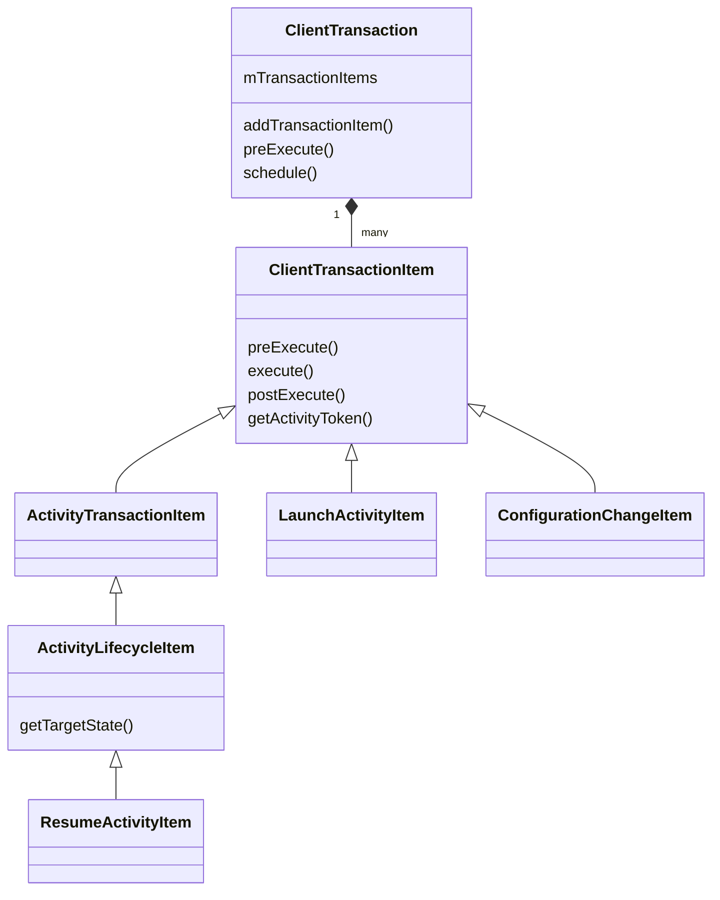
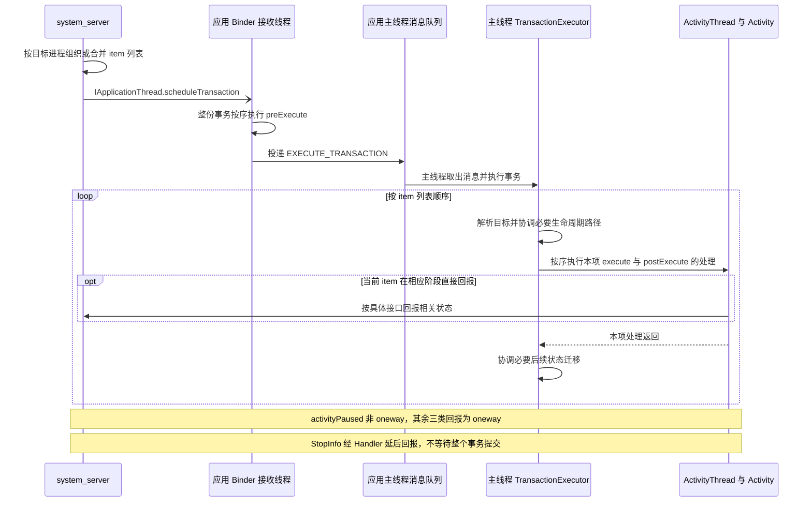
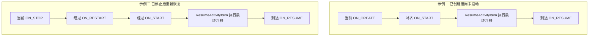

# ClientTransaction 机制：从跨进程调度到生命周期状态机

系统决定启动、恢复或停止一个 Activity 后，需要把操作送到应用进程，再由应用主线程执行。`ClientTransaction` 将这些请求组织为可传输的 item 列表，`TransactionExecutor` 则根据客户端记录的当前状态执行操作、补齐生命周期路径。

## 1. 容器、操作、身份与执行器各管什么

`ClientTransaction` 是 `Parcelable` 数据容器，核心是有序的 `mTransactionItems`。每个 `ClientTransactionItem` 表达一项客户端操作，可以是 Activity 启动、目标生命周期状态、进程配置变化或窗口变化等。它们通过目标进程的 `IApplicationThread` 投递，而不是把服务端 Java 对象直接交给另一个进程调用。

| 对象 | 所在位置 | 职责与边界 |
| --- | --- | --- |
| `ActivityRecord` | system_server | 保存活动与任务状态，参与系统决策，不是应用 Activity 实例 |
| `ClientLifecycleManager` | system_server | 按目标应用进程归并待发事务，并决定发送时机 |
| `ClientTransaction` / item | 两端各有自己的对象 | 序列化操作数据，并传递其中的 Binder 引用 |
| `ApplicationThread` | 应用 Binder 端点 | 接收系统调度，转交 ActivityThread 的调度入口 |
| `TransactionExecutor` | 应用进程 | 在主线程解释 item、协调生命周期路径 |
| `ActivityClientRecord` | 应用进程 | 维护本地 Activity 引用、配置和生命周期状态 |

这里有两层身份：`IApplicationThread` 选择**哪个应用进程**；Activity item 中的 Token 再选择**该进程里的哪个逻辑 Activity**。同一事务可以包含不同 Activity 的 item，也可以包含不以 Activity 为目标的 item。不能把“一个事务”等同于“一个 Activity”。[源码：ClientTransaction](https://android.googlesource.com/platform/frameworks/base/+/refs/tags/android-16.0.0_r1/core/java/android/app/servertransaction/ClientTransaction.java#50)

## 2. 当前 item 模型怎样组织

以下是核心继承与包含关系的简图，省略字段、接口和其他子类：



`ActivityTransactionItem` 保存目标 Token，并提供解析客户端记录的通用执行入口；`ActivityLifecycleItem` 在此基础上表达目标生命周期状态。**LaunchActivityItem 直接继承 ClientTransactionItem**，因为启动时可能还没有客户端记录，它要负责创建记录，再交给 `ActivityThread` 实例化 Activity。[源码：ActivityTransactionItem](https://android.googlesource.com/platform/frameworks/base/+/refs/tags/android-16.0.0_r1/core/java/android/app/servertransaction/ActivityTransactionItem.java)、[LaunchActivityItem](https://android.googlesource.com/platform/frameworks/base/+/refs/tags/android-16.0.0_r1/core/java/android/app/servertransaction/LaunchActivityItem.java#61)

非 Activity 操作可看 [ConfigurationChangeItem](https://android.googlesource.com/platform/frameworks/base/+/refs/tags/android-16.0.0_r1/core/java/android/app/servertransaction/ConfigurationChangeItem.java)，窗口操作可看 [WindowStateResizeItem](https://android.googlesource.com/platform/frameworks/base/+/refs/tags/android-16.0.0_r1/core/java/android/app/servertransaction/WindowStateResizeItem.java)。执行器会区分生命周期 item 与其他 item，不是对所有 item 都查询同一份 Activity 记录。

## 3. 服务端怎样组织一次启动

目标应用进程就绪后，`ActivityTaskSupervisor.realStartActivityLocked()` 准备启动参数，创建 `LaunchActivityItem(r.token, …)`，再选择 Resume、Pause 或 Stop item，最后交给 `ClientLifecycleManager.scheduleTransactionItems(...)`。[源码：ActivityTaskSupervisor](https://android.googlesource.com/platform/frameworks/base/+/refs/tags/android-16.0.0_r1/services/core/java/com/android/server/wm/ActivityTaskSupervisor.java#1021)

可以将常见组合记为：

```text
需要恢复到前台：       LaunchActivityItem + ResumeActivityItem
启动后保持可见暂停：   LaunchActivityItem + PauseActivityItem
启动后进入停止状态：   LaunchActivityItem + StopActivityItem
```

这是目标状态的组合示意，不表示应用可以跳过中间回调，也不表示任意后台启动都被系统允许。启动模式复用已有实例时还可能投递 NewIntent 等操作；没有就绪的进程则需要先经过进程启动和 attach，详见 [Token 笔记中的启动分流](./activity-token.html#已有进程与冷启动在哪里分流)。

`LaunchActivityItem` 携带 Intent、ActivityInfo、配置、保存状态、待处理结果和窗口信息等客户端所需数据，不能称为整个 `ActivityRecord` 的跨进程副本。Activity Token 保留 Binder 身份，其他普通数据在两端反序列化为各自的对象。

## 4. 批量归并与立即发送有什么区别

`ClientLifecycleManager.mPendingTransactions` 以 `client.asBinder()` 为 key，保存该**应用进程**尚未发送的事务。向同一目标追加 item 时，可能取回已有事务；这也解释了为什么一个事务能涉及多个 Activity。[源码：ClientLifecycleManager](https://android.googlesource.com/platform/frameworks/base/+/refs/tags/android-16.0.0_r1/services/core/java/com/android/server/wm/ClientLifecycleManager.java)

需要区分两个入口：

- `scheduleTransactionItems(client, true, items)`：先把新 item 追加到该客户端的 pending 事务，再派发整份事务，其中可能已有其他操作。
- `scheduleTransactionItemNow(client, item)`：为这项操作新建独立事务并立即发送，不等价于顺便清空该客户端已有的 pending 事务。

没有要求强制立即派发时，管理器还会考虑窗口布局是否被延后、正在进行或已安排 traversal。具备立即派发条件时发送，否则等待相关布局流程中的派发点。**pending 是服务端的待发队列，不是应用主线程的 MessageQueue**，也不是等到下一次 VSYNC 才能无条件发送。

合并是追加 item，不是自动去重或覆盖。Launch bundling 还涉及 target SDK 兼容性开关，不能宣称所有应用采用完全相同的合并策略。相关派发点可核对 [RootWindowContainer 的 surface placement](https://android.googlesource.com/platform/frameworks/base/+/refs/tags/android-16.0.0_r1/services/core/java/com/android/server/wm/RootWindowContainer.java#792)。

合并减少部分 Binder 调用，并让相关窗口和生命周期操作按组织好的列表发送；它不提供跨进程数据库事务的隔离性、提交协议或失败回滚。

## 5. Binder 接收与主线程执行之间还有一个阶段

`ClientTransaction.schedule()` 调用 `mClient.scheduleTransaction(this)`。`mClient` 是服务端用来发送的 `IApplicationThread` 连接，不写入发给客户端的 Parcel；客户端主要还原 item 列表。不要在应用侧把事务的 `mClient` 当作可用的反向服务连接。[源码：序列化与 schedule](https://android.googlesource.com/platform/frameworks/base/+/refs/tags/android-16.0.0_r1/core/java/android/app/servertransaction/ClientTransaction.java#257)

远程 `IApplicationThread` 是 oneway 接口，服务端发出调度不等于目标 Activity 已完成回调。应用的 `ApplicationThread.scheduleTransaction()` 转入 `ClientTransactionHandler.scheduleTransaction()`，先执行整份事务的 `preExecute()`，再发送 `H.EXECUTE_TRANSACTION` 消息。[源码：IApplicationThread](https://android.googlesource.com/platform/frameworks/base/+/refs/tags/android-16.0.0_r1/core/java/android/app/IApplicationThread.aidl)、[ClientTransactionHandler](https://android.googlesource.com/platform/frameworks/base/+/refs/tags/android-16.0.0_r1/core/java/android/app/ClientTransactionHandler.java)



图示是常见跨进程调度路径；同进程直接调用或测试入口不能一概称为 Binder 线程。还要分清：**整份事务的 preExecute 先于消息入队，随后主线程才逐项 execute / postExecute**，不是主线程循环执行每个 item 的三个方法。

预处理可提前登记配置、待销毁信息或启动计数，不能笼统理解为“已经调用 Activity 业务回调”。线程归属与具体副作用要分别查看各 item 的实现。[源码：LaunchActivityItem.preExecute](https://android.googlesource.com/platform/frameworks/base/+/refs/tags/android-16.0.0_r1/core/java/android/app/servertransaction/LaunchActivityItem.java#202)

### 为什么 onCreate 之前已有状态变化 {#launch-preexecute-state}

`LaunchActivityItem.preExecute()` 会增加 launching Activity 计数、更新进程状态并提交 pending configuration，必要时更新 Activity 客户端控制接口。这些操作发生在生命周期执行消息入队之前；`postExecute()` 再减少 launching 计数。因此，“配置已收到”或“启动计数增加”不能证明主线程已经创建页面，分析延迟要区分接收、入队和实际执行。[LaunchActivityItem 前后处理](https://android.googlesource.com/platform/frameworks/base/+/refs/tags/android-16.0.0_r1/core/java/android/app/servertransaction/LaunchActivityItem.java#202)

## 6. TransactionExecutor 不是固定的“两段式”解释器

此版本 `executeTransactionItems()` 按 `getTransactionItems()` 的顺序遍历：生命周期 item 进入 `executeLifecycleItem()`，其他 item 进入 `executeNonLifecycleItem()`。因此，不能套用“先统一执行所有 callback，最后只执行一个生命周期请求”的旧模型。[源码：TransactionExecutor](https://android.googlesource.com/platform/frameworks/base/+/refs/tags/android-16.0.0_r1/core/java/android/app/servertransaction/TransactionExecutor.java)

对于非生命周期 item，执行器会考虑其 Token、前置状态需求与 `getPostExecutionState()`。有需要时先迁移到合适的前置状态，再调用 `execute()` / `postExecute()`，最后协调要求的后置状态。**非生命周期 item 不等于完全不影响生命周期。**

Launch 是一个关键例子：执行前可能查不到 `ActivityClientRecord`；item 创建记录后，执行器会再次查询记录，才能继续后续状态处理。把“执行前没记录”统一当成非法 Token，会误判正常启动。

对于生命周期 item，执行器依据 Token 查记录，计算到目标状态的路径，先执行除最终一步以外的必要迁移，再由该 item 的 `execute()` 完成目标跳转，随后执行 `postExecute()`。这避免通用路径和具体 item 重复执行最后一步。

## 7. 怎样补齐生命周期路径

`cycleToPath()` 读取 `ActivityClientRecord.getLifecycleState()`，通过 `TransactionExecutorHelper.getLifecyclePath(...)` 计算路径，再由 `performLifecycleSequence()` 调用相应 `handleStartActivity()`、`handleResumeActivity()` 等方法。它读取客户端状态，不是直接照搬服务端 ActivityRecord 的状态字段。[源码：TransactionExecutorHelper](https://android.googlesource.com/platform/frameworks/base/+/refs/tags/android-16.0.0_r1/core/java/android/app/servertransaction/TransactionExecutorHelper.java)

下面只展示两个正常、记录有效的 Resume 请求示例，不表示所有运行时条件下都必然走到终点：



这里的 `ON_RESTART` 是路径计算使用的内部中间状态，不能按整数编号递增来模拟生命周期。恢复、暂停、停止和销毁并不是沿同一条数字直线单向推进；执行器根据起点和终点选择路径，并可能排除末状态。

对于非生命周期 item 的后置状态，`shouldExcludeLastLifecycleState()` 会向后寻找同一 Activity Token 的显式生命周期 item，结合目标状态是否相同及回调区间的选择规则，判断是否把最后一步交给后者。它不是“只要后面有 Resume 就全部跳过”，也不只是检查列表最后一项。阅读时应同时标注 **当前 Token、当前状态、item 后置状态、后续目标状态**，再对照 [排除规则实现](https://android.googlesource.com/platform/frameworks/base/+/refs/tags/android-16.0.0_r1/core/java/android/app/servertransaction/TransactionExecutorHelper.java#267)。

生命周期补齐属于框架内部协议。应用不能通过直接修改 `ActivityClientRecord` 的状态字段来代替真实回调、资源切换和服务端状态回报。

## 8. Launch 创建客户端记录，ActivityThread 创建实例

`LaunchActivityItem.execute()` 使用传来的 Token 和启动参数创建 `ActivityClientRecord`，交给 `ActivityThread.handleLaunchActivity()` / `performLaunchActivity()`。后者准备 LoadedApk、ClassLoader、资源和 Context，经 `Instrumentation.newActivity()` 创建 Java 实例，再关联 Application、调用 `attach()` 并执行创建回调。[源码：Launch 执行](https://android.googlesource.com/platform/frameworks/base/+/refs/tags/android-16.0.0_r1/core/java/android/app/servertransaction/LaunchActivityItem.java#214)、[ActivityThread](https://android.googlesource.com/platform/frameworks/base/+/refs/tags/android-16.0.0_r1/core/java/android/app/ActivityThread.java#4173)

可将身份关系压缩为：

```text
ActivityRecord.token                          [system_server]
  → LaunchActivityItem / lifecycle item        [跨进程的操作数据与 Binder 引用]
  → ActivityClientRecord.token                 [应用进程]
  → ActivityThread.mActivities[token]
  → Activity.attach(..., token, ...)
  → Activity.mToken
```

Launch 处理完成后的客户端状态可到 `ON_CREATE`，后续 Resume 请求再补齐 Start 并执行 Resume。因此，“LaunchActivityItem 已执行”不等于 Activity 已恢复、窗口已呈现或用户已经看见首帧，窗口和图形管线见 [SurfaceFlinger 与 VSYNC](./surfaceflinger-vsync.html)。

配置重建时 Java Activity 实例可以变化，而逻辑记录和 Token 继续使用；不能把每个 Launch 或 relaunch 都理解为生成全新 Binder 身份。

## 9. 生命周期 item 的处理与回报不是一回事

| item | 目标状态与主要处理 | 回报边界 |
| --- | --- | --- |
| `ResumeActivityItem` | `ON_RESUME`，调用 `handleResumeActivity()` | `postExecute()` 经 ActivityClient 回报恢复状态 |
| `PauseActivityItem` | `ON_PAUSE`，调用 `handlePauseActivity()` | `mDontReport` 为 false 时同步调用 `activityPaused()`，否则不回报 |
| `StopActivityItem` | `ON_STOP`，调用 `handleStopActivity()` | 借助 StopInfo 等后续调度报告状态和保存信息 |
| `DestroyActivityItem` | `ON_DESTROY`，调用 `handleDestroyActivity()` | `postExecute()` 清除待销毁标记；实际销毁处理在 finishing 条件下回报 |

对应实现可查看 [Resume](https://android.googlesource.com/platform/frameworks/base/+/refs/tags/android-16.0.0_r1/core/java/android/app/servertransaction/ResumeActivityItem.java)、[Pause](https://android.googlesource.com/platform/frameworks/base/+/refs/tags/android-16.0.0_r1/core/java/android/app/servertransaction/PauseActivityItem.java)、[Stop](https://android.googlesource.com/platform/frameworks/base/+/refs/tags/android-16.0.0_r1/core/java/android/app/servertransaction/StopActivityItem.java) 和 [Destroy](https://android.googlesource.com/platform/frameworks/base/+/refs/tags/android-16.0.0_r1/core/java/android/app/servertransaction/DestroyActivityItem.java)。

例如 `ActivityThread.reportStop()` 将 `StopInfo` 投递给 Handler，后者的 `run()` 才向系统报告 `activityStopped`；`handleDestroyActivity()` 的 `activityDestroyed` 则受 finishing 条件约束。[源码：StopInfo.run](https://android.googlesource.com/platform/frameworks/base/+/refs/tags/android-16.0.0_r1/core/java/android/app/servertransaction/PendingTransactionActions.java#130)、[销毁回报](https://android.googlesource.com/platform/frameworks/base/+/refs/tags/android-16.0.0_r1/core/java/android/app/ActivityThread.java#6361)

三个时间点要分别记录：服务端发出操作、应用执行到某个客户端状态、服务端收到相关完成回报。发往应用的事务是 oneway；反向回报中 Pause 是同步接口，Resume、Stop 和 Destroy 为 oneway，不能把两个方向混为一谈。[源码：IActivityClientController](https://android.googlesource.com/platform/frameworks/base/+/refs/tags/android-16.0.0_r1/core/java/android/app/IActivityClientController.aidl#39)。进程被终止时也不保证先完整执行 Destroy item 或 `onDestroy()`。

## 10. 顺序执行不意味着原子性、回滚或总能成功

列表中的 item 具有顺序，但主线程之前可能已有其他消息排队，Binder 发送之前又可能存在 pending 阶段。分析卡顿应拆成**服务端待发、跨进程投递、主线程排队、业务执行和状态回报**，不能把所有延迟都归到 Binder。

处理失败时也没有“撤销此前所有回调”的通用机制。前面的 item 可能已产生副作用，后面的 item 可能未执行；异常项及后续项也不保证执行 `postExecute()`。`PendingTransactionActions` 的清理不表示撤销已发生的 Activity 状态或业务操作。

缺失记录有不同含义：Launch 前无记录可能正常；生命周期 item 找不到记录有跳过路径；普通 `ActivityTransactionItem` 解析不到记录或实例则可能抛出异常；已经登记为待销毁目标的迟到操作又可能被跳过。必须结合 item 类型、执行器分支和当前记录状态判断，不能统一写成“找不到就返回”或“找不到一定崩溃”。

系统与应用两侧的调度还依赖进程和 Binder 连接存活。应用死亡后，原客户端对象不再存在；系统是否保留服务端记录、如何重新启动是另一层恢复逻辑，不是 ClientTransaction 自动回滚或自动重试全部操作。

## 11. 阅读旧文章时怎样识别模型差异

旧资料中常见 `mActivityCallbacks`、事务级 `mActivityToken`、`mLifecycleStateRequest`，以及 `obtain(...)` / `addCallback(...)` / `setLifecycleStateRequest(...)`。本基线保留部分兼容成员，但新的解释路径以有序 item 列表为核心，不能看到成员名还在就认为旧调用方式仍然适用。

尤其不要用事务级兼容 Token 去解释列表里所有 item 的目标；应逐项读取 `getActivityToken()`，并承认存在不面向 Activity 的操作。内部协议会演进，分析不同系统版本时要固定标签核对字段、方法可见性和实际调用点，不能宣称它是稳定的公共 SDK。

插件化与虚拟化在这里体现为版本适配问题：只理解旧 Handler 消息或替换启动参数，不能代替对配置、身份、记录和生命周期顺序的完整协调。客户端替换对象也不自动改变系统登记的组件、UID 或权限。

## 12. 从异常与时间线反查执行阶段

先保存异常类型、完整调用栈、item 列表、目标进程以及同一时间段的生命周期日志；再按阶段缩小问题：

1. **服务端是否已经发送**：区分 pending 归并、强制立即派发和发送失败，不用“创建了 item”代替“已经交给应用”。
2. **应用主线程是否取出消息**：先检查排队和前序工作，`preExecute()` 的发生不能证明主线程已执行对应操作。
3. **记录与身份是否匹配**：逐项关联 Token、ActivityClientRecord 和当前实例，关注重建或销毁后到达的操作。
4. **路径是否符合当前状态**：记录执行前状态、目标状态、被排除的末状态和实际回调，避免仅按日志打印顺序猜测。
5. **是否已经回报系统**：区分业务回调结束、postExecute 与 StopInfo 等延后上报路径；不要将后续呈现延迟混入生命周期时间。

先获取实际系统版本和构建，再对应源码标签、事务记录与主线程日志。

```sh
adb shell getprop ro.build.version.release
adb shell getprop ro.build.version.sdk
adb shell getprop ro.build.fingerprint
adb shell getprop ro.product.model
adb shell dumpsys activity -h
adb shell dumpsys activity activities
adb logcat -d -v threadtime
```

需要衡量调度延迟时，应使用实际设备的 trace 对照 Binder 调用、主线程消息和生命周期处理；日志缺失不等于请求未发生。采集方式及可见字段受系统版本与权限影响。

## 13. 源码阅读路线

1. **列表与序列化**：[ClientTransaction.java](https://android.googlesource.com/platform/frameworks/base/+/refs/tags/android-16.0.0_r1/core/java/android/app/servertransaction/ClientTransaction.java)。确认服务端连接、item 列表与兼容字段的区别。
2. **归并和派发**：[ClientLifecycleManager.java](https://android.googlesource.com/platform/frameworks/base/+/refs/tags/android-16.0.0_r1/services/core/java/com/android/server/wm/ClientLifecycleManager.java)。分别跟踪普通追加、独立立即发送和 pending 派发。
3. **接收与线程切换**：[ClientTransactionHandler.java](https://android.googlesource.com/platform/frameworks/base/+/refs/tags/android-16.0.0_r1/core/java/android/app/ClientTransactionHandler.java)、[ActivityThread.java](https://android.googlesource.com/platform/frameworks/base/+/refs/tags/android-16.0.0_r1/core/java/android/app/ActivityThread.java)。标记 preExecute、消息入队与主线程取出三处位置。
4. **逐项解释和状态路径**：[TransactionExecutor.java](https://android.googlesource.com/platform/frameworks/base/+/refs/tags/android-16.0.0_r1/core/java/android/app/servertransaction/TransactionExecutor.java)、[TransactionExecutorHelper.java](https://android.googlesource.com/platform/frameworks/base/+/refs/tags/android-16.0.0_r1/core/java/android/app/servertransaction/TransactionExecutorHelper.java)。同时看当前 item 与后续生命周期目标。
5. **真实副作用与回报**：[servertransaction 目录](https://android.googlesource.com/platform/frameworks/base/+/refs/tags/android-16.0.0_r1/core/java/android/app/servertransaction/)、[PendingTransactionActions.java](https://android.googlesource.com/platform/frameworks/base/+/refs/tags/android-16.0.0_r1/core/java/android/app/servertransaction/PendingTransactionActions.java)。逐类核对 execute、postExecute 与客户端处理方法。

原始笔记：[原始笔记《Android ClientTransaction 机制详解》](https://alidocs.dingtalk.com/i/nodes/GZLxjv9VGqnO4bEpi65X096R86EDybno)。
