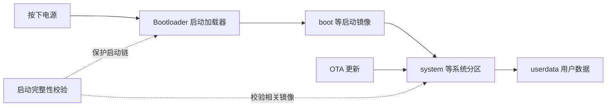
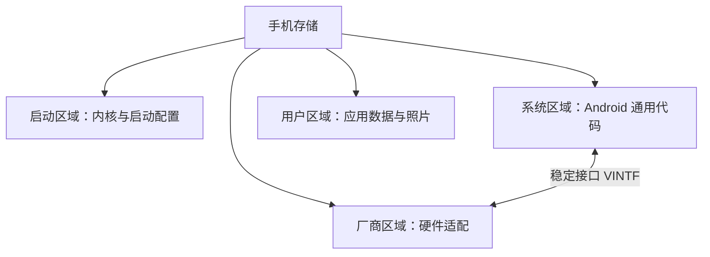
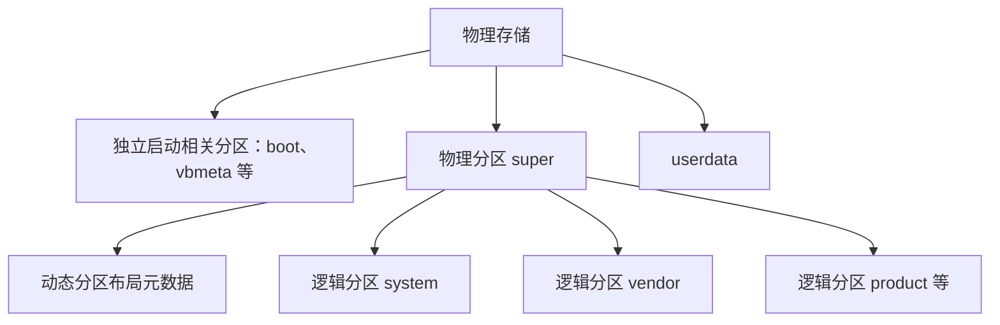
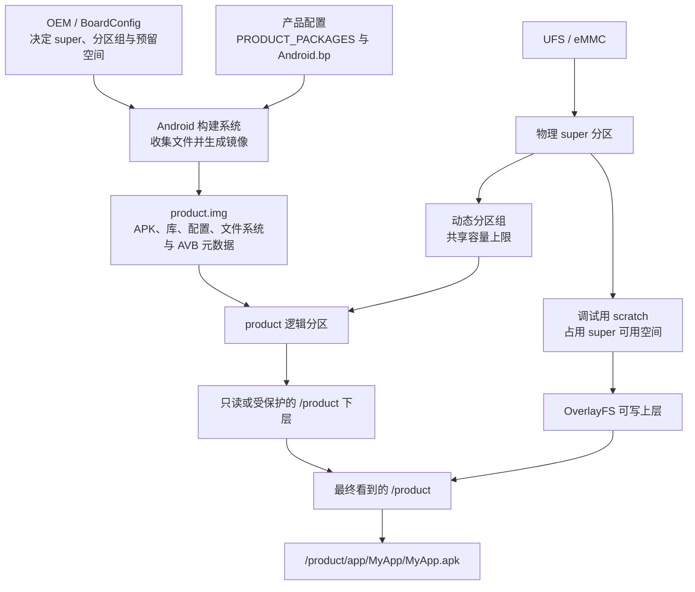
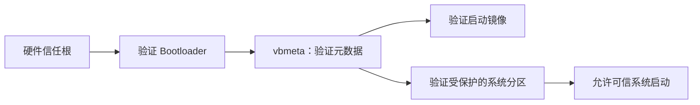
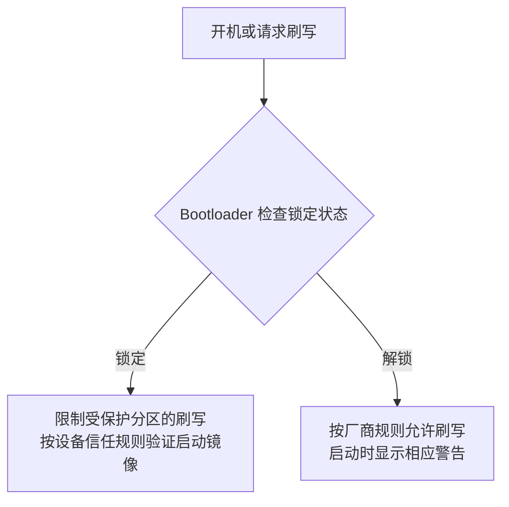
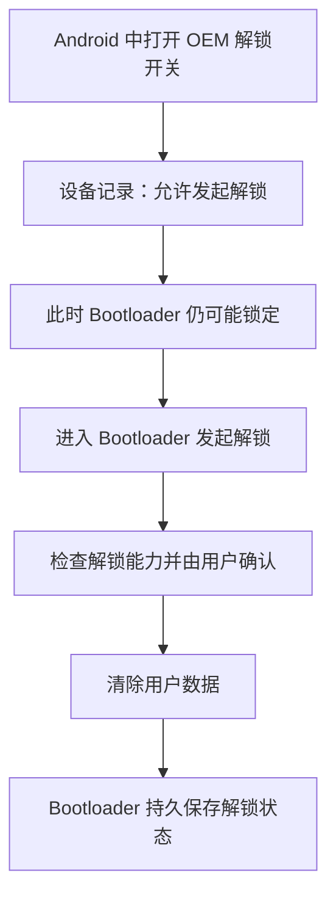
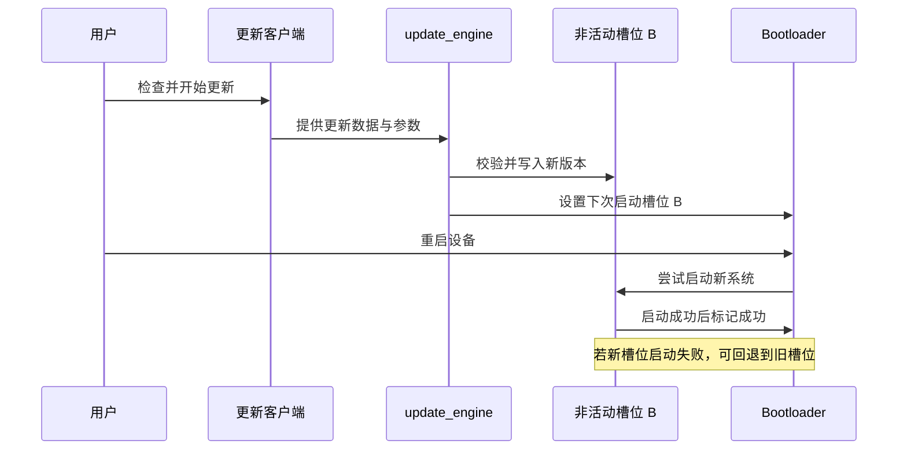
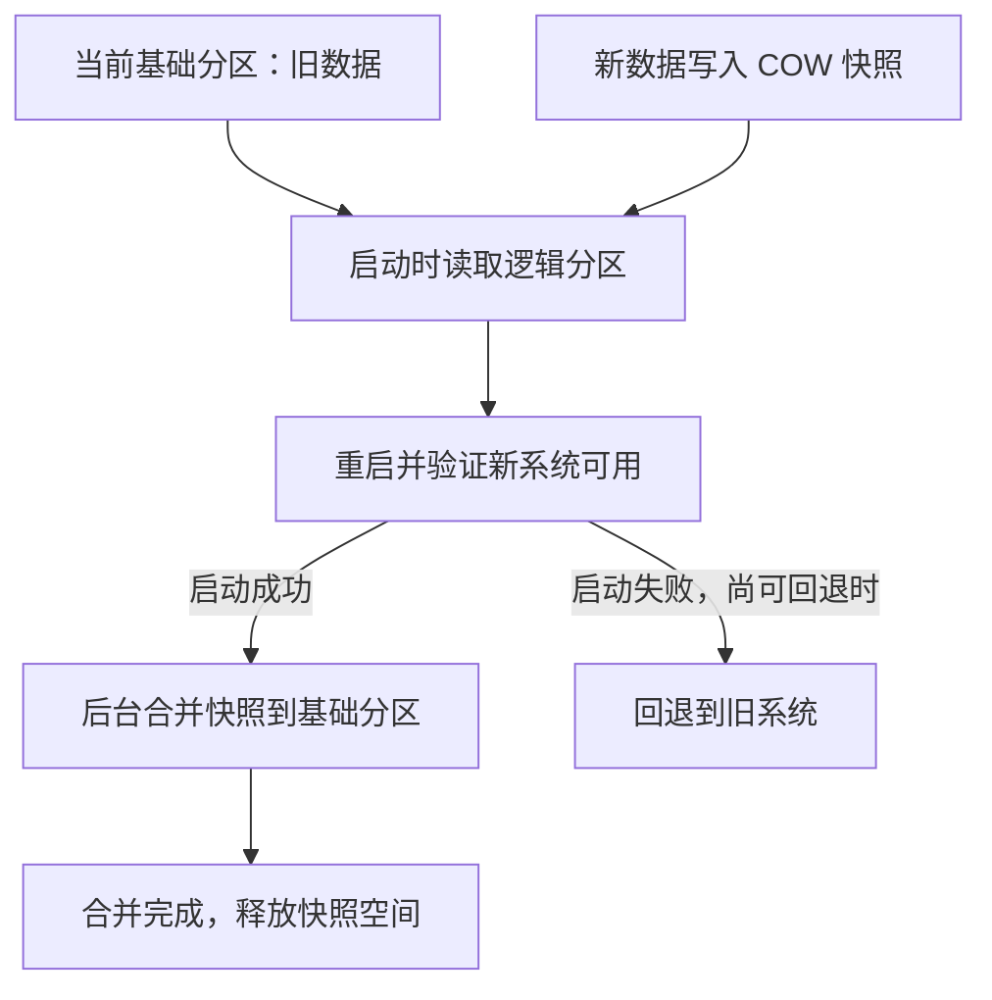
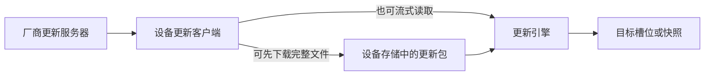

# Android 分区、刷机与 OTA：从存储到系统更新

手机里的系统不是一个文件。存储被划分为不同区域：有的负责启动，有的保存 Android，有的保存照片与应用数据。



先记住三个动作：**解锁**允许设备按厂商规则接受非官方镜像；**刷机**写入镜像；**Root**让受控进程获得更高权限。三者不是同一个操作。

## 1. 为什么要分区



- **职责分开**：系统、硬件适配、用户数据各自维护。
- **安全隔离**：系统镜像可通过 Verified Boot 检测篡改；用户数据可独立加密。
- **便于升级**：系统和厂商组件通过稳定接口协作；兼容时可以分别更新。
- **恢复能力**：部分设备利用 A/B 或快照，让更新失败后的恢复更容易。

分区是存储区域，`/system` 是挂载后的路径，`system.img` 是用于写入分区的镜像文件；三者不是同一件事。[AOSP 分区概览](https://source.android.com/docs/core/architecture/partitions)

## 2. 常见分区放什么，能不能改

下表中的“运行时”指正常启动的量产设备；实际分区名称和布局取决于机型。

| 分区 | 主要内容 | 能否修改 |
| --- | --- | --- |
| `boot` | 内核；部分设备还含通用 ramdisk | 普通应用不能写；受支持的更新或刷机可替换 |
| `init_boot` | 部分新设备的通用 ramdisk | 同上，并非每台设备都有 |
| `vendor_boot` | 厂商启动所需 ramdisk 等 | 同上，需匹配设备与系统版本 |
| `system`、`system_ext` | Android 系统及扩展组件 | 运行时通常只读；官方更新可替换 |
| `product` | 产品相关应用、资源和配置 | 运行时通常只读；更新方式依机型而定 |
| `vendor`、`odm` | 芯片、设备相关的 HAL 与厂商组件 | 运行时通常只读；需要匹配的厂商镜像 |
| `vbmeta` | Verified Boot 验证元数据 | 由受信任的更新或设备专用刷机流程维护 |
| `userdata` | `/data`，应用数据和用户文件 | 系统及授权范围内可写；应用通常只能访问自己的数据 |
| `metadata` | 加密元数据、快照等设备相关信息 | 由系统管理，不应随意清除 |
| `misc`、`recovery` | 启动控制信息、恢复环境 | 布局因设备而异；随意修改可能无法启动 |

设备还可能有基带、校准等厂商专用分区。**不要把未知分区当成可清空的临时空间。**

`boot` 和 `init_boot` 的布局与**设备首次搭载的 Android 版本**有关，不能仅凭当前升级后的版本判断：搭载 Android 13 或更高版本推出的设备通常将通用 ramdisk 放在 `init_boot`；较早设备可能放在 `boot`。[AOSP 通用启动分区](https://source.android.com/docs/core/architecture/partitions/generic-boot)

## 3. 动态分区：super 是一个容器



动态分区把多个逻辑分区放进 `super` 管理，升级时可以调整它们占用的空间。内核通过 `dm-linear` 把底层存储区域映射成逻辑块设备。示意图省略了槽位与设备差异。[AOSP 动态分区](https://source.android.com/docs/core/ota/dynamic_partitions/implement)

## 4. System / Product 容量与预置应用

这里的“分区内存”实际是 **UFS 或 eMMC 上的持久化存储空间**，不是运行内存 RAM。理解一个 100 MB APK 为什么写不进 `/product/app`，要同时区分物理分区、逻辑分区、文件系统镜像、挂载后的文件系统和调试写层。

### 4.1 从构建配置到 APK 的五层关系



*图 1：自绘的容量与写入关系。普通量产启动通常只使用下层；`eng` 或 `userdebug` 构建执行 `adb remount` 后，可能额外使用 OverlayFS。具体分区组、槽位和后备存储位置由设备实现决定。依据：[AOSP 分区概览](https://source.android.com/docs/core/architecture/partitions)、[动态分区实现](https://source.android.com/docs/core/ota/dynamic_partitions/implement)和 [OverlayFS 说明](https://android.googlesource.com/platform/system/core/+/refs/heads/android16-release/fs_mgr/README.overlayfs.md)。*

这五层的容量含义不同：

| 层级 | 谁控制 | 空间不足意味着什么 |
| --- | --- | --- |
| 物理存储与 GPT | 设备厂商、Bootloader 和硬件方案 | `super`、`userdata` 等物理边界已经确定 |
| `super` 与动态分区组 | OEM 的 `BoardConfig` | 组内所有逻辑分区及必要开销不能超过上限 |
| `product` 逻辑分区 | 构建和 OTA 元数据 | 当前逻辑块设备能映射多少块 |
| `product.img` 镜像与文件系统 | 镜像构建工具 | APK、库、预编译产物和文件系统元数据要装进文件系统；AVB 哈希树或 footer 还要满足镜像与分区预算 |
| OverlayFS `scratch` | `adb remount` 和 `fs_mgr` | 手工修改只能写入可写上层剩余空间 |

因此，`/data` 还剩几十 GB，不代表 `/product` 能写入 100 MB；`super` 还有未分配块，也不代表一次 `adb push` 会自动扩展 `product` 文件系统。

### 4.2 分区大小由谁控制

传统静态分区通常在设备配置中直接给出固定上限，例如 `BOARD_PRODUCTIMAGE_PARTITION_SIZE`。物理 GPT 分区没有变化时，镜像不能超过这个边界。

动态分区设备通常使用下面几类配置。变量名中的 `<GROUP>` 是设备定义的分区组名称，不是固定字符串：

```make
PRODUCT_USE_DYNAMIC_PARTITIONS := true

BOARD_SUPER_PARTITION_SIZE := <super物理容量>
BOARD_SUPER_PARTITION_GROUPS := <GROUP>
BOARD_<GROUP>_SIZE := <组内逻辑分区容量上限>
BOARD_<GROUP>_PARTITION_LIST := system system_ext product vendor

# 使用动态镜像尺寸时，为 product 镜像保留构建余量
BOARD_PRODUCTIMAGE_PARTITION_RESERVED_SIZE := <预留字节数>
```

`BOARD_SUPER_PARTITION_SIZE` 限制整个 `super`；分区组大小限制组内逻辑分区总和；`BOARD_PRODUCTIMAGE_PARTITION_RESERVED_SIZE` 指定 `product` 文件系统的最小未使用空间；`BOARD_PRODUCTIMAGE_PARTITION_SIZE` 则强制镜像使用固定大小。二者约束的对象不同，AOSP 建议非必要不要设置；如果产品同时设置，固定边界必须容纳文件内容、预留空间和必要开销。A/B、Virtual A/B 和 retrofit 动态分区的组容量计算还要考虑槽位、元数据和对齐开销。[AOSP 动态分区配置](https://source.android.com/docs/core/ota/dynamic_partitions/implement)

构建工具并不是只统计 APK 文件大小。它还会考虑目录内容、文件系统块与 inode、预留空间、对齐，以及 AVB 哈希树或 footer。对于 EROFS 等压缩文件系统，还需要以实际生成的压缩镜像测量。超过分区或分区组上限时，构建应直接失败，而不是运行到设备上再临时挤占 `/data`。[AOSP `build_image.py`](https://android.googlesource.com/platform/build/+/master/tools/releasetools/build_image.py)

职责可以归纳为：

- **OEM、硬件和 Bootloader 团队**确定物理存储布局与 `super` 边界。
- **设备与产品构建团队**通过 `BoardConfig`、产品 Makefile 和 Soong 模块配置决定镜像预算与内容。
- **Android 构建工具**计算实际镜像大小并执行超限检查。
- **`liblp`**提供逻辑分区元数据的读写能力，**`fastbootd` 和 `update_engine`**在刷写或 OTA 流程中使用这些能力应用布局与更新。
- **PackageManager**只负责扫描、选择和管理软件包，不负责给 `/product` 扩容。

### 4.3 预置应用怎样占用空间

预置应用没有独立的“每个 App 配额”。APK 被当作分区镜像中的普通文件，和目录、资源、原生库以及可能生成的 dexpreopt 产物共同占用镜像空间。

常见位置包括：

- `/system/app`、`/system/priv-app`：平台通用或放入 system 镜像的应用。
- `/system_ext/app`、`/system_ext/priv-app`：与平台私有接口紧密耦合的系统扩展。
- `/product/app`、`/product/priv-app`：产品、地区、运营商或软件 SKU 相关应用。
- `/vendor/app`：确实属于 vendor 侧且满足分区接口要求的应用，不应只因团队归属随意放入。

产品构建通常先定义模块，再由产品配置把模块加入 `PRODUCT_PACKAGES`。下面是已经签名的预编译 APK 示例；若希望由构建系统重新签名，应配置 `certificate`，不能同时声明 `presigned: true`：

```text
android_app_import {
    name: "MyPrebuiltApp",
    apk: "MyPrebuiltApp.apk",
    presigned: true,
    product_specific: true,

    // 只有确实需要 privileged 权限时才启用。
    privileged: true,
}
```

```make
PRODUCT_PACKAGES += MyPrebuiltApp
```

`presigned: true` 只表示预编译 APK 已按原签名交付，不能再同时配置 `certificate`；它不会把应用变成平台签名，也不会因为应用位于 `priv-app` 就自动授予 signature 或 privileged 权限。不应只为方便授权而给普通预置应用使用 platform key。[AOSP `android_app_import`](https://android.googlesource.com/platform/build/soong/+/refs/heads/main/java/app_import.go)、[AOSP 应用签名最佳实践](https://source.android.com/docs/security/best-practices/app)

`product_specific: true` 使模块进入 `/product`；`privileged: true` 选择 `priv-app` 目录。`priv-app` 只表示应用具备申请特权权限的位置条件，不代表自动得到全部权限。对受 privileged-permission allowlist 管控的权限，XML 必须与应用位于同一分区；需要 signature 权限时，证书还必须符合该权限的签名要求。Android 9 及以上在 `ro.control_privapp_permissions=enforce` 时，未明确允许或拒绝的 allowlist 违规会阻止设备完成启动；集成阶段可先使用 `log` 模式收集缺项。[AOSP Product 分区](https://source.android.com/docs/core/architecture/partitions/product-partitions)、[Privileged Permission Allowlist](https://source.android.com/docs/core/permissions/perms-allowlist)

预置版本通过应用商店或安装器升级后，新 APK 通常位于 `/data/app`，原始只读分区中的 APK 仍然存在。PackageManager 运行较新的 `/data` 版本，因此更新会额外占用用户数据空间，不会释放原始 `/product` 容量。

### 4.4 为什么 100 MB APK 会提示空间不足

首先区分错误类型：

- `Read-only file system`：`/product` 没有建立可写层，或者设备不允许 remount。这不是容量错误。
- `No space left on device`：当前实际写层没有足够数据块，也可能是 inode 耗尽。
- `Permission denied`：调用身份、SELinux 或目录权限不允许写入，不能只靠增加空间解决。

如果设备直接把 ext4 `/product` 重新挂成可写，限制来自 `product` 文件系统自身的剩余块和 inode。动态分区不会因为一次文件复制自动调整逻辑分区、扩展文件系统并重写 AVB 元数据。

如果 `adb remount` 启用了 OverlayFS，原始 `/product` 仍然是下层，新增 APK 写入后备存储对应的上层目录。在支持动态分区的调试设备上，`adb remount` 可以利用 `super` 可用空间创建临时 `scratch` 逻辑分区；具体实现也可能使用 `/cache/overlay`、`/mnt/scratch/overlay` 或 A/B 设备的另一 system 槽位。OverlayFS 按文件保存修改，所需空间可能大于 APK 表面大小，所以 100 MB APK 应准备超过 100 MB 的可写余量。[AOSP `adb remount`](https://source.android.com/docs/core/ota/dynamic_partitions/implement#adb-remount)、[OverlayFS Backing Storage](https://android.googlesource.com/platform/system/core/+/refs/heads/android16-release/fs_mgr/README.overlayfs.md)

EROFS 是只读压缩文件系统，不能像普通 ext4 那样直接原地增加文件；这种设备要依赖 OverlayFS 调试，或者重新生成并刷写镜像。

### 4.5 先判断究竟哪一层满了

下面的命令以读取为主。`lpdump`、`/cache`、`/mnt/scratch` 和部分挂载信息在量产 `user` 构建上可能不存在或受权限限制，路径不存在本身不能证明设备没有 OverlayFS：

```bash
adb shell getprop ro.build.type
adb shell getprop ro.debuggable
adb shell df -h /system /system_ext /product /vendor /data
adb shell df -i /product
adb shell cat /proc/mounts
adb shell df -h /cache
adb shell df -h /mnt/scratch
adb shell ls -l /dev/block/mapper
adb shell lpdump
adb shell pm path com.example.myapp
```

按下面顺序解释结果：

1. `userdebug` 或 `eng` 且 `ro.debuggable=1` 表示设备具备调试构建条件，但最终以 `adb root` 和 `adb remount` 的实际返回结果为准；正常量产 `user` 构建通常不允许 `adb root`。
2. `/proc/mounts` 中 `/product` 的文件系统为 EROFS，或者挂载参数为只读时，不能直接写下层。
3. 挂载信息包含 `overlay` 时，先从 `/proc/mounts` 和设备实现确认实际后备存储，再检查对应路径的容量；不能把所有设备都按 `/mnt/scratch` 判断。
4. `df -h` 余量不足是数据块问题；`df -i` 用尽则是 inode 问题。部分文件系统不提供有意义的 inode 统计。
5. `lpdump` 用来理解逻辑分区和分区组，不代表可以在 Android 正常挂载期间直接修改布局。
6. `pm path` 指向 `/data/app` 时，表示同包名的数据分区版本可能正在覆盖预置版本。

不要只看宿主机上的 sparse `product.img` 文件大小。稀疏镜像的磁盘占用、展开后的逻辑大小和设备上文件系统的可用空间是三个不同数字。

### 4.6 在调试设备上手工放入 `/product/app`

以下流程只用于明确授权的 `eng` 或 `userdebug` 调试设备。它会改变 verity / remount 状态，并可能阻止 OTA；量产 `user` 设备不能把 Bootloader 已解锁简单等同于 `adbd` 可以 root。

```bash
adb root
adb remount -R
adb wait-for-device
adb root
adb remount

adb shell df -h /product /mnt/scratch
adb shell mkdir -p /product/app/MyApp
adb push MyApp.apk /product/app/MyApp/MyApp.apk

adb shell chown -R root:root /product/app/MyApp
adb shell chmod 0755 /product/app/MyApp
adb shell chmod 0644 /product/app/MyApp/MyApp.apk
adb shell restorecon -RF /product/app/MyApp
adb reboot
```

`adb remount -R` 可能完成 verity 状态调整并触发重启，因此后面要重新等待设备、获取 root 并确认 remount 结果。复制完成后设置所有者、目录权限、APK 权限和 SELinux 文件标签；重启让 PackageManager 在系统分区扫描阶段发现它。[AOSP OverlayFS 操作流程](https://android.googlesource.com/platform/system/core/+/refs/heads/android16-release/fs_mgr/README.overlayfs.md)

重启后验证：

```bash
adb shell pm path com.example.myapp
adb shell dumpsys package com.example.myapp
adb shell ls -ldZ /product/app/MyApp
adb shell ls -lZ /product/app/MyApp/MyApp.apk
```

成功标准不只是桌面出现图标：`pm path` 应指向预期分区，`dumpsys package` 中的代码路径、版本和 flags 应符合设计，日志中不能有解析、签名、SELinux 或 privileged allowlist 错误。

需要放入 `/product/priv-app` 时，把目录替换为 `/product/priv-app/MyApp`。对受 privileged-permission allowlist 管控的权限，还要同步写入与应用同分区的 XML，例如 `/product/etc/permissions/privapp-permissions-myapp.xml`，再设置正确权限和标签。Android 9 及以上在 `ro.control_privapp_permissions=enforce` 时，未明确允许或拒绝的 allowlist 违规会阻止设备完成启动；集成阶段可先使用 `log` 模式收集缺项。[AOSP Privileged Permission Allowlist](https://source.android.com/docs/core/permissions/perms-allowlist)

### 4.7 可写空间仍然不足时怎么办

按目标选择方案，不要把不同手段混在一起：

1. **只想清除以前的调试覆盖**：可以 teardown OverlayFS 后重新 remount。`adb enable-verity` 会放弃现有 remount overrides；这会删除此前所有 OverlayFS 修改，必须先保存需要的文件。执行后重启，再重新运行上面的 remount 流程。
2. **清理后 OverlayFS 后备存储仍不足**：说明该设备可供调试写层使用的空间有限。换到另一个目录如果仍共享同一个后备存储，通常不会增加总容量。
3. **需要稳定预置 100 MB 以上应用**：把 APK 纳入产品构建，调整 `product` 的 reserved 或 fixed size，并确认所属动态分区组与 `super` 都有预算；再按该产品的发布流程生成并签名所需镜像和 AVB 元数据，通过 fastbootd 刷写逻辑分区，或交付匹配的 `super` / OTA 包。不是所有设备都需要同时单独刷写 `product.img` 和 `super.img`。
4. **只是验证普通应用功能**：使用 `adb install` 写入 `/data/app`。这不会把应用变成预置或 privileged 应用，也不能验证真实的预置权限模型。
5. **必须改变逻辑分区布局**：在解锁且支持的设备上通过匹配该产品的 fastbootd、镜像和 AVB 流程完成。不能给所有机型套用一条通用在线扩容命令，也不要在分区正常挂载时强行修改块布局。

OverlayFS 修改不是正式产品交付物。它可能阻止 `update_engine` 执行 OTA，并会在 teardown、重新刷机或某些恢复流程后消失。若 `scratch` 自身占用了 `super` 空间，它还可能妨碍逻辑分区扩容；AOSP 建议先清理 scratch，再进行正式镜像操作。[AOSP OverlayFS Caveats](https://android.googlesource.com/platform/system/core/+/refs/heads/android16-release/fs_mgr/README.overlayfs.md#caveats)

### 4.8 集成和调试检查清单

- 当前设备是 `user`、`userdebug` 还是 `eng`？`adb root` 是否真实成功？
- `/product` 是 ext4、EROFS 还是 OverlayFS 合成视图？
- 空间不足发生在 `product` 文件系统、动态分区组还是 `scratch`？
- APK 是否与已安装同包名版本的签名和版本关系兼容？
- 目标应该是 `app` 还是 `priv-app`？是否确实需要 privileged 权限？
- privileged allowlist 是否与应用位于同一个分区？
- 文件所有者、`0755` 目录权限、`0644` APK 权限和 SELinux 标签是否正确？
- `pm path` 是否仍指向 `/data/app` 中的更新版本？
- 这是一次性调试覆盖，还是需要通过 OTA 和恢复出厂长期存在的产品配置？
- 是否已记录 OverlayFS 对 OTA、刷机和后续分区调整的影响？

## 5. 谁来阻止系统被篡改



**Android Verified Boot（AVB）**建立信任链：签名确认镜像来源，哈希或哈希树检查内容完整性，回滚保护限制降级到存在已知风险的旧版本。具体受保护范围由设备配置决定。[AOSP Verified Boot](https://source.android.com/docs/security/features/verifiedboot/verified-boot)

文件系统只读、Android 权限、SELinux 和 AVB 是不同层的保护。获得 Root 不等于自动关闭这些保护，也不意味着可以安全改写任意分区。

## 6. 先观察自己的设备

电脑安装 [Android SDK Platform Tools](https://developer.android.com/tools/releases/platform-tools)，设备打开开发者选项和 USB 调试，并在手机上确认授权。以下命令只读取信息：

```bash
adb devices
adb shell getprop ro.product.model
adb shell getprop ro.build.version.release
adb shell getprop ro.build.version.sdk
adb shell getprop ro.build.fingerprint
adb shell getprop ro.build.type
adb shell getprop ro.boot.slot_suffix
adb shell getprop ro.boot.verifiedbootstate
adb shell ls -l /dev/block/by-name
adb shell df -h /data
```

- `fingerprint` 用于核对设备当前构建；`slot_suffix` 可能显示 `_a` 或 `_b`，但不能单独证明设备使用 Virtual A/B。
- 属性为空、路径不存在或权限不足，表示当前设备未公开对应信息，不代表分区不存在。
- `green` 等启动状态需结合设备的 Verified Boot 实现理解，不能仅凭一项判断整机安全。[AOSP 启动状态](https://source.android.com/docs/security/features/verifiedboot/boot-flow)

## 7. 解锁 Bootloader 与刷机

### Bootloader 锁是什么

**Bootloader** 是早于 Android 系统运行的启动加载器。它负责加载启动镜像，并参与启动校验；在刷机模式下，也会根据设备策略决定是否允许写入分区。

**Bootloader 锁**不是实体锁，而是设备保存的锁定状态，加上 Bootloader 使用该状态执行的检查：



锁定状态与屏幕锁、Root 是三回事；具体允许刷写的分区和启动行为因设备而异。解锁可能降低设备抵御系统篡改的能力。

### OEM 解锁开关与 Bootloader 锁

**OEM** 是 Original Equipment Manufacturer，原始设备制造商；这里的“OEM 解锁”指设备厂商提供的解锁能力。开发者选项里的开关表示**允许发起解锁**，并不等于 Bootloader 已经解锁。



根据 [AOSP 解锁规范](https://source.android.com/docs/core/architecture/bootloader/locking_unlocking)，设备应在 `get_unlock_ability` 为 `1` 时才接受标准解锁请求；用户确认并清除数据后，才持久化解锁状态。是否支持解锁取决于厂商、型号和运营商策略。

### 这两个状态的代码在哪里

以下是 AOSP `android16-qpr2-release` 的一种 **Persistent Data Block 实现**，不是所有设备的通用实现：[PersistentDataBlockService.java](https://android.googlesource.com/platform/frameworks/base/+/android16-qpr2-release/services/core/java/com/android/server/pdb/PersistentDataBlockService.java)。

**① 保存“允许解锁”**：`setOemUnlockEnabled()` 先检查权限、管理员身份和用户限制，然后调用：

```java
doSetOemUnlockEnabledLocked(enabled); // 保存允许状态，不执行解锁
```

该实现将 `enabled` 写入持久数据块的一个字节；其他设备也可能使用不同实现。它回答的是“能否发起解锁”，不是“锁是否已打开”。

**② 读取“实际锁定状态”**：同一服务的 `getFlashLockState()` 读取启动状态属性并判断：

```java
String locked = SystemProperties.get(FLASH_LOCK_PROP);
switch (locked) {
    case FLASH_LOCK_LOCKED:   return PersistentDataBlockManager.FLASH_LOCK_LOCKED;
    case FLASH_LOCK_UNLOCKED: return PersistentDataBlockManager.FLASH_LOCK_UNLOCKED;
    default: return PersistentDataBlockManager.FLASH_LOCK_UNKNOWN;
}
```

这个版本中 `FLASH_LOCK_PROP` 是 `ro.boot.flash.locked`，`1` 表示锁定，`0` 表示解锁。该方法**只读取和报告状态，不修改 Bootloader 锁**；属性缺失时返回未知。

**③ 真正改变锁状态**发生在设备 Bootloader 中，而不是上述 Java 方法。厂商的 Bootloader 代码和持久存储方式可能不公开，不能断言所有机型都修改同一个变量或条件。逻辑上，它先检查是否允许解锁，再在确认和清除数据后保存解锁状态；后续启动、刷写时再根据该状态执行设备策略。

### 如何解锁


没有 OEM 解锁选项不代表存在通用解法。

在**厂商明确支持标准 fastboot 解锁**的设备上，流程示例：

```bash
adb reboot bootloader
fastboot devices
fastboot flashing unlock
```

在设备屏幕确认后会清除用户数据。先备份，确认型号、厂商步骤和数据恢复方式；不同厂商可能使用其他工具或流程。[AOSP 锁定和解锁](https://source.android.com/docs/core/architecture/bootloader/locking_unlocking)

### 刷机是什么


- **厂商工具**：例如受支持 Pixel 可使用 [Android Flash Tool](https://flash.android.com/)；操作前阅读对应的[官方出厂镜像说明](https://developers.google.com/android/images)。
- **fastboot / fastbootd**：前者通常运行在 Bootloader 环境；后者是用户空间中的 fastboot，用于设备支持的动态分区操作。分区和槽位必须遵循具体机型的官方说明。[AOSP fastbootd](https://source.android.com/docs/core/architecture/bootloader/fastbootd)
- **重新上锁**：先按厂商说明恢复匹配且受信任的官方镜像，再确认上锁条件；修改后的系统直接上锁可能无法启动，上锁也可能清除数据。

出厂镜像、OTA 更新包和单个 `.img` 用途不同；是否清除数据取决于工具和具体流程。

## 8. Root 是什么，如何获得


Root 通常指 Linux 的 UID 0 权限。解锁本身不会自动获得 Root；量产 `user` 系统通常也不能直接使用 `adb root`。Root 进程仍可能受 SELinux 等机制约束。

以 [Magisk 官方安装流程](https://topjohnwu.github.io/Magisk/install.html)为例，具体操作必须匹配自己的设备：

1. 备份数据，确认厂商支持解锁，并完成 Bootloader 解锁。
2. 获取与**当前机型和构建版本**一致的官方固件。
3. 根据设备的 ramdisk 布局和 Magisk 指引，选择 `boot.img`、`init_boot.img`、`vendor_boot.img` 或特定情况下的 `recovery.img`；不能只按 Android 版本猜测。
4. 在设备上使用 Magisk 修补对应官方镜像，再按该机型的官方工具及 Magisk 指引写入正确位置。
5. 重启后通过管理器核对安装状态，并仅向可信应用授权。

错误镜像、错误槽位或中途断电可能导致无法启动。OTA 更新可能替换经过修补的镜像，更新后的 Root 状态要按设备与工具版本重新确认。

## 9. OTA 是什么，更新怎样生效

OTA（Over-the-Air）是通过网络分发系统更新。更新包经过校验后，由设备上的更新组件安装；**安装更新不等于必须解锁或 Root**。

### 传统 A/B：运行 A，更新 B



示例中 A 是当前运行版本，B 是目标版本；下一次更新时角色可以互换。哪些分区有槽位取决于设备。[AOSP A/B 更新](https://source.android.com/docs/core/ota/ab)

### Virtual A/B：动态分区使用快照



**COW（写时复制）**保存更新期间的新数据，读逻辑分区时组合基础数据与快照。部分启动相关分区仍有实体 A/B 槽位；动态分区通常不保留两套完整副本。支持压缩快照的实现使用 `snapuserd` 参与读取和合并。合并开始后不能简单假设仍可回退。[AOSP Virtual A/B](https://source.android.com/docs/core/ota/virtual_ab)

### 旧式非 A/B

旧设备可在 Recovery 环境中更新原有系统分区，安装期间不能正常使用系统；实现与失败恢复能力因设备而异。[AOSP 非 A/B 更新](https://source.android.com/docs/core/ota/nonab)

## 10. 更新包放在哪个分区



| 内容 | 可能的位置 | 需要区分 |
| --- | --- | --- |
| OTA ZIP | 厂商更新应用管理的存储位置，因设备而异 | 不保证存在一个固定的 OTA 分区或固定路径 |
| 流式更新数据 | 从服务器分段读取 | 不一定在设备上保存完整 ZIP |
| Virtual A/B 快照 | 可使用 `super` 可用空间及必要时的 `/data` 空间，取决于实现 | 快照不是 OTA ZIP，是更新过程中的块数据 |
| 旧式 Recovery 更新包 | 旧设备可能使用 `/cache` 或其他位置 | 不适用于所有现代设备 |

完整包可包含完整目标版本的数据；增量包只包含从特定旧版本更新所需的数据，因此需要匹配来源版本。包的格式、下载位置和安装方式由厂商决定。[AOSP OTA 工具](https://source.android.com/docs/core/ota/tools)

Google 为支持的 Pixel/Nexus 提供[完整 OTA 与 sideload 说明](https://developers.google.com/android/ota)：按官方步骤安装无需解锁 Bootloader，通常无需清除数据；仍应先备份。

## 11. 常见误区

- **能写 `/data` 不等于能写 `/system`**：权限、挂载方式和完整性校验分别生效。
- **A/B 不等于所有分区都有两份**：Virtual A/B 的动态分区使用快照。
- **更新下载完成不等于安装完成**：可能还需要重启、启动确认和快照合并。
- **升级后的 Android 版本不等于设备出厂版本**：不能据此断言 ramdisk 一定在 `init_boot`。
- **解锁不等于 Root，Root 不等于解锁**：它们作用于不同阶段与权限边界。
