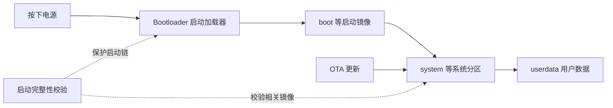
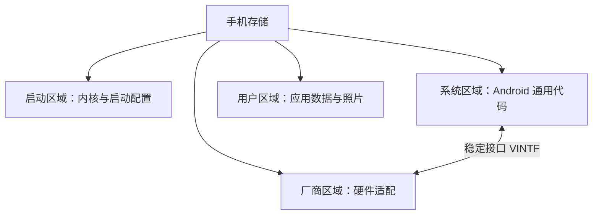
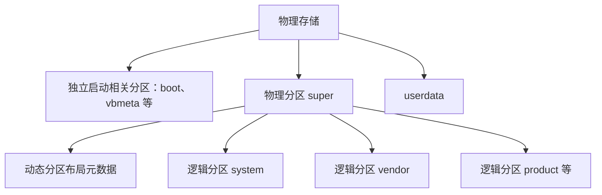
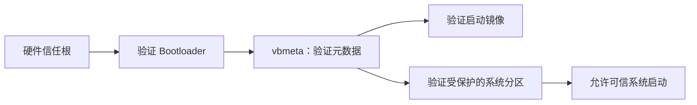
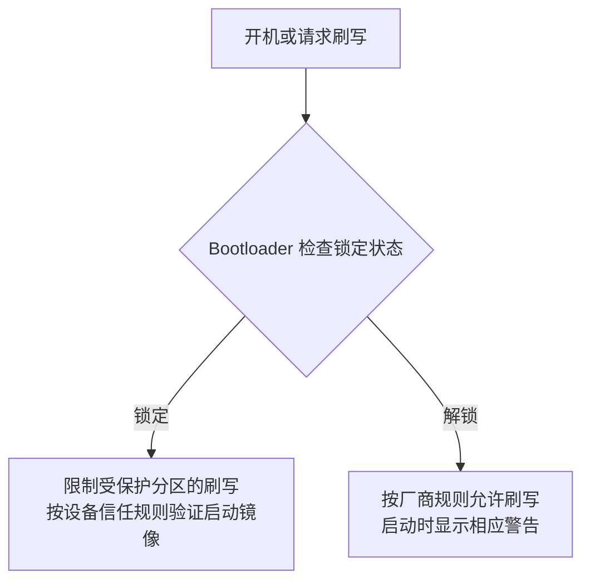
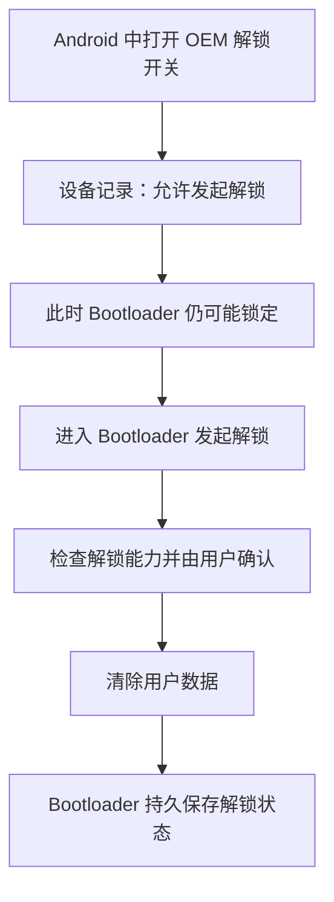
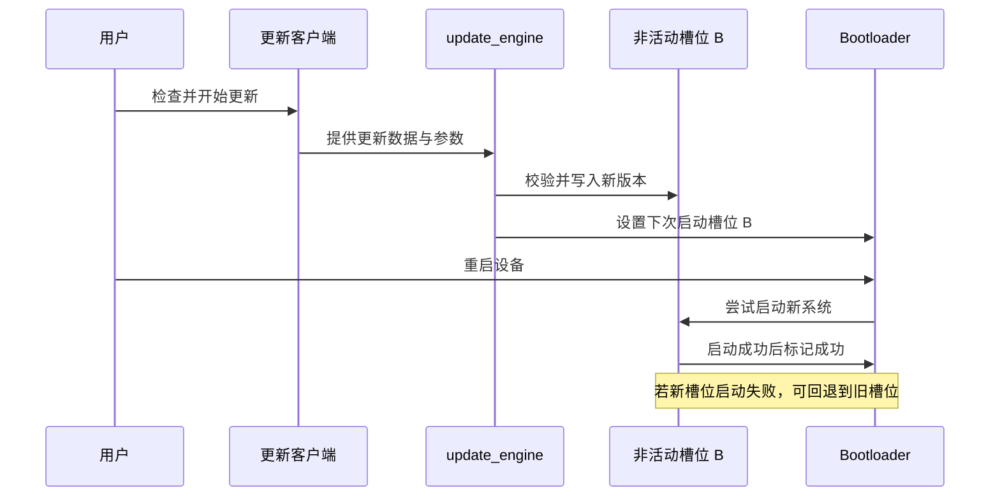
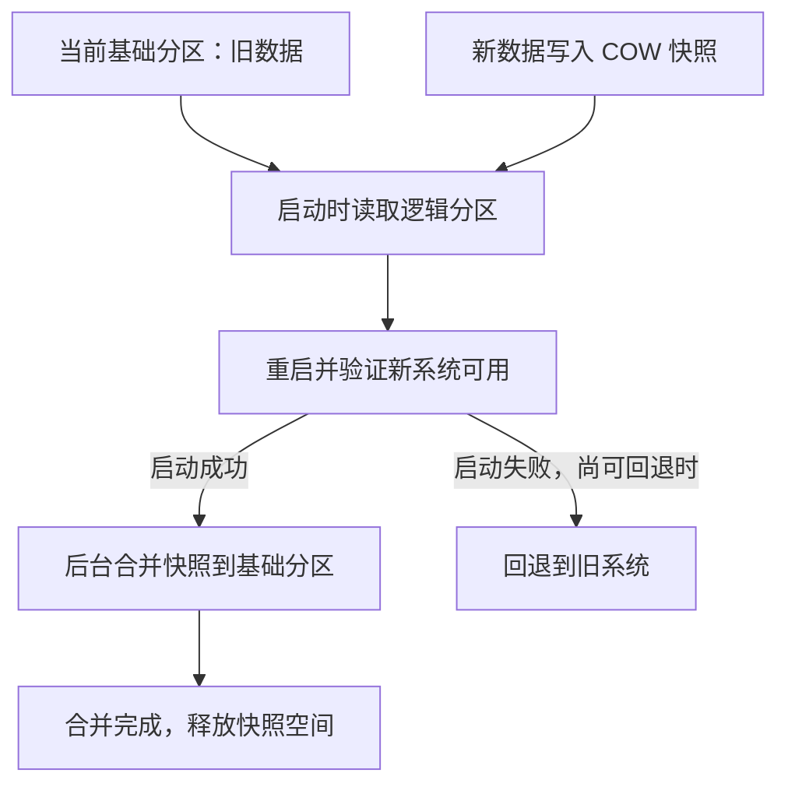
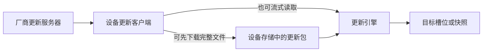

# Android 分区、刷机与 OTA：从存储到系统更新

手机里的系统不是一个文件。存储被划分为不同区域：有的负责启动，有的保存 Android，有的保存照片与应用数据。



先记住三个动作：**解锁**允许设备按厂商规则接受非官方镜像；**刷机**写入镜像；**Root**让受控进程获得更高权限。三者不是同一个操作。

## 1. 为什么要分区



- **职责分开**：系统、硬件适配、用户数据各自维护。
- **安全隔离**：系统镜像可通过 Verified Boot 检测篡改；用户数据可独立加密。
- **便于升级**：系统和厂商组件通过稳定接口协作；兼容时可以分别更新。
- **恢复能力**：部分设备利用 A/B 或快照，让更新失败后的恢复更容易。

分区是存储区域，`/system` 是挂载后的路径，`system.img` 是用于写入分区的镜像文件；三者不是同一件事。[AOSP 分区概览](https://source.android.com/docs/core/architecture/partitions)

## 2. 常见分区放什么，能不能改

下表中的“运行时”指正常启动的量产设备；实际分区名称和布局取决于机型。

| 分区 | 主要内容 | 能否修改 |
| --- | --- | --- |
| `boot` | 内核；部分设备还含通用 ramdisk | 普通应用不能写；受支持的更新或刷机可替换 |
| `init_boot` | 部分新设备的通用 ramdisk | 同上，并非每台设备都有 |
| `vendor_boot` | 厂商启动所需 ramdisk 等 | 同上，需匹配设备与系统版本 |
| `system`、`system_ext` | Android 系统及扩展组件 | 运行时通常只读；官方更新可替换 |
| `product` | 产品相关应用、资源和配置 | 运行时通常只读；更新方式依机型而定 |
| `vendor`、`odm` | 芯片、设备相关的 HAL 与厂商组件 | 运行时通常只读；需要匹配的厂商镜像 |
| `vbmeta` | Verified Boot 验证元数据 | 由受信任的更新或设备专用刷机流程维护 |
| `userdata` | `/data`，应用数据和用户文件 | 系统及授权范围内可写；应用通常只能访问自己的数据 |
| `metadata` | 加密元数据、快照等设备相关信息 | 由系统管理，不应随意清除 |
| `misc`、`recovery` | 启动控制信息、恢复环境 | 布局因设备而异；随意修改可能无法启动 |

设备还可能有基带、校准等厂商专用分区。**不要把未知分区当成可清空的临时空间。**

`boot` 和 `init_boot` 的布局与**设备首次搭载的 Android 版本**有关，不能仅凭当前升级后的版本判断：搭载 Android 13 或更高版本推出的设备通常将通用 ramdisk 放在 `init_boot`；较早设备可能放在 `boot`。[AOSP 通用启动分区](https://source.android.com/docs/core/architecture/partitions/generic-boot)

## 3. 动态分区：super 是一个容器



动态分区把多个逻辑分区放进 `super` 管理，升级时可以调整它们占用的空间。内核通过 `dm-linear` 把底层存储区域映射成逻辑块设备。示意图省略了槽位与设备差异。[AOSP 动态分区](https://source.android.com/docs/core/ota/dynamic_partitions/implement)

## 4. 谁来阻止系统被篡改



**Android Verified Boot（AVB）**建立信任链：签名确认镜像来源，哈希或哈希树检查内容完整性，回滚保护限制降级到存在已知风险的旧版本。具体受保护范围由设备配置决定。[AOSP Verified Boot](https://source.android.com/docs/security/features/verifiedboot/verified-boot)

文件系统只读、Android 权限、SELinux 和 AVB 是不同层的保护。获得 Root 不等于自动关闭这些保护，也不意味着可以安全改写任意分区。

## 5. 先观察自己的设备

电脑安装 [Android SDK Platform Tools](https://developer.android.com/tools/releases/platform-tools)，设备打开开发者选项和 USB 调试，并在手机上确认授权。以下命令只读取信息：

```bash
adb devices
adb shell getprop ro.product.model
adb shell getprop ro.build.version.release
adb shell getprop ro.build.version.sdk
adb shell getprop ro.build.fingerprint
adb shell getprop ro.build.type
adb shell getprop ro.boot.slot_suffix
adb shell getprop ro.boot.verifiedbootstate
adb shell ls -l /dev/block/by-name
adb shell df -h /data
```

- `fingerprint` 用于核对设备当前构建；`slot_suffix` 可能显示 `_a` 或 `_b`，但不能单独证明设备使用 Virtual A/B。
- 属性为空、路径不存在或权限不足，表示当前设备未公开对应信息，不代表分区不存在。
- `green` 等启动状态需结合设备的 Verified Boot 实现理解，不能仅凭一项判断整机安全。[AOSP 启动状态](https://source.android.com/docs/security/features/verifiedboot/boot-flow)

## 6. 解锁 Bootloader 与刷机

### Bootloader 锁是什么

**Bootloader** 是早于 Android 系统运行的启动加载器。它负责加载启动镜像，并参与启动校验；在刷机模式下，也会根据设备策略决定是否允许写入分区。

**Bootloader 锁**不是实体锁，而是设备保存的锁定状态，加上 Bootloader 使用该状态执行的检查：



锁定状态与屏幕锁、Root 是三回事；具体允许刷写的分区和启动行为因设备而异。解锁可能降低设备抵御系统篡改的能力。

### OEM 解锁开关与 Bootloader 锁

**OEM** 是 Original Equipment Manufacturer，原始设备制造商；这里的“OEM 解锁”指设备厂商提供的解锁能力。开发者选项里的开关表示**允许发起解锁**，并不等于 Bootloader 已经解锁。



根据 [AOSP 解锁规范](https://source.android.com/docs/core/architecture/bootloader/locking_unlocking)，设备应在 `get_unlock_ability` 为 `1` 时才接受标准解锁请求；用户确认并清除数据后，才持久化解锁状态。是否支持解锁取决于厂商、型号和运营商策略。

### 这两个状态的代码在哪里

以下是 AOSP `android16-qpr2-release` 的一种 **Persistent Data Block 实现**，不是所有设备的通用实现：[PersistentDataBlockService.java](https://android.googlesource.com/platform/frameworks/base/+/android16-qpr2-release/services/core/java/com/android/server/pdb/PersistentDataBlockService.java)。

**① 保存“允许解锁”**：`setOemUnlockEnabled()` 先检查权限、管理员身份和用户限制，然后调用：

```java
doSetOemUnlockEnabledLocked(enabled); // 保存允许状态，不执行解锁
```

该实现将 `enabled` 写入持久数据块的一个字节；其他设备也可能使用不同实现。它回答的是“能否发起解锁”，不是“锁是否已打开”。

**② 读取“实际锁定状态”**：同一服务的 `getFlashLockState()` 读取启动状态属性并判断：

```java
String locked = SystemProperties.get(FLASH_LOCK_PROP);
switch (locked) {
    case FLASH_LOCK_LOCKED:   return PersistentDataBlockManager.FLASH_LOCK_LOCKED;
    case FLASH_LOCK_UNLOCKED: return PersistentDataBlockManager.FLASH_LOCK_UNLOCKED;
    default: return PersistentDataBlockManager.FLASH_LOCK_UNKNOWN;
}
```

这个版本中 `FLASH_LOCK_PROP` 是 `ro.boot.flash.locked`，`1` 表示锁定，`0` 表示解锁。该方法**只读取和报告状态，不修改 Bootloader 锁**；属性缺失时返回未知。

**③ 真正改变锁状态**发生在设备 Bootloader 中，而不是上述 Java 方法。厂商的 Bootloader 代码和持久存储方式可能不公开，不能断言所有机型都修改同一个变量或条件。逻辑上，它先检查是否允许解锁，再在确认和清除数据后保存解锁状态；后续启动、刷写时再根据该状态执行设备策略。

### 如何解锁


没有 OEM 解锁选项不代表存在通用解法。

在**厂商明确支持标准 fastboot 解锁**的设备上，流程示例：

```bash
adb reboot bootloader
fastboot devices
fastboot flashing unlock
```

在设备屏幕确认后会清除用户数据。先备份，确认型号、厂商步骤和数据恢复方式；不同厂商可能使用其他工具或流程。[AOSP 锁定和解锁](https://source.android.com/docs/core/architecture/bootloader/locking_unlocking)

### 刷机是什么


- **厂商工具**：例如受支持 Pixel 可使用 [Android Flash Tool](https://flash.android.com/)；操作前阅读对应的[官方出厂镜像说明](https://developers.google.com/android/images)。
- **fastboot / fastbootd**：前者通常运行在 Bootloader 环境；后者是用户空间中的 fastboot，用于设备支持的动态分区操作。分区和槽位必须遵循具体机型的官方说明。[AOSP fastbootd](https://source.android.com/docs/core/architecture/bootloader/fastbootd)
- **重新上锁**：先按厂商说明恢复匹配且受信任的官方镜像，再确认上锁条件；修改后的系统直接上锁可能无法启动，上锁也可能清除数据。

出厂镜像、OTA 更新包和单个 `.img` 用途不同；是否清除数据取决于工具和具体流程。

## 7. Root 是什么，如何获得


Root 通常指 Linux 的 UID 0 权限。解锁本身不会自动获得 Root；量产 `user` 系统通常也不能直接使用 `adb root`。Root 进程仍可能受 SELinux 等机制约束。

以 [Magisk 官方安装流程](https://topjohnwu.github.io/Magisk/install.html)为例，具体操作必须匹配自己的设备：

1. 备份数据，确认厂商支持解锁，并完成 Bootloader 解锁。
2. 获取与**当前机型和构建版本**一致的官方固件。
3. 根据设备的 ramdisk 布局和 Magisk 指引，选择 `boot.img`、`init_boot.img`、`vendor_boot.img` 或特定情况下的 `recovery.img`；不能只按 Android 版本猜测。
4. 在设备上使用 Magisk 修补对应官方镜像，再按该机型的官方工具及 Magisk 指引写入正确位置。
5. 重启后通过管理器核对安装状态，并仅向可信应用授权。

错误镜像、错误槽位或中途断电可能导致无法启动。OTA 更新可能替换经过修补的镜像，更新后的 Root 状态要按设备与工具版本重新确认。

## 8. OTA 是什么，更新怎样生效

OTA（Over-the-Air）是通过网络分发系统更新。更新包经过校验后，由设备上的更新组件安装；**安装更新不等于必须解锁或 Root**。

### 传统 A/B：运行 A，更新 B



示例中 A 是当前运行版本，B 是目标版本；下一次更新时角色可以互换。哪些分区有槽位取决于设备。[AOSP A/B 更新](https://source.android.com/docs/core/ota/ab)

### Virtual A/B：动态分区使用快照



**COW（写时复制）**保存更新期间的新数据，读逻辑分区时组合基础数据与快照。部分启动相关分区仍有实体 A/B 槽位；动态分区通常不保留两套完整副本。支持压缩快照的实现使用 `snapuserd` 参与读取和合并。合并开始后不能简单假设仍可回退。[AOSP Virtual A/B](https://source.android.com/docs/core/ota/virtual_ab)

### 旧式非 A/B

旧设备可在 Recovery 环境中更新原有系统分区，安装期间不能正常使用系统；实现与失败恢复能力因设备而异。[AOSP 非 A/B 更新](https://source.android.com/docs/core/ota/nonab)

## 9. 更新包放在哪个分区



| 内容 | 可能的位置 | 需要区分 |
| --- | --- | --- |
| OTA ZIP | 厂商更新应用管理的存储位置，因设备而异 | 不保证存在一个固定的 OTA 分区或固定路径 |
| 流式更新数据 | 从服务器分段读取 | 不一定在设备上保存完整 ZIP |
| Virtual A/B 快照 | 可使用 `super` 可用空间及必要时的 `/data` 空间，取决于实现 | 快照不是 OTA ZIP，是更新过程中的块数据 |
| 旧式 Recovery 更新包 | 旧设备可能使用 `/cache` 或其他位置 | 不适用于所有现代设备 |

完整包可包含完整目标版本的数据；增量包只包含从特定旧版本更新所需的数据，因此需要匹配来源版本。包的格式、下载位置和安装方式由厂商决定。[AOSP OTA 工具](https://source.android.com/docs/core/ota/tools)

Google 为支持的 Pixel/Nexus 提供[完整 OTA 与 sideload 说明](https://developers.google.com/android/ota)：按官方步骤安装无需解锁 Bootloader，通常无需清除数据；仍应先备份。

## 10. 常见误区

- **能写 `/data` 不等于能写 `/system`**：权限、挂载方式和完整性校验分别生效。
- **A/B 不等于所有分区都有两份**：Virtual A/B 的动态分区使用快照。
- **更新下载完成不等于安装完成**：可能还需要重启、启动确认和快照合并。
- **升级后的 Android 版本不等于设备出厂版本**：不能据此断言 ramdisk 一定在 `init_boot`。
- **解锁不等于 Root，Root 不等于解锁**：它们作用于不同阶段与权限边界。
