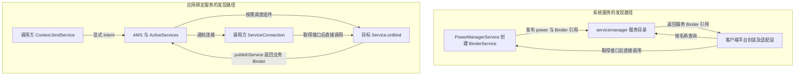
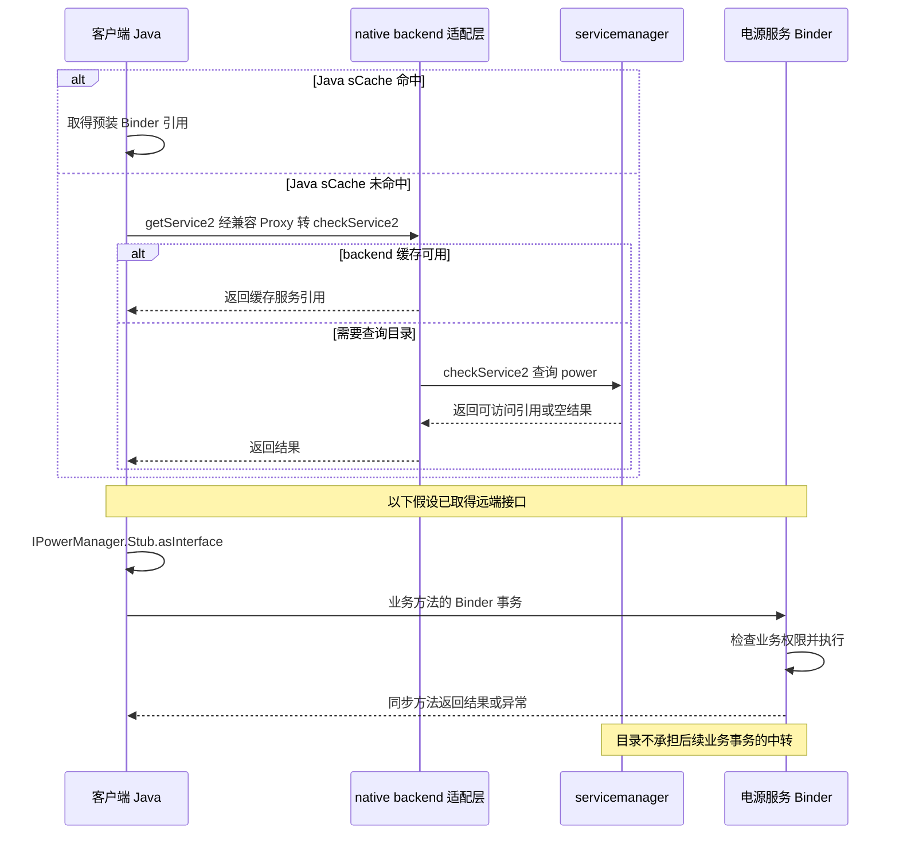
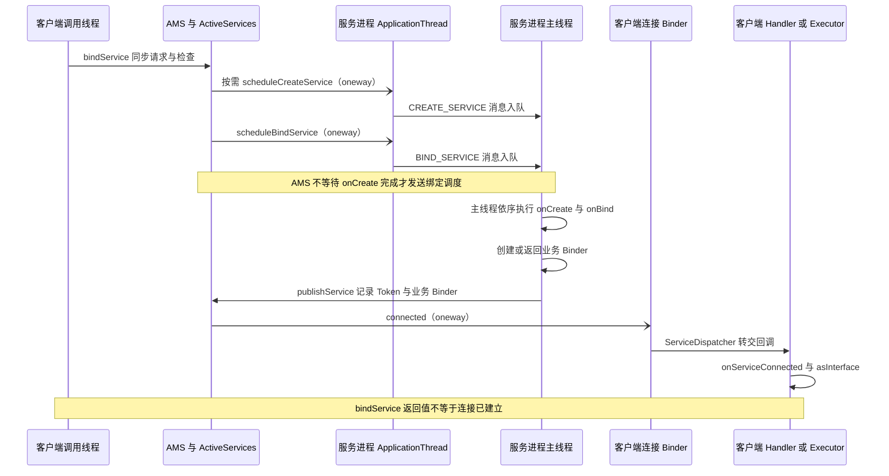

# ServiceManager 与 AIDL：系统服务和应用绑定的两条路径

同样使用 AIDL，为什么系统服务常见 `ServiceManager.getService()`，应用服务却通常通过 `bindService()` 获取接口？区别首先在于**谁发布 Binder、客户端怎样发现它，以及谁管理服务组件的生命周期**。接口取得之后，业务调用仍遵循 Binder 的本地或远端调用规则。

## 1. 四个概念分别解决什么问题

**Binder** 提供对象引用和跨进程事务；**AIDL** 描述接口并生成封送代码；**ServiceManager** 提供特定 Binder 服务目录；**Service 组件** 则由 Android 组件管理机制调度。AIDL 接口可以由普通 Binder 对象实现，并不要求实现类继承 `android.app.Service`。

| 对象 | 接入方式 | 主要职责 | 不应推导出的结论 |
| --- | --- | --- | --- |
| Binder | `IBinder`、`transact()` | 传递引用、调用与身份 | 自动完成业务授权 |
| AIDL | `.aidl` 生成 Stub / Proxy | 约定方法、参数和序列化规则 | 自动发现服务、管理生命周期 |
| ServiceManager | 服务名与 Binder 引用 | 发布、查找及相关访问控制 | 中转全部业务调用 |
| Service 组件 | Manifest、Intent、`bindService()` | 创建、绑定、解绑及组件关联 | 默认在独立线程执行 |

系统服务也不全在 `system_server`：原生进程可以发布 Binder 服务，部分服务支持惰性启动。下文以 PowerManagerService 和普通应用绑定为具体例子，不把某个进程或启动方式推广到所有系统服务。



图中的“直接调用”指业务事务以目标服务 Binder 为端点；仍可能经过驱动和 Binder 线程池，不是直接解引用其他进程的对象地址。

## 2. 三个 ServiceManager 名字不是同一个对象

- **`android.os.ServiceManager`**：Java 静态工具类，提供查找、注册和缓存相关入口，运行在调用进程中。
- **`IServiceManager`**：服务目录的接口协议，有对应的生成代码和适配实现，不是具体业务服务的接口。
- **`servicemanager`**：独立的原生目录进程，保存服务名称、Binder 引用及相关元数据，执行目录访问控制。

Java `getIServiceManager()` 从 `BinderInternal.getContextObject()` 取得目录入口，再交给 `ServiceManagerNative.asInterface()`。底层 `ProcessState::getContextObject()` 使用当前 Binder context 中的 **handle 0**。这个约定使客户端能找到目录，但不能据此把其他 handle 当作全局对象 ID；服务名也应在对应目录和 Binder 域的范围内理解。[Java 入口](https://android.googlesource.com/platform/frameworks/base/+/refs/tags/android-16.0.0_r1/core/java/android/os/ServiceManager.java#149)、[原生 context 入口](https://android.googlesource.com/platform/frameworks/native/+/refs/tags/android-16.0.0_r1/libs/binder/ProcessState.cpp#177)、[目录进程初始化](https://android.googlesource.com/platform/frameworks/native/+/refs/tags/android-16.0.0_r1/cmds/servicemanager/main.cpp#153)

本版本还存在一层容易遗漏的适配：Java `ServiceManagerProxy` 获取 native backend 对应的接口，backend 再连接真正的 context manager。不能直接套用“Java Proxy 保存 remote，然后每个方法都对它手写事务码”的旧实现。[ServiceManagerNative](https://android.googlesource.com/platform/frameworks/base/+/refs/tags/android-16.0.0_r1/core/java/android/os/ServiceManagerNative.java#38)、[BackendUnifiedServiceManager](https://android.googlesource.com/platform/frameworks/native/+/refs/tags/android-16.0.0_r1/libs/binder/BackendUnifiedServiceManager.cpp#491)

## 3. 系统服务怎样发布：以电源服务为例

`PowerManagerService` 的外层负责系统服务生命周期，内部 `BinderService extends IPowerManager.Stub` 提供远端业务接口。`onStart()` 发布的是已经创建好的 `mBinderService` 实例，同时通过另一条路径发布 `PowerManagerInternal` 本地接口。

主线是 `PowerManagerService.onStart()` → `SystemService.publishBinderService()` → Java `ServiceManager.addService()` → native backend → 目录服务的注册操作。注册内容是**名称与 Binder 引用**，不是 Java 类名，也不是把 PowerManagerService 的实现迁移到目录进程。[Power 发布入口](https://android.googlesource.com/platform/frameworks/base/+/refs/tags/android-16.0.0_r1/services/core/java/com/android/server/power/PowerManagerService.java#1342)、[SystemService 发布封装](https://android.googlesource.com/platform/frameworks/base/+/refs/tags/android-16.0.0_r1/services/core/java/com/android/server/SystemService.java#606)

这也解释了为何不宜背诵“所有系统服务都继承某个 Stub”：有的服务直接实现业务 Stub，有的外层是 `SystemService`、内部持有 BinderService。分析时应追踪实际传给 `addService()` 的对象。

### 注册权限与查找权限分开检查

原生注册路径检查应用 UID 限制、服务名、空 Binder、SELinux `add` 权限及适用的声明要求；查找路径涉及 `find` 权限和 isolated 调用方限制。`service_contexts` 将名称映射到 SELinux 服务类型，`allowIsolated` 也不是“允许任何应用访问”的开关。[目录注册与查找](https://android.googlesource.com/platform/frameworks/native/+/refs/tags/android-16.0.0_r1/cmds/servicemanager/ServiceManager.cpp#449)、[Access 中的 add / find 检查](https://android.googlesource.com/platform/frameworks/native/+/refs/tags/android-16.0.0_r1/cmds/servicemanager/Access.cpp#130)

普通应用不能靠反射调用隐藏的 `addService()` 获得注册资格；平台策略和进程身份检查仍然存在。

## 4. getService、checkService 与等待不能混为一谈

在此版本 Java 实现中，`getService()` 和 `checkService()` 都先查 Java `sCache`。`rawGetService()` 虽然调用名为 `getService2()` 的方法，但兼容 Proxy 实际转交 native backend 的 **`checkService2()`**。因此不能将 Java `getService()` 直接解释为“未注册就启动并等待目标服务”。[Java 查找入口](https://android.googlesource.com/platform/frameworks/base/+/refs/tags/android-16.0.0_r1/core/java/android/os/ServiceManager.java#160)、[Proxy 中的实际转发](https://android.googlesource.com/platform/frameworks/base/+/refs/tags/android-16.0.0_r1/core/java/android/os/ServiceManagerNative.java#63)

- **Java `getService()` / `checkService()`**：查缓存和当前目录结果；没有目标时可能得到 `null`。这里“不等待注册”不表示同步 Binder 查询绝不阻塞线程。
- **Java `waitForService()`**：经 JNI 使用原生等待逻辑，涉及查询、注册通知、等待和惰性启动重试，没有统一固定的总等待期限。不能在界面线程随意等待不确定存在的服务。
- **原生目录 `getService2()`**：相应路径可以在未找到时请求启动服务，与上述 Java 兼容转发不同；惰性启动依赖声明和 init 配置，并非任意字符串都能启动一个服务。

分析缺失服务时，还需区分未注册、访问受限和调用错误；一次 `null` 并不能证明目标进程没有运行。[原生等待实现](https://android.googlesource.com/platform/frameworks/native/+/refs/tags/android-16.0.0_r1/libs/binder/IServiceManager.cpp#658)、[目录启动与死亡处理](https://android.googlesource.com/platform/frameworks/native/+/refs/tags/android-16.0.0_r1/cmds/servicemanager/ServiceManager.cpp#853)

### 两层缓存有不同的边界

Java `sCache` 主要由启动流程预装，普通 `getService()` / `checkService()` 缓存未命中后不会自动把结果加入这个表。native backend 则另有受配置和运行条件影响的缓存与死亡失效处理。因此“Java 表未命中”不等于“本次必然跨进程”，持有缓存引用也不等于服务永远存活。[Java 缓存初始化](https://android.googlesource.com/platform/frameworks/base/+/refs/tags/android-16.0.0_r1/core/java/android/os/ServiceManager.java#405)、[native backend 缓存](https://android.googlesource.com/platform/frameworks/native/+/refs/tags/android-16.0.0_r1/libs/binder/BackendUnifiedServiceManager.cpp#131)



## 5. AIDL 的 Stub、Proxy 和本地优化

以一个教学接口为例，以下内容属于 `com/example/calc/ICalcService.aidl`：

```java
package com.example.calc;

interface ICalcService {
    int add(int a, int b);
}
```

Java 后端生成的 Stub 继承 Binder，并实现接口；服务端实现业务方法。客户端对取得的 `IBinder` 使用 `ICalcService.Stub.asInterface()`：先通过 descriptor 查询匹配的本地接口并检查类型，成功则返回本地实现，否则构造 Proxy。[asInterface 生成逻辑](https://android.googlesource.com/platform/system/tools/aidl/+/refs/tags/android-16.0.0_r1/generate_java_binder.cpp#334)

远端同步方法大致经历：Proxy 写入接口标识和参数 → `transact()` → 服务端 Stub 分派与参数读取 → 业务方法 → 写入回复 → Proxy 读取异常标记及结果。生成细节随后端、方法和编译选项变化，例如不能声称所有方法都会生成 `enforceNoDataAvail()`。[请求与回复生成](https://android.googlesource.com/platform/system/tools/aidl/+/refs/tags/android-16.0.0_r1/generate_java_binder.cpp#785)

本地接口优化路径可以直接执行 Java 方法，不必经过 Parcel、驱动和 `onTransact()`。因此不能无条件把拿到的 Binder 强转为 Stub，也不能假设每次 AIDL 调用都有线程切换。

接口 descriptor 校验只验证事务接口约定，**不代表业务权限校验通过**。AIDL 也不会自动解决进程保活、重连、业务幂等和长期接口兼容问题。

## 6. 应用 Service 怎样交出业务 Binder

普通应用常见方式是在 `Service.onBind()` 返回自己实现的 Stub，然后在 `ServiceConnection.onServiceConnected()` 中转换接口。以下是同一应用内、放入独立进程的教学片段，省略 imports 与类外部代码；项目需启用 AIDL 代码生成。

```java
public class CalcService extends Service {
    private final ICalcService.Stub binder = new ICalcService.Stub() {
        @Override
        public int add(int a, int b) {
            return a + b;
        }
    };

    @Override
    public IBinder onBind(Intent intent) {
        return binder;
    }
}
```

```xml
<service
    android:name=".CalcService"
    android:exported="false"
    android:process=":calc" />
```

客户端用显式 `Intent` 调用 `bindService(intent, connection, Context.BIND_AUTO_CREATE)`；连接建立后，以 `ICalcService.Stub.asInterface(service)` 转换回调中的 `IBinder`。示例中的 `exported="false"` 用于本应用内演示；跨应用使用必须另行设计导出、声明权限、调用方授权与可见性，不能只修改这一个属性。[官方 AIDL 接入说明](https://developer.android.com/develop/background-work/services/aidl)

这里至少要分清两份 Binder：**ServiceRecord 本身的 Binder** 是 AMS 管理服务记录的 Token；**`onBind()` 返回的 Binder** 才是示例中的计算接口。`publishService(token, intent, binder)` 同时传递二者，不能把框架 Token 当成业务 Stub。[ServiceRecord 定义](https://android.googlesource.com/platform/frameworks/base/+/refs/tags/android-16.0.0_r1/services/core/java/com/android/server/am/ServiceRecord.java#81)、[handleBindService](https://android.googlesource.com/platform/frameworks/base/+/refs/tags/android-16.0.0_r1/core/java/android/app/ActivityThread.java#5300)

## 7. bindService 跨进程时序与回调线程

调用进入 `ContextImpl.bindServiceCommon()`，由 AMS / ActiveServices 解析、检查并维护绑定关系。按需创建目标进程与 Service 后，`ApplicationThread` 接收创建、绑定调度，投递 H 消息，目标主线程执行生命周期方法。

下面画出需要创建服务并首次获取 Binder 的典型远端路径；目标已存在、已有 Intent binding 或发生失败时，会走不同分支，不必每次重复调用 `onBind()`。



`IServiceConnection.connected()` 是 oneway 通知，但最终用户回调由 `LoadedApk.ServiceDispatcher` 交给 Handler 或指定 Executor。常见重载默认使用主线程；不能把“经 Binder 到达”写成“回调必在 Binder 线程池”。Service 的 `onCreate()` / `onBind()` 默认也在主线程，远端业务 AIDL 方法才通常由 Binder 线程池处理。[ContextImpl](https://android.googlesource.com/platform/frameworks/base/+/refs/tags/android-16.0.0_r1/core/java/android/app/ContextImpl.java#2201)、[ApplicationThread 消息转交](https://android.googlesource.com/platform/frameworks/base/+/refs/tags/android-16.0.0_r1/core/java/android/app/ActivityThread.java#1204)、[ServiceDispatcher](https://android.googlesource.com/platform/frameworks/base/+/refs/tags/android-16.0.0_r1/core/java/android/app/LoadedApk.java#2165)

## 8. 返回值、解绑与死亡怎样处理

`bindService()` 返回 `true` 表示系统正在建立允许的绑定，不代表已收到 Binder，更不保证一定会收到连接回调。业务状态应区分“正在连接”“已连接”“暂时断开”和“本次绑定失效”，不能把返回值直接当作可调用接口。

- **`onServiceDisconnected()`**：连接意外断开，清空业务接口；原绑定仍存在，服务再次运行时可能收到新的 `onServiceConnected()`。
- **`onBindingDied()`，API 26 起**：本次绑定永久失效，需要解绑后重新绑定，而不是继续等待旧连接恢复。
- **`onNullBinding()`，API 28 起**：服务返回空 Binder，本次绑定不可用，但仍须释放绑定资源。
- **主动 `unbindService()`**：由调用方结束绑定，不应依赖它触发 `onServiceDisconnected()` 才清理本地状态。

SDK 契约要求正常返回 `false` 或抛出 `SecurityException` 时调用 `unbindService()` 释放连接，不能只在 `true` 时安排清理。[Context 的返回与清理契约](https://android.googlesource.com/platform/frameworks/base/+/refs/tags/android-16.0.0_r1/core/java/android/content/Context.java#3979)、[连接回调契约](https://android.googlesource.com/platform/frameworks/base/+/refs/tags/android-16.0.0_r1/core/java/android/content/ServiceConnection.java#34)

不要把上述安全异常与登记前的参数错误合并：`ContextImpl.bindServiceCommon()` 在 `conn == null` 或同时传入 Handler/Executor 时，尚未取得 ServiceDispatcher 就抛出 `IllegalArgumentException`，不应对这种未登记对象盲目解绑；而隐式 Intent 等校验发生在取得 ServiceDispatcher 之后，同样可能抛出 `IllegalArgumentException`。应结合具体失败位置跟踪绑定尝试、登记及清理状态，不能仅凭异常类型或“已连接”布尔值决定是否释放。[固定版本登记与参数检查顺序](https://github.com/aosp-mirror/platform_frameworks_base/blob/android-16.0.0_r1/core/java/android/app/ContextImpl.java#L2201)

服务死亡后，旧 Proxy 不会自动指向重启后的新对象。应使用有效连接或重新绑定取得新接口；处理 `RemoteException` / 死亡通知时，也不能无条件重试非幂等操作。最后一个绑定解除后，服务是否销毁还取决于它是否同时处于 started 状态等生命周期条件。[绑定服务生命周期](https://developer.android.com/develop/background-work/services/bound-services)

## 9. 权限、线程与身份必须逐层分析

绑定组件时，系统检查 Intent、可见性、导出和声明权限等条件。使用显式 Intent 有助于确定目标，但不会绕过这些检查。通过目录找系统服务时，则适用目录本身的 add / find 与相关平台策略。取得 Binder 后，还存在独立的业务方法授权，例如电源服务 `reboot()` 检查 REBOOT / RECOVERY 权限。[绑定解析与访问检查](https://android.googlesource.com/platform/frameworks/base/+/refs/tags/android-16.0.0_r1/services/core/java/com/android/server/am/ActiveServices.java#5080)、[Power 业务权限](https://android.googlesource.com/platform/frameworks/base/+/refs/tags/android-16.0.0_r1/services/core/java/com/android/server/power/PowerManagerService.java#6848)

特别容易出错的是在 `onBind()` 中用 `Binder.getCallingUid()` 判断原始绑定客户端：该回调经主线程消息执行，已经不处于原客户端的业务 Binder 事务。业务授权应在实际接收调用的边界核验调用身份；准备转交异步任务时，先捕获并验证身份，不能到工作线程再假设原调用上下文仍存在。

Service 不是后台线程。远端 AIDL 方法可能被多个 Binder 线程并发调用，本地优化则直接使用调用线程；可变状态必须有明确的并发策略。同步调用也可能阻塞或发生重入，不宜在主线程发出耗时请求，或在持锁时调用不受控的远端接口。`oneway` 改变远端事务等待方式，不会让本地直接调用自动异步。[AIDL 线程规则](https://developer.android.com/develop/background-work/services/aidl)、[Service 的线程说明](https://android.googlesource.com/platform/frameworks/base/+/refs/tags/android-16.0.0_r1/core/java/android/app/Service.java#119)

## 10. getSystemService 与 LocalServices 又是什么

`Context.getSystemService()` 通过 `SystemServiceRegistry` 提供面向应用的客户端对象。以电源服务为例，注册逻辑取得 Power / Thermal 接口后创建 `PowerManager`；而 LayoutInflater 的注册逻辑直接构造本地 `PhoneLayoutInflater`。所以不能写成“每次 getSystemService 都查询目录并返回一个 Binder”。封装、缓存以及建立连接的时机要逐项追踪。[PowerManager 注册](https://android.googlesource.com/platform/frameworks/base/+/refs/tags/android-16.0.0_r1/core/java/android/app/SystemServiceRegistry.java#638)、[LayoutInflater 注册](https://android.googlesource.com/platform/frameworks/base/+/refs/tags/android-16.0.0_r1/core/java/android/app/SystemServiceRegistry.java#592)

`LocalServices` 则是进程内按接口类型管理对象的注册表，常用于系统内部协作；`publishLocalService()` 不会把该对象发布到原生服务目录。调用取得的本地接口没有这一步跨进程代理过程，但对象内部仍可能再调用其他 Binder 服务，不应把“本地注册表”理解成“全部业务永不跨进程”。[LocalServices 注册表](https://android.googlesource.com/platform/frameworks/base/+/refs/tags/android-16.0.0_r1/core/java/com/android/server/LocalServices.java#33)、[publishLocalService](https://android.googlesource.com/platform/frameworks/base/+/refs/tags/android-16.0.0_r1/services/core/java/com/android/server/SystemService.java#625)

最后，`bindService()` 只是应用取得自定义 Binder 的常见方式。Binder 引用也能通过已有 Binder 调用、回调参数或适当的 `Bundle` 等契约继续传递；AIDL 本身不规定必须通过哪个入口首次发现接口。无论采用哪条路径，都要单独设计访问控制、引用有效期和死亡处理。

### Manager 缓存与 Binder 服务缓存不是一层 {#manager-cache}

`SystemServiceRegistry.CachedServiceFetcher` 为服务分配缓存下标，在 `ContextImpl.mServiceCache` 中保存创建好的 Manager，并用初始化状态协调并发创建。`ServiceManager` 缓存保存的则是服务 Binder 引用。复用 Manager 只省去包装对象的创建，不代表它的每次方法调用都变成本地操作，也不保证缓存里的远端服务始终存活。[CachedServiceFetcher](https://android.googlesource.com/platform/frameworks/base/+/refs/tags/android-16.0.0_r1/core/java/android/app/SystemServiceRegistry.java#2285)

## 11. 按故障阶段定位，而不是只看接口名字

1. **找不到接口**：先区分服务目录查询和组件绑定。目录路径查名称、注册、访问策略及等待条件；绑定路径查组件声明、Intent、权限、可见性和绑定回调。
2. **拿到 Binder 却调用失败**：检查接口约定、业务权限、参数兼容、死亡引用及 `RemoteException`；不能因为 descriptor 匹配就排除权限问题。
3. **连接正常但界面卡住**：确认实际执行线程、同步等待和持锁调用；Service 独立进程不意味着调用方不等待结果。
4. **重启后一直不可用**：检查是否仍保留旧 Proxy、收到的是临时断连还是 binding died，以及重新发现与幂等重试策略。

定位线程问题时同时记录两端 PID、线程和回调顺序：同进程 Binder 可能直接执行，跨进程才涉及远程事务与接收线程，二者的阻塞位置不同。

## 12. 源码阅读路线

- **目录入口与兼容转发**：`ServiceManager.java` → `ServiceManagerNative.java` → native backend → `cmds/servicemanager/ServiceManager.cpp`，重点区分 Java 查找与原生等待语义。
- **系统服务实例**：`PowerManagerService.onStart()` → `SystemService.publishBinderService()`；对照 `publishLocalService()`，识别注册对象和两种目录。
- **应用绑定链**：`ContextImpl.bindServiceCommon()` → `ActivityManagerService` / `ActiveServices` → `ActivityThread.handleBindService()` → `publishService()` → `LoadedApk.ServiceDispatcher`。
- **接口与业务调用**：AIDL Java 生成器 → 具体 Stub 实现 → 权限与线程边界；继续阅读 [Binder 机制](./binder-mechanism.html) 中的 Parcel、重入和死亡通知。

原始笔记：[原始笔记《Android ServiceManager 与 AIDL 原理详解：系统服务端与 App 应用侧的差异》](https://alidocs.dingtalk.com/i/nodes/OG9lyrgJPzbdAeE0fv3nxrk3WzN67Mw4)。
