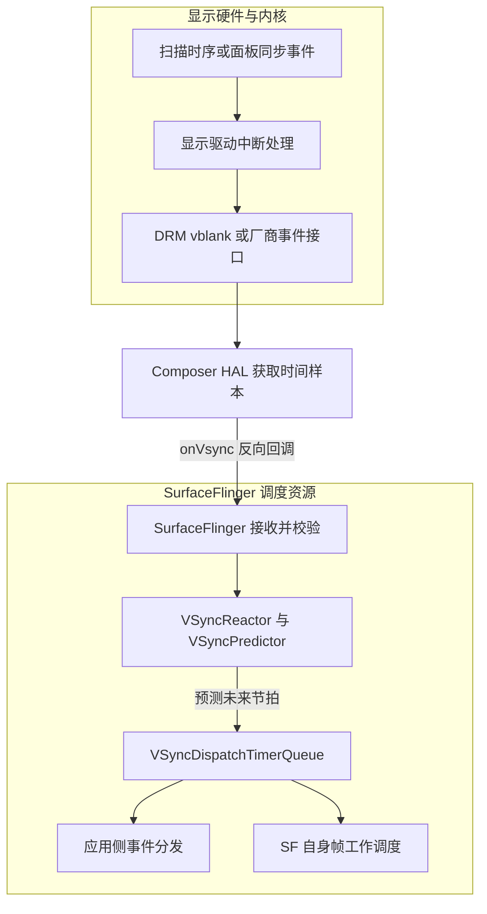
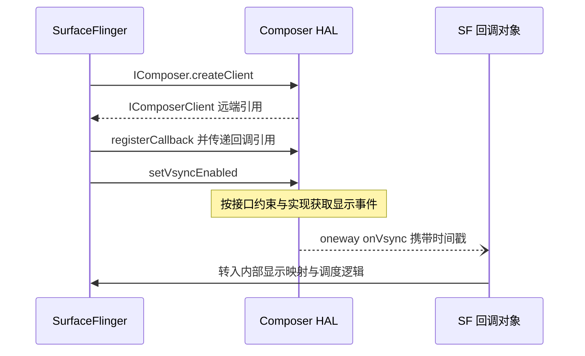
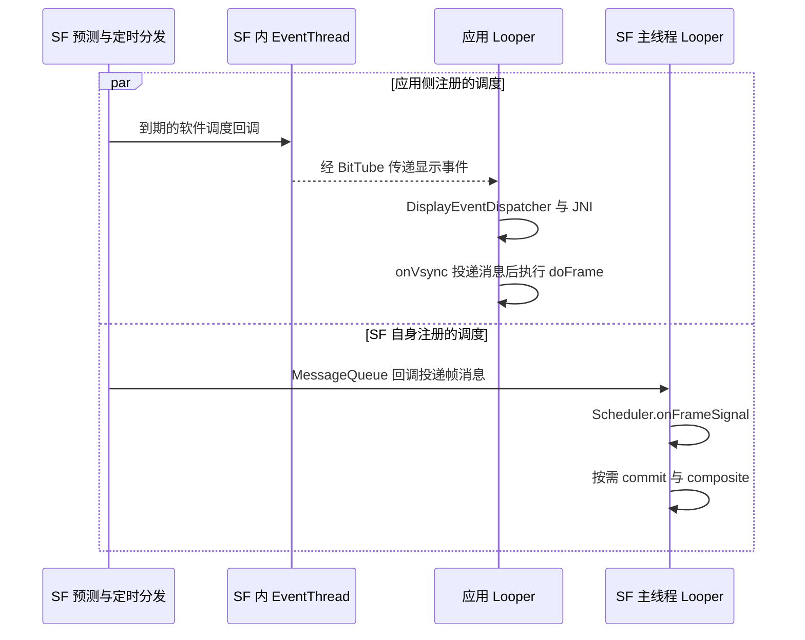

# SurfaceFlinger 与 VSYNC：从硬件节拍到一帧呈现

VSYNC 贯穿显示系统，但它并不是一条从硬件中断直接调用到应用绘制的函数链。理解整条管线，要分别追踪**时间如何预测、线程何时工作、缓冲区何时可用、画面何时呈现**。

## 1. 先建立三个互相关联的视角

**节拍视角**：显示事件提供时间样本，预测器估计未来 VSYNC，调度器选择提前唤醒应用和 SF 的时刻。

**数据视角**：应用生产图形缓冲区，经窗口提交机制交给 SurfaceFlinger；SF 决定各层如何合成，再通过 HWC 提交显示。

**完成视角**：CPU 函数返回、GPU 写完、显示开始呈现和旧缓冲区可复用是不同事件，需要分别观察时间戳与 fence。



图中箭头表达依赖关系，不表示每次硬件事件都同步执行图中全部步骤。HAL 还可能使用合成时间戳作为回退，收到回调也不能单独证明某次真实 IRQ 已发生。

## 2. 显示硬件、Linux 驱动与 HWC 各做什么

| 对象 | 职责 | 需要避免的混淆 |
| --- | --- | --- |
| 显示控制器、DSI Host、面板 | 读取或接收像素，完成扫描与传输 | DSI Host 不等同于整个显示控制器；面板不是被动的函数终点 |
| Linux 显示驱动与 DRM/KMS | 管理显示模式、Plane、CRTC、Connector，处理事件和同步 | CRTC 是显示管线的 KMS 抽象，具体寄存器与 IRQ 由驱动决定 |
| Composer HAL / HWC | 对接 SF，协商合成策略、提交显示工作、报告事件 | HWC 是 HAL 接口及其实现，不能直接当作一块固定名称的硬件 |

视频模式下，控制器通常按显示时序持续传输。命令模式的某些面板可保存图像，使用 TE 等信号协调更新；是否经过 GPIO、DSI 中断或其他事件，由面板和 SoC 实现决定。**TE、frame-done 和 DRM vblank 不能仅因“每帧出现”就认定是同一个硬件事件。**

同样，“画面没有变化”不代表物理面板停止扫描；减少应用绘制、减少 SF 合成、停止某类回调与降低面板刷新率，是不同层面的策略。硬件对象与 vblank 约束参见 [Linux DRM/KMS 文档](https://docs.kernel.org/gpu/drm-kms.html)。

## 3. 从内核事件到 HAL 时间戳

### DRM 路径是一种可阅读的参考实现

采用 DRM/KMS 的驱动可以在对应的中断处理中调用 `drm_crtc_handle_vblank()`，由 DRM 核心维护计数、时间戳与待处理事件。具体 IRQ handler 的名称不能从 AOSP Framework 推断，更不能把一个 SoC 的函数名推广到全部设备。

用户态通过设备文件、ioctl 或事件读取获取结果。`ioctl()` 是当前线程进入内核执行驱动操作的入口，并不意味着启动另一进程；如果请求需要等待，线程可能睡眠，直到条件满足或操作失败。接口说明见 [DRM 用户态接口](https://docs.kernel.org/gpu/drm-uapi.html)。

固定版本的 [`VSyncWorker.cpp`](https://android.googlesource.com/platform/external/drm_hwcomposer/+/refs/tags/android-16.0.0_r1/drm/VSyncWorker.cpp)提供了具体阅读样本：

1. 根据目标显示管线设置 vblank 请求，使用 `DRM_VBLANK_RELATIVE` 和 `request.sequence = 1` 等字段。
2. 调用 `drmWaitVBlank()`，处理被中断重试与失败情形。
3. 成功时把回复中的秒、微秒转换为纳秒时间戳，再向上层报告。
4. 等待失败时还可能进入 `SyntheticWaitVBlank()` 回退。

因此，不能省略请求配置后，仅凭 `drmVBlank vblank{}` 和一次调用就断言“必然阻塞到下一次硬件 VSYNC”。也不能把 reference HAL 的回退时间戳当作所有设备真实中断的证据。

### 时间戳表示事件时刻，不是收到回调的时刻

Composer `onVsync` 的 `timestamp` 使用 `CLOCK_MONOTONIC` 纳秒时间基准。IRQ 处理、HAL 等待返回、Binder 调度和 SF 接收之间会有延迟；函数被执行的时间不能替代参数中携带的事件时间。

接口契约见 [`IComposerCallback.aidl`](https://android.googlesource.com/platform/hardware/interfaces/+/refs/tags/android-16.0.0_r1/graphics/composer/aidl/android/hardware/graphics/composer3/IComposerCallback.aidl)。分析跨层时序时，应先确认时间基准和单位，再比较差值。

## 4. Composer 的会话对象与反向回调

`IComposer.createClient()` 返回 `IComposerClient` 会话接口。DRM 参考实现中的 `ComposerClient : BnComposerClient` 位于 **HAL 服务端**；名字中的 Client 表示为调用方维护的会话，并不意味着它是 SF 进程里的远端代理。

SF 持有该接口的远端引用，又实现一个 `BnComposerCallback` 回调对象并登记给 HAL。这样，控制请求从 SF 发往 HAL，而 VSYNC 通知沿相反方向进入 SF。



`oneway` 不要求 HAL 等待 SF 的业务处理完成，但仍需完成事务提交；它不意味着回调无延迟或提交永不失败。回调入口在 SF 的 Binder 接收上下文中，后续涉及锁、状态更新和线程间投递，不能直接把它等同于 SF 主线程合成。

源码入口：[`IComposer.aidl`](https://android.googlesource.com/platform/hardware/interfaces/+/refs/tags/android-16.0.0_r1/graphics/composer/aidl/android/hardware/graphics/composer3/IComposer.aidl)、[`ComposerClient.h`](https://android.googlesource.com/platform/external/drm_hwcomposer/+/refs/tags/android-16.0.0_r1/hwc3/ComposerClient.h)、[`AidlComposerHal.cpp`](https://android.googlesource.com/platform/frameworks/native/+/refs/tags/android-16.0.0_r1/services/surfaceflinger/DisplayHardware/AidlComposerHal.cpp)。

## 5. 硬件样本怎样成为未来的调度时间

### 接收、校准与预测

该版本可以沿以下入口阅读；这是跨对象的逻辑路径，不是一份实际设备线程栈：

```text
AidlIComposerCallbackWrapper::onVsync
  → SurfaceFlinger::onComposerHalVsync
  → HWComposer::onVsync：校验与物理显示 ID 映射
  → Scheduler::addResyncSample
  → VsyncSchedule::addResyncSample
  → VSyncReactor::addHwVsyncTimestamp
  → VSyncPredictor::addVsyncTimestamp
```

`VsyncSchedule` 管理某块物理显示器对应的预测、控制和分发资源。`VSyncReactor` 处理采样和重新同步；`VSyncPredictor` 从时间样本估计节拍，并计算未来时刻；`VSyncDispatchTimerQueue` 根据预测结果和任务预算安排软件定时回调。它们的职责不同，不能统称为“把中断转发出去”。

调度概念可以写成：

```text
期望唤醒时刻 ≈ 选定的目标 VSYNC - workDuration - readyDuration
```

该式解释预算如何影响提前量，不保证线程准时获得 CPU，也不表示应用与 SF 使用固定相同预算。实际选点、任务更新、过期处理和刷新模式变化应继续阅读 [`VSyncDispatchTimerQueue.cpp`](https://android.googlesource.com/platform/frameworks/native/+/refs/tags/android-16.0.0_r1/services/surfaceflinger/Scheduler/VSyncDispatchTimerQueue.cpp)。预测与采样入口见 [Scheduler 源码目录](https://android.googlesource.com/platform/frameworks/native/+/refs/tags/android-16.0.0_r1/services/surfaceflinger/Scheduler/)。

### 为什么可以按需关闭硬件回调

模型稳定后，SF 可以请求关闭 HWC 的 VSYNC 回调；需要重同步、切换模式或检查呈现偏差时，再按策略请求样本。是否持续采样还与配置及可用反馈有关，不存在适用于所有设备的固定采样次数。

控制方向大致为 `VsyncSchedule → Scheduler → SurfaceFlinger::requestHardwareVsync → HWComposer::setVsyncEnabled → IComposerClient`，与时间样本上行方向相反。

**关闭回调不等于关闭面板或全部中断。** DRM 参考 worker 还可能因为内部时间戳跟踪而继续工作。可核对 [`VsyncSchedule.cpp`](https://android.googlesource.com/platform/frameworks/native/+/refs/tags/android-16.0.0_r1/services/surfaceflinger/Scheduler/VsyncSchedule.cpp) 和前述 `VSyncWorker.cpp`。官方 [VSync 概念页](https://source.android.com/docs/core/graphics/implement-vsync)也说明按需启停事件，但其中的 DispSync/HWC2 示例属于不同实现背景，不能直接当作本版本类名与调用链。

## 6. 应用与 SF 使用两条调度路径

### 应用路径：Binder 建立连接，BitTube 传递事件

应用经 `DisplayEventReceiver` 建立显示事件连接，并请求后续 VSYNC。连接管理涉及 Binder；事件数据通过 **BitTube 的 Unix 域 socket 通道**传递，它不是共享内存，也不是“每一帧都直接调用应用的 Java Binder 方法”。

SF 中的 EventThread 接收调度回调，将事件交给连接；应用侧的 `DisplayEventDispatcher` 监听接收 FD，在对应 Looper 中读取。JNI 的 `NativeDisplayEventReceiver` 衔接 Java 接收器，`Choreographer.FrameDisplayEventReceiver.onVsync()` 再投递异步 Handler 消息，随后进入 `doFrame()`。



图中的两条路径并行展示职责，不要求同一时刻触发，也不承诺一定对应同一幅画面。该基线还存在面向不同周期的 EventThread；不能把名称带 `appSf` 的 EventThread 直接画成驱动 SF 自身合成的入口。

`Choreographer` 运行在创建它所绑定的 Looper 线程上，常见窗口 UI 使用主线程。`doFrame()` 的回调顺序包含 INPUT、ANIMATION、INSETS_ANIMATION、TRAVERSAL、COMMIT；后续渲染还涉及 RenderThread、GPU 和缓冲区提交。**`doFrame()` 返回不等于像素已经出现在屏幕上。**

源码入口：[`EventThread.cpp`](https://android.googlesource.com/platform/frameworks/native/+/refs/tags/android-16.0.0_r1/services/surfaceflinger/Scheduler/EventThread.cpp)、[`DisplayEventDispatcher.cpp`](https://android.googlesource.com/platform/frameworks/native/+/refs/tags/android-16.0.0_r1/libs/gui/DisplayEventDispatcher.cpp)、[`Choreographer.java`](https://android.googlesource.com/platform/frameworks/base/+/refs/tags/android-16.0.0_r1/core/java/android/view/Choreographer.java)。

### SF 路径：自己的定时注册与主线程消息

SF 的 `MessageQueue` 向 VSYNC dispatch 注册自身回调。需要一帧工作时，`scheduleFrame()` 申请调度；回调经 `MessageQueue::vsyncCallback → Handler::dispatchFrame` 向 SF Looper 发消息，再进入 `Scheduler::onFrameSignal()`。

这一层仍会判断是否需要合成。没有新状态或输出工作时，不应把每一次预测节拍都理解成完整执行一次 GPU 合成。准确入口见 [`MessageQueue.cpp`](https://android.googlesource.com/platform/frameworks/native/+/refs/tags/android-16.0.0_r1/services/surfaceflinger/Scheduler/MessageQueue.cpp)。

## 7. 从应用 Buffer 到 SF 的 commit

BufferQueue 的基本角色是生产者获取可用缓冲区、提交内容，消费者取得缓冲区并在使用后释放。传递的是缓冲区引用和同步信息，不是由 BufferQueue 为每一帧复制整幅像素。基础说明见 [BufferQueue 与 Gralloc](https://source.android.com/docs/core/graphics/arch-bq-gralloc)。

但现代窗口路径不能简单写成“所有 BufferQueue 都由 SF 直接消费”。在常见 BLAST 路径中，客户端进程内的 `BLASTBufferQueue` 作为适配器消费本地 BufferQueue，再把取得的 buffer、acquire fence 和帧信息放进 `SurfaceControl.Transaction`，交给 SF。

该版本可追踪 `BLASTBufferQueue::onFrameAvailable → acquireNextBufferLocked → Transaction::setBuffer`。普通提交与外部同步事务的处理不同，后者可能先合并再提交；不能假定每次回调都立即单独 `apply()`。源码见 [`BLASTBufferQueue.cpp`](https://android.googlesource.com/platform/frameworks/native/+/refs/tags/android-16.0.0_r1/libs/gui/BLASTBufferQueue.cpp)。

SF 的 `commit()` 处理待提交状态、Layer 关系与快照、可锁存的 buffer 和相关调度决策；`composite()` 才进一步组织输出合成。图层是否有新内容、依赖 fence 是否满足、目标时间和显示策略都会影响这一帧的结果，不能仅看到“应用已提交”就认定 SF 已消费并显示。

## 8. CompositionEngine、RenderEngine 与 Composer 命令

`SurfaceFlinger::composite()` 调用 `CompositionEngine::present()`。CompositionEngine 组织输出的准备和呈现，按策略选择客户端合成、设备合成或两者混合；一部分工作可以被卸载到其他线程，不宜将整个过程画成 SF 主线程的一段同步栈。

- **CLIENT composition**：需要 SF 的 RenderEngine 完成客户端合成，生成 client target，再交给 HWC。
- **DEVICE composition**：由 HAL 负责的设备合成路径处理相应图层；具体显示硬件能力与厂商策略有关。
- **混合路径**：部分图层先组成 client target，其他图层走设备合成，最终形成显示输出。

### validate / present 是阶段，不是固定的两次 AIDL 方法调用

`validate` 用于协商合成策略，`present` 用于提交呈现；存在 `presentOrValidate` 和跳过某些验证工作的优化，不能写成每一帧必然完整执行固定流程。

更需要区分接口层次：在 composer3 AIDL 中，SF 的包装层把 validate/present 操作编码到 `DisplayCommand`，由 **`IComposerClient.executeCommands()`** 批量发送并解析 `CommandResultPayload`。不要把包装函数名误写成并不存在的 `IComposerClient.validateDisplay()`、`IComposerClient.presentDisplay()` 独立 AIDL 方法。

可对照 [`AidlComposerHal.cpp`](https://android.googlesource.com/platform/frameworks/native/+/refs/tags/android-16.0.0_r1/services/surfaceflinger/DisplayHardware/AidlComposerHal.cpp)、[`DisplayCommand.aidl`](https://android.googlesource.com/platform/hardware/interfaces/+/refs/tags/android-16.0.0_r1/graphics/composer/aidl/android/hardware/graphics/composer3/DisplayCommand.aidl) 和 [CompositionEngine 源码](https://android.googlesource.com/platform/frameworks/native/+/refs/tags/android-16.0.0_r1/services/surfaceflinger/CompositionEngine/src/)。

### present 也有按帧选择的线程分支 {#present-worker}

`Output` 的呈现路径检查 `mOffloadPresent`：需要卸载时调用 `presentFrameAndReleaseLayersAsync()`，否则直接执行 `presentFrameAndReleaseLayers()`。卸载标志只对当前帧生效，之后重置，下一帧重新决策；不能把所有 present 都归到同一线程，也不能看到异步分支就推断 SF 不再等待其结果。[Output 呈现分支](https://android.googlesource.com/platform/frameworks/native/+/refs/tags/android-16.0.0_r1/services/surfaceflinger/CompositionEngine/src/Output.cpp#487)

## 9. 用 fence 区分“已提交”和“可安全使用”

Fence 表达异步工作依赖，可以随缓冲区传递。拿到一个 fence FD，只是拿到了观察或传递该依赖的引用；它不等于依赖已经满足，也不要求每一层都在 CPU 上同步等待。

| 类型 | 在此路径中的含义 | 不能据此认定 |
| --- | --- | --- |
| 输入 / acquire fence | 输入 buffer 何时可以被后续消费者安全访问 | `queueBuffer` 或事务返回时 GPU 已经写完 |
| release fence | 旧 buffer 何时不再被相应消费者读取，可按生命周期复用 | 释放回调到达时就能无条件覆盖该 buffer |
| present fence | 按显示类型约定标记呈现或输出完成的时点 | 所有物理像素都已经完成发光或扫描 |

在 composer3 的约束中，物理视频模式面板与命令模式面板的 present 时点并不完全相同；后者可对应开始向面板存储传输。虚拟显示又有输出 buffer 可读取的语义。因此，不能统一把 present fence 定义为“整屏扫描结束”。精确定义以 [`CommandResultPayload.aidl`](https://android.googlesource.com/platform/hardware/interfaces/+/refs/tags/android-16.0.0_r1/graphics/composer/aidl/android/hardware/graphics/composer3/CommandResultPayload.aidl) 为准，输入依赖见 [`Buffer.aidl`](https://android.googlesource.com/platform/hardware/interfaces/+/refs/tags/android-16.0.0_r1/graphics/composer/aidl/android/hardware/graphics/composer3/Buffer.aidl)。

SF 归还旧缓冲区时，仍可能需要合并或继续传递依赖。应用重新获取缓冲区后，也须遵守返回的同步约束。把“函数返回、提交成功、fence 已 signal、buffer 可重用”合并为一个完成状态，会同时误判性能与生命周期问题。

## 10. 怎样阅读一帧的时间线

| 观测数据 | 表示什么 | 排查时的限制 |
| --- | --- | --- |
| HAL VSYNC timestamp | HAL 报告的显示节拍时间样本 | 区别真实事件与实现中的合成回退 |
| 回调到达与线程运行时刻 | 消息传递延迟和 CPU 调度结果 | 不能替代事件携带的 timestamp |
| 应用 frame time | 应用帧回调使用的逻辑时间 | 不是实际呈现完成时间 |
| deadline、expected presentation time | 某条 FrameTimeline 需准备完成的绝对时刻与期望呈现时刻 | 预测值不是硬件完成保证，预算须由时间差计算 |
| VsyncId | 关联帧调度与 FrameTimeline 记录的标识 | 不是硬件 vblank counter |
| present / release fence 的 signal 时刻 | 对应同步契约实际满足的时刻 | 不能互相代替，也不能脱离显示模式解释 |

FrameTimeline 的 deadline 与 expected presentation time 使用 `System.nanoTime()` 的纳秒时间基准。一个事件可携带多条候选时间线及首选项，应结合具体候选解释预算，而不是把这些字段当作已测得的完成时间。

60 Hz 的理想刷新周期约为 16.67 ms，但这个周期不是应用可独占的 CPU 预算；应用、GPU、SF 与显示硬件会跨帧并行。刷新率切换、帧率覆盖和可变刷新能力还会改变调度关系，不能固定断言“一次 VSYNC 对应一帧应用画面”或“输入到显示永远延迟两帧”。

分析时，应先选定物理显示器与关联的应用帧，再沿提交、锁存、合成和呈现关联数据。不同模块的 Display ID 命名空间也有区别，不能直接把 HAL 的显示句柄与 SF 的物理显示 ID 当作同一整数使用。

## 11. 从症状反查阶段

| 现象 | 优先核对的阶段 | 有用的证据 |
| --- | --- | --- |
| 应用帧开始很晚 | 事件接收、Looper 消息、CPU 可运行到实际运行 | 应用主线程消息与调度片段 |
| 应用逻辑结束但画面迟到 | RenderThread、GPU 完成、提交与 acquire 依赖 | 应用帧记录、GPU 与 fence 时间线 |
| SF 收到内容却未用于目标帧 | 事务合并、锁存条件、截止时间与帧选择 | buffer/帧标识、SF 帧记录与依赖 |
| SF 工作时间明显增加 | 图层变化、合成策略、GPU client composition | CLIENT/DEVICE 变化及合成耗时 |
| 模式切换前后节拍异常 | 新周期约束、重新采样与预测、显示 ID | 模式变更与同一显示器的事件时间戳 |
| SF 回调减少但屏幕仍刷新 | 回调订阅与物理扫描的层次差异 | enable 状态、HAL 行为与驱动观测 |

### 先确认设备，再解释 trace

先确认设备的构建、显示配置与可用追踪数据源：

```sh
adb shell getprop ro.build.fingerprint
adb shell getprop ro.build.version.release
adb shell getprop ro.build.version.sdk
adb shell uname -a
adb shell dumpsys SurfaceFlinger
adb shell perfetto --help
adb shell perfetto --query
```

记录实际构建、内核与显示信息后，再确认 Composer 实现、面板模式和可用的追踪能力。设备输出不能单独证明它采用本文源码标签；厂商内核与 HAL 的实现细节仍需对应源码或额外证据。

使用 Perfetto 时，先通过帮助与数据源查询确认该设备支持的功能，再围绕一次可复现操作对齐应用、SF、CPU 调度与 FrameTimeline。官方 [FrameTimeline 指南](https://perfetto.dev/docs/data-sources/frametimeline)说明了应用与 SF 的 Expected/Actual 轨道及关联方式；需根据设备实际暴露的数据补充 GPU、fence 或驱动事件。不要预设所有设备都提供同一组 tracepoint，也不要把 `dumpsys` 的某一瞬间状态当作整段帧时间线。

## 12. 按问题阅读源码

推荐从接口契约进入，再分别阅读采样、分发、应用和缓冲区路径，避免逐行通读庞大的 `SurfaceFlinger.cpp`。

1. **谁在回调谁**：[Composer AIDL 接口](https://android.googlesource.com/platform/hardware/interfaces/+/refs/tags/android-16.0.0_r1/graphics/composer/aidl/android/hardware/graphics/composer3/)与 [`AidlComposerHal.cpp`](https://android.googlesource.com/platform/frameworks/native/+/refs/tags/android-16.0.0_r1/services/surfaceflinger/DisplayHardware/AidlComposerHal.cpp)。分别标出服务对象和回调对象所在进程。
2. **时间样本来自哪里**：[`VSyncWorker.cpp`](https://android.googlesource.com/platform/external/drm_hwcomposer/+/refs/tags/android-16.0.0_r1/drm/VSyncWorker.cpp)与 [`DrmHwcThree.cpp`](https://android.googlesource.com/platform/external/drm_hwcomposer/+/refs/tags/android-16.0.0_r1/hwc3/DrmHwcThree.cpp)。区分真实等待、回退与回调开关。
3. **何时重新采样、何时唤醒**：[Scheduler 目录](https://android.googlesource.com/platform/frameworks/native/+/refs/tags/android-16.0.0_r1/services/surfaceflinger/Scheduler/)。分开追踪 `addResyncSample`、软件 dispatch 和 `onFrameSignal`。
4. **应用在哪条线程执行帧回调**：[`DisplayEventReceiver.cpp`](https://android.googlesource.com/platform/frameworks/native/+/refs/tags/android-16.0.0_r1/libs/gui/DisplayEventReceiver.cpp)、[`BitTube.cpp`](https://android.googlesource.com/platform/frameworks/native/+/refs/tags/android-16.0.0_r1/libs/gui/BitTube.cpp)与 [`Choreographer.java`](https://android.googlesource.com/platform/frameworks/base/+/refs/tags/android-16.0.0_r1/core/java/android/view/Choreographer.java)。标出 Binder 控制通道和 socket 事件通道。
5. **buffer 如何提交和回收**：[`BLASTBufferQueue.cpp`](https://android.googlesource.com/platform/frameworks/native/+/refs/tags/android-16.0.0_r1/libs/gui/BLASTBufferQueue.cpp)、[`SurfaceFlinger.cpp`](https://android.googlesource.com/platform/frameworks/native/+/refs/tags/android-16.0.0_r1/services/surfaceflinger/SurfaceFlinger.cpp)与 [CompositionEngine](https://android.googlesource.com/platform/frameworks/native/+/refs/tags/android-16.0.0_r1/services/surfaceflinger/CompositionEngine/src/)。分别记录 buffer 引用、帧标识和 acquire/release/present 依赖。

阅读完成后，应能解释：为什么硬件回调关闭后软件调度仍可工作，为什么应用 `doFrame()` 完成后还会迟到，以及为什么一个 present fence 不能代表所有显示相关工作都结束。

原始笔记：[原始笔记《SurfaceFlinger VSYNC 全链路与源码导读》](https://alidocs.dingtalk.com/i/nodes/1zknDm0WRardABEYczQQowE38BQEx5rG)。
