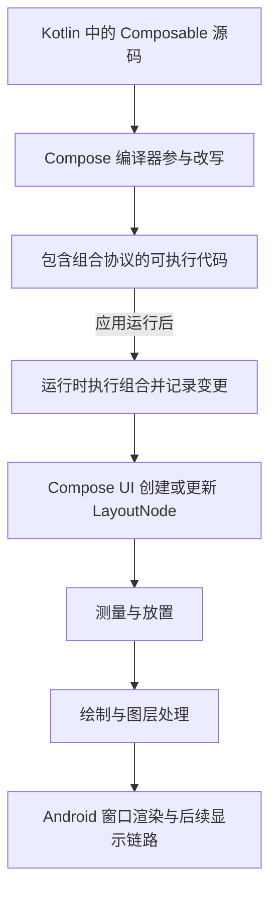
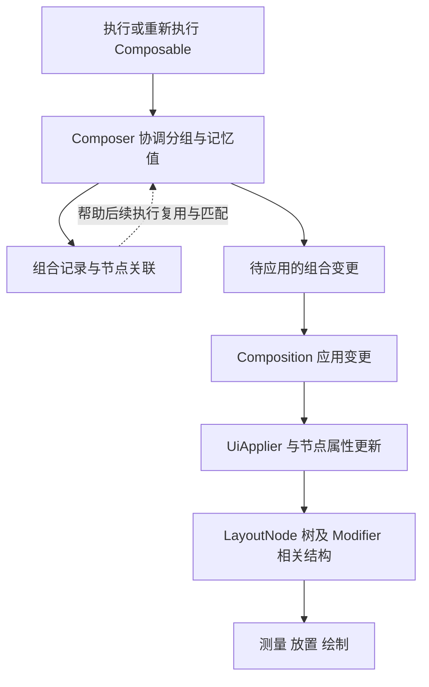
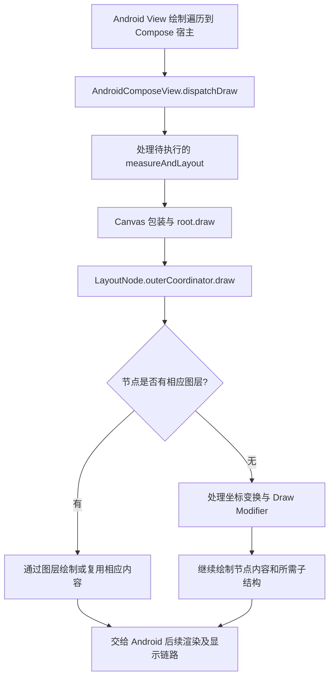

# Compose 渲染流程：从编译改写到屏幕呈现

写下 `Text("Hello")` 后，谁创建界面节点，谁计算尺寸，谁真正执行绘制？要回答这些问题，需要分清**编译期改写、运行时组合、布局与绘制，以及 Android 后续呈现**，不能把所有工作都归给 Composer。

状态依赖和失效细节见 [Compose State 原理](./compose-state.html)；缓冲区提交、合成与显示见 [SurfaceFlinger 与 VSYNC](../framework/surfaceflinger-vsync.html)。

## 1. 声明式描述与命令式更新有什么区别

声明式界面强调根据输入描述当前 UI，让框架协调内容变化。命令式方式则由调用方显式修改已有对象，例如设置 TextView 文本、添加或移除子 View。区别不在于“View 必须提前排好布局”：传统 View 同样可以运行时创建，也有自己的测量、布局和绘制机制。[Compose 的声明式模型](https://developer.android.com/develop/ui/compose/mental-model)

例如下面是 `setContent { ... }` 中的一段内容，省略组件和布局的 import：

```kotlin
Column {
    Text("Hello")
    Text("Compose")
}
```

这段代码表达纵向排列两段文字，不是在调用处直接向屏幕写像素。执行组合时，Compose UI 通过布局原语创建或更新所需节点，随后才有测量、放置与绘制。一个 Composable 可以输出多个节点、只提供状态或不输出任何布局节点，所以**函数数量不等于 LayoutNode 数量，也不等于 Android View 数量**。

## 2. Compiler、Runtime、Composer 和 UI 各负责哪一层

| 角色 | 所处环节 | 主要职责 | 不应混淆的工作 |
| --- | --- | --- | --- |
| Compose Compiler | 编译期 | 处理 Composable 调用约定、组合分组及跳过等支持逻辑 | 在编译机器上创建运行时 LayoutNode |
| Compose Runtime | 运行期 | 提供组合、记忆值、快照观察和调度等机制 | 本身必须绑定 Android View 或 Canvas |
| Composer / Composition | 运行期组合 | 协调组合执行，维护组合记录并组织、应用变更 | 直接承担全部 Android 绘制与显示 |
| Compose UI | 运行期 UI | 维护 LayoutNode、Modifier、测量、放置和绘制等机制 | 为每个 Composable 创建一个 Android View |
| AndroidComposeView | Android 平台桥接 | 接入 View 系统，并以 Owner 身份承载 Compose UI 工作 | 把 SlotTable 当绘图清单逐项绘制 |

`@Composable` 不只是运行时反射标记，编译器会改写相关代码，使其能与 Runtime 协作。内部可以涉及 Composer 参数、变化信息与分组操作，但不同函数和编译设置下形态不同，不能把教程中的伪代码当作可手写调用的普通接口。自 Kotlin 2.0.0 起，Compose 编译器已并入 Kotlin 仓库；阅读 AndroidX Runtime 时还需区分编译器源码所在仓库。[编译器官方说明](https://kotlinlang.org/docs/compose-compiler-migration-guide.html)



图中后半段是首次构建普通布局的概念主线；后续更新可能复用节点、跳过组合或只执行必要阶段。子组合布局还有例外：`BoxWithConstraints`、`LazyColumn` 等可以在父布局的测量阶段组合所需子项，因此不能据此推断所有子项都必须在整棵树开始测量前完成组合。[阶段顺序与子组合例外](https://developer.android.com/develop/ui/compose/phases#the-three-phases-of-a-frame)

## 3. 从 Activity.setContent 到 AndroidComposeView

Android 的 `ComponentActivity.setContent()` 会尝试复用已有 ComposeView，或创建 ComposeView、设置组合内容与相关 Owner，再将它接入 Activity 的内容 View 层级。[Activity 接入入口](https://android.googlesource.com/platform/frameworks/support/+/a7537bce15de1ae43654cfcfdbb115211977a632/activity/activity-compose/src/main/java/androidx/activity/compose/ComponentActivity.kt#50)

`ComposeView.setContent()` 保存内容，并在满足附着或组合上下文等条件时创建组合；`AbstractComposeView.ensureCompositionCreated()` 负责确保组合建立。本快照还涉及 `ComposeViewContext`，因此不应把某个旧版的窗口 Recomposer 初始化代码当成所有版本的固定实现。[ComposeView.setContent](https://android.googlesource.com/platform/frameworks/support/+/a7537bce15de1ae43654cfcfdbb115211977a632/compose/ui/ui/src/androidMain/kotlin/androidx/compose/ui/platform/ComposeView.android.kt#646)、[确保组合创建](https://android.googlesource.com/platform/frameworks/support/+/a7537bce15de1ae43654cfcfdbb115211977a632/compose/ui/ui/src/androidMain/kotlin/androidx/compose/ui/platform/ComposeView.android.kt#342)

平台包装代码创建或复用 AndroidComposeView，并以其根 LayoutNode 构造 `UiApplier`，再创建关联父组合上下文的 Composition。AndroidComposeView 继承 ViewGroup，同时实现 Compose UI 的 Owner 等接口：它才是这里接入 Android 测量、绘制、输入等能力的重要平台对象，不能把这些职责全部归给 Composer。[Android 包装与组合创建](https://android.googlesource.com/platform/frameworks/support/+/a7537bce15de1ae43654cfcfdbb115211977a632/compose/ui/ui/src/androidMain/kotlin/androidx/compose/ui/platform/Wrapper.android.kt#54)、[AndroidComposeView 定义](https://android.googlesource.com/platform/frameworks/support/+/a7537bce15de1ae43654cfcfdbb115211977a632/compose/ui/ui/src/androidMain/kotlin/androidx/compose/ui/platform/AndroidComposeView.android.kt#284)

这里仍然存在 Android View 宿主，但普通 Compose UI 不要求每个文字、布局或按钮都对应一个 Android View。使用 `AndroidView` 等互操作组件时则另有桥接节点和 View 管理路径。

## 4. LayoutNode 是运行时怎样创建和更新的

`Layout()` 是关键布局原语之一。此快照的实现通过 `ReusableComposeNode` 提供节点工厂，以及 MeasurePolicy、Modifier、CompositionLocal 等更新操作；`ComposeUiNode.Constructor` 最终关联 `LayoutNode.Constructor`。这说明节点工厂是在**组合运行时**被使用，而不是编译期已经把某个具体手机界面树创建出来。[Layout 的节点声明](https://android.googlesource.com/platform/frameworks/support/+/a7537bce15de1ae43654cfcfdbb115211977a632/compose/ui/ui/src/commonMain/kotlin/androidx/compose/ui/layout/Layout.kt#77)、[节点工厂关联](https://android.googlesource.com/platform/frameworks/support/+/a7537bce15de1ae43654cfcfdbb115211977a632/compose/ui/ui/src/commonMain/kotlin/androidx/compose/ui/node/ComposeUiNode.kt#28)

Runtime 计算组合变更，应用阶段通过 Applier 操作目标树。Android UI 的 `UiApplier` 对 LayoutNode 实现插入、移除、移动和清理；本版本在 `insertBottomUp()` 中实际插入，在 `insertTopDown()` 中不重复插入。节点已存在且可以复用时，也不需要每次重新创建全部对象。[UiApplier](https://android.googlesource.com/platform/frameworks/support/+/a7537bce15de1ae43654cfcfdbb115211977a632/compose/ui/ui/src/androidMain/kotlin/androidx/compose/ui/node/UiApplier.android.kt#21)

因此应把三个动作分开：编译器生成参与组合的代码；运行时执行这些代码并计算变更；应用变更时更新实际目标树。`ControlledComposition` 的契约也明确区分 `recompose()` 计算与 `applyChanges()` 应用，普通应用不应直接手动驱动这些内部环节。[组合变更契约](https://android.googlesource.com/platform/frameworks/support/+/a7537bce15de1ae43654cfcfdbb115211977a632/compose/runtime/runtime/src/commonMain/kotlin/androidx/compose/runtime/Composition.kt#231)

## 5. SlotTable 与 LayoutNode 树为什么不能混为一谈

组合记录需要保存分组、记忆值和节点关联等信息，帮助 Runtime 在后续执行中识别位置、复用内容并处理变更；LayoutNode 树则承载 UI 布局和绘制相关结构。二者有关联，但不是同一棵树，也不能按“每个函数、每个 slot、每个节点一一对应”理解。

此快照的 Composition 内部还存在不同 slot 存储实现的选择，因此本文只使用“组合记录”解释职责，不把某一种数组布局或内部字段当成通用定义。[Composition 的组合存储与变更结构](https://android.googlesource.com/platform/frameworks/support/+/a7537bce15de1ae43654cfcfdbb115211977a632/compose/runtime/runtime/src/commonMain/kotlin/androidx/compose/runtime/Composition.kt#488)



回答“怎样从 SlotTable 读出来再绘制”时，应先纠正这个前提：绘制阶段沿 LayoutNode、Coordinator、Modifier 和图层等 UI 结构工作，而不是每次先把 SlotTable 完整解释成一串 Canvas 命令。

## 6. Layout 阶段：约束、测量与放置

Compose 的 Layout 阶段包含测量和放置。父布局向子项传递约束，子项在约束下决定尺寸，再由父项确定放置位置。约束与尺寸应分开，知道一个节点的宽高也不等于知道它在父坐标系中的位置。[布局基本规则](https://developer.android.com/develop/ui/compose/layouts/basics)

`MeasurePolicy` 决定布局策略；子项测量后得到可放置结果，再通过放置逻辑确定坐标。普通测量契约不允许在同一测量过程中随意反复测量同一子项以试探不同尺寸，但这不等于一帧永远只能发生一次测量：内在测量、Lookahead、不同失效和后续布局工作应按各自契约分析。[自定义布局契约](https://developer.android.com/develop/ui/compose/layouts/custom)

AndroidComposeView 的 `onMeasure()` 将 Android MeasureSpec 转为 Compose Constraints，并协调根节点测量；`onLayout()` 继续处理待执行的布局与位置回调。`MeasureAndLayoutDelegate` 维护所需工作，并非每次都无条件重测整棵树。[onMeasure](https://android.googlesource.com/platform/frameworks/support/+/a7537bce15de1ae43654cfcfdbb115211977a632/compose/ui/ui/src/androidMain/kotlin/androidx/compose/ui/platform/AndroidComposeView.android.kt#2173)、[onLayout](https://android.googlesource.com/platform/frameworks/support/+/a7537bce15de1ae43654cfcfdbb115211977a632/compose/ui/ui/src/androidMain/kotlin/androidx/compose/ui/platform/AndroidComposeView.android.kt#2234)、[测量布局工作处理](https://android.googlesource.com/platform/frameworks/support/+/a7537bce15de1ae43654cfcfdbb115211977a632/compose/ui/ui/src/commonMain/kotlin/androidx/compose/ui/node/MeasureAndLayoutDelegate.kt#402)

布局节点嵌套也不是没有成本。是否昂贵应看测量策略、工作范围、文本布局和修饰符等实际开销，不能仅凭“Compose”就认为任意深度嵌套都免费。

## 7. onDraw 为空，为什么仍能显示内容

固定源码中的实现确实是：

```kotlin
override fun onDraw(canvas: android.graphics.Canvas) {}
```

原因在于该宿主把主要 Compose UI 绘制组织在 `dispatchDraw()`：先处理所需的测量布局工作，再通过 Canvas 包装调用根 LayoutNode 的 `draw()`，并处理脏图层等后续工作。空 `onDraw()` 不代表没有绘制，也不能只搜这个方法就判断屏幕内容来自哪里。[onDraw 与 dispatchDraw](https://android.googlesource.com/platform/frameworks/support/+/a7537bce15de1ae43654cfcfdbb115211977a632/compose/ui/ui/src/androidMain/kotlin/androidx/compose/ui/platform/AndroidComposeView.android.kt#2302)



`LayoutNode.draw()` 转交 `outerCoordinator.draw()`。Coordinator 有图层时使用对应图层路径，否则处理坐标变换与绘制 Modifier，再继续绘制内容。Modifier 的顺序、裁剪、变换、图层缓存和子节点绘制次序都可能影响最终结果，不能只看一份函数调用列表。[LayoutNode.draw](https://android.googlesource.com/platform/frameworks/support/+/a7537bce15de1ae43654cfcfdbb115211977a632/compose/ui/ui/src/commonMain/kotlin/androidx/compose/ui/node/LayoutNode.kt#1054)、[Coordinator 绘制分支](https://android.googlesource.com/platform/frameworks/support/+/a7537bce15de1ae43654cfcfdbb115211977a632/compose/ui/ui/src/commonMain/kotlin/androidx/compose/ui/node/NodeCoordinator.kt#507)

图中省略了互操作 View 和部分平台图层兼容分支。即使某次 `dispatchDraw()` 调用了 `measureAndLayout()`，也不能据此断言该次重测了全部节点，或重新记录了所有图层内容。

## 8. 绘制调用结束，不等于像素已经呈现

Canvas 在这里是绘制接口，而不是“屏幕本身”。实际工作会随硬件加速、图层实现和平台状态而变化，可能涉及绘制指令记录、图层更新和后续渲染执行。一次 Composable 执行、一次 Canvas 绘制调用和一次显示呈现，是不同层级的事件。

AndroidComposeView 的绘制仍嵌入 Android 窗口体系，应用结果之后还涉及窗口渲染、缓冲区提交、SurfaceFlinger 合成与显示端呈现。主线程完成绘制相关工作，不代表 GPU、合成端和显示设备已完成同一帧；也不能把每个 LayoutNode 都当成独立 Surface 或独立系统窗口。后半段详见 [SurfaceFlinger 与 VSYNC](../framework/surfaceflinger-vsync.html)。

## 9. 状态改变后，为什么不必重跑全部流程

State 的变化通过 Snapshot 和观察关系传播，影响实际读取它的范围。组合读取可能引发相关作用域重组，布局阶段读取可请求测量或放置工作，绘制阶段读取则可能只使绘制失效；同一状态在多个阶段读取时，也可能同时影响多个阶段。[Compose 阶段与观察](https://developer.android.com/develop/ui/compose/phases)

重组会更新必要的组合结果，随后是否需要重新布局和绘制，还要看变化影响了什么。不能将整个过程固定为“所有状态变化 → 全树重组 → 全树测量 → 全树绘制”。也不能将“没有重组”当成“这一帧没有任何界面工作”；细节见 [Compose State 的读取阶段](./compose-state.html#_8-状态变化不一定先重组-看读取发生的阶段)。

组合函数还可能被跳过或取消，框架会尽量复用已有结果。业务代码应保证描述 UI 的过程适合重复执行，不应依赖固定的组合调用次数来发送请求或记录必须精确计数的事件。[Composable 执行模型](https://developer.android.com/develop/ui/compose/mental-model)

## 10. 怎样按症状选择观察点

1. **内容没有进入界面**：先检查 setContent、组合是否建立、生命周期与附着条件，再确认分支是否实际输出了 UI。
2. **节点存在但尺寸或位置不对**：查看约束、MeasurePolicy、测量结果、放置过程和 Modifier 顺序，不能只检查重组。
3. **onDraw 为空却有画面**：沿 AndroidComposeView 的 dispatchDraw、根节点与 Coordinator 继续追踪，而不是认定绘制被跳过。
4. **重组少却仍卡顿**：分别检查测量、布局、文本、图层与后续渲染工作；重组次数不是完整性能指标。
5. **源码与教程不同**：先确认项目依赖与编译器配置，再匹配源码提交；内部存储和平台桥接的变化不意味着公开 API 用法必然改变。

推荐阅读顺序是：Activity 的 `setContent()` → ComposeView / Android 包装 → Composition 与 UiApplier → Layout 的节点工厂 → LayoutNode / MeasureAndLayoutDelegate → AndroidComposeView 的绘制入口 → Coordinator。组合存储、Snapshot 和编译器优化可沿具体问题继续深入，避免把它们串成每帧必须从头跑完的单一路径。

[原始笔记](https://alidocs.dingtalk.com/i/nodes/7dx2rn0JbYDdQwjzHNR2wpjBVMGjLRb3)。
