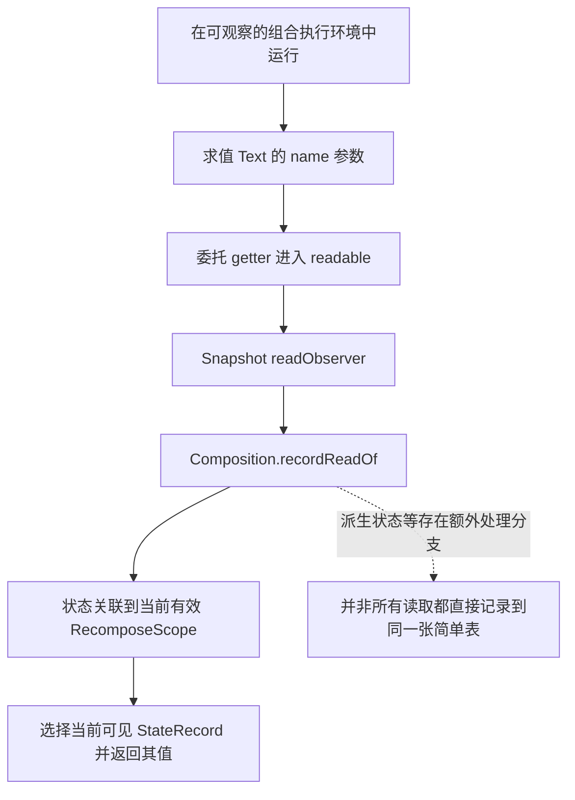
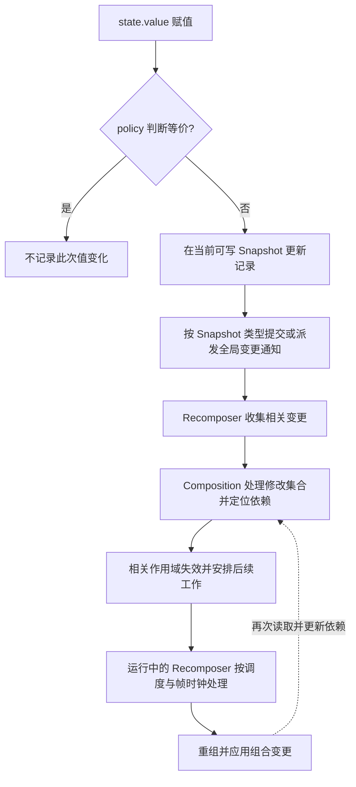
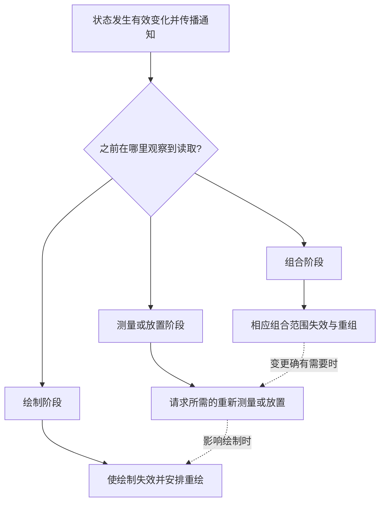

# Compose State 原理：从 Kotlin 委托到 Snapshot 与重组

`var name by remember { mutableStateOf("Tom") }` 同时涉及 Kotlin 语法、对象复用和 Compose 状态观察。理解它的关键，是分别追踪**读取时怎样建立依赖，写入后怎样传播变化，以及何时执行后续工作**。

## 1. 一行声明其实有三层职责

下面是一个可修改名字的 Composable 片段。省略的 Material 组件 import 应按项目使用的组件库补充；属性委托需要 `getValue` 和 `setValue` 扩展函数。

```kotlin
import androidx.compose.runtime.Composable
import androidx.compose.runtime.getValue
import androidx.compose.runtime.mutableStateOf
import androidx.compose.runtime.remember
import androidx.compose.runtime.setValue

@Composable
fun UserInfo() {
    var name by remember { mutableStateOf("Tom") }

    Text(text = name)
    Button(onClick = { name = "Jerry" }) {
        Text("修改名字")
    }
}
```

`mutableStateOf()` 创建可参与 Snapshot 观察的 `MutableState<String>`；`remember` 在对应 Composition 位置保存并复用对象；`by` 将属性访问转交 `getValue()` / `setValue()`。对这里的状态而言，读取 `name` 相当于读取 `state.value`，赋值相当于修改 `state.value`。

**响应能力来自 State 的读写机制，不是 `by` 语法本身。** 普通 Kotlin 委托不因此自动成为 Compose State；反过来，直接使用 `state.value` 也完全可以参与观察。[Kotlin 属性委托](https://kotlinlang.org/docs/delegated-properties.html)、[Compose 委托扩展与状态工厂](https://android.googlesource.com/platform/frameworks/support/+/a7537bce15de1ae43654cfcfdbb115211977a632/compose/runtime/runtime/src/commonMain/kotlin/androidx/compose/runtime/SnapshotState.kt#62)

## 2. remember 保存对象，不负责监听任意对象

`remember` 的基本实现调用 `currentComposer.cache()`，缓存值与 Composition 中的位置相关。带 key 的重载会比较 key，必要时重新计算；它不是全局缓存，也不会因为对象字段改变就自动重新执行初始化代码。[remember 实现](https://android.googlesource.com/platform/frameworks/support/+/a7537bce15de1ae43654cfcfdbb115211977a632/compose/runtime/runtime/src/commonMain/kotlin/androidx/compose/runtime/Composables.kt#18)、[Composer.cache](https://android.googlesource.com/platform/frameworks/support/+/a7537bce15de1ae43654cfcfdbb115211977a632/compose/runtime/runtime/src/commonMain/kotlin/androidx/compose/runtime/Composer.kt#1045)

例如 `remember(userId) { mutableStateOf(initialName) }` 在该位置的 `userId` 改变时重新创建状态；若 key 未变，仅 `initialName` 变化不会自动重置已保存的名字。key 的选择应反映“什么时候需要重新初始化”，不能把初始参数当成持续同步的数据源。

当调用位置离开 Composition，保存的对象会被遗忘；普通 `remember` 不承诺跨 Activity 重建或进程重建恢复。需要可恢复的界面状态时，按数据类型使用 `rememberSaveable` / Saver，业务数据则由适当的状态持有者管理。这些机制有各自的保存条件和容量边界，不能等同于永久存储。[状态与保存官方说明](https://developer.android.com/develop/ui/compose/state)

## 3. MutableState 为什么不是一个普通字段

`MutableState<T>` 提供可读写的 `value`。在此快照中，公共工厂调用平台实现；Android 端创建继承 `SnapshotMutableStateImpl<T>` 的对象。公共语义与内部类名应分开理解，不能把工厂返回值简单认定为一个没有平台包装的具体类。[Android 工厂实现](https://android.googlesource.com/platform/frameworks/support/+/a7537bce15de1ae43654cfcfdbb115211977a632/compose/runtime/runtime/src/androidMain/kotlin/androidx/compose/runtime/SnapshotState.android.kt#24)

实现中的核心读写逻辑可概括为下面的源码节选，省略记录初始化与合并逻辑：

```kotlin
override var value: T
    get() = next.readable(this).value
    set(value) =
        next.withCurrent(this) {
            if (!policy.equivalent(it.value, value)) {
                next.overwritable(this, it) { this.value = value }
            }
        }
```

getter 选择当前 Snapshot 可见的状态记录，并参与读取观察；setter 先判断新旧值是否等价，再通过 Snapshot 机制更新记录。StateObject 标识状态对象，StateRecord 承载其版本数据，Snapshot 决定本次读写可见的记录集合。它不是每次变化都完整复制整棵 UI 树。[SnapshotMutableStateImpl](https://android.googlesource.com/platform/frameworks/support/+/a7537bce15de1ae43654cfcfdbb115211977a632/compose/runtime/runtime/src/commonMain/kotlin/androidx/compose/runtime/SnapshotState.kt#136)

## 4. 读取链：谁在什么地方读取，谁建立依赖

在有读取观察器的 Snapshot 中，`readable()` 会调用 `readObserver`。Recomposer 为组合执行安装读写观察器，读取会进入 `Composition.recordReadOf()`；普通组合读取路径再将状态与当前有效的 `RecomposeScope` 关联。未处于相应观察环境的读取，不会凭空订阅某个界面作用域。[Snapshot.readable](https://android.googlesource.com/platform/frameworks/support/+/a7537bce15de1ae43654cfcfdbb115211977a632/compose/runtime/runtime/src/commonMain/kotlin/androidx/compose/runtime/snapshots/Snapshot.kt#2385)、[组合观察器](https://android.googlesource.com/platform/frameworks/support/+/a7537bce15de1ae43654cfcfdbb115211977a632/compose/runtime/runtime/src/commonMain/kotlin/androidx/compose/runtime/Recomposer.kt#1471)、[recordReadOf](https://android.googlesource.com/platform/frameworks/support/+/a7537bce15de1ae43654cfcfdbb115211977a632/compose/runtime/runtime/src/commonMain/kotlin/androidx/compose/runtime/Composition.kt#1161)



### Text 的参数读取不等于 Text 内部读取

`Text(text = name)` 会先在调用处求值 `name`，再把字符串传入 Text。这个示例通常在 `UserInfo` 的当前重启作用域中读取状态，不能直接在 Text 旁边画一个独立作用域并宣称只有它重新执行。内联函数、编译器生成结构以及实际调用位置都会影响边界。

若将状态持有者或读取 lambda 传给更小的 Composable，并在其中读取，可以改变依赖建立的位置；关键仍是**实际执行 getter 的地方**。在点击回调中读取，则属于事件处理，不应当成在组合阶段读取。

### 依赖随执行路径更新

若代码是 `if (showName) Text(name.value)`，只有进入分支才读取 `name.value`，而 `showName` 自己的可观察读取仍会建立依赖。后续组合会按实际读取更新观察集合，清理不再使用的关系；跳过的作用域则需保留已有观察。依赖不是只在“第一次执行”时建立一次的永久连线。[RecomposeScope 观察清理](https://android.googlesource.com/platform/frameworks/support/+/a7537bce15de1ae43654cfcfdbb115211977a632/compose/runtime/runtime/src/commonMain/kotlin/androidx/compose/runtime/RecomposeScopeImpl.kt#389)

## 5. 写入链：先判断变化，再传播失效

默认 `mutableStateOf()` 使用 `structuralEqualityPolicy()`。在当前记录上，setter 认为新旧值等价时不会记录一次有效状态变化，不能把每次赋值都画成一次重组。

- `structuralEqualityPolicy()`：使用 `==`，结构相等的赋值视为等价。
- `referentialEqualityPolicy()`：使用 `===`，同一引用视为等价。
- `neverEqualPolicy()`：赋值总被视为不等价，但仍不保证一次赋值对应一次实际组合或绘制。

策略还可参与 Snapshot 冲突合并；它只控制这类状态变化的判定，不负责让对象内部所有字段自动可观察。[策略定义与实现](https://android.googlesource.com/platform/frameworks/support/+/a7537bce15de1ae43654cfcfdbb115211977a632/compose/runtime/runtime/src/commonMain/kotlin/androidx/compose/runtime/SnapshotMutationPolicy.kt#38)



这张图描述通常的外部状态变化到组合的主线，不代表 setter 同步执行了整条链。组合执行期间还有写观察、派生状态判断和同帧追加工作等分支；不要将内部实现简化成一个固定顺序的 Listener 回调。[写入通知](https://android.googlesource.com/platform/frameworks/support/+/a7537bce15de1ae43654cfcfdbb115211977a632/compose/runtime/runtime/src/commonMain/kotlin/androidx/compose/runtime/snapshots/Snapshot.kt#2654)、[Recomposer 的 apply 观察](https://android.googlesource.com/platform/frameworks/support/+/a7537bce15de1ae43654cfcfdbb115211977a632/compose/runtime/runtime/src/commonMain/kotlin/androidx/compose/runtime/Recomposer.kt#1093)

## 6. Snapshot 提交与全局变更通知的区别

可写 Snapshot 可以隔离一组状态修改，成功 `apply()` 后使其对父快照或后续相应读取环境可见；嵌套 Snapshot 与全局 Snapshot 的边界不同，不能把“写入完成”当成“所有读取者立刻看到新值”。全局写入的 apply 通知也可能延后派发。[通知边界](https://android.googlesource.com/platform/frameworks/support/+/a7537bce15de1ae43654cfcfdbb115211977a632/compose/runtime/runtime/src/commonMain/kotlin/androidx/compose/runtime/snapshots/Snapshot.kt#701)

例如在需要一起发布两个 Snapshot 状态的场景中，可以显式使用下面的 API。此片段解释快照事务，不表示普通点击事件每次修改都必须手工包裹 Snapshot。

```kotlin
val firstName = mutableStateOf("Tom")
val lastName = mutableStateOf("Green")

Snapshot.withMutableSnapshot {
    firstName.value = "Jerry"
    lastName.value = "White"
}
```

`Snapshot` 来自 `androidx.compose.runtime.snapshots.Snapshot`。该 block 不应挂起；成功返回包含 apply 检查，无法合并的冲突会失败，而不是自动解决所有并发竞争。`state.value++` 这样的复合读改写也不能仅凭使用 MutableState 就认定为跨线程原子计数器。[withMutableSnapshot 契约](https://android.googlesource.com/platform/frameworks/support/+/a7537bce15de1ae43654cfcfdbb115211977a632/compose/runtime/runtime/src/commonMain/kotlin/androidx/compose/runtime/snapshots/Snapshot.kt#449)

## 7. Invalidation、Recomposer、Composer 各做什么

| 角色 | 主要职责 | 关联对象 | 需要区分的边界 |
| --- | --- | --- | --- |
| RecomposeScope | 表示可重启的组合执行区域 | 编译器生成的重启逻辑、读取记录 | 不等于每个可见控件 |
| Composition | 维护组合内容及观察关系，处理变更 | 状态、作用域、Composer | 不是单纯一棵绘制树 |
| Composer | 协调组合执行、分组与记忆值等操作 | remember、组合节点操作 | 不负责直接把像素送到屏幕 |
| Recomposer | 观察变化并调度重组与应用工作 | 已关联的 Composition、协程和帧时钟 | 失效不等于立即同步执行 |

外部快照变化先进入 Recomposer 的待处理集合，再通过 `recordModificationsOf()` 交给相关 Composition。运行中的 `runRecomposeAndApplyChanges()` 配合帧时钟处理工作；多次写入可以合并，未被观察的变化也不必产生可见界面更新。因此重组不是逐条事件回放，不能依赖“每次赋值恰好执行一次函数”。[变更集合分发](https://android.googlesource.com/platform/frameworks/support/+/a7537bce15de1ae43654cfcfdbb115211977a632/compose/runtime/runtime/src/commonMain/kotlin/androidx/compose/runtime/Recomposer.kt#503)、[重组循环与帧时钟](https://android.googlesource.com/platform/frameworks/support/+/a7537bce15de1ae43654cfcfdbb115211977a632/compose/runtime/runtime/src/commonMain/kotlin/androidx/compose/runtime/Recomposer.kt#564)

Composable 的执行还可能被跳过或取消，其函数体不适合承载必须精确执行一次的请求、埋点或持久化操作。应在事件处理或生命周期明确的 Effect 中组织这些副作用，重组统计也应避免用额外状态写入反过来干扰被测过程。[副作用官方说明](https://developer.android.com/develop/ui/compose/side-effects)

## 8. 状态变化不一定先重组：看读取发生的阶段

Compose 会在不同阶段观察状态读取。组合阶段的读取可以使对应组合范围失效；测量或放置阶段的读取可请求相应布局工作；绘制阶段的读取则可以只使绘制失效。若同一个状态被多个阶段读取，相应阶段都可能受影响，不能宣称每帧固定经过所有阶段。[Compose 阶段说明](https://developer.android.com/develop/ui/compose/phases)



例如 `Modifier.offset { IntOffset(0, offsetY.value) }` 将读取留在放置用 lambda 内，与在组合时先求值 `offsetY.value` 再创建 Modifier 不同。仅把已读出的整数放入 lambda，并没有延后那次读取；选取对应阶段的 API 和实际 getter 位置才是关键。[延后读取的官方示例](https://developer.android.com/develop/ui/compose/performance/bestpractices)

`SnapshotStateObserver` 是可复用的快照读取观察工具，Compose UI 的 `OwnerSnapshotObserver` 使用它关联布局等阶段的读与失效。**组合阶段的读取主线则是 Recomposer 安装的观察器与 Composition 的依赖记录**，不能把这两个观察体系串成每次读取都必经的同一条流水线。[SnapshotStateObserver](https://android.googlesource.com/platform/frameworks/support/+/a7537bce15de1ae43654cfcfdbb115211977a632/compose/runtime/runtime/src/commonMain/kotlin/androidx/compose/runtime/snapshots/SnapshotStateObserver.kt#41)、[OwnerSnapshotObserver](https://android.googlesource.com/platform/frameworks/support/+/a7537bce15de1ae43654cfcfdbb115211977a632/compose/ui/ui/src/commonMain/kotlin/androidx/compose/ui/node/OwnerSnapshotObserver.kt#31)

## 9. 常见的“不刷新”和“刷新太多”

### 普通可变对象没有自动变成深层可观察对象

`remember { mutableListOf<String>() }` 只保存普通列表，调用 `add()` 不会自动产生 Snapshot 状态变化。`mutableStateOf(mutableListOf<String>())` 也不意味着列表内部所有修改都经过 `value` setter；即使再把同一列表赋回，等价策略也可能认为没有变化。

可按模型使用新的不可变列表替换 `MutableState<List<T>>.value`，或使用 `mutableStateListOf()` 等快照集合。`State<T>` 只暴露只读 `value`，赋值应通过可写状态持有者进行。快照集合观察集合操作，不自动观察元素中任意普通 `var` 字段；元素更新仍需不可变替换或显式状态建模。[State 与 MutableState 接口](https://android.googlesource.com/platform/frameworks/support/+/a7537bce15de1ae43654cfcfdbb115211977a632/compose/runtime/runtime/src/commonMain/kotlin/androidx/compose/runtime/SnapshotState.kt#75)、[可变对象与状态容器](https://developer.android.com/develop/ui/compose/state)

### remember 计算结果不能替代持续派生状态

`remember { firstName.value + lastName.value }` 只缓存初始化结果，依赖改变后不会因此重新计算。简单且随输入同频变化的表达式通常直接计算即可；昂贵的纯计算可以使用完整输入作为 remember key，但前提是输入的变化能正确被观察到。

当输入频繁变化而 UI 只关心阈值时，可考虑 `derivedStateOf()`。例如下面是 Composable 内的片段，`listState` 是 `LazyListState`；显式策略控制派生结果的等价判定，remember key 防止更换列表状态后仍捕获旧对象。

```kotlin
val showButton by remember(listState) {
    derivedStateOf(structuralEqualityPolicy<Boolean>()) {
        listState.firstVisibleItemIndex > 0
    }
}
```

派生状态仍需记录依赖和判断结果，有自身开销；输入改变也可能触发内部重新计算，不能写成“不执行任何工作”。是否减少组合执行还取决于读取位置和其他失效来源。在本文快照中，不带策略的重载与显式策略的契约也有区别，不应将二者一概解释为完全相同的通知语义。[derivedStateOf 源码契约](https://android.googlesource.com/platform/frameworks/support/+/a7537bce15de1ae43654cfcfdbb115211977a632/compose/runtime/runtime/src/commonMain/kotlin/androidx/compose/runtime/DerivedState.kt#333)

## 10. snapshotFlow 观察状态，不保证保留每次事件

`snapshotFlow { state.value }` 在收集时执行 block 并记录读取；相关 Snapshot 变化后可能重新执行，结果与上次不等才发出新值。block 运行在只读 Snapshot 中，应保持无副作用且不能写入 Snapshot 状态；它可能合并快速变化，也可能对相同输入重复执行。[snapshotFlow 契约](https://android.googlesource.com/platform/frameworks/support/+/a7537bce15de1ae43654cfcfdbb115211977a632/compose/runtime/runtime/src/commonMain/kotlin/androidx/compose/runtime/SnapshotFlow.kt#568)

因此 snapshotFlow 适合把可观察状态接入 Flow 处理，不适合充当“每次点击都必须消费一次”的无损事件队列。反向从 Flow 接入 UI 时，应选择适当的 State 转换与生命周期管理，例如 Android 界面使用 `collectAsStateWithLifecycle()`；Flow 本身的普通读取不自动建立 Compose State 依赖。[Flow 与 Compose 的状态桥接](https://developer.android.com/develop/ui/compose/state)

## 11. 按问题选择源码入口和验证方法

1. **对象为什么重建**：追踪 `remember` 的调用位置、key 与是否离开 Composition，不要先归因于 Snapshot 丢失数据。
2. **变化为什么没被观察**：检查实际修改的是 State 的 value、快照集合操作，还是普通对象内部字段；再检查等价策略和读取环境。
3. **重组范围为什么比预期大**：定位参数求值与 lambda 内部的实际读取，结合编译器输出和重启边界判断，不能直接按控件层级推测。
4. **界面更新为何没有对应重组**：检查布局、绘制阶段读取；重绘次数、重组次数和最终呈现帧数是不同指标。
5. **并发结果为什么冲突**：区分快照可见性、apply 合并与业务复合操作的同步要求，核对实际依赖版本后再匹配源码。

推荐先读 `SnapshotState.kt` 与 `SnapshotMutationPolicy.kt`，再分两条线：读取沿 `Snapshot.readable()` → `Recomposer.readObserverOf()` → `Composition.recordReadOf()`；外部修改沿 Snapshot 提交通知 → Recomposer 变更集合 → Composition 失效处理 → 重组与应用。最后再研究 Composer 的分组、记忆值与阶段观察，避免把所有类名堆成一条必经调用链。

[原始笔记](https://alidocs.dingtalk.com/i/nodes/PwkYGxZV3Z0bP5M6spoYrb9DWAgozOKL)。节点创建与呈现链路见 [Compose 渲染流程](./compose-rendering.html)。
