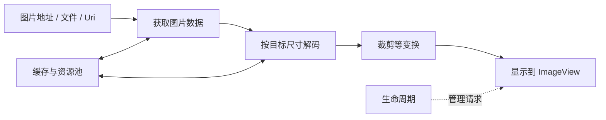
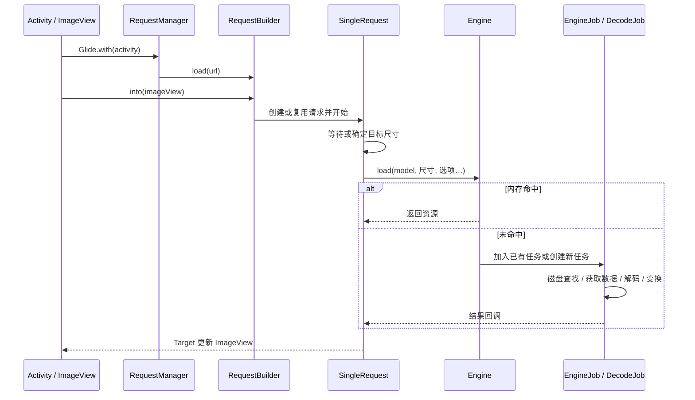
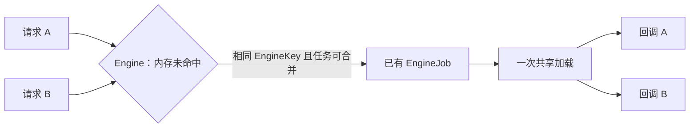
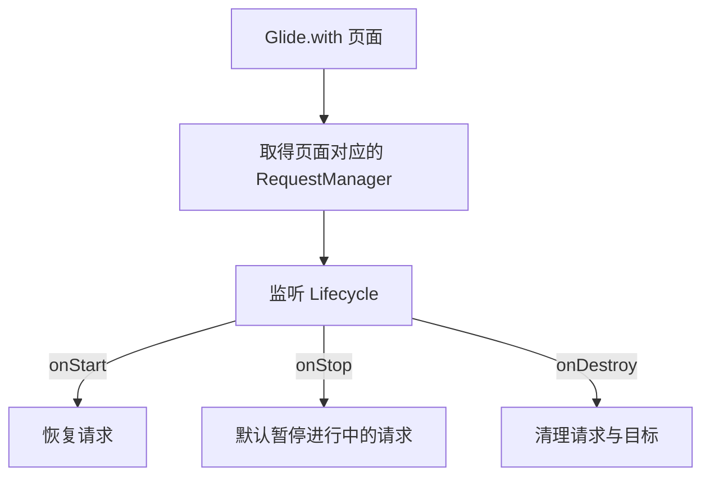
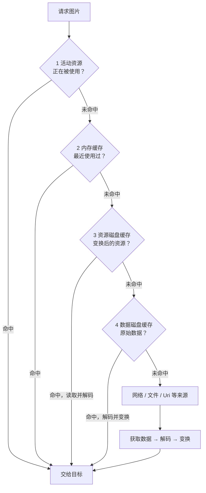
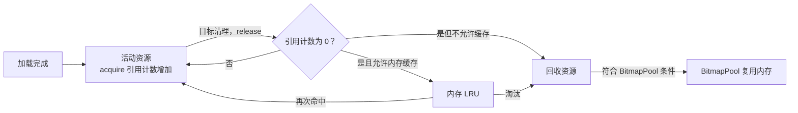
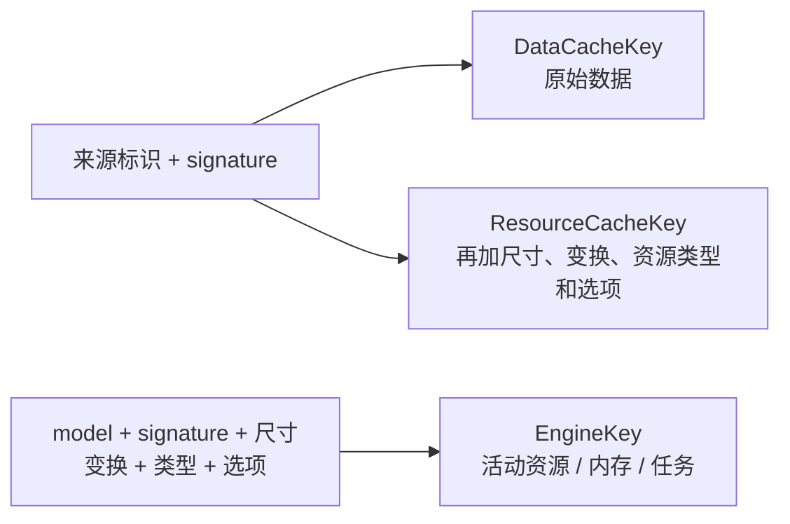
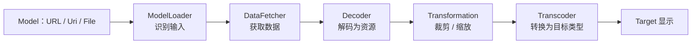

# Glide：图片加载、缓存与源码设计

**Glide 帮 Android 应用加载、解码、变换和显示图片，并管理请求和资源。**

源码基线：[Glide v5.0.9](https://github.com/bumptech/glide/tree/v5.0.9)。参考：[深入理解 Glide 源码](https://www.kancloud.cn/alex_wsc/improve/1822083)；旧版生命周期实现与 5.x 不完全相同。

## 1. 一张图片要经历什么？ {#overview}



例：JPEG 文件大小是 2 MB，解码后的 Bitmap 内存可能大得多。`4000 × 3000 × 4` 约 **45.8 MiB**，这是按 `ARGB_8888` 每像素 4 字节的估算；实际占用取决于配置和分配方式。

## 2. 先用起来 {#usage}

### 依赖与权限

```kotlin
// app/build.gradle.kts；仓库需包含 mavenCentral()
dependencies {
    implementation("com.github.bumptech.glide:glide:5.0.9")
}
```

```xml
<!-- AndroidManifest.xml：加载网络图片 -->
<uses-permission android:name="android.permission.INTERNET" />
```

基础 API 不要求为每个项目配置代码生成器。加载纯本地资源不需要网络权限。[官方依赖与示例](https://github.com/bumptech/glide/tree/v5.0.9)

### 加载与清理

```kotlin
import com.bumptech.glide.Glide

// imageView 是页面中的 ImageView；url 是图片地址
Glide.with(this)                 // Activity 内调用，关联页面生命周期
    .load(url)                   // 也可以传 Uri、File、资源 ID 等
    .placeholder(R.drawable.image_loading)
    .error(R.drawable.image_error)
    .centerCrop()                // 居中裁剪；按需求选择
    .into(imageView)             // 目标 View，主线程调用
```

示例中的占位图资源需自行创建。`load(null)` 可单独配置 `fallback()`；`error()` 用于加载失败。[占位图规则](https://bumptech.github.io/glide/doc/placeholders.html)

```kotlin
// 不再需要目标时，例如自定义 Target 或 RecyclerView 回收场景
Glide.with(imageView).clear(imageView)
```

同一个 `ImageView` 发起新请求时，Glide 会处理目标上已有请求；回收时显式 `clear` 可更早释放目标持有的资源。[RequestBuilder.into](https://github.com/bumptech/glide/blob/v5.0.9/library/src/main/java/com/bumptech/glide/RequestBuilder.java)

### 列表中的最小示例

```kotlin
override fun onBindViewHolder(holder: PhotoHolder, position: Int) {
    Glide.with(holder.image)
        .load(items[position].imageUrl)
        .placeholder(R.drawable.image_loading)
        .error(R.drawable.image_error)
        .centerCrop()
        .into(holder.image)
}

override fun onViewRecycled(holder: PhotoHolder) {
    Glide.with(holder.image).clear(holder.image)
    super.onViewRecycled(holder)
}
```

`PhotoHolder`、`items` 和 drawable 由应用提供。不要在异步回调中依赖过期的 `position`；列表复用时以当前绑定的数据为准。

## 3. 一行代码背后的请求链 {#request-flow}



| 类 | 主要职责 |
| --- | --- |
| `RequestManager` | 管理某个生命周期范围内的请求 |
| `RequestBuilder` | 收集 model、尺寸、变换和选项，创建请求 |
| `SingleRequest` | 请求状态、目标尺寸、结果和失败回调 |
| `Engine` | 内存命中、查找已有任务、创建加载任务 |
| `EngineJob` | 管理一次加载的回调和执行调度 |
| `DecodeJob` | 按阶段查磁盘、取源数据、解码和变换 |
| `Target` | 接收结果并交给目标 View |

源码入口：[RequestBuilder](https://github.com/bumptech/glide/blob/v5.0.9/library/src/main/java/com/bumptech/glide/RequestBuilder.java)、[SingleRequest](https://github.com/bumptech/glide/blob/v5.0.9/library/src/main/java/com/bumptech/glide/request/SingleRequest.java)、[Engine](https://github.com/bumptech/glide/blob/v5.0.9/library/src/main/java/com/bumptech/glide/load/engine/Engine.java)。

### 同一图片同时请求两次，会下载两次吗？



核心源码节选，`Engine.waitForExistingOrStartNewJob()`：

```java
EngineJob<?> current = jobs.get(key, onlyRetrieveFromCache);
if (current != null) {
  current.addCallback(cb, callbackExecutor);
  return new LoadStatus(cb, current);
}
```

`EngineKey` 涉及 model、尺寸和变换等；地址相同不一定是同一个任务。仅缓存请求与普通请求分开管理；不符合条件时可能启动不同任务。[任务查找](https://github.com/bumptech/glide/blob/v5.0.9/library/src/main/java/com/bumptech/glide/load/engine/Engine.java#L239)、[Jobs](https://github.com/bumptech/glide/blob/v5.0.9/library/src/main/java/com/bumptech/glide/load/engine/Jobs.java)

## 4. 生命周期：页面结束后请求怎么办？ {#lifecycle}



Glide 5.0.9 对主线程的 AndroidX `FragmentActivity` / `Fragment` 使用 `LifecycleRequestManagerRetriever`；后台线程获取时会退到 Application 范围。`with(applicationContext)` 不随某个页面停止。`clearOnStop()` 会改变停止时的行为。[获取管理器](https://github.com/bumptech/glide/blob/v5.0.9/library/src/main/java/com/bumptech/glide/manager/RequestManagerRetriever.java)、[生命周期回调](https://github.com/bumptech/glide/blob/v5.0.9/library/src/main/java/com/bumptech/glide/RequestManager.java#L364)

旧文章常用“添加隐藏 Fragment”解释生命周期；**不能直接当成 5.0.9 的 AndroidX 路径**。自定义 Target 和页面引用仍须按生命周期清理，Glide 不能替应用消除所有泄漏。

## 5. 四层缓存：先查哪里？ {#cache}



这是默认策略下的查找顺序；实际阶段受请求选项和磁盘策略控制。磁盘命中仍要读取、解码，**磁盘资源不是内存里的 Bitmap 对象**。[缓存说明](https://bumptech.github.io/glide/doc/caching.html)、[DecodeJob 阶段](https://github.com/bumptech/glide/blob/v5.0.9/library/src/main/java/com/bumptech/glide/load/engine/DecodeJob.java#L404)

| 层 | 保存什么 | 命中后的主要工作 |
| --- | --- | --- |
| 活动资源 | 当前被持有的资源，Glide 用弱引用跟踪 | 复用已解码资源 |
| 内存缓存 | 已释放但可缓存的资源，LRU 淘汰 | 取回并重新进入活动状态 |
| 资源磁盘缓存 | 编码后的变换结果，例如特定尺寸的缩略图 | 读盘并解码 |
| 数据磁盘缓存 | 原始来源数据 | 读盘、解码并执行需要的变换 |

### 资源如何从正在使用变成缓存？ {#resource-lifecycle}



`EngineResource.acquire()` / `release()` 管理使用计数；归零后通知 `Engine`。命中内存时，`Engine` 将资源从 LRU 移出并重新激活。[引用计数](https://github.com/bumptech/glide/blob/v5.0.9/library/src/main/java/com/bumptech/glide/load/engine/EngineResource.java)、[释放与缓存](https://github.com/bumptech/glide/blob/v5.0.9/library/src/main/java/com/bumptech/glide/load/engine/Engine.java#L456)

源码抓住两处即可：

```java
// EngineResource.release()，省略加锁和校验
if (--acquired == 0) {
  release = true;                // 最后一个持有者已释放
}
// 锁外通知 Engine：listener.onResourceReleased(key, this)
```

```java
// Engine.onResourceReleased()，省略非缓存分支
activeResources.deactivate(cacheKey);
if (resource.isMemoryCacheable()) {
  cache.put(cacheKey, resource); // 转入内存 LRU
}
```

**BitmapPool 不是图片内容缓存**：它复用合适的 Bitmap 内存，减少分配；下一次仍要把新图片数据解码进去。池无法接收的 Bitmap 会按实现回收。[LruBitmapPool](https://github.com/bumptech/glide/blob/v5.0.9/library/src/main/java/com/bumptech/glide/load/engine/bitmap_recycle/LruBitmapPool.java)

### 缓存 Key：同一个 URL 为什么可能不命中？ {#cache-key}



同一 URL 的 100×100 和 500×500 图片，原始数据可能共享，变换后的资源 Key 不同。磁盘 Key 用摘要生成文件名；`EngineKey` 与磁盘 Key 不是同一个对象。[EngineKey](https://github.com/bumptech/glide/blob/v5.0.9/library/src/main/java/com/bumptech/glide/load/engine/EngineKey.java)、[DataCacheKey](https://github.com/bumptech/glide/blob/v5.0.9/library/src/main/java/com/bumptech/glide/load/engine/DataCacheKey.java)、[ResourceCacheKey](https://github.com/bumptech/glide/blob/v5.0.9/library/src/main/java/com/bumptech/glide/load/engine/ResourceCacheKey.java)

### 图片更新了，URL 没变怎么办？

```kotlin
import com.bumptech.glide.signature.ObjectKey

Glide.with(this)
    .load(avatarUrl)
    .signature(ObjectKey(avatarVersion)) // 服务端返回的版本号，内容变化时更新
    .into(imageView)
```

`signature` 是 Key 的附加信息，不是图片校验或安全签名。版本应稳定且在内容变化时改变；不要每次加载都使用当前时间，否则无法有效复用缓存。[缓存失效](https://bumptech.github.io/glide/doc/caching.html#cache-invalidation)

### 磁盘缓存策略 {#disk-strategy}

| 策略 | 读取 | 写入意图 |
| --- | --- | --- |
| `AUTOMATIC` | 尝试资源和数据缓存 | 远程通常写原始数据；本地通常写变换结果，受编码器及来源条件约束 |
| `DATA` | 原始数据 | 缓存来源数据 |
| `RESOURCE` | 变换后资源 | 缓存编码后的资源 |
| `ALL` | 两种 | 按来源和编码能力尽可能写两种，并非所有来源都必然产生两份 |
| `NONE` | 不读磁盘缓存 | 不写 Glide 磁盘缓存 |

策略同时影响读和写；是否能写还受数据来源、编码器与条件影响。[策略源码](https://github.com/bumptech/glide/blob/v5.0.9/library/src/main/java/com/bumptech/glide/load/engine/DiskCacheStrategy.java)

```kotlin
import com.bumptech.glide.load.engine.DiskCacheStrategy

Glide.with(this).load(url)
    .diskCacheStrategy(DiskCacheStrategy.DATA)
    .into(imageView)
```

- `onlyRetrieveFromCache(true)`：未命中允许使用的缓存时失败，不再取源数据。
- `skipMemoryCache(true)`：跳过该请求的 Glide 内存缓存；不等于禁用磁盘缓存或其他网络缓存。
- `DiskCacheStrategy.NONE`：关闭 Glide 的磁盘缓存，不等于禁用内存缓存。

不要把“不使用 Glide 磁盘缓存”理解成“数据绝不会被其他层缓存”。敏感图片还需考虑服务端、网络栈、应用存储和系统日志。

### 默认大小与清理

默认内存缓存和 BitmapPool 的大小由 `MemorySizeCalculator` 依据设备计算；磁盘默认工厂使用应用内部缓存目录。不要把某台设备测到的大小当作固定值。[GlideBuilder](https://github.com/bumptech/glide/blob/v5.0.9/library/src/main/java/com/bumptech/glide/GlideBuilder.java#L633)

```kotlin
Glide.get(applicationContext).clearMemory() // 主线程
Thread { Glide.get(applicationContext).clearDiskCache() }.start() // 后台线程
```

清理会降低后续命中率，不应在每次页面退出时执行；清理磁盘也不会自动清除正在显示或内存中的资源。[缓存管理](https://bumptech.github.io/glide/doc/caching.html#resource-management)

## 6. 从数据到图片：谁做了什么？ {#decode}



- `ModelLoader` 负责把输入映射为可获取的数据；`DataFetcher` 执行获取。
- `Decoder` 解码；`Transformation` 处理资源；`Transcoder` 负责输出类型转换。
- 默认 URL 获取路径使用 `HttpURLConnection`；安装并注册对应集成后可改用 OkHttp，**引入 OkHttp 依赖本身不会自动切换**。[ModelLoader](https://github.com/bumptech/glide/blob/v5.0.9/library/src/main/java/com/bumptech/glide/load/model/ModelLoader.java)、[HttpUrlFetcher](https://github.com/bumptech/glide/blob/v5.0.9/library/src/main/java/com/bumptech/glide/load/data/HttpUrlFetcher.java)、[OkHttp 集成](https://github.com/bumptech/glide/tree/v5.0.9/integration/okhttp3)

## 7. Glide 中的设计模式 {#patterns}

### 建造者：一步步配置复杂对象

**原理：** 将可选参数逐步组合，最后执行或创建对象。Glide 的 `RequestBuilder` 把图片地址、选项和目标组合成请求。

```kotlin
Glide.with(this)
    .load(url)
    .override(200, 200) // 目标尺寸：像素
    .centerCrop()
    .into(imageView)
```

`.override()` 不是 dp；给出合理目标尺寸可避免不必要的大图解码。大图裁剪仍需考虑源尺寸、目标尺寸和实际解码策略。

### 策略模式：同一个接口，切换规则

**原理：** 把变化的算法封装为可替换对象。Glide 用 `DiskCacheStrategy` 决定缓存阶段和写入条件。

```kotlin
val strategy = if (isPrivateImage) DiskCacheStrategy.NONE
               else DiskCacheStrategy.AUTOMATIC
Glide.with(this).load(url).diskCacheStrategy(strategy).into(imageView)
```

简化模型：`选择策略 → 执行同一请求流程 → 按策略决定缓存行为`。私密图片还要根据需求处理内存和其他缓存。

### 观察者 / 回调：状态变化通知订阅者

**原理：** 被观察对象发生变化后通知注册者；Glide 的生命周期事件通知 `RequestManager`，加载完成也通过回调通知请求。

```kotlin
// AndroidX 生命周期的最小观察者例子
lifecycle.addObserver(object : androidx.lifecycle.DefaultLifecycleObserver {
    override fun onStop(owner: androidx.lifecycle.LifecycleOwner) {
        // 页面停止时暂停自己的工作
    }
})
```

这段是模式演示，Glide 内部有自己的生命周期适配与请求管理。[Lifecycle 适配](https://github.com/bumptech/glide/blob/v5.0.9/library/src/main/java/com/bumptech/glide/manager/LifecycleLifecycle.java)

### 工厂与注册表：按输入选择处理器

**原理：** 把“创建哪个实现”从调用方移到工厂或注册表；Glide 注册不同 `ModelLoader`，为 URL、文件等输入选择合适处理器。

```kotlin
Glide.with(this).load(url).into(imageView)       // 选择 URL 处理器
Glide.with(this).load(localFile).into(imageView) // 选择 File 处理器
```

扩展自己的 model 时，需要实现并注册对应 loader；处理器匹配、顺序和数据类型由 Registry 决定。[自定义 ModelLoader 教程](https://bumptech.github.io/glide/tut/custom-modelloader.html)

### 单例与对象池：共享管理器，复用临时资源

**单例：** `Glide.get(context)` 获取进程内共享 Glide 实例；v5.0.9 使用 `volatile` 与双重检查初始化。每个进程有各自的静态实例，不是跨进程单例。[Glide.get](https://github.com/bumptech/glide/blob/v5.0.9/library/src/main/java/com/bumptech/glide/Glide.java#L140)

**对象池：** 对象不再使用时归还，后续申请时复用；`BitmapPool` 复用像素内存，`EngineJob` / `DecodeJob` 也使用池。池化有容量和状态管理成本，不意味着对象永不释放。[Engine 工厂](https://github.com/bumptech/glide/blob/v5.0.9/library/src/main/java/com/bumptech/glide/load/engine/Engine.java)

## 8. 常见问题速查 {#pitfalls}

| 现象 | 先检查 |
| --- | --- |
| 图片不更新 | URL 是否不变；服务端版本号是否改变；`signature` 是否更新 |
| 列表闪图或错图 | 每次绑定是否都发起正确请求；目标是否被其他代码修改 |
| 内存压力大 | 目标尺寸、并发量、图片尺寸和格式；是否保留资源或反复禁用缓存 |
| 网络加载失败 | 权限、HTTPS 证书、服务端响应、网络策略；查看请求失败原因 |
| 页面退出后仍在加载 | `with()` 传入的对象、线程及生命周期范围，自定义 Target 是否清理 |
| 只想使用缓存却失败 | `onlyRetrieveFromCache` 与磁盘策略、Key、尺寸和变换是否匹配 |

继续阅读：[OkHttp 与 Retrofit](./okhttp.html)、[HTTP 缓存](/network/http.html)。
