# OkHttp：版本演进、设计模式与 Retrofit 实战

**OkHttp 负责把 HTTP 请求变成网络上的字节，再把响应交回应用。它最值得理解的能力，是复用连接、组织请求处理流程，以及在有限条件下恢复网络故障。**

## 1. 先看清它在 App 中的位置 {#overview}

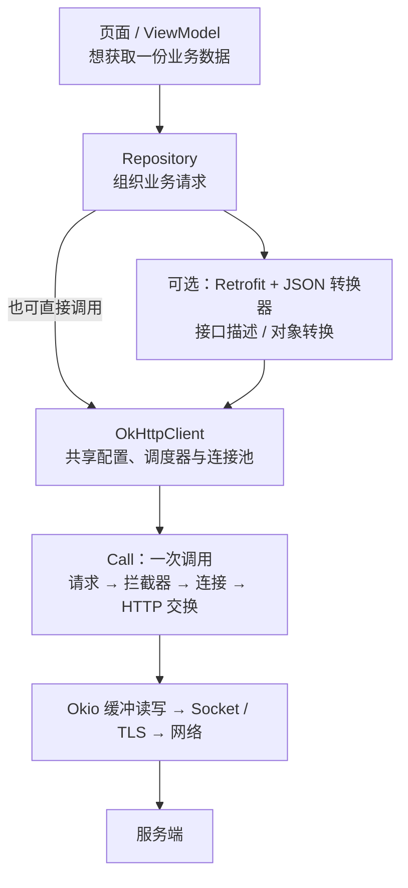

先区分三个对象：**Client 是长期复用的客户端，Request 是请求描述，Call 是只能执行一次的调用。** 同一个 Request 可以创建多个 Call；同一个 Call 不能先 `execute()` 再 `enqueue()`。

| 对象 | 负责什么 | 生命周期与注意点 |
| --- | --- | --- |
| `OkHttpClient` | 调度、连接池、缓存及网络策略 | 通常在应用中共享；不同身份的 Cookie、认证和缓存需要明确隔离 |
| `Request` / `RequestBody` | URL、方法、头部和上传内容 | Request 描述不可变；自定义流式 Body 不一定能重复发送 |
| `Call` / `RealCall` | 执行、取消，跟踪一次调用 | 一次性；重试业务操作应重新创建 Call |
| `Dispatcher` | 异步排队、并发配额与执行器 | 配额约束异步调用，不能当成 Socket 数量 |
| `Exchange` | 一轮实际 HTTP 请求与响应的交换 | 重定向或认证可能让一个 Call 产生多轮 Exchange |
| `ResponseBody` | 响应体字节流 | 通常边读边收；一次性消费，必须关闭 |

## 2. 版本怎样演进：每一代解决什么问题 {#evolution}

**1.x 到 3.x 的主线，是从传输引擎走向稳定的 HTTP 对象模型，再把配置与内部职责拆清楚。4.x、5.x 延续这套思想继续演进。** `okhttp3` 是包名，不是当前版本号；Retrofit 3.0 也不是 OkHttp 3.0。

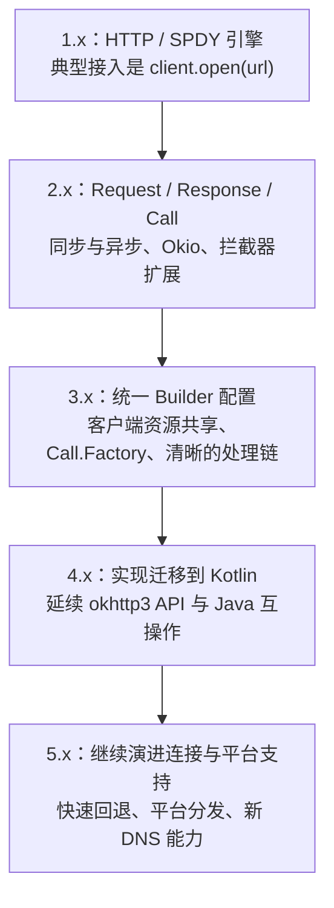

| 版本阶段 | 关键变化与优化 | 为什么值得记住 |
| --- | --- | --- |
| **1.0，2013-05-06**；1.x | HTTP + SPDY 客户端，早期主要经 URLConnection 风格接入；1.5 已加入 HTTP/2 草案支持 | 连接管理和协议效率是起点；不能说 HTTP/2 是 3.x 才出现 |
| **2.0，2014-06-21** | 引入独立 Request、Response、Call / Callback，使用不可变请求描述与链式 Builder；基于 Okio 组织缓冲 I/O | 网络调用开始有明确的对象与生命周期，不再只围绕 Connection 操作 |
| **2.2，2014-12-30** | 开放 Interceptor；2.7 继续重写连接管理，统一管理活跃与空闲连接并检测泄漏 | 拦截器不是 3.0 才发明；连接泄漏检查也有历史演进 |
| **3.0，2016-01-13**；3.x | 包名迁至 `okhttp3`；Client 统一通过 Builder 配置；新 Client 默认有自己的连接池，`newBuilder()` 可共享资源；新增 `Call.Factory`。3.5 源码中已能看到本文的分层拦截器链 | 避免并发请求时反复复制可变配置；扩展、测试与资源共享更清楚 |
| **4.0，2019-06-26** | 实现迁移到 Kotlin，着重保持与 3.x 的迁移兼容和 Java 使用方式 | Java 项目仍可使用；Kotlin 实现不等于必须用 Kotlin 调用 |
| **5.x** | 本篇固定版本为 5.5.1；包含快速连接回退、Android / JVM 的多平台发布，以及新的 DNS 调用能力 | 核心思路延续，但内部类、平台要求、依赖选择需要对照具体版本 |

历史依据：[1.x 发布记录](https://lysine.dev/okhttp/changelogs/changelog_1x/)、[2.x 发布记录](https://lysine.dev/okhttp/changelogs/changelog_2x/)、[3.x 发布记录](https://lysine.dev/okhttp/changelogs/changelog_3x/)、[4.x 发布记录](https://lysine.dev/okhttp/changelogs/changelog_4x/)、[5.x 发布记录](https://lysine.dev/okhttp/changelogs/changelog/)。3.5 的处理链可直接对照 [RealCall.java](https://github.com/lysine-dev/okhttp/blob/parent-3.5.0/okhttp/src/main/java/okhttp3/RealCall.java#L164-L180)。

### 两段代码，看懂 2.x 到 3.x 的配置变化

```java
// 2.x 历史 API 示意，不要复制到当前项目。
com.squareup.okhttp.OkHttpClient oldClient = new com.squareup.okhttp.OkHttpClient();
oldClient.setReadTimeout(15, java.util.concurrent.TimeUnit.SECONDS);

// 3.x 起常用的配置方式，5.x 仍沿用这套 Builder 入口。
okhttp3.OkHttpClient client = new okhttp3.OkHttpClient.Builder()
        .readTimeout(15, java.util.concurrent.TimeUnit.SECONDS)
        .build();
okhttp3.OkHttpClient uploadClient = client.newBuilder()
        .writeTimeout(60, java.util.concurrent.TimeUnit.SECONDS)
        .build(); // 默认共享原客户端的连接池与调度器。
```

Client 的**配置方式趋于稳定**，不代表整个对象没有状态：连接池、调度器、缓存仍然维护运行状态。应用通常共享实例，这是生命周期选择；OkHttpClient 并没有强制使用 GoF 单例模式。

## 3. 经典设计模式：落到哪些类、解决什么问题 {#design-patterns}

| 模式或机制 | 对应实现 | 解决的问题 |
| --- | --- | --- |
| **建造者 Builder** | `OkHttpClient.Builder`、`Request.Builder`、`Response.Builder` | 把多项可选配置与对象创建分开；请求描述创建后保持稳定 |
| **责任链 Chain of Responsibility** | `Interceptor` + `RealInterceptorChain` | 将重试、协议桥接、缓存、连接和收发分开，通过 proceed 组合；允许短路与响应回程处理 |
| **策略 Strategy** | `Dns`、`CookieJar`、`Authenticator` 等接口 | 核心流程保持稳定，解析、会话和认证策略可替换 |
| **工厂接口** | `Call.Factory`，由 `OkHttpClient` 实现；`newCall()` 创建 `RealCall` | 调用方依赖创建 Call 的能力，可注入不同实现或测试替身 |
| **装饰器 Decorator** | `Exchange.ResponseBodySource` 继承 `ForwardingSource`，包装下层 Source | 保留读写接口，叠加字节统计、结束回报与资源管理 |
| **资源池机制** | `ConnectionPool` / `RealConnectionPool` | 在约束下复用昂贵的连接；这是资源管理模式，不应和单例、请求缓存混为一谈 |

这些模式是根据类关系和职责作出的归纳，重点是理解协作，不能只记模式名称。源码入口：[Builder 与 Call.Factory](https://github.com/lysine-dev/okhttp/blob/parent-5.5.1/okhttp/src/commonJvmAndroid/kotlin/okhttp3/OkHttpClient.kt#L135-L137)、[ResponseBodySource 装饰器](https://github.com/lysine-dev/okhttp/blob/parent-5.5.1/okhttp/src/commonJvmAndroid/kotlin/okhttp3/internal/connection/Exchange.kt#L323-L327)。

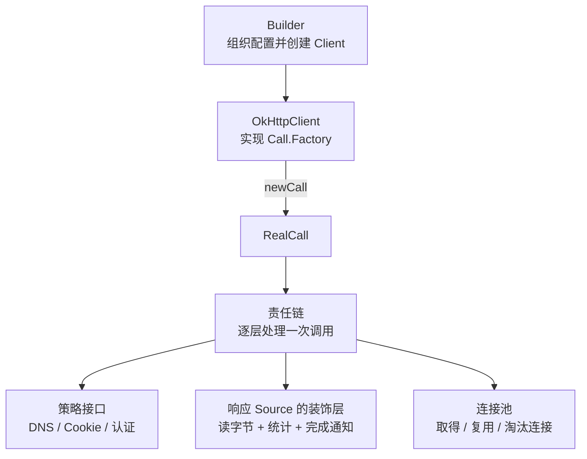

### 工厂与策略：接口为什么比写死实现有用

```java
// 依赖“能创建 Call”的接口，而不是依赖某个具体客户端构造过程。
final class CallCreator {
    private final okhttp3.Call.Factory factory;
    CallCreator(okhttp3.Call.Factory factory) { this.factory = factory; }
    okhttp3.Call create(okhttp3.Request request) {
        return factory.newCall(request);
    }
}
// 正式运行可以传入共享 OkHttpClient，测试时可以传入受控实现。
```

策略并不一定意味着自己重写 DNS 或认证逻辑，而是让变化停留在明确的边界。责任链负责“步骤如何组合”，策略负责“某项决策如何实现”；装饰器则侧重“包装同一接口并增强行为”。后面 Retrofit 的动态代理、Converter.Factory 与 CallAdapter 又分别承担接口实现、数据转换与调用形式适配。

## 4. 先会用：GET、POST 与下载 {#usage}

### 依赖与 Android 前提

示例使用 **OkHttp 5.5.1**，源码链接固定到 `parent-5.5.1`。Android 最低要求为 API 21，JVM 要求 Java 8+。[依赖与运行要求](https://lysine.dev/okhttp/)

```kotlin
// app/build.gradle.kts
dependencies {
    implementation(platform("com.squareup.okhttp3:okhttp-bom:5.5.1"))
    implementation("com.squareup.okhttp3:okhttp")
    // 需要请求日志时再添加；日志拦截器也使用同一 BOM 版本。
    // implementation("com.squareup.okhttp3:logging-interceptor")
}
```

```xml
<!-- AndroidManifest.xml，放在 application 标签外。无需运行时弹窗申请。 -->
<uses-permission android:name="android.permission.INTERNET" />
```

`ACCESS_NETWORK_STATE` 用于查询网络状态，单纯发请求不靠它授权。网络读写不得放在主线程，`enqueue()` 的回调也不会自动切回主线程。[Android 网络操作](https://developer.android.com/develop/connectivity/network-ops/connecting)

OkHttp 在 Android 上默认通过 AndroidX Startup 初始化；只有主动禁用它的初始化器时，才需要在 `Application.onCreate()` 调用 `OkHttp.initialize(applicationContext)`。普通项目保留默认初始化即可。

### 一个可以复用的异步 GET 客户端

下面是完整 Java 类。Android 中用 `new NoteHttp(context.getApplicationContext().getCacheDir())` 创建应用级实例；回调返回小文本，页面层负责生命周期和 UI 线程切换。

```java
import java.io.File;
import java.io.IOException;
import java.util.concurrent.TimeUnit;
import okhttp3.Cache;
import okhttp3.Call;
import okhttp3.Callback;
import okhttp3.OkHttpClient;
import okhttp3.Request;
import okhttp3.Response;

public final class NoteHttp {
    public interface Result {
        void onSuccess(String text);
        void onError(IOException error);
    }

    private final OkHttpClient client;

    public NoteHttp(File appCacheDir) {
        client = new OkHttpClient.Builder()
                .cache(new Cache(new File(appCacheDir, "http"), 20L * 1024 * 1024))
                .connectTimeout(10, TimeUnit.SECONDS)
                .readTimeout(15, TimeUnit.SECONDS)
                .writeTimeout(15, TimeUnit.SECONDS)
                .callTimeout(30, TimeUnit.SECONDS)
                .build();
    }

    public Call get(String url, Result result) {
        Request request = new Request.Builder().url(url).build();
        Call call = client.newCall(request);
        call.enqueue(new Callback() {
            @Override public void onFailure(Call call, IOException error) {
                result.onError(error); // DNS、连接、TLS、取消等失败。
            }

            @Override public void onResponse(Call call, Response response) {
                String text;
                try (Response owned = response) {
                    if (!owned.isSuccessful()) {
                        // HTTP 404 / 500 也进入 onResponse，由应用判断状态码。
                        throw new IOException("HTTP " + owned.code());
                    }
                    text = owned.body().string(); // 只适合可控的小响应。
                } catch (IOException error) {
                    // 回调里读 Body 仍可能失败，必须在这里处理。
                    result.onError(error);
                    return;
                }
                result.onSuccess(text); // 此时 Body 已关闭；仍在后台线程。
            }
        });
        return call; // 页面不再需要结果时，对这个 Call 调用 cancel()。
    }
}
```

缓存目录应由这一个 `Cache` 实例独占。不要重复创建多个 `NoteHttp` 访问同一路径；也不要每次请求都新建 Client。

个别接口需要不同超时，可通过 `client.newBuilder()` 派生客户端，默认共享原有连接池和调度器；它不代表网络资源或登录身份已被隔离。[共享客户端与派生配置](https://github.com/lysine-dev/okhttp/blob/parent-5.5.1/okhttp/src/commonJvmAndroid/kotlin/okhttp3/OkHttpClient.kt#L54-L103)

::: tip 回调到达，不代表文件已经下载完
`onResponse()` 表示响应已可读，通常只是响应头已经到达。后续 `string()`、`read()` 仍会阻塞，也仍会抛出 `IOException`。回调内部的读取失败，不会再自动补发一次 `onFailure()`。[异步调用示例](https://lysine.dev/okhttp/recipes/#asynchronous-get-kt-java)
:::

### POST JSON：上传字节与解析对象是两件事

把下面的方法放入 `NoteHttp`，增加 `MediaType`、`RequestBody` 的 import。**这是同步方法，只能从后台线程调用。**

```java
import okhttp3.MediaType;
import okhttp3.RequestBody;

public String postJson(String url, String json) throws IOException {
    RequestBody body = RequestBody.create(
            json, MediaType.get("application/json; charset=utf-8"));
    Request request = new Request.Builder().url(url).post(body).build();
    try (Response response = client.newCall(request).execute()) {
        if (!response.isSuccessful()) throw new IOException("HTTP " + response.code());
        return response.body().string();
    }
}
```

例如把 `{"title":"学习 OkHttp"}` 作为参数传入；正式业务使用 JSON 序列化器生成字符串，避免手工拼接用户输入。表单用 `FormBody`，文件表单用 `MultipartBody`，不要把它们和 JSON 的 `Content-Type` 混用。

### 大文件：流式读写，不要 string() 后再保存

同样作为 `NoteHttp` 的方法，增加以下 import。调用方传入自己创建的文件输出流，并负责关闭它；下载到临时文件，成功后再由调用方替换正式文件。

```java
import java.io.InputStream;
import java.io.OutputStream;

public long download(String url, OutputStream destination) throws IOException {
    Request request = new Request.Builder().url(url).build();
    try (Response response = client.newCall(request).execute()) {
        if (!response.isSuccessful()) throw new IOException("HTTP " + response.code());
        try (InputStream source = response.body().byteStream()) {
            byte[] buffer = new byte[8192];
            long total = 0;
            int count;
            while ((count = source.read(buffer)) != -1) {
                destination.write(buffer, 0, count);
                total += count;
            }
            return total;
        }
    }
}
```

`Content-Length` 可能未知，透明解压后也不能直接拿压缩前后的长度计算百分比。上面的示例只负责一次流式传输；下载中断后，怎样继续写同一个文件，见下面的完整流程。

### 断点续传：确认同一份文件，再从断点继续 {#resumable-download}

**已经连续保存了 N 字节，下一次就从第 N 字节请求；只有确认还是同一版本、返回位置也正确，才能接着写。** 适合安装包、离线资料、视频原文件等大文件下载。OkHttp 的连接重试不会替应用保存跨进程的文件断点。

#### 先看一次真正的续传

假设文件共 **10 MiB = 10485760 字节**，本地 `.part` 已有 **4 MiB = 4194304 字节**。字节编号从 0 开始，因此已保存的是 `0～4194303`，下一次请求从 `4194304` 开始。

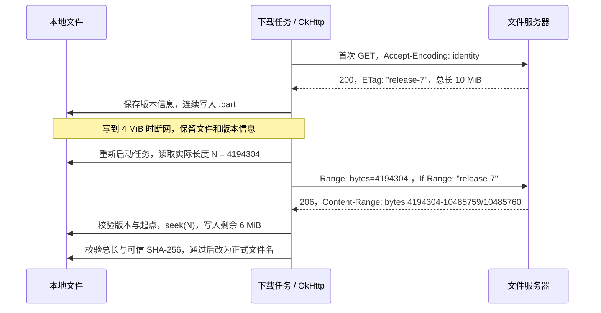

续传请求与响应中的关键字段如下。`Range` 在请求里，`Content-Range` 在响应里；两者不能写反。[HTTP Range 请求](https://developer.mozilla.org/en-US/docs/Web/HTTP/Guides/Range_requests)

```http
GET /releases/manual-v7.zip HTTP/1.1
Range: bytes=4194304-
If-Range: "release-7"
Accept-Encoding: identity

HTTP/1.1 206 Partial Content
ETag: "release-7"
Content-Range: bytes 4194304-10485759/10485760
Content-Length: 6291456
```

这里的 `Content-Length` 是**本次返回的 6 MiB**；完整文件大小来自 `Content-Range` 斜杠后的 `10485760`。进度用 `(本地已有字节 + 本次已写字节) / 完整文件大小`，不能把本次响应长度当分母。[Content-Range 字段](https://developer.mozilla.org/en-US/docs/Web/HTTP/Reference/Headers/Content-Range)

#### 响应不同，写文件的动作也不同

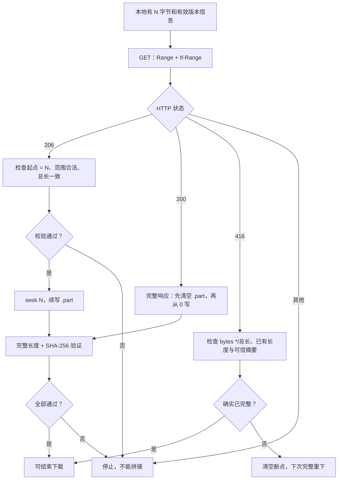

- **206 才考虑续写。** 必须检查 `Content-Range` 的起点就是 N，终点不小于起点、且小于总长；实际读取量应等于 `终点 - 起点 + 1`。不能只看状态码。
- **200 必须重新写。** 服务器可能不支持范围请求，也可能因版本变化而忽略 Range。把整个新文件 append 到旧前缀后面，长度和内容都会错。
- **416 不是“下载完成”。** `Content-Range: bytes */10485760` 只是说明当前完整长度。只有本地长度匹配且可信摘要也匹配，才能认定已有文件完整；否则重下。

以上是本例的处理策略；服务器也可能忽略 Range 直接返回 200。无需把 `HEAD` 或 `Accept-Ranges: bytes` 当成续传前置条件，最终以 GET 的实际响应为准。[RFC 9110 §14 范围请求](https://www.rfc-editor.org/rfc/rfc9110.html#section-14)

#### 为什么只有 Range 还不够：旧文件可能已经变了

昨天下载了 v7 的前半段，今天同一个 URL 换成 v8，单独发送 `Range` 就可能收到 v8 的后半段。**URL 相同不代表文件内容相同。**

`If-Range: "release-7"` 的意思是：版本仍然匹配时给我片段；版本不匹配时给我完整文件。因此发生变化时通常得到 **200**，而不是让客户端继续拼接。

`ETag` 是服务器给出的不透明版本标识，**不保证是 MD5 / SHA-256**。`W/"release-7"` 是弱 ETag，不能用于 `If-Range`。HTTP 日期也能用于 If-Range，但需满足强校验条件；下面示例只接受**强 ETag + 已知总长**续传，条件不足时保守地从 0 重下。[If-Range 约束](https://developer.mozilla.org/en-US/docs/Web/HTTP/Reference/Headers/If-Range)

**本来要下载 v7，却收到 v8 的完整文件，仍不能当作 v7 成功。** 示例最终还会核对预期 SHA-256；要接受新版，应重新取得可信版本清单，用新版摘要与新的目标文件名发起任务。

文件保存使用同一目录下的几个固定名称：

```text
filesDir/downloads/
├── manual-v7.zip.part             # 连续保存的原始字节，长度就是下一次起点
├── manual-v7.zip.part.properties  # URL、强 ETag、总长、预期 SHA-256
├── manual-v7.zip.lock             # 写入锁，防止两个任务同时修改
└── manual-v7.zip                  # 校验通过后才出现的正式文件
```

#### Android 怎么调用

沿用前文 OkHttp 依赖，把下面的完整 `ResumableDownload.java` 放入自己的包中。**在后台线程调用**；传入的摘要必须来自可信发布清单或受信任的版本配置，不能临时把本次下载算出的摘要当作预期值。

```java
// 由业务已有的后台执行器调用。每次尝试创建一个任务，失败后可重新创建。
ResumableDownload task = new ResumableDownload(sharedClient);
File target = new File(context.getFilesDir(), "downloads/manual-v7.zip");
downloadExecutor.execute(() -> {
    try {
        File file = task.download(
                releaseUrl, target, trustedReleaseSha256, 200L * 1024 * 1024);
        // 回到主线程更新界面；此时 file 已通过校验。
    } catch (IOException e) {
        // 断网或取消时保留有效前缀；下次用新任务和同一组参数继续。
        // 401/403 应先恢复授权；协议错误、摘要错误不能无限自动重试。
    }
});
// 用户取消、Worker.onStopped() 等位置：task.cancel();
```

本例每次发起一个单区间 GET，支持进程重启后恢复；206 省略重复 ETag 时依据已发送的 If-Range，携带 ETag 时再检查是否一致。服务器只返回一部分剩余区间时会保留前缀并报告尚未完成，由下一次任务继续。无强 ETag、未知完整长度、多个并行片段和压缩表示不在本例续传范围内。

::: details 完整代码：版本校验、文件锁、续写、取消与最终校验

<<< @/public/assets/android/libraries/okhttp/ResumableDownload.java

:::

[下载完整 Java 源码](/assets/android/libraries/okhttp/ResumableDownload.java){download="ResumableDownload.java"}

#### 最容易写错的地方

- **offset 取磁盘文件长度。** UI 进度、上次回调值和响应 Content-Length 都不是可靠断点；本例仅适用于从 0 连续保存的文件，多片并行下载需要单独记录各片区间。
- **前后使用相同的字节表示。** 从第一次 GET 就指定 `Accept-Encoding: identity`，响应仍有 gzip 等编码则拒绝。本地解压后大小不能直接用于请求压缩表示的 Range。
- **元数据与文件有写入顺序。** 收到 200 后先截断旧文件，再保存新版本信息，然后写 Body；反过来会在崩溃后出现“新 ETag + 旧前缀”。元数据缺失或损坏时重下。
- **完成与中断分别处理。** 网络中断保留前缀；读取时越界、完整文件摘要错误则清空。先验证再改名；使用应用私有目录、固定的版本文件名，预留磁盘空间，不直接使用服务端提供的文件路径。
- **任务调度不等于续传协议。** 需要应用退出后仍可恢复、满足网络约束再运行，可把任务交给 WorkManager；持久化参数、鉴权刷新和有限重试由应用安排，Worker 停止时取消 Call。UI 进度更新应节流。

OkHttp 5.5.1 的 [`BridgeInterceptor.intercept()`](https://github.com/lysine-dev/okhttp/blob/parent-5.5.1/okhttp/src/commonJvmAndroid/kotlin/okhttp3/internal/http/BridgeInterceptor.kt) 只有在请求**既未设置 Accept-Encoding，也未设置 Range**时才自动加 gzip。显式指定 identity，是为了让首次下载与后续续传都在同一套字节坐标中工作。

## 5. Android 集成 Retrofit：从 JSON 到 Java Bean {#retrofit}

### Retrofit 是什么：把 HTTP 接口变成可调用的方法

**Retrofit 是声明式、类型安全的 HTTP 接口封装库。** 你用 Java / Kotlin 接口描述“请求哪个地址、传什么参数、返回什么对象”，它在运行时创建接口实现，连接 HTTP 客户端与数据转换器。

```java
// 这一行声明了请求方法、相对路径、路径参数和响应的对象类型。
@retrofit2.http.GET("users/{id}")
retrofit2.Call<ApiEnvelope<UserDto>> user(@retrofit2.http.Path("id") long id);

// api 是 Retrofit 创建的 UserApi 实现；普通 Call 接口此时还没有发送 HTTP 请求。
retrofit2.Call<ApiEnvelope<UserDto>> call = api.user(7);
// 调用 call.enqueue(...) 或 call.execute()，才开始执行网络请求。
```

这里的“类型安全”指参数和返回对象可以在代码中明确表达，例如 `UserDto`、`List<UserDto>`，调用方无需到处强转 Map；它**不保证服务端 JSON 永远符合声明，也不替代业务字段校验**。[Retrofit 官方介绍](https://lysine.dev/retrofit/)

### 什么时候出现，后来解决了哪些问题

Retrofit 最初由 **Square** 开发。项目仓库创建于 **2010-09-06**；官方发布记录中的 **1.0.0 发布于 2013-05-13**。仓库创建和正式版本发布是两个不同时间节点。[仓库元数据](https://api.github.com/repos/lysine-dev/retrofit)、[官方版本记录](https://github.com/lysine-dev/retrofit/blob/3.0.0/CHANGELOG.md)

| 节点 | 主要变化 | 对实际使用的意义 |
| --- | --- | --- |
| **1.0.0，2013-05-13** | 首个正式发布版本，已有声明式 HTTP 接口思路 | 用接口组织远端 API，减少每个请求各写一套传输胶水代码 |
| **2.0.0，2016-03-11** | 以可扩展性为重点，普通接口返回 `Call<T>`；Converter、CallAdapter 分离；以 OkHttp 为传输基础 | 同一方法支持同步 / 异步执行与取消，数据格式和调用形式可分别扩展 |
| **2.6.0，2019-06-05** | 原生支持 Kotlin `suspend` 接口 | 协程调用不再必须自己把 Callback 包装成挂起函数 |
| **3.0.0，2025-05-15** | 默认依赖从 OkHttp 3.14 升级到 4.12，并延续 2.x 的前向二进制兼容方向 | 依赖和维护基线更新；本文通过显式配置使用前面验证过的 OkHttp 5.5.1 |

### 它要解决的重复劳动是什么

假设 App 有几十个接口。只使用底层 HTTP API 时，每个接口都可能重复写：URL 拼接、路径与查询参数编码、请求体序列化、执行调用、读取响应、转换对象，再把结果交给业务层。

**Retrofit 把这套重复翻译过程集中到“接口声明 + 运行时处理器”中。** URL 和参数由注解表达，JSON 交给 Converter，执行形式交给 CallAdapter。接口变化时，开发者主要修改明确的 API 声明与 DTO。

| 关注点 | Retrofit 负责 | OkHttp 负责 |
| --- | --- | --- |
| 接口表达 | `@GET`、`@POST`、`@Path`、`@Body` 等声明 | Request、Headers、RequestBody 等 HTTP 对象 |
| 对象与字节转换 | 选择 Converter，把 Bean 与请求 / 响应体衔接 | 传输 Body 字节流，提供流式读写 |
| 调用形式 | 普通 `Call<T>`、协程接口和可扩展适配器 | 底层 Call 的执行、取消与调度 |
| 网络协议与资源 | 委托配置好的 HTTP 客户端 | 连接池、DNS、TCP / TLS、HTTP/2、HTTP 缓存等 |
| 业务语义 | 仍需应用判断业务 code、校验 DTO | 同样不理解“登录成功”“订单已提交”等业务含义 |

组合使用时，**Retrofit 组织接口，OkHttp 执行 HTTP，Gson 等 Converter 实现 JSON 与对象映射**。它们各管一层；不要在 OkHttp 拦截器里重复解析每个接口的业务 JSON。

### 原理：动态代理、方法解析缓存与延迟执行

理解 Retrofit 可以分成三个时刻：

1. **创建接口实现**：`retrofit.create(UserApi.class)` 使用 JDK `Proxy` / `InvocationHandler` 创建动态代理，不要求你手写 UserApiImpl，也不是为每个接口预先生成一份实现类源码。
2. **调用接口方法**：普通方法进入代理；首次使用时，Retrofit 解析 HTTP 注解、参数处理器与泛型返回类型，形成 ServiceMethod 并缓存。随后把本次参数装进新的 Retrofit Call。
3. **执行 Call**：`enqueue()` / `execute()` 通过 RequestFactory 构建请求，再用 `okhttp3.Call.Factory` 创建底层 Call。响应返回后走 Converter 和调用适配，最终交给应用。

源码中，普通接口方法在代理内进入这一行：

```java
// Retrofit.java：InvocationHandler 内普通接口方法的分支。
loadServiceMethod(service, method).invoke(proxy, args);
```

创建 Retrofit Call 与创建底层 HTTP Call 是不同步骤：

```java
// HttpServiceMethod.invoke()：每次方法调用创建新的 Retrofit Call。
Call<ResponseT> call =
        new OkHttpCall<>(requestFactory, instance, args, callFactory, responseConverter);
return adapt(call, args);
```

```java
// OkHttpCall.createRawCall()：把参数转换成 HTTP Request，交给底层工厂。
okhttp3.Call call = callFactory.newCall(requestFactory.create(instance, args));
```

这里的 `retrofit2.OkHttpCall` 是 Retrofit 对调用过程的封装，`okhttp3.Call` 才是传输层调用。**方法解析缓存复用的是接口元数据，不是 HTTP 响应，也不会把一次性 Call 变成可反复执行的对象。**

源码入口：[Retrofit.create / loadServiceMethod](https://github.com/lysine-dev/retrofit/blob/3.0.0/retrofit/src/main/java/retrofit2/Retrofit.java#L157-L241)、[ServiceMethod.parseAnnotations](https://github.com/lysine-dev/retrofit/blob/3.0.0/retrofit/src/main/java/retrofit2/ServiceMethod.java#L25-L44)、[HttpServiceMethod.invoke](https://github.com/lysine-dev/retrofit/blob/3.0.0/retrofit/src/main/java/retrofit2/HttpServiceMethod.java#L156-L160)、[OkHttpCall.createRawCall](https://github.com/lysine-dev/retrofit/blob/3.0.0/retrofit/src/main/java/retrofit2/OkHttpCall.java#L210-L215)。

### 为什么现代 Android 项目常用 Retrofit + OkHttp

**它是常见的工程组合，Android 平台不会自动为应用启用它。** Android 官方文档同时列出了 Retrofit、Ktor 等选择，平台本身还提供 HttpsURLConnection；项目仍需按需求选型。[Android HTTP 客户端选择](https://developer.android.com/develop/connectivity/network-ops/connecting#choose-an-http-client)

对包含大量 HTTP / JSON 接口的 App，这个组合的价值主要在于：

- **接口规模扩大后仍便于维护**：路径、参数、DTO 集中声明，减少分散的拼接和强转代码；Repository 可以围绕具体业务接口组织。
- **传输能力集中复用**：多个 Retrofit 接口复用同一个 OkHttpClient，统一连接池、超时、认证、拦截器与缓存配置。
- **数据格式与传输解耦**：Gson、Moshi、kotlinx.serialization 等转换器可以按项目选取，不必因为更换 JSON 方案重写连接管理。
- **适配 Android 的异步调用方式**：Java 可以使用 Call / Callback；Kotlin 可以直接声明 suspend 接口，并和 ViewModel 的协程生命周期结合。
- **测试边界清晰**：业务层可以替换 Repository / API 实现，传输集成测试可以用本地受控服务验证请求、响应与错误分支。

协程接口仍使用同一套 HTTP 处理链，例如：

```kotlin
interface CoroutineUserApi {
    @retrofit2.http.GET("users/{id}")
    suspend fun user(@retrofit2.http.Path("id") id: Long):
        retrofit2.Response<com.example.network.ApiEnvelope<com.example.network.UserDto>>
}
```

普通 Call 方法先返回待执行对象；这个 suspend 方法则在被调用时进入异步执行和挂起等待，不应再返回 `Call<T>`。返回 `Response<T>` 时要自己判断 HTTP 状态；直接返回 T 时，非 2xx 通常抛 HttpException。业务 code 仍由应用判断，取消异常也不应被吞掉。[协程支持的发布说明](https://github.com/lysine-dev/retrofit/blob/3.0.0/CHANGELOG.md#260---2019-06-05)

**Retrofit 的主要收益是减少接入与维护成本；连接和协议性能主要由 OkHttp、服务端与网络环境决定。** 只有少量原始请求、流式下载或 WebSocket 时，直接使用 OkHttp 就可能更合适；偏重 Kotlin 多平台的项目也可以评估 Ktor，不必为了组合而组合。

[下载完整 Java 核心示例](/assets/android/libraries/okhttp/retrofit-core-sample.zip)：包含本节与下一节的源文件、依赖、Manifest 片段和接入说明。它是可移入现有 Android 工程的示例，服务端地址需要替换。

### 依赖与调用链

```kotlin
// 在前面的 OkHttp BOM 和 okhttp 依赖基础上增加：
implementation("com.squareup.retrofit2:retrofit:3.0.0")
implementation("com.squareup.retrofit2:converter-gson:3.0.0")
implementation("com.google.code.gson:gson:2.13.1")
```

这组 Retrofit / Converter 版本来自 Maven Central，Gson 版本与该 Converter 的依赖一致；HTTP 客户端仍使用前面的 OkHttp 5.5.1。

`retrofit2` 也是延续的包名。这里使用 Java DTO，以便清楚展示类型和字段；Kotlin data class 的非空约束不能简单等同于 Gson 反射校验。

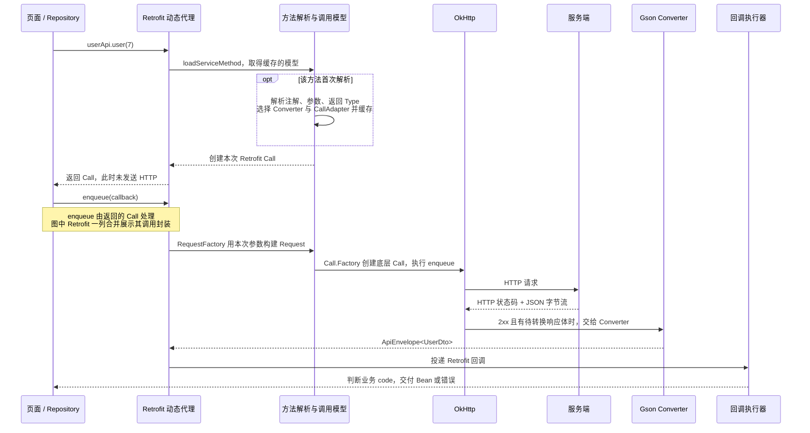

### 先定服务端契约，再写泛型

假设 `GET /v1/users/7` 返回：

```json
{
  "code": 0,
  "message": "OK",
  "data": { "id": 7, "display_name": "小林" }
}
```

这里的 `code` 是**本示例服务端约定的业务码**，成功值由 `ApiEnvelope.SUCCESS` 定义，不能照搬到所有接口。HTTP 状态码在响应行中，JSON 的 code 在响应体中，它们是两套规则。

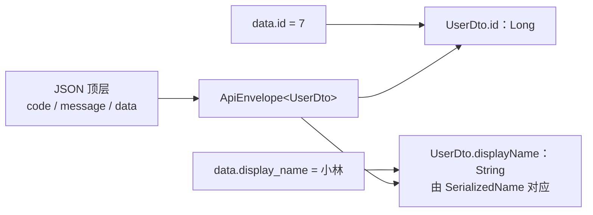

**ApiEnvelope.java**

```java
package com.example.network;

import com.google.gson.annotations.SerializedName;

public final class ApiEnvelope<T> {
    // 本示例与服务端约定 0 为业务成功；不是 HTTP 状态码。
    public static final int SUCCESS = 0;
    @SerializedName("code") public Integer code;
    @SerializedName("message") public String message;
    @SerializedName("data") public T data;
}
```

**UserDto.java**

```java
package com.example.network;

import com.google.gson.annotations.SerializedName;

public final class UserDto {
    @SerializedName("id") public Long id;
    @SerializedName("display_name") public String displayName;
}
```

**code 用 Integer，而不是 int。** 缺少字段时 Integer 保持 null，能识别协议错误；若用 int 默认得到 0，恰好可能把缺字段误认成业务成功。DTO 的字段名与 JSON 不同，通过 `@SerializedName` 对应；对象构造完成不代表必填字段一定存在。

### 接口声明：每个方法保留具体返回类型

**UserApi.java**

```java
package com.example.network;

import java.util.List;
import retrofit2.Call;
import retrofit2.http.Body;
import retrofit2.http.GET;
import retrofit2.http.POST;
import retrofit2.http.Path;

public interface UserApi {
    @GET("users/{id}")
    Call<ApiEnvelope<UserDto>> user(@Path("id") long id);

    @GET("users")
    Call<ApiEnvelope<List<UserDto>>> users();

    @POST("users/{id}/name")
    Call<ApiEnvelope<UserDto>> rename(@Path("id") long id, @Body RenameUser body);
}
```

`user()` 的 T 是 `UserDto`，`users()` 的 T 是 `List<UserDto>`。列表 JSON 的 data 必须是数组；`@Body RenameUser` 则由同一个 Converter 转成请求 JSON：

**RenameUser.java**

```java
package com.example.network;

import com.google.gson.annotations.SerializedName;

public final class RenameUser {
    @SerializedName("display_name") public final String displayName;
    public RenameUser(String displayName) { this.displayName = displayName; }
}
```

`baseUrl = https://api.example.com/v1/` 配合 `@GET("users/{id}")` 会请求 `/v1/users/7`。baseUrl 末尾必须有 `/`；若写成 `@GET("/users/{id}")`，开头的 `/` 会从站点根路径解析，丢掉 `/v1/`。[接口声明与 URL 参数](https://lysine.dev/retrofit/declarations/)

### 用一个 Network 把三个库装配起来

**Network.java**

```java
package com.example.network;

import java.io.File;
import java.util.concurrent.Executor;
import java.util.concurrent.TimeUnit;
import com.google.gson.Gson;
import com.google.gson.GsonBuilder;
import com.google.gson.Strictness;
import okhttp3.Cache;
import okhttp3.OkHttpClient;
import retrofit2.Retrofit;
import retrofit2.converter.gson.GsonConverterFactory;

public final class Network {
    public final Gson gson;
    public final UserApi users;

    public Network(String baseUrl, File appCacheDir, Executor callbackExecutor) {
        gson = new GsonBuilder().setStrictness(Strictness.STRICT).create();
        OkHttpClient http = new OkHttpClient.Builder()
                .connectTimeout(10, TimeUnit.SECONDS)
                .readTimeout(15, TimeUnit.SECONDS)
                .callTimeout(30, TimeUnit.SECONDS)
                .cache(new Cache(new File(appCacheDir, "retrofit-http"), 20L * 1024 * 1024))
                .build();
        Retrofit retrofit = new Retrofit.Builder()
                .baseUrl(baseUrl) // 例如 https://api.example.com/v1/，末尾必须有 /。
                .client(http)    // Retrofit 的 HTTP 调用最终交给这个共享 Client。
                .addConverterFactory(GsonConverterFactory.create(gson))
                .callbackExecutor(callbackExecutor)
                .build();
        users = retrofit.create(UserApi.class);
    }
}
```

`client(http)` 指定传输实现，`GsonConverterFactory` 指定 JSON 转换，`create(UserApi.class)` 创建接口的动态代理。不要每个接口调用都重新创建 Network、Retrofit 或 OkHttpClient。[Retrofit 配置与 Converter](https://lysine.dev/retrofit/configuration/)

**两个 Call 的包不要导错：** 接口返回的是 `retrofit2.Call<ApiEnvelope<UserDto>>`；真正传输时创建的是 `okhttp3.Call`，后者不带这个业务泛型。

### Android 中初始化和页面调用

示例把 Network 保存在 Application 中，并**显式使用后台回调执行器**，让业务解包与错误体解析不占主线程。页面通过 `runOnUiThread()` 显示结果。

::: details Application 初始化：StudyApplication.java
**StudyApplication.java**

```java
package com.example.network;

import android.app.Application;
import java.util.concurrent.ExecutorService;
import java.util.concurrent.Executors;

public final class StudyApplication extends Application {
    private UserRepository users;
    private final ExecutorService callbacks = Executors.newSingleThreadExecutor();

    @Override public void onCreate() {
        super.onCreate();
        Network network = new Network("https://api.example.com/v1/", getCacheDir(),
                callbacks); // 业务响应处理放后台；页面显式切主线程。
        users = new UserRepository(network);
    }

    public UserRepository users() { return users; }
}
```
:::

```xml
<!-- 合并到现有 AndroidManifest.xml；示例 Activity 不需要对外导出。 -->
<uses-permission android:name="android.permission.INTERNET" />
<application android:name="com.example.network.StudyApplication">
    <activity android:name="com.example.network.UserActivity"
              android:exported="false" />
</application>
```

页面调用使用下一节的 UserRepository 与 ApiListener：

::: details 页面完整调用：UserActivity.java
**UserActivity.java**

```java
package com.example.network;

import android.app.Activity;
import android.os.Bundle;
import android.widget.TextView;
import retrofit2.Call;

public final class UserActivity extends Activity {
    private Call<ApiEnvelope<UserDto>> inFlight;

    @Override protected void onCreate(Bundle state) {
        super.onCreate(state);
        TextView text = new TextView(this);
        setContentView(text);
        text.setText("加载中");
        UserRepository repository = ((StudyApplication) getApplication()).users();
        inFlight = repository.user(7, new ApiListener<UserDto>() {
            @Override public void onSuccess(UserDto user) {
                runOnUiThread(() -> {
                    if (!canDisplay()) return;
                    // Gson 反射不会替你检查业务必填字段。
                    if (user.id == null || user.displayName == null) {
                        text.setText("数据缺少必要字段");
                        return;
                    }
                    text.setText(user.displayName);
                });
            }
            @Override public void onError(ApiError error) {
                runOnUiThread(() -> {
                    if (!canDisplay() || error.kind == ApiError.Kind.CANCELED) return;
                    text.setText("请求失败：" + error.kind);
                });
            }
        });
    }

    private boolean canDisplay() {
        return !isFinishing() && !isDestroyed();
    }

    @Override protected void onDestroy() {
        if (inFlight != null) inFlight.cancel();
        super.onDestroy();
    }
}
```
:::

**原生 OkHttp 回调通常在工作线程；Android 上 Retrofit 默认的普通 Call 回调经主线程执行器分发。** 本示例通过 `callbackExecutor(...)` 改成后台执行器；JSON 成功响应的转换在回调分发之前完成。`execute()`、自定义 CallAdapter、协程接口的执行语义不能套用这条普通 enqueue 回调规则。[Platform 的默认执行器](https://github.com/lysine-dev/retrofit/blob/3.0.0/retrofit/src/main/java/retrofit2/Platform.java)、[DefaultCallAdapterFactory 的回调分发](https://github.com/lysine-dev/retrofit/blob/3.0.0/retrofit/src/main/java/retrofit2/DefaultCallAdapterFactory.java#L74-L98)

这个页面例子在销毁时取消 Call，便于看清归属；需要跨旋转保留请求时，应把请求与界面状态放入 ViewModel 等合适生命周期中。不要在通用网络封装里持有 Activity 或直接弹 Toast。

## 6. 通用请求封装：泛型、业务 Code 与错误分层 {#generic-requests}

通用层统一的是**相同的响应契约与错误规则**，接口仍然写具体 DTO。不要为了“通用”把所有结果变成 Object、Map 或 JSON 字符串，再让页面强转。

### 先画出判断顺序

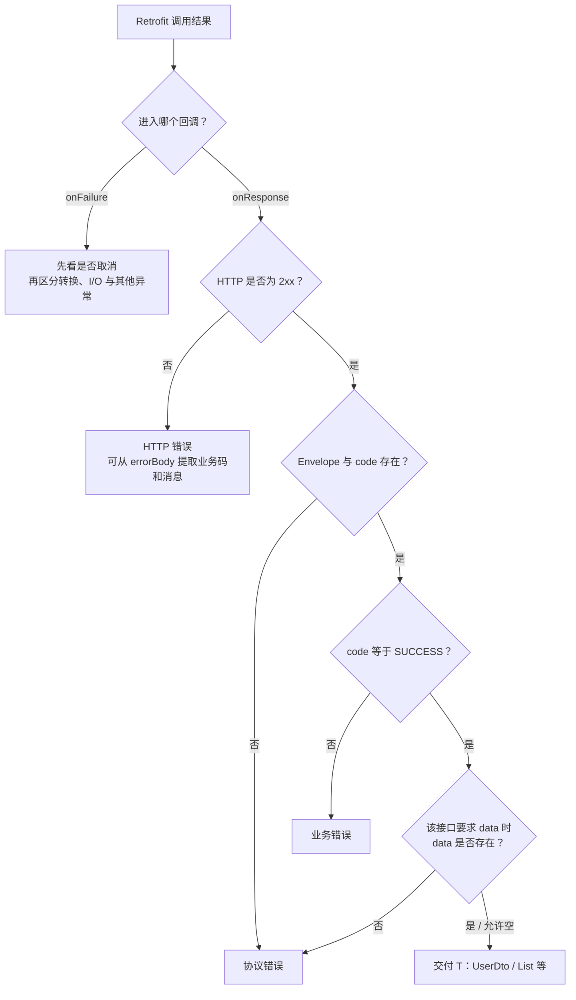

| 情况 | 归属 | 为什么 |
| --- | --- | --- |
| HTTP 200，业务 code 不等于 SUCCESS | BUSINESS | HTTP 请求成功不代表业务被接受 |
| HTTP 401 / 500，错误体恰好是 JSON | HTTP，可附带业务码 | HTTP 层失败仍是首要事实；成功响应 Converter 不会自动解析它 |
| HTTP 204 / 205 | 看接口契约 | Retrofit 通常交付空 Body；本例要求 Envelope，因此判为 PROTOCOL；无返回值接口应独立声明 `Call<Void>` |
| JSON 类型不匹配或转换失败 | CONVERSION 等异常 | onFailure 不只表示断网，转换器也能触发它 |
| 用户取消 | CANCELED | 不应展示成服务器故障或无条件自动重试 |

### 泛型方法到底保留了什么

```java
// 泛型方法签名，完整实现见下方。
public static <T> retrofit2.Call<ApiEnvelope<T>> enqueue(
        retrofit2.Call<ApiEnvelope<T>> call,
        boolean requireData,
        com.google.gson.Gson gson,
        ApiListener<T> listener)
```

调用 `enqueue(api.user(7), ...)` 时 T 推导为 UserDto；传入 `api.users()` 时 T 为 List&lt;UserDto&gt;。**泛型方法复用解包逻辑，具体接口声明提供转换所需的运行时 Type；两者缺一不可。**

**ApiListener.java**

```java
package com.example.network;

public interface ApiListener<T> {
    void onSuccess(T data);
    void onError(ApiError error);
}
```

::: details 错误模型：ApiError.java
**ApiError.java**

```java
package com.example.network;

public final class ApiError {
    public enum Kind { HTTP, BUSINESS, PROTOCOL, NETWORK, CONVERSION, CANCELED, UNKNOWN }
    public final Kind kind;
    public final Integer httpCode;     // 当前分支拿不到 Retrofit Response 时为 null。
    public final Integer businessCode; // 未拿到有效业务 Code 时为 null。
    public final String message;
    public final Throwable cause;

    public ApiError(Kind kind, Integer httpCode, Integer businessCode,
                    String message, Throwable cause) {
        this.kind = kind;
        this.httpCode = httpCode;
        this.businessCode = businessCode;
        this.message = message;
        this.cause = cause;
    }
}
```
:::

### 核心封装：ApiRequests.java

**ApiRequests.java**

```java
package com.example.network;

import java.io.IOException;
import com.google.gson.Gson;
import com.google.gson.JsonParseException;
import com.google.gson.stream.MalformedJsonException;
import okhttp3.ResponseBody;
import retrofit2.Call;
import retrofit2.Callback;
import retrofit2.Response;

public final class ApiRequests {
    private ApiRequests() {}

    // T 来自 UserApi 的具体声明，不能把它替换成 Object 或原始 Call。
    public static <T> Call<ApiEnvelope<T>> enqueue(
            Call<ApiEnvelope<T>> call, boolean requireData,
            Gson gson, ApiListener<T> listener) {
        call.enqueue(new Callback<ApiEnvelope<T>>() {
            @Override public void onResponse(Call<ApiEnvelope<T>> current,
                                              Response<ApiEnvelope<T>> response) {
                if (current.isCanceled()) {
                    listener.onError(new ApiError(ApiError.Kind.CANCELED,
                            null, null, "请求已取消", null));
                    return;
                }
                if (!response.isSuccessful()) {
                    // 非 2xx 不经过成功响应转换器；不能从 response.body() 取错误 JSON。
                    Integer businessCode = null;
                    String message = "HTTP " + response.code();
                    try (ResponseBody body = response.errorBody()) {
                        if (body != null) {
                            ErrorEnvelope error = gson.fromJson(body.charStream(), ErrorEnvelope.class);
                            if (error != null) {
                                businessCode = error.code;
                                if (error.message != null) message = error.message;
                            }
                        }
                    } catch (RuntimeException ignored) {
                        // 错误体可能是 HTML 或格式不符；仍保留首要的 HTTP 错误。
                    }
                    listener.onError(new ApiError(ApiError.Kind.HTTP,
                            response.code(), businessCode, message, null));
                    return;
                }
                ApiEnvelope<T> envelope = response.body();
                if (envelope == null || envelope.code == null) {
                    listener.onError(new ApiError(ApiError.Kind.PROTOCOL,
                            response.code(), null, "缺少业务响应或 code", null));
                    return;
                }
                if (envelope.code != ApiEnvelope.SUCCESS) {
                    listener.onError(new ApiError(ApiError.Kind.BUSINESS,
                            response.code(), envelope.code, envelope.message, null));
                    return;
                }
                if (requireData && envelope.data == null) {
                    listener.onError(new ApiError(ApiError.Kind.PROTOCOL,
                            response.code(), envelope.code, "成功响应缺少 data", null));
                    return;
                }
                listener.onSuccess(envelope.data);
            }

            @Override public void onFailure(Call<ApiEnvelope<T>> current, Throwable error) {
                ApiError.Kind kind;
                if (current.isCanceled()) kind = ApiError.Kind.CANCELED;
                else if (error instanceof JsonParseException || error instanceof MalformedJsonException)
                    kind = ApiError.Kind.CONVERSION;
                else if (error instanceof IOException) kind = ApiError.Kind.NETWORK;
                else kind = ApiError.Kind.UNKNOWN;
                listener.onError(new ApiError(kind, null, null, error.getMessage(), error));
            }
        });
        return call;
    }

    // 错误体只关心 code/message，不假定它与成功响应的 data 类型一致。
    private static final class ErrorEnvelope {
        @com.google.gson.annotations.SerializedName("code") Integer code;
        @com.google.gson.annotations.SerializedName("message") String message;
    }
}
```

实现先看 HTTP 状态，再看 Envelope 和业务码；非 2xx 的 errorBody 只尝试读 code / message，并保证关闭。错误体可能是 HTML，解析失败也不能覆盖原来的 HTTP 状态。异常分类是客户端策略，不是通过异常类型就能还原所有服务端执行结果。

`requireData` 只检查顶层 data 是否存在，不验证 UserDto 的每个字段；正式业务还要在 DTO 转领域对象时验证必填字段、取值范围和枚举值。服务端错误体也应限制大小，本示例不用于无界下载或超大错误响应。

### Repository：同一套封装接住 Bean 和 Bean 列表

**UserRepository.java**

```java
package com.example.network;

import java.util.List;
import retrofit2.Call;

public final class UserRepository {
    private final Network network;
    public UserRepository(Network network) { this.network = network; }

    public Call<ApiEnvelope<UserDto>> user(long id, ApiListener<UserDto> listener) {
        return ApiRequests.enqueue(network.users.user(id), true, network.gson, listener);
    }

    public Call<ApiEnvelope<List<UserDto>>> users(ApiListener<List<UserDto>> listener) {
        return ApiRequests.enqueue(network.users.users(), true, network.gson, listener);
    }
}
```

```java
// repository 为共享 UserRepository；同一方法支持不同的 T。
repository.users(new ApiListener<java.util.List<UserDto>>() {
    @Override public void onSuccess(java.util.List<UserDto> users) {
        // users.get(0) 已是 UserDto，不需要从 Map 再转换。
        for (UserDto user : users) System.out.println(user.displayName);
    }
    @Override public void onError(ApiError error) {
        // 根据 kind 决定提示、登录失效处理或业务回退，不要一律重试。
    }
});
```

无 data 的业务操作可使用 `ApiEnvelope<Void>` 并传 `requireData = false`；这仍要求响应中有合法 Envelope。真正的 HTTP 204 没有 JSON，应另用 `Call<Void>` 与对应处理方式，不能强行共用本封装。

### 为什么 Retrofit 能解析 List，而 Gson.fromJson(..., ApiEnvelope.class) 不行

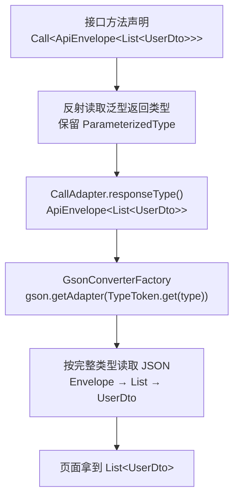

Java 泛型擦除不代表反射看不到接口声明中的泛型签名。Retrofit 从方法声明取得完整 Type，再把它交给 Converter；它不是靠页面变量的 `List<UserDto>` 声明猜测元素类型。

```java
// GsonConverterFactory.responseBodyConverter() 核心原文。
TypeAdapter<?> adapter = gson.getAdapter(TypeToken.get(type));
return new GsonResponseBodyConverter<>(gson, adapter);
```

转换器按该 Adapter 读取 JSON，并在 finally 关闭 ResponseBody：[HttpServiceMethod 的 responseType](https://github.com/lysine-dev/retrofit/blob/3.0.0/retrofit/src/main/java/retrofit2/HttpServiceMethod.java#L79-L97)、[GsonConverterFactory](https://github.com/lysine-dev/retrofit/blob/3.0.0/retrofit-converters/gson/src/main/java/retrofit2/converter/gson/GsonConverterFactory.java#L76-L82)、[GsonResponseBodyConverter](https://github.com/lysine-dev/retrofit/blob/3.0.0/retrofit-converters/gson/src/main/java/retrofit2/converter/gson/GsonResponseBodyConverter.java#L36-L48)。

HTTP 非 2xx 和 204 / 205 的分支见 [OkHttpCall.parseResponse](https://github.com/lysine-dev/retrofit/blob/3.0.0/retrofit/src/main/java/retrofit2/OkHttpCall.java#L218-L254)。

手动解析时，也必须提供完整类型：

```java
com.google.gson.reflect.TypeToken<ApiEnvelope<java.util.List<UserDto>>> type =
        new com.google.gson.reflect.TypeToken<ApiEnvelope<java.util.List<UserDto>>>() {};
ApiEnvelope<java.util.List<UserDto>> envelope = gson.fromJson(json, type);

// 错误思路：gson.fromJson(json, ApiEnvelope.class)
// 它只知道外层类，data 里的对象通常成为 Map，而不是 UserDto。
```

**不要在普通泛型方法里写 `new TypeToken<ApiEnvelope<T>>() {}` 期待找回 T。** 方法中的 T 已被擦除，应由调用方传入具体 TypeToken / Type。也不要声明 `<T> Call<ApiEnvelope<T>> request()` 让 Retrofit 凭空猜 DTO；接口返回类型必须能解析。[Gson 泛型与类型擦除排错](https://github.com/google/gson/blob/main/Troubleshooting.md#classcastexception-when-using-deserialized-object)

### 集成后必须检查的几个边界

- **字段映射**：`@SerializedName` 处理命名差异，不负责验证必填字段；缺失引用字段通常为 null，未知字段通常被忽略。
- **错误契约**：有些后端用字符串 code、有些用数字，有些用其他成功值；按实际协议调整 DTO 和 SUCCESS，不能同时假设 0 与 200 都成功。
- **转换器顺序**：按需要添加 Converter；通用 Gson 转换器会接收很多类型，不要把它随意放在专用转换器前面。
- **R8 / Release**：核对 Retrofit、Gson 随版本附带的规则；保留反射需要的泛型签名与 DTO 映射信息，并在开启混淆的包中验证真实响应。不要用全项目 keep 掩盖问题。
- **业务与传输分工**：登录失效、错误提示和重试策略由业务层决定；HTTP 拦截器不应偷读并消耗所有接口的 JSON Body。

## 7. 一次请求怎样走完 {#call-lifecycle}

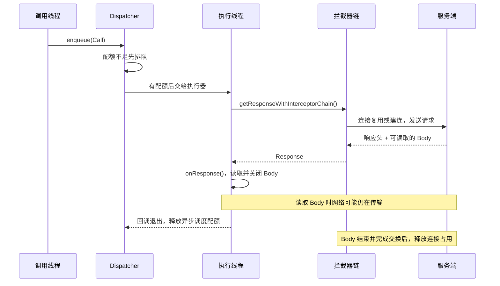

上图按“回调中读完 Body”的常见写法展开。若把 Body 移交另一线程，回调可以先退出，但连接仍可能被占用。**调度完成、响应体完成、连接释放，是不同事件。**

### execute 与 enqueue 到底差在哪里

| 比较点 | `execute()` | `enqueue()` |
| --- | --- | --- |
| 谁执行拦截器与阻塞 I/O | 调用线程 | Dispatcher 的执行器线程 |
| 是否自动切线程 | 不会 | 会，普通回调也在该线程执行 |
| Dispatcher 并发配额 | 记录同步调用，不受异步配额限制 | 先排队，再按全局与主机配额执行 |
| 获取响应的方式 | 返回 Response 或抛 IOException | `onResponse` / `onFailure` |

源码的分界很直接：[RealCall.kt，execute / enqueue，182–200 行](https://github.com/lysine-dev/okhttp/blob/parent-5.5.1/okhttp/src/commonJvmAndroid/kotlin/okhttp3/internal/connection/RealCall.kt#L182-L200)。

```kotlin
// RealCall.execute() 摘录，省略一次性执行检查与 finally。
timeout.enter()
callStart()
client.dispatcher.executed(this) // 记录当前同步调用，不负责换线程。
return getResponseWithInterceptorChain()

// RealCall.enqueue() 摘录：包装成 AsyncCall 后交给调度器。
callStart()
client.dispatcher.enqueue(AsyncCall(responseCallback))
```

### Dispatcher：限制正在执行的异步调用

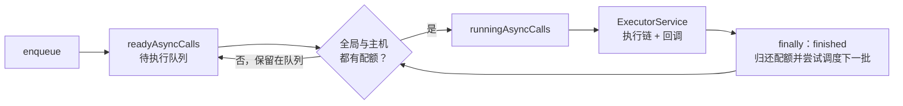

在该版本中，默认 `maxRequests = 64`、`maxRequestsPerHost = 5`。它们限制普通异步调用的执行数量，**不是线程池固定大小，也不是最多只能建立五条连接**。同一主机的 HTTP/2 请求也仍受异步调度配额限制；WebSocket 不计入这里的每主机限制。[Dispatcher.kt，53–73、223–234 行](https://github.com/lysine-dev/okhttp/blob/parent-5.5.1/okhttp/src/commonJvmAndroid/kotlin/okhttp3/Dispatcher.kt#L53-L73)

慢回调会长期占用调度配额；大量排队请求也会占内存。先减少重复请求、按页面取消过时调用，再依据实测调整并发。不要为了“加速”直接把配额调到很大。

## 8. 拦截器链：请求向内走，响应向外返回 {#interceptors}

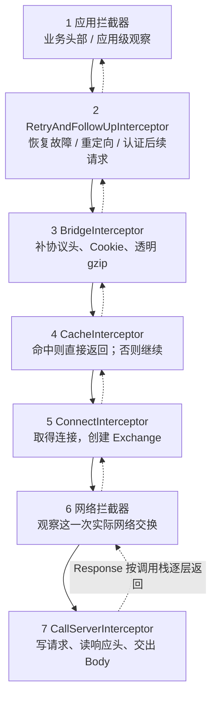

**实线表示调用下一层，虚线表示 Response 返回。** 完整缓存命中在第 4 层就返回，不会走到建连与网络拦截器。重定向则由第 2 层发起下一轮，重新经过后续处理。

源码按这个顺序组装列表：[RealCall.getResponseWithInterceptorChain，211–221 行](https://github.com/lysine-dev/okhttp/blob/parent-5.5.1/okhttp/src/commonJvmAndroid/kotlin/okhttp3/internal/connection/RealCall.kt#L211-L221)。

```kotlin
// 原文摘录；中文注释用于说明位置。
interceptors += client.interceptors
interceptors += RetryAndFollowUpInterceptor()
interceptors += BridgeInterceptor()
interceptors += CacheInterceptor()
interceptors += ConnectInterceptor
if (!forWebSocket) {
  interceptors += client.networkInterceptors
}
interceptors += CallServerInterceptor
```

### proceed 如何把它们串起来

```kotlin
// RealInterceptorChain.proceed()，核心摘录，省略前后校验。
val next = copy(index = index + 1, request = request)
val interceptor = interceptors[index]
val response =
  interceptor.intercept(next) ?: throw NullPointerException(
    "interceptor $interceptor returned null",
  )
```

传给当前拦截器的是 **index 已加一的 Chain**。当前拦截器调用 `chain.proceed()`，就进入下一个拦截器；下一层返回后，当前层还可以继续处理响应。这是嵌套函数调用，不是把 Request 丢到七条线程依次处理。[RealInterceptorChain.proceed，312–342 行](https://github.com/lysine-dev/okhttp/blob/parent-5.5.1/okhttp/src/commonJvmAndroid/kotlin/okhttp3/internal/http/RealInterceptorChain.kt#L312-L342)

| 比较点 | 应用拦截器 `addInterceptor` | 网络拦截器 `addNetworkInterceptor` |
| --- | --- | --- |
| 完整缓存命中 | 执行 | 不执行 |
| 自动重定向 / 恢复重试 | 正常链路通常只进入一次，看到最终结果 | 每次实际进入网络交换都可能执行 |
| 看到的头部 | 更接近原始业务请求和最终响应 | 能看到 Bridge 补充的协议头与网络响应 |
| `chain.connection()` | 此时通常尚未取得连接 | 能访问当前连接 |
| `proceed()` 约束 | 可短路；多次调用前必须关闭上次 Body | 必须恰好一次，且保留目标 host 和 port |

### 实用示例：添加请求 ID，不偷读响应体

```java
import java.util.UUID;
import okhttp3.Interceptor;

Interceptor requestId = chain -> {
    Request request = chain.request().newBuilder()
            .header("X-Request-Id", UUID.randomUUID().toString())
            .build();
    return chain.proceed(request); // Body 仍交给调用方消费。
};
// 创建客户端时：new OkHttpClient.Builder().addInterceptor(requestId).build();
```

不要在日志拦截器里直接 `response.body().string()` 后原样返回：Body 已被消费，业务层就读不到了。需要日志时使用官方 logging-interceptor，控制级别并脱敏 Authorization、Cookie 等；生产环境避免输出完整敏感载荷。网络拦截器也不适合改写到另一个域名。[拦截器使用规则](https://lysine.dev/okhttp/features/interceptors/)

## 9. 连接池：复用什么，什么时候归还 {#connections}

### Call、Exchange、Connection 不是一一对应

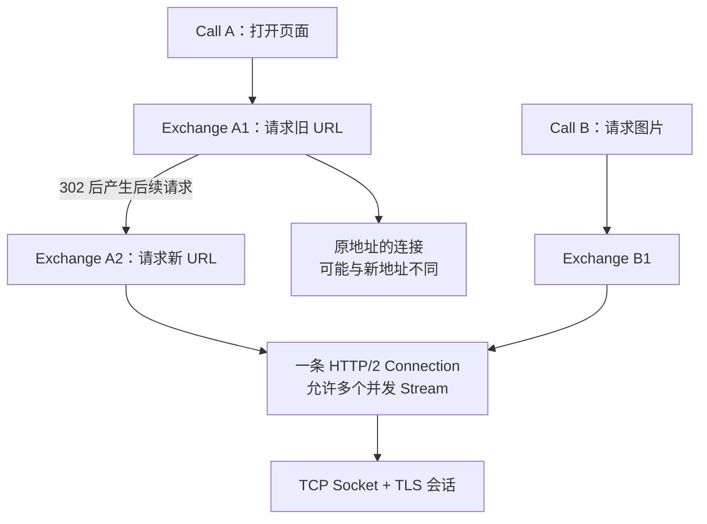

一个 Call 可能包含多轮交换；多轮交换不一定新建连接。HTTP/2 的多个 Stream 可以共享一条连接，每个响应仍有自己的 Body，需要分别消费和关闭。

### 从连接选择走到底层 I/O

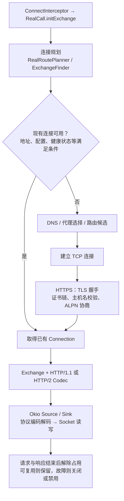

图中是常见 HTTPS 路径，HTTP 跳过 TLS，HTTPS 经 HTTP 代理还可能先建立 CONNECT 隧道。实现会在连接规划过程中再次检查池，避免并发建连产生不必要的重复连接。

`ConnectInterceptor` 的核心仅三步：`initExchange()`、把 Exchange 放入下一层 Chain、继续 `proceed()`。[ConnectInterceptor.kt，29–36 行](https://github.com/lysine-dev/okhttp/blob/parent-5.5.1/okhttp/src/commonJvmAndroid/kotlin/okhttp3/internal/connection/ConnectInterceptor.kt#L29-L36)

`RealCall` 创建 `RealRoutePlanner` 后，根据 `fastFallback` 选择 `FastFallbackExchangeFinder` 或 `SequentialExchangeFinder`。

5.x 默认支持快速回退：让不同 IP 候选的 TCP 尝试按间隔竞争，保留先成功的连接，再在胜出连接上进行 TLS；不是把同一笔业务同时发送给多个服务器。[连接规划源码](https://github.com/lysine-dev/okhttp/blob/parent-5.5.1/okhttp/src/commonJvmAndroid/kotlin/okhttp3/internal/connection/RealCall.kt#L273-L295)、[Fast Fallback](https://lysine.dev/okhttp/features/connections/#fast-fallback)

5.5 的 DNS 同时保留 `lookup(hostname)` 兼容入口，并引入可取消、流式返回记录的 `Dns.Call`。理解 DNS 的作用即可，不要把旧文章中“所有 DNS 都在调用线程同步 lookup”的描述套到所有新实现。[Dns.kt](https://github.com/lysine-dev/okhttp/blob/parent-5.5.1/okhttp/src/commonJvmAndroid/kotlin/okhttp3/Dns.kt#L42-L83)

### 两个容易记错的数值

默认连接池保留最多 **5 条空闲连接**，空闲保活时间 **5 分钟**。这不是“所有活跃连接最多五条”，也不是 TCP 每五分钟强制断开。连接能否复用还取决于协议、服务端关闭、健康状态、HTTP/2 Stream 配额等。[ConnectionPool.kt，26–50 行](https://github.com/lysine-dev/okhttp/blob/parent-5.5.1/okhttp/src/commonJvmAndroid/kotlin/okhttp3/ConnectionPool.kt#L26-L50)

**关闭 Body 是解除资源占用，不是承诺一定保住 TCP 连接。** HTTP/1.1 未读完的响应可能需要短暂丢弃剩余字节，失败时连接就不能继续复用。HTTP/2 则可取消某个 Stream，不必每次关闭整条连接。`string()` 已消费并关闭流，但仍建议统一使用 try-with-resources，覆盖异常和提前返回路径。[ResponseBody 的资源约定](https://github.com/lysine-dev/okhttp/blob/parent-5.5.1/okhttp/src/commonJvmAndroid/kotlin/okhttp3/ResponseBody.kt)

HTTP/2 可以减少重复握手，但多个 Stream 仍共享 TCP、带宽与流控；TCP 丢包也可能拖慢多个请求，不能理解成完全互不影响的独立通道。

## 10. HTTP 缓存：有磁盘，不代表一定命中 {#cache}

缓存默认关闭，示例通过 `Cache` 显式启用。缓存是否可用由请求、响应的 HTTP 语义共同决定，磁盘大小只是容量上限。

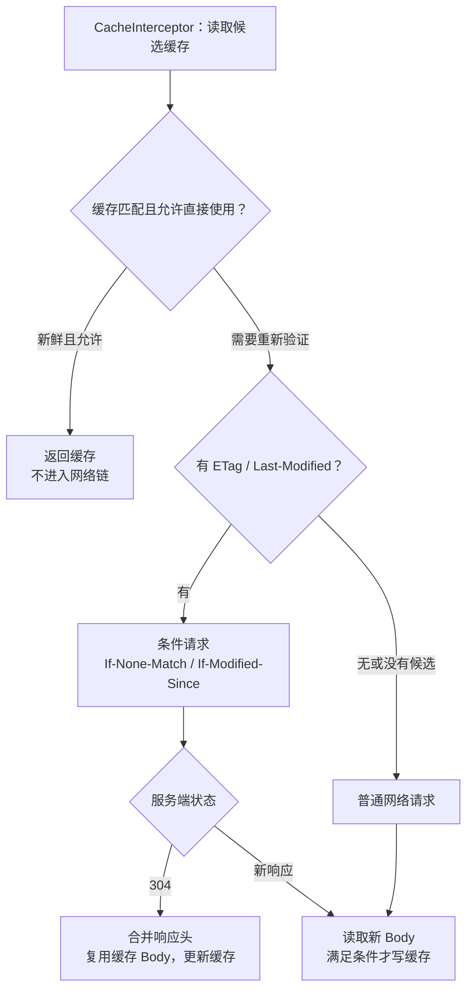

| 指令 / 条件 | 真实含义 | 常见误解 |
| --- | --- | --- |
| `Cache-Control: max-age=60` | 在其他条件允许时，60 秒内可以使用新鲜缓存 | 不是给客户端配置磁盘后，所有请求都缓存 60 秒 |
| `no-cache` | 允许保存，但使用前需验证 | 不是完全不存储 |
| `no-store` | 不应存储这次请求或响应 | 不能靠强行改响应头把敏感数据缓存下来 |
| `Vary` | 影响缓存匹配的请求头也必须相符 | URL 相同不保证命中 |
| `only-if-cached` | 只接受满足要求的缓存，否则返回 504 | 不是自动接受任意陈旧缓存 |

条件命中时，应用常见的是缓存的成功状态，例如 **200**；`response.networkResponse().code()` 才是 **304**。此时 `cacheResponse()` 和 `networkResponse()` 都不为空；纯缓存命中没有 networkResponse。[CacheInterceptor，107–125 行](https://github.com/lysine-dev/okhttp/blob/parent-5.5.1/okhttp/src/commonJvmAndroid/kotlin/okhttp3/internal/cache/CacheInterceptor.kt#L107-L125)

```java
// 调试缓存来源：在拥有 Response 的 try 块里执行。
boolean usedCache = response.cacheResponse() != null;
boolean usedNetwork = response.networkResponse() != null;
// 两者都为 true：可能是条件请求验证后复用缓存。

// 下拉刷新：要求向服务端验证，仍可复用 304 对应的缓存 Body。
Request refresh = new Request.Builder().url(url)
        .cacheControl(new okhttp3.CacheControl.Builder().noCache().build())
        .build();
```

缓存响应体随读取写入磁盘；未完整消费可能无法完成缓存写入。不要只读响应头就认为缓存已经落盘。[官方缓存说明](https://lysine.dev/okhttp/features/caching/)

账户切换时尤其要小心：**HTTP 私有缓存不等于按登录用户分区的数据库**。同 URL 的个性化内容必须有正确的服务端缓存策略，客户端也要明确清理或隔离账户数据；不能假定 Authorization 或 Cookie 自动成为缓存键。

## 11. 超时、取消、重试：失败不等于服务端没执行 {#reliability}

### 四种超时分别管什么

| 设置 | 控制范围 | 该版本默认值 |
| --- | --- | --- |
| `connectTimeout` | 连接建立阶段的 Socket 连接尝试 | 10 秒 |
| `readTimeout` | 单次读取 / 读取等待的超时约束 | 10 秒 |
| `writeTimeout` | 单次写入 / 写入等待的超时约束 | 10 秒 |
| `callTimeout` | 调用执行的整体预算，含重定向、重试和 Body 读取 | 0，即不启用整体超时 |

这些是客户端默认值，不是服务端 SLA。TLS 等过程也会涉及读写等待，不能把连接超时当成整个 HTTPS 请求的总时限。[OkHttpClient.Builder 默认字段，615–618 行](https://github.com/lysine-dev/okhttp/blob/parent-5.5.1/okhttp/src/commonJvmAndroid/kotlin/okhttp3/OkHttpClient.kt#L615-L618)

::: warning 异步排队时间不在 callTimeout 计时起点内
该版本 `execute()` 进入执行时启动计时；异步则在 `AsyncCall.run()` 中才调用 `timeout.enter()`。所以“设置 30 秒 callTimeout”不能保证 enqueue 后 30 秒内返回结果。

页面级总期限还要覆盖排队等待，并在超期时取消 Call。[RealCall.AsyncCall.run，577–605 行](https://github.com/lysine-dev/okhttp/blob/parent-5.5.1/okhttp/src/commonJvmAndroid/kotlin/okhttp3/internal/connection/RealCall.kt#L577-L605)
:::

### 取消能做什么

```java
Call call = http.get("https://example.com/", result); // http 为共享 NoteHttp。
// 页面不再需要本次结果时：
call.cancel();
```

取消会尽力终止进行中的交换，但存在竞态：结果可能已经生成，服务端也可能已经完成写入。页面层仍需检查请求是否过期、页面是否有效；取消不会回滚服务端，更不能当成“撤销订单”。

### 自动重试不是业务幂等保证

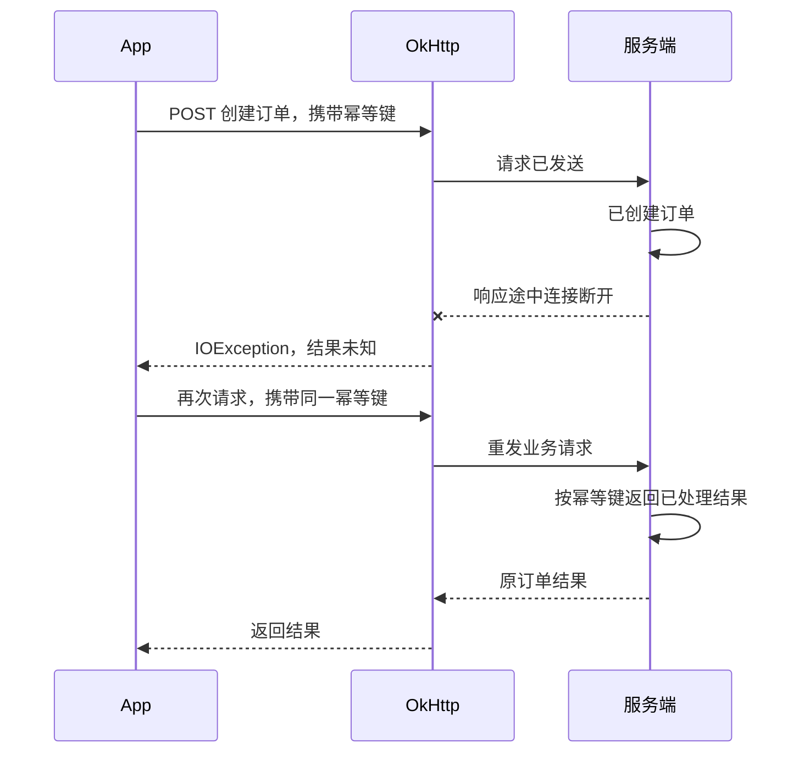

重试逻辑会检查策略是否允许、请求体能否重放、异常是否可恢复、是否还有可用路由。它没有“POST 一定不重试”的简单规则，也无法判断服务端业务是否已提交。[RetryAndFollowUpInterceptor.recover，133–163 行](https://github.com/lysine-dev/okhttp/blob/parent-5.5.1/okhttp/src/commonJvmAndroid/kotlin/okhttp3/internal/http/RetryAndFollowUpInterceptor.kt#L133-L163)

订单、支付等操作应由服务端实现幂等键与去重。`retryOnConnectionFailure(false)` 只改变连接故障恢复策略，不会自动关闭重定向、认证后续请求，更不能解决“响应丢失、执行结果未知”。一次性上传流要正确声明 `RequestBody.isOneShot()`，不能假设它可被无损重放。

## 12. 认证、TLS 与 Android 集成 {#integration}

### 401 之后，Authenticator 做什么

Cookie 会话与 Token 认证要分别配置。默认 `CookieJar.NO_COOKIES` 不保存也不发送 Cookie；需要会话保持时实现或接入线程安全的 CookieJar，处理域名、路径、有效期与账号切换，不能只把一个 Cookie 字符串发送给所有地址。[CookieJar 默认行为](https://github.com/lysine-dev/okhttp/blob/parent-5.5.1/okhttp/src/commonJvmAndroid/kotlin/okhttp3/OkHttpClient.kt#L800-L809)

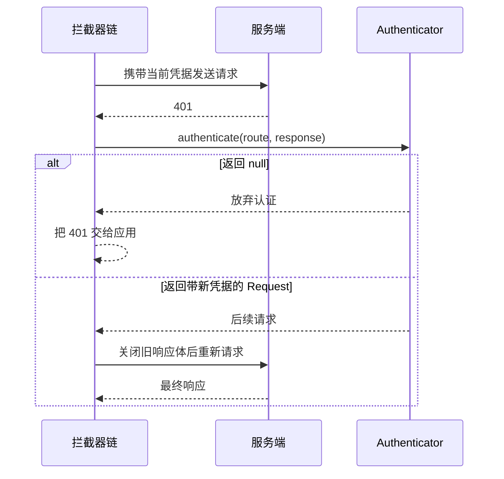

Authenticator 返回新 Request，OkHttp 才会继续尝试；返回 `null` 表示不再尝试。[Authenticator 接口约定](https://github.com/lysine-dev/okhttp/blob/parent-5.5.1/okhttp/src/commonJvmAndroid/kotlin/okhttp3/Authenticator.kt)

Token 刷新需要处理三件事：**限制尝试次数、合并并发刷新、避免调度死锁**。如果多个调用都在 Authenticator 中阻塞等待，而刷新请求又通过同一套已被占满的异步调度器排队，刷新就可能无法执行。可以设计独立的刷新客户端与受控同步刷新路径，或把刷新状态机上移；刷新客户端不能再装回同一个刷新 Authenticator。

不要在每次 401 时无限返回同一份失败凭据；也不要把库对后续请求次数的上限，当成自己的业务重试策略。凭据添加还应限定目标域名，避免业务拦截器把 Token 发给不相关地址。

### HTTPS 检查的是两件不同的事

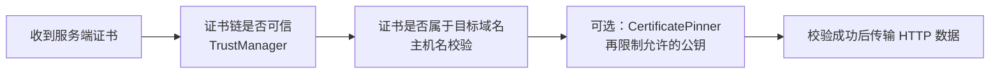

保留平台默认信任校验与主机名校验。调试环境使用 Android Network Security Configuration 的域名配置或 `debug-overrides`，不要用信任所有证书、始终返回 true 的 HostnameVerifier 来修复 TLS 报错。

证书固定会增加轮换和应急替换的成本，使用前需要备用 Pin 与证书更新计划。Android 面向 API 28+ 的应用默认限制明文 HTTP；确需测试 HTTP 时限定具体调试域名，不要全局放开。[Android 网络安全配置](https://developer.android.com/privacy-and-security/security-config)、[OkHttp HTTPS](https://lysine.dev/okhttp/features/https/)

### 和 Android 生命周期的交界

页面层持有当前 Call，在离开页面且不再需要结果时取消；回调更新 UI 前切主线程并核对当前页面状态。不要让长期存活的网络回调无期限持有 Activity。

OkHttp 自身不是持久后台任务调度器。需要进程重启后继续、等待网络条件或由系统安排重试的工作，应由 WorkManager 等调度请求；底层 HTTP 传输仍可使用 OkHttp。使用协程封装时，必须显式把协程取消传播到 `Call.cancel()`，并处理取消与 Response 到达之间的资源释放竞态。

## 13. 它的短板与排查重点 {#limits}

| 边界或短板 | 会出现什么问题 | 实际处理方式 |
| --- | --- | --- |
| 提供 HTTP 传输，不提供完整业务网络层 | JSON 解析、统一错误、UI 状态仍需自己组织 | Repository 中集中封装；需要接口声明时叠加 Retrofit |
| 普通读写仍是阻塞 I/O | 异步不等于没有线程成本，慢回调会积压 | 控制并发，避免回调承担长时间 CPU 工作 |
| Body 是流，不是可反复读取的内存对象 | 重复 string()、日志偷读、忘记关闭 | 明确唯一消费者，统一关闭；大数据流式处理 |
| 缓存遵循 HTTP，不是离线数据库 | 内容不一定可缓存，也不按账号自动隔离 | 服务端配置缓存语义；结构化离线数据使用数据库 |
| 自动恢复无法保证业务只执行一次 | 连接失败时可能重复提交 | 服务端幂等、查询执行结果、限制业务重试 |
| 遵循协议且配置有边界 | 不能给 GET 塞 Body，也不能任意替换内置 Cache 实现 | 修改接口设计，特殊协议需求单独评估 |
| 网络库升级也涉及运行环境与依赖 | 旧平台、TLS、自定义扩展可能不兼容 | 升级前核对最低要求，统一 BOM，避免依赖 internal 包 |

### 用 EventListener 定位慢在哪一段

**Interceptors 适合改请求和响应，EventListener 适合观察阶段耗时。** 请求缓存命中或复用连接时，DNS / 建连事件可能完全不发生，不能假设每次调用都有同一套事件。

```java
// 加入已有的 OkHttpClient.Builder；每个 Call 单独创建监听器。
.eventListenerFactory(call -> new okhttp3.EventListener() {
    private long start;
    @Override public void callStart(Call call) {
        start = System.nanoTime();
    }
    @Override public void callEnd(Call call) {
        record("complete", System.nanoTime() - start);
    }
    @Override public void callFailed(Call call, IOException error) {
        record("failed", System.nanoTime() - start);
    }
    private void record(String stage, long nanos) {
        System.out.println(stage + " elapsedMs=" + nanos / 1_000_000);
    }
})
```

继续覆盖 `dnsStart/End`、`connectStart/End`、`secureConnectStart/End`、`responseHeadersStart/End` 和 `responseBodyStart/End`，区分解析慢、建连慢、服务端等待慢和下载慢。

使用独立 Listener 是为了避免并发调用把时间戳互相覆盖；异步排队耗时还需在提交前另外记录。[EventListener 与每 Call 工厂](https://lysine.dev/okhttp/features/events/)

| 现象 | 先核对什么 |
| --- | --- |
| HTTP 404 却没有 onFailure | 状态码不是传输失败，查看 onResponse 中的 code |
| onResponse 很快，界面仍很慢 | Body 读取、解析与 UI 切换耗时；回调只是响应可读 |
| 并发后请求一直排队 | Dispatcher 配额、回调是否阻塞、是否有互相等待的刷新请求 |
| 连接越来越多、资源泄漏警告 | ResponseBody 是否在异常、取消、提前返回时关闭 |
| 开了 Cache 还是每次访问网络 | no-store、Vary、新鲜度、是否读完 Body；304 也属于访问网络 |
| 偶发重复提交 | 是否存在自动恢复或业务重试，服务端是否具备幂等 |

## 14. 对照源码时从这些入口读 {#source-map}

所有实现链接固定在 **5.5.1**，避免把旧版 `StreamAllocation` 的调用图与本篇混用。应用代码只依赖公开 API，`internal` 类仅用于阅读。

| 阅读问题 | 源码入口 |
| --- | --- |
| 谁创建 Call、默认策略是什么 | [OkHttpClient.kt](https://github.com/lysine-dev/okhttp/blob/parent-5.5.1/okhttp/src/commonJvmAndroid/kotlin/okhttp3/OkHttpClient.kt) |
| 请求何时执行、何时结束 | [RealCall.kt](https://github.com/lysine-dev/okhttp/blob/parent-5.5.1/okhttp/src/commonJvmAndroid/kotlin/okhttp3/internal/connection/RealCall.kt) |
| 异步队列如何晋升 | [Dispatcher.kt](https://github.com/lysine-dev/okhttp/blob/parent-5.5.1/okhttp/src/commonJvmAndroid/kotlin/okhttp3/Dispatcher.kt) |
| proceed 为什么进入下一层 | [RealInterceptorChain.kt](https://github.com/lysine-dev/okhttp/blob/parent-5.5.1/okhttp/src/commonJvmAndroid/kotlin/okhttp3/internal/http/RealInterceptorChain.kt) |
| 重试与后续请求如何决定 | [RetryAndFollowUpInterceptor.kt](https://github.com/lysine-dev/okhttp/blob/parent-5.5.1/okhttp/src/commonJvmAndroid/kotlin/okhttp3/internal/http/RetryAndFollowUpInterceptor.kt) |
| 透明 gzip、Cookie 在哪处理 | [BridgeInterceptor.kt](https://github.com/lysine-dev/okhttp/blob/parent-5.5.1/okhttp/src/commonJvmAndroid/kotlin/okhttp3/internal/http/BridgeInterceptor.kt) |
| 缓存如何命中、304 如何合并 | [CacheInterceptor.kt](https://github.com/lysine-dev/okhttp/blob/parent-5.5.1/okhttp/src/commonJvmAndroid/kotlin/okhttp3/internal/cache/CacheInterceptor.kt) |
| 连接如何规划、保存和淘汰 | [RealRoutePlanner.kt](https://github.com/lysine-dev/okhttp/blob/parent-5.5.1/okhttp/src/commonJvmAndroid/kotlin/okhttp3/internal/connection/RealRoutePlanner.kt)、[RealConnectionPool.kt](https://github.com/lysine-dev/okhttp/blob/parent-5.5.1/okhttp/src/commonJvmAndroid/kotlin/okhttp3/internal/connection/RealConnectionPool.kt) |
| Body 完成如何回报并释放占用 | [Exchange.kt](https://github.com/lysine-dev/okhttp/blob/parent-5.5.1/okhttp/src/commonJvmAndroid/kotlin/okhttp3/internal/connection/Exchange.kt)、[ResponseBody.kt](https://github.com/lysine-dev/okhttp/blob/parent-5.5.1/okhttp/src/commonJvmAndroid/kotlin/okhttp3/ResponseBody.kt) |
