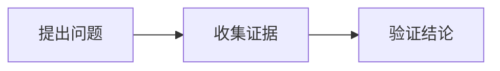

# 开始阅读

这里按主题组织知识，适合循序阅读，也适合在遇到具体问题时快速查阅。文章保留独立地址，可以直接在手机浏览器打开、收藏或分享。

## 找到需要的内容

- **按主题阅读**：桌面使用左侧分类导航；手机点击顶部菜单展开分类，选择文章后回到正文。
- **按问题查找**：打开搜索，输入中文关键词或 Android、Binder 等技术词。搜索覆盖知识库文章的标题与正文。
- **在文章内定位**：使用本文目录或标题旁的锚点，直接分享某个章节。
- **回看旧内容**：进入[历史博客](/legacy/index.html)，原来的文章与相册地址继续保留。

## 阅读图片与流程图

点击正文图片进入查看器，使用按钮缩放；桌面可以用键盘操作，按 Escape 关闭。流程图点击查看入口后可缩放、拖动、重置和全屏查看。手机上使用触控操作或缩放按钮，关闭查看器即可继续正常滚动文章。

可在 [App 网络请求抓包](/tools/app-network-capture.html)中查看代理链路图并使用缩放功能。图示用于解释文字，重要结论仍应在正文中写清楚。

## 增加一篇笔记

在对应分类目录添加 Markdown 文件，使用描述内容的短横线文件名，例如 `docs/tools/app-network-capture.md`。然后在 `docs/.vitepress/navigation.ts` 的 `knowledgeSections` 中登记标题与 `.html` 地址，首页和分类导航会共用这份配置。

建议先写明问题与适用范围，再整理原理、步骤、验证结果和参考资料。记录设备信息时注明实际查询方式；尚未验证的结论直接标为“待验证”，不要把示例当成实测。

```markdown
# 一句话说清具体问题

## 适用范围
系统、工具、输入与前提。

## 分析与验证
观察到什么，如何验证，证据在哪里。

## 参考资料
链接到实际使用的原始资料。
```

## 添加本地图片与图示

图片放进 `docs/public/media/<文章标识>/`，在正文用 `/media/<文章标识>/文件名.png` 等站内地址引用。写清 `alt`，便于图片加载失败或使用辅助阅读工具时理解内容。

````markdown



````

Mermaid 代码围栏会渲染成图示；语法错误时根据提示检查源码。建议控制单图复杂度，把完整分析拆成几个有文字说明的小图。

## 添加可下载附件

按文章标识管理文件，避免不同笔记出现同名附件冲突。以抓包笔记为例：

```text
docs/tools/app-network-capture.md
docs/public/attachments/app-network-capture/burp.yml
docs/public/media/app-network-capture/图片文件
```

附件放在 `docs/public/attachments/<文章标识>/`，配图放在 `docs/public/media/<文章标识>/`。构建时会复制到站点，下载无需登录原笔记平台；公开前检查配置中是否含有私人凭据。

在 Markdown 中插入下载卡片，`href` 从 `public` 内的目录开始写，`name` 指定保存文件名：

```vue
<AttachmentDownload
  href="/attachments/app-network-capture/burp.yml"
  name="burp.yml"
  description="导入前请核对服务地址与端口。"
/>
```

图片仍使用普通 Markdown 语法，例如 ``，自动支持点击放大。

## 本地预览

```sh
npm ci
npm run docs:dev
```

完成内容后运行 `npm run docs:build` 检查静态页面和站内链接，再用 `npm run docs:preview` 检查正式构建的阅读效果。
