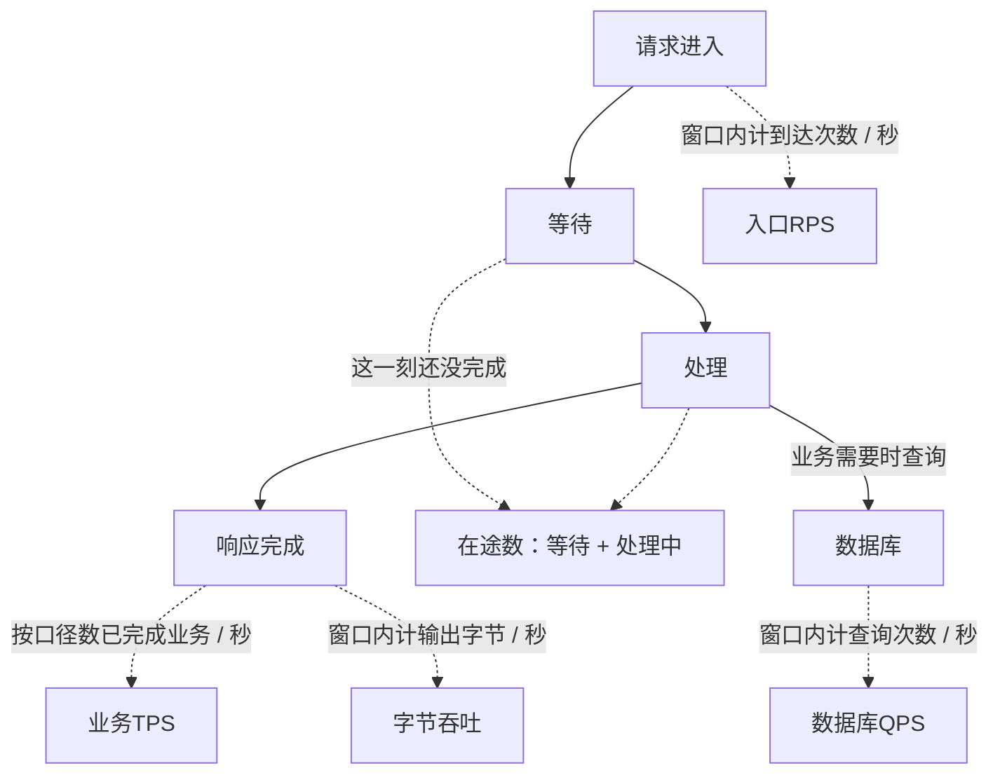
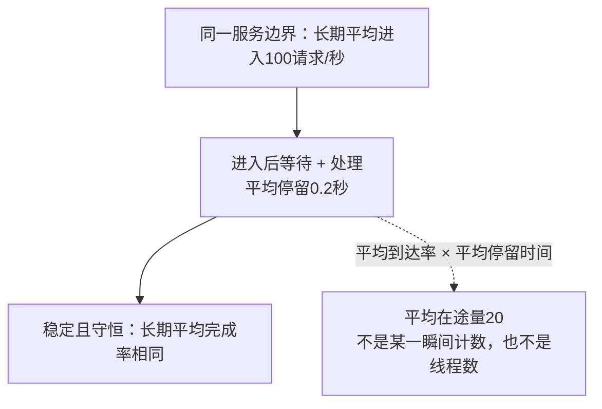
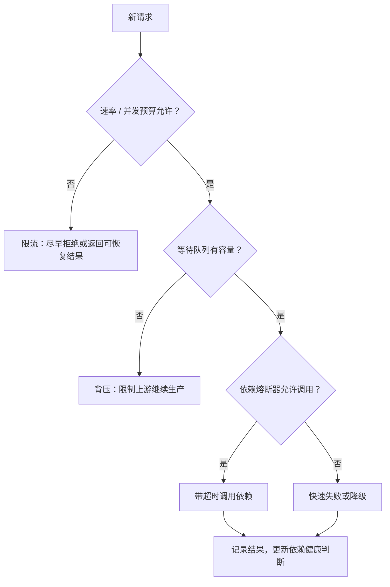
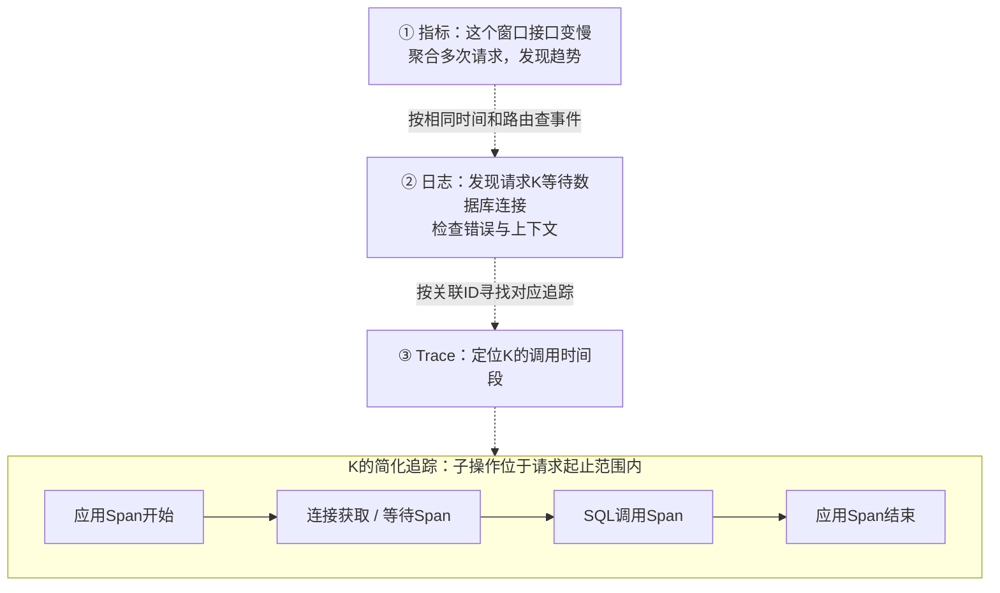

# 容量与可观测性：服务能处理多少，又怎样证明

打开笔记原来很快，人多以后开始转圈：是进来的请求更多，还是每个请求停留更久？**先看“数什么、等多久、失败多少”，再谈机器能扛多少 QPS。**

前置：[部署](./deployment.html)、[网络排障](./diagnostics.html)。下面的数字都是独立教学示例，不是本网站或某种服务器的实测容量。

## 1. QPS、RPS、TPS、并发分别数什么

把服务想成办事窗口：门口数进入的人，室内数还没办完的人，账本数完成的业务。它们对应不同指标；真实系统里，一个请求还可能查库多次。



实线表示工作流，虚线表示从对应位置取统计量；TPS 只计约定的业务完成事件，不是每个响应都算一笔订单。

<details>
<summary>QPS、RPS、TPS、在途数与字节吞吐的口径速查</summary>

| 术语 | 数的是什么 | 必须同时说明 |
| --- | --- | --- |
| QPS，Queries Per Second | 每秒查询数；有些团队也用来称请求数 | 在数据库、网关还是业务接口统计 |
| RPS，Requests Per Second | 每秒请求数 | 到达/完成、成功/全部、是否含重试 |
| TPS，Transactions Per Second | 每秒事务数 | 是数据库事务、支付事务还是其他业务事务 |
| 并发 / 在途数 | 同一时刻尚未完成的工作数 | 请求、连接、线程不是同一个量 |
| 字节吞吐量 | 单位时间实际传输的数据量 | bytes/s 还是 bit/s、入口还是出口 |

</details>

例如，同一个 1 秒窗口：入口接到 100 个 HTTP 请求，数据库执行 240 次查询，完成 10 笔订单。入口 RPS、数据库 QPS、业务 TPS 分别是 100、240、10，并不矛盾。

**先定口径，再比较数值。** “最近一分钟平均 RPS”可能掩盖短时突发；重试产生的新尝试也会增加入口计数，不能误当作更多独立用户操作。

## 2. 并发、吞吐与延迟怎样联系起来

Little's Law 用三个**平均量**描述同一系统边界：

```text
L = λ × W
L：平均在途工作数
λ：长期平均到达率；稳定且守恒时与完成率一致
W：每项工作在该边界内的平均停留时间，包含等待
```

若稳定服务长期平均每秒处理 100 个请求，每个请求平均停留 0.2 秒，则平均约有 20 个在途请求。它不是要求“恰好开 20 个线程”，也不是说每时每刻都只有 20 个请求。



适用前提是边界、工作单位和时间口径一致，长期平均存在且系统没有无限积压。**不能把 p99 代入平均 W，也不能把所有长连接数量当作在途请求数。** [Little's Law 与过载示意](https://www.usenix.org/system/files/srecon23apac_slides-gill_0.pdf)

数据库变慢会拉长停留时间；即使入口速率不变，在途量也可能增加，挤占连接池和内存。增加并发有时提高吞吐，也可能只是制造更长队列。

## 3. 为什么平均延迟还不够

平均值会把快请求和慢请求混在一起。p50、p95、p99 是百分位，用于描述延迟分布中不同位置，不是“这部分请求的平均值”。


图中一个慢请求就能拉高均值，但最近秩 p99 仍是 10ms。**p99 不是最大值，也不是最慢 1% 的平均值。**

这里明确使用 **nearest-rank** 教学规则：排序后取第 `ceil(p × N)` 个样本。工具采用其他插值或直方图估计时，结果可能不同。

```python
import math

latency_ms = sorted([10] * 99 + [1000])
def percentile(p):
    return latency_ms[math.ceil(p * len(latency_ms)) - 1]

print(sum(latency_ms) / len(latency_ms))  # 平均19.9ms
print(percentile(0.50), percentile(0.95), percentile(0.99))  # 都是10ms
print(max(latency_ms))  # 最大值1000ms；p99不是最大值
```

这只是小样本演示，不足以判断线上稳定性。实际看板还应说明窗口、样本量、是否计入失败/超时，以及是在客户端还是服务端测量。[SRE 延迟分布](https://sre.google/sre-book/service-level-objectives/)

### 多个实例的 p99 不能直接求平均

每个实例收到的请求量和分布可能不同。先把各实例的 p99 求平均，得不到全体请求的 p99。

应聚合兼容的分布数据，再估算百分位；例如 Prometheus Histogram 用桶记录观测数量，桶边界与估计方法会影响精度。[直方图与分位数聚合](https://prometheus.io/docs/practices/histograms/)

## 4. 可用性、SLI、SLO、SLA 怎么理解

- **SLI，Service Level Indicator**：实际测量指标，例如“有效请求中，正确且及时返回的比例”。
- **SLO，Service Level Objective**：团队给这个指标设定的目标，并写明窗口和口径。
- **SLA，Service Level Agreement**：与使用方的服务约定，通常还规定未达到目标的后果；不是随意把内部目标换一个名字。

“进程还活着”“网关返回了200”未必是用户的成功。业务 code、数据正确性、超时和关键操作完成状态，都可能进入好事件的定义。[SLI/SLO/SLA](https://sre.google/sre-book/service-level-objectives/)

### 错误预算从哪里来

以**请求型**目标为例：某统计窗口有 1,000,000 个有效事件，目标好事件比例为 99.9%，那么不达标事件预算是 1,000 个。

```text
错误预算 = 有效事件数 × (1 - SLO目标比例)
已消耗预算 = 按相同口径统计的不达标事件数
```

这不是“可以放心制造这么多故障”。预算用来决定何时优先修稳定性、降低变更风险；还要观察预算消耗速度，不能只等用完才反应。

**请求型预算不能直接换算成停机分钟。** 时间型可用性另有统计口径，流量高低也会影响一次故障损失多少请求。[错误预算策略](https://sre.google/workbook/implementing-slos/)

## 5. 容量测试：找拐点，不是把数字冲到最大

在自有受控环境，逐步增加负载，同时观察完成速率、延迟分布、错误、CPU/内存、连接池与依赖队列。达到饱和后，入口增加可能只让排队和超时变多。

要区分**计划施加的到达率**和**实际完成的吞吐**。只让固定数量客户端“收到响应再发下一次”，服务变慢时发起速率也会下降，可能掩盖排队问题。

先约定停止条件、资源上限和恢复观察。测试结果只适用于对应版本、数据、硬件、依赖与请求组合，不能把开发机的一次结果当作生产容量。

### 限流、熔断、降级、背压各管哪一段



- **限流**：限制进入的速率或并发，防止资源先被耗尽。
- **熔断**：依赖持续失败时暂时减少调用，之后受控探测恢复。
- **降级**：提供明确的较简化功能或兜底结果，不把错误数据伪装成正常结果。
- **背压**：下游跟不上时约束上游生产，配合有界队列；不是无限等待。

重试会增加额外流量，多个调用层各自重试还可能放大。有限重试预算、退避与随机抖动共同减少重试风暴；前提仍是操作适合重试。[处理过载](https://sre.google/sre-book/handling-overload/)、[级联故障与重试](https://sre.google/sre-book/addressing-cascading-failures/)

## 6. 可观测性：指标、日志、Trace 分工



- **Metrics** 看群体变化；**Logs** 查事件；**Trace** 看一次请求的调用关系。虚线是人的排查动作，不是请求在三个系统里被逐站转发。
- **Span** 是带起止时间的一段操作。图为串行教学例；现实也有并行调用，必须看时间轴，不能机械相加。
- 上述是故障示意，需实际埋点才会有这些证据；采样、脱敏和保留期限会影响能看到什么。

并行 Span 的时间会重叠，不能把所有 Span 耗时相加当作用户总延迟。Trace 有采样时，没找到某请求也不能证明它从未发生。[OpenTelemetry Signals](https://opentelemetry.io/docs/concepts/signals/)、[Trace 与 Span](https://opentelemetry.io/docs/concepts/signals/traces/)

### 指标类型与高基数

- **Counter** 记累计次数，重启可能重置；**Gauge** 记当前值，如在途数；**Histogram** 记分布。
- Prometheus 的 `rate(counter[窗口])` 算每秒平均增长并处理重置，不能拿 Gauge 冒充请求计数器。[rate](https://prometheus.io/docs/prometheus/latest/querying/functions/#rate)

Label 是指标维度。`route="/orders/{id}"` 是有限路由模板；把每个订单号、用户 ID、完整 URL、Trace ID 放进普通指标标签，会产生大量独立时间序列，这叫**高基数**。

关联 ID 放在受控日志/Trace中；聚合指标保留有限维度，既降低成本，也避免隐私泄漏。[Prometheus 命名与标签](https://prometheus.io/docs/practices/naming/)

## 7. 核心练习：先正确记录一次请求

先按[实验说明](/assets/network/README.txt){download="network-README.txt"}启动本机 HTTP 服务。下面仅串行观察几个固定路由，不是压测，也不会求出最大 QPS。

```python
import http.client
import json
import time
from network_lab import HOST, HTTP_PORT, IO_TIMEOUT, MAX_FRAME

def observe(path):
    started = time.perf_counter()  # 单调计时，不受系统时钟校准影响。
    status, error, good = None, None, False
    conn = http.client.HTTPConnection(HOST, HTTP_PORT, timeout=IO_TIMEOUT)
    try:
        conn.request("GET", path)
        response = conn.getresponse()
        status = response.status
        body = response.read(MAX_FRAME + 1)
        if len(body) > MAX_FRAME:
            raise ValueError("observation body exceeds limit")
        data = json.loads(body)
        # 只针对本实验的JSON约定；其他服务需要定义自己的好事件。
        good = 200 <= status < 300 and isinstance(data, dict) and data.get("code") == 0
    except (OSError, ValueError, http.client.HTTPException) as exc:
        error = type(exc).__name__
    finally:
        conn.close()
    print(json.dumps({
        "route": path, "status": status, "good": good, "error": error,
        "duration_seconds": time.perf_counter() - started
    }))

for route in ("/health", "/status/503", "/business-error"):
    observe(route)
```

应分别观察协议状态与 `good` 的区别；HTTP200业务错误也不能计入本例好事件。耗时覆盖本例连接、请求和读取，不等同服务器纯执行时间。

自测：QPS和TPS为什么可以不同？连接数能代替并发请求数吗？为什么不能平均各实例p99？请求型错误预算能换算停机时间吗？怎样避免指标标签爆炸？

回到[学习路线](./index.html)，继续结合部署拓扑和排障证据理解容量。
