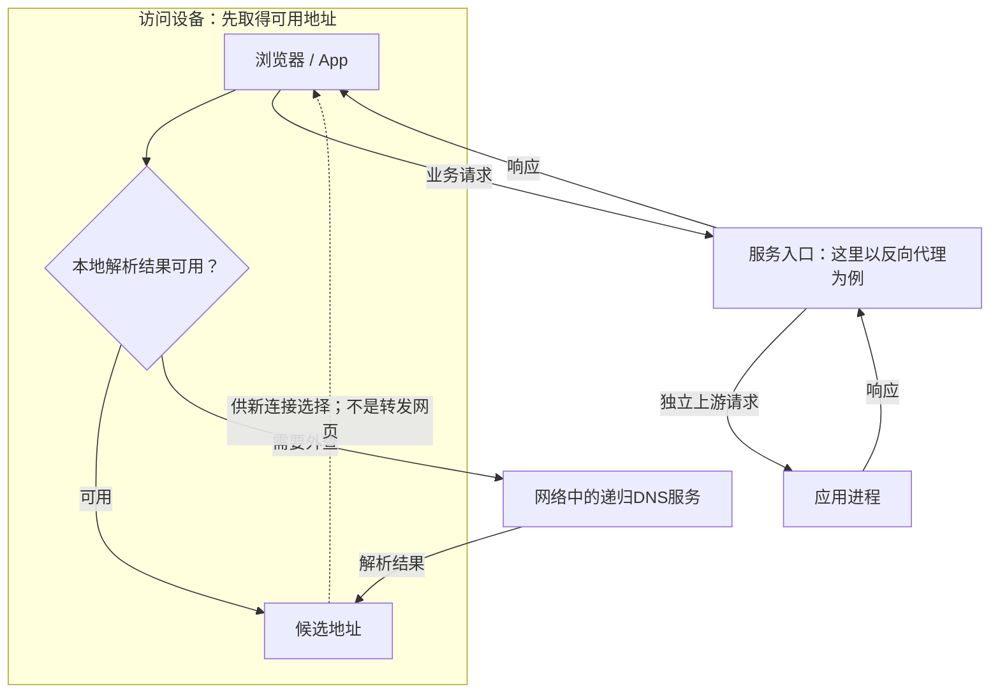
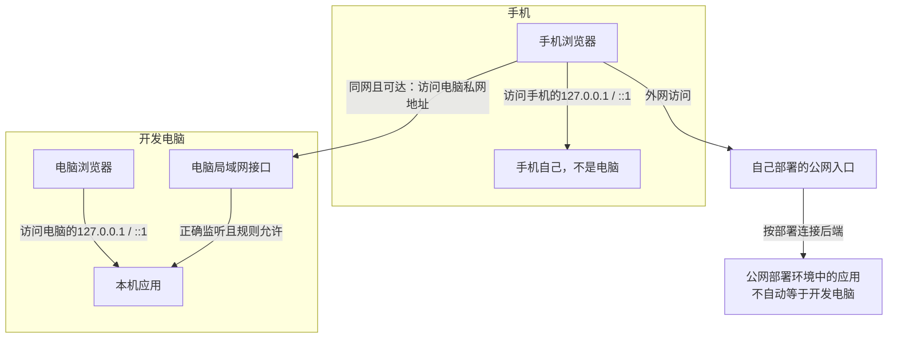
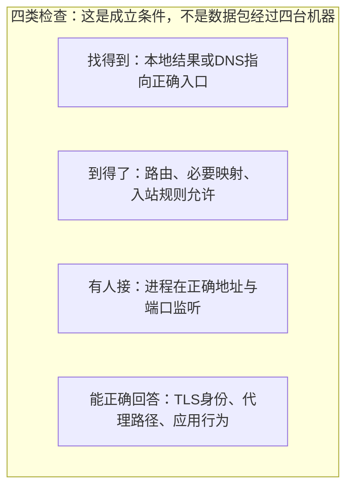
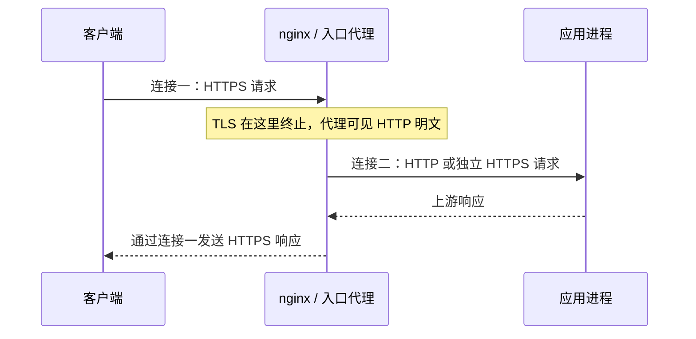

# 服务器部署：域名后面到底运行着什么

电脑上能打开自己写的页面，为什么手机却打不开？先分清“我连到谁”和“谁在处理请求”。**买域名只是给地址起名字，服务还要真正运行、可达，并正确处理协议。**

前置：[域名与 DNS](./dns.html)、[HTTPS 与 TLS](./tls.html)。

## 1. 先把“查询地址”和“传网页”分开 {#topology}



- **DNS 负责找地址。** 网页和 API 响应不经过 DNS 服务器转发。
- **服务器是运行环境，服务是进程。** 同一台机器可运行代理、应用和其他进程，不等于每个域名各有一台机器。
- **CDN 和代理不是必备的每一跳。** 小服务可直接由应用提供入口；图示是常见扩展结构。

图按需要建立新连接的访问举例；IP 字面量、已有可用连接、HTTP 缓存或自定义解析可跳过不同步骤。本地入口与远端递归服务的区别见[DNS](./dns.html)。

## 2. 四个地址概念，先在本机区分 {#addresses}



- **回环**永远指当前设备；**私网地址**不能假定从公网直接可达。
- **公网入口**是可供外部到达的地址，后面可能是代理或映射；有地址仍不代表端口开放。
- **`0.0.0.0` 是监听设置**：绑定本机所有 IPv4 接口。它不是要发给手机访问的地址，也不包含 IPv6 全接口监听。

先在实验脚本默认回环地址运行，确认功能，再按自己的部署环境规划对外入口。**不要为了“能连上”而把管理接口、数据库或实验服务全部暴露。**

## 3. 从本机到公网，需要跨过哪些门 {#path}



HTTPS 常用 TCP/443；启用 HTTP/3 时还涉及 UDP/443。证书错误、TCP 连不上和 HTTP 502 是不同阶段的问题，不能统一归为“DNS 还没生效”。

### 推荐的验证顺序

1. 应用在本机可以正常处理请求。
2. 代理能连接应用，上游路径与方法正确。
3. 入口能够完成 TLS 验证并返回结果。
4. 自己的域名解析到入口，外部客户端可达。
5. 检查错误日志、健康检查、重启恢复和证书续期。

这里是部署顺序示意，不表示当前笔记任务已经购买、开放或部署了公网服务器。

## 4. 反向代理究竟做了什么 {#reverse-proxy}

**反向代理代表服务端接收请求，再发起一条新的上游连接。** 它可以统一 TLS、域名路由、负载均衡、限流与访问日志；应用负责业务。



两个连接的协议、超时和生命周期分别管理。客户端取消不保证应用已经停止执行；代理超时不代表上游业务没有提交。[nginx 反向代理说明](https://nginx.org/en/docs/beginners_guide.html#proxy)

### 一个有完整上下文的 nginx 模板

把配置对回上面的两条连接：`listen`接客户端，`upstream`指向应用，`location`决定怎样转发；`ssl_certificate`一组参数保护客户端到入口这一段。先读[Nginx篇的正向/反向对照图](./gateway-load-balancing.html#正向代理与反向代理)；可直接跑的本机HTTP模板、逐项参数解释与路径替换实验见[反向代理模板](./gateway-load-balancing.html#reverse-template)。

前提：自己的 Linux 服务器已安装支持 HTTPS 的 nginx，已取得目标域名证书和私钥，应用已在本机运行。

**模板不能原样启动**：替换域名、证书路径和 `__HTTP_PORT__`；实验端口取统一脚本 `HTTP_PORT` 或启动输出。

将模板保存为 `nginx.conf.in`；它是完整主配置结构，不是随意粘到现有 `server` 块内部的片段。

[下载完整HTTPS模板](/assets/network/nginx/reverse-https.conf.in){download="reverse-https.conf.in"}。正文引用同一份附件，避免两篇的模板各自变化。

<<< @/public/assets/network/nginx/reverse-https.conf.in{nginx}

实验模板可在 `network_lab.py` 同目录用下列代码填入实际端口，生成另一个配置文件；这不会替你安装证书、开放端口或重启服务。

```python
from pathlib import Path
from network_lab import HTTP_PORT

template = Path("nginx.conf.in").read_text(encoding="utf-8")
Path("nginx.lab.conf").write_text(
    template.replace("__HTTP_PORT__", str(HTTP_PORT)), encoding="utf-8")
```

将域名和证书路径也改成实际值后，才可执行 `nginx -t -c /绝对路径/nginx.lab.conf` 检查。该命令会校验配置并尝试打开引用文件，不等于业务请求端到端成功。[nginx 参数](https://nginx.org/en/docs/switches.html)、[证书配置](https://nginx.org/en/docs/http/ngx_http_ssl_module.html#ssl_certificate)

### 路径与转发头为什么容易出问题

`proxy_pass` 是否带 URI，会影响上游收到的路径，不能随手加尾部 `/`。上游也只能信任由受控入口产生的转发头，不能相信任意客户端发来的 `X-Forwarded-For`。[proxy_pass 的路径规则](https://nginx.org/en/docs/http/ngx_http_proxy_module.html#proxy_pass)

本模板入口直接接客户端，因此用 `$remote_addr` 生成转发地址。若前面还有 CDN / 负载均衡，应另行配置可信代理范围和真实客户端地址，不能继续照搬。

后端只信任指定入口源地址及约定转发头；不能启用“信任所有代理”。`Host` 仍要校验允许域名，`server_name` 匹配不等于授权白名单。

`proxy_set_header` 按整组继承；新增子层配置时要保留完整所需规则。[继承](https://nginx.org/en/docs/http/ngx_http_proxy_module.html#proxy_set_header)、[可信代理来源](https://nginx.org/en/docs/http/ngx_http_realip_module.html#set_real_ip_from)

## 5. 上游与证书续期，不能漏掉 {#operations}

### 上游跨机器，重新建立信任

同机回环 HTTP 是上图的教学起点。上游跨主机或不受信任网络时，应按风险使用 HTTPS / mTLS，并验证上游证书与身份；仅把 `proxy_pass` 改成 `https://` 不等于已经完成验证。

上游验证要明确配置 `proxy_ssl_verify on`、受信 CA 与 `proxy_ssl_name`；按需开启 `proxy_ssl_server_name on`。

验证深度也要适配证书链，不能只改 URL 的 `https://`。[nginx 上游 TLS 参数](https://nginx.org/en/docs/http/ngx_http_proxy_module.html#proxy_ssl_verify)

### 证书与服务都需要持续维护

- 证书签发只是开始：安排续期、续期失败告警、加载新证书与到期检查。
- 私钥文件限制权限，不上传仓库、不嵌到前端、不复制进示例附件。
- 应用进程使用适当的进程管理方式，启动失败、异常退出和健康检查都要可观察。
- 设置合理的请求大小、连接/读取超时与并发边界；日志避免记录密码、完整 Token 和敏感请求体。
- SSE 等流式上游需结合代理缓冲与空闲超时调整；客户端连接成功不代表事件能及时刷出。

证书获取和续期通常可交给 ACME 客户端；挑战校验、域名控制和证书替换流程要与自己环境匹配。[ACME 协议](https://www.rfc-editor.org/rfc/rfc8555.html)

## 6. 本站 GitHub Pages 能做什么 {#pages}

GitHub Pages 发布静态 HTML、CSS、JavaScript 和附件，适合这套知识笔记。**它不能在页面目录里启动 Python、Java 或 Socket 服务。**[GitHub Pages 官方说明](https://docs.github.com/en/pages/getting-started-with-github-pages/what-is-github-pages)

如果笔记以后需要登录、同步进度或保存个人数据，应由独立 HTTPS API 提供后端。页面上的 JavaScript 通过浏览器网络 API 调用它，而不是让访问者执行服务器源码。

### 跨源与 CORS

`https://notes.example.com` 与 `https://api.example.com` 是不同源。浏览器按服务端 CORS 响应决定是否允许页面脚本读取响应；携带凭据时不能用通配符 `Access-Control-Allow-Origin: *` 代替精确允许的源。

跨源请求还可能先发 `OPTIONS` 预检；后端需处理允许的方法与头部。CORS 不是服务端鉴权，命令行客户端不受浏览器同源策略约束；认证授权仍要照做。[CORS 官方参考](https://developer.mozilla.org/en-US/docs/Web/HTTP/Guides/CORS)

不要从 HTTPS 知识站页面调用本机 HTTP 实验服务来验证部署，这还涉及混合内容、浏览器本地网络策略与访问设备差异。课程实验在命令行或本机 HTTP 上独立完成。

## 7. 自测 {#check}

1. DNS 已返回正确地址，但连接被拒绝，应继续查哪个进程和端口？
2. HTTPS 入口返回 502，为什么通常先查代理到应用这一段？
3. 代理终止 TLS 后，源站连接是否自动受同一个 TLS 会话保护？
4. 在 Pages 仓库上传 `server.py`，为什么不会变成在线 Python API？
5. curl 能读 API，浏览器脚本却提示 CORS，说明哪一层仍需要检查？

下一篇：[Nginx、网关与负载均衡](./gateway-load-balancing.html)；遇到失败时使用[分层排障](./diagnostics.html)。
