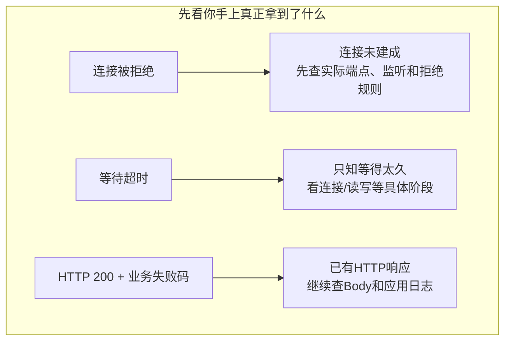
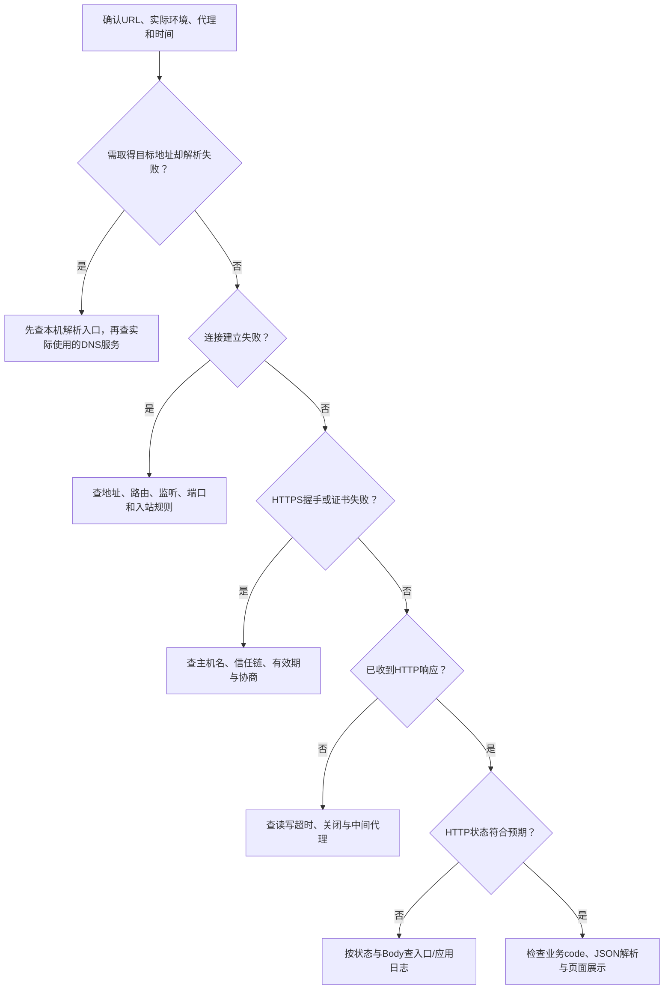
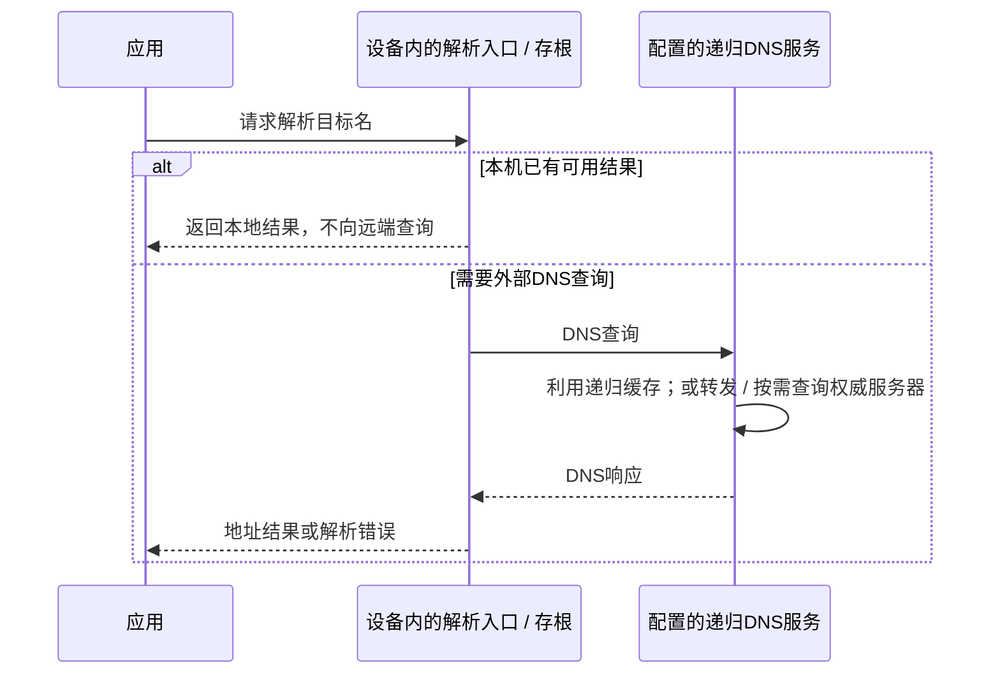
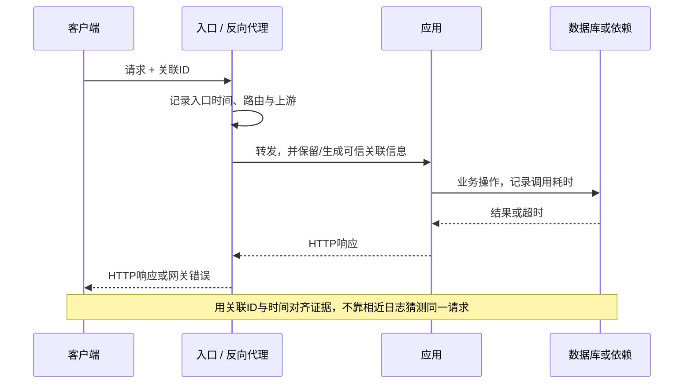

# 网络排障：先确定失败发生在哪一层

手机打开笔记失败，先别急着换 DNS。**“连不上”“等太久”“HTTP 200 却显示失败”是三种不同证据。** 先找已经走到哪一步，再向前或向后追。

可以先用这一篇查问题，再回到各章补原理。完整主线见 [网络通信学习路线](./index.html)。

## 1. 先按这条路径缩小范围



超时不证明服务端没执行；200 不证明业务成功。下面是检查顺序，不要求每次访问都重新经历所有阶段。



这是一条常见 TCP + HTTPS 请求的检查路径，HTTP/3 使用 QUIC 时连接与握手证据不同。先判断本次请求实际需要哪些阶段：

- **HTTP 内容缓存**能直接满足请求时，可能不发起本次网络请求。
- **地址缓存或 hosts**已提供可用地址时，可以不向远端 DNS 查询；需要新连接时，仍要建连。
- **IP 字面量**通常不需要解析目标名；已有可复用连接也可以省去本次重新解析、TCP 建连与 TLS 握手。
- **代理**可能在另一端解析目标名；仍须确认客户端连接代理所需的地址、协议与握手，不能机械套用直连路径。

**记录实际 URL、时间、客户端环境和错误原文。** “手机能开、电脑不能开”还需比较代理、DNS、IPv4/IPv6、证书信任和请求凭据，不能直接认定服务器故障。

## 2. 各层看什么证据

### DNS：名字是否真的解析到预期地址

**先分清谁在解析，再判断失败在哪里。** 下图限定为应用使用系统解析设施的场景；本机规则因系统而异，hosts 与各级缓存不一定按固定顺序检查。



- **本机入口**：应用/浏览器可能有自己的地址缓存，系统入口可结合 hosts、本机缓存和存根解析器。存根通常把需要外查的 DNS 问题交给配置的解析服务。
- **递归服务**：可部署在路由器、企业网络或公共服务上；有自己的缓存，也可能继续转发，不等于手机或电脑里的解析API。
- **权威服务**：负责其区域的记录。只有需要时才进一步查询，不是每个请求都要问遍根、顶级域和目标区域。

先区分域名写错、记录不存在、旧缓存、本机入口异常和上游服务超时。拿到地址不说明目标端口有服务；没有地址也不一定是权威记录错误。[DNS 角色](https://www.rfc-editor.org/rfc/rfc9499.html#section-6)

Python 可只读查询自己域名的地址；把示例名替换为实际域名，结果应保留地址族，不照抄固定 IP：

```python
import socket

host = "notes.example"  # 替换为自己已经配置的域名。
for family, kind, protocol, canonical, address in socket.getaddrinfo(
        host, 443, type=socket.SOCK_STREAM):
    print(family, address)
```

`getaddrinfo` 是当前环境的地址解析入口，结果可能来自本机配置或缓存；**返回地址不证明发过 DNS 包，更不证明查询过权威服务**。IP 字面量甚至可以配合 `AI_NUMERICHOST` 在禁用名称解析时得到地址。

浏览器也不一定走同一路径：自带缓存、DoH（经 HTTPS 查询 DNS）或代理代解析都可能改变证据位置。先确认实际使用的解析服务，再结合其日志或受控抓包判断查询到了哪里。[getaddrinfo](https://docs.python.org/3.11/library/socket.html#socket.getaddrinfo)

### 连接：拒绝和超时不是同一件事

- **连接被拒绝**：常见于目标没有监听、主动拒绝等；需要结合目标地址和服务端证据确认。
- **连接超时**：可能是路径丢弃、地址不可达、入站规则等；不是单凭一个错误就能确定“防火墙拦了”。
- **连接建立后读取超时**：已经进入后续等待，要查服务处理、上游依赖和响应传输。

先看服务实际绑定了哪个地址、进程是否存活、入口端口是否映射正确。`0.0.0.0` 是监听用的通配地址，不是客户端应访问的公网地址。

`ping` 检查的是 ICMP 相关可达性；它失败不等于 HTTPS 不通，它成功也不等于应用端口可用。

### TLS：连接到了，不代表身份可信

检查目标主机名与证书身份是否匹配、证书链能否到达受信任根、时间是否正确、协议和算法是否兼容。

不要把跳过证书校验当成修复。用 IP 直接访问 HTTPS 也可能改变目标身份/SNI 等条件，不能把它与正常域名请求不加区分地比较。[TLS 与证书](./tls.html)

### HTTP 与业务：拿到响应后继续拆分

HTTP503、HTTP200业务错误、收到HTML却按JSON解析，是不同问题。保留状态、必要字段与脱敏错误 Body；凭据、Cookie、个人数据不要原样贴到日志里。

浏览器 CORS 错误还需查开发者工具和服务端：部分跨源请求可能已发送，浏览器只是阻止脚本读取；带预检的请求也可能在实际请求前被拦住。[CORS 处理模型](https://developer.mozilla.org/en-US/docs/Web/HTTP/Guides/CORS)

## 3. 把客户端、入口、应用日志对上



关联 ID 用来追踪，不是授权凭据；入口还需限制与规范化客户端传入字段，避免任意日志内容混入。

拿到 `502` 先查入口的上游连接与响应错误；应用自己返回 `500` 再查应用异常。若客户端先超时，服务端仍可能继续处理，不能把超时当作“事务已回滚”。

## 4. 性能：慢在哪一段

### 先分清几个量

| 指标 | 含义 | 常见误解 |
| --- | --- | --- |
| RTT | 一次往返所需时间 | 不等于下载整个文件时间 |
| 带宽 | 链路或路径的容量 | 不等于应用此刻的实际下载速度 |
| 吞吐量 | 实际单位时间完成的数据量 | 还受协议、丢包、服务器与消费速度影响 |
| TTFB | 到收到第一个响应字节的时间 | 不等于纯服务器业务执行时间 |
| 尾延迟 | 较慢那部分请求的延迟 | 平均值正常不表示少数用户没有长等待 |


每根条都从 t0 开始。看“到现在总共多久”读整条；看“这一段多久”才在满足条件时做差。图中的数值是合成示例，不是本站测量值。

### curl 显示的是累计时间

先启动本机实验服务。在 PowerShell 中从脚本常量取得地址，再运行命令；Linux/macOS 使用 `curl`，把 `NUL` 换成 `/dev/null`。

```powershell
$httpBase = python -c "from network_lab import HOST,HTTP_PORT; print(f'http://{HOST}:{HTTP_PORT}')"
curl.exe --http1.1 -o NUL -sS -w 'dns=%{time_namelookup}\nconnect=%{time_connect}\ntls=%{time_appconnect}\nfirst=%{time_starttransfer}\ntotal=%{time_total}\n' "$httpBase/health"
```

- `time_namelookup`：开始到名字解析完成。
- `time_connect`：开始到连接完成，可能连接的是代理。
- `time_appconnect`：开始到 TLS 等应用连接握手完成。
- `time_starttransfer`：开始到首字节，包含前置阶段以及请求发送、服务等待等。
- `time_total`：整个操作耗时。

**本机 HTTP 没有 TLS，不能用它测 TLS 时间。** 单次、无代理、无重定向、无连接复用的 TCP+TLS 请求，才可近似用相邻时间点之差拆分阶段。

例如 TCP 阶段约为 `time_connect - time_namelookup`，TLS 阶段约为 `time_appconnect - time_connect`。复用、代理、重定向、HTTP/3 等情况应重新解释字段，不能机械相减。[curl write-out 字段](https://curl.se/docs/manpage.html#-w)

`curl -v` 可以观察实际地址、代理、连接和协商信息，但输出可能包含敏感字段。`curl --version` 能检查当前构建支持的能力，不能假设每台电脑都有 HTTP/3。

## 5. 动手：制造可控错误，再解释证据

下载 [network_lab.py](/assets/network/network_lab.py){download="network_lab.py"}和[说明](/assets/network/README.txt){download="network-README.txt"}。终端 A 启动服务：

```sh
python network_lab.py http-server
```

终端 B 依次请求：

```sh
python network_lab.py http-client --path /health
python network_lab.py http-client --path /status/503
python network_lab.py http-client --path /business-error
```

应分别识别正常响应、HTTP错误和业务错误。CLI 会保留 HTTP 错误状态与 Body，不把它们伪装成“连接失败”。

在 PowerShell 中用小于服务延迟的等待时间，观察读超时：

```powershell
$shortTimeout = python -c "from network_lab import SLOW_DELAY_SECONDS; print(SLOW_DELAY_SECONDS / 2)"
python network_lab.py http-client --path /slow --timeout $shortTimeout
```

随后停止终端 A 的服务，再请求 `/health`，观察未监听时的错误。不能把某一个平台的具体错误文字当成跨平台固定输出。

这些实验只覆盖本机 HTTP、连接与读取故障；不伪造真实 DNS、TLS、HTTP/2/3 的执行结果。公网域名、证书和部署验证需要对应环境。

## 6. 排障时保留一条能复查的结论

建议记录：**现象 → 实际证据 → 已排除范围 → 最小复现 → 修复后的对照结果**。缺证据时写“尚不能确定”，不要把一个猜测改成肯定句。

比较性能时固定测试条件，区分冷连接、复用连接与缓存命中；多次采样，再看分布和慢请求，不能用一次最快结果代表所有用户。

自测：DNS成功能证明服务器可用吗？HTTP200为什么还可能失败？首字节慢为何不一定是数据库慢？为什么超时不能证明扣款没发生？

回到[学习路线](./index.html)，把分层图、Socket实验、HTTP报文、TLS与部署路径串起来。
