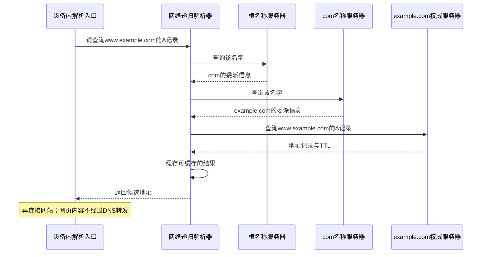
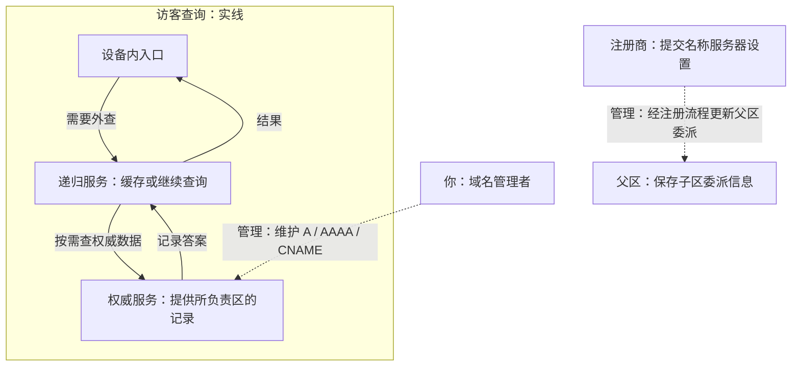
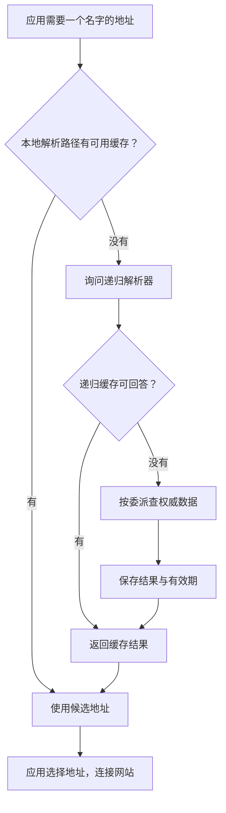
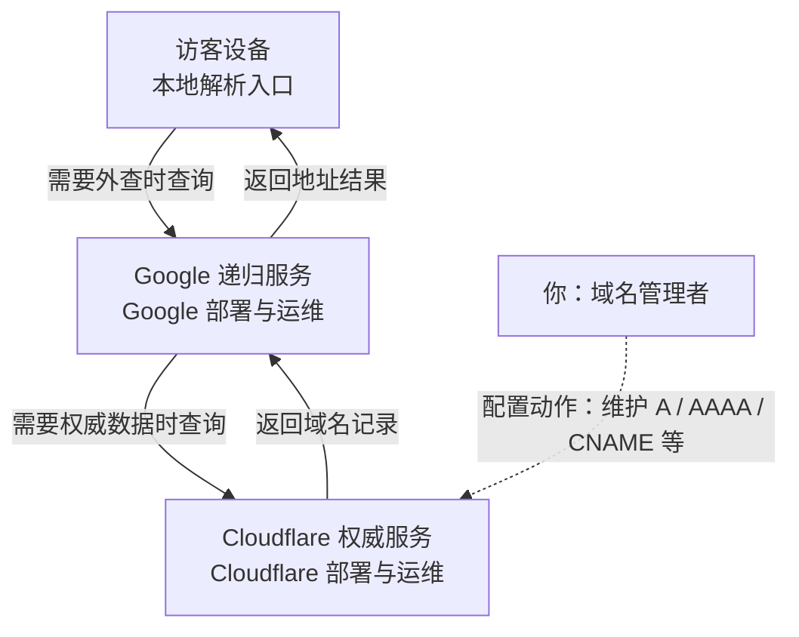

# 域名与 DNS：名字怎样变成可连接的地址

浏览器记着 `www.example.com`，发包却需要地址。**DNS 像查通讯录：告诉你“到哪里联系”，不替你传网页。** 查到候选地址后，浏览器另建网站连接。

## 1. 域名不等于 URL，也不等于一台机器

```text
https://www.example.com:443/notes?id=7
        └──主机名─────┘    └路径┘└查询参数┘

DNS常见地址查询：问 www.example.com 的 A / AAAA 记录
HTTP请求：向选定地址对应的服务请求 /notes?id=7
```

- 一个名字可以有多个 IP；一个 IP 也可以承载多个域名。
- DNS 不解析网页路径、业务参数，也不告诉应用“这个账号是否有权限”。
- 查到地址只代表得到连接线索，不能证明服务器已启动、端口可达或证书有效。

示例域名与图中地址用于教学。实际查询结果可能变化，不要把示例返回值配置到自己的生产服务里。[DNS 名称空间与记录](https://www.rfc-editor.org/rfc/rfc1034.html#section-3)

### 几种常见记录先认识用途

- **A / AAAA**：直接给 IPv4 / IPv6 候选地址。
- **CNAME**：告诉你“这个名字是别名”，继续找目标名字的记录。
- **NS**：告诉查询方“这个区由谁负责”，用于委派与权威查询。

例如 `www.notes.example` 是 `notes.example` 的别名，仍要取得目标的地址。**不要给同一名字同时放 CNAME 与 A/AAAA。** [别名约束](https://www.rfc-editor.org/rfc/rfc1034.html#section-3.6.2)

<details>
<summary>记录速查：邮件、验证、区域管理与服务参数</summary>

| 记录 | 回答什么 | 影响哪个环节 |
| --- | --- | --- |
| A | 名字对应的 IPv4 地址 | 候选连接地址 |
| AAAA | 名字对应的 IPv6 地址 | 候选连接地址 |
| CNAME | 这个名字是另一个名字的别名 | 继续查规范名字的记录 |
| NS | 哪些名称服务器负责一个区 | 委派与权威查询 |
| SOA | 区的管理与版本等信息 | 区维护、负缓存等 |
| MX | 邮件由哪些主机接收，带优先级 | 邮件投递；不决定网页服务器 |
| TXT | 一段或多段文本，由使用方约定含义 | 域名验证、邮件策略等 |
| HTTPS / SVCB | 服务端点与协议参数等信息 | 客户端连接方案选择 |

基础记录格式见 [RFC 1035 §3](https://www.rfc-editor.org/rfc/rfc1035.html#section-3)，HTTPS/SVCB 是后来的扩展，不是把一个 URL 字符串塞进 A 记录。[RFC 9460](https://www.rfc-editor.org/rfc/rfc9460.html#section-2)

TXT 的含义由读取它的系统约定；验证字符串不是网站登录密码。MX 决定邮件接收主机，不决定网站在哪台机器上。

</details>

## 2. 不是你的手机挨个问遍整个互联网

**设备内入口接住应用的查询；网络递归服务替它继续找答案。** 两边都可能有缓存。存根解析器（Stub Resolver）通常依赖递归服务，不自己跑完整条权威查询链。[角色定义](https://www.rfc-editor.org/rfc/rfc9499.html#section-6)

先看冷查询：**本地和递归服务都没有所需缓存**。根和顶级域只指路，最终地址由负责该区的权威服务器回答。



两条捷径：**本地命中，不问外部；递归缓存命中，不再问根/TLD/权威。** 图中整条链不需要每次重走。

- **递归**：调用方希望解析器替自己完成查询，或返回失败。
- **迭代**：这一步返回答案或指引，查询方再决定下一步问谁。
- **权威**：服务器对其负责的区提供权威数据；“权威”不表示它替你查完所有域名。

图中省略根提示、胶水记录、CNAME 跟随和转发解析器等细节；实际解析器也可能把请求转给上游递归服务。[递归与迭代查询](https://www.rfc-editor.org/rfc/rfc1034.html#section-4.3.1)

### 外部 DNS：谁部署、部署在哪、谁维护 {#operators}

把“访客问地址”和“你修改记录”分开：**递归服务帮访客查询，权威服务保存你配置的区数据。** 它们可以由不同公司运行。



虚线是管理关系，**不是访客查询的后续步骤**。根/TLD 由各自运营方提供服务；前图已展示它们怎样参与查询。

<details>
<summary>运营职责与部署实例速查</summary>

| DNS 角色 | 谁部署并运维 | 部署在哪里 | 维护什么 |
| --- | --- | --- | --- |
| 递归 DNS | 运营商、企业 IT，或 Google、Cloudflare 等公共 DNS 提供方 | 运营商机房、企业网络或服务商多地节点 | 查询服务、缓存、软件更新与可用性 |
| 域名的权威 DNS | 域名持有者自建，或委托 DNS 托管商 | 自建服务器或托管商节点 | 所负责区域的记录服务；记录内容由域名管理者配置 |
| 顶级域 DNS | 对应注册局或其技术运营方，例如 `.com` 的 Verisign | 运营方部署的 DNS 服务节点 | 该顶级域的区数据，包括下级域的委派信息 |
| 根 DNS | 多个根服务运营组织，各自维护所运营的服务 | 全球分布的服务器节点 | 提供根区数据，包括顶级域的委派信息 |

运营实例：[Google 公共递归服务及部署位置](https://developers.google.com/speed/public-dns/faq#locations)、[Cloudflare 权威 DNS 托管](https://developers.cloudflare.com/dns/zone-setups/full-setup/)、[IANA 的 .com 运营记录](https://www.iana.org/domains/root/db/com.html)、[根服务运营方与节点说明](https://www.iana.org/domains/root/servers)。

**一个 DNS 地址不等于一台机器。** 公共 DNS 可以用 **Anycast（任播）**：多个节点宣告相同的服务 IP，网络路由把查询送到其中一个节点。它选择的是路由意义上的可达路径，不保证地理距离最近；节点位置与流量调度也可能变化。[Anycast 原理](https://www.rfc-editor.org/rfc/rfc4786.html#section-2)、[Google 的实际部署](https://developers.google.com/speed/public-dns/faq#locations)

家用路由器显示为 DNS 地址时，也可能只是转发入口，上游仍是运营商或公共递归服务；要分清“设备先问谁”和“后续由谁完成查询”。[转发器与递归角色](https://www.rfc-editor.org/rfc/rfc9499.html#section-6)

</details>

### Android 系统解析、浏览器 DoH 与代理路径

- **Android 系统路径**：`InetAddress.getAllByName()`、`Network.getAllByName()` 等接口由系统 DNS 模块的存根解析器支持；模块负责查询收发和结果缓存。设备内有这个入口，不等于递归服务和权威服务器都在手机里。[AOSP DNS Resolver](https://source.android.com/docs/core/ota/modular-system/dns-resolver)
- **浏览器自带 DoH**：浏览器可以按自己的配置，通过 HTTPS 向 DoH 服务查询，不一定沿用系统解析接口。抓不到 UDP/53，不能直接断言“没有查询 DNS”。[Chromium DoH 配置](https://www.chromium.org/developers/dns-over-https/)
- **代理代解析**：客户端可以把目标域名交给支持该方式的代理，由代理解析并连接目标；HTTP CONNECT、SOCKS5 都有携带目标名字的形式。是否远端解析取决于协议与客户端配置；客户端连接代理自身时仍可能需要解析代理的名字。[CONNECT](https://www.rfc-editor.org/rfc/rfc9110.html#section-9.3.6)、[SOCKS5 地址类型](https://www.rfc-editor.org/rfc/rfc1928.html#section-4)

因此，图中的系统路径是常见场景，不能当作所有浏览器和代理的唯一调用链；**查名字、连接目标、传输网页**仍须分别理解。

## 3. 第二次为什么更快：缓存会截短路径



**TTL**（Time To Live）表示 DNS 记录正常情况下可以作为**新鲜结果**使用的期限，到期应刷新。不同记录有各自的 TTL；解析器通常返回剩余有效期，不是每次读取都重新给它完整寿命。


- **改记录不是清缓存。** 浏览器、系统、递归服务有各自策略，旧值可能仍在新鲜期内。
- **到期通常刷新，serve-stale 是例外。** 支持它的解析器可按规则在刷新失败等情况下暂用过期答案。[RFC 8767](https://www.rfc-editor.org/rfc/rfc8767.html#section-4)
- **TTL 不控制已有连接。** 到期不强制断开 TCP/HTTP；后续解析和连接复用各按自己的规则工作。

### “不存在”也会缓存

- **NXDOMAIN**：查询的名字不存在。
- **NODATA**：名字存在，但没有所询问类型的记录；它不是独立 DNS 状态码。
- **SERVFAIL**：服务器未能完成处理，例如上游故障或验证失败；不能直接解读成“域名不存在”。

负响应也有缓存规则，和权威 SOA 等数据有关。刚新增一个此前不存在的名字，仍可能短时间看到旧的不存在结果。[DNS 负缓存](https://www.rfc-editor.org/rfc/rfc2308.html#section-5)

## 4. 再往下看：DNS 报文里装了什么

DNS 查询不是发送“打开这个网页”的自然语言，而是发送结构化问题。

```text
Header      ID、查询/响应标志、状态、各区域数量
Question    QNAME=www.example.com.  QTYPE=A  QCLASS=IN
Answer      例如：名字、类型、TTL、IPv4地址
Authority   例如：委派信息或负响应所需的SOA
Additional  例如：关联服务器的地址或扩展数据
```

读字段时优先看：

1. **ID / QR**：匹配查询响应、区分查询与响应；ID 本身不是身份认证。
2. **RD / RA**：请求是否希望递归、服务器是否提供递归能力。
3. **RCODE / AA**：结果状态、响应是否标为权威答案。
4. **TC**：响应被截断，客户端可能需要改用可靠传输重新取得完整结果。

DNS 名字还可以使用报文内压缩指针，不能把整个 Body 当 UTF-8 字符串搜索后就认定解析正确。[DNS 消息格式](https://www.rfc-editor.org/rfc/rfc1035.html#section-4.1)

### DNS 不是“只能 UDP”

传统 DNS 常使用 UDP，也必须考虑 TCP；截断、大响应与连接复用都会涉及 TCP。DNS over TCP 的消息前有两字节长度字段，这是 DNS 的流式分帧，不是 TCP 替它保留消息边界。[DNS over TCP 要求](https://www.rfc-editor.org/rfc/rfc7766.html#section-1)、[长度字段](https://www.rfc-editor.org/rfc/rfc1035.html#section-4.2.2)

- **DoT**：DNS over TLS，通过 TLS 承载 DNS。
- **DoH**：DNS over HTTPS，通过 HTTPS 交换 DNS 消息。
- **DNSSEC**：验证 DNS 数据的来源与完整性；不负责把查询内容加密隐藏。

DoH/DoT 保护的是相应客户端到解析服务的通信，解析服务仍能看到它需要回答的问题；不能因此认为所有上游查询也自动加密。[DoT](https://www.rfc-editor.org/rfc/rfc7858.html#section-3)、[DoH](https://www.rfc-editor.org/rfc/rfc8484.html#section-1)、[DNSSEC 的服务范围](https://www.rfc-editor.org/rfc/rfc4033.html#section-3)

## 5. 域名买了以后，还缺什么

**注册商**处理域名注册；**权威 DNS 托管方**保存记录；**网站服务方**运行实际程序。它们可以是不同公司，也可以由一个平台打包提供。

### 你维护记录，托管商运维服务器 {#hosting}

假设把自己域名的权威 DNS 托管给 Cloudflare，访客使用 Google 公共递归服务：



实线是查询与响应，虚线是管理配置；**修改记录不属于访客每次查询的步骤**。图省略根、顶级域和各级缓存分支，它们仍遵循前面的解析过程。

- **你负责记录内容**：地址指向哪里、别名是什么、TTL 如何配置；在注册商处正确设置权威名称服务器委派。
- **托管商负责服务运行**：DNS 节点、网络、软件更新、监控与故障处理。若改为自建权威服务，这些运维职责也由你或受托团队承担。

公共递归服务与权威托管是两种服务；例如 Google Public DNS 本身不提供域名权威托管。[Google 服务边界](https://developers.google.com/speed/public-dns/faq#general)、[Cloudflare 托管模式](https://developers.cloudflare.com/dns/zone-setups/full-setup/)

### 注册、委派、记录与网站怎样衔接

按职责检查三件独立的事：

1. **注册与委派**：域名仍有效，父区指向正确的权威名称服务器。
2. **权威记录**：A/AAAA/CNAME 等指向计划使用的入口。
3. **网站服务**：入口监听、防火墙、TLS 证书和应用均已配置。

上面的列表是配置依赖，**不是网页经过三家服务逐级转发**。解析正确仍可能连接失败或证书不匹配。

多个候选地址中哪一个能用，应用还需要实际连接。双栈客户端可能用 Happy Eyeballs 等策略协调 IPv4/IPv6 的尝试，避免一个地址族故障拖住全部访问。[地址选择与并发尝试](https://www.rfc-editor.org/rfc/rfc8305.html#section-3)

## 6. 动手观察：查询记录与应用解析要分开

Windows PowerShell 可以做 DNS 记录查询：

```powershell
Resolve-DnsName example.com -Type A
Resolve-DnsName example.com -Type AAAA
```

观察记录类型、地址、TTL；不要要求输出 IP 与笔记固定一致。命令能力以系统 DnsClient 模块为准。[Resolve-DnsName 官方说明](https://learn.microsoft.com/en-us/powershell/module/dnsclient/resolve-dnsname)

使用 Python 观察应用拿到的地址候选：

```python
import socket

# localhost通常来自本机解析，不代表已向互联网DNS服务器发包。
results = socket.getaddrinfo("localhost", 443, type=socket.SOCK_STREAM)
for family, socktype, proto, canonname, address in results:
    print(family, address)
```

`getaddrinfo()` 是应用地址解析接口，会受系统名称解析配置影响；它不直接提供每条 DNS 记录的 TTL，也不保证每次都查网络。调用它不等于连接目标端口。[Python getaddrinfo](https://docs.python.org/3/library/socket.html#socket.getaddrinfo)

再运行统一实验 `python network_lab.py http-server` 与 `python network_lab.py http-client`：脚本使用回环地址，这条 HTTP 实验不需要靠公网 DNS 找服务器。先把“查名字”和“传内容”这两个环节区分清楚。

## 7. 查错时不要跳步

- **解析失败**：看名字、所查记录类型、当前解析器与负缓存，不先改 HTTP 超时。
- **IP 正确仍连不上**：继续查路由、监听端口与入站规则，DNS 不替这些环节担保。
- **改记录不立刻生效**：检查缓存有效期与实际委派，不能无限次重复保存记录当修复。
- **直接用 IP 能访问，域名报证书错**：继续查目标主机名、证书、SNI 与虚拟主机，不关闭证书验证。

试着回答：**递归解析器替谁查？权威服务器负责哪一段？DNS 缓存 TTL 到期，为什么不代表 HTTP 缓存也失效？** 它们分别由不同规则控制。

[上一篇：IP、端口与路由](./ip-routing.html) · 下一篇：[TCP、UDP 与 QUIC](./transport.html)
