# Nginx：正向代理、反向代理与负载均衡

同一篇笔记突然被很多人打开，一个应用实例不够，换成 A、B 两个实例。用户仍只访问一个网址：**入口替用户选实例，但不会自动替两个实例同步登录态、保证订单只执行一次。**

阅读路线：[安装与启动](#nginx-install) → [代理区别](#正向代理与反向代理) → [反向代理模板](#reverse-template) → [HTTPS部署模板](#https-template) → [正向隧道模板](#forward-template) → [多实例分流](#selection)。前置：[服务器部署](./deployment.html)。

## 1. Nginx 是什么，为什么总在服务入口出现 {#nginx}

Nginx 是服务器软件，可以提供静态文件、反向代理、负载均衡等能力。**“Nginx”“网关”“负载均衡”不是三个同义词：前者是软件，后两者是它可以承担的职责。**

它常用主进程管理配置与工作进程，工作进程通过事件驱动方式处理大量连接。事件驱动减少“每个连接占一条专用线程”的需要，但不会让 CPU、内存、文件描述符和上游能力变成无限。[nginx 进程与事件模型](https://nginx.org/en/docs/beginners_guide.html)

### 先看它装在哪里 {#nginx-install}

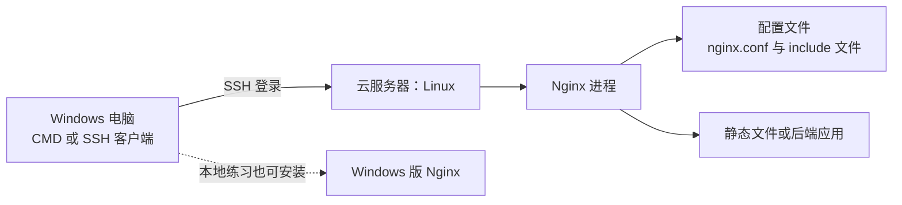

云主机的系统由购买者选择，Linux 上部署 Nginx 是常见做法，例如[阿里云的 Ubuntu + Nginx 部署教程](https://www.alibabacloud.com/help/en/ecs/user-guide/manually-build-a-magento-e-commerce-website-on-a-ubuntu-instance)。也可以使用 Windows 虚拟机或 Linux 容器；**云厂商托管负载均衡是另一种产品，不能据此断言其内部使用 Nginx。** Windows 官方版适合本地学习，官方将其标为 beta，有性能与功能限制。[Windows 版说明](https://nginx.org/en/docs/windows.html)

### Linux 云服务器：安装、找到配置、启动 {#nginx-linux}

以下以 **Ubuntu、已登录且使用 systemd 的虚拟机**为例；先在 Windows CMD 输入 `ssh 用户名@服务器地址` 登录，下面命令在远端 Linux 执行。SSH 端口、账号与密钥以实际主机配置为准。

```bash
sudo apt update
sudo apt install nginx             # 安装当前已配置的软件源中的 nginx
nginx -v                           # 程序版本
sudo nginx -t                      # 检查配置，并显示此次测试的配置路径
sudo systemctl enable --now nginx  # 开机启动并立即启动
systemctl status nginx --no-pager  # 查看状态
curl -i http://127.0.0.1/         # 在服务器本机测试默认站点
```

安装时部分发行版可能已自动启动服务。`127.0.0.1` 只验证服务器本机；外部访问还需检查监听地址、主机防火墙与云安全组。后续配置修改后执行：

```bash
cd /etc/nginx                      # Ubuntu 软件包常见配置目录
ls
sudo nginx -t                      # 先检查
sudo systemctl reload nginx        # 检查通过后重新加载配置
```

常见主文件是 `/etc/nginx/nginx.conf`，它可通过 `include` 引入 `conf.d/` 等文件；Ubuntu 发行版包还常见 `sites-available/` 和 `sites-enabled/`。

实际布局取决于安装包及配置。`nginx -V` 可看编译时默认路径，`sudo nginx -T` 可测试并输出展开后的配置；输出可能含敏感信息，请勿公开。服务可能通过 `-c` 或 `-p` 指定其他路径，可用 `systemctl cat nginx` 检查启动参数，必要时测试时使用相同参数。[命令参数](https://nginx.org/en/docs/switches.html)

### Windows 本地练习：从 CMD 进入配置目录 {#nginx-windows}

从 [Nginx 官方下载页](https://nginx.org/en/download.html)下载 Windows ZIP，解压至 `C:\tools\nginx`，确认该目录下直接有 `nginx.exe` 和 `conf`。打开 **CMD**：

```bat
cd /d C:\tools\nginx
nginx.exe -v
nginx.exe -t
start "" nginx.exe
curl.exe -i http://127.0.0.1/
cd conf
notepad nginx.conf
```

保存配置后回到安装目录，再检查并加载：

```bat
cd /d C:\tools\nginx
nginx.exe -t
nginx.exe -s reload
```

练习结束可在安装目录执行 `nginx.exe -s quit` 优雅退出；启动失败查看 `logs\error.log`。Windows 版是普通控制台程序，不会自动注册为 Windows 服务；相对路径以启动目录为前缀，因此管理命令也应从同一目录执行。[官方 Windows 指南](https://nginx.org/en/docs/windows.html)

### 云上版本怎么选、怎么维护？ {#nginx-versions}


- **没有统一版本。** 例如阿里云上述教程列出 Ubuntu 22.04 和 Nginx 1.24，这只是该教程的示例，不能代表云厂商全部客户。实际运行 `nginx -v` 查询；Ubuntu 软件包还可用 `apt-cache policy nginx` 查看安装版本与来源。
- **区分软件来源。** `apt install nginx` 使用机器已配置的软件源；要使用 Nginx 官方仓库的 stable 或 mainline，需先按[官方 Linux 安装说明](https://nginx.org/en/linux_packages.html)配置仓库。官方[下载页](https://nginx.org/en/download.html)在 2026-10-28 列出的 stable 为 1.30.6、mainline 为 1.31.8，后续会变化。
- **维护看补丁，不只看主版本号。** 发行版可能将安全修复回移到已有版本，需核对完整包版本、系统支持期限及发行版安全公告，例如 [Ubuntu Security Notices](https://ubuntu.com/security/notices)。容器则更新并重新部署经过验证的镜像，记录镜像摘要。
- **职责边界：** 自建虚拟机或容器中的 Nginx 通常由部署者负责更新；托管产品按厂商服务说明划分责任。先在测试环境验证配置、模块和 TLS 依赖，再分批部署并检查健康状态；`reload` 只重新加载配置，并不等于替换运行中的程序版本。容器由编排平台管理，不套用上述 systemd 命令。

### 正向代理与反向代理

**正向代理像公司统一出口，反向代理像网站接待前台。** 两者都收请求、转发、收响应、回复；“正反”指代表哪一方，不是数据传输方向。


| 看什么 | 正向代理：替客户端出门 | 反向代理：替服务端接待 |
| --- | --- | --- |
| 谁配置 | 用户 / 公司给客户端配置代理地址 | 网站方配置入口与后端路由 |
| 目标由谁决定 | 客户端请求中指定目标网站 | 入口按域名、路径等规则选后端 |
| 用户怎么访问 | 仍访问目标URL，另外配置代理 | 正常访问网站URL，无需配置显式代理 |
| 常见用途 | 企业出口、访问控制、统一审计 | TLS入口、静态资源、应用转发、多实例分流 |

**“隐藏IP”不是定义，也不等于匿名。** 转发头可能携带地址；代理通常仍知道连接两端。这里画显式HTTP代理，透明拦截代理是另一种部署方式。[HTTP中间节点定义](https://www.rfc-editor.org/rfc/rfc9110.html#section-3.7)

### 反向代理：网址没变，为什么应用能换 {#reverse-flow}

用下一节的本机模板举例：用户打开`http://localhost:18080/api/health`，浏览器连接Nginx入口；Nginx按配置访问应用，拿到结果再回复。**浏览器不需要知道应用的内网IP和端口。**


- **两段连接**：客户端↔Nginx、Nginx↔应用；协议、连接池、超时分别管理。
- **两种身份**：对浏览器，Nginx是服务端；对应用，Nginx是客户端。
- **两类返回**：应用可以返回业务响应；上游连接失败时，Nginx也可能自己生成502等响应。

图中两段均为本机HTTP。后面的HTTPS模板在Nginx终止TLS，上游仍走本机HTTP；HTTPS站点还涉及握手时按SNI选证书。若改为上游HTTPS，那是另一段TLS；`stream`透传TLS则是不同模型。[请求匹配顺序](https://nginx.org/en/docs/http/request_processing.html)、[上游代理](https://nginx.org/en/docs/http/ngx_http_proxy_module.html#proxy_pass)

### 先跑通：带注释的反向代理模板 {#reverse-template}

本机实验只用回环地址：`18080`是Nginx入口，`18081`是自己的应用。先确保端口空闲；这些是本模板的实验值，不是Nginx默认端口。

[下载reverse-http.conf](/assets/network/nginx/reverse-http.conf){download="reverse-http.conf"}

<<< @/public/assets/network/nginx/reverse-http.conf{nginx}

**配置按四层读：** 主配置管理进程；`events`管理连接；`http`管理HTTP共用规则；`server`选站点、`location`选路径。此文件是完整主配置，不能整个塞进已有的`server`里。[配置上下文](https://nginx.org/en/docs/beginners_guide.html#conf_structure)

| 配置组 | 控制什么 | 读配置时注意 |
| --- | --- | --- |
| `listen` / `server_name` | 入口地址端口 / 虚拟站点匹配 | `server_name`不负责DNS解析，也不是访问权限白名单 |
| `location` / `proxy_pass` | 路径匹配 / 上游地址及URI替换 | 一个决定“匹配谁”，一个决定“发给谁、发什么路径” |
| `upstream` / `keepalive` | 应用地址池 / 每worker空闲连接缓存 | `keepalive 8`不是最多8个请求，也不是8条总连接 |
| `proxy_set_header` | Nginx发给应用的HTTP头 | 此例入口直连客户端，覆盖地址头；后端只信任指定入口 |
| 三个`proxy_*_timeout` | 建连 / 向上游写 / 从上游读 | 发送、读取超时按相邻两次操作间隔算，不是总请求时限 |
| `client_max_body_size` / 日志 | 请求体上限 / 故障证据 | 超限可能413；上游地址、状态、耗时能帮助区分故障段 |

连接仍受操作系统资源限制；`worker_connections`还要计入上游连接，不能直接当作可服务用户数。[连接数](https://nginx.org/en/docs/ngx_core_module.html#worker_connections)、[连接池](https://nginx.org/en/docs/http/ngx_http_upstream_module.html#keepalive)、[超时](https://nginx.org/en/docs/http/ngx_http_proxy_module.html#proxy_read_timeout)

**最容易写错的是`proxy_pass`末尾的`/`。** 假设请求是`/api/health?x=1`，普通前缀`location /api/`中：

| `proxy_pass`写法 | 替换规则 | 应用收到 |
| --- | --- | --- |
| `http://notes_app` | 没有URI部分，保留请求路径 | `/api/health?x=1` |
| `http://notes_app/` | 用`/`替换匹配到的`/api/` | `/health?x=1` |
| `http://notes_app/v1/` | 用`/v1/`替换匹配前缀 | `/v1/health?x=1` |

这张表限定为无变量、无`rewrite`的普通前缀location；正则location、命名location与变量URL另有规则。`/api/`与`/api`也要分清。[URI替换规则](https://nginx.org/en/docs/http/ngx_http_proxy_module.html#proxy_pass)

### 配置怎样运行，怎样证明经过了Nginx {#proxy-lab}

下载[network_lab.py](/assets/network/network_lab.py){download="network_lab.py"}。在独立实验目录创建`logs`子目录，放入`reverse-http.conf`；用绝对目录作为`-p`前缀，避免影响现有Nginx。

```sh
# 终端一：启动自己的应用
python -B network_lab.py http-server --port 18081

# 终端二：替换绝对路径；Windows使用nginx.exe和D:/.../路径
nginx -t -p /absolute/nginx-lab/ -c reverse-http.conf
nginx -p /absolute/nginx-lab/ -c reverse-http.conf
curl --noproxy "*" -i http://127.0.0.1:18080/health
curl --noproxy "*" -i "http://127.0.0.1:18080/api/health?x=1"
nginx -p /absolute/nginx-lab/ -c reverse-http.conf -s quit
```

两次均应200：第二次应用收到`/health?x=1`。对照应用终端和`logs/reverse-http-access.log`，上游地址应为`127.0.0.1:18081`。停止应用再请求，对照错误日志：连接被拒绝等故障可能返回502，建连或读取超时可能返回504；不要把“应用停了”固定等同于一种状态码。

修改配置后先`nginx -t`，成功再用**相同`-p`、`-c`**执行`-s reload`；检查通过不等于已经加载。`-s quit`是结束本实验进程。[命令参数](https://nginx.org/en/docs/switches.html)

### 再上HTTPS：完整部署模板 {#https-template}

[下载reverse-https.conf.in](/assets/network/nginx/reverse-https.conf.in){download="reverse-https.conf.in"}。替换域名、证书路径和应用端口，再保存为实际配置文件；这是另一份完整主配置，与本机HTTP模板**二选一**。

<<< @/public/assets/network/nginx/reverse-https.conf.in{nginx}

- `80 → 308 → 443`：这一步是让浏览器重新请求HTTPS；后面的`proxy_pass`才是Nginx内部转发。
- `ssl_certificate`是站点证书加必要中间链，`ssl_certificate_key`是匹配私钥，私钥留在服务器。Nginx需具有读取权限。
- `$host`是请求目标主机名，`$scheme`是到本入口的协议，`$remote_addr`是本入口看到的对端；CDN在前面时需重新规划可信代理链。
- 日志示例记录`$uri`而不记录查询串；仍要按业务处理路径中的敏感信息。示例大小和超时值按业务调整。

`server_name`未匹配可能落到默认站点，不能用它代替拒绝未知主机的规则；多站点部署要显式规划默认站点。上游跨主机时的HTTPS验证、证书续期和Pages边界见[部署篇](./deployment.html#operations)。[证书配置](https://nginx.org/en/docs/http/ngx_http_ssl_module.html#ssl_certificate)

### 正向代理：HTTP请求与HTTPS隧道不一样 {#forward-proxy}

显式HTTP代理中，客户端把**完整目标URL**交给代理；例如客户端发给公司代理的请求行：

```http
GET http://target.example/notes?q=1 HTTP/1.1
Host: target.example
```

访问HTTPS目标时，常见做法是先发`CONNECT target.example:443`，成功后通过隧道与目标网站做TLS握手。代理转发加密字节，**不会仅因提供CONNECT就能解密HTTPS内容**。

**地址也要分两次看：** 客户端先连接代理地址；CONNECT中若给出目标域名，由代理侧解析并连接目标。不能继续套用“客户端先解析目标网站，再直连网站IP”的直连流程。

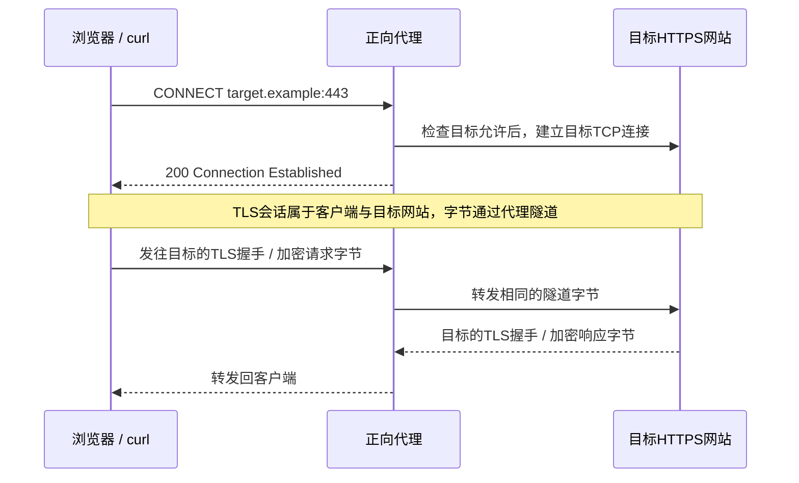

如果企业代理另行解密检查，需要客户端信任其证书体系，那是TLS拦截模型，不能与纯CONNECT混为一谈。代理地址用`http://`不妨碍目标用`https://`；它们描述不同连接段。[请求目标形式](https://www.rfc-editor.org/rfc/rfc9112.html#section-3.2.2)、[CONNECT语义](https://www.rfc-editor.org/rfc/rfc9110.html#section-9.3.6)

### Nginx正向隧道模板：先确认版本与模块 {#forward-template}

**Nginx从1.31.0起提供原生`ngx_http_tunnel_module`。** 普通`proxy_pass`不会自动启用CONNECT；较旧版本不能直接使用下面的`tunnel_pass`。用`nginx -v`、`nginx -V`查看版本与构建，最终以目标二进制的`nginx -t`为准。[官方隧道模块](https://nginx.org/en/docs/http/ngx_http_tunnel_module.html)、[构建选项](https://nginx.org/en/docs/configure.html)

这个完整模板只允许**本机客户端访问自己在`127.0.0.1:18443`运行的HTTPS服务**，用于观察CONNECT，不是任意HTTP/HTTPS目标都可访问的通用代理。

[下载forward-connect.conf](/assets/network/nginx/forward-connect.conf){download="forward-connect.conf"}

<<< @/public/assets/network/nginx/forward-connect.conf{nginx}

- `map`把CONNECT中的目标主机与端口映射为允许/拒绝，`if`只做拒绝返回；`tunnel_pass`才建立隧道。
- 用IP字面量的本机实验无需DNS解析；若改为域名目标，要配置可用的`resolver`，并校验解析后的出口范围。
- `tunnel_read_timeout`管隧道无数据传输的间隔，不是TLS内容读取规则。纯隧道也不能用`location /api/`检查加密后的URL路径。

先按[证书实验](./tls.html#certificate-lab)生成本地证书链；在目标实验目录合并`leaf.crt`、`intermediate.crt`为`fullchain.pem`，保留`leaf.key`。用**另一独立Nginx前缀**加载上面的HTTPS模板：入口改为`127.0.0.1:18443`、域名改为`localhost`，填入证书和上游`18081`，删去80端口跳转块。先直接访问确认目标可用，再启动本正向代理。

```sh
# 启动/检查/退出方式与反向模板相同，配置文件换成forward-connect.conf
# root.crt来自自己的证书实验，不导入系统全局信任
curl --noproxy "" --proxy http://127.0.0.1:18082 --cacert root.crt -v https://127.0.0.1:18443/health
```

应先看到代理建立CONNECT，再看到目标TLS校验及200业务响应。`--noproxy ""`避免本机地址被默认绕过代理；不要用`-k`掩盖证书问题。仅启动代理而没有HTTPS目标，上游连接会失败。

要部署企业出口，还需客户端认证、目标与端口限制、出口策略、DNS/IP校验和审计；不要把回环监听直接改成公网开放。**CONNECT隧道能力不等于完整的通用正向代理产品。**

### upstream 和 downstream：站在 Nginx 的位置看 {#upstream-explained}

**upstream 是“上游”，指 Nginx 为处理请求而连接的后端。** 配置里的 `upstream` 块给一组后端起名字；它既可以只有一个地址，也可以有多个实例。

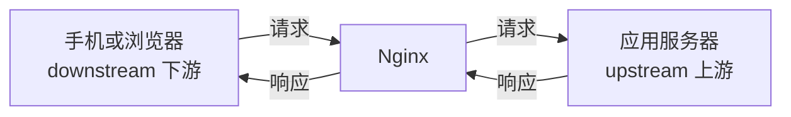

上下游是**相对当前节点的角色**，不是单向数据流：请求和响应都要经过两段连接。配置中 `upstream {}` 定义后端组；客户端侧用 `server`、`listen`、`location` 等接收请求，没有对应的通用 `downstream {}` 块。[upstream 指令](https://nginx.org/en/docs/http/ngx_http_upstream_module.html#upstream)、[客户端方向](https://nginx.org/en/docs/njs/reference.html)

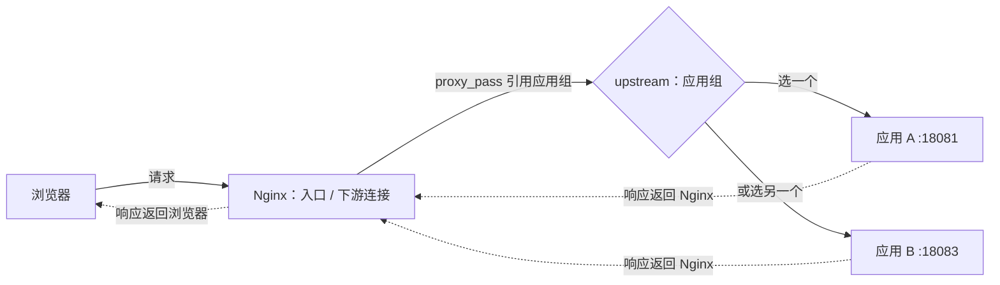

```nginx
# 放在 http {} 内；这里的名称是 Nginx 内部的组名
upstream knowledge_pool {
    server 127.0.0.1:18081;
    server 127.0.0.1:18083;
}

# 放在 server {} 内
location / {
    proxy_pass http://knowledge_pool;
}
```

`knowledge_pool` 不是一个必须公开解析的域名；`proxy_pass` 引用同名组后，Nginx从该组选择地址。上游只配一个实例时也能转发，但没有多实例分流。直接写 `proxy_pass http://127.0.0.1:18081;` 也能代理，不必强制声明组。[upstream 官方说明](https://nginx.org/en/docs/http/ngx_http_upstream_module.html#upstream)

### 三台服务器的配置：请求到底怎么分流？ {#upstream-example}

下面是 [Nginx 官方负载均衡示例](https://nginx.org/en/docs/http/load_balancing.html)的结构，注释说明每一行的作用：

```nginx
http {
    # 定义一个名为 myapp1 的后端服务器组；这里只是定义，还没有开始转发
    upstream myapp1 {
        server srv1.example.com;  # 后端实例 1，未写端口时默认 80
        server srv2.example.com;  # 后端实例 2
        server srv3.example.com;  # 后端实例 3
    }

    # 这是 Nginx 自己的入口，不是上面的后端服务器
    server {
        listen 80;                # 入口监听 80 端口
        location / {
            proxy_pass http://myapp1;  # 将请求交给 myapp1 组处理
        }
    }
}
```

`srv1`、`srv2`、`srv3` 是**示例域名**，应替换成 Nginx 能访问的真实后端域名或 IP 和端口，例如 `server 10.0.0.11:8080;`。它们通常运行同一个应用的多个实例，也可以是同一主机上的不同端口；一个域名解析出多个 IP 时，可能对应多个上游地址。[server 地址规则](https://nginx.org/en/docs/http/ngx_http_upstream_module.html#server)

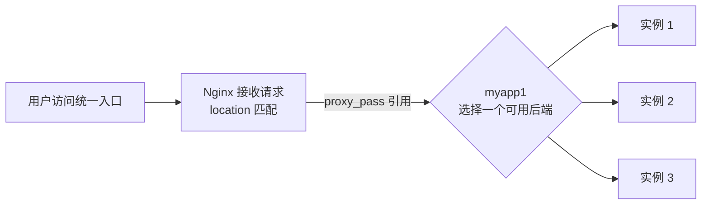

一次请求的顺序：① 用户连接 Nginx 的入口；② `location` 匹配请求；③ `proxy_pass` 找到 `myapp1`；④ Nginx 依照策略选一个可用后端并转发；⑤ 后端响应再经 Nginx 返回用户。后续请求也会重新选择，**不是一份请求同时发给三台**。

**没写策略时，默认是加权轮询；每台默认权重为 1。** 三台都可用、各域名各解析为一个地址时，流量会大致均分；请求 1、2、3 分别落在 1、2、3 仅是帮助理解的示意，并发、进程和失败重试等会影响实际观察。轮询不保证同一用户始终到同一台。[默认分流](https://nginx.org/en/docs/http/load_balancing.html#default_load_balancing_configuration)

例如配置 `server srv1.example.com weight=3;`，另外两台保持默认权重 1，三者的目标分配比例是 **3∶1∶1**，不是实时测量 CPU。若请求耗时差异较大，可以在组内添加 `least_conn;`，按活跃连接数结合权重选择；它也不等同于 CPU 最低。更多策略和故障处理见[请求怎样选中某台实例](#selection)。

要验证实际分流，可在 `http {}` 内增加以下日志格式，并在入口 `server {}` 中启用；配置修改后先执行 `nginx -t`，成功再重载。重复请求入口并查看日志中的 `upstream=`，才知道实际选中的地址；发生重试时可能显示多个地址。

```nginx
# http {} 内
log_format route '$remote_addr "$request" status=$status upstream=$upstream_addr';

# 入口 server {} 内：Ubuntu 示例路径，需确保目录存在且可写
access_log /var/log/nginx/upstream-route.log route;
```

## 2. L4 与 L7：选择发生在连接还是请求 {#layers}

L4 指传输层视角，L7 指应用层视角，沿用 OSI 分层术语。**L4 通常按连接和端点信息分发；L7 能理解 HTTP 等应用信息，按请求路由。**

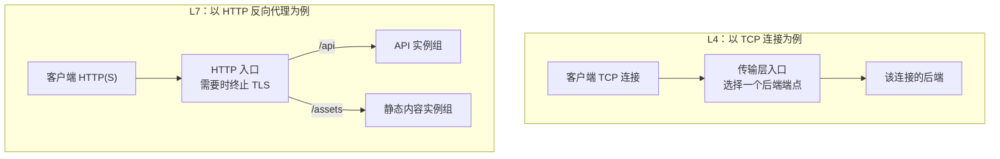

L4 像先选一条通道，L7 像读懂请求后选业务窗口。类比只用于“按什么选择”；L4 透传 TLS 时看不到加密的 URL 路径。

<details>
<summary>按选择依据、分发单位和可见内容对照 L4/L7</summary>

| 维度 | L4 典型分发 | L7 HTTP 典型分发 |
| --- | --- | --- |
| 选择依据 | 源/目标地址、端口、连接信息等 | 域名、路径、方法、头部等 |
| 分发单位 | TCP 通常以连接为单位；UDP需相应会话映射 | 可按请求选择上游 |
| HTTPS 路径可见性 | TLS 透传时看不到加密路径 | 终止并验证相应 TLS 后才读取 HTTP |
| 典型能力 | TCP/UDP 服务转发 | 路由、HTTP缓存、认证接入、请求策略 |

</details>

HTTP `upstream` 放在 `http {}`；TCP/UDP 相关转发放在 `stream {}`，还取决于模块和构建。**HTTP 的 `location /api` 不能原样搬进 L4 配置。**[HTTP](https://nginx.org/en/docs/http/ngx_http_upstream_module.html)、[stream](https://nginx.org/en/docs/stream/ngx_stream_upstream_module.html)

## 3. 请求怎样选中某台实例 {#selection}

负载均衡的目标是分配工作，不是保证“每台机器每秒请求数绝对一样”。健康状态、请求耗时、会话和实例能力都会影响结果。

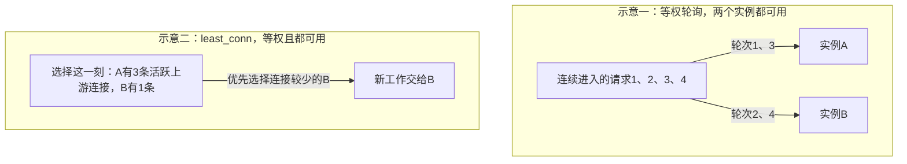

这是简化的调度快照，不是实际流量日志。`least_conn` 比较连接并结合权重，**不是测 CPU，也不是读取应用任务队列**；HTTP/2 的一条连接还可能承载多条流。

<details>
<summary>轮询、最少连接和哈希策略的选用边界</summary>

| 策略 | 依据 | 适合先想到的场景 | 必须记住的边界 |
| --- | --- | --- | --- |
| 轮询 / 加权轮询 | 按轮次与相对权重 | 无状态、请求成本较接近 | 权重不是即时 CPU 测量，不保证短时间绝对比例 |
| `least_conn` | 活跃上游连接数，结合权重 | 连接占用时长差异较大 | 不是最少业务任务、最少CPU或响应最快 |
| `ip_hash` | 客户端 IP 的哈希 | 临时需要客户端亲和 | NAT后许多用户可能共用IP，导致倾斜 |
| `hash key consistent` | 对稳定键做一致性哈希 | 缓存分片、需要键亲和 | 减少节点变化时重映射，不保证永不迁移或无热点 |

</details>

在 HTTP/2 等多路复用情况下，**连接数不等于并发请求数**。选算法前先确认代理到上游实际使用的协议与工作模型。[least_conn 语义](https://nginx.org/en/docs/http/ngx_http_upstream_module.html#least_conn)、[一致性哈希](https://nginx.org/en/docs/http/ngx_http_upstream_module.html#hash)

### 一个实际 upstream 配置模板

基于[部署篇的完整配置](./deployment.html#reverse-proxy)，**替换** `http {}` 内原有的 `upstream knowledge_app`，不要再追加一份同名入口。

先看最简单的分流：上面的 `knowledge_pool` 没写策略时使用默认加权轮询；两个实例默认权重相同。`proxy_pass` 指向组名，客户端始终访问同一个入口。实例异常、连接复用和并发会影响观察结果，不应按少量请求断言严格交替。[负载均衡官方指南](https://nginx.org/en/docs/http/load_balancing.html)

在本机可启动两份[网络实验服务](/assets/network/network_lab.py){download="network_lab.py"}，分别使用 `--port 18081` 和 `--port 18083`；将两个地址填入上游组，再重复请求入口的 `/health`。

查看 Nginx访问日志的 `$upstream_addr` 才能区分实际选中的端口；两个应用返回相同内容时，响应正文不能证明请求分到了哪台。实验前确认端口空闲，配置检查通过后再重新加载。

先启动两份自己的应用，按真实地址填 `__APP_A_PORT__` / `__APP_B_PORT__`；未替换的占位符不能通过配置检查。

```nginx
upstream knowledge_pool {
    least_conn;
    # 权重、失败阈值与超时只是本例配置，不是通用生产推荐。
    server 127.0.0.1:__APP_A_PORT__ weight=2 max_fails=2 fail_timeout=10s;
    server 127.0.0.1:__APP_B_PORT__ weight=1 max_fails=2 fail_timeout=10s;
}
```

再**替换原 `listen 443 ssl` 的 `server` 内的 `location /`**，保留其证书配置，以及唯一的 80 端口 HTTPS 重定向块；不要追加同监听端口、同域名的另一个 `server`。

```nginx
location / {
    proxy_pass http://knowledge_pool;
    proxy_http_version 1.1;
    proxy_set_header Connection "";
    proxy_set_header Host $host;
    proxy_set_header X-Forwarded-Proto $scheme;
    proxy_set_header X-Forwarded-For $remote_addr;
    # 本例后端只采用上面约定的转发头，其余同类头不转交。
    proxy_set_header Forwarded "";
    proxy_set_header X-Forwarded-Host "";
    proxy_set_header X-Real-IP "";
    proxy_connect_timeout 2s;
    proxy_read_timeout 15s;
    proxy_next_upstream error timeout http_502 http_503 http_504;
    proxy_next_upstream_tries 2;
}
```

这里是“公网 HTTPS 入口 → 本机 HTTP 上游”，转发头只允许后端按约定从指定入口接受。`proxy_set_header` 不会从另一 `server` 自动继承；当前层定义了这组指令时，上层同类指令也不会逐项合并。[继承规则](https://nginx.org/en/docs/http/ngx_http_proxy_module.html#proxy_set_header)

如果直接使用课程脚本，默认端口取脚本 `HTTP_PORT`，第二个实例用其 `--port` 参数指定自己选择的空闲端口，不把多个实例写成相同地址。

要改成默认加权轮询，去掉 `least_conn;`。要观察一致性哈希，则改用 `hash $request_uri consistent;`；它只按这个键建立亲和，不会把业务状态同步过去，且会把同一路径的流量集中起来。

## 4. 多实例以后，登录态为什么会“时有时无” {#state}

如果 A 把 Session 仅存在自己的内存，下一次请求分到 B，B 就不认识它。**亲和分发能暂时把客户端留在 A，但 A 宕机后，状态仍会丢。**

可选择让应用实例无状态，把必要会话放入受控的共享存储；或使用经过验证、具有有效期和撤销策略的令牌方案。数据库与状态服务自己也需要可用性设计，不能只把单点从应用搬到缓存。

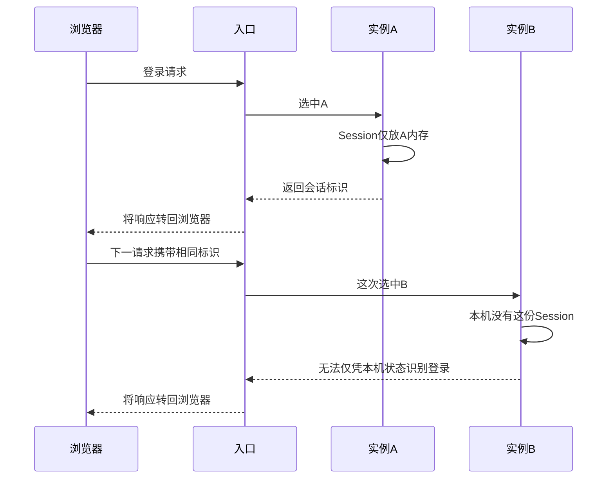

## 5. 健康检查：有真实流量才发现，还是主动探测 {#health}

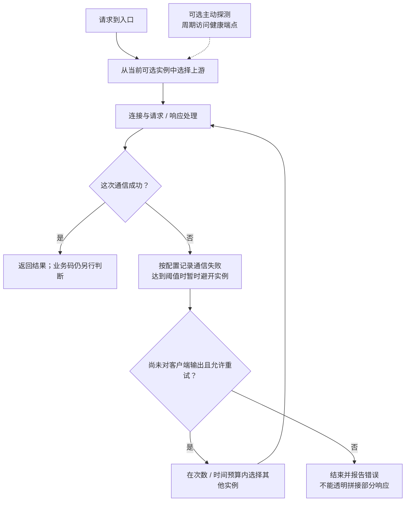

### 开源 nginx 的被动判断

`max_fails` 与 `fail_timeout` 根据实际通信失败暂时避开实例；哪些情况计入失败，需要结合 `proxy_next_upstream`。HTTP 200 的业务错误不会自动变成实例不健康。

`fail_timeout` 既限定失败统计窗口，也限定判定不可用的持续期；**不是健康探测间隔**。

仅一个上游时，`max_fails` / `fail_timeout` 会被忽略，不能指望它摘除唯一后端。[server 参数](https://nginx.org/en/docs/http/ngx_http_upstream_module.html#server)

### 主动检查需要单独确认能力

主动检查会定期请求健康端点，不必等待真实用户先失败。nginx 官方内建 `health_check` 的相应 HTTP 主动健康检查属于商业订阅能力，**不能当作开源默认指令复制**；也可由外部负载均衡器或平台提供探测。

健康端点还要设计清楚：进程存活、实例已准备接流量、依赖降级是不同状态。一次 `/health` 返回 200 不能证明所有业务都可用。[官方主动检查能力说明](https://nginx.org/en/docs/http/ngx_http_upstream_module.html)

## 6. 故障转移，最怕把一笔业务做两遍 {#retry}

`proxy_next_upstream` 控制哪些失败可尝试另一台服务器，但不是“失败就一定可以重发”。请求可能已经到达上游并完成提交，只是响应丢失。

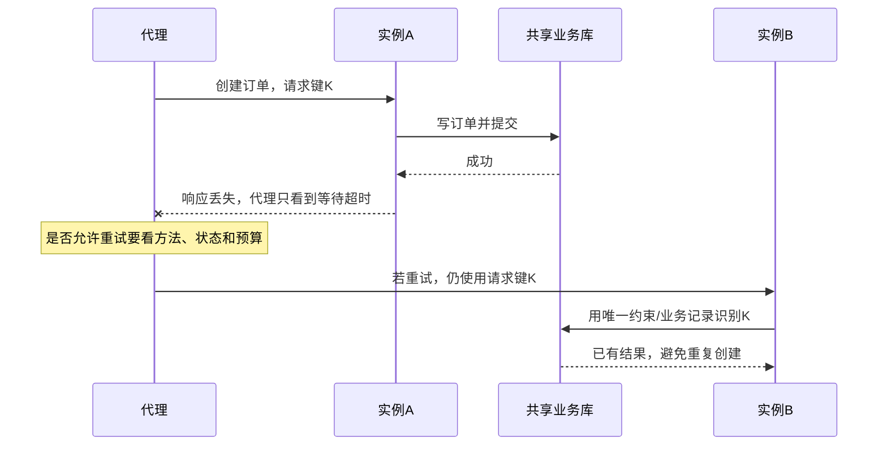

图中共享业务记录与唯一键需要应用实现，Nginx 不会自动创建它们。对外部支付等副作用还需下游幂等协议；粘性会话只影响分配，不能替代这些保证。

- **非幂等业务先设计去重。** 不随手启用 `non_idempotent` 允许已发出的 POST / PATCH 再次尝试。
- **已经发给客户端的响应不能撤回。** Body 发到一半失败，不能无痕换另一个后端继续拼。
- **重试有总预算。** 限制尝试次数与可用时间，防止故障时代理、SDK与业务层重试叠加放大流量。

默认情况下，已经发往上游的非幂等方法不会像普通可重试请求那样切换；显式配置 `non_idempotent` 会改变这条保护。[proxy_next_upstream](https://nginx.org/en/docs/http/ngx_http_proxy_module.html#proxy_next_upstream)

### 超时的名字相似，计算区间不同

`proxy_connect_timeout` 管建立上游连接；`proxy_read_timeout` 管相邻两次上游读取之间的等待，**不是整个响应的总耗时上限**。SSE 或大文件还要考虑流式输出、缓冲和空闲等待。[读取超时定义](https://nginx.org/en/docs/http/ngx_http_proxy_module.html#proxy_read_timeout)

## 安全配置：入口、文件和身份分别保护 {#nginx-security}

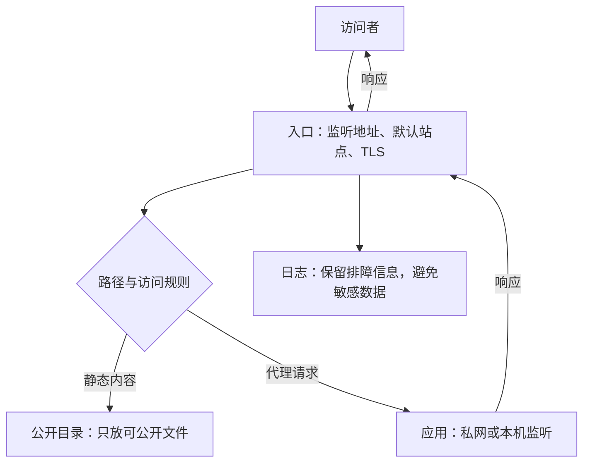

| 检查点 | 配错可能造成什么 | 配置与核对 |
| --- | --- | --- |
| 默认站点与监听 | 未知域名或意外端口仍能进入站点 | 明确 `listen`、`default_server`；分别检查 HTTP 和 HTTPS，后者还涉及 SNI 与证书 |
| 静态目录 | 备份、配置、密钥或目录列表暴露 | 公开目录只放可发布文件；检查 `root`、`alias` 和 `autoindex`；不要把仓库或私钥目录当网站根目录 |
| 管理入口与上游 | 绕过入口直连应用或访问管理页面 | 应用只监听必要地址，配合防火墙与应用鉴权；内网地址不等于自动可信 |
| 客户端地址头 | 客户端伪造 `X-Forwarded-For` 影响审计或权限判断 | 直连入口覆盖客户端提供的地址头；前面有代理时仅信任实际受控的代理地址，再按链路配置 realip |
| 上游 HTTPS | 连接加密但没有验证后端身份 | 配置 `proxy_ssl_verify on`、可信 CA、验证名称；按需开启 SNI，验证整条证书链 |
| 日志与缓存 | URL 参数、凭据或其他用户的私有响应被暴露 | 不记录密码和完整 Token；私有响应按业务限制共享缓存，检查缓存键与响应头 |
| 请求大小和超时 | 大请求或慢连接占用资源 | 按业务设置请求体大小、连接与读写超时、限流；限流不能代替鉴权 |

**最小示例：关闭版本号和目录索引。** 两行可放在已有的 `http {}` 或适当的 `server {}` 中，按实际配置检查继承关系：

```nginx
server_tokens off;  # 隐藏 Nginx 版本号，不等于隐藏所有服务信息
autoindex off;      # 不生成目录列表，不阻止访问已知文件路径
```

部署前用 `nginx -t` 检查，再按实际前缀和配置文件执行 reload；从预期外的入口验证访问控制，并检查响应头、目录和日志。`server_tokens off`、隐藏文件规则或单一安全头都不能代替应用鉴权与及时更新。[版本标识](https://nginx.org/en/docs/http/ngx_http_core_module.html#server_tokens)、[目录索引](https://nginx.org/en/docs/http/ngx_http_autoindex_module.html)、[可信代理地址](https://nginx.org/en/docs/http/ngx_http_realip_module.html#set_real_ip_from)、[上游证书验证](https://nginx.org/en/docs/http/ngx_http_proxy_module.html#proxy_ssl_verify)

### 文件能否访问：先看目录，再看 location {#file-access}

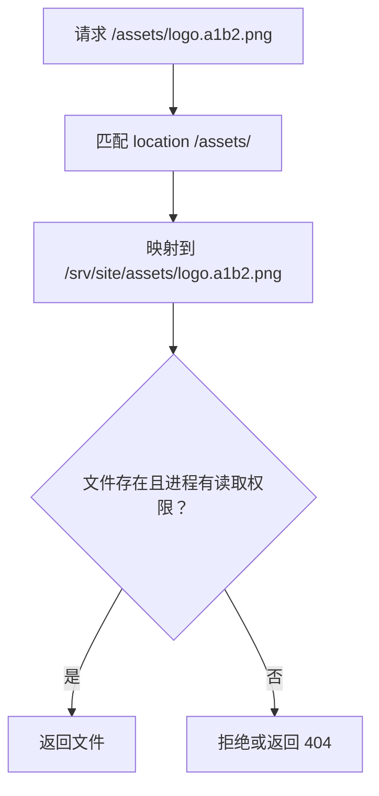

```nginx
# server {} 中：只把可公开文件放进这个目录
location ^~ /assets/ {
    alias /srv/site/assets/;
    autoindex off;
}

# 精确拒绝站点根路径下的这个文件，不覆盖其他路径
location = /.env { deny all; }
```

- `/assets/a.png` 映射到 `/srv/site/assets/a.png`；`alias` 替换匹配到的路径前缀，末尾斜杠应与该前缀对应。
- `autoindex off` 不列目录，但知道路径仍可能读到文件。最可靠的边界是**私钥、配置、备份、源码仓库不放在任何公开映射目录内**。
- `location = /.env` 只保护这个精确路径，不代表所有目录中的敏感文件都被保护。`^~` 会影响正则 location 的选择，不能假定一个通用正则拒绝规则一定覆盖所有路径；逐个检查实际路由。[location 匹配](https://nginx.org/en/docs/http/ngx_http_core_module.html#location)、[alias](https://nginx.org/en/docs/http/ngx_http_core_module.html#alias)

### 哪些端口能访问：入口和后端分开 {#port-access}

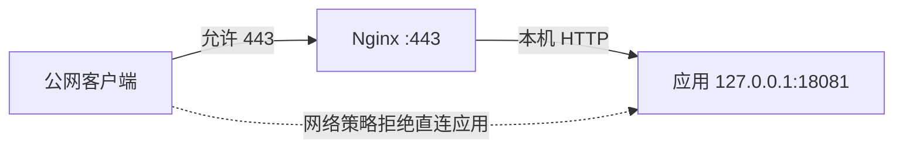

```nginx
# http {} 内示例：应用必须自行监听本机 18081
upstream app { server 127.0.0.1:18081; }
server {
    listen 443 ssl;
    server_name notes.example.com;
    # 还需配置 ssl_certificate 和 ssl_certificate_key
    location / { proxy_pass http://app; }
}
```

`listen` 决定 Nginx 绑定的地址和端口；应用自身的监听地址、主机防火墙、云安全组决定客户端能否直连应用。`allow` / `deny` 是 Nginx 收到连接后的客户端地址规则，不能替代网络防火墙，也不能限制客户端访问别的进程。实际规则以部署环境为准，IPv4 和 IPv6 都要检查。[listen](https://nginx.org/en/docs/http/ngx_http_core_module.html#listen)、[地址访问控制](https://nginx.org/en/docs/http/ngx_http_access_module.html)

### 缓存：浏览器缓存和 Nginx 缓存是两层 {#nginx-cache}

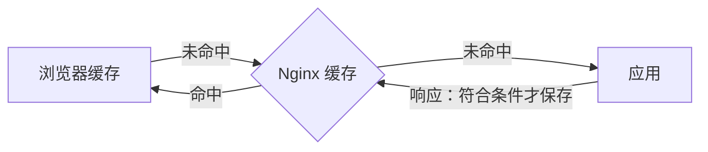

带内容哈希、更新时文件名会变化的公开静态文件，可以设置较长的浏览器缓存：

```nginx
location ^~ /assets/ {
    alias /srv/site/assets/;
    expires 30d;
    add_header Cache-Control "public, immutable";
}
```

只有资源 URL 确实随内容变化时才适合 `immutable`；HTML、用户信息等应依据实际更新和隐私需求分别设置。`expires` 控制客户端响应头，不会自动开启 Nginx 代理缓存。[expires](https://nginx.org/en/docs/http/ngx_http_headers_module.html#expires)

下面是**仅限保证对所有用户都相同的公开接口**的代理缓存片段；`proxy_cache_path` 和 `map` 在 `http {}`，`location` 在已有的 `server {}`：

```nginx
proxy_cache_path /var/cache/nginx/public levels=1:2 keys_zone=public_cache:10m
                 max_size=1g inactive=30m;
map "$http_authorization:$http_cookie" $skip_public_cache {
    ":"     0;
    default 1;
}

location /public-api/ {
    proxy_pass http://app;
    proxy_cache public_cache;
    proxy_cache_key "$scheme|$host|$request_uri";
    proxy_cache_valid 200 1m;
    proxy_cache_bypass $skip_public_cache; # 不读取共享缓存
    proxy_no_cache $skip_public_cache;     # 不写入共享缓存
    add_header X-Cache-Status $upstream_cache_status always;
}
```

`keys_zone` 存放缓存元数据，文件存放在指定目录；`max_size` 是缓存管理目标，不是实时严格磁盘配额。`inactive` 表示长期未访问的清理条件，`proxy_cache_valid` 给未被上游缓存头覆盖的响应设置缓存时间。

上游的 `Cache-Control`、`Set-Cookie` 等仍会影响缓存。两条 bypass/no_cache 分别控制读、写，少一条可能产生意外结果；仅检查 Cookie 和 Authorization 也不能证明接口一定公开，其他身份来源仍须由业务排除。

此处定义 `add_header` 还会影响上层同类头的继承，部署时要检查所需安全响应头。[代理缓存](https://nginx.org/en/docs/http/ngx_http_proxy_module.html#proxy_cache_path)、[响应头继承](https://nginx.org/en/docs/http/ngx_http_headers_module.html#add_header)

### TLS 版本与加密套件 {#nginx-tls-ciphers}

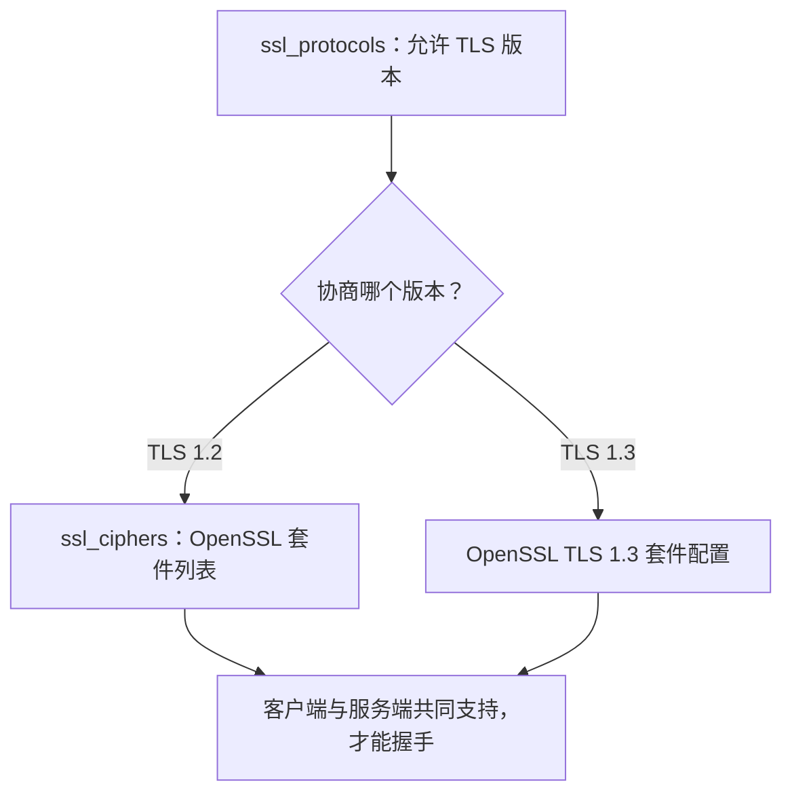

```nginx
# http {} 或 HTTPS server {}，已有证书和私钥配置
ssl_protocols TLSv1.2 TLSv1.3;
ssl_ciphers 'ECDHE-ECDSA-AES128-GCM-SHA256:ECDHE-RSA-AES128-GCM-SHA256';

# 可选：仅在支持 ssl_conf_command 的构建上使用；控制 TLS 1.3 套件
ssl_conf_command Ciphersuites TLS_AES_128_GCM_SHA256:TLS_AES_256_GCM_SHA384:TLS_CHACHA20_POLY1305_SHA256;
```

TLS 1.2 示例分别允许 ECDSA 或 RSA 证书对应的 ECDHE + AES-GCM 套件；实际能用哪一种还取决于证书、客户端和链接的 TLS 库。TLS 1.3 的套件不由 `ssl_ciphers` 控制；`ssl_conf_command` 依赖 Nginx 版本及 TLS 库支持，同层定义会影响上层同类指令的继承。

未明确需要定制时，优先结合实际版本和兼容性评估库默认值，不照搬别人的长期固定列表。[Nginx TLS 指令](https://nginx.org/en/docs/http/ngx_http_ssl_module.html#ssl_conf_command)、[OpenSSL 套件配置](https://docs.openssl.org/3.0/man3/SSL_CTX_set_cipher_list/)

部署后对**自己控制的域名**分别指定 `-tls1_2`、`-tls1_3` 连接，核对证书验证结果及协商套件；`nginx -t` 只说明配置可加载，不证明所有客户端都能握手。

```sh
openssl s_client -connect notes.example.com:443 -servername notes.example.com -verify_hostname notes.example.com -verify_return_error -tls1_2
openssl s_client -connect notes.example.com:443 -servername notes.example.com -verify_hostname notes.example.com -verify_return_error -tls1_3
```

## WAF：应用请求的安全检查站 {#waf}

**WAF（Web Application Firewall，Web 应用防火墙）是一套检查 Web 请求的安全系统，不是一条规则。** 可以把它想成入口安检：

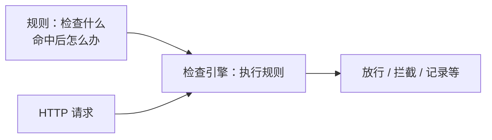

- **引擎**：执行检查的软件。
- **规则**：检查条件和动作，例如限制非授权来源访问 `/admin`。
- **云 WAF**：引擎由云厂商运行，用户在控制台管理规则和接入。

### 请求为什么会经过云 WAF？ {#waf-cloud-path}

以 **AWS ALB 绑定 AWS WAF** 为例，域名已指向 ALB：

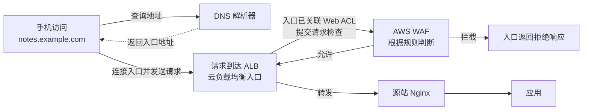

ALB 关联 Web ACL（规则集合）后，负责将到达入口的请求交给 WAF 检查。[AWS 工作方式](https://docs.aws.amazon.com/waf/latest/developerguide/how-aws-waf-works.html)

**关键边界：** 只有经过受保护入口的请求才会被检查。源站或其他入口直接暴露时，可能绕过 WAF；WAF 也不能代替应用认证和授权。

### 自己部署时，请求如何经过检查？ {#waf-self-hosted}

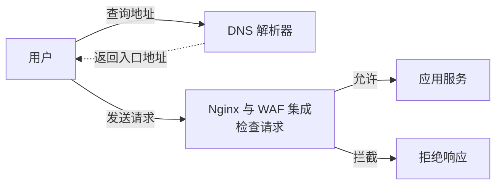

在入口安装并启用兼容 WAF 模块，请求进入 Nginx 后由模块检查；仅写规则不会自动执行。[F5 安装说明](https://docs.nginx.com/waf/install/virtual-environment/)

### HTTPS 内容为什么能检查？

入口终止 TLS 后，WAF 才能检查 HTTP 内容；仅透传 TLS 时看不到加密内容。入口到源站可再建立 HTTPS 连接。

### 安装在哪里？ {#waf-deployment}

- **云托管：** 厂商运行 WAF，关联其支持的 CDN、负载均衡等入口。
- **自建：** 在主机、代理或容器中安装 WAF；普通 Nginx 不自带 F5 WAF 模块。
- **防绕过：** 源站只允许可信入口访问，同时保留受控的运维通道。

### 一次请求怎样被检查？ {#waf-flow}

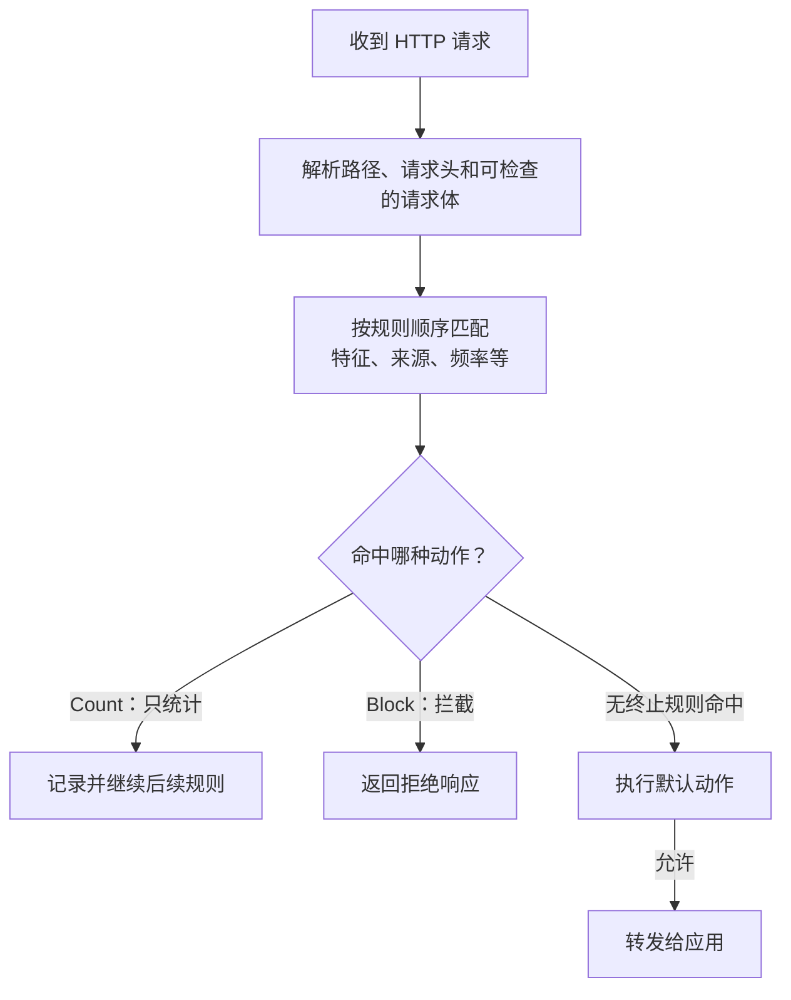

实际规则顺序、动作和限制以产品为准。**Count 不等于最终一定放行**：后续规则仍可能拦截。请求体有检查大小上限，大文件或超限内容的处理需要单独配置；WAF 可能误拦正常输入，也可能漏掉攻击。[动作语义](https://docs.aws.amazon.com/waf/latest/developerguide/web-acl-rule-group-override-options.html)、[请求体检查限制](https://docs.aws.amazon.com/waf/latest/developerguide/web-acl-setting-body-inspection-limit.html)

### 实际案例：阿里云 WAF 的 CNAME 接入 {#waf-cname-example}

**WAF 提供接入 CNAME，后台配置源站地址；用户仍访问业务域名。** 案例：[阿里云 WAF 3.0 CNAME 接入](https://help.aliyun.com/zh/waf/web-application-firewall-3-0/user-guide/add-a-domain-name-to-waf-in-cname-record-mode/)。

先认识三个地址，下面均为示意值，不能直接用于实际部署：

| 名称 | 示例 | 谁使用 | 作用 |
| --- | --- | --- | --- |
| 业务域名 | `api.example.com` | App / 浏览器 | 用户一直访问的地址 |
| WAF 接入 CNAME | 控制台生成的专用域名 | DNS 解析器 | 帮业务域名找到 WAF 的入口地址 |
| 源站地址 | `203.0.113.10:443` | WAF | 检查通过后连接你的 Nginx；示例 IP 是文档保留地址 |

```mermaid
sequenceDiagram
    participant C as 手机 / 浏览器
    participant D as DNS 解析器
    participant W as 云 WAF
    participant N as 源站 Nginx
    C->>D: 查询 api.example.com
    Note over D: 按 CNAME 查找 WAF 接入域名<br/>再解析出 WAF 入口 IP
    D-->>C: 返回 WAF 入口 IP
    C->>W: HTTPS 请求 api.example.com
    Note over W: 根据业务域名找到对应配置<br/>执行安全规则
    W->>N: 允许后，向配置的源站地址转发
    N-->>W: 返回响应
    W-->>C: 返回响应
```

- DNS 只返回地址，不转发业务请求。
- App 继续访问 `https://api.example.com`；WAF 入口证书须覆盖该域名。
- WAF 到 Nginx 是**代理回源**，通常不是让浏览器收到 301 / 302 跳转。

**控制台操作顺序：**

1. **准备：** 业务域名的 DNS 管理权限、WAF 实例、可访问的 Nginx 源站及 HTTPS 证书；记录原 DNS 以备回退。
2. **添加域名：** 控制台选择实例区域和 CNAME 接入，添加 `api.example.com` 并验证域名所有权。
3. **配置回源：** 设置 HTTPS 监听与证书，填写源站地址、端口和回源协议。
4. **测试并切换：** 按官方指引在本机验证，确认回源正常后，将业务域名的 DNS 指向 WAF 生成的 CNAME。
5. **检查并收口：** 核对 WAF 和 Nginx 日志；按厂商回源 IP 限制源站入站，保留受控运维入口。

**易错点：**

- 回源域名不要填写已指向 WAF 的业务域名，避免循环；HTTPS 回源需核对源站证书、Host 和 SNI。
- DNS 切换受 TTL 和缓存影响；检查同名 CNAME 与其他记录的兼容性。
- 厂商回源 IP 可能变更，需同步更新源站访问规则。[接入与验证步骤](https://www.alibabacloud.com/help/en/waf/web-application-firewall-3-0/add-a-domain-name-to-waf-in-cname-record-mode)

```bat
nslookup api.example.com
curl.exe -i https://api.example.com/health
```

`nslookup` 只检查 DNS；回源和规则是否生效还需查看 WAF、Nginx 日志。`/health` 须替换为实际接口。

### 另一种接入：在 AWS 入口绑定 WAF {#waf-config}

以**已有测试用 Application Load Balancer（ALB）**为例，使用 AWS WAF 控制台。这个过程配置的是云服务，不是在 `nginx.conf` 中添加指令。

1. 创建 Web ACL，选择与 ALB 相同的区域，将测试 ALB 关联到该 Web ACL；确认默认动作为 Allow。
2. 添加 AWS 托管规则组，例如 `AWSManagedRulesCommonRuleSet`；初次评估时将**规则组内各条规则的动作**覆盖为 Count，开启指标和日志。
3. 用自己的正常业务请求进行测试，检查命中规则、路径与误报；按需调整规则或限定例外范围。
4. 对验证过的规则逐步恢复其原有动作，观察拦截率、误报和业务错误；保存回滚方案。

规则组整体结果覆盖为 Count 与逐条规则覆盖不同：前者仍可能在组内第一条终止规则处停止评估，因此不适合完整观察所有规则。Count 也不能抵消 Web ACL 内其他拦截规则。日志可能包含敏感请求信息，应限制访问并配置保留策略。具体费用、规则版本和区域支持以云厂商页面为准。[AWS 托管规则](https://docs.aws.amazon.com/waf/latest/developerguide/waf-rule-statement-type-managed-rule-group.html)、[覆盖动作的区别](https://docs.aws.amazon.com/waf/latest/developerguide/web-acl-rule-group-override-options.html)

## 7. CDN、负载均衡、API 网关怎样分工 {#roles}

**CDN** 是内容分发网络，将可缓存内容放到更靠近用户的边缘；**负载均衡**在多个实例之间分配流量；**API 网关**在入口实施路由、认证接入、配额和统一策略。

这些职责可由一个产品组合承担，也可分层部署；不是每个项目都必须同时买三个系统。缓存命中、限流拒绝和真正进入应用的请求分别计数，否则 QPS（每秒请求数）看起来相同，实际后端负载却不同。

DNS 可以帮助选择入口地址，但受缓存和 TTL 影响，不能替代每次请求的实时后端健康选择。部署中各层都要有自己的日志与观测点，才能判断请求停在哪一层。

### 常见运维与安全组件地图 {#operations-map}

```mermaid
flowchart LR
    U[用户] --> D[DNS 解析] --> C[CDN / 边缘入口]
    C --> W[WAF 检查] --> LB[负载均衡] --> GW[API 网关]
    GW --> APP[应用实例] --> DB[数据库 / Redis]
    APP -. 指标 / 日志 / 链路 .-> O[监控与告警]
    LB -. 指标 / 日志 .-> O
    W -. 命中日志 .-> O
```

这是帮助记忆的示例，实际系统可能合并、调整或省略某些组件，云 WAF 也常集成在 CDN 或负载均衡中。

| 组件 | 主要负责 | 常见例子 |
| --- | --- | --- |
| 网络防火墙 / 安全组 | 控制 IP、端口和协议层面的进出流量 | 云安全组 |
| DDoS 防护 | 缓解大规模流量或请求造成的资源耗尽 | 云厂商抗 DDoS 服务 |
| WAF | 按 HTTP 请求内容和规则检查 Web 流量 | AWS WAF、F5 WAF for NGINX |
| CDN / 负载均衡 / API 网关 | 内容分发、多实例分流、接口入口治理 | 云 CDN、Nginx、云 API 网关 |
| 可观测与告警 | 指标看趋势，日志看事件，链路追踪跨服务请求 | Prometheus、OpenTelemetry |
| 部署与配置管理 | 发布版本、管理实例和回滚 | CI/CD、容器与 Kubernetes |

例如：登录接口错误率升高时，先看监控和告警，再结合 WAF 命中日志、网关日志与请求链路定位；不要仅凭某一层的 403 就断定原因。[OpenTelemetry 信号](https://opentelemetry.io/docs/concepts/signals/)

## 8. 动手与自测 {#check}

有自己的 nginx 环境时，先按[部署篇的配置检查方法](./deployment.html#reverse-proxy)验证替换后的模板；再给两个上游增加不同的实例标识日志，观察多次请求和停止一台后的行为。没有 nginx 时只做模型与配置阅读，不把课程 Python 服务称为已经跑通负载均衡。

1. 一条 HTTP/2 连接上有很多请求，为什么“连接少”不能保证实例负载轻？
2. `least_conn`、权重和一致性哈希分别依据什么？它们会不会自动复制 Session？
3. 为什么被动健康判断不能保证第一个用户不会遇到故障？
4. POST 已提交、响应超时后，换一台重发有什么风险？
5. CDN 命中大量请求时，入口 QPS 与应用 QPS 应怎样区分？

继续：[实时通信与消息协议](./realtime.html)、[QPS、容量与可观测性](./capacity-observability.html)；查术语用[网络通信术语速查](./glossary.html)。
